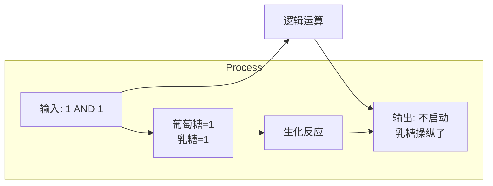
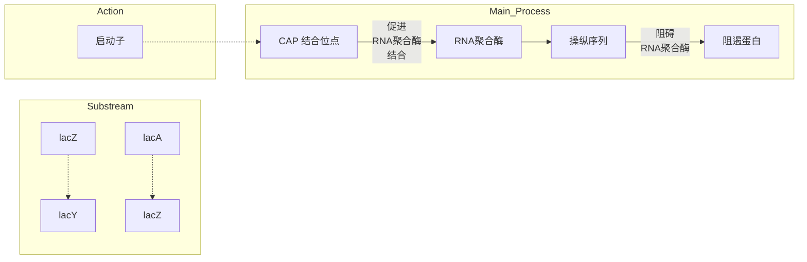

度大约就在微米到纳米之间，在这样的时空尺度下，反应受到溶液中分子无规则热运动的显著影响，随机规律将发挥重要的作用。借助概率与统计的思想方法，可以定量地刻画这种随机规律，探索其背后的生物学机制。

历史上最早的随机定量生物物理学大概可以追溯到20世纪初，由阿尔伯特·爱因斯坦（Albert Einstein，1879—1955）推导出定量刻画布朗运动的数学规律，并被法国物理学家让·皮兰（Jean Baptiste Perrin，1870—1942）首次在实验上证实，最终确认了分子和原子的存在。到了21世纪，随着单分子和单细胞实验技术的突飞猛进，人们已经可以定量追踪到单个细胞内部精细的随机现象了，特别是荧光标记实验，可以高分辨率地记录下单个细胞内部一种或若干种分子的数目随时间的变化。在本节中，我们将看到科学家们如何把实验手段和定量模型结合起来，带来新的生物学发现。


<details>
<summary>line</summary>

| 时间 \((1/\beta m)\) | 蛋白质 (完整动力学) | 蛋白质 (简化动力学) | mRNA |
| --- | --- | --- | --- |
| 0 | 0 | 0 | 0 |
| 10 | ~6.5 | ~7.2 | ~1.0 |
| 20 | ~8.2 | ~8.8 | ~1.0 |
| 30 | ~9.2 | ~9.6 | ~1.0 |
| 40 | ~9.8 | ~9.9 | ~1.0 |
| 50 | ~10.1 | ~10.1 | ~1.0 |
| 60 | ~10.2 | ~10.2 | ~1.0 |
</details>

图18-12 蛋白质表达的动力学

蓝色曲线是考虑mRNA的动力学（灰线）后，蛋白质浓度随时间变化。橙色曲线是假设mRNA处于稳态后，求解方程式（18-21）所得。可以看到它与蓝线几乎重合。模拟所用的参数: $\alpha_{\mathrm{m}} = v = 1$ ，$\beta_{\mathrm{m}} = 1$ ， $\beta = 0.1$ 。

单细胞的表达调控是有随机性的。实验生物学家在2002年设计了两段一模一样的基因启动子序列，并通过质粒把它们分别整合在大肠杆菌环状DNA复制起点两侧等距的位置，但是其中一段启动子转录翻译出的是能发出绿色荧光的蛋白质，而另一段转录翻译出的则是能发出红色荧光的蛋白质（图18-13A）。如果单细胞内是没有随机性的，那么每个单细胞中两种蛋白质的表达量应当相等，它们发出同样强度的绿色和红色荧光，因此整个细胞显现黄色荧光；而如果单细胞内随机性显著，则可以看到有些细胞是发出绿色荧光，有些是发出黄光，而有些则是发出红光（图18-13B）。最终在显微镜下，单细胞发出了五彩斑斓的光芒，证实了其随机性的存在（图18-13C）。

(A)


<details>
<summary>flowchart</summary>


</details>

(B)


<details>
<summary>line</summary>

| Time | Fluorescence Intensity (Green) | Fluorescence Intensity (Red) |
| --- | --- | --- |
| Start | ~100 | ~100 |
| Peak 1 | ~125 | ~120 |
| Trough 1 | ~80 | ~60 |
| Trough 2 | ~75 | ~50 |
| Peak 2 | ~130 | ~125 |
| End | ~110 | ~95 |
</details>

(C)


<details>
<summary>natural_image</summary>

Close-up of green and yellow rod-shaped objects with no visible text or symbols
</details>


<details>
<summary>flowchart</summary>


</details>

图18-13 实验验证单细胞中的随机性

（A）大肠杆菌染色体示意图。编码发红色和绿色荧光的蛋白的基因分别被整合在复制起点两侧等距的位置。图中Mb指的是100万个碱基对，以此作为基因组上的长度单位。（B）单细胞中转录是否存在随机性会带来不同观测结果。假设不存在随机性，则如上图所示，所有大肠杆菌都呈现黄色；相反地，若存在随机性，则如下图所示，大肠杆菌会呈现出绿和红之间的多种颜色。（C）实际观察到大肠杆菌呈现多种颜色，证实了单细胞中转录随机性的存在。（C，引自Elowitz M B, et al. Science, 2002, 297(5584): 1183-1186）

## 18.3.1 最简单的基因转录模型

生物学中的中心法则，即DNA会自我复制，也可以转录成mRNA，mRNA又可以翻译成蛋白质的过程。这是一个由多种分子参与的化学过程，其状态可以由这些分子的个数来描述。在最简单的中心法则模型里，DNA只有一个分子，细胞状态就由mRNA分子个数 $m$ 和蛋白质分子个数 $n$ 来描述。而由于随机性，无法用一个确定的 $m$ 和 $n$ 来描述，取而代之的是用单细胞处于状态（$m, n$）的概率来描述，而模型描述的正是这个概率随时间的演变规律。这样的模型被称为化学主方程模型，其中主方程就是细胞状态的概率随时间的演变方程，通常为常微分方程组。

$$
\mathrm{DNA} \xrightarrow {k} \mathrm{mRNA} \xrightarrow {\gamma} \dots
$$

$$
(m - 1) \xrightarrow [ m \gamma ]{k} (m) \xrightarrow [ (m + 1) \gamma ]{k} (m + 1)
$$

图18-14 单基因无反馈转录模型

上图为一种最简单的基因转录模型的反应图。DNA生成mRNA，而每个mRNA分子都会被降解。下图是相应的状态跃迁图，这里状态指的是系统中的mRNA分子数。

先来讲一个最简单的基因转录模型（图18-14）。那就是一个DNA分子会生成mRNA分子，而这个mRNA分子又会降解，且不考虑转录因子等造成的反馈等因素。可以假设这两步都可以用一阶化学反应来刻画（图18-14，上）。此时这个模型里面的变量只有一个，即mRNA的分子数，于是就可以建立该单细胞内此mRNA分子个数为 $m$ 的概率 $P(m)$ 随时间的变化方程（图18-14，下）。状态从 $m$ 状态只可能转移到 $m - 1$ 状态或者 $m + 1$ 状态:从 $m$ 状态跳转到 $m - 1$ 状态就意味着这 $m$ 个mRNA分子里有1个分子发生了降解，每一个分子的降解速率为 $\gamma$ ，那么 $m$ 个分子的降解速率就为 $m\gamma$ ，这其实是质量作用定律的随机版本；从 $m$ 状态跳转到

$m + 1$ 状态，是因为DNA发生了一次转录，产生了一个新的mRNA分子，其速率为 $k$ 与现在细胞里的mRNA分子数 $m$ 无关。同样地，能够跳转到 $m$ 状态的也只有 $m - 1$ 和$m + 1$ 这两种状态。因此可以写下这个模型的化学主方程:

$$
\frac {\mathrm{d} P (m)}{\mathrm{d} t} = k P (m - 1) - k P (m) + (m + 1) \gamma P (m + 1) - m \gamma P (m) 。 \tag {18-24}
$$

当时间足够长之后，状态 $m$ 的概率不再随着时间改变，可以计算得到单细胞内 mRNA 分子数目的分布为

$$
P (m) = \frac {\left(\frac {k}{\gamma}\right) ^ {m}}{m !} \mathrm{e} ^ {- \frac {k}{\gamma}},
$$

恰是参数为  $k/\gamma$  的泊松分布（知识窗 18-2）。

泊松分布最大的特点是均值等于方差，即法诺因子（Fano factor，均值除以方差）等于1。但是有趣的是，2010年科学家测到的大肠杆菌内mRNA数量分布的法诺因子明显大于1（图18-15A），意味着上述模型并不是非常符合真实的情况。这就要引出来下面一个有关转录爆发现象的故事。

## 知识窗18-2

## 最简单基因转录模型中单细胞内 mRNA 分子数目的分布

在最简单基因转录模型(图 18-14)中，单细胞内mRNA 分子数的概率随时间的变化规律被式（18-24）刻画。因此当时间足够长之后，状态 m 的概率不再随着时间改变，也就意味着该方程右端等于 0，即

$$
k P (m) - (m + 1) \gamma P (m + 1) = k P (m - 1) - m \gamma P (m) 。
$$

需要注意到，这个等式对于  $m=1,2,3,\cdots$  都成立。特别地，对于 m=0 的情况，因为 mRNA 的数量只可能从 0 跳转到 1，或从 1 跳转到 0，不会出现 m=-1 的状态，所以这个等式最终化为

$$
\begin{array}{l} k P (m) - (m + 1) \gamma P (m + 1) = k P (m - 1) - m \gamma P (m) \\ = \dots = k P (0) - \gamma P (1) = 0, \\ \end{array}
$$

因此有

$$
k P (m) = (m + 1) \gamma P (m + 1) 。
$$

据此递推可以得到

$$
P (m) = \frac {\left(\frac {k}{\gamma}\right) ^ {m}}{m !} P (0),
$$

最后  $P(0)$  可由所有  $P(m)$  求和必须等于 1 来求得。


图 18-15 两状态无反馈转录模型和转录爆发机制

（A）大肠杆菌中137个高表达基因对应mRNA数量的法诺因子的分布，即每一个基因都可以计算其对应的单细胞mRNA数量分布的法诺因子值。（B）两状态基因开关模型的化学反应图，基因可以处于ON和OFF两个状态，当处于ON状态时可以转录出mRNA，且每个mRNA分子可以降解。（C）两状态基因开关随机模型的状态跃迁图，这里的状态可以用基因的状态和mRNA分子数来共同刻画。（D）拓扑异构酶和旋转酶结合情况对转录的影响示意图。拓扑异构酶能够消除DNA负超螺旋。旋转酶结合DNA时，正超螺旋也得以释放，转录激活；旋转酶不结合时，正超螺旋无法消除，转录停止。（A，数据自Taniguchi Y, et al. Science, 2010, 329(5991): 533-538; D，改编自Levens D, et al. Cell, 2014, 158(2): 241-242）

## 18.3.2 转录爆发现象与定量模型

2005年，世界上首次观测到了单个细胞中的单个mRNA分子的生成和降解现象，并且发现了一种名为转录爆发的现象。转录爆发，顾名思义，说的是DNA似乎存在着某种神奇的机制，它会使得即使在完全不存在抑制蛋白结合的情况下，DNA也会时不时地偷懒不工作，即停止转录，过一段时间后再重新开启。而这种DNA自身具有多种不同的转录状态的现象并未包括在前面所述的最简单的模型里。

早在20世纪90年代，就有学者提出了具有两个不同的DNA转录状态的随机模型，即俗称的二态模型（图18-15B、C）。

从数学上来看，这个模型可以用其状态概率 $p_{\mathrm{on}}(m;t)$ 和 $p_{\mathrm{off}}(m;t)$ 来刻画，它们分别表示 $t$ 时刻细胞内恰好有 $m$ 个 mRNA 分子且 DNA 正好处于 ON 或者 OFF 状态的概率，其随时间的演化方程，即化学主方程为:

$$
\begin{array}{l} \frac {\mathrm{d} p _ {\mathrm{on}} (m ; t)}{\mathrm{d} t} = k _ {1} p _ {\mathrm{on}} (m - 1; \mathrm{t}) + d _ {1} (m + 1) p _ {\mathrm{on}} (m + 1; \mathrm{t}) + a p _ {\mathrm{off}} (m; t) \\ - (k _ {1} + d _ {1} m + \beta) p _ {\mathrm{on}} (m; t), \\ \frac {\mathrm{d} p _ {\mathrm{off}} (m ; t)}{\mathrm{d} t} = d _ {1} (m + 1) p _ {\mathrm{off}} (m + 1; t) + \beta p _ {\mathrm{on}} (m; t) - (d _ {1} m + \alpha) p _ {\mathrm{off}} (m; t) _ {\circ} \\ \end{array}
$$

令上面两式右端等于零，可以算出平稳状态下 mRNA 数量的均值和方差，特别是法诺因子的表达式 $F = 1 + \frac{\alpha \beta k_1}{\beta (\alpha + \beta)(\alpha + \beta + d_1)}$，显然是大于 1 的。

因此，二态模型可以很好地解释实验里观测到的法诺因子大于1的现象。但是具体到转录爆发这件事情上，在没有抑制蛋白结合的前提下，DNA产生ON和OFF这两个状态的分子机制又是什么呢？这里的模型没有考虑转录因子等形成的反馈等机制，这是因为转录爆发现象，本来就是在几乎排除了所有调控蛋白的实验情况下看到的，这也是为什么这个现象背后的机制很长时间没有得到揭示的原因。

在2011年左右，人们发现即使是在细菌中，DNA分子也不是自由的，它们会被一段一段地锚定在一些大的蛋白质分子上。早在20世纪80年代，人们就发现在DNA转录的过程中，处于RNA聚合酶前方的DNA链将聚集正超螺旋（positive supercoil），通俗来讲DNA双螺旋结构原本是每10.5个碱基对转一圈（360°）的，而现在被转得越来越紧，每转一圈的碱基对数目越来越少，DNA形变越来越厉害了；与此相对应的，处于RNA聚合酶后方的DNA链将产生负超螺旋（negative supercoil），即完成一圈的碱基对数目越来越多。这两种DNA形变由于DNA被锚定在一些大分子上而无法相互抵消，从而影响对应基因转录的能力。因此细胞内需要有两种酶，拓扑异构酶IA（topoisomerase IA）专门负责在RNA聚合酶的后方释放负超螺旋，而旋转酶（gyrase）则专门负责在RNA聚合酶的前方释放正超螺旋。研究表明，拓扑异构酶的活性是很高的，然而旋转酶的活性是不高的，而且旋转酶在活细胞内的分子数也并不十分多，

## 知识窗18-3

## 转录爆发模型中的零膨胀泊松分布及其应用

在二态模型（图18-15B、C）中，如果不同基因状态间的转换速率，即 $\alpha$ 和 $\beta$ ，远小于 $k_{1}$ 和 $d_{1}$ ，则先可以简单认为基因不同状态间是断开的。于是，当基因处于ON态的时候，就等同于图18-14里的最简单模型，因此mRNA分子数的平稳分布为参数 $\frac{k_1}{d_1}$ 的泊松分布；而当基因处于OFF态时，由于只能降解不能生成，所以最后mRNA分子数就只能都在0。最后，因为两个基因状态间的转换速率 $\alpha$ 和 $\beta$ 并不依赖于mRNA的分子数，所以基因处于ON态的概率为 $\frac{\alpha}{\alpha + \beta}$ ，处于OFF态的概率为$\frac{\beta}{\alpha + \beta}$ 。把以上这些分析结合到一起，就可以得到该二态模型中mRNA分子数的分布可以近似为

$$
P (m) = \frac {\alpha}{\alpha + \beta} \frac {\left(\frac {k _ {1}}{d _ {1}}\right) ^ {m}}{m !} \mathrm{e} ^ {- \frac {k _ {1}}{d _ {1}}}, \quad m > 0 \text {时};
$$

$$
P (0) = \frac {\alpha}{\alpha + \beta}   \mathrm{e} ^ {- \frac {k _ {1}}{d _ {1}}} + \frac {\beta}{\alpha + \beta}, \quad m = 0 \text {时。}
$$

这就叫零膨胀的泊松分布。

在活细胞里，平稳分布是可以测量到的，且符合零膨胀泊松分布成立的条件，因此就可以通过数据拟合而得到 $\frac{k_{1}}{d_{1}}$ 和 $\frac{\alpha}{\beta}$ 。另一方面，实验里 $\alpha$ 是可以通过增加旋转酶的浓度或者改变旋转酶结合位点的结合强度等方式来调节的。于是就可以利用实验和数学模型的结合来验证转录爆发的机制是不是由于旋转酶与DNA的结合和解离造成的，即控制 $\alpha$，看是否和实验数据拟合得到的 $\frac{\alpha}{\beta}$ 的趋势相一致。

平均到每一段被铆定的 DNA 片段只有大约一个旋转酶分子。

有鉴于此，2014年，把高通量的体外单分子荧光技术和两状态模型相结合，人们最终发现，细菌里的转录爆发机制，来源于旋转酶分子与DNA分子的不断随机结合与解离，从而导致该DNA片段的超螺旋情况发生改变。当旋转酶结合DNA时，DNA前方的正超螺旋释放，相应基因得以被转录；当旋转酶与DNA解离时，无法释放的正超螺旋带来的DNA形变将阻碍转录的进行（图18-15D；知识窗18-3）。这是二态模型能够解释法诺因子大于1这一现象的生物学基础。

## ※ 本章小结

在本章我们看到，生命活动中的基础过程——酶促反应、基因表达，都可以用简单的数学语言进行定量的描述。从酶与底物的结合，到蛋白质的修饰，再到基因的转录与mRNA的翻译，我们将生物大分子之间的相互作用抽象为一个个基本的结合-解离过程的组合，用一组组常微分方程准确地刻画它们稳态和瞬态的性质。当然，常微分方程并不适用于所有的生物过程:当我们考虑的体系较小、分子数较少时，系统的随机性较大，此时就需要加入对概率的考虑。利用化学主方程等工具，我们既可以看到生命过程的“平均结果”，也能考察噪声会为系统带来怎样的波动。

这些基于质量作用定律的数学模型，既向我们展示了中心法则背后的数学关系，也为我们提供了推断微观生物过程的有力武器。无论是希尔方程中的希尔系数，还是 mRNA 数量分布的法诺因子，都体现着实验手段与定量数据结合的重要意义。在下一章中，我们将以这些简单的数学模型作为基石，分析更为复杂的生物网络，进一步体会定量描述为生命科学研究所注入的强大活力。

## ※ 思考题

1. 试估算一个典型的大肠杆菌细胞中总的蛋白质数量。（提示:大肠杆菌中蛋白质的体积密度为 $0.2\mathrm{g / mL}$，典型的蛋白质长度为300个氨基酸，而平均每个氨基酸的分子量为 $100\mathrm{Da}$。）
2. 试推导竞争性抑制情形下酶促反应速率公式（18-3）。
3. 如果在模型图18-14中加入mRNA生成蛋白质的过程，以及蛋白质的降解过程，在没有任何反馈机制的情况下，请计算出单细胞中蛋白质分子数目的均值和方差，以及单细胞中mRNA数目和蛋白质分子数目的相关系数。

## ※ 扩展阅读

## 图书

Alon U. An introduction to systems biology: design principles of biological circuits[M]. 2nd ed. Boca Raton: CRC Press, 2019.

Segel I H. Enzyme kinetics: behavior and analysis of rapid equilibrium and steady state enzyme systems[M]. New York: Wiley, 1975.

## 研究论文

Chong S S, Chen C Y, Ge H, et al. Mechanism of transcriptional bursting in bacteria[J]. Cell, 2014, 158(2):314–326.

Elowitz M B, Levine A J, Siggia E D, et al. Stochastic gene expression in a single cell[J]. Science, 2002, 297(5584):1183–1186.

Goldbeter A, Koshland D E Jr. An amplified sensitivity arising from covalent modification in biological systems[J]. Proc Natl Acad Sci USA, 1981, 78(11):6840-6844.

Monod J, Changeux J P, Jacob F. Allosteric proteins and cellular control systems[J]. J Mol Biol, 1963, 6(4):306–329.

Monod J, Wyman J, Changeux J P. On the nature of allosteric transitions: a plausible model[J]. J Mol Biol, 1965, 12(1):88–118.

Taniguchi Y, Choi P J, Li G W, et al. Quantifying E. coli proteome and transcriptome with single-molecule sensitivity in single cells[J]. Science, 2010, 329(5991):533-538.

## 生物网络的动力学模型

当我们深入探索生物系统的奥秘时，生物网络的动力学模型成为解读复杂生命互动的关键工具。生物体内的各种分子、基因、蛋白质以及它们之间错综复杂的关系形成了一张庞大的网络，维系着生命的正常运转。

从代谢反应到基因调控，这些相互关联的元素在空间和时间上交织着，创造出生物网络的复杂拓扑结构。

在本章中，我们将探讨生物网络的动力学模型的基础，包括网络的基本知识和矩阵表征、前馈和反馈网络的定义、生物网络的拓扑结构与其功能之间的密切关联。通过对生物网络的动力学探索，我们将展示数学模型如何帮助我们更全面直观地理解生物系统的运作原理。

## 19.1 网络的基本知识和矩阵表征

生物的复杂性很大程度上源于无处不在的相互关联。例如，在三羧酸循环中，乙酰辅酶A与草酰乙酸结合，由柠檬酸合酶催化生成柠檬酸，当柠檬酸合酶被抑制时，会导致柠檬酸的产率降低，底物的浓度升高；又如，转录因子p53蛋白的入核或出核直接影响其下游靶基因如Bax、p21等的表达水平，进而调控细胞周期和凋亡；再如，肠道中乳酸菌通过分泌乳酸抑制大肠杆菌等竞争者的生长，同时也影响宿主的肠道环境。

这些关联在生物系统中相互交织，形成了一张张密集复杂的大网，维持着生命系统的正常运行，也为研究者们带来挑战。

生物网络是对这些关联性的建模。在基于图论的抽象中，网络由节点（node）和边（edge）构成。其中，节点可以是系统中任何参与了关联的实体，例如基因、蛋白质、细胞和物种；边则连接起相互关联着的节点。研究中常见的生物网络中，边所代表的关联性可以有多种类别，例如:

① 直接物理交互:蛋白质-蛋白质相互作用网络（protein-protein interaction network）是生物网络的典型代表，其中无向的边连接着彼此接触的蛋白质（图19-1A）。

② 相关性:从繁杂数据中计算相关性是寻找因果性的前置步骤，网络可以用来刻画这类并不反映直接相互作用的关联。例如，基因间表达的相关性体现为共表达网络（co-expression network），微生物在群落中的体现为共现性网络（co-occurrence network）。这些网络中，无向的边连接了丰度变化显著偶联着的基因或微生物（图19-1B）。

③ 流入和流出:代谢网络（metabolic network）中，代谢产物可以用节点表示，而边从底物出发指向产物，代表了相关的化学反应（图 19-1C）。

④ 调控:在代谢网络中，酶指向代表了其催化的反应的边；在基因调控网络（gene regulatory network）中，边从转录因子指向下游靶基因，代表激活或抑制的转录调控（图19-1D）。

邻接矩阵（adjacency matrix）是网络最直观的数学表征之一。对于一个由 $N$ 个节点构成的网络，其邻接矩阵 $M$ 的大小为 $N \times N$ 。其中，第 $i$ 行第 $j$ 列的元素 $M_{ij}$ 可以用来表示第 $i$ 个节点指向第 $j$ 个节点的边，其值可以用来表示相互作用的种类和权重。

图19-1 生物网络的不同例子第一行表征生物实体，第二行表示相应的网络简化。


上文关联类别1（直接物理交互）和类别2（相关性）的网络中，节点 $i$ 和节点 $j$ 之间的关联并不具有方向性。表征这类无向网络的邻接矩阵是对称的（图19-2A、B）。而表征上文关联类别3（流入和流出）和类别4（调控）的网络中，具有方向性的箭头从节点 $i$ 指向节点 $j$ ，带来非对称的邻接矩阵（图19-2C）。

生物网络的拓扑（topology）与其功能紧密相连。拓扑是节点和边在网络中的排列方式，是网络最基本的属性。

对于生物网络，一些最常用的拓扑性质和概念包括:

（1）度（degree）是连接到一个节点的边的数量。有向网络中，节点的度有两个值:出度（outdegree）表示从节点出发的边的数量，入度（indegree）表示进入节点的边的数量。基因调控网络中，诸如p53之类的“主控调节因子”（master regulator）往往具有很高的出度。
（2）路径（path）是指通过边连接的一系列节点。例如图19-2C中，就存在一条从A指向E的，经过了节点B、C、D的路径。

## 19.2 基因调控

生物体对环境的合理响应是生命的典型特征之一。对于单细胞生物而言，精准而合理的适时响应尤为重要，因为它们需要根据外界信号来调节自身基因表达及行为功能，以确保生存、促进生长。这种信号影响细胞中基因表达的过程，我们称之为基因调控。

在基因调控中，细胞可被看作一个“输入-计算-输出”的计算机。输入信号可

图19-2 生物网络的矩阵表征

（A）一个不考虑作用强度的蛋白质-蛋白质相互作用网络可以用一个二进制对称矩阵表示。其中， $M_{ij}=M_{ji}$ ，其值1和0分别表示蛋白质i和j之间作用的存在和不存在。（B）一个侧重于丰度偶联的微生物共现性网络可以用一个有权重的对称矩阵表示。其中 $M_{ij}=M_{ji}$ ，其值表征了微生物i和j丰度的相关系数。相关系数低于阈值的边已被移除。（C）一个不考虑调控强度的基因调控网络可以用一个非对称的矩阵表示。其中， $M_{ij}$ 的1、-1、0分别代表了基因i对基因j的激活、抑制、不存在相互作用。


<details>
<summary>flowchart</summary>


</details>

图19-3 以计算机类比细胞的基因调控

以来自环境中的化学物质、温度、光照等因素。在细胞接收到这些信号后，它会通过一系列复杂的生物化学作用进行“计算”，最终“输出”为特定基因的活化或抑制，从而影响细胞的行为和功能（图19-3）。

## 19.2.1 布尔逻辑简介

布尔逻辑是现代计算科学的基石。当谈到布尔逻辑时，我们在讨论一种逻辑系统，它只有两个基本值（也叫作布尔值）——真（TRUE）和假（FALSE），可以被简单地记为1和0。这种简单

的二进制状态可以用来描述各种情况和关系，类似于生物体中常见的ON（开启）和OFF（关闭）状态。事实上，生命系统中二态系统的普遍性（参见14.2.3节），也是生物体系可以和计算机类比的重要原因。

布尔逻辑形成了一组基本的逻辑运算规则，用于组合和操作这些TRUE和FALSE的值，从而产生多样的逻辑结果。

以下是布尔逻辑的基本运算规则:

① “与”运算（AND）:如果两个条件都为真，则结果为真；否则为假。在生物体中，可以将这种与运算类比为:两个分子必须同时处于激活状态，才能触发特定的生理响应。
② “或”运算（OR）:如果至少一个条件为真，则结果为真；否则为假。这可以类比为生物体中作用于同一靶点的多个转录因子中的任何一个处于激活状态，都足以启动靶点基因的转录。
③ “非”运算（NOT）:若输入为真，结果为假；若输入为假，则结果为真。在生物体中，这可以理解为某个抑制子的状态由激活变为失活，才能启动其下游基因的转录。

这些基本的规则可以通过逻辑门（logic gate）——与门（AND gate）、或门（OR gate）、非门（NOT gate）来实现。逻辑门将一个或多个输入值转换为一个输出值，从而执行特定的逻辑运算。在生物体内，分子的状态转变和相互作用可以类比为逻辑门的操作，这些操作使复杂的基因调控和生物反应得以实现。

布尔逻辑的运作可以通过真值表来清晰地表示。真值表列出了不同输入组合下的逻辑运算结果，它有助于我们理解布尔逻辑在不同条件下的行为。在生物体内可以类比为不同的分子状态（如活跃和不活跃）作为输入，通过生物化学作用进行逻辑运算，最终影响细胞的功能和行为（也就是输出）。

以与门为例，假设我们有两个输入，称为A和B，它们可以是真（TRUE，1）或假（FALSE，0）。下面是与门的真值表:

| 输入A | 输入B | 输出 |
| --- | --- | --- |
| 1 | 1 | 1 |
| 1 | 0 | 0 |
| 0 | 1 | 0 |
| 0 | 0 | 0 |

通过使用布尔逻辑描述生物体内分子状态的变化，我们可以更好地理解细胞如何对环境信号作出合理的响应。生物体内的“计算”为细胞在不断变化的环境中做出准确的决策提供了基础。

## 19.2.2 乳糖操纵子简介

大肠杆菌中对乳糖的响应就是一个“细胞根据环境信号计算基因表达的输出”的典型例子。乳糖操纵子的调控是第一个被清楚理解的基因调控机制，它的发现者弗朗索瓦·雅各布（François Jacob，1920—2013）和雅克·莫诺（Jacques Lucien Monod，1910—1976）于1965年被授予诺贝尔生理学或医学奖。这也是基因调控领域的首个诺贝尔奖。

对碳源的有效利用是大肠杆菌等肠杆菌科细菌的重要特征，帮助其在诸多不同的环境中生存。为了利用环境碳源中常见的乳糖（lactose），大肠杆菌基因组中三个与

乳糖分解、转运和代谢相关的基因共用一个启动子并共同表达，它们与相关的调控序列一起构成乳糖操纵子（lac operon）（图19-4）。然而，尽管能够利用乳糖，但大肠杆菌更喜欢用葡萄糖作为碳源，因为葡萄糖代谢比乳糖代谢所需要的步骤和能量更少。为了优化细胞内有限资源的分配，乳糖操纵子仅在环境中缺乏葡萄糖但存在乳糖时才会被激活。如果继续将细胞类比于一个小小的计算机，这个过程中，它是如何进行以葡萄糖和乳糖的浓度为输入信号，以乳糖操纵子的活性为输出结果，用胞内的化学反应网络进行合理“计算”的呢？


<details>
<summary>flowchart</summary>


</details>

图 19-4 乳糖操纵子的图示

其中，启动子为转录所必需的RNA聚合酶提供结合位点，而乳糖阻遏蛋白在操纵序列上的结合则会阻碍RNA聚合酶的结合。

## 19.2.3 乳糖阻遏蛋白介导的负性调控

让我们进入这个基因调控领域首个诺贝尔奖成果的具体细节。首先，乳糖阻遏蛋白由lacI基因转录，它不属于乳糖操纵子的一部分，因而可以独立于乳糖操纵子而被单独持续地表达。当环境中不存在乳糖时，乳糖阻遏蛋白紧紧地结合在乳糖操纵子的启动子区域下方的操纵序列（operator）上，阻止RNA聚合酶与乳糖操纵子的启动子结合，从而抑制整个操纵子的转录（图19-5A）。当环境中存在乳糖时，一部分乳糖进入细胞并被转化为异乳糖（allolactose）。异乳糖和阻遏蛋白结合，改变其构象使之不再能结合DNA，从而停止了其对乳糖操纵子的抑制（图19-5B）。由此，以阻遏蛋白的构象变化为媒介，细胞实现了乳糖操纵子基因表达活性随外界乳糖浓度的变化。


图 19-5 乳糖阻遏蛋白介导的负性调控（A、B）和这个过程的逻辑描述（C）

黑色箭头代表激活，逻辑运算中为“等同”。红色圆头线代表抑制，逻辑运算中为“非门”。

这个过程如何用布尔逻辑来简洁地描述呢？在最简单的模型中，我们可以把胞外乳糖的浓度（[lac]）用布尔值（1和0）表示， $[\mathrm{lac}] = 1$ 对应高浓度状态， $[\mathrm{lac}] = 0$ 对应低浓度状态。胞外乳糖浓度直接影响细胞内异乳糖的布尔值: $[\mathrm{allo}] = [\mathrm{lac}]$ 。这是一个最简单的布尔函数: $[\mathrm{lac}] = 1$ ，则 $[\mathrm{allo}] = 1$ ； $[\mathrm{lac}] = 0$ ，则 $[\mathrm{allo}] = 0$ 。

而阻遏蛋白的活性（活性的布尔值记为 [R]）则是对异乳糖浓度的非门计算: $[R]=NOT([allo])$ 。这意味着， $[allo]=1$ ，则  $[R]=0; [allo]=0$ ，则  $[R]=1$ 。

再接下来，在环境中葡萄糖浓度不高时，乳糖操纵子的启动子活性（[lacP]）又是对阻遏蛋白活性的非门: $[\mathrm{lacP}] = \mathrm{NOT}([R])$ 。依次代入刚才得到的[R]和[allo]、[allo]、[lac]之间的关系，我们可以得到乳糖操纵子启动子活性作为胞外乳糖浓度的逻辑函数:

$$
\left[ \mathrm{lacP} \right] = \mathrm{NOT} (\mathrm{NOT} ([ \mathrm{lac} ]))
$$

根据布尔逻辑，两个非门会在叠加后消失，让这个函数的输入直接等于输出，即

$$
\left[ \mathrm{lacP} \right] = \left[ \mathrm{lac} \right]
$$

这形象地表示了为什么阻遏蛋白是一个转录抑制子（对基因转录有负性调控作用），而乳糖对乳糖操纵子起激活作用——两个非门相互抵消。生物调控网络中，这个规律也是普遍的:两个串联的抑制等同于激活。

## 19.2.4 分解代谢物基因激活蛋白介导的正向调控

然而，大肠杆菌还需要进行另一个计算:环境中是否存在葡萄糖？如前所述，葡萄糖是大肠杆菌所偏爱的碳源，当它与其它糖类同在环境中时，细胞会优先表达和葡萄糖转运代谢有关的基因，而暂不启动对包括乳糖在内的其它碳源的利用程序。


图19-6 CAP介导的正向调控和这个过程的逻辑描述

这一对于葡萄糖浓度的计算由分解代谢物基因激活蛋白（catabolite gene activator protein，CAP）介导。CAP 是一个常量表达的转录调控蛋白质，当其与 DNA 结合时，能协助 RNA 聚合酶与启动子的结合。CAP 调控了包括了乳糖操纵子在内的上百个和能量代谢相关的基因簇，但它仅在与小分子环腺苷酸（cyclic adenosine monophosphate, cAMP）结合时才具有 DNA 结合活性。小分子 cAMP 则是细胞对饥饿的响应信号，随葡萄糖浓度的降低而升高。于是，仅有当葡萄糖浓度足够低时，升高的 cAMP 才会激活大量的 CAP 结合乳糖操纵子前端的调控序列，协助其转录（图 19-6A、B）。

这个过程用布尔逻辑描述，就是:cAMP 的浓度 [cAMP] 是细胞外葡萄糖浓度 [glu] 的非门，即 [cAMP] = NOT ([glu])；从这里开始，逻辑计算就都是直接赋值的“等同”了，也就是 CAP 活性 [CAP] = [cAMP]，乳糖操纵子启动子活性 [lacP] = [CAP]（在乳糖充分的情况下）。

代入上述结果，我们可以得到乳糖操纵子启动子活性关于胞外葡萄糖浓度的逻辑函数（图19-6C，在存在乳糖的情况下）:

$$
[ \mathrm{lacP} ] = \mathrm{NOT} ([ \mathrm{glu} ])
$$

这是对葡萄糖浓度的取“非”，也体现了生物调控网络中的另一个普遍规律:一条路径上若存在单数个抑制箭头，则该路径起抑制效果。

## 19.2.5 大肠杆菌乳糖代谢的组合逻辑

综合之前两个小节的内容，我们已经知道了阻遏蛋白介导的乳糖浓度对乳糖操纵子的激活的逻辑 $[\mathrm{lacP}] = \mathrm{NOT}([R])$ （在缺乏葡萄糖的情况下），和通过CAP介导的葡萄糖对乳糖操纵子的抑制 $[\mathrm{lacP}] = [\mathrm{CAP}]$ （在存在乳糖的情况下）。而细胞的糖代

黑色箭头代表激活，逻辑运算中为“等同”。红色圆头线代表抑制，逻辑运算中为“非门”。

谢策略既然受到葡萄糖和乳糖的共同影响，那么，在将乳糖和葡萄糖都作为输入时，乳糖操纵子的活性应该是一个什么样的布尔函数？

19.2.1节中已介绍过，由两个输入A和B得到的输出C，有两种逻辑:与（AND）和或（OR）。这两个逻辑的主要区分在于 $\mathrm{A} = 1$ 、 $\mathrm{B} = 0$ （或 $\mathrm{A} = 0$ 、 $\mathrm{B} = 1$ ）时的输出:对与门， $\mathrm{C} = \mathrm{A}$ AND B，输出为0；对或门， $\mathrm{C} = \mathrm{A}$ OR B，输出为1。

对应到以“阻遏蛋白不结合”（NOT（[R]））和“CAP激活”（[CAP]）为输入的乳糖操纵子，决定组合逻辑的关键就是:当阻遏蛋白结合（[R]=1）且CAP也激活结合时（[CAP]=1），时，[lacP]究竟是1还是0？

如果是1，则组合逻辑为“或”:

$$
\left[ \mathrm{lacP} \right] = \left[ \mathrm{CAP} \right] \mathrm{OR} (\mathrm{NOT} (\left[ \mathrm{R} \right])) = (\mathrm{NOT} (\left[ \mathrm{glu} \right])) \mathrm{OR} \left[ \mathrm{lac} \right]
$$

这意味着，“没有葡萄糖”和“存在乳糖”，这两个条件只需满足其一，则乳糖操纵子开始可以启动。如果环境中同时存在乳糖和葡萄糖，则乳糖操纵子会被表达；如果环境中没有葡萄糖也没有乳糖，乳糖操纵子也会被表达。这种情况不符合前人实验的观察——即使没有阻遏蛋白的抑制，RNA聚合酶仅是较弱地结合乳糖操纵子的启动区，难以将操纵子彻底激活。为了使糖类代谢效率最高，大肠杆菌仅在“没有葡萄糖”并且“存在乳糖”这两个条件同时满足的情况下，才启动乳糖操纵子的转录。

由此可知，野生型大肠杆菌乳糖操纵子在整合信号时采用的是“与”的组合逻辑:

$$
\left[ \mathrm{lacP} \right] = \left[ \mathrm{CAP} \right] \text {AND} (\mathrm{NOT} (\left[ \mathrm{R} \right])) = (\mathrm{NOT} (\left[ \mathrm{glu} \right])) \mathrm{AND} \left[ \mathrm{lac} \right]
$$

如图19-7所示，“与”的逻辑保证了，细胞仅在“葡萄糖浓度低”并且“乳糖浓度高”时启动乳糖代谢的途径。

逻辑计算可以用真值表来表示，这个系统输入—计算—输出的真值表如下表所示:

| 葡萄糖 | 乳糖 | CAP | 阻遏蛋白 | 转录活性 |
| --- | --- | --- | --- | --- |
| 1 | 0 | 0 | 1 | 无活性 |
| 1 | 1 | 0 | 0 | 低活性 |
| 0 | 0 | 1 | 1 | 无活性 |
| 0 | 1 | 1 | 0 | 高活性 |


<details>
<summary>flowchart</summary>

```mermaid
graph TD
  subgraph Input
  A["Input"] --> B["[lac]"]
  C["[glu]"] --> D["[cAMP] = NOT["glu"]"]
  end

  subgraph Calculation
  E["Calculation"] --> F["[R] = NOT["allo"]" ]
  G["Calculation"] --> H["[CAP] = [cAMP]"]
  end

  subgraph Output
  I["Output"] --> J["[lacP] = [CAP] AND (NOT["R"]) = (NOT["glu"]) AND["lac"]"]
  end
```
</details>

图19-7 大肠杆菌乳糖操纵子的布尔计算逻辑

绿色箭头代表激活，逻辑运算中为“等同”。红色圆头线代表抑制，逻辑运算中为“非门”。

然而，所有的模型都是对实际的近似。布尔模型仅是生物调控网络的最简化形式，它将物质浓度或蛋白质活性二进制化（表达为布尔值0和1），有助于我们直观地理解细胞的“运算逻辑”。我们如果希望对这个系统进行更细致的定量和预测，则需要进入连续动力学甚至随机动力学的领域。

## 19.2.6 连续方程下的乳糖操纵子活性

不同复杂程度的数学模型可以用来研究不同的生物学问题。布尔代数模型适用于高度简化的模型，只考虑蛋白质的活化和未活化（1和0态），以及简单的相互作用关系。而当我们需要考虑更复杂的情况时，例如时间和表达的连续性，则往往使用常微分方程一类的连续动力学模型，它可以描述单位时间内生物分子浓度的变化。连续动力学模型以 $t$ 时刻生物分子等的浓度为变量，描述它们随时间变化的动力学性质，所以需要更多的动力学参数来描述生物分子的合成、相互结合以及降解等关系。进一步地，如果还要考虑细胞内转录翻译mRNA和蛋白质的随机涨落，则需要采用随机动力学描述，并考虑反应体系的体积。此外，对于细胞内的代谢调控过程，由于反应产物过多，构建连续动力学模型过于复杂，人们则发展了流平衡分析方法，本书在20.3节做了介绍（图19-8）。

在一个简化的连续动力学模型中，乳糖操纵子的启动子活性可以被量化为单位时间内生成的mRNA拷贝数（用 $g_{\mathrm{lac}}$ 来代表），而它受到细胞内cAMP浓度（[cAMP]）以及异乳糖浓度（[allo]）的正影响。

由18.2节“转录过程的数学描述”已知，希尔函数可以直观地用于刻画基因转录的激活[式（18-18)]和抑制[式（18-19)]。那么，对于我们已知比较接近与门组合调控的乳糖操纵子中，单位时间生成的mRNA拷贝数可以写为cAMP和异乳糖相关


<details>
<summary>flowchart</summary>

```mermaid
graph LR
  subgraph LowLevel ["低"]
  A["单基因"] --> B["小型基因调控网络 (A)"]
  B --> C["中型基因调控网络 (B)"]
  C --> D["大型基因调控网络"]
  end

  subgraph HighLevel ["高"]
    E["计算机建模 (More细节)"]
    F["离散动力学 (Fewer细节)"]
    G["系统动力学 (Powerful Power)"]
  end

  subgraph Details ["数据来源与处理"]
    H["随机分子模拟 (Randomization Simulation)"]
    I["微分方程 (Decimation/Processing)"]
    J["&quot;d[RNA"]/dt = αkh / d["protein"]/dt = β[RNA(t)]"]
    K["输入 (Input)"]
    L["输出 (Output)"]
    M["伪时动力学 (False Time)"]
  end

  subgraph Details ["信息来源与处理"]
    N["时间 (Time)"]
    O["时间 (Time)"]
    P["网络状态的相空间 (Network State of Interaction)"]
    Q["功能模块 (Functional Module)"]
  end

  %% Connections between stages
  A --> B
  B --> C
  C --> D
  D --> E
  E --> F
  F --> G
  G --> H
  H --> I
  I --> J
  J --> K
  K --> L
  L --> M
  M --> N
  N --> O
  O --> P
  P --> Q
```
</details>

图 19-8 适应不同系统尺度和复杂性的不同建模方法

从单基因和小规模的基因回路，到中至大型的基因网络，系统复杂度逐步提升（第一行）；考虑到算力的有限性，建模的细节程度则需要逐渐降低（第二行），所关注的生物学信息也有不同的侧重（第三行）。随机分子模拟和连续动力学模型需要较多的动力学参数，用于精确描述系统的变化；而布尔网络模型简化了相互作用关系，方便得到包括吸引子性质和功能模块在内的全局性质。

的希尔方程的各自相乘（希尔系数为1）:

$$
g _ {\mathrm{lac}} \left(\left[ \mathrm{cAMP} \right], \left[ \mathrm{allo} \right]\right) = V \cdot \frac {\left[ \mathrm{cAMP} \right]}{K _ {\mathrm{c}} + \left[ \mathrm{cAMP} \right]} \cdot \frac {\left[ \mathrm{allo} \right]}{K _ {\mathrm{a}} + \left[ \mathrm{allo} \right]} 。 \tag {19-1}
$$

乘法可以比较好地近似布尔逻辑中的与门，因为相乘的两项只要有一项接近于0，乘积就比较接近于0。

而当采取“mRNA有恒定降解速率 $d$ ”的简单假设后，相关mRNA（例如LacZ的mRNA）的数量[lac]随时间变化的速率由如下常微分方程描述:

$$
\frac {\mathrm{d} [ \mathrm{lac} ]}{\mathrm{dt}} = g _ {\mathrm{lac}} ([ \mathrm{cAMP} ], [ \mathrm{allo} ]) - d \cdot [ \mathrm{lac} ] _ {\circ} \tag {19-2}
$$

当系统接近于稳态（即 mRNA 的量不随时间变动，生成与降解达到平衡）时，$\frac{\mathrm{d}[\mathrm{lac}]^{*}}{\mathrm{d}t} = 0$，由此可得出乳糖操纵子在稳态时的 mRNA 量:

$$
\begin{array}{l} \left[ \mathrm{lac} \right] ^ {*} = g _ {\mathrm{lac}} \left(\left[ \mathrm{cAMP} \right], \left[ \mathrm{allo} \right]\right) / d \\ = \frac {V}{d} \cdot \frac {[ \mathrm{cAMP} ]}{K _ {\mathrm{c}} + [ \mathrm{cAMP} ]} \cdot \frac {[ \mathrm{allo} ]}{K _ {\mathrm{a}} + [ \mathrm{allo} ]} \tag {19-3} \\ \end{array}
$$

这个方程的未知参数有4个: $V$ 、 $d$ 、 $K_{\mathrm{c}}$ 和 $K_{\mathrm{a}}$ 。对于大部分生物实验而言，真正有意义的测量是“变化”——cAMP和异乳糖的浓度是比较易于被测量或控制的，我们关心当它们的浓度增加或降低了某个倍数时，乳糖操纵子启动子的表达量会怎样的变化。

如果仅关心变化的倍数并认为上述方程能够合理地描述乳糖操纵子的活性，那么，式（19-3）中只有两个参数是重要的: $K_{\mathrm{c}}$ 和 $K_{\mathrm{a}}$ 。理想情况下，只需要在3个不同的cAMP和异乳糖浓度下测量乳糖操纵子的表达，就可以得到 $K_{\mathrm{c}}$ 和 $K_{\mathrm{a}}$ 的数值（实际操


<details>
<summary>heatmap</summary>

| 指标 | 数值 |
| --- | --- |
| 异乳糖浓度 (K_a) | ~K_a |
| cAMP浓度 (K_c) | ~K_c |
</details>

图19-9 乳糖操纵子活性的假想实验和预测

假想的用于确定 $K_{\mathrm{c}}$ 和 $K_{\mathrm{a}}$ 的实验测量和根据模型预测乳糖操纵子活性与cAMP浓度和异乳糖浓度之间的关系。

作中，由于噪声和误差的存在，需要多次且在不同浓度梯度下测量）。而在确定了 $K_{\mathrm{c}}$ 和 $K_{\mathrm{a}}$ 之后，就可以根据上述方程推断，在任何cAMP和异乳糖浓度下乳糖操纵子的活性（图19-9）。这体现了数学模型在生物系统中应用的常见步骤:①根据生物知识建立简单模型；②通过“有限次”的测量确定模型参数；③根据这个模型，对理论上任意的输入预测输出。

需要注意的是，数学模型是复杂生物体系的简单抽象，只能在一定程度上逼近实际测量。例如，希尔方程的简单相乘是对与门的近似，而与门又是对乳糖操纵子工作方式的简单概括。2003年，乌里·阿隆（Uri Alon）研究组详细地测量了大肠杆菌乳糖操纵子在约一百种不同cAMP和异乳糖模拟物异丙基硫代-β-D-半乳糖苷