不稳健。额外的正反馈环路不仅产生双稳态，使细胞周期转换类似开关，还引入了时间延迟，并有助于破坏整个系统的稳态，从而促进振荡的产生。

将 CDK 和 APC 的活性形式表示为 CDK1 $^{*}$  和 APC $^{*}$ ，它们的浓度随时间的演化可以由以下常微分方程组描述:

$$
\left\{ \begin{array}{l} \frac {\mathrm{d} [ \mathrm{CDK1} ^ {*} ]}{\mathrm{dt}} = \alpha_ {1} - \beta_ {1} [ \mathrm{CDK1} ^ {*} ] \frac {[ \mathrm{APC} ^ {*} ] ^ {n _ {1}}}{K _ {1} ^ {n _ {1}} + [ \mathrm{APC} ^ {*} ] ^ {n _ {1}}} + \alpha_ {3} (1 - [ \mathrm{CDK1} ^ {*} ]) \frac {[ \mathrm{CDK1} ^ {*} ] ^ {n _ {3}}}{K _ {3} ^ {n _ {3}} + [ \mathrm{CDK1} ^ {*} ] ^ {n _ {3}}}, \\ \frac {\mathrm{d} [ \mathrm{APC} ^ {*} ]}{\mathrm{dt}} = \alpha_ {2} (1 - [ \mathrm{APC} ^ {*} ]) \frac {[ \mathrm{CDK1} ^ {*} ] ^ {n _ {2}}}{K _ {2} ^ {n _ {2}} + [ \mathrm{CDK1} ^ {*} ] ^ {n _ {2}}} - \beta_ {2} [ \mathrm{APC} ^ {*} ]. \end{array} \right. \tag {20-1a}
$$

这里，假设CDK1被恒定速率的周期蛋白合成激活[式（20-1a）的第一项]，并将APC使CDK1失活的多个过程简化为希尔函数的形式[式（20-1a）的第二项]。式（20-1a）的第三项代表正反馈环路（自激活），虽然实际上APC的正反馈是通过Cdc25和Wee1介导的（图20-6A），这里进行了简化。我们还引入了对APC的线性降解。同时，不同形式的CDK1和APC的总量分别已被归一化为1。

应用相平面分析法，我们首先可以检查 $\mathrm{APC}^*$ 的平稳态水平如何取决于 $\mathrm{CDK1}^*$，这

可以通过将式（20-1b）的右边设置为0来确定。这个零斜率线是单调的，呈S形（图20-7B中的蓝线），因此APC\*和CDK1\*之间存在一对一的映射关系。然而，决定平稳态 $\mathrm{CDK1^{*}}$ 如何随APC\*变化的 $\mathrm{CDK1^{*}}$ 的零斜线（图20-7B中的橙线）存在一个区域，其中单一的$\mathrm{APC^{*}}$ 浓度可以对应三个不同的 $\mathrm{CDK1^{*}}$ 浓度（图20-7B中的蓝色阴影区域）。线性稳定性分析表明， $\mathrm{CDK1^{*}}$ 的左、右平稳态是稳定的，而中间的平稳态是不稳定的。两个零斜线相交点的线性稳定性分析显示它是不稳定的，进一步分析（知识窗20-2）表明，在这个不稳定的平衡点周围必然存在一个极限环（图20-7B中的灰线）。上述分析揭示了所选择的参数使CDK1/APC系统中的正反馈环路能够充当一个具有滞后的、双稳态的切换开关。切换开关与负反馈环路的耦合产生了持续的振荡。 $\mathrm{CDK1^{*}}$ 活性起初缓慢增加，然后跃升到高水平。紧随其后的是 $\mathrm{APC^{*}}$ 的迅速上升，这驱使$\mathrm{CDK1^{*}}$ 迅速下降。一旦 $\mathrm{CDK1^{*}}$ 降到一定水平以关闭$\mathrm{APC^{*}}$ ，系统开始缓慢地升向下一个峰值（图20-7C）。

目前，我们已经对过于简化的细胞周期网络进行了建模，添加更多的反馈环路，模型将变得更加真

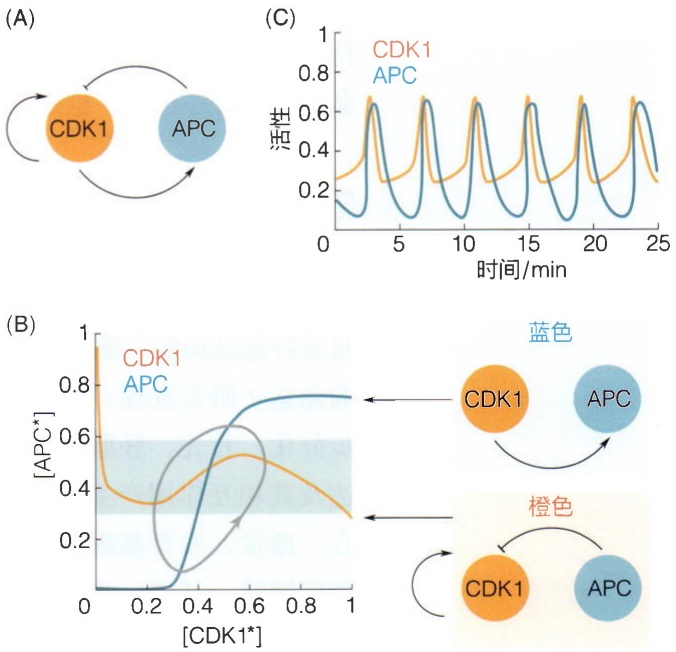

图20-7 CDK1-APC调控的正反馈与负反馈环路（A）模型示意图，箭头表示激活，带钝端的线表示抑制。（B）模型的相平面和零斜线。橙线和蓝线是CDK1和APC的零斜线，它们的交点是不稳定的不动点。灰线是极限环。（C）系统随时间变化的特性，显示了持续的振荡。（C，改编自Ferrell J E Jr, et al. Cell, 2011, 144(6):874-885）

## 知识窗20-2

## 相平面上极限环的存在性

我们怎么才能知道一个动力系统是否存在稳定的极限环呢？这是一个极其困难的问题，但是对于二维系统这一类情况，包括上文中简化的非洲爪蟾胚胎的细胞周期调控网络，实际上是可以判断的，这便是庞加莱-本迪克松（Poincaré-Bendixson）定理的内容。简单来讲，如果在相平面内一个连通、有界的区域（不妨记为R）内没有不动点，并且R内的点代表的系统状态随时间变化将永远留在 R 内，则 R 中一定存在一个稳定极限环；满足条件的区域 R 典型的形状是环状的，其外边界上点都向内移动，而内边界上点都向外移动（比如，围绕一个不稳定的不动点）。定理的证明需要用到一些高阶的数学知识，在此不多作介绍，感兴趣的读者不妨参考相关的非线性动力学教材。

实，因而可以刻画细胞周期动力学的更多细节。但这会以模型的复杂度为代价:网络组件越多，解释模型的行为就越困难。在许多真核细胞中，细胞周期由CDK1/APC驱动，其行为更加具有序列性，而不是自主振荡，我们将在第21章中用芽殖酵母的细胞周期网络模型来说明。尽管如此，这里提出的简单的非洲爪蟾胚胎细胞周期模型为理解更复杂细胞周期环路的设计提供了借鉴。

周期性振荡普遍存在于生物体系中，它在细胞周期的调控，昼夜节律的日常维持，以及心脏跳动等各种生物功能中都发挥着重要作用。这些生物振荡不仅确保了生命活动的有序进行，也是维系生物体内环境平衡和功能协调的基础。

## 20.2.3 果蝇胚胎发育早期的基因调控网络

多细胞生物个体从受精卵开始，经过一系列的细胞分裂和分化过程，最终形成了具有特定结构的三维体系。在此过程中，每一个细胞如何根据所处的位置来选择特定的命运？研究发现，发育过程的一个普遍的原则是胚胎中的细胞在一系列步骤中逐步分化。首先，胚胎的大范围区域差异被建立起来，在这些区域内，特定基因的表达及其相互作用产生了更多的较小发育区域，每个区域有其独特的发育基因表达组合。通常，发育基因被按照严格的时间序列激活，它们形成了一个具有层级的基因调控网络，其中一组基因对下一组基因的激活至关重要，从而促使下一阶段的发育发生。果蝇早期胚胎发育过程清晰地展示了上述原则。这里，我们以果蝇的裂隙基因（gap gene）调控网络为例来说明，它在早期胚胎前后轴方向形态建成的过程中起重要作用。

果蝇的受精卵呈长椭球状，在精子和卵细胞核融合后，会发生快速的细胞核分裂，但核周围不形成细胞膜，从而使胚胎形成具有多个细胞核的合胞体。

在果蝇胚胎的合胞体阶段，首先发生的是一系列快速的核分裂。这些核分裂不伴随着细胞膜的形成，因此所有的细胞核都位于共享的胞浆中。这种快速的核分裂过程称为核分裂期（mitotic cycle）。这种结构允许果蝇胚胎在很短的时间内通过连续的核分裂来快速增加细胞核数量。直到第9次分裂后，细胞核开始移动到胚胎的边缘，形成合胞原胚（blastoderm）。这是一个关键的过程，因为它标志着细胞核开始在胚胎表面形成一个单层的排列。

在第13次核分裂后，细胞核的数量达到6000个左右，并且均匀覆盖在胚胎表面。此时，虽然细胞核已经定位到了胚胎的外围，但细胞膜尚未形成。这种结构的特点是允许基因表达产物（如蛋白质和RNA）在胚胎中自由扩散，从而可以迅速影响整个胚胎。这种快速而广泛的信号传播对于胚胎早期发育过程的调控至关重要。

在后续的发育过程中，细胞膜最终会形成，细胞核将被包含在单独的细胞中，标志着果蝇胚胎从合胞体阶段转变为细胞化阶段。这个过程导致细胞的进一步分化和胚胎的形态发生明显变化。

胚胎发育过程中的一个核心问题是，单个细胞如何正确地选择自己的命运从而使得整个胚胎形成最终的身体规划？果蝇的前后轴方向的形态形成，即哪部分细胞最终会变成头部、胸部、腹部和尾部等，是由一系列基因表达程序逐步决定的，使得每一个细胞选取特定的命运。处于这一过程中的核心地位的是一组裂隙基因，它们在前后轴方向特定的范围内表达，提供了细胞分化所需要的“位置信息”，其下游的基因读取这些信息并将胚胎前后轴方向进一步标记为更小的区域，从而最终决定不同部位细胞的命运（知识窗20-3）。代找电子书资源，新书可代做扫描制作加微信asxiao90

## 20.3 代谢网络

上一节介绍的基因调控网络主要涉及DNA、RNA和蛋白质之间的相互作用。实际上，除了中心法则支配的基因表达调控过程，生物体中还有包括各种糖、脂质等在内的成百上千种代谢物在时刻不停地发生着复杂的化学反应。代谢物之间能够通过一系列的化学反应构成的代谢通路相互转化，就像一个个“站点”被道路连接起来，例如糖酵解通路、三羧酸循环等（图20-10）。在站点与站点之间的运输过程中，酶会帮助反应的发生（具体单步反应参阅18.1节），中间产物会被传递到下一个站点，直到形成最终产物或与其它代谢通路连接。不同的通路彼此连接、交错，就形成了代谢网络（metabolic network）。它就像生物体内一个庞大的交通系统，包括了代谢活动中的各种生化反应、通路及其调控关系。代谢网络有两个重要功能:一是将从外界摄取的物质（比如食物）转变成身体所需的构建材料和能量，二是参与物质的分解过程。这个网络非常复杂，涉及数百种生化反应和数千种代谢物之间的相互转化，其结构和调控机制对于维持生物体的生理功能至关重要。近年来，科学家们对代谢网络非常感兴趣，他们结合实验和计算模拟，对代谢网络进行建模和分析，揭示其结构和功能之间的关系。这有助于我们理解代谢疾病的发生原因，并为开发新的药物靶点和应用于

## 知识窗20-3

## 果蝇胚胎发育

果蝇的胚胎发育极其迅速，其体轴的前后轴极性在精子进入卵子之前就已经由母源细胞质中的转录因子确定（图20-8）。前后体轴由产生于母源营养细胞中并运输到卵母细胞中的mRNA确定，其蛋白质产物被称为母源形态生成素（morphogen）。最主要的有决定胚胎前部的bicoid(bcd)和后部的nanos mRNA。其中，bicoid mRNA被锚定在头部，其表达的产物即Bicoid蛋白通过扩散形成前后方向的浓度梯度。相应的，nanos mRNA翻译产生的Nanos蛋白建立了从后部到前部的浓度梯度（图20-9A）。除此之外，另外两类重要的由母源提供的mRNA是hunchback(hb)和caudal(cad)，它们对体轴前后方向的形态建成也是至关重要的。这样，胚胎前部的Bicoid蛋白作为转录因子激活hunchback基因而抑制caudal基因；胚胎后部的Nanos蛋白激活caudal基因而抑制 hunchback 基因。这些母源基因表达产物所形成的胚胎前后方向的浓度梯度是整个胚胎发育过程中基因调控网络的输入。

随后，合子基因开始表达。第一类被表达的这类合子基因被称为裂隙基因，因为它们的突变体会在分节模式中造成缺口。这些基因在特定的大范围区域内部重叠地表达。裂隙基因编码转录因子，它们的不同组合调节成对控制（pair-rule）基因的转录，而成对控制基因的表达将胚胎分割成更小的周期性的单位。不同成对控制基因的转录导致了与前后轴垂直的7个纵向条带的条纹状图案。成对控制基因编码的转录因子激活体节极性（segment-polarity）基因，这些基因的蛋白质产物将胚胎分割成14个节段的单位。与此同时，裂隙基因、成对控制基因和体节极性基因的蛋白质产物相互作用，调控同源异型基因（homeotic gene），从而决定了每个节段的发育命运，比如果蝇的胸部、腹部等。

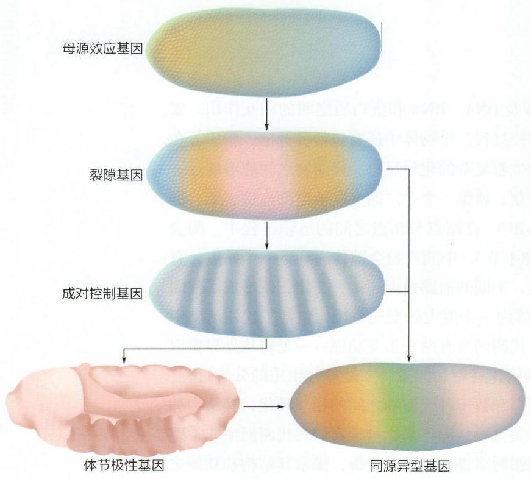

<details>
<summary>flowchart</summary>

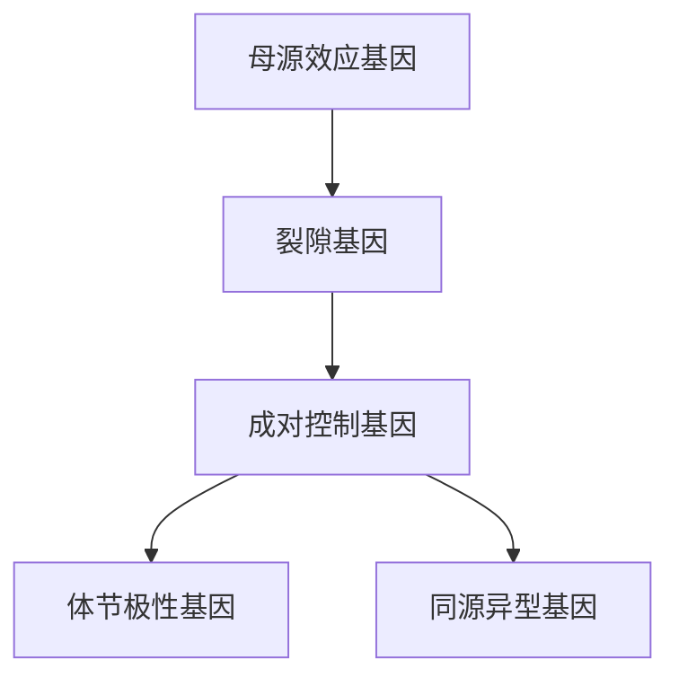
</details>

图 20-8 果蝇胚胎前后轴的形态建成该模式是由母源效应基因建立的，这些基因形成形态发生素梯度和区域。这些蛋白质是激活裂隙基因的转录因子，裂隙基因在胚胎的大段区域表达，它们调控成对控制基因的表达。成对控制基因的表达成条带状。然后，体节极性基因将胚胎沿前后轴划分为大小适中的单元。这些基因的共同作用定义了确定每个节段的同源域基因的空间领域。通过这种方式，周期性从非周期性中产生，每个节段都被赋予独特的身份。

决定果蝇躯干部分的裂隙基因有四个，它们分别是hunchback(hb)，kruppel(kr)，knirps(kni)，giant(gt)。它们在胚胎进入第14次核分裂后的表达模式如图20-9C所示。那么这种空间表达模式是如何形成的呢？在胚胎的前部，高浓度的bicoid蛋白激活hb的表达，而hb会激活或抑制其它裂隙基因kr、kni和gt，同时，裂隙基因之间又形成复杂的调控关系。尽管确切的调控网络尚不清楚，但多年的实验和建模研究表明，裂隙基因之间的核心调控关系大致可以用图20-9B表示。例如，$hb$ 对 $kr$ 的调控依赖于 $hb$ 蛋白浓度，当 $hb$ 蛋白浓度高于某一阈值时，它将激活 $kr$ ，而其浓度过高时又会抑制 $kr$ 的表达。作为一个粗略的近似，裂隙基因之间的相互作用可以拆分为三个开关样的模块:$hb$ 和 $kni$ 的互相抑制，$kr$ 和 $gt$ 之间的互相抑制，以及 $hb$ 对 $kr$ 产物浓度依赖的调控。值得注意的是，裂隙基因的这种空间表达模式提供了决定前后轴方向细胞命运的“位置信息”，即每个细胞可以根据所表达的裂隙基因水平的组合而推断出所处的前后位置，从而决定合适的细胞命运。

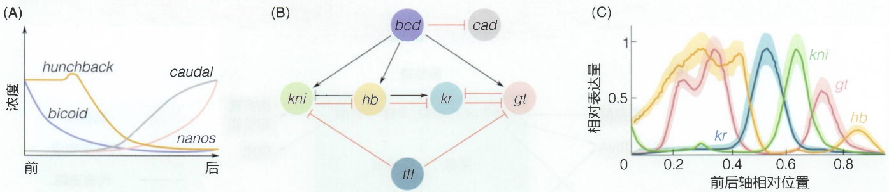

图 20-9 裂隙基因表达的调控

（A）受精卵中的母源效应基因沿胚胎前后轴方向的表达模式。（B）简化后的裂隙基因调控网络，这里也显示了在胚胎端部表达的裂隙基因 $tll$ 对 $kni$ 和 $gt$ 的抑制。（C）实验测得的躯干部分四种裂隙基因在胚

胎进入第 14 次核分裂后 40 分钟左右的相对表达量。阴影区是多个胚胎测量的标准误差。（B，改编自 Papatsenko D, et al. PLOS ONE, 2011, 6(7): e21145；C，改编自 Petkova M D, et al. Cell, 2019, 176(4): 844-855）

生物工程提供了契机。

在前面的章节中，我们应用米氏反应动力学、希尔函数等工具对单个或几个酶促反应进行建模，以底物和酶的浓度为变量写出微分方程，研究其动态和稳态性质。然而对于数百个反应、上千种代谢物组成的复杂代谢网络（图20-10A），如果仍然采取这种建模方法，我们就不得不求解巨大的微分方程组，难度可想而知。因此，我们引入一种新的方法，它可以从更宏观的角度对整个代谢网络进行建模。

流平衡分析（flux balance analysis）是一种用于研究代谢网络的定量分析方法，就像我们用交通流分析来研究城市交通一样。它基于代谢网络的结构和物质转化的规律，通过建立数学模型来预测稳态下代谢通路中物质的流动和代谢产物的生成速率。流平衡分析本质上是一个线性规划问题。该问题的目标往往是最大化或最小化某个或某些代谢产物的产量，如最大化生物量（biomass）积累、最小化营养物质消耗等。同时，体系还要满足一定的约束条件，如代谢网络中的质量守恒和能量守恒，某些化学反应的速率存在上下限等。在稳态下，物质在代谢网络中的流动要保持平衡，即各代谢物的含量和代谢通路中的反应速率需要保持稳定。通过设定代谢通路中的约束条件和需要优化的目标产物，我们可以找出在特定条件下代谢通路中物质流动的最佳方案。

图20-10 代谢网络（A）代谢网络总览。（B）核心碳源代谢通路示例。（A，引自KEGG网站；B，改编自Wang X, et al. Nat Commun, 2019, 10: 1279）

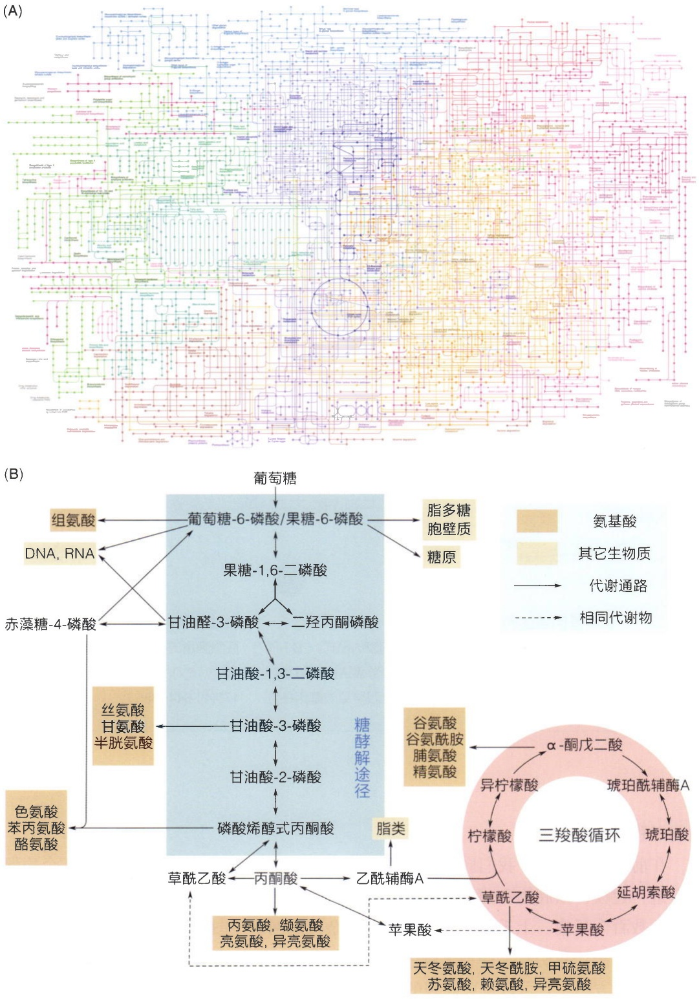

具体来说，流平衡分析可以分为几个步骤（图20-11）:首先，根据想要研究的问题，明确体系中有哪些生化反应及每个反应的化学计量系数，构建一个代谢网络（图20-11①）。其次，用数学的方式描述这个代谢网络，即写出这个代谢网络对应的化学计量矩阵（stoichiometric matrix）S和代谢流向量v。化学计量矩阵的每一行代表一种物质，每一列代表一个化学反应，矩阵中的每个值即为该行对应的物质在该列对应的反应式中的化学计量系数，其中反应物为负，生成物为正。例如，第二个化学反应为 $B + 2C \rightarrow D$，那么矩阵第二列中，第一个数为-1，第二个数为-2，对应反应物B和C；第三个数为1，对应生成物D；其余位置均为0。除了真实发生的化学反应，细胞对代谢物的摄取和排出也可以被等效为化学反应，比如细胞从外部环境中摄取葡萄糖，就可以用反应式 $\varnothing \rightarrow$ 葡萄糖来表示。代谢流向量v是一个列向量，每个分量表示一个反应的速率，定义为单位时间内反应物浓度减少量或生成物增加量除以该物质的化学计量系数。这样表示代谢网络的妙处在于，化学计量矩阵 $S$ 和代谢流向量 $\nu$ 相乘可以得到一个维度等于反应物数量的列向量，其每个分量代表一种物质的浓度随时间的变化率（图20-11②）。然后，根据流平衡的原理，稳态下反应速率和各物质浓度保持不变，即

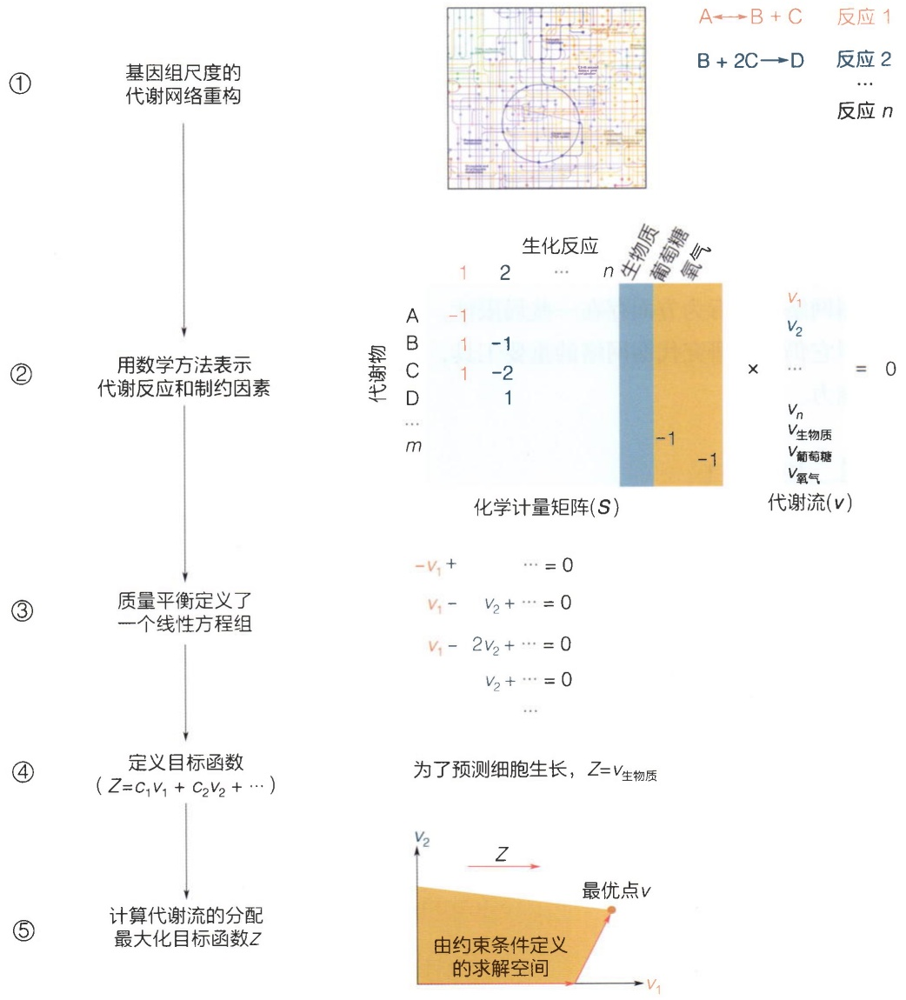

<details>
<summary>flowchart</summary>

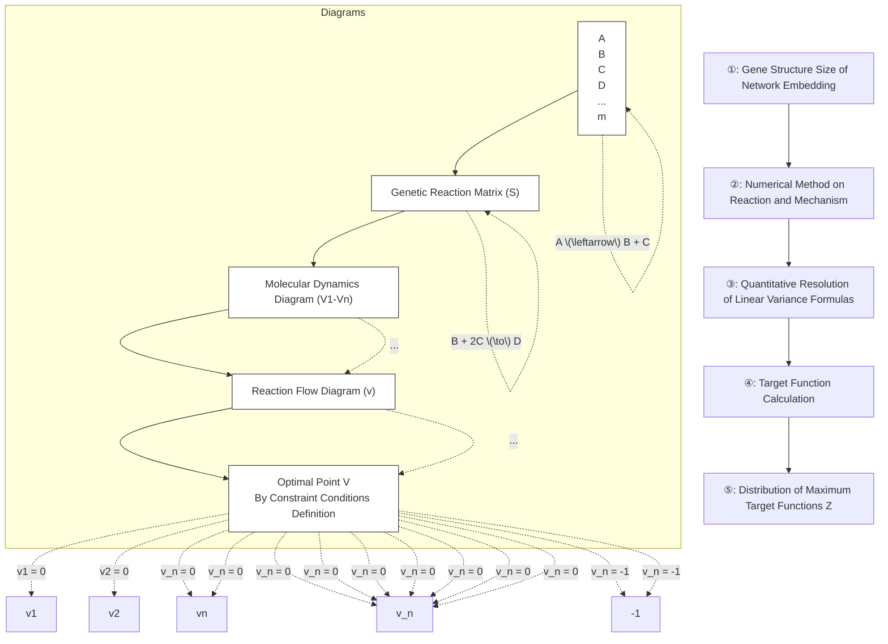
</details>

图20-11 流平衡分析方法的研究流程

其中① - ⑤是研究流程的各个步骤。（改编自 Orth J D, et al. Nat Biotech, 2010, 28(3): 245-248）

$$
\boldsymbol {S} \boldsymbol {v} = 0 _ {\circ} \tag {20-2}
$$

根据式（20-2）得出反应流动满足的线性方程组（图20-11③）；接着，定义一个想要优化的目标函数（图20-11④），比如某种产物的产量，或者细胞的生长速率。最后，在一定的约束条件下利用线性规划的方法求解目标函数的最大值和此时自变量（v）满足的条件，得到最优化问题的解（图20-11⑤）。

在上述五个步骤中，式（20-2）是流平衡原理的核心，其本质在于物质守恒。对于细胞内的每一种代谢物，其稳态浓度恒定，使得整个生命系统处于一种动态平衡状态。由于图20-11所示的方程式未包含流入系统的代谢流，为了更清晰地阐释流平衡分析的方法，图20-12展示了一个具体案例。其中，与外界交换物质的代谢流都被计入代谢流向量 $\nu$ ，同时只有细胞内的代谢物质需要满足流平衡（即物质守恒）。通过对目标函数进行优化计算，我们即可得到代谢流分布的最优解。

流平衡分析方法在定量生物学研究中具有广泛的应用，就像交通流分析可以帮助规划城市道路一样。它可以预测不同条件下代谢产物的生成速率、代谢通路的流量分布，从而预测细胞的生长速率、代谢物的积累和消耗，以及能量产生的效率等，还可以帮助确定关键酶的调控策略。此外，流平衡分析还可以应用于优化代谢工程和生物工业生产过程，从而增加特定产物的产量或提高底物的利用效率。尽管流平衡分析在预测代谢网络整体行为方面存在一些局限性，比如无法考虑动态变化和更复杂的调控机制，但它仍然是研究代谢网络的重要工具，为系统性的代谢研究提供了全局的视角和预测能力。

图20-12 流平衡分析方法的一个具体案例

(改编自Raman K, et al. Brief Bioinform, 2009, 10(4): 435-449)

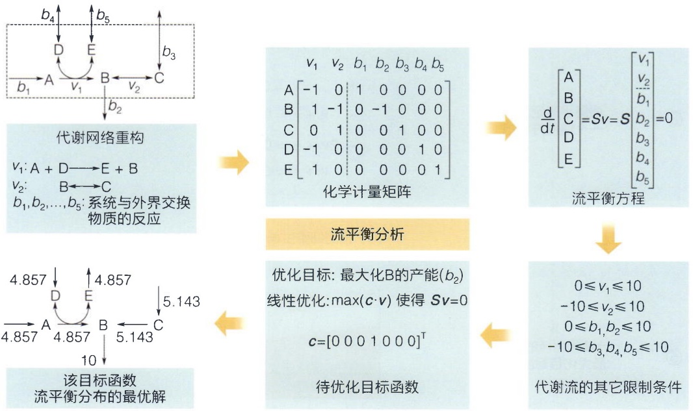

<details>
<summary>flowchart</summary>

```mermaid
graph LR
  subgraph Top_Process
  A["b1 \to A \to B \to C"] --> B["代谢网络重构"]
  B --> C["v1: A + D \to E + B\nv2: B \to C\nb1, b2, ..., b5: 系统与外界交换\n物质的反应"]
  C --> D["化学计量矩阵"]
  D --> E["流平衡方程"]
  end

  subgraph Bottom_Process
  F["4.857 \to A \to B \to C"] --> G["该目标函数\n流平衡分布的最优解"]
  G --> H["&quot;优化目标: 最大化B的产能(b2)\n线性优化:\(max(c \cdot v)\)使得 Sv=0\nc=[0 0 0 1 0 00"]^T"]
  H --> I["待优化目标函数"]
  I --> J["代谢流的其它限制条件"]
  end
```
</details>

## ※ 本章小结

本章主要讨论了生物网络中的复杂性，尤其是大肠杆菌的基因调控网络、细胞周期调控网络，以及多细胞生物的发育过程中的基因调控网络。我们依次领略了生物网络的基本特性，如非线性相互作用、自组织性、异质性、动态性和多尺度性，这些特性共同构成了生物网络的复杂性。

我们重点讨论了基因调控网络的动力学特性，如自抑制和自激活模体的功能，前馈环的类型与功能，以及单输入调控模块和致密交叠调控子的重要性。特别是通过对大肠杆菌和其它模型生物的研究，展示了基因调控网络在生物体适应环境和发展过程中的关键作用。

我们之后还介绍了细胞周期调控网络，特别是非洲爪蟾胚胎细胞周期的调控机制，强调了正反馈和负反馈环路在细胞周期调控中的重要性。此外，发育过程中的基因调控网络部分详述了多细胞生物从受精卵到成体的复杂分化过程中基因表达的调控机制，而果蝇胚胎发育的模型研究为理解这些调控机制提供了重要的视角。

本章最后还简要介绍了代谢网络的概念，包括通过流平衡分析方法来研究和预测生物体中各种化学反应的动态平衡和代谢产物的生成速率，相关内容我们将在第21章再次进行讨论。

## ※ 思考题

1. 在比较自抑制调控和简单调控的响应时间时，我们将希尔函数近似为一个阶跃函数。试推导不做这一近似时，输入函数由系数为 $n$ 的希尔函数描述的自抑制调控的响应时间。讨论上述近似成立的条件。[提示:做变量替换 $u = [X]^{n + 1}$，解出 $u$ 的方程。]
2. 根据图20-1的图解法说明自激活模体响应时间慢于简单调控。
3. 在指数生长期，细菌群的质量和代谢物含量均呈指数增长。这种情况为什么适用于流平衡分析？

## ※ 扩展阅读

## 图书

- Alon U. An introduction to systems biology: design principles of biological circuits[M]. 2nd ed. Boca Raton: CRC Press, 2019.
- Barresi M, Gilbert S. Developmental biology[M]. New York: Oxford University Press, 2020.
- Strogatz S H. Nonlinear dynamics and chaos: with applications to physics, biology, chemistry, and engineering[M]. 2nd ed. Boca Raton: CRC Press, 2018.

## 综述

Ferrell J E Jr, Tsai T Y-C, Yang Q. Modeling the cell cycle: why do certain circuits oscillate?[J]. Cell, 2011, 144(6):874-885.

Orth J D, Thiele I, Palsson B ∅. What is flux balance analysis?[J]. Nat Biotechnol, 2010, 28(3):245–248.

## 研究论文

Shen-Orr S S, Milo R, Mangan S, et al. Network motifs in the transcriptional regulation network of Escherichia coli [J]. Nat Genet, 2002, 31(1):64–68.

## 生命系统特征的定量理解

在前面的章节中，我们从单个酶促反应的动力学出发，对生命活动的基本过程建立定量模型，从中体会定量生物学的思维方式。以此为基础，我们逐步引入了形式更加复杂多样的模型，从而能够定量地描述更加丰富的生物学过程，直至复杂生物网络的调控。而随着研究对象越发复杂和庞大，一些微观尺度和还原论视角下不存在的新问题就会涌现出来。在本章中，我们将从更加宏观的层次上介绍生命系统所具有的一般性特征及其背后的原理，包括非平衡状态、稳健性、优化原理和自组织。这些特征保证了作为一个整体的生命系统能够稳定、有序、高效地完成极为复杂精妙的各项生命活动。我们将结合具体的例子，学习如何利用定量模型刻画和研究这些特征，从而深化对生命系统的理解。

## 21

## 21.1 远离平衡态的生命系统

物理学家薛定谔在他的名著《生命是什么？》中就指出，生命体和非生命体的一个本质区别就在于是否和周边环境在不断地交换着物质和能量，远离平衡态以克服自身熵的增大，并尽可能地保持在有序的状态。早在20世纪初，就开始有物理化学家在具体的远离平衡态系统中研究动力学和热力学，其中就包括简单的化学反应系统。而到了20世纪40年代，以普里戈金为代表的物理化学家们提出了“非平衡稳态”的概念（也称为非平衡定态），并给出了非平衡态热力学的一般框架。但是，非平衡态和平衡态的热力学理论是很不一样的，一直都无法脱离具体的动力学过程来进行定量刻画。这并不一定是一种缺陷或者遗憾，非平衡态现象理当如此的复杂，否则这个世界也太无趣了。

单个细胞是最简单的生命系统，但其内部也已经足够复杂，因此我们再次进行大幅度的简化，来寻找最简单的化学反应体系，这可以看作生命系统的一个最原始的雏形。而且时至今日，对于化学反应以及化学反应系统的非平衡态热力学，至少在稀溶液的情况下，理解得已经比较清晰。

所以在本节中，我们就基于最简单的单分子和双分子反应的质量作用定律和平衡态热力学里的一些基本概念，来研究非平衡态化学反应系统的基本动力学和热力学性质，主要是考虑非平衡稳态。

## 21.1.1 化学反应非平衡稳态热力学基础

非平衡稳态只有在含有环形结构的化学反应系统里才能体现出来，因此先来考虑一个最简单的环形三组分化学反应系统:

$$
\mathrm{A} \xrightarrow [ k _ {- 1} ]{k _ {1}} \mathrm{B}, \mathrm{B} \xrightarrow [ k _ {- 2} ]{k _ {2}} \mathrm{C}, \mathrm{C} \xrightarrow [ k _ {- 3} ]{k _ {3}} \mathrm{A}
$$

在2.3节中，我们已经知道:对于每个物质A、B和C，都可以分别定义出它们的化学势，也就是单位浓度的自由能；而且在稀溶液的情况下，这个化学势 $\mu$ 又可以分解成两项，一项叫作内在化学势，是由分子结构、温度、压强、溶剂性质等决定的，与该物质的浓度是无关的，被记为 $\mu^0$ ，另一项是浓度的对数乘以 $k_{\mathrm{B}}T$ ，其中 $k_{\mathrm{B}}$ 是玻尔兹曼常量， $T$ 是温度。

这里我们只考虑浓度变化而导致的非平衡态，不考虑比如温度、压强等的不均匀性等原因导致的非平衡系统。因此可以认为，在浓度变化时，$\mu^0$ 是不会变的，而每个物质的单位浓度自由能，也就是化学势，依然可以用平衡态热力学里的表达式来刻画。

具体来说，我们定义A、B和C的化学势为 $\mu_{\mathrm{A}} = \mu_{\mathrm{A}}^{0} + k_{\mathrm{B}}T\log c_{\mathrm{A}}$ 、 $\mu_{\mathrm{B}} = \mu_{\mathrm{B}}^{0} + k_{\mathrm{B}}T\log$ $c_{\mathrm{B}}$ 和 $\mu_{\mathrm{C}} = \mu_{\mathrm{C}}^{0} + k_{\mathrm{B}}T\log c_{\mathrm{C}}$ ，其中 $c_{\mathrm{A}}$ 、 $c_{\mathrm{B}}$ 、 $c_{\mathrm{C}}$ 分别是化学物质A、B和C的浓度。在2.3节，我们已经知道了内在化学势和化学平衡常数之间的对数关系，而在这个具体的例子里，化学平衡常数就等于正向和逆向一阶化学反应常数之比，因此可以得到

$$
\frac {k _ {1}}{k _ {- 1}} = \exp \left(\frac {\mu_ {\mathrm{A}} ^ {0} - \mu_ {\mathrm{B}} ^ {0}}{k _ {\mathrm{B}} T}\right), \frac {k _ {2}}{k _ {- 2}} = \exp \left(\frac {\mu_ {\mathrm{B}} ^ {0} - \mu_ {\mathrm{C}} ^ {0}}{k _ {\mathrm{B}} T}\right), \frac {k _ {3}}{k _ {- 3}} = \exp \left(\frac {\mu_ {\mathrm{C}} ^ {0} - \mu_ {\mathrm{A}} ^ {0}}{k _ {\mathrm{B}} T}\right) 。
$$

把上面三个式子左右两边分别连乘，就有

$$
\frac {k _ {1} k _ {2} k _ {3}}{k _ {- 1} k _ {- 2} k _ {- 3}} = 1 \text {。} \tag {21-1}
$$

这正是化学里细致平衡原理的表现形式之一，它刻画了无其它物质参与的环形单分子化学反应系统的各个化学反应常数之间所必须满足的约束。而非平衡态，特别是非平衡稳态，就是要打破这个约束。

但是这已经是物理化学定律了，还怎么打破呢？其实是打引号的“打破”，并不是要违反这条定律，而只是说在不符合该定律的前提条件时，这个约束条件是可以被违背的，而且这样的一种违背也是可以被定量刻画的。

生命体中最常见的破坏该约束的情形就是正逆两个方向的六个单分子一阶反应里有两个是拟一阶化学反应，也就是说本质上这些反应中有两个是双原子的二阶化学反应，比如生命体中常见的磷酸化和去磷酸化过程，就是物质A、B和C组成的环形结构耦合上ATP的水解过程。对该过程的定量刻画有助于我们理解生命体内部的能量转化，如图21-1所示。

以图21-1B的化学反应系统为例，其中 $k_{1}^{0}$ 和 $k_{-3}^{0}$ 是对应的二阶双分子化学反应的反应常数，因为前者是T加上A合成B，后者是D加上A合成C。于是当把它和最简单的环形三组分化学反应系统相比较时就会发现，当物质D和T的浓度固定不变时，只要定义拟一阶化学反应常数 $k_{1} = k_{1}^{0}c_{\mathrm{T}}$ 和 $k_{-3} = k_{-3}^{0}c_{\mathrm{D}}$ ，则二者在数学模型上就变得完全一样，唯一的不同是此时这些一阶和拟一阶化学反应常数不必再遵守细致平衡原理式（21-1）。

使用和最简单环形三组分化学反应系统几乎一样的推导，可以得到整个环形结构总的化学势差，就等于物质D与物质T的化学势差（知识窗21-1），即

$$
\Delta \mu = \mu_ {\mathrm{D}} - \mu_ {\mathrm{T}} = \Delta \mu^ {0} + k _ {\mathrm{B}} T \ln \frac {c _ {\mathrm{D}}}{c _ {\mathrm{T}}} 。
$$

这个公式其实说的是一个很浅显的结论，那就是环形结构每顺时针转一圈，其效果无非就是把一个T分子转化成了D分子而已。

再次利用内在化学势与化学反应常数的关系，可以进一步得到

$$
\begin{array}{l} \Delta \mu = - k _ {\mathrm{B}} T \ln \frac {k _ {1} ^ {0} k _ {2} k _ {3}}{k _ {- 1} k _ {- 2} k _ {- 3} ^ {0}} + k _ {\mathrm{B}} T \ln \frac {c _ {\mathrm{D}}}{c _ {\mathrm{T}}} \\ = - k _ {\mathrm{B}} T \ln \frac {k _ {1} k _ {2} k _ {3}}{k _ {- 1} k _ {- 2} k _ {- 3}} 。 \\ \end{array}
$$

这个公式表明细致平衡原理[式（21-1）]正好对应于环形结构总的化学势差为零。这也是平

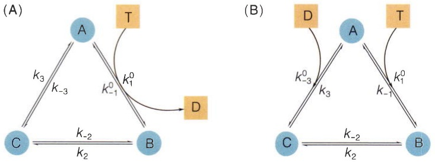

图21-1 环形结构化学反应系统与外部物质转化过程相耦合物质A、B和C组成的环形结构化学反应系统，与物质T和D之间的转化过程相耦合，耦合的方式有两种。

## 知识窗21-1

## 图 21-1B 的环形自由能变化分析

对于顺时针的三个化学反应，其反应物与生成物的化学势差分别为

$$
\Delta \mu_ {\mathrm{l}} = \mu_ {\mathrm{B}} - \mu_ {\mathrm{A}} - \mu_ {\mathrm{T}} = \Delta \mu_ {\mathrm{l}} ^ {0} + k _ {\mathrm{B}} T \ln \frac {c _ {\mathrm{B}}}{c _ {\mathrm{A}} c _ {\mathrm{T}}},
$$

$$
\Delta \mu_ {2} = \mu_ {\mathrm{C}} - \mu_ {\mathrm{B}} = \Delta \mu_ {2} ^ {0} + k _ {\mathrm{B}} T \ln \frac {c _ {\mathrm{C}}}{c _ {\mathrm{B}}},
$$

$$
\Delta \mu_ {3} = \mu_ {\mathrm{A}} + \mu_ {\mathrm{D}} - \mu_ {\mathrm{C}} = \Delta \mu_ {3} ^ {0} + k _ {\mathrm{B}} T \ln \frac {c _ {\mathrm{A}} c _ {\mathrm{D}}}{c _ {\mathrm{C}}}
$$

左右两边分别相加，从而整个环形结构的化学势差为

$$
\Delta \mu = \Delta \mu_ {1} + \Delta \mu_ {2} + \Delta \mu_ {3} = \mu_ {\mathrm{D}} - \mu_ {\mathrm{T}} = \Delta \mu^ {0} + k _ {\mathrm{B}} T \ln \frac {c _ {\mathrm{D}}}{c _ {\mathrm{T}}}.
$$

再次利用 2.3 节中内在化学势与化学平衡常数的关系，我

们知道

$$
\Delta \mu_ {1} ^ {0} = - k _ {\mathrm{B}} T \ln \frac {k _ {1} ^ {0}}{k _ {- 1}}, \Delta \mu_ {2} ^ {0} = - k _ {\mathrm{B}} T \ln \frac {k _ {2}}{k _ {- 2}},
$$

$$
\Delta \mu_ {3} ^ {0} = - k _ {\mathrm{B}} T \ln \frac {k _ {3}}{k _ {- 3} ^ {0}},
$$

因此把它们都加起来就可以得到

$$
\Delta \mu^ {0} = \Delta \mu_ {1} ^ {0} + \Delta \mu_ {2} ^ {0} + \Delta \mu_ {3} ^ {0} = - k _ {\mathrm{B}} T \ln \frac {k _ {1} ^ {0} k _ {2} k _ {3}}{k _ {- 1} k _ {- 2} k _ {- 3} ^ {0}}.
$$

因此

$$
\Delta \mu = - k _ {\mathrm{B}} T \ln \frac {k _ {1} ^ {0} k _ {2} k _ {3}}{k _ {- 1} k _ {- 2} k _ {- 3} ^ {0}} + k _ {\mathrm{B}} T \ln \frac {c _ {\mathrm{D}}}{c _ {\mathrm{T}}} = k _ {\mathrm{B}} T \ln \frac {k _ {1} k _ {2} k _ {3}}{k _ {- 1} k _ {- 2} k _ {- 3}},
$$

其中 $k_{1} = k_{1}^{0}c_{\mathrm{T}}$ 、 $k_{-3} = k_{-3}^{0}c_{\mathrm{D}}$ 是拟一阶化学反应常数。

衡态的一个特征，即系统里不存在能量差。

另一方面，从动力学的角度，我们可以基于质量作用定律，给出该系统中物质A、B和C浓度随时间变化的常微分方程组，同时假设T和D的浓度保持不变——这恰恰是维系该系统的稳态偏离平衡态的原因所在。

列出的常微分方程组为

$$
\left\{ \begin{array}{l l} \frac {\mathrm{d} c _ {\mathrm{A}}}{\mathrm{d} t} = k _ {- 1} c _ {\mathrm{B}} + k _ {3} c _ {\mathrm{C}} - (k _ {1} + k _ {- 3}) c _ {\mathrm{A}}, & \text {(21-2a)} \\ \frac {\mathrm{d} c _ {\mathrm{B}}}{\mathrm{d} t} = k _ {1} c _ {\mathrm{A}} + k _ {- 2} c _ {\mathrm{C}} - (k _ {- 1} + k _ {2}) c _ {\mathrm{B}}, & \text {(21-2b)} \\ \frac {\mathrm{d} c _ {\mathrm{C}}}{\mathrm{d} t} = k _ {2} c _ {\mathrm{B}} + k _ {- 3} c _ {\mathrm{A}} - (k _ {- 2} + k _ {3}) c _ {\mathrm{C}} 。 & \text {(21-2c)} \end{array} \right.
$$

令右端为零，可以计算出稳态时物质 A、B 和 C 的浓度  $c_{A}^{ss}$ 、 $c_{B}^{ss}$  和  $c_{C}^{ss}$ （知识窗 21-2）。

我们其实关心的是单位时间内有多少A转成B，B转化成C，C转化成A，这就是这个环形结构的环流量，也是单位时间内物质T转化成物质D的量，为

$$
J ^ {\mathrm{ss}} = \frac {k _ {1} k _ {2} k _ {3} - k _ {- 1} k _ {- 2} k _ {- 3}}{k _ {2} k _ {3} + k _ {3} k _ {- 1} + k _ {- 1} k _ {- 2} + k _ {3} k _ {1} + k _ {1} k _ {- 2} + k _ {- 2} k _ {- 3} + k _ {1} k _ {2} + k _ {2} k _ {- 3} + k _ {- 3} k _ {- 1}} c _ {\mathrm{tol}}
$$

这里 $c_{\mathrm{tot}}$ 是物质A、B和C的浓度和，不随时间改变。

因此细致平衡条件式（21-1）也等价于这个流量为零。这是平衡态的另一个特

## 知识窗21-2

## 稳态物质浓度和环流量

令常微分方程组式（21-2）右端为零，可以计算出稳态时物质A、B和C的浓度如下:

$$
c _ {\mathrm{A}} ^ {\mathrm{ss}} = \frac {k _ {2} k _ {3} + k _ {3} k _ {- 1} + k _ {- 1} k _ {- 2}}{k _ {2} k _ {3} + k _ {3} k _ {- 1} + k _ {- 1} k _ {- 2} + k _ {3} k _ {1} + k _ {1} k _ {- 2} + k _ {- 2} k _ {- 3} + k _ {1} k _ {2} + k _ {2} k _ {- 3} + k _ {- 3} k _ {- 1}} c _ {\mathrm{tot}},
$$

$$
c _ {\mathrm{B}} ^ {\mathrm{ss}} = \frac {k _ {3} k _ {1} + k _ {1} k _ {- 2} + k _ {- 2} k _ {- 3}}{k _ {2} k _ {3} + k _ {3} k _ {- 1} + k _ {- 1} k _ {- 2} + k _ {3} k _ {1} + k _ {1} k _ {- 2} + k _ {- 2} k _ {- 3} + k _ {1} k _ {2} + k _ {2} k _ {- 3} + k _ {- 3} k _ {- 1}} c _ {\mathrm{tot}},
$$

$$
c _ {\mathrm{C}} ^ {\mathrm{ss}} = \frac {k _ {1} k _ {2} + k _ {2} k _ {- 3} + k _ {- 3} k _ {- 1}}{k _ {2} k _ {3} + k _ {3} k _ {- 1} + k _ {- 1} k _ {- 2} + k _ {3} k _ {1} + k _ {1} k _ {- 2} + k _ {- 2} k _ {- 3} + k _ {1} k _ {2} + k _ {2} k _ {- 3} + k _ {- 3} k _ {- 1}} c _ {\mathrm{tot}}
$$

单位时间内物质 T 转化成物质 D 的量为

$$
\begin{array}{l} J ^ {\mathrm{ss}} = c _ {\mathrm{A}} ^ {\mathrm{ss}} k _ {1} - c _ {\mathrm{B}} ^ {\mathrm{ss}} k _ {- 1} = c _ {\mathrm{B}} ^ {\mathrm{ss}} k _ {2} - c _ {\mathrm{C}} ^ {\mathrm{ss}} k _ {- 2} = c _ {\mathrm{C}} ^ {\mathrm{ss}} k _ {3} - c _ {\mathrm{A}} ^ {\mathrm{ss}} k _ {- 3} \\ = \frac {k _ {1} k _ {2} k _ {3} - k _ {- 1} k _ {- 2} k _ {- 3}}{k _ {2} k _ {3} + k _ {3} k _ {- 1} + k _ {- 1} k _ {- 2} + k _ {3} k _ {1} + k _ {1} k _ {- 2} + k _ {- 2} k _ {- 3} + k _ {1} k _ {2} + k _ {2} k _ {- 3} + k _ {- 3} k _ {- 1}} c _ {\mathrm{tot}} \\ \end{array}
$$

征，即系统里不存在定向的宏观流动。

对于违背细致平衡条件式（21-1）的系统，如果把总的化学势差乘以稳态的流量，即 $\Delta \mu \cdot J^{\mathrm{ss}}$ ，我们可以发现这个量总是负的，而它的相反数恰恰就是单位时间内一共损失了多少能量。这是因为该环形结构每顺时针转一圈就损失了 $-\Delta \mu$ 这么多的能量，而 $J^{\mathrm{ss}}$ 恰恰表示的就是单位时间内转了多少圈。$-\Delta \mu \cdot J^{\mathrm{ss}}$ 在非平衡态热力学里被称为稳态熵产生，即薛定谔指出的内部自发熵增，这是非平衡稳态理论里的核心物理量，它的非负性体现的正是热力学第二定律。

## 21.1.2 动力学校对

在20世纪70年代，人们发现，生命体内部的物质合成过程，比如转录翻译，准确度都非常高。以蛋白质分子在核糖体上的合成过程来说，识别转运核糖核酸（tRNA）的错误率可以低至 $10^{-4}$，也就是识别正确的可能性是识别错误的可能性的一万倍。如果我们简单地使用平衡态统计物理的知识，根据在2.1节学过的玻尔兹曼分布，正确的和错误的tRNA分子的内在化学势差就必须等于 $\ln 10^{4}$ 乘以 $k_{\mathrm{B}}T$，可以算出是 $3.776 \times 10^{-20} \mathrm{~J}$，则 $1 \mathrm{~mol}$ 正确的和错误的tRNA分子的内在化学势差就应该等于 $22.656 \mathrm{~kJ}$。但这和实验上在平衡态条件下测量得到的 $1 \mathrm{~mol}$ 正确的和错误的tRNA分子的内在化学势差相去甚远，几乎相差一倍，这也就意味着平衡态时正确的和错误的tRNA之比（即平衡常数）也就只能在 $10^{2}$ 上下。这又是怎么回事呢？

后来人们意识到，生命体远离平衡态，其环形结构总的自由能差很可能就是这种高效率的来源，这种机制被称为动力学校对，是由约翰·霍普菲尔德（John Hopfield）和雅克·尼尼奥（Jacques Ninio）在1974年分别独立提出的。动力学校对在不同生命过程中的表现形式略有不同，这里就借用上一节介绍的环形结构化学反应系统的非平衡定态基础知识，以酶与两种不同配体的结合为例，来定量地加以介绍。

生命体中的蛋白质（酶）和配体的结合过程，很多都不是一个简单的可逆双分子化学反应，为了实现某些生物功能，或者就是为了本节所说的高特异性，即拉大与正确的或错误的配体结合的比例，都会和比如ATP水解这样的反应相耦合，使得系统得以远离平衡态，并且通过比如磷酸化等机制来激活复合体的功能。

在配体 L 的浓度以及物质 T 和物质 D 浓度固定的情况下，图 21-2 就是上一小节介绍的环形模型，其中 R 就是 A，RL 就是 B，而 RL$^{*}$ 就是 C，这里简单假设提供能量的 T 和 D 之间的反应是只和 RL 与 RL$^{*}$ 之间的反应相耦合的，即 T + RL $\longleftrightarrow$ D + RL$^{*}$。这一假设非本质，并不影响本节的所有结论。

除了正确的配体L，我们进一步假设还有一个和L结构类似的错误配体 $\mathrm{L}'$ ，最典型的例子就是在翻译过程中的不同tRNA，其结构上差异很小，但是核糖体依照模板链却能非常精准高速地完成翻译过程，而这也正是动力学校对这一机制着重要解释的现象。

对于L和 $\mathrm{L}^{\prime}$ 共存的系统，且我们假设L和 $\mathrm{L}^{\prime}$ 的结构如此相似，它们所参与的化学反应也是相同的，于是一个环的化学反应系统就被扩增为了两个环（图21-3），其中 $k_{1}, k_{-3}, k_{1}^{\prime}$ 和 $k_{-3}^{\prime}$ 是拟一阶化学反应常数。这里我们假设L和 $\mathrm{L}^{\prime}$ 的浓度相同，这样比较二者的结合比例才合理。

根据上一节最后所得到的热力学关系，由于L和 $\mathrm{L}^{\prime}$ 的环形反应都是被同样的T和D之间的反应所驱动的，因此我们知道

$$
\Delta \mu_ {\mathrm{T} \rightarrow \mathrm{D}} = \mu_ {\mathrm{D}} - \mu_ {\mathrm{T}} = - k _ {\mathrm{B}} T \ln \frac {k _ {1} k _ {2} k _ {3}}{k _ {- 1} k _ {- 2} k _ {- 3}} = - k _ {\mathrm{B}} T \ln \frac {k _ {1} ^ {\prime} k _ {2} ^ {\prime} k _ {3} ^ {\prime}}{k _ {- 1} ^ {\prime} k _ {- 2} ^ {\prime} k _ {- 3} ^ {\prime}} 。 \tag {21-3}
$$

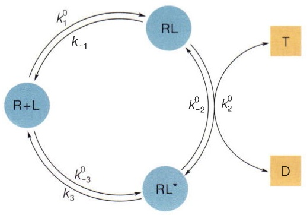

<details>
<summary>flowchart</summary>

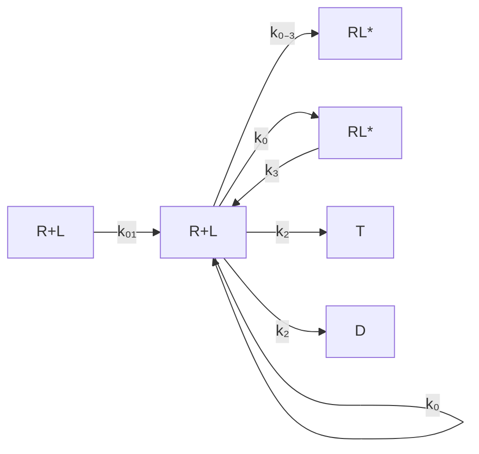
</details>

图21-2 蛋白质配体的结合过程，与外部物质的转化相耦合

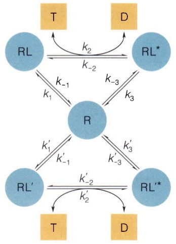

<details>
<summary>flowchart</summary>

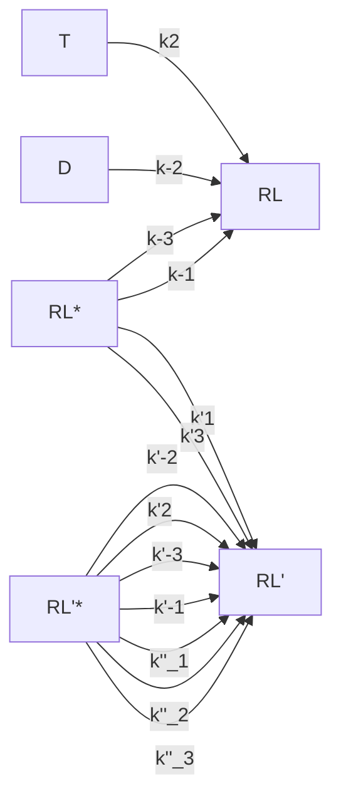
</details>

图21-3 蛋白质R和两种不同的配体结合的环形化学反应模型