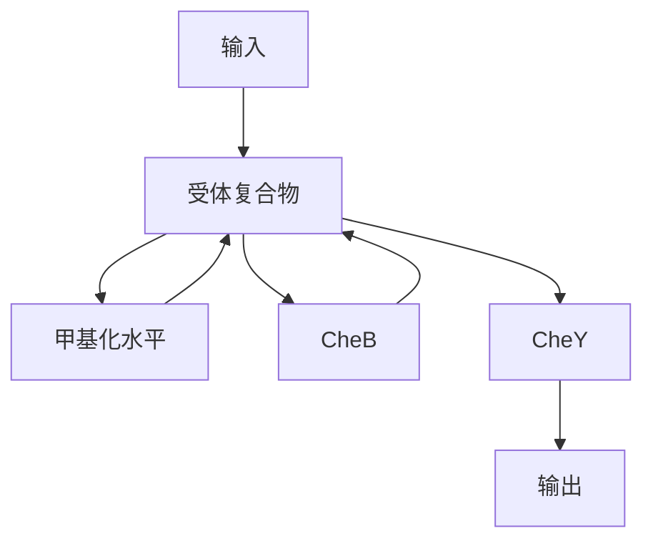
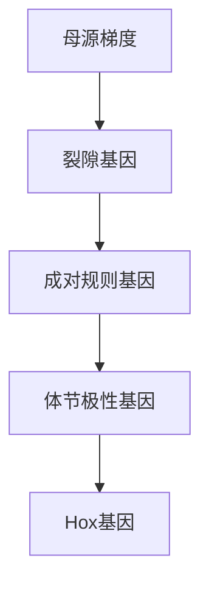
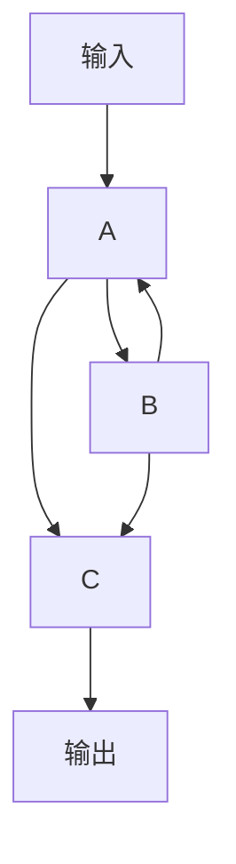
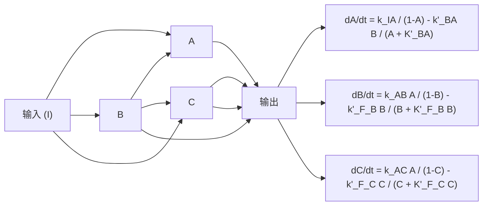
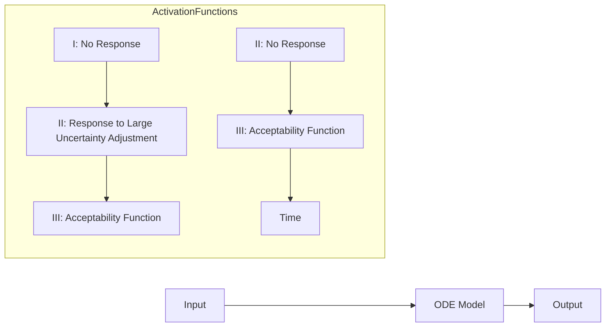
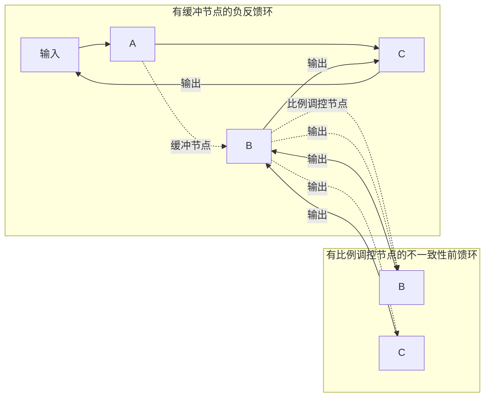

如果该化学反应系统处于热力学平衡态，那么每个化学反应都处于平衡态，即没有定向的物质净流动，所以根据化学反应平衡的性质，在R与 $\mathrm{RL}^*$ 、R与 $\mathrm{RL}^*$ 之间可以有

$$
k _ {- 3} [ \mathrm{R} ] = k _ {3} [ \mathrm{RL} ^ {*} ], k _ {- 3} ^ {\prime} [ \mathrm{R} ] = k _ {3} ^ {\prime} [ \mathrm{RL} ^ {\prime *} ] 。
$$

此时我们最关心的错误的配体和酶结合状态的浓度 $\left[\mathrm{RL}^*\right]$ 与正确的配体和酶结合状态的浓度 $\left[\mathrm{RL}^*\right]$ 之间的比例，即错误率定义为

$$
f = \frac {\left[ \mathrm{RL} ^ {\prime *} \right]}{\left[ \mathrm{RL} ^ {*} \right]} \circ
$$

根据前文计算，热力学平衡状态下

$$
\frac {\left[ \mathrm{RL} ^ {*} \right]}{\left[ \mathrm{RL} ^ {*} \right]} = \frac {k _ {- 3} ^ {\prime} k _ {3}}{k _ {3} ^ {\prime} k _ {- 3}} \circ
$$

注意到这个量和物质T以及D的浓度无关，是酶与两个配体之间的平衡常数之比，把这个量 $\frac{k_{-3}^{\prime}k_3}{k_3^{\prime}k_{-3}}$ 定义为 $\theta$ ，它小于1因为我们假设配体L和R有更高的亲和性。以本小节一开始说的核糖体上的翻译过程为例，$\theta$ 就近似等于百分之一。下面就来探讨在非平衡稳态的时候，错误率 $f$ 有没有可能做到比 $\theta$ 要小得多。

为了简单起见，我们假设涉及配体L和 $\mathrm{L}'$ 的所有化学反应常数中，除了 $k_{3}$ 和 $k_{3}^{\prime}$，$k_{-1}$ 和 $k_{-1}^{\prime}$ 不相等之外，其它对应的化学反应常数都相等，即 $k_{1} = k_{1}^{\prime}$，$k_{2} = k_{2}^{\prime}$，$k_{-2} = k_{-2}^{\prime}$，$k_{-3} = k_{-3}^{\prime}$。在这样的假设下，可以得到错误率 $f$ 的表达式如下（知识窗21-3）:

$$
f = \frac {k _ {1} k _ {2} + k _ {2} k _ {- 3} + \frac {k _ {- 1} k _ {- 3}}{\theta}}{k _ {2} k _ {- 3} + \frac {k _ {- 1} k _ {- 3}}{\theta} + \frac {k _ {1} k _ {2}}{\gamma}} \cdot \frac {k _ {2} k _ {- 3} + k _ {- 1} k _ {- 3} + \frac {k _ {1} k _ {2}}{\gamma}}{k _ {1} k _ {2} + k _ {2} k _ {- 3} + k _ {- 1} k _ {- 3}} 。
$$

计算可得，在 $\theta$ 和 $\gamma$ 保持不变的情况下，$f$ 的最小值可以无限接

近 $\frac{\left(\sqrt{\theta} + \frac{1}{\sqrt{\gamma}}\right)^2}{\left(\frac{1}{\sqrt{\theta}} + \frac{1}{\sqrt{\gamma}}\right)^2}$ （知识窗21-4；图21-4）。而当 $\gamma$ 很大的时候，

该最小值接近 $\theta$ 的平方，如果 $\theta$ 为百分之一，则 $\theta$ 的平方则为万分之一，错误率大大减小。

所以通过定量的方法，结合非平衡定态的基本规律，我们发现能量真的可以使得酶和配体的结合变得更加准确，这就是动力学校对机制的精髓所在。


<details>
<summary>line</summary>

| \(\gamma\) | \(\theta = 0.01\) | \(\theta = 0.1\) | \(\theta = 0.5\) | \(\theta = 0.8\) |
|---|---|---|---|---|
| 0 | ~0.03 | ~0.38 | ~0.75 | ~0.95 |
| 1000 | ~0.01 | ~0.02 | ~0.26 | ~0.64 |
</details>

图21-4 错误率在给定 $\theta$ 和 $\gamma$ 下的最小值

## 知识窗21-3

## 非平衡稳态下错误率的表达式

在本节的假设下，由式（21-3），我们又令 $\frac{k_{1}k_{2}k_{3}}{k_{-1}k_{-2}k_{-3}}=\frac{k_{1}^{\prime}k_{2}^{\prime}k_{3}^{\prime}}{k_{-1}^{\prime}k_{-2}^{\prime}k_{-3}^{\prime}}=\gamma$ ，于是有

$$
\theta = \frac {k _ {- 3} ^ {\prime} k _ {3}}{k _ {3} ^ {\prime} k _ {- 3}} = \frac {k _ {3}}{k _ {3} ^ {\prime}} = \frac {k _ {- 1}}{k _ {- 1} ^ {\prime}} 。
$$

在任何一个非平衡态，即  $\gamma$  不等于 1，我们可以仿照知识窗 21-2 的方法列出各物质浓度随时间变化的微分方程组，计算出各物质的稳态浓度，进而得到

$$
f = \frac {\left[ \mathrm{RL} ^ {\prime *} \right]}{\left[ \mathrm{RL} ^ {*} \right]} = \frac {k _ {1} ^ {\prime} k _ {2} ^ {\prime} + k _ {2} ^ {\prime} k _ {- 3} ^ {\prime} + k _ {- 1} ^ {\prime} k _ {- 3} ^ {\prime}}{k _ {2} ^ {\prime} k _ {3} ^ {\prime} + k _ {- 1} ^ {\prime} k _ {3} ^ {\prime} + k _ {- 1} ^ {\prime} k _ {- 2} ^ {\prime}} \cdot \frac {k _ {2} k _ {3} + k _ {- 1} k _ {3} + k _ {- 1} k _ {- 2}}{k _ {1} k _ {2} + k _ {2} k _ {- 3} + k _ {- 1} k _ {- 3}},
$$

进一步通过计算可以得到

$$
f = \theta \frac {k _ {1} k _ {2} + k _ {2} k _ {- 3} + \frac {k _ {- 1}}{\theta} k _ {- 3}}{k _ {2} k _ {3} + k _ {- 1} \frac {k _ {3}}{\theta} + k _ {- 1} k _ {- 2}} \cdot \frac {k _ {2} k _ {3} + k _ {- 1} k _ {3} + k _ {- 1} k _ {- 2}}{k _ {1} k _ {2} + k _ {2} k _ {- 3} + k _ {- 1} k _ {- 3}},
$$

再把 $k_{3} = \frac{\gamma k_{-1}k_{-2}k_{-3}}{k_1k_2}$ 代入，最终得到

$$
f = \theta \frac {k _ {1} k _ {2} + k _ {2} k _ {- 3} + \frac {k _ {- 1} k _ {- 3}}{\theta}}{k _ {2} k _ {- 3} + \frac {k _ {- 1} k _ {- 3}}{\theta} + \frac {k _ {1} k _ {2}}{\gamma}} \cdot \frac {k _ {2} k _ {- 3} + k _ {- 1} k _ {- 3} + \frac {k _ {1} k _ {2}}{\gamma}}{k _ {1} k _ {2} + k _ {2} k _ {- 3} + k _ {- 2} k _ {- 3}}
$$

## 21.2 稳健性

为了适应周围的环境，生命系统在演化过程中需要不断优化其自身的代谢调控网络、信号转导通路和基因调控网络等控制系统。在计算机和移动通信设备的电子线路设计过程中，人类工程师先画出设计图，然后逐步实现电路功能的优化。不同于电子线路中的预先设计，生物系统中控制系统的优化，是通过对原有原件和网络不断修补的“修补匠”（进化）来完成的。那么生命系统有什么基本的设计原理吗？

在以下几个小节中，我们通过一些具体例子来讨论生物系统的稳定性、稳健性（robustness）以及生物网络拓扑与其功能的关系。

## 知识窗21-4

## 错误率最小值推导

令 $a = k_{1}k_{2}$ ， $b = k_{2}k_{-3}$ ， $c = k_{-1}k_{-3}$ ，则

$$
f = \theta \frac {a + b + \frac {c}{\theta}}{b + \frac {c}{\theta} + \frac {a}{\gamma}} \cdot \frac {b + c + \frac {a}{\gamma}}{a + b + c} = \theta \frac {a b \left(1 + \frac {1}{\gamma}\right) + a c \left(1 + \frac {1}{\gamma \theta}\right) + b c \left(1 + \frac {1}{\theta}\right) + \frac {a ^ {2}}{\gamma} + b ^ {2} + \frac {c ^ {2}}{\theta}}{a b \left(1 + \frac {1}{\gamma}\right) + a c \left(\frac {1}{\theta} + \frac {1}{\gamma}\right) + b c \left(1 + \frac {1}{\theta}\right) + \frac {a ^ {2}}{\gamma} + b ^ {2} + \frac {c ^ {2}}{\theta}}
$$

$$
= \theta \left(1 - \frac {a c \left(\frac {1}{\theta} - 1\right) \left(1 - \frac {1}{\gamma}\right)}{a b \left(1 + \frac {1}{\gamma}\right) + a c \left(\frac {1}{\theta} + \frac {1}{\gamma}\right) + b c \left(1 + \frac {1}{\theta}\right) + \frac {a ^ {2}}{\gamma} + b ^ {2} + \frac {c ^ {2}}{\theta}}\right) 。
$$

不妨假设 $\gamma > 1$，要使得 $f$ 最小，则在固定 $a$ 和 $c$ 的时候，$b$ 要尽可能小，则可以令 $b = 0$，于是

$$
f = \theta - (1 - \theta) \left(1 - \frac {1}{\gamma}\right) \frac {a c}{a c \left(\frac {1}{\theta} + \frac {1}{\gamma}\right) + \frac {a ^ {2}}{\gamma} + \frac {c ^ {2}}{\theta}} 。
$$

我们知道 $\frac{a^2}{\gamma} +\frac{c^2}{\theta}\geqslant 2ac / \sqrt{\gamma\theta}$ ，于是

$$
\frac {a c}{a c \left(\frac {1}{\theta} + \frac {1}{\gamma}\right) + \frac {a ^ {2}}{\gamma} + \frac {c ^ {2}}{\theta}} \leqslant \frac {1}{\frac {1}{\theta} + \frac {1}{\gamma} + \frac {2}{\sqrt {\gamma \theta}}} = \frac {1}{\left(\frac {1}{\sqrt {\theta}} + \frac {1}{\sqrt {\gamma}}\right) ^ {2}},
$$

所以

$$
f \geqslant \theta - (1 - \theta) \left(1 - \frac {1}{\gamma}\right) \frac {1}{\left(\frac {1}{\sqrt {\theta}} + \frac {1}{\sqrt {\gamma}}\right) ^ {2}} = \frac {\left(\sqrt {\theta} + \frac {1}{\sqrt {\gamma}}\right) ^ {2}}{\left(\frac {1}{\sqrt {\theta}} + \frac {1}{\sqrt {\gamma}}\right) ^ {2}}.
$$

## 21.2.1 信号转导过程的稳健性

细胞使用复杂的网络来传递和处理信息，执行诸如信号转导、细胞周期调控等一系列生物功能。细胞内的生化网络是高度相连的，对某一个反应速率的扰动或者信号分子浓度的改变可能会影响诸多其它细胞过程。这自然引出了一个问题:生化反应网络是如何保持其功能的稳定性的？一种可能的方式是精确地设定网络的参数和各组分分子的浓度。另一种可能性是，生化反应网络的功能实现对其参数相对不敏感，这一性质被称为稳健性。研究发现，稳健性是生物网络的一个重要特征。本节我们首先以大肠杆菌的趋化性网络的适应性为例来介绍信号转导网络的稳健性。

细菌的趋化性（chemotaxis）是细菌感知化学环境并朝向引诱物运动、远离排斥物的现象。这是生物学中研究得最深入的信号转导系统之一。大肠杆菌的运动类似于随机行走，平滑游动有时会被短暂的翻滚（tumbling）所打断，从而改变方向。细菌的趋化性是通过调节翻滚频率实现的。当细菌顺着引诱物梯度运动时，会遇到随时间增加的引诱物浓度。作为反应，它们翻滚的频率会降低，因此倾向于继续顺梯度移动。

这个过程由如图21-5所示的信号转导通路控制。简单来讲，环境中的趋化分子浓度信息由分布在细胞膜上的趋化受体传导到细胞内。趋化受体通过适配蛋白CheW与组氨酸激酶CheA形成复合物。引诱剂（趋散剂）与受体的结合会抑制（增强）CheA的自磷酸化活性。激活的组氨酸激酶CheA通过自磷酸化获得磷酸基团，随后将其转移给反应调节蛋白CheY或去甲基化酶CheB。磷酸化的CheY能够与鞭毛马达结合，增加马达的顺时针转动和细胞翻滚的概率。因此，系统的输出可以由处于活化状态的趋化受体浓度来近似描述。

与其它感觉系统类似，大肠杆菌趋化性也表现出适应性（adaptation），即在平稳状态下，细菌的翻滚频率对空间均一的趋化分子浓度不敏感。实验发现，当趋化物天冬酸浓度突然增加时，大肠杆菌细胞的翻滚频率首先降低，然后逐渐恢复，最终回到刺激前的水平。适应后的翻滚频率在一定范围的浓度下保持不变。适应性使得细菌能对更大范围内的化学浓度梯度保持敏感。在上述信号转导通路中，适应性是由趋化受体的甲基化和去甲基化过程调控的，它们分别由CheR和磷酸化的CheB（CheB-P）催化。CheA对CheB的磷酸化增强了后者的去甲基化活性。


<details>
<summary>flowchart</summary>

```mermaid
graph TD
  Input["输入"] -->|"P\nChenB"| Output["输出"]
  
  subgraph Pathway1
  A["CheA"] -->|"CheW"| B["CheW"]
  B -->|"CheW"| C["CheW"]
  C -->|"CheA"| D["CheA"]
  D -->|"CheY"| E["CheY"]
  E -->|"CheZ"| F["CheZ"]
  end
  
  subgraph Pathway2
    G["CheR"] -.->|"P"| H["CheB"]
    I["CheB"] -.->|"P"| J["CheY"]
    K["CheZ"] -.->|"P"| L["CheY"]
    M["CheZ"] -.->|"P"| N["CheY"]
    O["CheZ"] -.->|"P"| P
  P -->|"P"| Q["P"]
  Q -->|"P"| R["P"]
  R -->|"P"| S["P"]
  S -->|"P"| T["P"]
  T -->|"P"| U["P"]
  U -->|"P"| V["P"]
  V -->|"P"| W["P"]
  W -->|"P"| X["P"]
  X -->|"P"| Y["P"]
  Y -->|"P"| Z["P"]
  Z -->|"P"| AA["P"]
  AA -->|"P"| AB["P"]
  AB -->|"P"| AC["P"]
  AC -->|"P"| AD["P"]
  AD -->|"P"| AE["P"]
  AE -->|"P"| AF["P"]
  AF -->|"P"| AG["P"]
  AG -->|"P"| AH["P"]
  AH -->|"P"| AI["P"]
  AI -->|"P"| AJ["P"]
  AJ -->|"P"| AK["P"]
  AK -->|"P"| AL["P"]
  AL -->|"P"| AM["P"]
  AM -->|"P"| AN["P"]
  AN -->|"P"| AO["P"]
  AO -->|"P"| AP["P"]
  AP -->|"P"| AQ["P"]
  AQ -->|"P"| AR["P"]
  AR -->|"P"| AS["P"]
  AS -->|"P"| AT["P"]
  AT -->|"P"| AU["P"]
  AU -->|"P"| AV["P"]
  AV -->|"P"| AW["P"]
  AW -->|"P"| AX["P"]
  AX -->|"P"| AZ["P"]
  AZ -->|"P"| BA["P"]
  BA -->|"P"| BB["P"]
  BB -->|"P"| BC["P"]
  BC -->|"P"| BD["P"]
  BD -->|"P"| BE["P"]
  BE -->|"P"| BF["P"]
  BF -->|"P"| BG["P"]
  BG -->|"P"| BH["P"]
  BH --> "A\nB\nC\nD\nE\nF\nG\nH\nI\nJ\nK\nL\nM\nN\nO\nP\nQ\nR\nS\nT\nU\nV\nW\nX\nY\nZ\nAB\nAC\nAD' & AE\nAE' & AE' & AE' & AE' & AE' & AE' & AE' & AE' & AE' & AE' & AE' & AE' & AE' & AE' & AE' & AE' & AE' & AE' & AE' & AE' & AE' & AE' & AE' & AE' & AE' & AE' & AE' & AE' & AE' & AE' & AE' & AE' & AE' & AE' & AE'
```
</details>

图 21-5 大肠杆菌趋化信号转导系统

（A）在该信号网络中，跨膜的趋化受体蛋白与适配蛋白CheW以及激酶CheA形成复合物。该复合物可以自磷酸化，以及磷酸化CheY和CheB。磷酸化后的CheY会调节细菌的翻转频率。同时，CheZ使CheY去磷酸化。趋化的适应性是由受体复合物的甲基化和去甲基化


<details>
<summary>flowchart</summary>


</details>

水平调控的，分别由 CheR 和磷酸化后的 CheB 催化。因此，受体复合物与 CheB 之间形成了一个负反馈。（B）简化后的信号转导网络可以看作一个具有缓冲节点的负反馈回路，其中缓冲节点为趋化受体复合物的甲基化水平。（A，改编自 Alon U, et al. Nature, 1999, 397(6715): 168-171）

实验发现，不同的细菌个体均能表现出趋化的精确适应性，考虑到上述信号转导系统中各个组分可能存在较大的细胞间差异，一个很有意思的问题是:这样的生化网络是如何实现如此精确的适应性的？为了回答这个问题，我们可以对该系统进行定量建模。整个系统可以由三个变量描述:信号分子浓度 $l$ ，受体复合物的甲基化水平 $m$ 以及受体活性 $a$ （一般来说，未甲基化和甲基化的受体都有一定的概率具有催化活性，这个概率对于甲基化的受体更高）。在早期的模型中，实现精确的适应性需要特定的模型参数组合和信号分子的浓度。后来，研究者提出了一种不依赖于微调动力学参数和各种酶浓度以解释精确适应性的模型，其中引入了两个关键假设:

① 甲基化酶 CheR 以最大催化速度饱和运作；
② 去甲基化酶 CheB 仅对具有活性的趋化受体复合物起作用。

通过这两个简单假设，该模型就可以实现精确适应性，即使网络中各种关键组分的浓度（如CheR和CheB）发生数量级的变化。

为了直观地理解该模型中的精确适应性，我们可以考察趋化受体的甲基水平的变化速率:

$$
\frac {\mathrm{d} m}{\mathrm{d} t} \approx V _ {\max} ^ {\mathrm{R}} - \frac {V _ {\max} ^ {\mathrm{B}} \langle a \rangle}{K _ {\mathrm{b}} + \langle a \rangle} 。 \tag {21-4}
$$

其中 $V_{\mathrm{max}}^{\mathrm{R}}$ 、 $V_{\mathrm{max}}^{\mathrm{B}}$ 是CheR和CheB的最大催化速率， $K_{\mathrm{b}}$ 是米氏常数， $\langle a\rangle$ 是趋化受体的平均活性。当该系统适应后，它会达到一个平稳状态，即 $\frac{\mathrm{dm}}{\mathrm{dt}} = 0$ 。从式（21-4）可以得到适应后的趋化受体活性为:

$$
\langle a \rangle = \frac {K _ {\mathrm{b}} V _ {\max} ^ {\mathrm{R}}}{V _ {\max} ^ {\mathrm{B}} - K _ {\max} ^ {\mathrm{R}}} 。
$$

显然，它不依赖于环境中趋化分子的浓度。因此，大肠杆菌的化学趋向性网络的精确适应性不需要网络参数的精确调节和各组分分子浓度的精确调控。随后的实验研究发现，即便改变大肠杆菌趋化性关键基因（如cheR、cheB和cheZ）的表达水平，大肠杆菌依然表现出精确的适应性，甚至在这些关键蛋白的表达水平变化了一个数量级后，适应的精确性仍然很高。

大肠杆菌趋化的精确适应性机制，是一种类似于工程中广泛使用的积分控制机制。积分反馈控制确保系统的输出能够稳健地跟踪所期望的值，而不受噪声或系统参数变化的影响。对应到趋化信号转导系统上，式（21-4）的右边可以看作系统的“误差”，其积分值也就是受体复合物的甲基化水平 $m$ 被反馈到系统中，这是因为受体复合物的活性是其甲基化水平的函数。因而，趋化适应性网络可以简化为具有缓冲节点的负反馈回路（图21-5B）。总的来讲，细胞的生化网络具有稳健性这一基本概念的形成肇始于对细菌趋化性的深入研究。

## 21.2.2 细胞周期过程的稳定性

对于不同的环境和信号，基因调控网络通过不同蛋白质的状态的不断变化产生反应，即通过动力学过程完成生物学功能。细胞生存在一个较强的环境噪声下，蛋白质网络的动力学稳定性将直接影响细胞的生物学功能和生理学稳定性。本节将简要介绍酵母细胞周期调控网络的动力学性质的研究，说明该动力学过程独特的稳定性（stability）和稳健性（robustness）。

在真核细胞的细胞周期（cell cycle）调控研究中，芽殖酵母（budding yeast）是重要的单细胞模式生物。环境信号和检查点信号，以及细胞周期蛋白（cyclin）和周期蛋白依赖性激酶（cyclin-dependent kinase，CDK）的表达和活性调控了细胞周期过程。细胞周期过程起始于激发 $\mathrm{G}_{1}$ 态，通过DNA复制期（S期）、$\mathrm{G}_{2}$ 期和有丝分裂期（M期），最后回到静息 $\mathrm{G}_{1}$ 态。分子生物学家经过几十年努力，逐步理解了芽殖酵母细胞周期过程和相应的分子调控机制。芽殖酵母细胞周期的基本调控过程见知识窗21-5，相应的简化调控网络见图21-6。自1996年开始，芽殖酵母的基因组和蛋白质相互作用的数据积累迅速增加，为全面系统地研究蛋白质网络的性质提供了可能。

那如何研究酵母细胞周期网络的动力学性质，尤其是全局的动力学性质呢？

## 知识窗21-5

## 芽殖酵母细胞周期的基本调控过程

调控网络中的蛋白质可分为以下三大类:第一类为Cyclin/Cdc28复合物，Cdc28是芽殖酵母细胞的CDK，包括Cln3/Cdc28复合物（简写为Cln3）、Cln1/Cdc28与Cln2/Cdc28复合物（简写为Cln1,2）、Clb5/Cdc28与Clb6/Cdc28复合物（简写为Clb5,6），Clb1/Cdc28与Clb2/Cdc28复合物（简写为Clb1,2）；第二类为转录因子，包括MBF、SBF、Mcm1/SFF和Swi5；第三类为Cyclin/Cdc28复合物的抑制蛋白与降解蛋白，包括Sic1、Cdh1、Cdc20/APC。

芽殖酵母细胞周期的基本调控过程如下（图21-6）:在营养丰富的条件下，当双倍体或单倍体的芽殖酵母细胞长得足够大时，Cln3/Cdc28复合物将被活化，促使细胞进入“激发的” $\mathrm{G}_{1}$ 态，即激发 $\mathrm{G}_{1}$ 态，这时细胞的Sic1浓度较高，Cdh1处于活化状态。活化的Cln3/Cdc28复合物将活化转录因子MBF和SBF，活化的MBF和SBF与DNA结合后，转录相应的mRNA，然后翻译形成Cln1、Cln2、Clb5和Clb6蛋白，上述蛋白质抑制了Sic1和Cdh1的作用，并控制着 $\mathrm{G}_{1}$ 后期基因的表达。在S期，细胞复制自己的DNA。通过 $\mathrm{G}_{2}$ 期，Clb1和Clb2活化，细胞进入M期。有丝分裂使得复制的DNA等量地分配到细胞的两极，然后一个细胞分裂产生两个子细胞，在这个过程中，Cdc20/APC和Swi5被活化，导致Sic1浓度升高，Cdh1活化，并对Cyclin/Cdc28复合物产生抑制作用。最后，细胞又回到细胞周期的静息 $\mathrm{G}_{1}$ 态，即 $\mathrm{G}_{1}$ 基态，等待下一次分裂信号。总的来说，细胞周期过程起始于激发$\mathrm{G}_{1}$ 态（该状态Cln3/Cdc28复合物处于活化状态），通过一系列细胞周期过程，最后回到Cln3/Cdc28复合物未活化的静息 $\mathrm{G}_{1}$ 态。

我们选择简单的离散布尔动力学模型。定义在 t 时刻第 i 个蛋白质的状态为  $S_{i}(t)$ ，存在两种状态——0 与 1，分别表示该蛋白质处于活化与未活化状态。在  $t+1$  时刻， $S_{i}(t+1)$  是由 t 时刻的与其有相互作用的蛋白质的状态按照以下规则决定的:

$$
S _ {i} (t + 1) = \left\{ \begin{array}{l l} 1, & \sum_ {j} a _ {i j} S _ {j} (t) > 0; \\ 0, & \sum_ {j} a _ {i j} S _ {j} (t) <   0; \\ S _ {i} (t), & \sum_ {j} a _ {i j} S _ {j} (t) = 0. \end{array} \right.
$$

其中， $a_{ij}$ 是第 $j$ 类蛋白质对第 $i$ 类蛋白质的作用系数，$a_{ij}$ 取值为1与-1，分别表示正相互作用（绿线）和负相互作用（红线）。自降解作用（黄线）具有时间延迟的性质:一个具有自降解作用的蛋白质，若在 $t$ 时刻被活化 $(S_{i}(t) = 1)$，而且在 $t + 1$ 到 $t + t_{\mathrm{d}}$ 时间内一直没有其它的正负输入，那么它将在 $t + t_{\mathrm{d}}$ 时刻降解 $(S_{i}(t + t_{\mathrm{d}}) = 0)$ 。在模型中 $t_{\mathrm{d}} = 1$ ，为简化的选择；也可以选择负相互作用为负无穷，即很强的负作用。尽

```mermaid
graph TD
  A["细胞大小"] --> B["Cln3"]
  B --> C["MBF"]
  C --> D["C1b5,6"]
  D --> E["Mcm1/SFF"]
  E --> F["Swi5"]
  F --> G["Cdc20 & Cdc14"]
  G --> H["Cdh1"]
  H --> I["Sic1"]
  I --> J["Cln1,2"]
  J --> K["SBF"]
  K --> L["Sib1"]
  L --> M["Clb1,2"]
  M --> N["Ccln1,2"]
  N --> O["Sib1"]
  O --> P["Sib2"]
  P --> Q["Sib3"]
  Q --> R["Sib4"]
  R --> S["Sib5"]
  S --> T["Sib6"]
  T --> U["Sib7"]
  U --> V["Sib8"]
  V --> W["Sib9"]
  W --> X["Sib10"]
  X --> Y["Sib11"]
  Y --> Z["Sib12"]
  Z --> AA["Sib13"]
  AA --> AB["Sib14"]
  AB --> AC["Sib15"]
  AC --> AD["Sib16"]
  AD --> AE["Sib17"]
  AE --> AF["Sib18"]
  AF --> AG["Sib19"]
  AG --> AH["Sib20"]
  AH --> AI["Sib21"]
  AI --> AJ["Sib22"]
  AJ --> AK["Sib23"]
  AK --> AL["Sib24"]
  AL --> AM["Sib25"]
  AM --> AN["Sib26"]
  AN --> AO["Sib27"]
  AO --> AP["Sib28"]
  AP --> AQ["Sib29"]
  AQ --> AR["Sib30"]
  AR --> AS["Sib31"]
  AS --> AT["Sib32"]
  AT --> AU["Sib33"]
  AU --> AV["Sib34"]
  AV --> AW["Sib35"]
  AW --> AX["Sib36"]
  AX --> AY["Sib37"]
  AY --> AZ["Sib38"]
  AZ --> BA["Sib39"]
  BA --> BC["Sib40"]
  BC --> BD["Sib41"]
  BD --> BE["Sib42"]
  BE --> BF["Sib43"]
  BF --> BG["Sib44"]
  BG --> BH["Sib45"]
  BH --> BI["Sib46"]
  BI --> BK["Sib47"]
  BK --> BL["Sib48"]
  BL --> BM["Sib49"]
  BM --> BN["Sib50"]
  BN --> BO["Sib51"]
  BO --> BP["Sib52"]
  BP --> BR["Sib53"]
  BR --> CA["Sib54"]
  CA --> CD["Sib55"]
  CD --> CE["Sib56"]
  CE --> CF["Sib57"]
  CF --> CG["Sib58"]
  CG --> CH["Sib59"]
  CH --> CI["Sib60"]
```


<details>
<summary>flowchart</summary>


</details>

图 21-6 芽殖酵母细胞周期的简化调控网络

“细胞大小”信号为细胞周期过程的触发信号。图中绿线表示激活的正作用，红线表示抑制或者降解的负作用，黄线表示蛋白质的自降解作用。

管我们选择 $a_{ij}$ 与 $t_\mathrm{d}$ 不同的值，但下面的主要结论不会因此而改变。模型中的时间步长是逻辑步长，而非实际意义上的时间，因此利用这种方法得到的研究结果只是逻辑意义上的动力学。

图21-6中的酵母细胞周期简化调控网络，不考虑“细胞大小”信号，是11个节点的蛋白质相互作用网络。首先，遍历所有可能的 $2^{11}(= 2048)$ 个初始态，研究它们所有可能的动力学吸引状态，也就是所有的动力学吸引子。可以发现它们最后演化到7个稳定的状态，而其中1764个初始态（约 $86\%$ ）都演化到静息 $\mathrm{G}_{1}$ 态（Sic1和Cdh1的状态为1，其余蛋白质的状态为0），即细胞周期的生物学稳定态。这说明芽殖酵母细胞周期的静息 $\mathrm{G}_{1}$ 态是一个全局吸引状态，而且是唯一的全局吸引子。静息 $\mathrm{G}_{1}$ 态作为唯一的全局吸引子具有明显优势:保证了细胞状态的稳定性，在正常条件下，细胞将停留在静息 $\mathrm{G}_{1}$ 态，等待下一轮分裂信号。

其次，研究“细胞大小”信号启动的细胞周期过程。当芽殖酵母细胞长到足够大时，“细胞大小”信号启动，系统由静息 $G_{1}$ 态转变为激发 $G_{1}$ 态， $G_{1}$ 期细胞周期因子Cln3被激活。这样，系统从激发 $G_{1}$ 态（Cln3、Sic1和Cdh1的状态为1，其余蛋白质的状态为0）经过13个逻辑步长，演化到并稳定在静息 $G_{1}$ 态，并不再改变状态（表21-1）。蛋白质状态的时间演化过程与芽殖酵母的S期、 $G_{2}$ 期和M期的实验观察相符合。这条从激发 $G_{1}$ 态到静息 $G_{1}$ 态的动力学路径正是细胞周期路径。

为了进一步研究上述细胞周期路径的动力学性质，在图21-7中，我们给出了最终演化到静息 $\mathrm{G}_{1}$ 态的1764个初始态的所有演化路径。其中每个点代表一个状态，状态之间的箭头表示从一个态到另一个态的演化路径，细胞周期路径用蓝箭头线表示，点的大小和每条线的宽度正比于 $\ln (2 + m)$，$m$ 为蛋白质初态经过该点（边）的数目。不同的初始状态逐步演化、汇聚，并被吸引到细胞周期路径的不同状态，然后沿着细胞周期路径逐步演化到最终的稳定态——静息 $G_{1}$ 态。所以，静息 $G_{1}$ 态是一个

表 21-1 利用布尔动力学模型模拟芽殖酵母细胞周期的演化过程

| 时刻 | Cln3 | MBF | SBF | Cln1,2 | Cdh1 | Swi5 | Cdc14 | Clb5,6 | Sic1 | Clb1,2 | Mcm1/SFF | 细胞周期阶段 |
| --- | --- | --- | --- | --- | --- | --- | --- | --- | --- | --- | --- | --- |
| 1 | 1 | 0 | 0 | 0 | 1 | 0 | 0 | 0 | 1 | 0 | 0 | 激发G1态 |
| 2 | 0 | 1 | 1 | 0 | 1 | 0 | 0 | 0 | 1 | 0 | 0 | G1 |
| 3 | 0 | 1 | 1 | 1 | 1 | 0 | 0 | 0 | 1 | 0 | 0 | G1 |
| 4 | 0 | 1 | 1 | 1 | 0 | 0 | 0 | 0 | 0 | 0 | 0 | G1 |
| 5 | 0 | 1 | 1 | 1 | 0 | 0 | 0 | 1 | 0 | 0 | 0 | S |
| 6 | 0 | 1 | 1 | 1 | 0 | 0 | 0 | 1 | 0 | 1 | 1 | G2 |
| 7 | 0 | 0 | 0 | 1 | 0 | 0 | 1 | 1 | 0 | 1 | 1 | M |
| 8 | 0 | 0 | 0 | 0 | 0 | 1 | 1 | 0 | 0 | 1 | 1 | M |
| 9 | 0 | 0 | 0 | 0 | 0 | 1 | 1 | 0 | 1 | 1 | 1 | M |
| 10 | 0 | 0 | 0 | 0 | 0 | 1 | 1 | 0 | 1 | 0 | 1 | M |
| 11 | 0 | 0 | 0 | 0 | 1 | 1 | 1 | 0 | 1 | 0 | 0 | M |
| 12 | 0 | 0 | 0 | 0 | 1 | 1 | 0 | 0 | 1 | 0 | 0 | G1 |
| 13 | 0 | 0 | 0 | 0 | 1 | 0 | 0 | 0 | 1 | 0 | 0 | 静息G1态 |

全局性的稳定点和吸引子，而且从激发 $\mathrm{G}_{1}$ 态到静息$\mathrm{G}_{1}$ 态的细胞周期演化路径是一个全局性的稳定的动力学路径。

接下来讨论的问题是:类似的全局吸引子和吸引路径的动力学性质是否是“特殊的”？或者说，是否任意的网络结构都具有类似的性质？实际上，在相同的布尔模型演化规则下，对于具有相同节点数目和连接数目的随机网络，会出现更多的吸引子，但是出现类似细胞周期静息 $G_{1}$ 态的全局吸引子的概率很小，出现类似细胞周期过程的全局吸引路径的概率更小。因此，细胞周期网络的特殊结构保证了系统的全局动力学稳定性。由此推断，通过长期的演化，芽殖酵母细胞周期调控网络保证了其动力学性质具有以上双重稳定性。在裂殖酵母和蛙卵细胞的细胞周期网络中也存在类似的动力学性质。

以上分析所用的是布尔动力学分析方法，该方法的优点是相互作用关系简单，可以给出系统不同状态的全局动力学性质。但是，它无法给出生物系统在真实时间中蛋白质的具体浓度和随时间演化的动力学性质。为了研究酵母细胞周期的真实动力学过程，可以建立微分方程模型。微分方程模型能够反映酵母细胞周期过程更丰富的动力学行为，以及基因突变对动力学的影响；并能够进一步分析细胞周期过程保持动力学稳定性的原因，以及成为全局性吸引路径的动力学机理，尤其是图21-6A中细胞周期中DNA复制检查点和纺锤体检查点的作用。类似地，对哺乳动物细胞周期过程，也可以建立相应的动力学模型。读者如果有兴趣更深入了解细胞周期调控的动力学机理，可以参考本章扩展阅读材料。

```mermaid
graph TD
  A["Node 1"] --> B["Node 2"]
  B --> C["Node 3"]
  C --> D["Node 4"]
  D --> E["Node 5"]
  E --> F["Node 6"]
  F --> G["Node 7"]
  G --> H["Node 8"]
  H --> I["Node 9"]
  I --> J["Node 10"]
  J --> K["Node 11"]
  K --> L["Node 12"]
  L --> M["Node 13"]
  M --> N["Node 14"]
  N --> O["Node 15"]
  O --> P["Node 16"]
  P --> Q["Node 17"]
  Q --> R["Node 18"]
  R --> S["Node 19"]
  S --> T["Node 20"]
  T --> U["Node 21"]
  U --> V["Node 22"]
  V --> W["Node 23"]
  W --> X["Node 24"]
  X --> Y["Node 25"]
  Y --> Z["Node 26"]
  Z --> AA["Node 27"]
  AA --> AB["Node 28"]
  AB --> AC["Node 29"]
  AC --> AD["Node 30"]
```


<details>
<summary>flowchart</summary>


</details>

图21-7 芽殖酵母细胞周期网络中不同状态的演化路径图中展示了从1764个不同初始态（绿点）演化到静息 $G_{1}$ 态（蓝点）的动力学路径集合。蓝箭头线表示从激发 $G_{1}$ 态到静息 $G_{1}$ 态的细胞周期演化路径。

## 21.2.3 果蝇体节发育的稳健性

尽管自然环境中卵或胚胎的大小总存在涨落，发育过程却总能使组织、器官和身体结构保持正确的比例。果蝇体节发育作为从分子调控的角度研究宏观发育的经典体系，许多研究者对其中可能存在的稳健性也有所讨论。

果蝇作为节肢动物中最经典的模式生物，对其体节发育模式的研究也是最透彻的。果蝇的体节由一系列层级表达的基因决定（图21-8）。从母源效应基因编码的形态发生因子，到裂隙基因（gap gene），再到成对规则基因（pair-rule gene），再到体节极性基因（segment polarity gene），每一级所受到的最主要的调控几乎只来自前一级。这最终形成了近似等间距的表达条带，标记了未来体节位置。与此几乎同时，裂隙基因、成对规则基因和体节极性基因决定了Hox基因的表达，后者则最终决定每个体节接下来的分化方向。

如果我们只看母源形态生成素、裂隙基因、成对规则基因、体节极性基因这一条线，便是一个典型的“解码级联”，即前一层级的基因在空间维度上形成的表达图案，作为下一层级的输入。

研究者们通过构建基于微分方程的动力学模型，发现体节极性基因构成的调控系

统是一个稳健的“发育模块”。首先，成对规则基因中的每一个最终都能在胚胎中后部形成包含7个条带的表达图案，而体节极性基因接受这样的输入，最终形成14个表达条带。不同基因所形成的条带并不完全重叠，宽度也不一定相等，但它们共同形成14个周期，对应着14个体节。其中，两个关键的基因engrailed(en)和wingless(wg)分别在相邻的两列细胞中稳定表达，它们之间便是原体节（parasegment）的边界（图21-9）。

分割极性系统可以抽象为如图21-10所示的调控网络。这个相互作用网络是结合当时的生物学事实（实线）和推测（虚线）给出的一个最简模型，其中大量的中间节点已经被简化了。

在这个相互作用网络中，每个细胞内:en 激活 hh 但抑制 cid，cid 激活 wg 和 ptc 的转录，wg 自激活，而 ptc 能帮助 CID 蛋白切割，切割后的产物CN反过来又抑制wg、ptc、hh和en的翻译。而作为细胞间相互作用的机制，被分泌的WG蛋白会激活相邻细胞的en，而HH又会与相邻细胞的PTC结合形成没有活性的复合体PH。


<details>
<summary>flowchart</summary>


</details>

图21-8 果蝇胚胎的发育调控示意图

图21-9 果蝇的体节极性基因表达示意图（改编自von Dassow G, et al. Nature, 2000, 406(6792): 188-192）


<details>
<summary>text_image</summary>

(A)
en
wg
ptc
cid
CID
CN
hh
PH
前后
</details>


<details>
<summary>bar</summary>

| Category | Value |
| --- | --- |
| en (1) | ~0.5 |
| en (2) | ~0.5 |
| en (3) | ~0.5 |
</details>


<details>
<summary>bar</summary>

| Category | Value |
| --- | --- |
| en | 1 |
| en | 2 |
| en | 3 |
| en | 4 |
| en | 3 |
| en | 1 |
| en | 3 |
| en | 4 |
| en | 3 |
| en | 1 |
| en | 3 |
| en | 4 |
| en | 3 |
| wg | 1 |
| wg | 2 |
| wg | 1 |
| wg | 1 |
| wg | 2 |
| wg | 1 |
| wg | 1 |
| wg | 2 |
| wg | 1 |
| cid | 0 |
| cid | 0 |
| cid | 0 |
| cid | 0 |
| cid | 0 |
| cid | 0 |
| cid | 0 |
| cid | 0 |
| cid | 0 |
| cid | 0 |
| cid | 0 |
| cid | 0 |
| cid | 0 |
| cid | 0 |
| cid | 0 |
| cid | 0 |
| cid | 0 |
| cid (end) | 0 |
| cid (end) | 0 |
| cid (end) | 0 |
| cid (end) | 0 |
| cid (end) | 0 |
| cid (end) | 0 |
| cid (end) | 0 |
| cid (end) | 0 |
| cid (end) | 0 |
| cid (end) | 0 |
| cid (end) | 0 |
| cid (end) (final) | 0 |
| cid (end) (final) | 0 |
| cid (end) (final) | 0 |
| cid (end) (final) | 0 |
| cid (end) (final) | 0 |
| cid (end) (final) | 0 |
| cid (end) (final) | 0 |
| cid (end) (final) | 0 |
| cid (end) (final) | 1 |
| cid (end) (final) | 1 |
| cid (end) (final) | 1 |
| cid (end) (final) | 1 |
| cid (end) (final) | 1 |
| cid (end) (final) | 1 |
| cid (end) (final) | 1 |
| cid (end) (final) | 1 |
| cid (end) (final) | 1 |
| cid(end) (final) | 1 |
| cid(end) (final) | 1 |
| cid(end) (final) | 1 |
| cid(end) (final) | 1 |
| cid(end) (final) | 1 |
| cid(end) (final) | 1 |
| cid(end) (final) | 1 |
| cid(end) (final) | 1 |
| cid(end) (end) | 1 |
| cid(end) (end) | 1 |
| cid(end) (end) | 1 |
| cid(end) (end) | 1 |
| cid(end) (end) | 1 |
| cid(end) (end) | 1 |
| cid(end) (end) | 1 |
| cid(end) (end) | 1 |
| cid(end) (end) | 2 |
| cid(end) (end) | 2 |
| cid(end) (end) | 2 |
| cid(end) (end) | 2 |
| cid(end) (end) | 2 |
| cid(end) (end) | 2 |
| cid(end) (end) | 2 |
| cid(end) (end) | 2 |
| cid(end) (end) | 2 |
| cid (end) (end) | 2 |
| cid (end) (end) | 2 |
| cid (end) (end) | 2 |
| cid (end) (end) | 2 |
| cid (end) (end) | 2 |
| cid (end) (end) | 2 |
| cid (end) (end) | 2 |
| cid (end) (end) | 2 |
| cid (end) (final) | — |
| pid(end) | — |
</details>

我们可以将这样的转录、翻译、蛋白质-蛋白质相互作用网络写成一个包含48个参数的常微分方程模型，并在一维空间格点上运行这一模型（每个格点代表一个细胞）。如果模型从只有en和wg有条带状表达的初始状态（图21-9B，或更有挑战性的情况图21-9C）出发，演化到一个en和wg有相邻的稳定表达边界的状态（en和wg如图21-9A所示），即如果en和wg在成对规则基因的激活下有了如图21-9B、C

的初始表达，希望分割极性网络能一直“记住”这个空间位置作为体节边界。

那么这个系统对参数变化的稳健性如何？由于参数自由度非常大，研究者们使用随机采样的方法搜索了模型的参数，总共采样240000套参数，运行模型，筛选出满足要求的参数组。这也是早期系统生物学模型常见的参数搜索方法。结果发现搜索的成功率很高:对于“简单任务”即初始化为图21-9B，然后记住这个图案，成功率有约1/200；而对于“困难任务”即初始化为图21-9C，要求模型能先将wg和en的表达锐化成图21-9B的样子再保持，成功率也能达到约1/5000。


<details>
<summary>flowchart</summary>

This flowchart illustrates a genetic construct with multiple elements (EN, WG, PTC, CN, hh) and their interactions, mapped against cellular and cell boundary regions.
</details>

图21-10 分割极性系统的可能的调控网络（改编自vonDassowG,et al.Nature,2000,406(6792):188-192）

进一步地，通过对稳健性的分析得出如下两个发现:

① 这些参数的分布范围特别宽，在搜索到的约2000个样本中，每个参数都跨越了好几个数量级。这被他们视为这个调控网络结构的“参数稳健性”的第一个体现。而对于多数搜到的参数组，单独改变其中的每一个参数，模型都能在很宽（10～100倍）的变化范围内保持其锁定en和wg的功能。这被视为参数稳健性的第二个体现。
② “困难任务”也有相当大的“命中率”，即从图21-9C那样的低对比度初始状态也能演化出满足要求的终态，表明这个调控网络对初始状态（在这里反映了成对规则基因提供的暂态输入）的细节并不敏感，也就是对输入的稳健性。

对于这两种稳健性，即参数稳健性和对输入的稳健性，或许可以从两个角度讨论其可能的生物学意义。首先，对动力学参数（也就是小突变）的稳健性，也许是分割极性网络在演化上十分保守的一个解释:不同物种间的动力学参数肯定会有差别，但因为网络的动力学稳健性，分割极性模块能一直保持相同的功能。其次，对输入的稳健性，则可能是为了应对实际胚胎中成对规则表达图案的噪声。

## 21.3 优化原理

## 21.3.1 网络功能与网络拓扑的关系

生物系统以超乎寻常的精度、可靠性和稳健性完成着各种各样复杂的功能。为了能够在不断变化的环境中生存，它们不断地进化。人们推测在如此繁杂的生物世界里一定暗藏着一些可以适用于多种组织水平的普适性的规律。事实上，越来越多的证据也表明可以将不同生物系统，不同层次网络结构统一起来的设计规律的确存在。例如，生物系统中有一些会反复出现的具有特定功能的小网络，比如可以控制时序表达，执行可靠的细胞决定，以及执行稳健并可调谐的生物振荡。这些研究结果暗示了一个有趣的假设:尽管生物网络表面上非常复杂，但对于特定的功能，也许仅存在有限个可以稳健执行该功能的网络结构，而其中某些拓扑结构可能因为存在较少的参数约束而更有优势。尽管在不同的生物系统中，由于生化细节和演化历史不同，具体的生物功能的执行过程细节可能非常不同，但真正实现该功能的核心网络结构则可能完全相同。但是，如何发现这些普适的设计规律，并了解其如何在不同的生物系统中执行特定的功能以及它在不同生物系统的差异性是系统生物学面临的一个巨大挑战。

为了揭示生物网络普适的设计原理，我们对拓扑与功能的关系以及拓扑结构与参数的关系进行研究。这里我们不关心在任何自然的或者合成的生物体系中一个给定功能的执行过程的细节。相反，我们会关心更广泛、更有趣的问题——功能和网络结构是如何一一对应的。一类常用的方法是穷举的粗粒化模型。根据合适的粗粒化计算方法，我们可以系统地去确定能够实现特定生物学功能的核心拓扑结构。粗粒化计算方法的重要部分是用少量数目的“节点”（代表基因或者蛋白质）和“边”（代表相互调控关系）去构建一个结构空间，这种方法不仅能够加速计算，还能用于去理解一个具有层次性的复杂系统。

这种方法的核心是选择合适的粗粒化近似，抓住生物网络中不同节点间的核心相互作用但不纠缠具体的机理细节，从而抓住问题本质的同时使穷举工作控制在可计算的范围。可以采用米氏方程或带希尔函数的非线性常微分方程来对很多生物化学反应建模。举个例子来说，为了给受B蛋白调控的A蛋白的量随时间变化的过程进行建模（其中A蛋白的启动子表达受到B蛋白的激活调控），我们可以用带希尔函数的微分方程描述A蛋白的浓度变化:

$$
\frac {\mathrm{d} A}{\mathrm{d} t} = \frac {\alpha B ^ {n}}{B ^ {n} + K ^ {n}} - \beta A
$$

其中，参数 $\alpha$ 代表A的最大生成速率，参数 $\beta$ 代表A的降解速率。我们没有对B蛋白与启动子结合的过程、转录翻译的过程进行细致的描述，而是将这些中间步骤和其中的所有参数简化成了一个整体。这种做法是合理的，因为我们的目标是找到能稳健执行目标功能的核心拓扑，该拓扑对于各元部件和相互作用的具体实现细节应是不敏感的。

即使只有很少的几个节点，其可能形成网络的数目已经非常大。因此，我们面临的另一个挑战是设计合适的算法来穷举系统或有效地对各种可能形成的拓扑进行参数空间采样。这样来选取符合目标功能并能稳健执行网络拓扑。对于参数空间过大的情况，全局穷举已经不合适，可以采用以下几种策略进行处理:

第一种方法是，可以穷举一个子空间，例如固定一个调控关系的子集，穷举余下部分的参量。这种方法在已经知道网络部分信息时是十分适用的，例如我们已知部分网络数据的自然网络，或者在设计合成网络时仅有一部分网络需要设计、优化。

第二种方法是，可以对参数空间进行随机采样。在这一策略下，那些能实现特定功能的稳健拓扑网络并不孤立，而是周围聚集着一群具有相似功能的网络，它们之间的拓扑距离相当近。这种现象意味着，尽管这些网络在结构上各不相同，它们却能实现同样的生物学功能，并展现出相似的性能特征，例如稳健性。因此，在进行随机采样时，这些稳健的网络拓扑由于其聚集性，我们有较高的概率能够探索到它们，这大大提高了寻找有效网络拓扑的效率。这一方法的关键在于，它允许在广阔而复杂的参数空间中，有效率地识别出那些能够稳定执行特定功能的网络结构，即使这些结构在演化和设计上可能存在着微妙的差异。

第三种方法是，借鉴了自然界中的自然选择原理，通过采用进化算法来高效搜索和优化网络拓扑。在这个方法中，网络拓扑的设计和优化过程仿佛是一个演化过程，其中最适合实现特定功能的网络结构会被“选择”出来，而不够适应的则被淘汰。这一过程开始于一个初始种群，这个种群由多种随机生成的网络拓扑构成，每个网络拓扑都尝试着解决同一个生物学问题或实现特定的功能。

随着进化算法的运行，通过模拟自然选择、遗传变异和基因重组等生物演化机制，网络拓扑会逐代演化。具体来说，算法会根据每个网络拓扑执行预定功能的效率和稳健性等性能指标进行评分，选择表现最佳的网络进行复制和变异，以生成新一代网络拓扑。变异可能包括改变网络中的节点连接方式或调整调控关系的强度，而基因重组则允许两个优秀的网络拓扑“交换”它们的一部分结构特征，创造出可能表现更好的后代。

我们根据网络实现目标功能的稳健性情况对每一个被穷举或参数采样的拓扑结构利用Q值（在给定的随机参数套数下，能够实现特定功能的参数数目）予以打分。拓扑网络稳健性的Q值分数代表该拓扑网络参数空间中能完成目标功能的百分数，如果Q值高，意味着参数扰动时，该拓扑网络相比低Q值拓扑网络有更大概率能够执行目标功能。

以适应性功能的生物网络为例，研究学者对酶促反应的三节点生物网络进行了穷举并进行了Q值打分，从而找到可以执行完美适应的核心拓扑网络（图21-11）。在所有可能的三节点网络中，我们要求输入节点和输出节点中至少有一条直接或间接的作用连线，由于连接边的数量以及调控关系的不同，三节点网络总共可以形成16038个不同的拓扑结构（图21-11B、C）。假设所有调控都是酶促反应，且使用米氏方程来建模。对于每个网络拓扑，抽样10000套参数，分析拓扑对输入变化的敏感性和其适应性的精度。拓扑的Q值定义为该拓扑在这两方面表现都很好的抽样参数集数量。

通过大规模计算，我们识别了可以执行完美适应的两个核心拓扑（图21-11E）:有缓冲节点的负反馈环（a negative feedback loop with a buffering node，NFBLB）和有比例调控节点的不一致性前馈环（an incoherent feedforward loop with a proportioner node，IFFLP）。两个拓扑中都存在关键控制节点（NFBLB的缓冲节点和IFFLP的比例节点），其调控需满足一定的参数需求。同时，得分高的核心拓扑的变异的共同特征可以通过在同一类稳健拓扑内部的聚类来发现，例如正的自调控和额外的负反馈环。进一步，我们可以从数学上分析其方程组的雅可比矩阵（Jacobian matrix），给出两个核心网络拓扑实现适应性的理论基础。综合模拟计算与理论分析的结果，最终获得了具适应功能的三结点酶催化反应网络的“元素周期表”。

同样的思想和方法也可以用来研究其它功能的网络拓扑，例如细胞的极化网络、生物的振荡网络。另外，在真实的细胞环境中一个复杂性的来源是涨落和噪声。当生物网络的输入信号本身包含噪声时，我们可以将该方法拓展来寻找“适应-抗噪”双功能网络的设计原理。

## 21.3.2 模块化

模块化是生物网络的典型特征之一。其中，最为人所熟知的例子便是蛋白质-蛋白质相互作用网络（protein-protein interaction network，PPIN）——一种以蛋白质间物理相互作用为基础的生物网络。这种网络通过实验数据或计算预测构建而成，以节点

图21-11 寻找适应性功能的网络拓扑空间

（A）定义适应性的输入-输出曲线。（B）三个节点之间可能的有向连接。（C）三节点网络拓扑的示例。（D）给定网络拓扑的建模分析过程的示意图。（E）有缓冲节点的负反馈环和有比例调控节点的不一致性前馈环。（引自Ma W, et al. Cell, 2009, 138(4): 760-773）

(A)


<details>
<summary>line</summary>

| Time Phase | Input Current (I1, I2) | Output Current (O1, O2) |
| --- | --- | --- |
| Initial State | Low | Low |
| Peak/Decline | High | Rising to Peak |
| Decay to End | High | Low |
| Final State | High | Low |
</details>

灵敏度= $\left|\frac{(O_{\mathrm{峰}}-O_{1})/O_{1}}{(I_{2}-I_{1})/I_{1}}\right|$

精确度= $\left|\frac{(O_{2}-O_{1})/O_{1}}{(I_{2}-I_{1})/I_{1}}\right|$

(B)


<details>
<summary>flowchart</summary>


</details>

(C)


(D)


<details>
<summary>flowchart</summary>


</details>


<details>
<summary>flowchart</summary>


</details>

(E)


<details>
<summary>flowchart</summary>


</details>

表示蛋白质，边表示它们之间的相互作用。在这样的网络中，研究者们往往可以观察到许多明显的聚团结构，例如和DNA修复相关的蛋白质，以及和转运分泌相关的蛋白质。这些蛋白质在蛋白质-蛋白质相互作用网络上形成了内部链接紧密的集群，就如同一个个功能明确的小“社区”（图21-12）。

那么，这些聚团行为应该如何量化呢？聚类系数（clustering coefficient）和模块度(modularity）都是可用的衡量指标。聚类系数定义在节点上，指这个节点的邻居节点之间实际存在的连接数与可能存在的连接数之比，表示该节点附近的聚集程度。模块度定义在已经划分好“模块”后的网络上，反映了模块内部的连接边数与整个网络的连接边数之比。如果一个网络的模块度值较高，则该网络具有较强的模块化特性。


<details>
<summary>text_image</summary>

线粒体
过氧化物酶体
核糖体和翻译
代谢和氨基酸
生物合成
分泌和
囊泡运输
蛋白质折叠
和糖基化
细胞壁生物合成
细胞极化
和形态形成
RNA加工
染色质和转录
核-质传输
核迁移与
蛋白质降解
有丝分裂
和染色体分离
DNA复制和修复
</details>

图21-12 从Cytoscape上复制得到的PPI网络（引自Costanzo M, et al. Science, 2010, 327(5964): 425-431）

在这些衡量指标的帮助下，研究者们在很多其它类型的生物网络中也发现了较强的模块化特性。例如，在基因调控网络中，共同表达的基因模块往往共同参与某一生物过程（图21-13A）；在微生物基因组中，相关代谢途径的基因也往往聚类成一个基因簇（图21-13B）；在蛋白质结构中，不同的结构域也往往被视为功能独立、可被反复使用和组合的模块（图21-13C）。

为什么生物网络呈现出如此强的模块性？从直观的角度来看，模块化具有许多优势。首先，模块化可以提高系统的稳定性和稳健性，因为每个模块都可以独立工作，即使某个模块出现问题，也不会影响到整个系统的运行。其次，模块化可以提高系统的可扩展性和适应性，因为新的模块可以被添加到系统中，以应对新的环境或任务。这些优势在人类的工程学中得到了广泛的应用，例如在电路设计、软件开发等领域，模块化的思想都起着关键的作用。

然而，尽管模块化的优势在工程学上已经被广泛认识，但是生物中模块化的成因和演化优势仍然是当前研究的重要课题。一些研究认为，模块化提高了生命系统的稳健性:由于每个模块和外界较少的链接，偶然出现的“错误”将被限制在模块内而非传播至整个系统。而另一些研究认为，模块化可能是生物系统在长期演化过程中对环境变化的适应结果:面对变化的环境，生物的优化目标时常发生变化，例如微生物在资源有限的环境中定植，优化目标会由初期营养丰富时的高速生长切换为后期营养匮乏时的耐受和竞争。迥异的目标需要启动不同的行为和功能，而将这些不同的基因按功能组织成团簇，有助于系统在不同目标之间有效切换。由此，模块化可以提高系统的适应性和进化速率。还有一些研究则认为，模块化并非有特定的适应优势，而是生物系统在自组织过程中的自然产物。这是因为生物的演化很大程度上是由“复制-分化”驱动的，而无论是蛋白质还是基因的复制，都会让原有的相互作用也随之原样复制一份，让模块化自然地产生。无论如何，对模块化的深入理解都将有助于我们更好地理解生物系统的稳健性和可进化性。

(A)


<details>
<summary>text_image</summary>

A类基因
B类基因
C类基因
</details>

(B)


<details>
<summary>natural_image</summary>

Abstract network diagram with interconnected nodes and shaded regions (no text or symbols)
</details>

(C)


<details>
<summary>natural_image</summary>

Abstract diagram with curved lines and shaded regions, no text or symbols present
</details>

图21-13 模块化的典型例子

## 21.3.3 细菌的优化生长

细菌在培养液中的生长可以分为四个时期:开始时的延迟期（lag phase）、指数增长期（exponential phase）、稳定期（stationary phase）和衰亡期（death phase）。在指数增长期中，细菌快速增殖并呈几何级数增长。研究表明，由于长时间的自然选择作用，细菌在多数常见碳源培养基中会表现出最优生长（optimal growth）的模式，细菌

调整其生理和代谢过程，以最高效地利用可用资源，实现最快的增殖速度。


<details>
<summary>surface_3d</summary>

| 氧气摄入速率 / \([mmol \cdot g^{-1}(干重) \cdot h^{-1}]\) | 葡萄糖摄入速率 / \([mmol \cdot g^{-1}(干重) \cdot h^{-1}]\) | 生长速率 / \(h^{-1}\) |
| --- | --- | --- |
| 0~16 | 0~16 | 0~2.0 |
</details>

图21-14 大肠杆菌进化实验与流平衡分析最优化生长结果的比对

图中橙色线为最优生长的解集（最优生长线）；演化开始时刻，细胞处于浅蓝色点位置，演化结束时，细胞处于浅灰色点位置，均处在最优生长线附近。（数据自 Ibarra R U, et al. Nature, 2002, 420(6912): 186-189）

伯恩哈德·帕尔森（Bernhard Palsson）研究小组通过结合实验研究和20.3节介绍的流平衡分析方法，发现大肠杆菌在葡萄糖培养液中接近最优生长状态（图21-14）。类似的情况也在其它单细胞微生物（例如芽殖酵母等）以及不同碳源的情况下得到了证实。同时，代谢产物的生成速率也与最优生长状态的预期相符。然而，仅仅依靠流平衡分析，对于给定的细菌菌株和培养液中的碳源浓度，无法推断出碳源和氧气的吸收速率。它只能确定一个最优生长的范围（就像图21-14中的最优生长线一样）。只有通过实验测得所有摄入流量之后，才能够确定最优生长的确切状态（对应一个最优生长点）。

在 2005 年，乌里·阿隆（Uri Alon）研究团队取得的发现进一步推动了细菌优化生长领域的研究。他们进行了一项进化实验，使用甘油和不同浓度的乳糖来培养大肠杆菌（图 21-15A）。他们发现，一方面，大肠杆菌细胞内表达 LacZ 蛋白（一种消化乳糖的酶）时，会对细胞