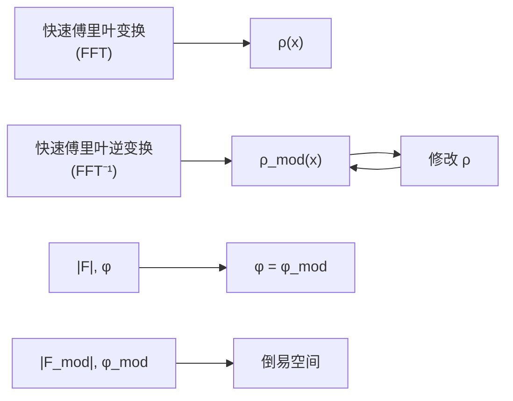
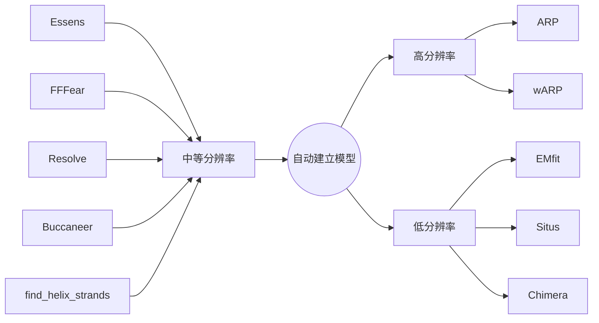

优化探测器和晶体参数。

## 23.8.5 衍射点强度的总和与轮廓拟合方法

确定积分强度有两种截然不同的方法:总和积分和轮廓拟合（图23-26）。总和积分只需要将斑点区域内的所有像素值相加，然后减去估计的背景贡献值。轮廓拟合则假设已知实际斑点形状或轮廓（在二维或三维中），并通过寻找比例因子来推导强度，该比例因子将已知（或标准）轮廓应用于观察到的斑点轮廓时给出最佳拟合。在实践中，轮廓拟合需要两个单独的步骤:确定标准轮廓和评估轮廓拟合强度。轮廓拟合可以减小与低强度相关的随机误差，但对于非常高的强度则没有改进。轮廓拟合在估计饱和衍射和处理未完全分辨的衍射斑点方面提供了额外的优势。

## 23.8.6 数据还原

在一组X射线衍射图像上进行衍射点积分，得到一份衍射强度的列表之后，通常会对数据进行一系列操作，这一系列操作被称为“数据还原”。这些过程包括

确定点群和可能的空间群，将所有数据放在一个共同的尺度上，确定是否拒绝收集的数据的某些部分或削减分辨率，并从强度中估计结构振幅 $|F|$ 。数据的内部一致性统计还提供了数据集整体质量的良好指标。数据还原试图纠正由于数据收集期间实验条件的变化对测量强度的影响，例如入射光强度的变化、晶体被照射的体积、主要或次要束的吸收以及平均辐射损伤。一般通过尝试使对称相关或重复测量的衍射强度相等来完成，即尽可能使数据内部自洽一致:

$$
\Psi = \sum_ {h} \sum_ {l} w _ {h l} (I _ {h l} - g _ {h l} \left<   I _ {h} \right> ^ {2} + \text {parameter\_restraint\_terms}, \tag {23-7}
$$

其中， $\langle I_{h}\rangle$ 是 $I_{h}$ 衍射点的l次测量结果的平均。

## 23.8.7 数据品质评估

一旦将所有强度归一化，并获得每个强度的误差估计，我们可以评估数据的内在一致性和信噪比。我们可以根据图像编号（相当于时间或晶体旋转）以及分辨率对数据进行分析，以检测辐射损伤强弱或不一致的数据区域，并确定最高分辨率的截断点。需要注意的是，对称相关的观察可能受到相同系统误差的影响，导致内在一致性测量往往低估真实误差。传统上，我们通过 $R$ 因子来评估内在一致性。通过冗余度加权的 $R_{\mathrm{meas}}(R_{\mathrm{r.i.m.}})$ 相对于 $R_{\mathrm{merge}}$ 有所改进，因为它对数据的冗余度不敏感，而 $R_{\mathrm{merge}}$ 则随着冗余度的增加而增加，即使平均强度在改善。$R_{\mathrm{p.i.m.}}$ 提供了合并多个观测后的数据质量估计。另一种用于分析内在一致性的替代方法是将观测结果随机分成两部分，然后计算两部分之间的线性相关系数 $CC\frac{1}{2}$。

text_image

Refinement Information
Space Group: P4
Resolution: 50.00 - 1.46
Positional: 1098 X-χ2: 0.78 Y-χ2: 0.71 (0)
Partially: 1270 χ2: 1.16 (84)
X Beam: 150.055 Y Beam: 148.844
a: 79.06 b: 79.06 c: 38.06
α: 90.00 β: 90.00 γ: 90.00
Crystal Rotation X: 148.382 8.811 0.004
Crystal Rotation Y: 1.722 -0.882 0.003
Crystal Rotation H: 2.488 0.002 0.008
Detector Rotation X: 0.818 -0.008 0.008
Detector Rotation Y: 0.813 -0.003 0.009
Detector Rotation Z:
Cresfire X: 8.223 0.822 0.834
Cresfire Y: 8.228 -0.882 0.833
Cresfire ZY: -0.895 -0.901 0.849
Distances: 75.139 0.826 0.816
Possitivity:
Y Scale: 8.9998 8.00025 8.8924
Bmm: 0.00033 -0.00033 8.8917
χ²x = Σ(hkl (x预测-x实验)²)/σ²x²
χ²y = Σ(hkl (y预测-y实验)²)/σ²y²
χ²p = Σ(hkl (Pφp₂-P₀)²)/σ²p₀²

图23-25 晶体和探测器参数的优化

violin

| 区域 | 统计方式 |
| --- | --- |
| 背景 | 背景估计 |
| 背景 | 背景 |
| 背景 | 背景估计 |
| 积分强度 | 积分强度 |

图 23-26 衍射点强度的积分

$$
R _ {\mathrm{merge}} = \sum_ {h} \sum_ {i} \mid I _ {h i} - \langle I _ {h} \rangle \mid / \sum_ {h} \sum_ {i} \langle I _ {h} \rangle ,
$$

$$
R _ {\mathrm{meas}} = R _ {\mathrm{r.i.m.}} = \sum_ {h} \sum_ {i} \left[ \left(\frac {n _ {h}}{n _ {h} - 1}\right) ^ {\frac {1}{2}} | I _ {h i} - \langle I _ {h} \rangle | \right] / \sum_ {h} \sum_ {i} \langle I _ {h} \rangle , \tag {23-8}
$$

$$
R _ {\mathrm{p.i.m.}} = \sum_ {h} \sum_ {i} \left[ \left(\frac {1}{n _ {h} - 1}\right) ^ {\frac {1}{2}} | I _ {h i} - \langle I _ {h} \rangle | \right] / \sum_ {h} \sum_ {i} \langle I _ {h} \rangle_ {\circ}
$$

## 23.8.8 结构因子强度的分布及孪晶检测

## (1) 威尔逊分布

威尔逊分布（Wilson distribution）是一种概率分布，用于描述结构因子的情况。假设我们已知晶胞中的原子类型（即散射因子 $f$），并假设每个原子可位于晶胞中的任意位置，其对结构因子的贡献相位可以取任意值。威尔逊分布在数据调整和确定整体热运动方面非常有用。

① 非中心对称晶体 晶体的结构因子计算公式可表示为

$$
F = \sum_ {j = 1} ^ {N} f _ {j} \mathrm{e} ^ {2 \pi \mathrm{i} h r _ {j}} = \sum_ {j = 1} ^ {N} f _ {j} \cos 2 \pi h r _ {j} + \mathrm{i} \sum_ {j = 1} ^ {N} f _ {j} \sin 2 \pi h r _ {j} = A + \mathrm{i} B _ {\circ} \tag {23-9}
$$

结构因子的实部和虚部分别记为 $A$ 和 $B$ ，它们分别是多个随机变量的求和。根据中心极限定理，$A$ 和 $B$ 各自服从正态分布。为了表征这两个正态分布，我们分别计算 $A$ 和 $B$ 的均值以及方差:

$$
\langle A \rangle = \sum_ {j = 1} ^ {N} \left\langle f _ {j} \cos 2 \pi h r _ {j} \right\rangle = 0, \tag {23-10}
$$

$$
\langle B \rangle = \sum_ {j = 1} ^ {N} \left\langle f _ {j} \sin 2 \pi h r _ {j} \right\rangle = 0, \tag {23-11}
$$

$$
\sum_ {A} = \left\langle A ^ {2} \right\rangle - \left\langle A \right\rangle^ {2} = \sum_ {j = 1} ^ {N} \left\langle (f _ {j} \cos 2 \pi h r _ {j}) ^ {2} \right\rangle = \frac {1}{2} \sum_ {j = 1} ^ {N} f _ {j} ^ {2}, \tag {23-12}
$$

$$
\sum_ {B} = \left\langle B ^ {2} \right\rangle - \left\langle B \right\rangle^ {2} = \sum_ {j = 1} ^ {N} \left\langle \left(f _ {j} \sin 2 \pi h r _ {j}\right) ^ {2} \right\rangle = \frac {1}{2} \sum_ {j = 1} ^ {N} f _ {j} ^ {2} 。 \tag {23-13}
$$

根据均值和方差，我们可以推导出 $A$ 和 $B$ 的概率分布:

$$
P (A) = N _ {A} \exp \left(- A ^ {2} \Big / \sum_ {j = 1} ^ {N} f _ {j} ^ {2}\right),
$$

$$
P (B) = N _ {B} \exp (- B ^ {2} / \sum_ {j = 1} ^ {N} f _ {j} ^ {2}) 。 \tag {23-14}
$$

假设 $A$ 和 $B$ 是相互独立的，$(A, B)$ 的联合概率可以表示为 $P(A)$ 和 $P(B)$ 的乘积:

$$
P (A, B) = P (A) P (B) = \exp \left(- \frac {A ^ {2} + B ^ {2}}{\sum_ {j = 1} ^ {N} f _ {j} ^ {2}}\right) = \exp (- | F | ^ {2} / \sum_ {j = 1} ^ {N} f _ {j} ^ {2}) 。 \tag {23-15}
$$

强度和结构因子振幅的概率密度函数:

$$
P (\mid F \mid^ {2}) = \exp (- \mid F \mid^ {2} / \sum_ {j = 1} ^ {N} f _ {j} ^ {2}),
$$

$$
P (\left| F \right|) = (2 / \sum_ {j = 1} ^ {N} f _ {j} ^ {2}) \left| F \right| \exp (- \left| F \right| ^ {2} / \sum_ {j = 1} ^ {N} f _ {j} ^ {2}) 。 \tag {23-16}
$$

归一化结构因子定义为 $E = \frac{F}{\sqrt{\sum_{j=1}^{N}f_j^2}}$ ，则概率简化为

$$
P (E ^ {2}) = \exp (- E ^ {2}),
$$

$$
P (E) = 2 E \exp (- E ^ {2}) 。
$$

② 中心对称晶体 同样的方法可以推导出中心对称晶体的归一化结构因子的概率密度函数如下:

$$
P (E) = \sqrt {\frac {2}{\pi}} \exp \left(- \frac {E ^ {2}}{2}\right) 。 \tag {23-17}
$$

根据非中心对称密度函数和中心对称密度函数，我们可以计算得到一个统计量（表23-6），用于区分非中心和中心对称晶体。

表 23-6 非中心对称和中心对称晶体中归一化结构因子的统计量

| 统计量 | 非中心对称 | 中心对称 |
| --- | --- | --- |
| $\langle E \rangle$ | $\sqrt{\pi}/2 \approx 0.886$ | $\sqrt{2/\pi} \approx 0.798$ |
| $\langle E^{2} \rangle$ | 1 | 1 |
| $\langle \|E^{2}-1\| \rangle$ | $2/e \approx 0.736$ | $\sqrt{8/e\pi} \approx 0.968$ |
| 威尔逊比率 $M = \frac{\langle E \rangle^{2}}{\langle E^{2} \rangle}$ | $\pi/4 \approx 0.785$ | $2/\pi \approx 0.637$ |

## (2) 李晶现象

在晶体学领域，孪晶并不罕见，尽管长期以来一直被认为是确定结构时最严重的潜在障碍之一。随着面探测器的使用，孪晶的检测和孪生晶体衍射照片的处理得到了极大的改进。计算机软件的发展也使以前难以处理的孪晶问题现在可以获得与非孪晶样品相当的结果。因此，从孪晶晶体中确定结构变得越来越常见。

① 定义 当晶体结构的空间群所隐含的对称性低于晶胞（或超晶胞）的实际对称性时，就可能会出现孪晶现象。用堆砌砖块来类比:砖块的整体形状或轮廓是mmm，但如果我们考虑一侧的“凹陷”以及上面刻有“正面”的字样，点群对称性仅为2（这堆砖的“空间群”将是P2）（图23-27A）。堆砌砖块一般的方式是所有砖块的放置方向相同，如图23-27B所示，注意到砖块是通过与页面垂直的二重轴或简单平移相互关联的，这两种操作都是空间群的元素。然而，也可以将一些砖块倒置放置（图23-27C）。砖块的整体形状以及边缘之间的 $90^{\circ}$ 角度，使这种方式成为可能，而不会影响砖块的堆叠。在将某些砖块倒置时，我们使用了 $\mathrm{mmm}$ 点群而不是 $2 / \mathrm{m}$ 点群的对称操作中的二重轴。图23-27B类似于单晶体，图23-27C就类似于孪晶了。在图23-27C中，存在两个区域变体:同一区域内的砖块（对应于晶胞）通过平移相互关联；不同区域的砖块通过平移加上在砖块的轮廓或整体形状

(A)

(B)

text_image

正面
正面
正面
正面
正面
正面
正面
正面
正面
正面
正面
正面
正面
正面
正面
正面
正面
正面
正面
正面
正面
正面
正面
正面
正面
正面
正面
正面
正面
正面
正面
正面
正面
正面
正面
正面
正面
正面
正面
正面
正面
正面
正面
正面
正面
正面
正面
正面
正面
正面
正面

(C)

text_image

正面
里卫
正面
里卫
正面
里卫
正面
里卫

图23-27 一个关于孪晶的简单模型

（A）一块砖；砖的顶部有一个凹陷处，凹陷处的两侧刻有“正面”字样。（B）一堆砖，所有的砖都通过平移与彼此相关。这类似于构成单个晶体的晶胞之间的关系。（C）这里有些砖被倒置放置。砖仍然可以拼接在一起，因为当我们将砖翻转时，使用了砖的轮廓或整体形状的对称元素。这类似于孪晶中晶胞之间的关系。在（B）和（C）中，这些图形旨在表示整个晶体。

的点对称性中发生的旋转相互关联。这个额外的对称操作在晶体学中对应于孪生定律。在替代方向上的砖块比例对应于孪晶缩放因子，在这个例子中为0.5。

每个孪晶区域都会产生自己的衍射图案；在衍射仪上测量到的是所有这些图案的叠加，其强度根据区域因子进行加权。来自不同区域的衍射图案的相对方向与区域的相对方向相同，因此如果它们通过绕 $a$ 轴旋转 $180^{\circ}$ 相互关联，那么它们的衍射图案也是如此。图23-28展示了 $\beta = 90^{\circ}$ 的单斜晶体结构的孪晶情况。孪晶在晶体学中是一个问题，因为它导致了非对称关系的衍射之间的叠加或重叠。在对孪晶晶体进行结构分析时，准确地确定哪些衍射对特定强度测量有贡献非常重要，这就是孪晶规则的作用。

(A)

text_image

(A)
l₁
h
l

(B)

text_image

(B)

(C)

text_image

J₁
J₂
α = 0.5

(D)

text_image

J₁
J₂
α= 0.2

图23-28 垂直于 $a$ 轴的二重旋转对P21/c空间群的单斜晶体（ $\beta = 90^{\circ}$ ）的衍射图案产生孪晶效应

这里只展示了h0l区域显示出的特殊现象。（A）来自单一晶体的h0l区域的衍射图案，可能代表了孪晶的一种情形。（B）与（A）相似，但经过绕 $a^{*}$ 轴（或 $h$ 轴）的旋转，这与单胞的 $a$ 轴对齐，呈现出孪晶的另一个区域的衍射图案。（C）将（A）和（B）叠加在一起，模拟了具有区域比例因子为0.5的孪晶，即两个区域以相等的比例存在。（D）模拟了具有区域比例因子为0.2的孪晶，其中晶体由 $80\%$ 的一个区域A和 $20\%$ 的另一个区域B组成。每个图案的 $\mid E^2 -1\mid$ 值分别为:（A）和（B）为1.015，（C）为0.674，（D）为0.743。对于中心晶体结构，理想（非孪晶） $\mid E^2 -1\mid$ 值为0.97，这表示衍射图案具有强衍射和弱衍射的存在；而在非中心分布中，强度更均匀分布，理想值为0.74。

孪晶晶体测量得到的强度是根据两个孪晶区域的体积比例进行合并的:

$$
J _ {1} = \alpha I _ {1} + (1 - \alpha) I _ {2}, \tag {23-18}
$$

$$
J _ {2} = (1 - \alpha) I _ {1} + \alpha I _ {2} 。 \tag {23-19}
$$

其中， $I_{1}$ 和 $I_{2}$ 代表与孪晶操作相关联的一对衍射点的测量强度； $J_{1}$ 和 $J_{2}$ 表示这些衍射点的真实强度，即来自非孪晶晶体的衍射； $\alpha$ 是孪晶比例，即较小孪晶成分的体积分数。

② 孪晶的识别 在小分子和生物大分子晶体学领域，已经提出并实践了多种基于强度分布的测试方法，包括 $N(Z)$ 测试、$H$ 测试、$L$ 测试等（表23-7）。

表 23-7 关于非孪晶和孪晶晶体的各种统计公式

<table><tr><td>强度分布</td><td colspan="4">统计公式</td></tr><tr><td>累加强度分布</td><td></td><td></td><td></td><td></td></tr><tr><td>非中心对称衍射</td><td></td><td></td><td></td><td></td></tr><tr><td>非孪晶</td><td colspan="4"> $_1N(z) = 1 - \exp(-z)$ </td></tr><tr><td>50% 李晶</td><td colspan="4"> $_1N(z, 0.5) = 1-(1+2z) \exp(-z)$ </td></tr><tr><td>α 李晶</td><td colspan="4"> $_1N(z, \alpha) = \{ \alpha [ \exp(-z/\alpha)-1 ] - (1-\alpha) \exp[-z/(1-\alpha)] - 1 \} / (1-2\alpha)$ </td></tr><tr><td>中心对称衍射</td><td></td><td></td><td></td><td></td></tr><tr><td>非孪晶</td><td colspan="4"> $_{-1}N(z) = erf\left( \frac{z}{2} \right)^{\frac{1}{2}}$ </td></tr><tr><td>50% 李晶</td><td colspan="4"> $_{-1}N(z, 0.5) = 1 - \exp(-z)$ </td></tr><tr><td>累加 S(H) 分布</td><td></td><td></td><td></td><td></td></tr><tr><td>非中心对称衍射</td><td colspan="4"> $S(H) = H/(1-2\alpha)$ </td></tr><tr><td>中心对称衍射</td><td colspan="4"> $S(H) = \arccos \frac{H}{(2\alpha-1)/\pi}$ </td></tr><tr><td>I 和 H 的分布矩</td><td> $\langle I^2 \rangle / \langle I \rangle^2$ </td><td> $\langle F \rangle^2 / \langle I \rangle$ (威尔逊比率)</td><td> $\langle H \rangle$ </td><td> $\langle H^2 \rangle$ </td></tr><tr><td>非中心对称衍射</td><td></td><td></td><td> $\frac{1}{2} - \alpha$ </td><td> $\frac{(1-2\alpha)^2}{3}$ </td></tr><tr><td>非孪晶</td><td>2.0</td><td>0.785 (=π/4)</td><td>0.5</td><td>0.333</td></tr><tr><td>50% 李晶</td><td>1.5</td><td>0.885</td><td>0.0</td><td>0.0</td></tr><tr><td>中心对称衍射</td><td></td><td></td><td> $\frac{2(1-2\alpha)}{\pi}$ </td><td> $\frac{(1-2\alpha)^2}{3}$ </td></tr><tr><td>非孪晶</td><td>3.0</td><td>0.637 (=2/π)</td><td>0.637</td><td>0.5</td></tr><tr><td>50% 李晶</td><td>2.0</td><td>0.785</td><td>0.0</td><td>0.0</td></tr><tr><td>L的分布矩和N( $|L|$ )的累加分布</td><td> $\langle |L| \rangle$ </td><td> $\langle L^2 \rangle$ </td><td>N(L)</td><td>N( $|L|$ )</td></tr><tr><td>非中心对称</td><td></td><td></td><td></td><td></td></tr><tr><td>非孪晶</td><td>1/2</td><td>1/3</td><td> $(L+1)/2$ </td><td> $|L|$ </td></tr><tr><td>孪晶</td><td>3/8</td><td>1/5</td><td> $\frac{(L+1)^2(2-L)}{4}$ </td><td> $\frac{|L|(3-L^2)}{2}$ </td></tr><tr><td>中心对称非孪晶</td><td>2/π</td><td>1/2</td><td> $\frac{\arccos(-L)}{\pi}$ </td><td> $\frac{2}{\pi} \arcsin L$ </td></tr></table>

## 23.9 解决蛋白质晶体学中相位问题的方法

在蛋白质晶体学中，相位问题（phase problem）是结构解析的核心挑战。由于X射线衍射实验仅能记录衍射点的振幅（强度开方），而丢失了相位信息（即结构因子的复数角度），因此需要借助特定方法恢复相位，才能通过傅里叶逆变换计算电子密度图。以下是主要求解策略的分类与原理。

## 23.9.1 实验相位解决方法

## (1) 同晶置换法

最早用于解决蛋白质晶体衍射相位的方法是多对同晶置换法（multiple isomorphous replacement，MIR）。佩鲁茨及其合作者证明了向血红蛋白晶体中引入的汞原子可以用于确定相位，这称为单对同晶置换法（single isomorphous replacement，SIR）。在单对同晶置换法中，来自单个重原子衍生物的相位信息是不确定的，通常每个衍射点提供两种选择。然而，通过引入第二个特异衍生物可以解决这种不确定

性，正如贝弗特（Johannes Bijvoet）对马钱子碱的分析所提出的，并由哈克（David Harker）进行了代数和图形化的详细说明。哈克的相位图解释了来自单一同晶衍生物的不确定性（图23-29），以及如何通过引入第二个衍生物来解决这个问题（图23-30）。布洛（David Blow）和罗斯曼（Michael Rossmann）提出，来自单个重原子衍生物的反常散射信号也可用于解决相位的不确定性。他们首次提到了具有反常散射的多对同晶置换法（multiple isomorphous replacement with anomalous scattering，MIRAS）用于还原血红蛋白的结构，并首次使用了具有反常散射的单对同晶置换（single isomorphous replacement with anomalous scattering, SIRAS）用于红铁蛋白的结构解析。

text_image

单对同晶置换
FPH = Fp + FH
α
FPH
Fp
FH
α1
|FP|
-FH
α2
|FPH|

图23-29 展示单对同晶置换法原理的哈克图通过引入第二个重原子 $F_{\mathrm{PH2}}$ ，相位问题得以解决。

理论上，单个衍生物的同晶置换差异为

$$
\left| F _ {\mathrm{PH}} \right| ^ {2} - \left| F _ {\mathrm{P}} \right| ^ {2} = \left| F _ {\mathrm{H}} \right| ^ {2} + 2 \left| F _ {\mathrm{P}} \right| \left| F _ {\mathrm{H}} \right| \cos \left(\varphi_ {\mathrm{P}} - \varphi_ {\mathrm{H}}\right) 。
$$

$(|F_{\mathrm{PH}}| - |F_{\mathrm{P}}|)^2$ 的帕特森图近似等于 $|F_{\mathrm{H}}|^2$ 的帕特森图，利用它就可以解析出重原子的位置。但单个重原子衍生物的相位信息是不确定的。

尽管在解析 $6\AA$ 肌红蛋白结构时，衍射点数量较少，但通过哈克图解法对每一个衍射点进行手动求解，取得了很好的成功，其中使用了五个重原子衍生物。然而，这种方法费力且充满困难。1959年，布洛和克里克提出了不闭合误差（图23-31）和“最佳傅里叶”作为概率加权的方法，使得相位求解可以程序化，加快了相位求解和结构解析的速度。布洛-克里克的不闭合误差被定义为

$$
\varepsilon (\varphi) = \left| F _ {\mathrm{PH}} \right| - \left| F _ {\mathrm{P}} (\varphi) + F _ {\mathrm{H}} \right|,
$$

相位概率分布呈现为

$$
P (\varphi) = N \exp \left[ - \frac {\varepsilon^ {2} (\varphi)}{2 E ^ {2}} \right],
$$

这里， $E^2 = \langle \varepsilon^2 (\varphi_{\mathrm{c}})\rangle$ 表示的是不闭合误差的方差。

## （2）共振和反常散射方法

反常散射是由X射线能量与基态核心轨道和未占据外层轨道之间的跃迁能量之间的共振引起的，这是一种量子现象。在吸收边附近，由于反常散射的存在，散射因子会发生修正，表达式如下:

$$
f = f ^ {0} (S) + f ^ {\prime} (\lambda) + \mathrm{i} f ^ {\prime \prime} (\lambda) 。 \tag {23-21}
$$

其中， $f'$  和  $f''$  分别代表了反常散射因子的实部和虚部修正量。

由于核心电子轨道靠近原子核附近，而外层电子相对扩散，所以正常的散射 $f^{0}(S)$ 会随着衍射矢量幅度的增加而平滑地减小。正常的散射 $f^{0}(S)$ 取决于散射角度，而不直接取决于波长。相比之下， $f'$ 在散射角度上几乎没有变化，但在靠近吸收边共振时，它对波长非常敏感。

通过光电吸收而被排出的电子与吸收成比例，并且在此过程中会发射出荧光光子（见图4-22）。这为测量 $f''$ 谱提供了一种方法。反过来，可以通过Kramers-Kronig变换从 $f''$ 值确定 $f'$ 谱（图 23-32）。

text_image

多对同晶置换
|F_{PH2}|
|F_P|
-F_H2
-F_H
|F_{PH}|
α_1
α_2

图23-30 展示多对同晶置换法原理的哈克图

图23-31 在单对同晶置换法实验中单个衍射的相位概率

$F_{重心}$  代表了分布的重心。
m=0.23 意味着  $76^{\circ}$  的相位误差，因为  $\cos76^{\circ}=0.23$ 。

line

| X射线的能量 (keV) | f'' (e) | f' (e) |
| --- | --- | --- |
| ~12.63 | ~8 | ~-12 |
| ~12.64 | ~5 | ~-8 |
| ~12.9 | ~5 | ~-3 |

图23-32 $f^{\prime}$ 和 $f''$ 随波长的变化

多波长反常散射（multi-wavelength anomalous dispersion, MAD）是利用蛋白质中的重元素（如硒、汞等）在吸收边附近产生的反常散射效应来解决结构相位问题的方法。MAD 方法的基本原理如下:

① 选择多个波长 在实验中选择多个不同波长的X射线，通常涵盖蛋白质中重元素的吸收边附近。
② 收集散射数据 在每个波长下，收集蛋白质晶体的X射线衍射数据。
③ 解析蛋白质结构 通过比较不同波长下的衍射数据，计算出蛋白质结构因子的差异部分，从而得到重元素的位置和分布信息。
④ 相位计算 使用差异部分的数据，结合重元素的位置信息，计算蛋白质结构的相位（图 23-33）。

MAD 方法克服了传统同晶置换法中相位问题的困难，

利用不同波长下的衍射数据确定蛋白质结构的相位信息。该方法广泛应用于生物大分子的结构研究。为了充分利用MAD技术，通常需要合适的蛋白质晶体和实验条件，并借助专业软件和技术进行数据处理和结构计算。

单波长反常散射（single-wavelength anomalous dispersion，SAD）是一种利用单一波长的X射线衍射数据，通过反常散射效应解析蛋白质晶体结构相位的方法。

text_image

ΔF⁺
F⁺
+F″ₐ
Fₐ
+F″ₐ'
-F″ₐ'
F⁻ₜ
φₐ
Fₙ
φₜ

图23-33 单波长反常散射相位求解的哈克图

## 23.9.2 分子置换法

分子置换法（molecular replacement method）是一种解析蛋白质结构的计算方法，它利用已知的分子结构模型来解决相关分子的未知晶体结构（见图4-23）。分子置换法通过提供新结构的相位的初始估计来解决晶体学相位问题，这些相位是从先前已知结构中获得的，而不是利用实验方法（如同晶置换法或者反常散射法）解决。随着已知结构数据库（PDB）的扩大，分子置换法的使用自然变得更加普遍。特别是蛋白质结构预测方法的突破，AlphaFold预测模型的精度已经可以满足大部分蛋白质结构相位的解析了。分子置换法目前已经用于解决高达 $70\%$ 的生物大分子结构。其基本原理是:如果要研究的结构未知的蛋白质分子与另一个结构已知的蛋白质分子类似，并且已经收集了未知结构的一组衍射强度数据，只要尝试在未知晶体中已知模型的所有可能的取向（orientation）与位置（position），并找到预测的衍射与观察的衍射最匹配的位置。此时，未知晶体的相位就可以从模型计算的相位中“借用”，并使用这些借用的相位和实验观察到的振幅计算一个初始的电子密度图。最后用常规的晶体学修正技术加以修正，最终获得精确的分子结构。

分子置换法的关键是确定分子在晶胞中的取向与位置。帕特森函数包含了分子在晶胞中的取向和位置信息。分子内矢量集合与分子取向紧密相关，分子间矢量集合与分子位置紧密相关。可以通过计算晶体的帕特森函数和模型晶胞的帕特森函数（模型晶胞构建:含一个结构已知的搜索分子）来解决分子取向问题；相对晶体帕特森函数旋转模型帕特森函数，观察两个帕特森函数符合情况，当搜索分子与目标分子取向一致时，帕特森函数符合最好，从两个帕特森函数符合最好的旋转角度，可推出分子在晶胞中的取向。两个帕特森函数的匹配度可以用乘积函数或者相关系数表征，也可以在倒易空间计算帕特森乘积函数，其表示为

$$
R F (R) = \int_ {r _ {\mathrm{min}}} ^ {r _ {\mathrm{max}}} P _ {\mathrm{observed}} (u) P _ {\mathrm{model}} (R, u) \mathrm{d} u _ {\circ}
$$

观测晶体的帕特森函数 $P_{\mathrm{observed}}(u)$ 和旋转后的模型帕特森函数 $P_{\mathrm{model}}(R,u)$ 乘积在半径 $r_{\mathrm{max}}$ 内进行积分，并排除掉原点附近的影响。在任意旋转 $R$ 下，如果晶体帕特森函数和旋转后的模型帕特森函数中的峰值重合，点 $u$ 的贡献才会很大。这个函数可以在帕特森空间中进行评估，可以在任何体积上进行，不一定必须是球形，也可以通过倒易空间中的傅里叶变换来评估。倒易空间版本可以通过巧妙的因式分解实现快速计算，即“快速旋转函数”，但仅适用于球形体积。

解决分子位置问题可以构造一个与晶体的几何和对称性等同的模型晶体，让取向已知的搜索分子在此模型中平移，计算搜索分子处于不同位置时模型的帕特森函数，并与晶体的帕特森函数相比较，两者符合最好时，给出分子位置信息。晶胞平移 $t$ 的帕特森平移函数定义为观测和模型帕特森函数的乘积，并对整个晶胞进行积分:

$$
T 2 (t) = \int_ {V} \left[ P _ {\mathrm{observed}} (u) - \sum_ {j = 1} ^ {N _ {\mathrm{sym}}} P _ {j j} (u) \right] \left[ P _ {\mathrm{model}} (u, t) - \sum_ {j = 1} ^ {N _ {\mathrm{sym}}} P _ {j j} (u) \right] \mathrm{d} u,
$$

其中， $P_{\mathrm{observed}}(u)$ 是在点 $u$ 处的晶体帕特森函数， $P_{\mathrm{model}}(u,t)$ 是通过搜索向量 $t$ 移动的模型帕特森函数， $P_{jj}(u)$ 是计算的自向量， $N_{\mathrm{sym}}$ 是对称操作数量。相对于旋转函数，平移函数是一个需要考虑所有的对称操作的三维搜索函数，既可以在帕特森空间计算，也可以通过快速傅里叶变换高效地在倒易空间中进行。

## 23.10 密度修正

密度修正是蛋白质晶体学中用于优化电子密度图的关键计算技术，旨在通过引入先验知识和物理约束，修正初始相位误差，提高电子密度的可解释性，从而辅助蛋白

质模型的构建与优化。

## 23.10.1 相位概率分布

## (1) Sim 概率分布

为了评估相位求解的准确性，西姆（G.A.Sim）于1960年推导出Sim概率公式。假设部分结构已知且部分 $F_{\mathrm{c}}$ 是正确的，所有误差都源自 $F_{\mathrm{c}}$ 和 $F_{\mathrm{o}}$ 的不闭合误差（图23-34）。

根据余弦定理

$$
\left| \Delta F \right| ^ {2} = \left| F _ {\mathrm{o}} \right| ^ {2} + \left| F _ {\mathrm{c}} \right| ^ {2} - 2 \left| F _ {\mathrm{o}} \right| \left| F _ {\mathrm{c}} \right| \cos \Delta \alpha , \tag {23-22}
$$

不闭合误差符合正态分布，因此相位误差的概率分布可表示为:

$$
P (\Delta \alpha) = \exp \left(- \frac {\left| \Delta F \right| ^ {2}}{\sigma_ {\Delta} ^ {2}}\right) = N \exp (X \cos \Delta \alpha), \tag {23-23}
$$

其中，N 是概率密度的归一化因子， $X=\frac{2\left|F_{o}\right|\left|F_{c}\right|}{\sigma_{\Delta}^{2}}$ 。

接着，分别计算 $\sin \Delta \alpha$ 和 $\cos \Delta \alpha$ 的平均值:

$$
\langle \sin \Delta \alpha \rangle = \int_ {- \pi} ^ {\pi} \sin \Delta \alpha \frac {\exp (X \cos \Delta \alpha)}{2 \pi I _ {0} (X)} \mathrm{d} (\Delta \alpha) = 0, \tag {23-24}
$$

$$
\langle \cos \Delta \alpha \rangle = \int_ {- \pi} ^ {\pi} \cos \Delta \alpha \frac {\exp (X \cos \Delta \alpha)}{2 \pi I _ {0} (X)} \mathrm{d} (\Delta \alpha) = \frac {I _ {1} (X)}{I _ {0} (X)} 。 \tag {23-25}
$$

品质因子可以通过以下方式计算:

$$
m = \sqrt {\left\langle \sin \Delta \alpha \right\rangle^ {2} + \left\langle \cos \Delta \alpha \right\rangle^ {2}} = \left\langle \cos \Delta \alpha \right\rangle = \frac {I _ {1} (X)}{I _ {0} (X)}, \tag {23-26}
$$

其中 $I_{1}$ 和 $I_0$ 分别代表贝塞尔函数的一阶和零阶形式。

## (2) Luzzati 分布

然而，在结构解析的早期阶段，一些结构几乎不可能是完全没有误差的。卢扎蒂（Par Luzzati）认为每个原子的坐标都存在 $\Delta x_{j}$ 的误差（图23-35），因此，在 $F_{\mathrm{c}}$ 上引入一个 D 参数，它会减小  $F_{c}$  的幅值，但不改变相位方向。

text_image

F₀
ΔF
Fc
Δα

图23-34 Sim概率模型

text_image

df₁
fⱼexp(2πih·xⱼ)
fⱼexp[2πih·(xⱼ+Δxⱼ)]
dⱼ=∫p(Δxⱼ)exp(2πih·Δxⱼ)d(Δxⱼ)

图23-35 Luzzati的原子坐标误差分析

## (3) Srinivasan 分布和  $\sigma_{A}$

斯里尼瓦桑（K. Srinivasan）考虑到了Luzzati的坐标误差对结果的影响，重新推导了Sim概率分布（图23-36）:

$$
P (\Delta \alpha) = \exp \left(- \frac {\left| F _ {\mathrm{o}} - D F _ {\mathrm{c}} \right| ^ {2}}{\sigma_ {\Delta} ^ {2}}\right) 。 \tag {23-27}
$$

简化整个公式，引入归一化结构因子:

text_image

DFc
F
Fc

图23-36 考虑Luzzati坐标误差后的概率模型

$$
E _ {\mathrm{o}} = \frac {F _ {\mathrm{o}}}{\sqrt {\varepsilon \sum_ {j = 1} ^ {N} f _ {j} ^ {2}}}, \tag {23-28}
$$

$$
E _ {\mathrm{c}} = \frac {F _ {\mathrm{c}}}{\sqrt {\varepsilon \sum_ {j = 1} ^ {P} f _ {j} ^ {2}}} \circ \tag {23-29}
$$

概率分布被简化为

$$
P (\Delta \alpha) = \exp \left(- \frac {\left| E _ {\mathrm{o}} - \sigma_ {\mathrm{A}} E _ {\mathrm{c}} \right| ^ {2}}{1 - \sigma_ {\mathrm{A}} ^ {2}}\right), \tag {23-30}
$$

其中 $\sigma_{\mathrm{A}} = D\sqrt{\frac{\sum_P}{\sum_N}}$。

## （4）引入傅里叶变化的权重因子

鉴于在Sim概率中，品质因子 $m$ 可以有效地表示相位误差，因此在进行电子密度的傅里叶计算时，将品质因子作为权重因子可以改善最终的电子密度图。

$$
\rho^ {(r)} = \sum_ {h} F (h) \mathrm{e} ^ {\mathrm{i} \phi_ {c}} \mathrm{e} ^ {- 2 \pi \mathrm{i} h \cdot r} \tag {23-31}
$$

$$
\rho^ {\prime (r)} = \sum_ {h} m F (h) \mathrm{e} ^ {\mathrm{i} \phi_ {c}} \mathrm{e} ^ {- 2 \pi \mathrm{i} h \cdot r} \tag {23-32}
$$

## 23.10.2 修正电子密度

密度修正是X射线晶体学中的一项技术，旨在改善从晶体学数据中获取的电子密度图的质量，以便更好地解释和构建生物大分子结构模型。其基本思想是利用晶体中电子密度分布的统计信息和假设来调整和优化初始的电子密度图，因为初始电子密度图通常存在噪声和不完整性（图23-37）。密度修正方法多种多样（图23-38），其中一种常用的方法是溶剂平滑法，该方法假设围绕生物大分子的溶剂区域的电子密度是均匀的。通过估计并从电子密度图中减去溶剂区域的贡献，可以增强与生物大分子本身相对应的电子密度。其它密度修正技术包括直方图匹配、非晶体学对称平均、多晶平均和最大似然方法。这些方法的目标是提高信噪比、减少模型偏差，并提高电子密度的准确性。密度修正通常与模型构建和精修过程迭代结合使用。修正后的电子密度图用于指导手动或自动模型构建，将生物大分子的原子坐标放置到电子密度中，然后对模型进行精修，并反复进行此过程直至收敛。

flowchart

图23-37 电子密度修正的流程图

line

| \(4sin^{2}\theta/\lambda^{2}\) | MIR | SF | HM | NCS | HM/SF/NCS |
| --- | --- | --- | --- | --- | --- |
| 0.01 | ~0.25 | ~0.34 | ~0.37 | ~0.28 | ~0.42 |
| 0.03 | ~0.32 | ~0.41 | ~0.41 | ~0.35 | ~0.46 |
| 0.05 | ~0.29 | ~0.35 | ~0.40 | ~0.29 | ~0.45 |
| 0.07 | ~0.21 | ~0.29 | ~0.32 | ~0.20 | ~0.49 |
| 0.09 | ~0.06 | ~0.18 | ~0.28 | ~0.05 | ~0.50 |
| 0.11 | ~0.05 | ~0.11 | ~0.19 | ~0.05 | ~0.41 |
| 0.13 | ~0.06 | ~0.10 | ~0.19 | 0.00 | ~0.37 |
| 0.15 | ~0.06 | ~0.04 | ~0.14 | 0.00 | ~0.34 |
| 0.17 | 0.00 | -0.02 | ~0.14 | 0.01 | ~0.33 |
| 0.19 | 0.00 | -0.01 | ~0.15 | 0.02 | ~0.29 |
| 0.21 | 0.00 | 0.01 | ~0.13 | -0.01 | ~0.24 |
| 0.23 | 0.00 | -0.06 | ~0.08 | 0.00 | ~0.19 |

图23-38 各种技术对电子密度的修正效果

MIR，多对同晶置换法；SF，溶剂平滑；HM，直方图匹配；NCS，非晶体学对称。

电子密度修正技术同时有助于克服SIR和SAD方法中衍射点相位的奇异性，特别是在辐射损伤的影响下，SAD方法结合密度修正逐渐取代了MAD方法。

## 23.11 蛋白质结构的建模、精修和验证

随着计算机技术的不断发展，模型的建立、结构的精修调整以及评估算法都已经转化为计算机程序。用户现在只需下载CCP4或者PHENIX程序包，通过简单的图形界面即可完成相关计算。由于这一领域已经高度自动化，因此本章只作简略的介绍，具体的算法细节不再详述，可以参考本章“扩展阅读”列表中的综述文章。

## 23.11.1 搭建原子模型

X射线晶体学仅用于检测晶体中原子周围的电子分布状态。模型的搭建需要根据电子密度确定原子核的位置以及相应的元素。模型的搭建可分为手动搭建和自动搭建两种方式。手动搭建通常在O或者Coot程序中进行，首先将电子密度图简化为山脊线的表示，然后识别出单个完整的分子，并逐步添加 $\mathrm{C}_{\alpha}$ 原子、主链骨架、侧链等。自动搭建通常采用模板匹配算法，根据电子密度图的分辨率不同，采用不同的算法（图23-39）。

## 23.11.2 结构精修

蛋白质结构精修（protein structure refinement）是对已解析的初步蛋白质结构进行进一步优化和改进的过程。其目标在于通过调整原子位置和结构参数，以使蛋白质结构更加准确、合理，并符合实验数据（图23-40）。

将实验观测数据（如X射线衍射数据）作为约束条件，引导精修过程，通过调整原子位置和键长、键角等几何参数，以更好地符合实验数据。在精修中，常常需要强加额外的约束条件，并修复由于初始模型不准确导致的错误或缺失的共价连接。通过蛋白质结构精修，可以提高结构的准确性和可信度，并为进一步的功能研究、药物设计和结构生物学研究提供更可靠的基础。

flowchart

图23-39 自动搭建模型的程序选择

## 23.11.3 验证和评估蛋白质结构模型

flowchart

图 23-40 结构精修的流程图

过去 50 年里，X 射线晶体学在仪器设备、方法

和软件等方面取得了长足的进步，但晶体学家仍有可能会犯错误。当晶体学数据的分辨率很高，并且晶体学家经验丰富时，模型可能不会有重大错误。然而，如果分辨率较低，并且晶体学家缺乏经验，那么出现严重错误的可能性就会大大增加。在最佳情况下，有缺陷的结构可能只引起有限的关注，然而任何严重的错误都会污染结构数据库，如PDB。在最坏的情况下，一个广为人知的结构中的严重错误可能会阻碍科学的发展，这种情况已经在ABC转运蛋白结构研究中发生了5次。

首先，模型在化学上应具有意义:键长、键角和扭转角应具有合理的数值；非标准化合物（如配体和辅助因子）应具有正确的原子类型；立体中心应具有正确的手性；平面基团应为平面等。模型在物理上也应具有意义:非共价键合的原子之间不应有不良接触或原子重叠（包括显式或隐式氢原子的存在）；蛋白质结构内核应紧密堆积；应有许多有利的氢键相互作用；电荷应主要与其它电荷相互作用等。温度因子应显示合理的形式:各向同性或者各向异性（例如，沿着侧链或依据溶剂接触的程度）等。显然，模型在晶体学方面也应该有意义:模型应解释（并且在未使用“测试集”衍射点的情况下）实验数据，而不做出不合理的假设，并且最低程度地过拟合（或“欠拟合”），配体结构通常应与其自身密度很好地匹配等。许多化学、物理和晶体学条件是由精修程序强加的约束，这使得这些检查从验证的角度来看不那么有用。该模型应该遵循这些条件，因此，任何这样的统计量（例如，常规的 $R$ 值和与理想值的键长均方根偏差）并不能提供模型正确性的独立证据。事实上，有研究证明，即便是一个错误的模型，也可以通过精修计算得出传统 $R$ 值和统计数据。另一方面，当然也要严格审查这些质量检查中的任何异常值（例如，非同寻常的短或长共价键）。

为了进行模型验证，评估模型的预测性质更为有用。一般来说，可以使用三种类型的数据和信息:模型与构建模型时未使用的先验知识的一致性、对所研究系统未使用的特定观察结果的预测，以及可进行实验测试的性质的预测。使用“测试集”的衍射点进行交叉验证（$R_{\mathrm{free}}$ 是第二类中的重要示例）。这三类中的其余部分基本上涵盖了这样一个要求，即好的模型应该符合我们所了解的关于生物大分子结构的所有知识，也符合实验生物学和生物化学。就生物大分子而言，基础物理和化学原理表现为经验观察到的结构规律。例如，非键相互作用导致蛋白质主链可采用的一组有限扭转角（表现在拉氏图上）和氨基酸残基的侧链（表现在优选构象的丰度上）。空间上相隔许多键但相互靠近的原子之间的相互作用受相同力量的支配，这导致高分辨率、经过良好精修的结构中观察到的有利相互作用（疏水残基相互堆积，亲水残基形成氢键，带电残基可能形成盐桥）。比较相关分子（复合物、突变体、直系同源物、旁系同源物）的结构也可以用于验证:任何意外的差异都应该得到合理解释，或者至少得到一个看似合理的解释。最后，应该根据所研究的分子的整体生物学和生物化学数据来审查结构。理想情况下，该结构应该解释已知的机制、底物偏好、突变和抑制剂的影响，等等。如果这些数据不可用或被认为是不可靠的，可以根据模型设计实验以评估其预测价值。可以利用专业的结构验证软件和数据库，如MolProbity、Procheck、WHAT\_CHECK等，进行全面的蛋白质结构验证分析。

## ※ 本章小结

本章首先介绍了晶体点阵理论、晶体结构对称性和X射线衍射的原理，随后介绍了蛋白质晶体结构测定过程中各个实验步骤背后的基本原理，包括晶体生长、衍射数据收集与处理、相位求解与密度修正、模型搭建、结构精修以及结构模型的评估。总体而言，X射线晶体学方法测定生物大分子结构在技术上已非常成熟，对所研究的生物大分子或复合物没有分子量大小的限制，结构测定的分辨率与精度也是目前各种方法中最高的，一直以来是结构生物学研究的主流方法。X射线晶体学方法也有缺点，主要的问题是需要制备衍射能力强的单晶，同时测定的结构是生物大分子紧密堆积在晶体中的时间和空间平均静态结构，不能直接反映生理条件下的动态变化。随着极高亮度和极高聚焦性的X射线自由电子激光的不断发展，串行晶体学技术已得到应用，单分子散射技术也成为可能，期待未来技术的发展能够使X射线散射技术有效应用于研究单分子的结构及其动态过程。

## ※ 思考题

1. 为什么晶体只有 1、2、3、4、6 次对称轴？
2. 如何科学评估蛋白质晶体衍射数据的可收集性？
3. 衍射数据质量评价的指标有哪些？

## ※ 扩展阅读

## 综述

Cowtan K. Fitting molecular fragments into electron density[J]. Acta Crystallogr D Biol Crystallogr, 2008, 64(Pt 1):83–89.

Cowtan K. Recent developments in classical density modification[J]. Acta Crystallogr D Biol Crystallogr, 2010, 66(Pt 4):470–478.

Dauter Z. Data-collection strategies[J]. Acta Crystallogr D Biol Crystallogr, 1999, 55(Pt 10):1703-1717.

Dauter Z, Jaskolski M. How to read (and understand) Volume A of International Tables for Crystallography: an introduction for nonspecialists[J]. J Appl Crystallogr, 2010, 43:1150–1171.

Evans P. Scaling and assessment of data quality[J]. Acta Crystallogr D Biol Crystallogr, 2006, 62(Pt 1):72–82.

Evans P, McCoy A. An introduction to molecular replacement[J]. Acta Crystallogr D Biol Crystallogr, 2008, 64(Pt 1):1–10.

Kleywegt G J. On vital aid: the why, what and how of validation[J]. Acta Crystallogr D Biol Crystallogr, 2009, 65(Pt 2):134–139.

Leslie A G W. The integration of macromolecular diffraction data[J]. Acta Crystallogr D Biol Crystallogr, 2006, 62(Pt 1):48–57.

Morris R J. Statistical pattern recognition for macromolecular crystallographers[J]. Acta Crystallogr D Biol Crystallogr, 2004, 60(Pt 12):2133-2143.

Otwinowski Z, Minor W. Processing of X-ray diffraction data collected in oscillation mode[J]. Methods Enzymol, 1997, 276:307–326.

Rossmann M G. Processing oscillation diffraction data for very large unit cells with an automatic convolution technique and profile fitting[J]. J Appl Crystallogr, 1979, 12:225-238.

Taylor G. Introduction to phasing[J]. Acta Crystallogr D Biol Crystallogr, 2010, 66(Pt 4):325-338.

Tronrud D E. Introduction to macromolecular refinement[J]. Acta Crystallogr D Biol Crystallogr, 2004, 60(Pt 12):2156-2168.

## 24

## 吸收和发射光谱

光与介质粒子的相互作用会使光的特性发生以下变化:因介质对光波的吸收和散射，会使光强度减弱；不同波长的光在介质中传播速度不同，并按不同的折射角散开，会发生光的折射和色散。介质粒子吸收了光子能量以后，由低能态跃迁到高能态。高能态是不稳定的，当粒子从高能态跃迁回低能态时，多余能量以光的发射、热、电、力、声、化学反应等形式进行释放。其中，光电效应和光化学反应已经在第12章中进行了介绍，光的力学效应（光镊）将在第27章介绍，本章主要介绍光的吸收和发射现象。在光与物质相互作用的过程中，各种光学现象可能同时发生，但由于样品性质各异，实验中观察到的光学现象可能以某一种为主。比如，对于理想体系，如果样品对入射光具有特异性吸收，那么光强度的减弱主要来源于光的吸收，此时可以忽略约占光吸收千分之一的光散射现象。本章所讨论的光吸收和光发射，都是指可以忽略光散射影响的理想体系。在化学和生物学研究中，电子运动状态、化学键的性质、核-电子和核-核相互作用是结构和功能分析中重要的信息，因此在实践中最常用的吸收光谱是紫外-可见吸收光谱、红外吸收光谱和磁共振吸收谱（第25章），而最常见的发射光谱是紫外-可见光区域的荧光技术。