## 24.1 光的吸收和发射

人们对于光与物质相互作用的观察由来已久。17世纪，牛顿和惠更斯（Christiaan Huygens，1629—1695）为代表的“微粒学派”和“波动学派”之争极大促进了光学研究。19世纪初，威廉·沃拉斯顿（William Hyde Wollaston，1766—1828）和约瑟夫·冯·夫琅禾费（Joseph von Fraunhofer，1787—1826）观察到太阳光谱中的暗线，这些暗线后来被称为夫琅禾费线。对太阳光谱中神秘暗线的追寻极大地促进了经典光学理论的发展。19世纪中叶，古斯塔夫·基尔霍夫（Gustav Robert Kirchhoff，1824—1887）和罗伯特·本森（Robert Bunsen，1811—1899）等发现，每种化学元素在加热到炽热时都有自己特有的颜色或光谱，在实验室中能够重现太阳光谱中观察到的暗线，从而能够通过发射光谱识别日冕中的吸收原子，也由此开创了光谱分析这门学科。20世纪初，伴随量子力学的发展，狄拉克等提出和完善了光子发射和吸收的量子力学理论。20世纪50年代，艾伦·沃尔什（Alan Walsh，1916—1998）建立了原子吸收光谱法。自此之后，大多数的化学、生物、材料等分析实验室都会拥有一台吸收分光光度计。由于吸收或发射光谱可以反映原子或分子的能级结构、能级寿命、电子运动状态、分子的结构、化学键的性质、分子-分子之间相互作用等多方面信息，吸收光谱仪和发射光谱仪在20世纪下半叶都得到了快速发展，并为物理学、化学和生物学等许多领域提供了重要的定性或定量的分析测定方法。

按照研究对象，吸收光谱和发射光谱可分为原子光谱和分子光谱。19世纪和20世纪物理学家们的研究已经为各种元素的原子吸收光谱和发射光谱提供清晰的物理图景。在现代分析方法中，利用原子吸收光谱的元素分析法在无机化学和生物无机化学中也是常用的科学工具，本书中主要介绍分子光谱。按照第2章介绍的量子力学基本理论，分子的总能量是基本粒子及其相互作用的各种量子化能量的总和，分子中特定能级跃迁的量子化能量变化所对应的电磁波范围涵盖了从 $\gamma$ 射线到无线电波的宽阔领域（图24-1）。

## 24.1.1 光与物质相互作用的经典理论

按照经典物理理论，组成介质的原子或分子内的带电粒子被准弹性力保持在其平衡位置附近，并具有一定的固有振动频率。在入射光的作用下，介质发生极化，带电粒子依入射光频率作强迫振动。由于带正电荷的原子核质量远大于电子质量，在光吸收的极短时间内可视为正电荷中心不动，而负电荷相对于正电荷作振动，负电荷中心指向正电荷中心的矢径为 $r$ 。正、负电荷电量的绝对值 $q$ 相同，构成了一个简谐振动电偶极子，其电偶极矩 $p$ 为

图24-1 分子运动与能级跃迁所需能量的对应关系

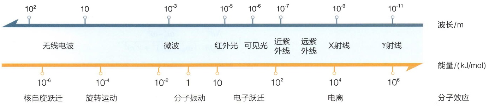

other

| Wave Type | Energy Level | Phenomena |
| :--- | :--- | :--- |
| 无线电波 | \(10^{2}\) | 核自旋跃迁 |
| 无线电波 | 10 | 旋转运动 |
| 微波 | \(10^{-3}\) | 分子振动 |
| 红外光 | \(10^{-5}\) | 电子跃迁 |
| 可见光 | \(10^{-6}\) | 电子跃迁 |
| 近紫外线 | \(10^{-7}\) | 电离 |
| 远紫外线 | \(10^{-9}\) | 电离 |
| X射线 | \(10^{-11}\) | 电子跃迁 |
| \(\gamma射线\) | — | — |

$$
p = q r _ {\circ}
$$

如果入射光场 $E$ 为

$$
E = E _ {0} \mathrm{e} ^ {- \mathrm{i} \omega t}, \tag {24-1}
$$

按照牛顿力学，对于原子核-电子构成的单原子体系，若-e和m分别为电子的电荷和质量，r为电子与核之间的距离，f是弹性系数，g为阻尼系数，则作强迫振动的电子的运动方程为

$$
m \frac {\mathrm{d} ^ {2} r}{\mathrm{d} t ^ {2}} = - e E - f r - g \frac {\mathrm{d} r}{\mathrm{d} t} 。
$$

上式中，等号右边的三项分别为电子受到的入射光电场强迫力、准弹性力和阻尼力。若设衰减系数 $\gamma = g / m$ ，而电子的固有振动频率 $\omega_0 = \sqrt{f / m}$ ，则上式可变为

$$
\frac {\mathrm{d} ^ {2} r}{\mathrm{d} t ^ {2}} + \gamma \frac {\mathrm{d} r}{\mathrm{d} t} + \omega_ {0} ^ {2} r = - \frac {e E}{m} _ {\circ}
$$

该方程是描述光与介质相互作用经典理论的基本方程。结合式（24-1），解此方程，得到电子在入射光场作用下的位移 $r$ 为

$$
r = \frac {- e / m}{\left(\omega_ {0} ^ {2} - \omega^ {2}\right) - \mathrm{i} \gamma \omega} E _ {0} \mathrm{e} ^ {- \mathrm{i} \omega t},
$$

则电偶极矩为 $p$ 的 $N$ 个粒子的极化强度 $P$ 为

$$
P = N p = - N e r = \frac {N e ^ {2} / m}{(\omega_ {0} ^ {2} - \omega^ {2}) - \mathrm{i} \gamma \omega} E _ {0} \mathrm{e} ^ {- \mathrm{i} \omega t}.
$$

由电磁场理论，极化强度和电场的关系为

$$
P = \varepsilon_ {0} \chi E _ {\circ}
$$

其中，$\varepsilon_0$ 为真空中的介电常数，$\chi$ 为电极化率。由此可以得到描述介质极化特性的电极化率 $\chi$ 的表达式。对于稀薄气体等理想系统，$|\chi| \ll 1$。根据电磁学理论，复折射率 $\tilde{n} = n + \mathrm{i}\eta$、介质中的相对介电常数 $\varepsilon_{\gamma}$、电极化率 $\chi = \chi' + \mathrm{i}\chi''$ 三者之间有如下关系:

$$
\widetilde {n} = \sqrt {\varepsilon_ {\gamma}} = \sqrt {1 + \chi} \cong 1 + \frac {1}{2} \chi = 1 + \frac {1}{2} \chi^ {\prime} + \frac {\mathrm{i}}{2} \chi^ {\prime \prime} = n + \mathrm{i} \eta
$$

由此可以得到复折射率实部和虚部分别为

$$
n = 1 + \frac {N e ^ {2}}{2 \varepsilon_ {0} m} \frac {\omega_ {0} ^ {2} - \omega^ {2}}{\left(\omega_ {0} ^ {2} - \omega^ {2}\right) ^ {2} + \gamma^ {2} \omega^ {2}}, \tag {24-2}
$$

$$
\eta = \frac {N e ^ {2}}{2 \varepsilon_ {0} m} \frac {\gamma \omega}{(\omega_ {0} ^ {2} - \omega^ {2}) ^ {2} + \gamma^ {2} \omega^ {2}} 。 \tag {24-3}
$$

为了更明确复折射率实部和虚部的意义，介质中沿 $x$ 方向传播的电磁波可以写作

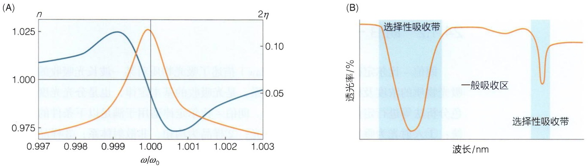

图 24-2 光的色散曲线和吸收曲线示意图

$$
\begin{array}{l} E = E _ {0} \exp \left[ \mathrm{i} \left(\frac {2 \pi}{\lambda} \tilde {n} x - \omega t\right) \right] = E _ {0} \exp \left(- \frac {2 \pi}{\lambda} \eta x\right) \exp \left[ \mathrm{i} \left(- \frac {2 \pi}{\lambda} n x - \omega t\right) \right] \\ = E _ {0} \exp (- k \eta x) \exp [ \mathrm{i} (- k \eta x - \omega t) ], \\ \end{array}
$$

其中 $k = 2\pi / \lambda$ 为真空中光的波数。由此可见，复折射率描述了介质对光传播特性（振幅和相位）的作用。其中，实部 $n$ 是表征介质影响光传播相位特性的量，即通常所说的折射率；虚部 $\eta$ 是表征介质影响光传播振幅特性的量，通常称为消光系数。通过 $n$ 和 $\eta$ 即可描述光在介质中传播的色散和吸收特性。由于 $n$ 和 $\eta$ 都是入射光频率的函数，根据上式可以得到 $n(\omega)$ 和 $\eta(\omega)$ 随入射光频率 $\omega$ 变化的理论曲线，即色散曲线和吸收曲线（图24-2）。对于色散曲线，固有振动频率 $\omega_0$ 附近区域为反常色散区，而远离 $\omega_0$ 的区域为正常色散区。对于吸收曲线，当 $\omega = \omega_0$ 时具有最强的共振吸收，也被称为物质的选择性吸收带；当 $\omega$ 远离 $\omega_0$ 时吸收迅速减弱，而此时 $\eta$ 很小且近似为常数的区域被称为一般吸收区（图24-2）。

对于更一般的情形，可以类似上面的过程对其它类型电偶极子的强迫振动进行推导。若测试样品中含有电荷和质量分别为 $q_{j}$ 和 $m_{j}$ 的 $N_{j}$ 个电偶极子的固有振动频率为 $\omega_{j}$，则复折射率的表达式可以写为

$$
\widetilde {n} ^ {2} = 1 + \sum_ {j} \frac {N _ {j} q _ {j} ^ {2}}{\varepsilon_ {0} m _ {j}} \frac {1}{(\omega_ {0 j} ^ {2} - \omega^ {2}) ^ {2} + \mathrm{i} \gamma_ {j} ^ {2} \omega^ {2}} \circ
$$

此时，色散曲线和吸收曲线会具有多个色散区和吸收带。

除了真空以外，介质中总是存在电偶极子的，因此除了真空以外没有任何一种介质对任何波长的电磁波均完全透明。常说的透明，也并非指没有吸收，而是只有很少的一般性吸收。也正因为此，不同的吸收光谱和发射光谱技术需要选择合适的光学材料制作光学器件，不同光谱技术使用的光学器件，特别是不同种类仪器的样品杯通常不能混用。比如，常见的石英玻璃的透光区段一般为 $180\sim 4000~\mathrm{nm}$，对紫外-可见光区是透明的，但在红外区具有强吸收。因此石英可以用来制作紫外-可见吸收光谱仪中的各种透镜等光学器件，而红外光谱仪的样品杯通常使用萤石（$\mathrm{CaF_2}$，透光波段一般为 $125\sim 9500~\mathrm{nm}$）或溴化钾等在红外区没有选择性吸收的材料制作。

（A）按照式（24-2）和式（24-3）绘制的理论色散曲线和吸收曲线。（B）以水分子的红外吸收为例，展示一般性吸收与选择性吸收的示意图。

## 24.1.2 朗伯-比尔定律

朗伯-比尔定律（Lambert-Beer law）描述了吸光物质对某一波长光吸收的程度与吸光物质的浓度及样品厚度之间的关系，是光吸收的基本定律，也是分光光度法和比色分析法等进行定量分析的理论基础。朗伯-比尔定律适用于满足以下条件的理想系统:①入射光为垂直照射的平行单色光；②样品为均相、非散射体系；③样品分子之间无相互作用；④光与样品之间只有光吸收过程，无荧光、光化学、光电效应等现象发生。对于该理想系统，假设入射光强度为 $I_{0}$ 的平行单色光，在通过光程为l的样品后，由于样品对光的吸收，透射光强度降低至I，则有

$$
\mathrm{d} I = - \alpha_ {\mathrm{a}} N I \mathrm{d} l _ {\circ}
$$

其中， $\alpha_{\mathrm{a}}$ 为吸收系数， $N$ 为样品粒子密度。对上式进行积分，易得

$$
I = I _ {0} \mathrm{e} ^ {- \alpha_ {\mathrm{a}} N l} = I _ {0} 1 0 ^ {\frac {1}{\ln 1 0} \alpha_ {\mathrm{a}} N l} = I _ {0} 1 0 ^ {- \varepsilon c l} = I _ {0} 1 0 ^ {- A},
$$

$$
A = \lg (I _ {0} / I) = \varepsilon c l _ {\circ}
$$

其中， $A$ 为吸光度， $\varepsilon$ 为摩尔吸收系数或摩尔消光系数， $c$ 为样品物质的量浓度。当 $l$ 的单位为 $\mathrm{cm}$ ， $c$ 的单位为 $\mathrm{mol / L}$ 时， $\varepsilon$ 的单位为 $\mathrm{L} \cdot \mathrm{mol}^{-1} \cdot \mathrm{cm}^{-1}$ 。

若引入上一节中所述的消光系数 $\eta$ 描述光强度的减弱，则粒子密度为 $N$ 的介质中沿 $l$ 方向传播的电磁波的光强度为

$$
I = \left| E \right| ^ {2} = I _ {0} \mathrm{e} ^ {- 2 k \eta N l},
$$

由此可知

$$
\alpha_ {\mathrm{a}} = 2 k \eta = 4 \pi \eta / \lambda_ {\circ}
$$

由于吸收系数 $\alpha_{\mathrm{a}}$ 是波长 $\lambda$ 的函数，而消光系数 $\eta$ 也与入射光频率有关，因此对于理想系统，当样品中含有多种吸光组分时，由于各组分间不存在着相互作用，则吸光度具有加和性，即在某一波长下样品的总吸光度是各组分在该波长下吸光度的加和，即

$$
A = \sum_ {i} \varepsilon_ {i} c _ {i} l _ {\circ}
$$

根据朗伯-比尔定律，当 $l$ 不变时，$A$ 与 $c$ 之间应该成正比关系。但实际测定时，标准曲线常会出现偏离朗伯-比尔定律的现象，这通常源于实验系统偏离了上述的理想系统。在生物和化学测量中，最常见的偏离原因是样品存在杂质、样品的不均一性（非均相体系）、样品浓度过高以及样品因生物化学反应随时间产生变化。一般地，测试样品应过滤以去除可能的杂质；吸光度在 $0.1 \sim 0.8$ 之间，以使得检测处于线性范围且测量误差较小。如吸光度不在此范围，可适当稀释或浓缩样品再进行测定。

## 24.1.3 光与物质相互作用的量子理论简介

通过量子理论对光与介质相互作用进行严格的定量计算可参阅电动力学等物理学专业教材。本小节主要在第2章对量子力学初步介绍的基础上，从能级角度进行简单的定性分析。

考虑辐射电磁场与分子的相互作用，磁相互作用一般可忽略，由于生物或化学分子的直径一般远远小于紫外-可见光范围的辐射波长，则电场只需保留线性阶而忽略高阶项，从而此时可以只考虑电偶极矩。对于多原子组成的分子，基态和激发态的波函数可近似分解成电子波函数 $\Psi_{\mathrm{el}}$ 、振动波函数 $\Psi_{\mathrm{vib}}$ 和自旋波函数的乘积。电偶极矩不依赖于自旋，或者说不同多重态间的电子跃迁禁阻，此时仅需考虑基态和激发态的电子波函数 $\Psi_{\mathrm{el}}$ 和振动波函数 $\Psi_{\mathrm{vib}}$ （图24-3）。如果用量子数 $\nu$ 和 $\nu^{\prime}$ 描述电子基态和激发态的振动波函数，则有电子基态波函数和第一激发态波函数:

$$
\Psi (\mathrm{S} _ {0}, \nu) = \Psi_ {\mathrm{el}} (\mathrm{S} _ {0}) \cdot \Psi_ {\mathrm{S} _ {0}, \mathrm{vib}} (\nu),
$$

$$
\Psi (\mathrm{S} _ {1}, v ^ {\prime}) = \Psi_ {\mathrm{el}} (\mathrm{S} _ {1}) \cdot \Psi_ {\mathrm{S} _ {1}, \mathrm{vib}} (v ^ {\prime}) 。
$$

根据弗兰克-康登原理（Frank-Condon principle），分子中电子跃迁的时间尺度远小于分子振动，电子跃迁前后的一瞬间，分子内原子核的相对距离和动量几乎与跃迁前完全一样，由此产生的态被称为弗兰克-康登态。此时，电子激发态与基态具有相似的振动能级结构。相应地，$\mathrm{S}_0 \rightarrow \mathrm{S}_1$ 的电子跃迁可形象地描述成垂直跃迁（图24-3）。吸收了光子能量的激发态通常比基态更易极化、极性更大，因此激发态键长通常大于基态键长。弗兰克-康登原理指出，在分子从它的电子基态向激发态跃

迁的过程中，基态的振动波函数与激发态的振动波函数将发生重叠，当基态和激发态的振动波函数有效重叠程度最大时，相应的跃迁发生的概率最大。基态和激发态的振动波函数重叠的程度被称为弗兰克-康登因子，而跃迁的强度与弗兰克-康登因子的平方成正比。由于基态和激发态键长不一致，因此从 $v = 0$ 到 $v' = 0$ 的跃迁发生概率很小。光吸收由跃迁偶极矩描述，即由电偶极矩在跃迁前后波函数间的期望值描述。$\mathrm{S}_0(0)\rightarrow \mathrm{S}_1(v')$ 的跃迁偶极矩

$$
\begin{array}{l} p _ {\mathrm{S} _ {0} (0) \rightarrow \mathrm{S} _ {1} (\nu^ {\prime})} = \big \langle \Psi_ {\mathrm{el}} (\mathrm{S} _ {0}) \Psi_ {\mathrm{S} _ {0}, \mathrm{vib}} (0) \mid \Psi_ {\mathrm{el}} (\mathrm{S} _ {1}) \Psi_ {\mathrm{S} _ {1}, \mathrm{vib}} (\nu^ {\prime}) \big \rangle \\ = \left\langle \Psi_ {\mathrm{el}} (\mathrm{S} _ {0}) \mid \Psi_ {\mathrm{el}} (\mathrm{S} _ {1}) \right\rangle \left\langle \Psi_ {\mathrm{S} _ {0}, \mathrm{vib}} (0) \mid \Psi_ {\mathrm{S} _ {1}, \mathrm{vib}} (v ^ {\prime}) \right\rangle , \\ \end{array}
$$

等号右边乘积中的两项即为电子跃迁偶极矩和弗兰克-康登因子。

类似地，当分子中的电子处于基态时，振动能级之间的跃迁有振动跃迁偶极矩

$$
p _ {i \rightarrow j} = \left\langle \Psi_ {i} \mid \Psi_ {j} \right\rangle 。
$$

通过量子力学计算可知，对于振动能级之间的跃迁，$\Delta v = \pm 1$ 的跃迁是被允许的，也被称为振动光谱的选择定则（选律）。

当外加电磁波照射到某个样品上时，它引起由基态到激发态的跃迁概率和激发态对于多原子组成的分子，基态和激发态的波函数可近似分解成电子波函数 $\Psi_{\mathrm{el}}$ 和振动波函数 $\Psi_{\mathrm{vib}}$ 乘积。根据弗兰克-康登原理，电子激发态与基态具有相似的振动能级结构，但激发态通常比基态更易极化、极性更大，因此激发态键长更长。光吸收和光发射可以由跃迁偶极矩描述，即由电偶极矩在跃迁前后波函数间的期望值描述。详见正文中的描述。

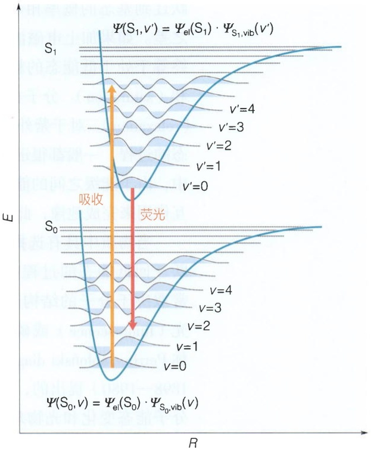

text_image

Ψ(S₁,v') = Ψel(S₁) · ΨS₁,vib(v')
S₁
v'=4
v'=3
v'=2
v'=1
v'=0
吸收
荧光
S₀
v=4
v=3
v=2
v=1
v=0
Ψ(S₀,v) = Ψel(S₀) · ΨS₀,vib(v)

图24-3 弗兰克-康登原理

跃迁到基态的概率相等，因此净吸收大小取决于两个能级上粒子数（布居数）分布之差。如果加上电磁波后基态和激发态的分布趋于平衡，即处于高能态的粒子数始终等于处于低能态的粒子数，这时再进行激发就不会产生净吸收，这种现象称为饱和（saturation）。分子在受到一个扰动后重新回到玻尔兹曼平衡状态的过程称为弛豫（relaxation）。对于紫外-可见-红外吸收来说，弛豫主要取决于高能态自发回到低能态的过程，一般都很迅速，因此在测试中无须过于注意弛豫时间。在磁共振波谱技术中，由于能级之间的能量差很小，自发弛豫发生的概率很低，需要样品分子之间的相互作用来完成弛豫，此时需要考虑弛豫和饱和对测试的影响（详见第25章）。

当物质中具有选择性吸收的分子被激发到高能态以后，分子从不稳定的高能态跃迁回低能态的过程中，多余能量具有多种可能的释放路径，而哪条路径为主通常取决于分子的结构和激发态的性质，以光发射方式返回基态时的发射光称为荧光（fluorescence）或磷光（phosphorescence）。雅布朗斯基图（Jabłoński diagram，也称 Perrin-Jabłoński diagram）是1933年亚历山大·雅布朗斯基（Aleksander Jabłoński, 1898—1980）提出的，描述了物质与光的相互作用过程中，吸收能量和释放能量的分子能态变化和光物理化学过程（图24-4）。

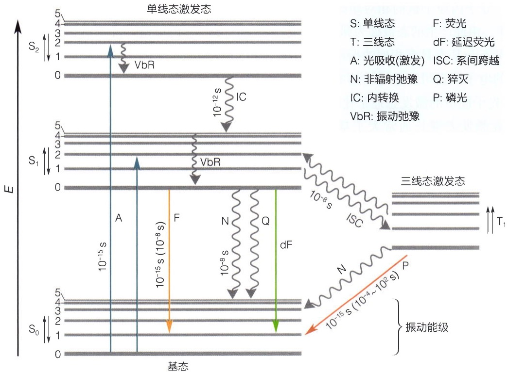

text_image

单线态激发态
S: 单线态 F: 荧光
T: 三线态 dF: 延迟荧光
A: 光吸收(激发) ISC: 系间跨越
N: 非辐射弛豫 Q: 猝灭
IC: 内转换 P: 磷光
VbR: 振动弛豫
S2 ↑
1
0
S1 ↑
5
4
3
2
1
0
S0 ↑
基态
E
10⁻¹⁵ s
10⁻¹⁵ s (10⁻⁶ s)
10⁻¹² s
IC
VbR
VbR
N
Q
dF
10⁻⁸ s
ISC
T₁
S: 单线态
T: 三线态
A: 光吸收(激发) ISC: 系间跨越
N: 非辐射弛豫 Q: 猝灭
IC: 内转换 P: 磷光
VbR: 振动弛豫
3线态激发态
N
P
10⁻¹⁵ s (10⁻⁴~10² s)
10⁻¹⁵ s (10⁻⁶ ~ 10⁻⁸ s)
S₀↑
S₀↑
S₀↑

图24-4 雅布朗斯基图

左侧的S表示单重态或单线态，右侧的T表示三重态或三线态。A代表电子吸收光跃迁。VbR是同一个电子能级的振动能级跃迁，是激发态分子中的能量再分配于多种振动模式的过程，分子通过振动跃迁获得的能量通过碰撞再转移给介质分子。IC是不同电子高能态之间的跃迁，不改变电子自旋态，被称为内转换。ISC是同一个电子能级的自旋状态发生改变的跃迁，称为系间跨越。N 和 Q 代表非辐射跃迁，激发态的多余能量转移给介质分子或猝灭剂 Q，最终以热等方式释放。F、dF 和 P 代表激发态分子的自发辐射，F 和 dF 不改变自旋状态，称为荧光；P 改变自旋状态，称为磷光；dF 表示从  $T_{1}$  回到  $S_{1}$  再次发射的延迟荧光。图中跃迁箭头旁的数值表示跃迁过程的时间尺度，其中括号内的数值表示荧光、磷光的寿命。

在光物理化学领域，有三个关于发射光谱的早期经验法则。这三个法则并非来源于严格的理论推导，而是早期观察的经验总结，因此均存在多种例外情形（知识窗24-1）。

## 24.1.4 吸收光谱、激发光谱和发射光谱

吸收光谱是指在一个波长范围内的不同波长光源作用下，物质吸收能力（吸光度或吸收系数）随波长变化的曲线。吸收曲线中谱峰或吸收带的出现反映了物质在相应波长处具有特异性吸收。

激发光谱是指在不同波长激发光源的激发下，测量某一波长处的荧光强度的变化，然后以激发光波长为横坐标，以固定波长处的荧光强度为纵坐标所绘制的图，即为激发光谱。激发光谱反映了不同波长的激发光的相对效率。根据雅布朗斯基图可知，一般情况下激发光谱与吸收光谱正相关，选择进行测量的发射波长仅影响峰强，并不影响峰位和谱形，因此可以通过激发光谱或吸收光谱选择适当的激发波长。需要注意的是，当分子具有多个激发态时，激发光谱与吸收光谱之间的相关性可能会出现偏离。

## 知识窗24-1

## 发射光谱的三个早期经验法则

（1）斯托克斯位移（Stokes shift）。19世纪，乔治·斯托克斯（George Stokes，1819—1903）观察到，一种矿物——萤石（fluospar）在受到紫外光照射后能发出比激发光波长长的光。采用萤石这个词的词头，他把这种光命名为荧光。荧光波长比激发光长这一现象则被人称为斯托克斯位移。发射光谱中的斯托克斯位移可以用弗兰克-康登原理（图24-3）和雅布朗斯基图（图24-4）很好地进行解释。斯托克斯位移的概念也被推广到了其它光谱学领域（如拉曼光谱），观测波长比激发波长短的现象则被称为反斯托克斯位移。
（2）卡莎规则（Kasha's rule）。20世纪50年代，迈克尔·卡莎（Michael Kasha，1920—2013）通过实验和经验推导提出:分子所发射的光子（荧光或磷光）只能从激发态的最低态激发。在雅布朗斯基图中，如果分子具有多个激发态（如图24-4中的 $S_{1}$ 和 $S_{2}$ ），不同的激发态之间存在非辐射跃迁，被称为内转换。内转换速率与不同激发态之间的能量差相关。一般情况下，内转换速率往往比辐射跃迁速率快四个数量级，因此内转换在荧光发射之前就已经完成。在此情形下，卡莎规则是成立的，且可以推论出荧光的波长、寿命、峰形、强度等属性均与激发波长无关。卡莎规则的前提是内转换速率极快，当不同激发态之间的能量差很大时，卡莎规则将不再适用，这样的有机分子被称为反卡莎规则（anti-Kasha's rule）体系。

（3）镜像规则（mirror-image rule）。根据弗兰克-康登原理（图24-3），激发态和基态具有相似的振动能级分布。同时，从 $S_{0}$ 的最低振动能级跃迁到 $S_{1}$ 各振动能级的概率与由 $S_{1}$ 的最低振动能级跃迁到 $S_{0}$ 各振动能级的概率也相近，因此吸收谱与发射谱呈镜像对称关系。但当分子具有多个激发态（如图24-4中的 $S_{1}$ 和 $S_{2}$ ），或分子激发态的构型发生变化导致 $S_{0}$ 和 $S_{1}$ 的振动能级分布不同时，镜像规则将不再适用。

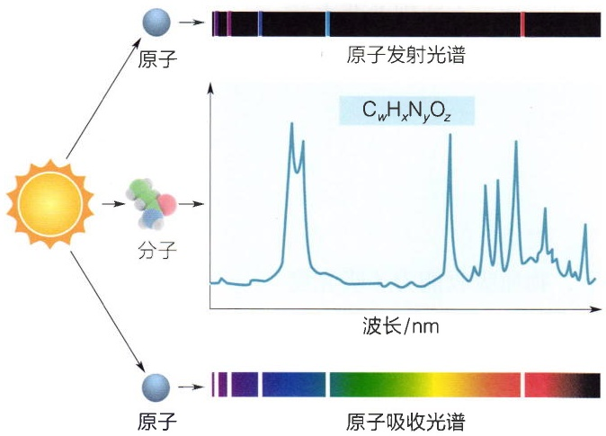

text_image

原子发射光谱
原子
分子
CwHxNyOz
波长/nm
原子吸收光谱

图24-5 原子光谱与分子光谱的比较

发射光谱是指固定激发光源的波长，测量不同波长处的荧光强度，然后以荧光波长为横坐标，以荧光强度为纵坐标作图，即为发射光谱。发射光谱反映了荧光中不同波长的光成分的相对强度。根据雅布朗斯基图，发射谱中的谱峰位置取决于能级结构，与在吸收带中所选择的激发波长无关，不同的激发波长仅影响峰强。

一般地，吸收谱、激发谱和发射谱都包含若干谱峰（图24-5），谱峰所能反映的主要信息包括:

（1）谱峰位置，简称峰位，通常用频率、波长或能量轴上的最大吸收位置来表示，最大吸收所对应的波长一般记为 $\lambda_{\mathrm{max}}$ ，最大发射所对应的波长一般记为

$E_{\mathrm{max}}$ 。对于光吸收来说，谱峰位置反映的是选择定则，即能态之间发生概率最大的跃迁。当入射电磁波的能量与能级之间的能量差相匹配（共振）时，吸收概率最大。

（2）谱峰宽度，通常用半高宽（full width at a half maximum，FWHM，$\Delta v_{1/2}$）或半高半宽（half width at half height，HWHH）来表示。由于原子的核外电子能级只包含了电子波函数，不涉及化学键的振动波函数，因此原子吸收光谱和原子发射光谱通常呈现窄的谱线结构，谱线之间分辨率高。每一种原子都具有特异的核外电子能级结构，因此利用原子吸收光谱和原子发射光谱中的特异谱线可以进行元素分析。分子吸收光谱和发射光谱的谱峰宽度通常远大于原子光谱（图24-5），谱峰宽度不仅与振动能级的结构有关，也与激发态寿命有关。由于谱峰具有一定的宽度，所以当两个谱峰距离过近时将产生重叠（图24-5）。
（3）谱峰强度，通常用吸收系数、吸收度、光强度或光子数来表示，$\lambda_{\mathrm{max}}$ 所对应的摩尔消光系数一般记为 $\varepsilon_{\mathrm{max}}$ 。一般地，谱峰强度与产生跃迁的分子的总数量有关。也就是说，吸收谱和发射谱都可以用于确定样品的量。发射谱的谱峰强度除了受光吸收程度和检测效率的影响以外，自发辐射概率还容易受到各种环境因素的干扰，因此一般使用吸收谱来进行定量分析。
（4）峰形。根据24.1.1节中的理论计算，理想系统中简单分子的谱峰大多是洛伦兹（Lorenz）线形。对于复杂的生物分子，由于极性溶剂和/或各向异性的影响，其谱峰经常会偏离洛伦兹线形，而更符合高斯（Gauss）线形或沃伊特（Voigt）线形。生物分子的吸收谱和发射谱通常会有严重的重叠问题，在对谱进行提高分辨率的数学处理时需要考虑峰形的影响。

## 24.2 紫外 - 可见吸收光谱

## 24.2.1 紫外-可见吸收光谱的选择定则

紫外-可见吸收光谱也被称为电子光谱，这是因为紫外-可见光的光子能量与电子能级之间的能量差相当（图24-1），紫外-可见光可以激发分子中的电子产生能级之间的跃迁。在分子中，电子能级通常用分子轨道来描述。根据分子轨道理论（参见第2章），当两个原子形成化学键时，两个原子参与化学键形成的原子轨道将线性组合形成新的分子轨道。从电子波函数来看，线性组合就是两个原子轨道波函数的叠加或相减，使得一个分子中不同的分子轨道的能量是不同的。所以形成分子轨道以后，轨道总数量不变而轨道能级改变。其中，能量低于相应原子轨道能量的分子轨道被称为成键轨道，反之称为反键轨道，而能量相等时不形成化学键则被称为非键轨道。

在有机化合物或生物分子中，常见的分子成键轨道包括 $\sigma$ 轨道、$\pi$ 轨道和某些过渡族金属化合物中的 $\delta$ 轨道，对应的反键轨道为 $\sigma^{*}$、$\pi^{*}$ 和 $\delta^{*}$。分子中没有参与成键的电子被称为非键电子或 n 电子，主要指位于 N、O、P、S、卤素等原子的外层孤对电子。当有机化合物或生物分子吸收紫外-可见光后，外层电子主要的跃迁类型有以下三种（图 24-6）:

① 成键轨道与反键轨道之间的跃迁，如  $\sigma \rightarrow \sigma^{*}$ 、 $\pi \rightarrow \pi^{*}$ ;
② 非键电子被激发到反键轨道的跃迁，如  $n \rightarrow \sigma^{*}$ 、 $n \rightarrow \pi^{*}$ ;
③ 某些含有过渡族金属以及镧系和锕系元素的化合物中，由于配基的影响，使得原本简并的d或f轨道分裂成几组能量不等的轨道。若轨道是未充满的，当吸收光子后，电子会发生跃迁，被称为d-d跃迁和f-f跃迁。

这几种主要跃迁所需能量大小的顺序一般为:$\sigma \rightarrow \sigma^{*} > n \rightarrow \sigma^{*} > \pi \rightarrow \pi^{*} > n \rightarrow \pi^{*}$。在有机化合物和生物分子中，$\sigma \rightarrow \sigma^{*}$ 跃迁所需能量最高，一般发生在真空紫外区。如乙烷C—C键的 $\sigma \rightarrow \sigma^{*}$ 跃迁，$\lambda_{\max}$ 约为 $135 \mathrm{~nm}$（图24-6）。由于氧气在

图 24-6 有机化合物或生物分子紫外-可见吸收光谱主要的跃迁类型和波长范围

（A）紫外-可见吸收光谱的主要电子跃迁方式。（B）主要电子跃迁方式的紫外-可见吸收波长范围。

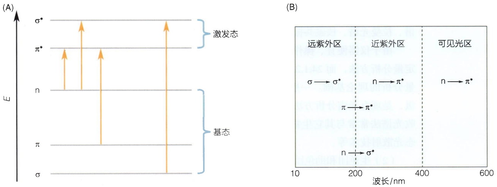

200 nm 以下的远紫外区和真空紫外区具有强吸收，以及氙灯光源的波长范围限制，一般紫外-可见分光光度计只提供约 185～850 nm 范围的单色光，因此一般无法检测  $\sigma \rightarrow \sigma^{*}$  跃迁吸收带。

N、O、S、卤素等含有 n 电子的饱和基团，如—NH₂、—OH、—SH 等，可能产生 n → σ\* 跃迁，λ\_max 在 190 nm 左右；而含有杂原子的不饱和基团，如＞C=O、＞C=S、—N=N—等，会发生 n → π\* 跃迁，λ\_max 在 300 nm 左右。n → σ\* 和 n → π\* 跃迁发生的概率均较小，因此其摩尔吸收系数较小（ε\_max < 100 L · mol⁻¹ · cm⁻¹）。

有 $\pi$ 轨道的基团，如 $>C = C < 、 -C \equiv C - 、 >C = O$ ，以及芳香族化合物的共轭体系的 $\pi$ 键等，会发生 $\pi \rightarrow \pi^{*}$ 跃迁，一般位于近紫外区，$\lambda_{\max}$ 在 $200\mathrm{nm}$ 左右，$\varepsilon_{\max}$ 通常大于 $10^{4}\mathrm{L} \cdot \mathrm{mol}^{-1} \cdot \mathrm{cm}^{-1}$，为强吸收带。由于 $\sigma \rightarrow \sigma^{*}$ 跃迁需要在真空中检测，且 $\mathrm{n} \rightarrow \sigma^{*}$ 和 $\mathrm{n} \rightarrow \pi^{*}$ 跃迁概率小，因此 $\pi \rightarrow \pi^{*}$ 跃迁是有机化合物和生物分子中最容易观测的吸收带。

## 24.2.2 紫外-可见吸收光谱给出的主要信息和影响因素

## （1）紫外-可见吸收光谱给出的主要定性和定量信息

由于紫外-可见吸收光谱主要检测样品中电子能级的跃迁，不同类型的基团通常具有不同的主要跃迁方式。因此在有机化合物结构鉴定中，谱峰的位置和强度可以用来定性分析可能存在的官能团类型。如利用紫外光谱在紫外区是否透明，可以定性分析有机化合物的分子骨架中是否含有共轭结构体系或是否含有芳香环；利用可见光区含有金属的有机化合物谱峰的精细结构，可以定性分析金属的配位情况等。由于紫外谱峰宽度很大经常造成谱峰重叠，可以利用二阶导数谱或高阶导数谱提高谱的分辨率。

从原理上来分析，由于各种有机化合物和生物分子都具有独特的化学结构和空间结构，原则上每种物质就会有其特有的、固定的吸收光谱曲线。但值得注意的是，紫外-可见吸收光谱常见的跃迁方式并不能很好地区分不同官能团，因此只根据紫外-可见吸收光谱不能完全确定有机分子的化学结构，现在也较少用于有机化合物和生物分子的结构鉴定。有机化合物的结构鉴定需要使用对化学结构更敏感的红外吸收光谱、拉曼光谱、核磁共振波谱、质谱以及其它的物理和化学方法共同进行分析。

由于仪器便宜、操作简便、灵敏度高等特点，紫外-可见吸收光谱法是最常用的定量分析方法，而24.1.2节中所述的朗伯-比尔定律是紫外-可见吸收光谱法进行定量分析的理论基础。一般情况下，紫外-可见吸收光谱法的检测限大约在 $\mu \mathrm{g} / \mathrm{mL}$ 量级，是现有光谱分析方法中灵敏度最高的技术之一。借助其高灵敏度，紫外-可见吸收光谱法常常与其它生物物理技术偶联，如分子筛、停-流仪、第19章中介绍的静态光散射技术等。

## (2) 生色团和助色团

分子中能产生强烈的特异性吸收带的基团被称为生色团或发色团（chromophore）。

有机化合物和生物分子中的生色团一般是吸收系数较大的强吸收（通常 $\varepsilon_{\mathrm{max}} > 5000\mathrm{L}\cdot \mathrm{mol}^{-1}\cdot \mathrm{cm}^{-1}$ ）、含有不饱和键的基团。生物分子中，一些 $\varepsilon_{\mathrm{max}}$ 小于5000但大于$100\mathrm{L}\cdot \mathrm{mol}^{-1}\cdot \mathrm{cm}^{-1}$ 的基团也被称为生色团（如酪氨酸和苯丙氨酸侧链的芳香环）。由24.2.1节可知，生色团电子跃迁的方式主要为 $\mathfrak{n}\to \pi^{*}$ 或 $\pi \rightarrow \pi^{*}$ ，在生物分子中最常见的生色团是共轭体系的 $\pi$ 键。通常情况下，由于其它基团贡献较小，分子的吸收谱主要体现为生色团谱峰的线性组合。当多个生色团形成共轭体系时，生色团之间会产生相互影响。其吸收光谱与单一生色团相比，随着共轭体系变大，吸收峰红移，吸收强度增加。

广义上来说，助色团（auxochrome）指的是分子中能够改变生色团光吸收的基团。由于紫外-可见光吸收来源于分子轨道的跃迁，因此助色团中通常含有孤对电

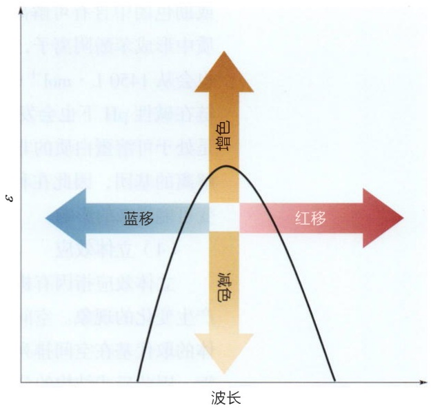

contour

| Color | Description |
| --- | --- |
| Blue | Left region (Blue) |
| Red | Right region (Red) |
| Yellow | Center region (Yellow) |

图24-7 助色团对生色团峰位和峰强的不同影响

子，如—OH、—OR、—NR₂、—X（卤素）等。助色团的作用机制主要是影响分子轨道的基态和激发态的能量状态和稳定性等。助色团对生色团峰位或峰强产生的影响包括（图24-7）:蓝移或短移（hypsochromic shift，向短波长方向移动）、红移或长移（bathochromic shift，向长波长方向移动）、增色效应（hyperchromic effect，吸收增强）和减色效应（hypochromic effect，吸收减弱）。助色团也可能同时对峰位和峰强造成影响。如在苯环上引入—OH等取代基，通常会使得谱峰发生红移和增色。

## (3) 溶剂的影响

溶剂对紫外-可见吸收光谱的影响包括两个方面:溶剂对紫外-可见光的吸收和溶剂对样品生色团峰位、峰强和峰形的影响（也称为溶剂效应）。

由于电子跃迁方式不同，不同的溶剂在紫外-可见光区的峰位和吸收系数都有着较大区别，因此在进行紫外-可见吸收光谱测量时，要考虑选用溶剂或缓冲液对测量结果的影响。常见的极性溶剂中，水的紫外吸收基本不影响主要的生色团谱峰。常用的有机溶剂中，氯仿会影响波长小于 $247\mathrm{nm}$ 的区域，丙酮、乙醛和苯等在紫外区具有强吸收不适合作为紫外-可见吸收光谱的溶剂。

非极性溶剂分子一般不影响紫外-可见吸收光谱，而极性溶剂分子与生色团的静电相互作用或形成氢键等都会影响外层电子的能级状态。特别需要指出的是，能级结构或每个能级的稳定性是依赖于环境的，因此紫外-吸收对溶剂的极性和 $\mathrm{pH}$ 都很敏感。在极性溶剂中，激发态具有更强的极性，导致 $\pi^{*}$ 比 $\pi$ 更稳定，基态与激发态之间的能级能量差减小，因此溶液极性增强会导致 $\pi \rightarrow \pi^{*}$ 跃迁红移。同时 $\mathrm{n} \rightarrow \pi^{*}$ 跃迁，基态比激发态极性大，极性溶剂分子与 $\mathbf{n}$ 电子形成更稳定的氢键，氢键的形成会使得 $\mathbf{n}$ 电子的能级能量降低大约一个氢键的能量，非键电子的稳定也造成跃迁概率下降，因此氢键的形成会促使极性溶液中的 $\mathrm{n} \rightarrow \pi^{*}$ 跃迁蓝移和减色。

极性溶液的 $\mathrm{pH}$ 增加通常会导致紫外-可见吸收谱峰的红移。此外，如果生色团或助色团中含有可解离的基团，$\mathrm{pH}$ 值的变化往往会造成较大影响。如苯酚在碱性介质中形成苯酚阴离子，其在紫外区的最大吸收峰 $\lambda_{\max}$ 会从 $270~\mathrm{nm}$ 红移到 $287~\mathrm{nm}$，$\varepsilon_{\max}$ 也会从 $1450~\mathrm{L} \cdot \mathrm{mol}^{-1} \cdot \mathrm{cm}^{-1}$ 增加到 $2600~\mathrm{L} \cdot \mathrm{mol}^{-1} \cdot \mathrm{cm}^{-1}$ 。类似地，酪氨酸的酚羟基侧链在碱性 $\mathrm{pH}$ 下也会发生解离，因此可以利用 $\mathrm{pH}$ 滴定的方法研究蛋白质中的酪氨酸是处于可溶蛋白质的非极性内部还是暴露于极性溶剂中。由于核酸和蛋白质都具有可解离的基团，因此在利用紫外-可见光吸收进行生物分子定量分析时，要注意 $\mathrm{pH}$ 改变可能带来的影响。

## (4) 立体效应

立体效应指因有机化合物或生物分子的空间位阻和立体构象等因素导致吸收光谱产生变化的现象。空间位阻可以影响生色团之间的相互作用或共轭效应。如同分异构体的取代基在空间排列不同，一般反式结构空间位阻较小，生色团之间能够更好地共轭，因此反式结构的分子通常具有更大的 $\lambda_{\mathrm{max}}$ 和 $\varepsilon_{\mathrm{max}}$ 。

在一些有机化合物和大多数生物大分子中，原本并不共轭的生色团（如蛋白质一级序列中距离很远的芳香环氨基酸），由于空间结构使得生色团之间互相靠近，产生相互作用，也能造成 $\lambda_{\mathrm{max}}$ 和 $\varepsilon_{\mathrm{max}}$ 的改变。这也使得处于不同构象状态（如天然态、中间态和变性态）的生物大分子的 $\varepsilon_{\mathrm{max}}$ 并不相同。因此理论上来说，使用变性态的生物大分子进行浓度测定等定量分析可以得到更准确的结果。比如对于核酸分子，双螺旋结构或更高级结构的氢键和碱基相互作用，以及 $3',5'$-磷酸二酯键的形成都造成减色效应，DNA变性以后由于减色效应消失导致其紫外吸收会变大。因此可以用紫外吸收光谱监测核酸的变性和复性过程。DNA或RNA分子的紫外吸收要小于碱基紫外吸收的总和，这也使得DNA或RNA分子水解以后的紫外吸收会变大。

## 24.2.3 紫外-可见吸收光谱在生物学中的应用

大多数糖类和饱和脂类分子中，最主要的是 $\sigma \rightarrow \sigma^{*}$ 跃迁，在近紫外区和可见光区吸收很小。也正因为此，紫外-可见吸收光谱分析通常被用来进行核酸和蛋白质的定量分析、结构变化和相互作用研究。此外，一些代谢物、金属化合物和特异性染料的紫外-可见吸收也经常被用于研究生物大分子结构变化、生化反应动力学的监测和显微成像等。例如，考马斯亮蓝R-250（R代表淡红色）和G-250（G代表淡绿色）在与蛋白质结合后 $\lambda_{\mathrm{max}}$ 红移而呈现蓝色，因此经常被用于蛋白质浓度的定量分析（Bradford方法）或凝胶电泳显色。

## (1) 核酸的紫外-可见吸收特性

核酸的主要基团包括碱基、核糖或脱氧核糖以及磷酸基团。其中，核糖或脱氧核糖和磷酸并非生色团，而碱基具有共轭双键，是核酸的主要生色团。碱基的主要吸收带在 $40\sim 290~\mathrm{nm}$ 的紫外波段。由于碱基化学结构上的差别，不同核苷酸的吸收带峰位和峰形具有较大区别，其 $\mathrm{pH}$ 依赖性也显著不同。

大多数情况下，DNA和RNA的紫外吸收曲线并无太大区别，其 $\lambda_{\mathrm{max}}$ 都在 $260~\mathrm{nm}$ 左右。DNA的 $\varepsilon_{\mathrm{max}}$ 的范围是 $6000\sim 8000\mathrm{L}\cdot \mathrm{mol}^{-1}\cdot \mathrm{cm}^{-1}$ RNA的 $\varepsilon_{\mathrm{max}}$ 大约在 $7000\sim 10000\mathrm{L}\cdot \mathrm{mol}^{-1}\cdot \mathrm{cm}^{-1}$ 。核酸在 $260~\mathrm{nm}$ 的吸光度常以 $A_{260}$ 或 $\mathrm{OD}_{260}$ （optical density）表示。在实践中为了方便计算，常以核酸的比吸光系数计算溶液中核酸的量。核酸的比吸光系数是指浓度为$1\mu \mathrm{g / mL}$ 核酸水溶液的 $A_{260}$ 值。天然态的双链DNA的比吸光系数为0.020，变性DNA和RNA的比吸光系数为$0.022\sim 0.024$ ，寡核苷酸的比吸光系数约为0.05。实践中，可以通过计算 $A_{260} / A_{280}$ 与 $A_{260} / A_{230}$ 的比值来评估核酸纯度，具体方法在生物化学或分子生物学等教材中已经有详细介绍。

## (2) 蛋白质的紫外-可见吸收特性

蛋白质由 20 种常见 $\alpha-$ 氨基酸残基组成。根据 $\alpha-$

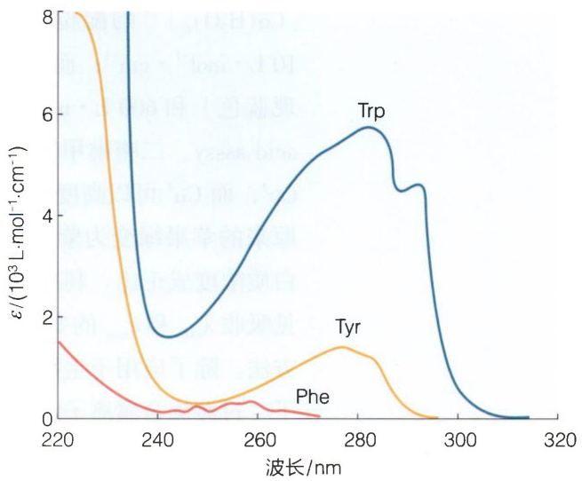

line

| Wavelength (nm) | Trp \((10^{3}\) \(L \cdot mol^{-1} \cdot cm^{-1})\) | Tyr \((10^{3}\) \(L \cdot mol^{-1} \cdot cm^{-1})\) | Phe \((10^{3}\) \(L \cdot mol^{-1} \cdot cm^{-1})\) |
| --- | --- | --- | --- |
| 220 | — | ~8.0 | ~1.5 |
| 240 | ~1.6 | ~0.5 | ~0.2 |
| 260 | ~3.5 | ~0.8 | ~0.3 |
| 280 | ~5.7 | ~1.4 | — |
| 300 | ~0.5 | — | — |
| 320 | — | — | — |

图24-8 三种芳香族氨基酸的紫外吸收光谱

氨基酸的化学结构可知，常见氨基酸在可见光区域均没有明显的吸收，在远紫外区（185～230 nm）均有紫外吸收。在近紫外区，主要的生色团是三种芳香族氨基酸，即苯丙氨酸（Phe）、酪氨酸（Tyr）和色氨酸（Trp）。此外，虽然半胱氨酸在260 nm以上并没有紫外吸收，但胱氨酸或蛋白质中的二硫键在近紫外区有吸收。三种芳香族氨基酸的吸收谱特征与苯环、苯酚和吲哚环的紫外吸收谱相近（图24-8），但峰位、峰形和吸收系数会被氨基酸中的其它基团或蛋白质结构影响。

对于蛋白质来说，肽链骨架的酰胺基团在 $190\mathrm{nm}$ 的远紫外区具有强吸收，其强度大约是近紫外区吸收的一百倍左右，且 $A_{190}$ 只与肽键数量有关而与含有的氨基酸种类无关。但由于远紫外吸收容易受到仪器、样品杯、缓冲液等的影响，实践中一般采用芳香族氨基酸在 $280~\mathrm{nm}$ 的近紫外吸收（$A_{280}$）进行定量分析。由图24-8可知，蛋白质的 $A_{280}$ 主要来源于色氨酸和酪氨酸芳香环侧链的吸收，以及可能存在的二硫键的少量贡献，而苯丙氨酸在 $280~\mathrm{nm}$ 几乎无吸收。蛋白质中游离半胱氨酸和二硫键的数量可以通过生化方法测定。因此，根据蛋白质一级序列中酪氨酸、色氨酸、胱氨酸的数量 $N_{\mathrm{Tyr}}$ 、 $N_{\mathrm{Trp}}$ 、 $N_{\text{胱}}$ ，以及经天然蛋白质数据修正后的摩尔消光系数 $\varepsilon_{\mathrm{Tyr}}$ 、 $\varepsilon_{\mathrm{Trp}}$ 、 $\varepsilon_{\text{胱}}$ 就可以计算得到相应蛋白质的理论 $\varepsilon_{\lambda}$ 值:

$$
\varepsilon_ {\lambda} = N _ {\mathrm{Tyr}} \varepsilon_ {\mathrm{Tyr}} + N _ {\mathrm{Trp}} \varepsilon_ {\mathrm{Trp}} + N _ {\mathrm{胱}} \varepsilon_ {\mathrm{胱} \circ}
$$

当波长为 $280\mathrm{nm}$ 时，根据天然态蛋白质修正后的 $\varepsilon_{\mathrm{Tyr}} = 1490$ ， $\varepsilon_{\mathrm{Trp}} = 5500$ ， $\varepsilon_{\text{胱}} = 125$ ，单位为 $\mathrm{L}\cdot \mathrm{mol}^{-1}\cdot \mathrm{cm}^{-1}$ 。对于含有色氨酸的蛋白质，理论 $\varepsilon_{\lambda}$ 值的误差一般小于$5\%$ ；但对于不含有色氨酸的蛋白质，其误差可能大于 $10\%$ 。需要注意的是，该方法无法用于预测含有在紫外-可见光区有吸收的辅基或过渡族金属离子的蛋白质（如结合金属离子的各种超氧化物歧化酶）。

## （3）生物分子-过渡族金属复合物的紫外-可见吸收特性

在过渡族金属的络合物中，过渡族金属离子的紫外-可见吸收特性不仅取决于过渡族金属离子自身的性质，还取决于参与络合的配基性质和配位情况。比如，$\left[\mathrm{Co}(\mathrm{H}_2\mathrm{O})_6\right]^{2+}$ 的配位情况是八面体， $\lambda_{\max}$ 和 $\varepsilon_{\max}$ 分别为 $513~\mathrm{nm}$ （溶液呈现红色）和$10\mathrm{L}\cdot \mathrm{mol}^{-1}\cdot \mathrm{cm}^{-1}$ ；而 $[\mathrm{CoCl}_4]^{2-}$ 的配位对称性低， $\lambda_{\max}$ 和 $\varepsilon_{\max}$ 分别为 $667~\mathrm{nm}$ （溶液呈现蓝色）和 $600~\mathrm{L}\cdot \mathrm{mol}^{-1}\cdot \mathrm{cm}^{-1}$ 。在蛋白质浓度测定中常用的BCA法（bicinchoninicacidasssy，二喹啉甲酸法）中，蛋白质在碱性环境下通过双缩脲反应将 $\mathrm{Cu^{2 + }}$ 还原成$\mathrm{Cu^{+}}$ ，而 $\mathrm{Cu^{+}}$ 可以高度特异性结合BCA钠盐，形成络合物 $\mathrm{Cu^{+}}$ -BCA以后，工作试剂由原来的苹果绿变为紫色，在 $562~\mathrm{nm}$ （溶液呈现紫色）处有最大吸光值，吸收值与蛋白质浓度成正比。利用金属离子与有机化合物或生物分子形成络合物以后，紫外-可见吸收 $\lambda_{\max}$ 和 $\varepsilon_{\max}$ 的变化（特别是可见光区的颜色变化），可以发展出多种多样的定量方法。除了应用于生物分子定量以外，还可以通过金属离子浓度滴定曲线研究生物分子-过渡族金属离子的结合常数等生物物理和生物化学性质（图24-9）。

## （4）紫外-可见吸收光谱研究生物大分子的结构变化

对于生物大分子，由于结构中氢键和立体效应的影响，天然态和变性态的 $\lambda_{\mathrm{max}}$ 和 $\varepsilon_{\mathrm{max}}$ 通常会有较大变化，可以通过测量不同状态下的 $\lambda_{\mathrm{max}}$ 和 $\varepsilon_{\mathrm{max}}$ 获得转变曲线，从而推算结构转换时的热力学常数。值得注意的是，由于生物大分子的紫外-可见吸收光谱包含了众多生色团的吸收，吸收峰的严重重叠导致谱峰较宽且对结构上的精细变化不够敏感，因此现在大多数情况下会采用对结构变化更灵敏的技术来监测生物大分子的结构变化。

## (5) 紫外-可见吸收光谱研究生化反应动力学

许多有机化合物或生物分子都具有特异的紫外-可见吸收。如果生化反应中，一种具有紫外-可见吸收反应物的浓度发生变化或者某种反应物可以特异结合染料，则可以测量不同时间的紫外-可见吸收来获得反应动力学。利用这一特性，已经发展了多种酶促反应动力学的测活方法（图24-10）。

图24-9 紫外-可见吸收光谱研究一个多肽与不同过渡族金属离子的结合（A）多肽与不同金属离子络合物的紫外-可见吸收光谱。（B）利用 $250\mathrm{nm}$ 紫外吸收的变化研究多肽与 $\mathrm{Cd^{2+}}$ 的结合常数，实线为拟合曲线。（数据自Cheng Y S, et al. J Inorg Biochem, 2005, 99(10): 1952-1962）

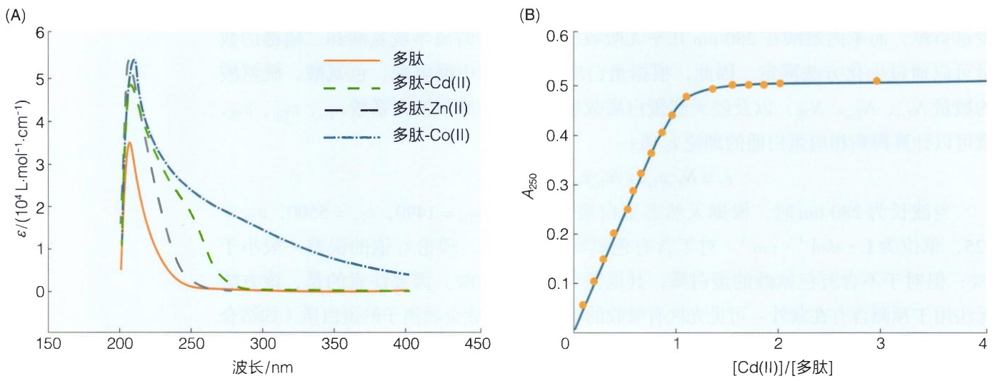

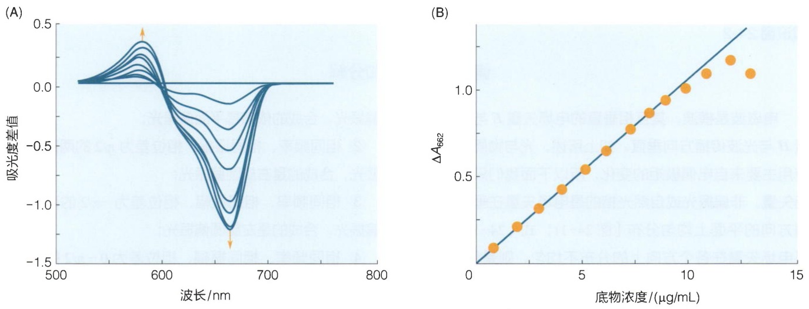

图 24-10 基于紫外-可见吸收的酶测活方法示意图

（A）酶与底物反应后的紫外-可见吸收光谱差谱。（B）利用特定波长处紫外-可见吸收值的变化可以获得酶动力学曲线。

## 24.3 圆二色光谱

## 24.3.1 圆二色光谱的基本原理和主要参量

## (1) 圆双折射与圆二色性吸收

当一束平面偏振光（可以看作是振幅、频率相同，旋转方向相反的两束圆偏振光）（知识窗24-2）通过介质传播时，如果介质对左旋和右旋圆偏振光折射率和光吸收的影响不同，则该介质被称为具有光学活性（optical activity），具有光学活性的物质也被称为手性物质（图24-12）。光学活性物质对折射率 $n_{左}$ 和 $n_{右}$ 的不同影响被称为圆双折射（circular birefringence），而对光吸收 $A_{左}$ 和 $A_{右}$ 的不同影响被称为圆二色性吸收、圆二色性或圆二色（circular dichroism，CD）。圆双折射和圆二色性吸收分别反映了光学活性物质对偏振光相位和幅度的影响（知识窗24-3）。

当波长为 $\lambda$ 的平面偏振光透过光程为 $l$ 的光学活性介质后，圆双折射的存在导致左旋和右旋偏振光分量的相位将不同，重新合成的平面偏振光（若光学活性介质对两者的光吸收相同）或椭圆偏振光（若光学活性介质对两者的光吸收不同）将旋转一个角度 $\alpha$ ，称为旋光性，$\alpha$ 随 $\lambda$ 变化的曲线被称为旋光色散（optical rotatory dispersion, ORD）。容易得到

$$
\alpha_ {\lambda} = \frac {\pi l}{\lambda} (n _ {1} - n _ {r}) = \frac {\pi l}{\lambda} \Delta n _ {\circ}
$$

实践中还常用比旋光度（specific rotation，$[\alpha]_{\lambda}$）、摩尔旋光度（molar rotation，$[\varphi]_{\lambda}$）和平均残基旋光度（mean residue rotation，$[\alpha_{\overline{m}}]_{\lambda}$），如果样品中光学活性物质的浓度为 $c$

## 知识窗24-2

## 偏振光的合成和分解

电磁波是横波，其互相垂直的电场矢量 $E$ 与磁场矢量 $H$ 与光波传播方向垂直。如上所述，光与物质的相互作用主要来自电偶极矩的变化，所以下面我们只考虑电场矢量。非偏振光或自然光指的是电场矢量在垂直于传播方向的平面上均匀分布[图24-11；式（24-1)]，如果电场矢量在各个方向上的分布不均匀，则是偏振光。如果电场矢量固定在某个特定的方向，电场矢量与传播方向组成的振动面始终保持在一个平面上，则被称为平面偏振光或线偏振光，可以写作

$$
E = \mathrm{j} E _ {0} \cos \omega t;
$$

如果电场矢量以顺时针方向旋转则称为右旋圆偏振光，以逆时针方向旋转则称为左旋圆偏振光，可以写作

$$
E _ {\mathrm{左}} = \frac {E _ {0}}{2} (- \mathrm{i} \mathrm{sin} \omega t + \mathrm{j} \mathrm{cos} \omega t),
$$

$$
E _ {\mathrm{右}} = \frac {E _ {0}}{2} (\mathrm{i} \sin \omega t + \mathrm{j} \cos \omega t)  .
$$

与矢量运算的规则相同，可以得到偏振光之间相互叠加的合成关系（图24-11）:

① 相同频率、相同振幅、相位也完全相同的两束平

面偏振光，合成的依然是平面偏振光；

② 相同频率、相同振幅、相位差为  $\pi/2$  的两束平面偏振光，合成的是右旋圆偏振光；
③ 相同频率、相同振幅、相位差为  $-\pi/2$  的两束平面偏振光，合成的是左旋圆偏振光；
④ 相同频率、相同振幅、相位差为  $0 \sim \pi/2$  的两束平面偏振光，合成的是椭圆偏振光；
⑤ 平面偏振光可分解为振幅、频率相同，旋转方向相反的两束圆偏振光，即  $E = E_{左} + E_{右}$ ;
⑥ 两束振幅、频率相同，旋转方向相反的偏振光也可以合成为一束平面偏振光，即 $E_{\text{左}} + E_{\text{右}} = E$
⑦ 两束圆偏振光振幅相同，但相位不同，合成的平面偏振光的偏振面旋转一个角度  $\alpha$ ;
⑧ 两束圆偏振光频率相同，旋转方向相反，但振幅不同，合成的是椭圆偏振光。如果椭圆偏振光的电场矢量分别为 $E_{\mathrm{a}}$ 和 $E_{\mathrm{b}}$ ，则合成的椭圆偏振光的椭圆率 $\theta$ 为椭圆短轴与长轴之比的反正切:

$$
\theta = \arctan \frac {\left| E _ {\mathrm{a}} - E _ {\mathrm{b}} \right|}{E _ {\mathrm{a}} + E _ {\mathrm{b}}}
$$

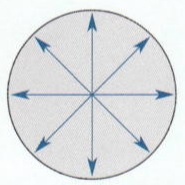

自然光 (非偏振光)

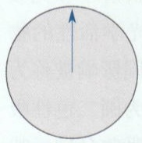

平面偏振光 (线偏振光)

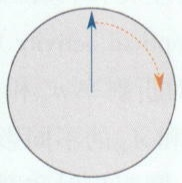

右旋圆偏振光

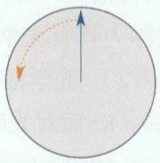

左旋圆偏振光

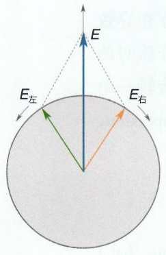

text_image

E
E左
E右

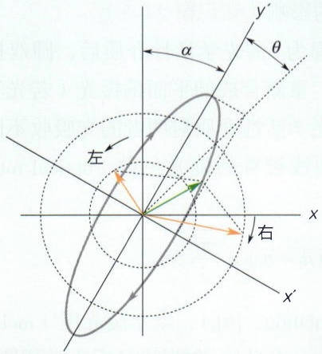

text_image

左
右
x'
y'
α
θ

图 24-11 平面偏振光、圆偏振光及其合成与分解示意图