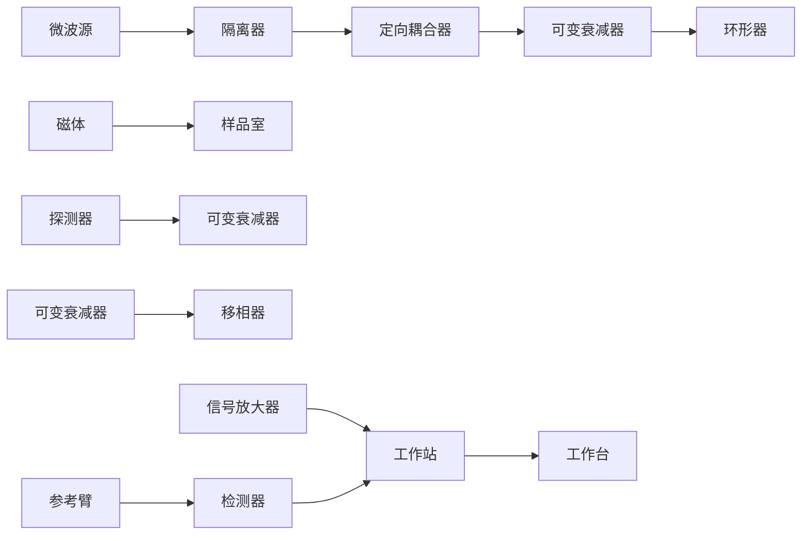

丰度较低，那么交叉峰不容易被检测到。

## 25.2 电子顺磁共振波谱学

电子顺磁共振（electron paramagnetic resonance，EPR）又称电子自旋共振（electron spin resonance，ESR），是研究包含有未成对电子的顺磁性物质如自由基、过渡金属离子、空穴等的波谱学方法。自1944年苏联物理学家叶夫根尼·扎沃伊斯基（Yevgeny Zavoisky，1907—1976）首次从固体 $\mathrm{CuCl}_2\cdot 2\mathrm{H}_2\mathrm{O}$ 中检测到顺磁共振吸收现象以来，EPR技术已有80多年的历史。在这80多年中，EPR技术的基础理论、实验技术和仪器设备等诸多方面均有了很大发展。EPR技术最初被物理学家用来研究某些复杂原子的电子结构、晶体结构、原子偶极矩及分子结构等问题。20世纪60年代末，由于低温技术、自旋捕捉、原位检测和自旋标记等新技术的发展，EPR技术被逐步引入化学和生物学领域，用来研究复杂有机化合物中的化学键、电子密度分布，生物体系内的自由基以及自旋标记的生命大分子等。20世纪70年代以来，美国、德国和日本等发达国家都在不断进行仪器改进和技术创新，随着商业化EPR谱仪的推出，EPR领域得到迅猛发展。20世纪末，世界上EPR技术的发展更加活跃，进入了脉冲、多频和活体成像等EPR技术发展的新时代。随着现代科学技术的不断发展，EPR目前已在物理学、化学、材料科学、生命科学、医学等许多领域获得了越来越广泛的应用。

## 25.2.1 电子顺磁共振的基本原理

和 NMR 一样，EPR 也是磁共振波谱学的一个分支。与 NMR 主要研究原子核自旋磁矩在外磁场中的核塞曼分裂以及与射频场相互作用引起的能级间的共振跃迁不同，EPR 研究电子自旋磁矩在外磁场中的电子塞曼分裂以及与微波场相互作用引起的能级间的共振跃迁。顾名思义，EPR 现象包含三个要素:未成对电子、外加磁场和共振。对 EPR 原理的精准描述需要量子力学的理论，难度较高，因此本节尽量使用比较容易接受的语言来介绍 EPR 的基本原理。

## (1) 共振条件

宏观物质由原子或离子组成。原子或离子由原子核和核外电子组成，除 ${}^{1}\mathrm{H}$ 外，原子核由质子和中子组成。质子、中子和电子等微观粒子均具有内禀的特征即自旋磁矩，因此，宏观物质毫无例外都是磁性物质。宏观物质的磁性主要由包含于其中的未成对电子的磁矩决定，这是因为电子自旋磁矩比原子核磁矩至少大三个数量级。对于不含未成对电子的物质，根据泡利不相容原理，同一原子轨道处于成对状态的两个电子自旋方向相反，因而各轨道上由成对电子自旋运动产生的磁矩相互完全抵消，这种分子为抗磁性物质。只有含有一个或一个以上未成对电子的物质，在外磁场作用下才能呈现顺磁性，这是EPR研究的对象。

如果将电子的自旋看作为绕其自身轴的旋转运动，假设外静磁场 B 沿着实验坐标系的 z 方向，则自旋角动量 S 绕磁场 B 的进动轨迹描绘出一个锥面（见图 5-3）。电子自旋角动量 S 的允许值为  $\sqrt{S(S+1)}$  h，S 代表自旋量子数，其在磁场方向的分量为  $S_{z}$ ，而垂直于磁场方向的分量  $S_{x}$  和  $S_{y}$  不可单独测定。根据泡利原理，单个电子的自旋量子数  $S = \frac{1}{2}$ ，对应的磁量子数  $m_{s}$  只能取  $\pm \frac{1}{2}$  两个值， $m_{s} = \frac{1}{2}$  的自旋可用上自旋（↑）或  $\alpha$  表示， $m_{s} = -\frac{1}{2}$  的自旋可用下自旋（↓）或  $\beta$  表示，即每个轨道最多只能容纳自旋方向相反的两个电子。对 2 个或 2 个以上的未成对电子体系，总自旋量子数 S 的最大值是 1， $\frac{3}{2}$ ，2，…。 $m_{s}$  的允许值可从 -S 到 +S 依序增加一个单位，共给出  $(2S + 1)$  个沿任意方向的分量。

电子带有电荷 $e$ ，带电体的旋转会产生磁场，这样一个旋转着的电子就好比一个小磁偶极子。在力学上可用 $\mu$ 描述磁偶极矩，它具有方向性，因而是一个矢量。根据量子力学，电子的自旋磁矩 $\mu$ 和自旋角动量 $S$ 间存在如下关系:

$$
\mu = - g _ {\mathrm{e}} \mu_ {\mathrm{B}} \hat {S} _ {\circ}
$$

其中，$g$ 为无量纲因子，称为 $g$ 因子，自由电子的 $g$（即 $g_{\mathrm{e}}$）为2.0023；$\mu_{\mathrm{B}}$ 称为玻尔磁子，常作为有效磁矩的单位，量值为 $\frac{e\hbar}{2m_{\mathrm{e}}} = 9.2740 \times 10^{-24} \mathrm{~J/T}$，其中 $e$ 为电子的电荷，$\hbar$ 为约化的普朗克常量，$m_{\mathrm{e}}$ 为电子静止质量；$\hat{S}$ 为自旋角动量算符，它在磁场方向的分量为 $S_{z}$，可用它的本征值即磁量子数 $m_{\mathrm{s}}$ 表示。

根据经典电磁学，如果将一个磁偶极矩 $\mu$ 放在磁场 $B$ 中，它们之间会产生一个相互作用能 $E$:

$$
E = - \boldsymbol {\mu} \cdot \boldsymbol {B} = - \mu B \cos \theta_ {\circ}
$$

其中，$\theta$ 是 $\pmb{\mu}$ 和 $B$ 之间的夹角，负号表示它为吸引能。当 $\theta = 0$ 时，$E = -\mu B$，自旋磁矩和外磁场平行时能量最低，体系最稳定；当 $\theta = \pi$ 时，$E = \mu B$，即自旋磁矩和外磁场反平行时，能量最高，体系最不稳定。对于电子，其在磁场中的磁相互作用能可为 $E = -\pmb{\mu} \cdot \pmb{B} = -(-g_{\mathrm{e}} \mu_{\mathrm{B}} \hat{S}) \cdot \pmb{B} = g_{\mathrm{e}} \mu_{\mathrm{B}} B m_{\mathrm{s}}$。由于电子自旋磁矩在外磁场中有两种取向（$\alpha$ 和 $\beta$），其 $m_{\mathrm{s}}$ 只能取 $+\frac{1}{2}$ 和 $-\frac{1}{2}$ 两个值，对应的电子能量分别为 $E_{\alpha} = \frac{1}{2} g_{\mathrm{e}} \mu_{\mathrm{B}} B$ 和 $E_{\beta} = -\frac{1}{2} g_{\mathrm{e}} \mu_{\mathrm{B}} B$，即电子自旋磁矩在外磁场中的磁相互作用能被裂分为两个能级，这就是电子自旋磁矩在外磁场中能量的塞曼分裂。两个塞曼能级之间的间距 $\Delta E = g_{\mathrm{e}} \mu_{\mathrm{B}} B$ 随磁场强度的增加而线性增大，如图25-20所示。

用适当频率 $v$ 的电磁波（微波）可激发两个塞曼能级之间的跃迁。若电磁辐射的激发能量 $h\nu$ 正好等于两个塞曼能级之间的间距 $\Delta E$ ，即

$$
\Delta E = h \nu = g \mu_ {\mathrm{B}} B _ {\mathrm{res}}, \tag {25-3}
$$

则处于两能级间的电子发生受激跃迁，导致部分处于低能级中的电子吸收微波的能量跃迁到高能级，这就是电子顺磁共振现象。式（25-3）称为电子顺磁共振的基本条件， $v$ 的单位是 $\mathrm{Hz}$，而 $B_{\mathrm{res}}$ 代表共振磁场的磁感应强度。塞曼能级间的跃迁，涉及电子自旋磁矩取向的改变，因此只有电磁辐射引起电子磁矩的重新取向，跃迁才能发生。为了使跃迁发生，电磁波（微波）必须在垂直于静磁场的方向上施加，使振荡磁场的一个分量垂直于静磁场。微波频率很容易满足振荡磁场垂直于静磁场的要求。

从式（25-3）可知，改变辐射频率或磁感应强度都可以满足共振条件，因而检测顺磁样品的共振吸收有两种方法。第一种是固定磁场不变，塞曼能级的间距固定，然后改变微波频率直至发生共振吸收；第二

line

| Feature | Description |
| --- | --- |
| Y-axis | E (Energy) |
| X-axis | B (Bandwidth) |
| Top panel | Semicircle energy level with slope +1/2 gμB |
| Top panel | Hyperbolic band height hν = \(g\mu B\) |
| Top panel | Horizontal slope -1/2 |
| Middle panel | Peak of the spectrum \(\chi_{2}\) |
| Bottom panel | EPR signal with peak labeled as B_res |
| Bottom panel | Vertical offset between peaks \(\Delta B_pp\) |

图 25-20 电子在外磁场中的能级分裂示意图

种方法是固定微波频率，然后改变磁感应强度。从技术角度出发，磁场均匀连续且精细的变化更容易实现，因此目前的EPR波谱仪一般采用固定微波频率，改变磁感应强度的方式来发生共振。与NMR图谱不同，EPR图谱的横坐标为磁场，一般用毫特斯拉（mT），纵坐标通常用信号强度对磁场的一阶导数曲线表示（称为一阶微分谱线），如图25-20所示。一般情况下EPR信号十分微弱，被噪声淹没，需要采取特殊的检波方式，在实际工作中，常常观测的是电子顺磁共振吸收信号的一阶微分信号。信号的高低或积分面积代表信号的强度，波峰到波谷之间的磁感应强度变化为EPR信号的线宽 $\Delta B_{\mathrm{pp}}$ 。

## (2) g 因子

在 NMR 中，处于不同化学环境的 H 原子核的共振频率有差异，产生共振吸收峰的位移，称为化学位移  $\delta$  。与化学位移  $\delta$  类似，g 值也可反映分子结构和原子结构信息。从未成对电子的顺磁共振条件  $h\nu = g\mu_{B}B$  看，h、 $\mu_{B}$  为常量，在微波频率固定后，v 亦为常量，g 值与共振磁场  $B_{res}$  二者成反比关系，因此 g 值可以表明共振磁场的大小。g 值是顺磁共振中的最重要参量之一。

$g$ 值在本质上反映出一种物质分子内局部磁场的特征，这种局部磁场主要来自轨道磁矩。自旋运动与轨道运动的耦合作用越强，则 $g$ 值对 $g_{\mathrm{e}}$ （自由电子的 $g$ 值）的增值越大，因此 $g$ 值能提供分子结构的信息。对于只含C、H、N和O的自由基，$g$ 值非常接近 $g_{\mathrm{e}}$ ，其增值只有千分之几。当单电子定域在硫原子时，$g$ 值为 $2.02 \sim 2.06$ 。多数过渡金属离子及其化合物的 $g$ 值就远离 $g_{\mathrm{e}}$ ，原因是它们原子中轨道磁矩的贡献很大。

## （3）超精细相互作用

如果顺磁分子在磁场中只有未成对电子和磁场的相互作用，从共振条件 $B_{\mathrm{res}} = h\nu / g\mu_{\mathrm{B}}$ 可知，所有EPR图谱只有一条谱线，它们的区别至多反映在g因子、线宽和线型上，而得不到更多的信息。在实际的顺磁分子中，未成对电子不仅与外磁场有相互作用，还会与附近的磁性核之间有磁相互作用，这种未成对电子自旋和磁性核自旋的相互作用称为超精细耦合或超精细相互作用，导致处于不同环境下的电子的顺磁共振波谱之间存在十分细微的差别，并会引起谱线分裂，称为超精细线或超精细结构。两个超精细谱线之间的间距被称为超精细耦合常数 $a$ ，可用于表示相互作用的大小。通过分析谱线数目、谱线间距以及相对强度，可以判断与电子相互作用的磁性核的种类、数量及相互作用的强弱，因而有助于确定自由基等顺磁物质的分子结构。

chemical

Energy level diagram showing electronic transitions with energy levels and coupling constants, alongside corresponding spectral peaks and coupling constant g=2.0023

图25-21 在固定磁场中氢原子的能级

虚线相当于在无超精细情况下 $h\nu = g\mu_{\mathrm{B}}B$ 的跃迁，实线相当于超精细结构允许的跃迁。

以氢原子为例，氢原子包含一个未成对电子 $\left(S=\frac{1}{2}\right)$ 和一个核自旋量子数 $I=\frac{1}{2}$ 的氢核。氢原子

中的未成对电子在受到外加磁场 $B_{0}$ 的作用同时也受到氢核自旋磁矩的附加磁场 $B_{\mathrm{local}}$ 的作用，并因此产生对应的共振磁场 $B_{\mathrm{res}}$ :

$$
B _ {\mathrm{res}} = B _ {0} + B _ {\mathrm{local}},
$$

$$
B _ {\mathrm{local}} = a _ {0} M _ {\mathrm{I} \circ}
$$

这里的 $a_0$ 就是超精细耦合常数。

氢原子的核自旋角动量 $M_{\mathrm{f}} = \pm \frac{1}{2}$，因此就有下式:

$$
B _ {\mathrm{res}} = B _ {0} \pm \frac {1}{2} a _ {0},
$$

因此一共将产生两条谱线: $B_{\mathrm{res1}} = B_0 - \frac{1}{2} a_0$ 和 $B_{\mathrm{res2}} = B_0 + \frac{1}{2} a_0$ 。两条谱线的距离等于 $a_0$ （图25-21）。超精细结构能够反映与未成对电子相关的磁性核的数目、核自旋大小、空间排布和化学键性质等情况，是鉴别自由基品种的“指纹”信息。

## 25.2.2 电子顺磁共振波谱仪

观察EPR现象的仪器称为电子顺磁共振波谱仪。一般EPR波谱仪都是固定频率、改变磁场来实现电子顺磁共振的，因此称为扫场式。根据共振条件 $h\nu = g\mu_{\mathrm{B}}B$ ，对自由电子 $g = 2.0023$ ，当频率为 $9.8\mathrm{GHz}$ （ $1\mathrm{GHz} = 10^{9}\mathrm{Hz}$ ）时，共振磁场为0.350T$\left[1\mathrm{T} = 10^{4}\mathrm{G}\right.$ （高斯）]。实际上，当磁感应强度在几到几百mT之间改变，辐射频率与磁感应强度保持着简单的比例关系是比较容易实现的。

根据固定的频率，EPR 谱仪可以分为若干型号，最常用的 X 波段（X-band, 9\~10 GHz），其次是 Q 波段。表 25-2 列出了典型波段、频率及对应的共振磁感应强度。针对不同的研究对象，微波的波段选择也有所不同。

表 25-2 常用 EPR 谱仪所采用的典型波段、频率及对应的共振磁感应强度

| 微波波段 | 频率范围 /GHz | 典型 EPR共振频率 /GHz | 典型 EPR磁感应强度 /mT |
| --- | --- | --- | --- |
| L | 1 ~ 2 | 1.5 | 5.4 |
| S | 2 ~ 4 | 3.0 | 110 |
| C | 4 ~ 8 | 6.0 | 220 |
| X | 8 ~ 12 | 9.5 | 340 |
| K | 18 ~ 26 | 23 | 1 820 |
| Q | 26 ~ 50 | 36 | 1 300 |
| V | 50 ~ 75 | 50 | 1 800 |
| W | 75 ~ 110 | 95 | 3 400 |

EPR波谱仪由微波桥、磁场系统、传导系统、检测系统等关键部分组成，共同实现对样品中未成对电子自旋行为的测量（图25-22）。微波桥使用速调管或耿氏二极管作为微波源，确保微波的稳定和高能输出。磁场系统包括电磁体和超导磁体，前者适用于X波段及以下的低频测量，后者则能在低温下提供高稳定性和均匀性的强磁场，适用于高频测量。传导系统通过隔离器、衰减器、环形器、波导管等器件精确控制微波的传导。样品室确保样品与微波和磁场的有效交互。探测器测量样品吸收的微波信号，放大器则增强信号以提高信噪比。数据采集系统记录并存储EPR信号，而工作站则负责调整和控制仪器的各项参数。这些组件的协同作用使得EPR谱仪能够提供样品结构和性质的详细信息。

不同的EPR谱仪可能会在具体构造和性能方面有所不同，以满足不同的研究需求。长期以来，商业化EPR波谱仪主要由欧美国家生产提供，其中性能和品种方面处于领先地位的是Bruker公司的产品。近年来，国仪量子自主研制的国产EPR波谱仪也得到较快发展。典型的 EPR 波谱仪如图 25-23 所示。

flowchart

图25-22 电子顺磁共振波谱仪的基本组成

natural_image

Laboratory equipment setup with white and blue equipment, including a dual-axis device and control panel (no visible text or labels)

图25-23 商业化电子顺磁共振波谱仪

## 25.2.3 定点自旋标记技术

早期 EPR 技术要求被检测的对象是含有未成对电子的顺磁性物质。由于大多数生命物质如蛋白质、DNA 或 RNA 本质上是抗磁性的，其结构中不含未成对电子，或者其中顺磁性成分的含量非常低，限制了 EPR 技术在生命科学研究中的应用。随后人们提出可将自旋标记物（spin label，某些稳定的自由基或顺磁性的报告基团）引入到被研究样品的特定位点，从而产生 EPR 信号并进行后续的实验分析，这种方法被称为定点自旋标记（site-

directed spin labeling, SDSL)。定点自旋标记技术的发展极大拓展了 EPR 技术在生命科学中的应用。

实现生物大分子的定点自旋标记，首先要选择合适的自旋标记物。对自旋标记物的基本要求是:①它本身应容易合成并且足够稳定，其中官能团可以根据被研究分子的需要而改变；②能以某种方式结合到被研究体系的特定位点并对被研究体系的原始结构和功能扰动非常小；③标记物本身的EPR波谱相对简单，易于解释；④对所在位置周围环境的变化极为敏感，从而在实验体系中需要加入的标记物浓度很低。

目前人们已发展出多种多样的自旋标记物（图25-24）。在大多数情况下，由于氮氧自由基及其衍生物的尺寸较小和已存在多种商业化产品，氮氧自由基及其衍生物是首选的生物大分子自旋标记物。其它的自旋标记物，包括顺磁镧系金属离子、三苯甲基自由基（triarylmethyl radical）等也在蛋白质和DNA的自旋标记中得到广泛应用。

近年来，人们通过将分子生物学中的点突变技术、非天然氨基酸技术相结合，发展了多种蛋白质定点自旋标记的策略（图25-25），主要有共价标记、分子生物学融合嵌入和金属离子置换反应等。

## ① 共价标记

蛋白质定点共价标记主要是基于半胱氨酸侧链巯基的化学反应。在蛋白质中，含有氨基的赖氨酸残基的丰度较高，而半胱氨酸的丰度较低。溶剂朝向的半胱氨酸具有较高的化学反应选择性，而一个蛋白质中存在多个溶剂朝向的半胱氨酸概率更低。对于含有多个半胱氨酸的蛋白质，由于每个半胱氨酸在蛋白质三维结构中化学环境和空间结构的差异，反应活性会有差异，因此可以通过改变自旋标记物中活化基团的活性达到选择性修饰。而在目标蛋白质中没有溶剂朝向的半胱氨酸情况下，可以根据蛋白质结构，通过分子生物学手段在蛋白质的特定位点通过基因突变方法引入溶剂朝向的半胱氨酸。

另外一种共价修饰路线是以生物正交的方式在目标蛋白质的特定位点上引入非天然氨基酸，该非天然氨基酸或带有与金属离子配位的基团，能直接与顺磁金属离子配

氮氧自由基

chemical

Chemical structure of a substituted pyrrolidone derivative with R and N-O groups

chemical

Chemical structure of a substituted pyrrolidone derivative with R and N-O- groups

chemical

Chemical structure of a substituted pyrrolidone derivative with R and N-O groups

chemical

Chemical structure of a substituted benzene derivative with R group and nitro group

图25-24 几种常见的自旋探针

镧系金属离子

chemical

Molecular structure of a gadolinium (Gd) complex with cobalt and pyridine ligands

三苯甲基自由基

chemical

Complex organic molecule structure with thiophene and thiophene rings, featuring a central metal atom bonded to multiple phenyl groups and terminal substituents.

chemical

Chemical structure of a sulfonamide derivative with MTSSL label and radical group

chemical

Chemical structure of a sulfonamide compound with a labeled protein residue

图25-25 蛋白质定点自旋标记技术

chemical

Chemical structure of a triazole derivative with labeled nitrogen atoms and a beta-1,2-dione group

chemical

Chemical structure of a copper ion (Cu²⁺) with IDA and N-H₂ groups attached to two carbonyl groups

chemical

Chemical structure of dHis-Cu²⁺-IDA complex showing copper ion binding to protein and ligand

chemical

Chemical structure of a phenyl ether derivative with labeled protein name

chemical

Chemical structure of a triazole derivative with amine and hydroxyl groups

chemical

Chemical structure of a peptide derivative with phenyl, amide, and ester functional groups

位，或带有叠氮或炔基，可以进一步通过点击化学进行反应，或有其它能进一步偶联的基团。

## ② 融合嵌入和金属离子置换反应

根据顺磁金属离子的配位特性和分子生物学技术，可以在蛋白质上引入顺磁金属结合中心。 $\mathrm{Cu^{2+}}$ 可以与N端的Gly和His氨基酸形成稳定配合物，因此可以在蛋白质的N端引入Gly和His两个氨基酸残基与 $\mathrm{Cu^{2+}}$ 结合，这类顺磁标记可以通过EPR研究蛋白质动态构象变化。

蛋白质上的钙离子结合位点通常具有EF手形（EF-hand）序列，人们通过优化EF手形的氨基酸序列，筛选出对顺磁稀土金属离子结合的多肽片段，并把该肽段融合到蛋白质的N端、C端或者蛋白质的某个中间环区，以此实现对顺磁稀土离子的结合。

近年来，RNA的研究日益受到重视。人们也发展了多种RNA的定点自旋标记方法，主要有固相化学合成法、模板指导酶促法、非天然碱基法等，限于篇幅，具体细节可参考扩展阅读材料。

## 25.2.4 电子顺磁共振波谱及其应用

根据微波辐照的持续性，EPR波谱仪可分成连续波谱仪（continuous wave EPR, cw-EPR）和脉冲式波谱仪（pulsed EPR）。在cw-EPR实验中，微波辐射源是连续波，而脉冲EPR实验的辐射源是短而强的微波脉冲。结合生物大分子定点自旋标记技术和EPR技术（SDSL-EPR），通过分析自旋标记物的EPR波谱，可获取生物大分子的结构、构象动态、相互作用等各种信息。下面简要介绍通过EPR实验如何获得生物大分子的局域动力学信息以及自旋标记物间的距离信息。

## (1) EPR 与局域动力学信息

相比于脉冲式波谱仪，连续波谱仪的设备费用相对较低，技术过程也相对简单，通常可在室温下开展，并具有更高的灵敏度。通过分析 cw-EPR 谱线的线型特征，通常可获取顺磁金属离子的价态、成键情况、诱导效应、共轭离域等电子效应，以及电子-电子的间距（小于 15 Å），运动相关时间  $\tau_{c}$  等信息。

氮氧自由基是生物大分子定点自旋标记中最常用的自旋标记物。由于氮氧自由基氧原子上的未成对电子（电子自旋量子数 $S = 1 / 2$ ）与其成键的氮原子（核自旋量子数 $I = 1$ ）之间存在超精细相互作用，通过SDSL技术连接到生物大分子上的氮氧自由基（如MTSL）在X波段EPR谱仪上测量得的cw-EPR谱图是典型的三线谱。由于氮氧自由基中的塞曼相互作用和超精细耦合是各向异性的，氮氧自由基相对于外磁场的方向能够影响EPR信号。反过来EPR信号也能够反映氮氧自由基的旋转扩散（rotational diffusion）运动情况。

EPR 方法能够检测的运动时间尺度跟实验的微波频率有关，高频 EPR 更容易观察非常快的运动。通常，氮氧自由基在 X 波段的 cw-EPR 谱图对分子在皮秒到微秒范围内的运动情况比较敏感，而通过使用饱和转移 EPR 方法（saturation transfer EPR）

则能够将运动检测范围延伸至毫秒级别。因此SDSL-EPR能够检测的运动时间尺度涵盖了生物大分子执行许多重要生理功能的时间尺度。EPR探测的运动情况可分成三个层次:转动相关时间（rotational correlation time）$\tau_{\mathrm{c}}$ 为 $0.1\sim 2\mathrm{ns}$ 的快运动； $\tau_{\mathrm{c}}$ 范围为$2\sim 100~\mathrm{ns}$ 的慢运动； $\tau_{\mathrm{c}}$ 大于 $100~\mathrm{ns}$ 的极慢运动。其中，快运动和慢运动的时间尺度小于氮氧自由基的横向弛豫时间 $T_{2}$ （约为 $15\sim 30~\mathrm{ns}$ ，因此快运动和慢运动会对cw-EPR谱图的线型产生影响。反过来，cw-EPR谱图的线型能够反映分子的运动速度情况以及运动受限情况。图25-26中的EPR谱图分别对应着不同转动相关时间的氮氧自由基。当氮氧自由基旋转运动非常快时（比如水溶液中），则cw-EPR谱图表现为各向同性，三条谱峰几乎是等高的。而当氮氧自由基旋转运动逐渐减小，EPR谱图的谱线峰宽则会逐渐增大，并伴随着谱峰高度降低。而当氮氧自由基的运动非常慢，达到运动受限极限时，其EPR谱图则类似于低温冷冻样品或者固体粉末样品的“粉末谱”（powderspectrum）。

EPR 谱线线型对于蛋白质内部的运动性非常敏感。对于那些具有多种运动组分的蛋白质，或者那些在空间上与其它位点侧链发生相互作用的位点，它们的 EPR 谱图通常会呈现出多种不同的谱线形状，反映了不同的运动状态。

## (2) EPR 与距离测量

在蛋白质等生物大分子中同时标记上两个自旋标记物，就能够使用EPR方法测量两个自旋标记物之间的距离信息。EPR方法测量距离的基本原理是相隔一定距离范围的两个自旋标记物A和B之间存在偶极-偶极相互作用 $\omega_{\mathrm{AB}}$ ， $\omega_{\mathrm{AB}}$ 由以下公式给出:

图25-26 氮氧自由基的超精细相互作用以及分子内运动与线型的关系

$$
\omega_ {\mathrm{AB}} (\theta , r) = - \frac {\mu_ {0} g _ {\mathrm{A}} g _ {\mathrm{B}} \mu_ {\mathrm{B}} ^ {2}}{4 \pi \hbar} \frac {1}{r _ {\mathrm{AB}} ^ {3}} (3 \cos^ {2} \theta - 1) 。
$$

其中，$\mu_0$ 是真空磁导率，$g_{\mathrm{A}}$ 和 $g_{\mathrm{B}}$ 是两个自旋标记物的 $g$ 值，$\mu_{\mathrm{B}}$ 是玻尔磁子，$\hbar$ 是约化普朗克常量，$r_{\mathrm{AB}}$ 是自旋标记物之间的距离，$\theta$ 是自旋标记物之间的矢量与磁场之间的角度。

同其它能够在生物大分子中进行距离测量的方法相比，EPR 距离测量技术具有诸多优势:①距离测量范围广（8～80 Å）；②能够在多种环境中进行检测，从室温到液氮低温，从水溶液到去污剂或者磷脂，甚至能在细胞膜原位进行距离测量；③EPR 距离测量过程中受到的干扰很少。

根据使用的 EPR 技术不同，生物大分子中的 EPR 距离测量可分为连续波 EPR 距离测量和脉冲 EPR 距离测量。

## ① 基于 cw-EPR 的距离测定

cw-EPR 距离测量适用于两个自旋标记物之间的距离为 8～25 Å，其基本原理是:较短距离（8～20 Å）的两个电子自旋之间的偶极-偶极相互作用会使得 cw-EPR 谱图发生明显的增宽效应，此时的 cw-EPR 谱图的线宽包含两部分的贡献，其中一部分是没有偶极-偶极相互作用的单自旋 cw-EPR 谱图，而另一部分就是偶极-偶极相互作用产生的增宽函数的卷积。因此，只要对增宽部分的谱图进行去卷积就可得到增宽函数，进而得到距离信息。在实际 cw-EPR 距离测量过程中，经常需要在生物大分子样品中加入甘油或者蔗糖从而提高黏度，有时甚至需要在液氮低温条件下收集蛋白质样品的 cw-EPR 谱图，其目的是降低生物大分子的整体运动，从而避免偶极-偶极相互作用被平均掉。当自旋标记物之间的距离大于 25 Å 时，偶极-偶极相互作用导致的谱线增宽变得非常微弱，cw-EPR 距离测量方法变得不再适用，此时可使用脉冲 EPR 距离测量方法。

## ② 基于脉冲 EPR 的距离测定

相比于cw-EPR，脉冲EPR距离测量方法的一般可测距离范围是 $18\sim 60\AA$ 。如果对生物大分子进行全氘代并使用氘代溶剂，在较低样品浓度下则能将可测距离极限提高到 $100\AA$ 以上甚至是 $160\AA$ 。自2000年以来，人们发展了多种脉冲EPR方法并广泛用于生物大分子的结构生物学研究，其中脉冲电子-电子双共振[pulsed electron-electron double resonance，PELDOR，又称双电子共振（double electron-electron resonance，DEER)]技术是目前最常见的生物大分子距离测定方法。如图25-27，常用的PELDOR脉冲序列包含4个脉冲，可分成观测脉冲（detection pulse）和激发脉冲（pump pulse）。PELDOR脉冲序列是一种远程检测回波的过程，该过程通过在观测频率 $\omega_{\mathrm{A}}$ （对应电子自旋A）处施加一个 $\pi /2$ 脉冲和两个 $\pi$ 脉冲，以及在激发频率 $\omega_{\mathrm{B}}$ （对应电子自旋B）处施加一个常见的翻转角度为 $\pi$ 的泵浦脉冲来产生。第二个观测脉冲在第一个脉冲之后延迟 $\tau_{1}$ 施加。随后，自旋系统的自由演化（FID）在进一步延迟 $\tau_{1}$ 处产生一个主要的Hahn回波（PE），其强度在进一步延迟 $\tau_{1}$ 时达到最大。第三个观测脉冲在这个回波的最大值之后延迟 $\tau_{2}$ 施加。因此，在这最后一个观测脉冲之后延迟 $\tau_{2}$ 处出现一个重聚焦回波（RE）。信号相位被调整，使得RE具有最大的正幅度。由于偶极-偶极相互作用的存在，在含有A和B两个自旋探针的体系中，通过对B自旋的反转，泵脉冲导致A自旋处的局部磁场发生变化。如果观察自旋A的回波强度，能够得到与自旋B的翻转时间（$t$）相关的多重振荡衰减信号（PELDOR信号），该信号的振荡频率和偶极-偶极相互作用有关，包含着距离信息。

spectrogram

| Feature | Description |
| --- | --- |
| Top Spectrum | Frequency spectrum with labeled peaks (π/2, π, π, π) and reference points \(\tau1\), \(\tau2\). |
| Middle Spectrum | Time delay between Hahn and Re聚焦 signals. |
| Right Spectrum | Re聚焦信号 (repeated) with labeled time delay \(\tau gate\) and time delay t. |
| Bottom Spectrum | Re聚焦信号 (repeated) with labeled time delay t. |

图25-27 PELDOR实验的四脉冲序列

PELDOR 测量得到的谱图需要通过去卷积方法或者拟合方法进行分析才能得到距离数据。虽然脉冲 EPR 的距离计算较为复杂，但相较于连续波 EPR，脉冲 EPR 的数据处理有 DeerAnalysis、DeerLab 以及基于神经网络的 DeerNet 等成熟的距离计算软件。

③ 距离信息与构象动态变化

PELDOR等实验提供的距离信息可用于生物大分子的构象动态研究，或作为结构约束用于生物大分子结构的计算模拟。例如，人们通过SDSL-EPR技术测定了不同偏向性配体引起的血管紧张素Ⅱ-1型受体（AT1R，一种G蛋白耦联受体）胞内区域10对自旋标记位点间的距离分布变化（如图25-28），结果表明不同功能组别的配体结

图25-28 基于PELDOR实验的距离分布信息用于研究偏向性激动剂引起的GPCR构象动态变化（引自Wingler L M, et al. Cell, 2019, 176(3): 468-478）

图 25-29 应用 PELDOR 技术开展活细胞内 RNA 结构的研究

（A）新型氮氧自由基探针。（B）双链RNA上标记的两个相距15个核苷酸的顺磁探针。（C）PELDOR在缓冲液（红色）、爪蛙卵母细胞内（橙色）、胞质提取物（蓝色）以及 $200\mathrm{mg / mL}$ 溶菌酶溶液（绿色）里测量到的探针间距。（引自Collauto A, et al. Angew Chem Int Ed Engl, 2020, 59(51): 23025-23029）

(A)

chemical

Chemical structure of EImUm molecule with labeled functional groups and stereochemistry

(B)

natural_image

Diagram of a DNA double helix structure with red nodes and a vertical double-headed arrow indicating positional difference (no text or labels)

(C)

line

| r/nm | Green Series | Blue Series | Orange Series | Red Series |
| --- | --- | --- | --- | --- |
| 2.0 | ~0.5 | ~0.3 | ~0.2 | — |
| 3.0 | ~0.5 | ~0.3 | ~0.2 | — |
| 4.0 | ~1.0 | ~0.8 | ~0.6 | ~0.4 |
| 5.0 | ~0.6 | ~0.4 | ~0.3 | ~0.1 |
| 6.0 | ~0.5 | ~0.3 | ~0.2 | — |
| 7.0 | ~0.5 | ~0.3 | ~0.2 | — |

合对AT1R的构象景观产生完全不同的效应。

## (3) 活细胞 EPR 研究

由于活细胞内环境难以在体外进行复刻模拟，直接在活细胞内原位探索生物大分子的结构和构象动态具有重要意义。谱学方法，包括NMR和EPR等，由于其非侵入性、无损伤和高选择性等特点，在活细胞原位结构研究中可发挥独特优势。

SDSL-EPR 技术是捕捉细胞内 RNA 结构和动态信息的有力手段。例如，人们将一种未成对电子被四个乙基保护的新型氮氧自由基探针引入一段双链 RNA，并通过显微注射的方法将 RNA 递送至爪蛙卵母细胞内，随后直接开展 PELDOR 实验。结果揭示，相比于体外实验，在爪蛙卵母细胞中，自由基探针间距离分布变近，表明 RNA 的双链结构在活细胞内的拥挤环境下被轻微压缩（图 25-29）。

## ※ 本章小结

核磁共振和电子自旋共振的发展历程紧密交织，互相促进。其中值得一提的是新兴的动态核极化技术。它通过激发电子自旋共振信号，并将其传递到原子核，从而实现了信号的极大增强。这一技术的出现体现了两种方法之间的紧密关联。与光的吸收和发射现象相比，核磁共振和电子自旋共振具有更长的弛豫时间，从而为方法学开发提供了广阔的空间。磁共振方法博大精深，本章只是介绍了基础知识。感兴趣的读者可以进一步阅读参考文献中的专业书籍。最后，直接测量活细胞内生物大分子的结构和动态是结构生物学的前沿方向，而两种磁共振方法都为胞内测量提供了重要工具，为我们理解生物体内复杂的分子互作及其功能带来了新的视角。

## ※ 思考题

1. 从微观上看，自旋量子数为 $1/2$ 的原子核在磁场中产生的磁矩总是分布在上下两个锥面上；从宏观上看，大量这样的自旋合成的宏观磁化矢量可以在横向射频场作用下转到 $xy$ 平面上。请描述两个锥面上的微观磁矩如何能够合成为一个在 $xy$ 平面上的宏观磁化矢量。
2. 请画出双自旋体系算符 $\hat{I}_{z}$、$\hat{I}_{x}$、$\hat{I}^{-}\hat{S}^{-}$ 和 $2\hat{I}_{x}\hat{S}_{z}$ 的能级示意图。
3. 假设你用 $600\mathrm{MHz}$ 的核磁仪测量一个8kDa的蛋白质，发现谱峰展宽非常严重，以致于多数谱峰难以清晰地辨认。请问有哪些因素可能导致这种现象？
4. 什么样的生物大分子不适合用无模型分析方法来处理它的弛豫数据？什么方法比较适合这类生物大分子？
5. 请比较核磁共振和电子顺磁共振两种方法的特点以及在应用场景上的区别。

代找电子书资源，新书可代做扫描制作加微信 asxiao90

## ※ 扩展阅读

图书

孔学谦. 固体核磁共振原理 [M]. 北京: 高等教育出版社, 2023.

苏吉虎，杜江峰.电子顺磁共振波谱:原理与应用[M].北京:科学出版社，2022.

Abragam A. The principles of nuclear magnetism[M]. Oxford: Oxford University Press, 1961.

Cavanagh J, Fairbrother W J, Palmer A G III, et al. Protein NMR spectroscopy: principles and practice[M/OL]. 2nd ed. Amsterdam: Academic Press, 2007.

Kowalewski J, Mäler L. Nuclear spin relaxation in liquids: theory, experiments, and applications[M]. 2nd ed. Boca Raton: CRC Press, 2017.

综述

Claxton D P, Kazmier K, Mishra S, et al. Navigating membrane protein structure, dynamics, and energy landscapes using spin labeling and EPR spectroscopy[J]. Methods Enzymol, 2015, 564:349–387.

Huang K Y, Fang X Y. A review on recent advances in methods for site-directed spin labeling of long RNAs[J]. Int J Biol Macromol, 2023, 239:124244.

Jeschke G. The contribution of modern EPR to structural biology[J]. Emerg Top Life Sci, 2018, 2(1):9–18.

研究论文

Collauto A, von Bülow S, Gophane D B, et al. Compaction of RNA duplexes in the

- cell[J]. Angew Chem Int Ed Engl, 2020, 59(51):23025-23029.
- Wingler L M, Elgeti M, Hilger D, et al. Angiotensin analogs with divergent bias stabilize distinct receptor conformations[J]. Cell, 2019, 176(3):468–478.

## 26

## 显微成像

显微成像技术是一种通过放大和增强样本的细节来观察物质微观结构的技术，被广泛用于多个不同的研究领域，包括生物学、医学、材料科学和纳米科技等，是人类理解微观世界的最基本工具和手段。显微成像技术使用各种可见或不可见光波甚至电子波作为基本的探测源，借助透射或扫描成像等多种手段来实现对微观物质结构的成像探测，使人们能够看到肉眼无法观察到的微观世界。本章将首先介绍显微成像技术的一些基本概念，然后介绍两个主要的显微成像手段（光学显微镜和电子显微镜）的基本成像原理和数据分析方法。

## 26.1 显微成像中的关键原理和概念

光学显微镜主要由光学玻璃透镜构成，是最常见的显微成像技术之一。它使用可见光来照亮样本，并通过透射或反射光来观察样本的细节。传统光学显微镜的最高分辨率通常在几百纳米到几微米之间，超分辨光学显微镜分辨率可达纳米水平，可以用于观察细胞、组织和其它生物样本的结构。光学显微镜具有成本低、易于操作和对样本无损伤等优点，在生物学研究中得到了广泛应用。

电子显微镜是一种使用电子束而不是可见光来观察样本的显微成像技术。电子显微镜分为透射电子显微镜（transmission electron microscope，TEM）和扫描电子显微镜（scanning electron microscope，SEM）两种类型。透射电子显微镜采用穿透样品的电子束来观察样品，用于观察样品的内部结构；借助一定的算法，还可以通过计算展示出样品的三维结构。扫描电子显微镜通过在样品表面进行栅格扫描的电子束来激发信号并形成图像，用于观察样本的表面形貌和元素分布等信息。相对于光学显微镜，电子显微镜具有高分辨率和高放大倍数的优点，可以提供高至原子级或纳米级分辨率的样本结构信息，目前最高分辨率可以达到几十皮米级别，可直接显示出样品中的原子排布，但同时建造成本也非常高。

除了光学和电子显微镜，还有许多其它的显微成像装置和技术。例如，原子力显微镜（AFM）通过探针与样本表面的相互作用来产生图像，可以观察到样本表面的原子尺度形貌和力学相关的性质。荧光显微镜在光学显微镜的基础上利用荧光染料来标记样本中的特定分子或结构，使其在激发光下发射荧光信号，从而观察到样本的分子分布和活动。近场光学显微镜（NSOM）利用纳米尖端和光学探测器的相互作用来产生图像，可以实现亚纳米级别的分辨率。这些显微成像技术各有特点，可以根据不同的需求选择合适的技术。

显微成像技术是生物学和医学研究的必备技术和工具，可以帮助研究细胞和组织的结构与功能，从而促进对生命活动的理解以及疾病的诊断和治疗。随着新技术的不断涌现和不同使用场景下的需求增加，人们发展出了各种不同的显微成像技术。这些成像技术所基于的基本原理千差万别，但又经常存在很多的共同点和相似点。本节将对这些成像技术所涉及的一些共有的基本原理和概念进行简要的介绍。

## (1) 光路

每一个显微成像系统都是由很多个光学元件组成的。这些光学元件处于光传播的一条通路上，这条通路被称为光路。在大部分的光学系统中，光沿光路的传播是可逆的。光路的可逆性是光学系统的一个重要性质，经常被用于光学系统的原理分析。通常来说光学元件的主光轴都需要与光路对齐或相互平行，两者的偏离会造成系统分辨率的降低。

## (2) 像与衍射

在大多数情况下，光学系统能够对所观察物体直接成像，反映出物体中组成元素的结构特征和元素间的空间位置关系。而衍射是一种样本结构的间接反映，是像或样