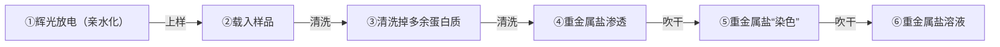

式（26-7）中的振幅项一样，造成了傅里叶空间中信号整体上的衰减。正弦项的取值范围在 $-1\sim 1$ 之间，其数值越接近于零，则意味着对局部信号的衰减越强。同时，正弦项的取值可以为负值。根据复数的欧拉公式，我们可以推算得到

$$
\mathrm{e} ^ {\mathrm{i} \pi} = \cos \pi + \mathrm{i} \sin \pi = - 1,
$$

由此可知，负值意味着 $180^{\circ}$ 的相位变化。因此，除了对信号造成局部衰减之外，取负值的正弦项还会对衍射信号引入一个额外的 $180^{\circ}$ 相位变化。图26-10给出了一个典型的欠焦成像条件下图像衬度传递函数的具体形式。在图中，我们除了看到振幅项作为一个外部衰减包络对整体信号尤其是高频信号造成的衰减，还能看到正弦项引入了复杂的影响，体现为一个高频率的振荡扰动，且不仅仅是图中红色曲线是衬度传递函数的振幅包络函数，蓝色曲线是衬度传递函数。绘制此函数的电镜参数列于图的右上角。

line

| 空间频率 \((Å^{-1})\) | A(u) | \(H(u)=A(u)sin\chi_{1}(u)\) |
| --- | --- | --- |
| 0 | 1 | 0 |
| 0.05 | ~0.95 | ~-0.95 |
| 0.1 | ~0.85 | ~0.85 |
| 0.15 | ~0.75 | ~-0.75 |
| 0.2 | ~0.65 | ~0.65 |
| 0.25 | ~0.55 | ~-0.55 |
| 0.3 | ~0.45 | ~0.45 |
| 0.35 | ~0.35 | ~-0.35 |
| 0.4 | ~0.25 | ~0.25 |
| 0.45 | ~0.15 | ~-0.15 |
| 0.5 | ~0.1 | ~0.1 |

图 26-10 典型的图像衬度传递函数

振幅上的，也是相位上的。从与图像衬度的关系角度，低频信号通常贡献了物体结构的低分辨率轮廓信息。而且在大多数信息传递系统中，包括这里的透射电镜，低频信号的强度通常远高于高频信号。在大部分的成像条件下，只有低频信号是直接肉眼可见的，而高频信号经常被隐藏在噪声之下，无法被直接观察到。当我们采用欠焦成像条件时，正弦项在低频部分取的是负值。由于低频信号在图像的衬度显示中占据了主要地位，图像衬度传递函数对低频信号施加的这个负值意味整个图像衬度的反转。因此，在欠焦成像条件时，我们看到的图像中的物体，比如说蛋白质，都是显示为黑色衬度的；而在空白区域或者物质密度比较小的地方，其衬度是白色的。而如果我们改用过焦条件成像，那么图像的衬度就会被反转过来，黑变白，白变黑。这种变化也恰恰说明了，相位衬度像并不一定能直接反映样品结构。此外，我们也看到衬度传递函数在原点附近（低频区域）接近于0，也就是说这部分最低频的信号会被显著地衰减掉。然而这部分信号恰恰是对图像衬度的展示至关重要的，这也是为什么生物电镜图像衬度非常低的一个重要原因。

## 26.3.1.4 衬度传递函数的测量与修正

根据式（26-8），从电镜图像中消除衬度传递函数影响的方法是显而易见的。将该公式稍加变形即可求解出结构因子

$$
F (\boldsymbol {u}) = \frac {\mathcal {F} [ I (\boldsymbol {r}) ]}{2 \sigma A (\boldsymbol {u}) \sin \chi (\boldsymbol {u})},
$$

再对其进行傅里叶逆变换即可得到样品的投影电势分布函数 $\varphi (\boldsymbol {r}) = \mathcal{F}^{-1}[F(\boldsymbol {u})]$ 。在该公式中，狄拉克函数 $\delta (\boldsymbol {u})$ 被忽略掉了，因其只在原点透射束处有非零值，而图像衬度传递函数是作用在所有衍射束上面的。根据这个公式，如果需要消除衬度传递函数的影响，首先需要做的是获得图像衬度传递函数的具体解析形式。

根据前面的推导，我们已经有了衬度传递函数的解析表达式，只需要测定其中的具体参数就可以了。在与衬度传递函数相关的所有参数中，只有离焦量参数是可变的，其它的参数包括球差、色差和束发散角等都是固定无法调节或者需要保持在能调节到的最佳值上，在数据采集过程中都是固定不变的。因此，衬度传递函数的测量，实际就是要测量成像时的离焦量的数值。在有物镜像散的情况下，也需要测量像散的具体参数。此外，在这个表达式中，振幅项并不会影响到对结构的解释，只是对分辨率有所影响。从信号的角度来讲，一旦信号被衰减掉了（体现为信噪比降低），是无法通过除以一个衰减数值而被恢复出来的。因此，消除衬度传递函数造成影响的主要目标是消除正弦项对衍射相位的扰动。

那么接下来的问题是如何从图像中得到衬度传递函数的信息并对其进行测量。实际很容易实现，只需要计算图像的功率谱。

在生物样品电镜相位衬度像的功率谱中（图26-11），我们经常能看到很多同心的圆环。如果围绕功率谱的中心，对图像做一个旋转平均就能够得到一条振荡的曲线。这些圆环和曲线中的振荡被称为索恩环（Thon ring），对应于图像衬度传递函数中的正弦项。之所以能在功率谱中直接观察到衬度传递函数的形态，是因为衬度传递函数在傅里叶空间中是乘在图像信号 $F(\pmb{u})$ 之上的。对于大多数生物样品来讲，其中的原子和分子的分布从宏观统计上来看可以认为是随机的，相应地，其信号是弥散地分布在傅里叶空间中的。当把一个振荡起伏的中心对称分布的图像衬度传递函数直接乘上去之后，就刻画出来了一些振荡的圆环，从而使我们能够直接观察到图像衬度传递函数的振荡。

接下来的测量问题就变得非常简单了，通常的方法是基于图像拟合的。由于已经知道了图像衬度传递函数的解析表达式，只需给定一个离焦量就可以模拟出索恩环的图像，然后将其与实验图像的功率谱进行匹配以判断相似度，再依托一定的参数搜索算法就可以最终估计出离焦量。当图像中存在轻度的物镜像散时，这些图像衬度传递函数相关的圆环会变成椭圆形。那么只要在模拟参数中考虑像散相关的参数，就可以用类似的匹配搜索算法来测定离焦及相散。

图26-11 电镜图像的功率谱和索恩环

在测定出图像衬度传递函数之后，根据前面的讨论，图像衬度传递函数修正也就变得简单直接了，直接在傅里叶变换之后的图像中除掉图像衬度传递函数即可。只是在除的时候，图像衬度传递函数中存在零点，直接与零或很小的衬度传递函数值相除

text_image

电镜相位衬度像
功率谱
强度
索恩环
背景噪声
空间频率/Å⁻¹
功率谱的旋转平均

或会导致相关信号和噪声的过度放大。为了避免这个问题，人们通常不会采用直接除以图像衬度传递函数的方法。实际上，在图像衬度传递函数的修正中，相位的修正是比振幅的修正更加重要的。所以，在大多数的电镜图像处理中，常用的方法是把图像衬度传递函数为负值的信号区域乘以-1，使其相位变正确即可，而不对振幅做过多处理。对于图像衬度传递函数的振幅来讲，当其数值接于近于零时，意味着这个频率上的信号并没有被电镜的成像系统传递过来，是丢失掉的。在实际的应用中，一个被更普遍采用的方法是把多张图像中的信号叠加起来以弥补单张图像中信号的损失，该方法将在后续三维重构方法中进行介绍。

## 26.3.2 生物大分子单颗粒三维重构技术

单颗粒分析技术只需要对处于样品中随机取向的大量生物大分子进行一次拍照，就可以获得同一个分子结构沿不同方向的投影。这样做的好处是可以把所有可用的电子辐照剂量集中在一张照片之上，在蛋白质结构被辐照损伤之前，尽最大可能获得高信噪比的投影图像以降低后续分析处理的难度。然而这样也有缺点，一方面是分子间结构上的不一致都会导致三维重构的失败或分辨率降低，这对前期的蛋白质分离纯化提出了较高的要求，使之占据了结构解析流程中相当一部分时间；另一方面，每一个蛋白质投影的方向是未知的，这使得三维重构的成败和分辨率严重依赖于方向测定算法的精度以及由此而产生的巨大计算量。

下面将首先阐述单颗粒分析的核心原理和方法，然后对整个结构解析的技术流程做简要的介绍。

## 26.3.2.1 单颗粒样品制备的基本方法

单颗粒样品制备的基本目标是制备出颗粒均匀分散且方向随机的薄片状样品。制备方法包含冷冻和常温染色两种制备方法。冷冻样品制备是将生物大分子直接快速冷冻起来，用于冷冻电镜直接成像，该方法也是获得生物大分子高分辨率结构的最基本方法。常温染色制备通常被称为蛋白质负染技术，是使用重金属盐染色的方式来保存生物大分子的一些粗略轮廓结构信息。该方法不需要将样品进行冷冻，简单快捷，但分辨率最高只能达到 $1\sim 2\mathrm{nm}$ 。

不管使用哪种样品制备方式，都需要使用标准的电镜载网和支持膜来承载样品（图26-12A）。电镜载网通常是 $3\mathrm{mm}$ 直径的金属微栅网格，其材质通常是铜或金。支持膜通常是一层 $10\mathrm{nm}$ 左右厚度的非晶碳膜，平铺在金属载网上。支持膜上通常有很多 $1\sim 2\mu \mathrm{m}$ 直径的圆形小孔或不规则小孔。这些小孔将来被用于承载样品溶液薄膜，或者进一步承载更薄的连续碳膜或者石墨烯等超薄膜材料用于吸附蛋白质颗粒。

冷冻样品制备的基本要求是把蛋白质颗粒冻结在一层非常薄的非晶态冰层（通常称为玻璃态冰）里，冰层厚度通常为几十纳米。这样的厚度保证了电镜成像时能够满足弱相位物体近似的条件。如果冰层过厚，最终单颗粒三维重构的分辨率将会被显著影响。因此，单颗粒冷冻样品制备的目标是尽量获得薄的冰层。冷冻样品制备的第一步是对带有支持膜的电镜载网进行射频辉光放电表面处理，利用离子轰击，使碳支持膜的表面变得亲水（图26-12B）。第二步把包含蛋白质颗粒的悬混液，约$2\sim 3~\mu \mathrm{L}$，滴到载网支持膜上，并用滤纸把多余的溶液吸走（图26-12C）。此时残留在支持膜微孔里的蛋白质溶液会形成一层薄膜。第三步把电镜载网迅速投入被液氮冷却的液态乙烷（-180℃左右）中进行冷冻（图26-12C）。因为液态乙烷具有非常高的比热，能够快速把蛋白质溶液薄膜中的热吸走，形成玻璃态冰。此时，蛋白质颗粒就被冷冻在这层薄冰里，可以用于后续的冷冻电镜成像。近来，人们也经常在支持膜上的微孔里铺上一层超薄的单层或多层石墨烯单晶薄层，并通过特殊的处理使石墨烯变得亲水以吸附溶液中的蛋白质颗粒。石墨烯超薄膜的引入经常会有助于控制蛋白质的分布以及获得比传统方法更薄的冰层厚度以改善相位衬度成像的质量，最终提高三维重构的分辨率和对小分子量蛋白质的结构解析能力。

图26-12 单颗粒样品制备的微孔支撑膜和吸取-投入式冷冻方法流程

（A）电镜的标准样品载网示意图。带网格的铜载网上铺有一层布满小孔的碳膜。（B）使用辉光放电对载网表面进行亲水化处理。通过上下两个电极的射频辉光放电将稀薄气体电离形成等离子体，电离出的阳离子在偏压的驱动下轰击载网表面使之变得亲水。（C）吸取投入式单颗粒冷冻样品的制备装置示意图。底部是一个双层的碗，最外层塑料泡沫制成的隔热层，其中装满液氮，用于冷却放置在最内层的液态乙烷。镊子夹着载网（载网上有一滴样品悬混液），被两片滤纸吸干多余悬混液后，快速投入液态乙烷中进行冷冻。

负染样品制备技术是冷冻样品制备技术的一个重要补充。通常用于早期样品结构信息的获取以及样品的快速检测。负染样品制备需要铺有连续碳膜的电镜

载网（图26-13）。首先通过辉光放电处理使碳支持膜表面变得亲水，然后把包含蛋白质的溶液滴到支持膜上。此时，溶液中的部分蛋白质就会吸附到碳膜上。之后通过多步清洗和染色步骤，对吸附在碳支持膜上的蛋白质进行染色并晾干。在晾干的过程中残留的重金属盐会紧紧地包裹蛋白质颗粒并精确地刻画出蛋白质的内外轮廓形态。样品中的蛋白质在晾干的过程中已经被破坏或降解。这一过程有点类似于铸造中使用的倒沙模工艺，重金属盐就是倒模用的沙子。用于染色的盐经常是铀或钨等大原子序数的重金属盐。这些重金属元素在电镜下具有非常高的电子散射能力并且具有很好的电子辐照耐受能力，这都有助于获得高衬度高信噪比的电镜图像。在最终的电镜观察中，人们看到的是重金属盐包裹的蛋白质降解后留下的空洞，而不是蛋白质本身。相应地，电镜负染样品成像和冷冻样品成像时看到的蛋白质本身的衬度是相反的，所以这项技术被称作负染。

## 26.3.2.2 图像的相似性分析

基于第6章的讨论，三维重构是冷冻电子显微学中生物大分子及其复合物结构解析的核心步骤。三维重构的实现依赖于获取中心截面定理中的两个关键要素:生物样本的二维投影以及这些投影的方向信息。只有当这两个要素都被获取后，才能进行三维重构。对于单颗粒分析而言，每一个目标分子在电镜样品中的三维空间取向是未知的。因此，在获取到每个分子的投影图像后，确定每一个分子的投影方向是首要任务。投影参数的确定在多数算法中是通过实验图像与三维模型的计算投影图像的配准来实现的，即通过图像匹配算法找出与实验图像最像的三维模型投影，将生成该模型投影的方向参数作为实验图像的投影参数。在此过程中，图像相似性的精确评估至关重要，直接关系到取向角度参数测量的准确性。

flowchart

图 26-13 单颗粒负染样品的制备

第 1 步是辉光放电处理以使支持膜表面变得亲水。第 2 步是将蛋白质溶液滴到支持膜上。此时溶液中的部分蛋白质会被吸附到支持膜上。第 3 步是用去离子水清洗支持膜表面以去除多余的蛋白质溶液和没有被吸

附的蛋白质。第4步是将重金属盐溶液滴到支持膜表面。此时重金属盐会渗透到蛋白质的缝隙中去，实现染色。第3步和第4步经常被重复多次，以确保蛋白质被重金属盐充分渗透。最后使用滤纸吸或吹干的方式去除多余的溶液，并晾干。

人们已经发展了多种图像分析技术以衡量图像间的相似性。其中，基于相关系数的方法因其简单有效而被广泛采用，并在其基础上发展出了基于相位残差的相似性评估方法。在基于相关系数的方法之外，统计推断方法的应用催生了基于带噪声图像统计特性的评估手段，如基于高斯白噪声假定的图像似然度，并在低信噪比的单颗粒分析中发挥了重要的作用，成为目前图像相似性分析的主流方法。

在本节中，我们将详细探讨图像相似性分析的原理与思路，特别关注其在电镜图像信号处理中的内在逻辑，以期为读者提供一个全面而深刻的技术框架。

（1）相关系数（correlation coefficient，CC）与图像的高维空间矢量描述方法

对于两幅含有 $N$ 个像素的同样大小的图像 $f$ 和 $g$ ，用下角标 $i\in [1,N]$ 表示图像中像素的线性索引，相关系数定义为

$$
\begin{array}{l} \mathrm{CC} = \frac {\sum_ {i} (f _ {i} - \bar {f}) (g _ {i} - \bar {g})}{\sqrt {\sum_ {i} (f _ {i} - \bar {f}) ^ {2}} \sqrt {\sum_ {i} (g _ {i} - \bar {g}) ^ {2}}} \\ = \frac {1}{N} \sum_ {i} \frac {f _ {i} - \bar {f}}{\sigma_ {f}} \cdot \frac {g _ {i} - \bar {g}}{\sigma_ {g}} \\ = \frac {1}{N} \sum_ {i} \tilde {f} _ {i} \cdot \tilde {g} _ {i} \tag {26-9} \\ \end{array}
$$

(A)

text_image

r₁或f̃
sinθ/2
d(f̃,g̃)
θ
r₂或g̃
O

(B)

text_image

Diagram showing a 2D coordinate system with shaded ellipses and scattered data points, likely illustrating a mathematical or computational concept.

图 26-14 高维空间中图像的矢量描述与相似性

（A）矢量关系示意图。（B）分布在高维空间中的矢量示意图。图中的每一个原点都对应一个从原点出发的单位矢量。为清晰起见，图中只示意性地画出了两个端点对应的矢量。相似的矢量端点相互靠近成簇，近似地用红圈来描述。横纵两个坐标轴示意多维空间坐标系，其原点为 $O$ 。

其中 $\bar{f}$ 和 $\bar{g}$ 分别是图像 $f$ 和 $g$ 中所有像素的均值，$\sigma_{f} = \sqrt{\frac{1}{N}\sum_{i}(f_{i} - \bar{f})^{2}}$ 和 $\sigma_{g} = \sqrt{\frac{1}{N}\sum_{i}(g_{i} - \bar{g})^{2}}$ 分别是图像 $f$ 和 $g$ 中像素值的标准差，$\tilde{f}_i = \frac{f_i - \bar{f}}{\sigma_f}$ 和 $\tilde{g}_i = \frac{g_i - \bar{g}}{\sigma_g}$ 分别为图像 $f$ 和 $g$ 的归一化图像，求和遍历图像中所有的像素。相关系数的取值范围在-1到1之间，其大小反映了两幅图像的相似性，数值越大，相似性越高；反之，则越低。当其取值为1时，表示两幅图像完全相同；取负值时表示负相关；为0时，则完全线性无关，或者说完全不同。公式中引入的归一化图像 $\tilde{f}$ 和 $\tilde{g}$ 与原图像相比仅仅是像素的整体取值范围发生了变化，其中包含的图像特征信息并没有发生变化。在图像处理前，人们通常会对所有的图像进行归一化处理，以简化后续的图像相似度计算。

此时读者可能会疑惑，为什么把两幅图像的像素值一对一相乘求和，就能衡量图像的相似度呢？我们下面从矢量运算的几何角度，来解释相关系数背后的数学含义。

首先，考虑三维空间中从同一点出发的两个单位矢量（图26-14A）， $r_1 = (x_1, y_1, z_1)$ 和 $r_2 = (x_2, y_2, z_2)$，其长度满足 $|\boldsymbol{r}_1| = \sqrt{x_1^2 + y_1^2 + z_1^2} = 1$ 和 $|\boldsymbol{r}_2| = \sqrt{x_2^2 + y_2^2 + z_2^2} = 1$，计算两个矢量的内积，得到夹角 $\theta$ 的余弦值:

$$
\cos \theta = \boldsymbol {r} _ {1} \cdot \boldsymbol {r} _ {2} = x _ {1} x _ {2} + y _ {1} y _ {2} + z _ {1} z _ {2} 。 \tag {26-10}
$$

当夹角 $\theta$ 为 $0^{\circ}$ 时，两个矢量完全重合，其夹角余弦值为1，意味着两个矢量完全相同；当夹角为 $90^{\circ}$ 时，两个矢量垂直，其夹角余弦值为0，两个矢量完全正交，是线性无关的，可以认为其完全不同。因此，两个单位（或者说长度相同）矢量之间的夹角（或者其余弦值）反映了两个矢量的相似度。

在上述矢量模型的基础上，我们把之前讨论的两个归一化后的图像 $\tilde{f}$ 和 $\tilde{g}$ 考虑为两个N维空间中的单位矢量（图26-14A）， $\tilde{f}=(x_{1},x_{2},\cdots,x_{i},\cdots,x_{N})$ 和 $\tilde{g}=(x_{1}^{\prime},x_{2}^{\prime},\cdots,x_{i}^{\prime},\cdots,x_{N}^{\prime})$ ，其中 $x_{i}$ 和 $x_{i}^{\prime}$ 表示图像 $\tilde{f}$ 和 $\tilde{g}$ 中第i个像素的像素值。对比式（26-10）和式（26-9），我们可以看到，在高维空间矢量的定义下，归一化互相关系数实际上是对应于图像相应高维空间矢量的内积或夹角 $\theta$ 的余弦值。进一步地，在一些算法中，人们也经常使用图像的欧拉距离

$$
\begin{array}{l} d (\tilde {f}, \tilde {g}) = \sqrt {(x _ {1} - x _ {1} ^ {\prime}) ^ {2} + (x _ {2} - x _ {2} ^ {\prime}) ^ {2} + \cdots + (x _ {N} - x _ {N} ^ {\prime}) ^ {2}} \\ = 2 \sin \frac {\theta}{2} = \sqrt {2 - 2 \cos \theta} \tag {26-11} \\ \end{array}
$$

来描述图像的相似度。依托简单的推导或矢量端点距离与夹角的几何关系，从上式中可见，欧拉距离和夹角余弦是直接关联的。因此，相关系数、欧拉距离和高维矢量夹角这三者之间的关系是一致的。在实际的计算中，人们经常借助互相关计算来比较或搜索相似的图像（知识窗26-3）。

另一方面，图像的高维空间矢量描述和相关系数的定义，实际上为依据图像的相似性进行聚类分析提供了理论基础。可以想象，有一系列归一化后的图像需要根据其相似性进行聚类分析，如果把每一幅图像都考虑为高维空间中从原点 $O$ 发出的一个单位矢量，简单起见，可以用矢量的端点来描述这个矢量。那么，越相似的图像，它们的端点在高维空间中就越靠近（图26-14B）。因此，依据图像相似度的聚类分析实质上就是在高维空间找出那些聚集的点簇。冷冻电镜中的很多图像分类或结构三维异质性分类分析算法，例如，单颗粒二维和三维分类中常用的k均值（k-means）聚类算法，都可以依托此图像高维空间描述的方法进行建模分析。

## (2) 相位残差 (phase residual)

对于两幅同样大小的图像 $f(x)$ 和 $g(x)$ 分别进行傅里叶正变换，得到两幅复数图像 $F(u)$ 和 $G(u)$，其中 $x$ 和 $u$ 分别表示实空间和傅里叶空间中的像素位置。可以在傅里叶空间用相位残差 $\Delta \phi$ 来衡量两幅图像相似度，其定义为

$$
\Delta \phi = \arccos \left(\mathrm{Re} \left(\frac {\sum_ {u _ {0} \leqslant u \leqslant u _ {1}} w (u) F (u) G ^ {*} (u)}{\sum_ {u _ {0} \leqslant u \leqslant u _ {1}} w (u) | F (u) | | G (u) |}\right)\right)
$$

## 知识窗26-3

## 图像的互相关计算

图像的相关系数定义了一种图像相似度的衡量方法，然而在实际的应用中，图像中目标物体可能存在位置上的相对偏移，只有将两幅图像中相应的目标物体图像平移对齐后才能计算物体图像间的相关系数。这一个过程也可以被理解为在图像 $f(x)$ 中搜索目标图像 $g(x)$ 的位置（这里用x表示图像中的位置坐标，可以是任意维度的）。相应的位置偏移搜索一般是通过互相关（cross correlation）计算来实现。

实数图像的互相关计算考虑目标（或称为模板）图像  $g(x)$  划过图像  $f(x)$ ，并在划过的每个位置上计算相关系数。该过程可用公式描述为

$$
\mathrm{CC} (\tau) = \sum_ {x} f (x) g (x - \tau), \tag {26-12}
$$

其中  $g(x-\tau)$  描述了将图像  $g(x)$  平移  $\tau$  的操作，求和过程等同于式（26-9）中的相关系数计算过程。在计算得到的互相关图像  $CC(x)$  中，相关系数最大的位置相对于图像中心的偏离对应于两幅图像的相对偏移，此时的系数值反映了两幅图像对齐后的相关系数。

在实际计算中，式（26-12）涉及的计算量很大，人们通常利用快速傅里叶变换来加速计算:

$$
\mathrm{CC} (x) = \mathcal {F} ^ {- 1} \{\mathcal {F} [ f (x) ] \times \mathcal {F} [ g (x) ] ^ {*} \}, \tag {26-13}
$$

其中，$\mathcal{F}$ 和 $\mathcal{F}^{-1}$ 分别表示傅里叶正变换和逆变换，\* 表示求复数共轭，$\times$ 表示对应像素的逐个相乘。

另外，把式（26-13）中的 $g(x)$ 换成 $f(x)$，也就是说，图像 $f(x)$ 和自己计算互相关，称为自相关（autocorrelation）。可以看到，此时在式（26-13）中，$\mathcal{F}[f(x)] \times \mathcal{F}[f(x)]^* = |\mathcal{F}[f(x)]|^2$ 是图像的功率谱。而对功率谱的傅里叶逆变换得到的函数被称为帕特森函数（见第4章），因而，自相关得到的图像也就是帕特森函数。

$$
= \arccos \left(\operatorname{Re} \left(\frac {\sum_ {u _ {0} \leqslant u \leqslant u _ {1}} w (u) | F (u) \| G (u) | \mathrm{e} ^ {\mathrm{i} [ \phi_ {F} (u) - \phi_ {G} (u) ]}}{\sum_ {u _ {0} \leqslant u \leqslant u _ {1}} w (u) | F (u) \| G (u) |}\right)\right) 。 \tag {26-14}
$$

其中，求和遍历给定的空间频率范围 $[u_0, u_1)$ 内的所有像素，分母项为振幅归一化因子，$w(u)$ 通常为人为指定的权重因子，\* 表示复数共轭，$\phi_F(u)$ 和 $\phi_G(u)$ 分别是 $F(u)$ 和 $G(u)$ 的复数相位，Re 表示取复数的实部。

相位残差给出了在指定的空间频率范围内的两幅复数图像的加权平均相位差异。尽管图像的振幅中也包含了图像中的结构信息，这里通常将其考虑为对信号可信度的权重。此外，在一些应用中也经常根据对信号参与程度的额外要求再附加一个权重 $w(u)$ 。当两幅图像完全相同时，相位残差为0，当图像完全不同时，相位残差为 $\pi / 2$ 。使用相位残差作为两幅图像相似度的衡量是基于人们通常认为相位信息相对于振幅更加可靠。相对于相关系数，使用相位残差有多个优势。首先是可以直接在傅里叶空间中计算，从而能够直接地选择在指定的空间频率（或者说分辨率）范围内进行图像相似度比较，并可以方便地使用额外的权重因子 $w(u)$ 调整不同空间频率下的相位残差对总体相位残差 $\Delta \phi$ 的贡献；此外，由于中心截面定理通常是在傅里叶空间中实现的，使用相位残差可以减少图像在实空间和傅里叶空间中的反复切换，降低计算强度。

此外，如果将相位残差公式（26-14）与式（26-13）和知识窗6-6中的FSC分辨率估计公式比较，可以看到，这几个公式在形式上是基本一致的。因此，相位残差和FSC本质上都是相关系数方法的一种变体。

## (3) 似然度 (likelihood)

对于冷冻电镜三维重构的结构 $V$ ，通过电镜成像，得到一系列观测图像数据 $X$ 。对于单颗粒分析，在获取图像数据 $X$ 的同时，由于蛋白质颗粒的随机取向分布，丢失了投影方向信息，更广义地讲，也缺失了位置信息（相对颗粒中心的平移）以及在样品中的高度（可理解为该蛋白质颗粒相对于样品平均离焦量的局部偏离）等信息。这些丢失的信息被称为隐变量，这里用符号 $\phi$ 表示。从中心截面定理的角度来看，$(X, \phi)$ 构成了重构所需要的完整数据。单颗粒三维重构的目标是要基于 $X$ 来找出隐变量 $\phi$ ，最终求解出 $V$ 。事实上，我们要求解的不仅仅是一个结构 $V$ ，例如，当构象柔性存在时，$V$ 可以是具有不同构象的多个结构。同时，由于噪声的存在以及求解过程中存在的不确定性，从统计的角度来讲，求解的结构还应包括数据本身的噪声以及求解的不确定性导致的偏差，例如模型噪声的方差 $\sigma^2$ ，以及对隐变量估计的方差 $\mu^2$ 等。这些待求解的信息可以统一用统计模型参数 $\Theta = \{V, \sigma^2, \mu^2\}$ 来描述。在不同的技术发展阶段或文献中，$\Theta$ 中包含的内容会有所变化，将在下一节中详述。

在上述多元因素与噪声或各种不确定性的存在条件下，简单地用之前的相关系数类的方法来评估两幅图像（或者说观测照片与模型或模型投影）之间的相似度是不全面的。为了解决这个问题，从结构解析过程的全局出发，人们发展了以概率的方式来描述实验观测图像和重构模型相似度的方法，称为似然度。基于一个给定的模型 $\Theta$ 和一些已知的先验信息 $\Upsilon$ ，观测到 $X$ 的概率被定义为似然度:

$$
\mathcal {L} (\Theta) = P (X | \Theta , \Upsilon) = \int P (X | \phi , \Theta , \Upsilon) P (\phi | \Theta , \Upsilon) \mathrm{d} \phi 。
$$

其中， $P(X|\phi ,\Theta ,\Upsilon)$ 为给定 $\Theta$ 和 $\phi$ 时观测到 $X$ 的条件概率，类似于传统意义上的相似度， $P(\phi |\Theta ,\Upsilon)$ 是给定 $\Theta$ 时 $\phi$ 出现的概率。似然度 $\mathcal{L}$ 是模型 $\Theta$ 的函数，观测量 $X$ 是常数。 $P(\phi |\Theta ,\Upsilon)$ 的意义在于 $P(X|\phi ,\Theta ,\Upsilon)$ 描述的相似度受给定的 $\phi$ 角度的正确性（例如，可能位于某些取向的可能性）的影响，最终给出的似然度是考虑所有角度可能性后积分的结果。

$P(X|\phi ,\Theta ,Y)$ 可基于电镜图像的噪声模型求出，推导如下。在傅里叶空间中，电镜的二维图像可建模为

$$
X _ {i} = H _ {i} ^ {\Delta f} R _ {i} ^ {\phi} (V) + \xi_ {i},
$$

其中， $X_{i}$ 是样品电镜投影图像傅里叶变换图 $X$ 中第 $i$ 个像素的值； $H_{i}^{\Delta f}$ 是离焦量为 $\Delta f$ 时，第 $i$ 个像素上衬度传递函数的值； $R_{i}^{\phi}$ 是对三维结构密度图 $V$ 在给定的 $\phi$ 方向上投影并计算傅里叶变换图的操作算子，其中的下标表示图像中的第 $i$ 个像素的值； $\xi_{i}$ 是 $X_{i}$ 像素上的噪声。把上式简单变换可得到观测噪声为

$$
\xi_ {i} = X _ {i} - H _ {i} ^ {\Delta f} R _ {i} ^ {\phi} (V) \circ
$$

假设傅里叶空间中每个像素上的噪声都是独立的，且是服从零均值高斯分布的白噪声。那么基于先验 $\Upsilon$ 在 $\Theta$ 的 $\phi$ 方向上观测到图像 $X$ 的概率密度是观测到图像中每个像素上高斯噪声的概率积:

$$
P (X | \phi , \Theta , Y) = \prod_ {i = 1} ^ {N} \frac {1}{2 \pi \sigma_ {i} ^ {2}} \exp \left(\frac {| H _ {i} ^ {\Delta f} R _ {i} ^ {\phi} (V) - X _ {i} | ^ {2}}{- 2 \sigma_ {i} ^ {2}}\right), \tag {26-15}
$$

其中， $N$ 是图像 $X$ 中像素的个数， $\sigma_i^2$ 是第 $i$ 个像素上噪声方差。由于上式存在连乘，实际计算中经常对似然度取对数，将连乘转换为求对数和，得到对数似然度。

在前述的互相关方法和相位残差方法中，图像的相似度实质是比较两幅图像中信号的相似度。而式（26-15）中，似然度依赖的是图像中的噪声。在生物冷冻电镜的场景下，通过低剂量成像获得的生物大分子图像通常信噪比很低，也就是说噪声是占主导地位的。因此，基于噪声统计的方式被认为在处理低信噪比数据时具有优势。而实际上，互相关类的方法和似然度方法在实质上存在一致性。仔细观察式（26-15），可以看到其指数中的分子部分类似于计算实验图像 $X_{i}$ 和计算投影图像 $H_{i}^{\Delta f}R_{i}^{\phi}(V)$ 间的欧拉距离（等同于相关系数）。因此，在处理噪声很低的图像（例如很大分子的图像）时似然度方法逼近于相关系数类方法。

## 26.3.2.3 相似度与三维重构迭代算法

在第6章中我们介绍了单颗粒三维重构所采用的迭代精修算法框架。在此框架之上，结合不同的相似度衡量方法，就构成了完整的单颗粒三维重构算法。对中阶段依据相似度评估来确定取向角度参数，重构阶段依据对中阶段得到估计参数或指标重构出新的三维模型。到目前为止，单颗粒三维重构算法的发展大致经历过三种不同的算法阶段，包括结合AM算法和相关系数的最大相关算法（maximum cross-correlation,

MCC）的AM-MCC算法，把EM和最大似然估计算法（maximum-likelihood estimation, MLE）结合的EM-MLE方法，以及把EM和最大后验概率（maximum a posteriori, MAP）算法结合的EM-MAP方法。AM算法和EM算法非常类似，主要差别是EM算法中开始用概率的方式来考虑估计过程。

在最早期，人们主要使用AM-MCC（包括相位残差）的算法。在对中阶段找到一组合适的取向参数 $\phi$ ，以最大化观测到的数据图像 $X$ 与已有重构 $V$ （或者说其投影）的相关系数，这也等价于最小化二者间的欧拉距离:

$$
\operatorname{argmax} _ {\phi} \mathrm{CC} (X ^ {\tau}, R ^ {\phi , \Delta f} (V)) = \operatorname{argmin} _ {\phi} \sum_ {i = 1} ^ {N} | R _ {i} ^ {\phi} (V) - X _ {i} ^ {\tau} | ^ {2}.
$$

其中， $R$ 描述对三维重构 $V$ 的投影（若在傅里叶空间中使用则附加进行傅里叶变换）操作，其上角标 $\phi$ 和 $\Delta f$ 表示投影和成像相关的参数， $X^{*}$ 为图像 $X$ 的实空间版本，下角标 $i$ 为像素索引。在重构阶段，按照求得的最佳取向参数 $\phi$ ，在傅里叶空间中计算三维重构为

$$
V = \frac {\sum_ {i , j} w _ {j} \cdot R _ {i , j} ^ {- \phi_ {j}} (H _ {i , j} ^ {\Delta f _ {j}} \cdot X _ {i , j})}{\sum_ {i , j} | w _ {j} \cdot R _ {i , j} ^ {- \phi_ {j}} \cdot H _ {i , j} ^ {\Delta f _ {j}} | ^ {2} + C} \circ
$$

其中，下标 $i$ 和 $j$ 分别表示像素和照片的索引，求和遍历全部的照片和像素，$-\phi$ 表示把图像反投影到三维结构，$w_{j}$ 为与照片质量相关的权重系数；公式中的分母为归一化系数，其中的常数 $C$ 是需要用户指定的一个超参数，在算法发展早期主要用于避免分母出现零值或过小的值，后来被逐渐考虑为维纳滤波常数，发挥滤波的作用。在这一时期，要求解的取向参数 $\phi$ 和模型参数 $\Theta$（三维重构 $V$）都被认为是确定的存在。注意，此时上一节提出的模型参数 $\Theta = \{V\}$，其中仅包含三维重构 $V$。

随着基于似然度的统计方法的发展，最早引入单颗粒三维重构的是基于最大似然估计的EM-MLE方法。相对于传统的AM-MCC方法，EM-MLE开始考虑取向参数$\phi$存在的概率分布；模型参数 $\Theta$ 被扩充为 $\{V,\sigma^2,\mu^2\}$，包含了模型相关统计量，但模型本身仍然是确定的。而按照前面似然度讨论中的参数系统设定，在算法的期望步骤，最大似然的优化目标是使体系中的所有数据照片与模型间的似然度最大化，即

$$
\operatorname{argmax} _ {\Theta} \mathcal {L} (\Theta) = \operatorname{argmax} _ {\Theta} P (X | \Theta , \Upsilon) 。
$$

在重构（最大化）阶段，在傅里叶空间中计算三维重构为

$$
V ^ {n + 1} = \frac {\sum_ {i , j} \int P (\phi | X , \Theta^ {n} , \Upsilon) R _ {i , j} ^ {- \phi_ {j}} (H _ {i , j} ^ {\Delta f _ {j}} \cdot X _ {i , j}) \mathrm{d} \phi}{\sum_ {i , j} \int P (\phi | X , \Theta^ {n} , \Upsilon) R _ {i , j} ^ {- \phi_ {j}} (| H _ {i , j} ^ {\Delta f _ {j}} | ^ {2}) \mathrm{d} \phi + C} 。 \tag {26-16}
$$

其中， $P(\phi |X,\Theta^n,Y)$ 是给定第 $n$ 轮迭代的模型 $\Theta^n$ 时投影参数 $\phi$ 的概率分布，对$\phi$ 的积分表示最终得到重构是使用角度概率分布作为权重的平均，上角标 $n + 1$ 表示第 $n$ 轮迭代的下一轮。这里 $P(\phi |X,\Theta ,Y)$ 存在的意义在于，所有照片都在所有的投影角度（参数）上插入，参与重构，只是不同参数位置上参与重构的权重不同。这是与最大互相关方法的主要区别。在最大互相关方法的重构中，每张照片只在模型匹配度最好的投影参数方向上参与重构。当模型中不存在噪声时， $P(\phi |X,\Theta ,\Upsilon)$ 变为一个狄拉克函数，也就说只在具有最大似然度的位置 $\phi$ 上不为零，此时最大似然方法等价于最大互相关方法。 $P(\phi |X,\Theta ,\Upsilon)$ 可以结合贝叶斯公式通过下述的推导过程来计算:

$$
P (\phi \mid X, \Theta , \Upsilon) = \frac {P (\phi , X \mid \Theta , \Upsilon)}{P (X \mid \Theta , \Upsilon)} = \frac {P (\phi , X \mid \Theta , \Upsilon)}{\int P (\phi , X \mid \Theta , \Upsilon) \mathrm{d} \phi}.
$$

其中，

$$
P (\phi , X | \Theta , \Upsilon) = P (X | \phi , \Theta , \Upsilon) P (\phi | \Theta , \Upsilon),
$$

$P(X|\phi, \Theta, \Upsilon)$ 可根据式（26-15）计算，$P(\phi|\Theta, \Upsilon)$ 为投影角度参数在给定模型参数时的概率分布。

进一步地，作为对最大似然方法的改进，人们又发展了基于最大后验估计的EM-MAP方法。相对于最大似然估计，MAP方法进一步考虑了模型 $\Theta$ 存在的概率分布，不再仅仅最大化似然度 $P(X|\Theta, \Upsilon)$，而是最大化后验概率 $P(\Theta | X, \Upsilon)$。根据贝叶斯定理，这里的后验概率可分解为

$$
P (\Theta | X, \Upsilon) \propto P (X | \Theta , \Upsilon) P (\Theta | \Upsilon),
$$

其中相对于似然度 $P(X|\Theta, \Upsilon)$ 多乘了一项 $P(\Theta|\Upsilon)$ 。$P(\Theta|\Upsilon)$ 是模型 $\Theta$ 的先验概率，表示在给定的先验信息条件下，得到模型 $\Theta$ 的可能性，其计算公式为

$$
P (\Theta \mid \Upsilon) = \prod_ {l} \frac {1}{2 \pi \tau_ {l} ^ {2}} \exp \left(\frac {\mid V _ {l} \mid^ {2}}{- 2 \tau_ {1} ^ {2}}\right) _ {\circ}
$$

其中，$l$ 表示模型 $V$ 中存在的多种不同构象的索引，$\tau^2$ 是信号的功率谱（考虑重构 $V$ 为信号）。这里假定在傅里叶空间中，每个像素上的信号都是独立且零均值分布的，因此，$\tau^2$ 的强弱实际上可以作为一种先验，来指示模型 $\Theta$ 的可靠程度。基于模型先验概率的引入，对模型优化的方向增加了进一步的约束，从而有可能获得更稳定的结果。在此基础上，三维重构的计算公式为

$$
V ^ {n + 1} = \frac {\sum_ {i , j} \int P (\phi | X , \Theta^ {n} , Y) R _ {i , j} ^ {- \phi_ {j}} \left(\frac {H _ {i , j} ^ {\Delta f _ {j}} \cdot X _ {i , j}}{\sigma_ {i , j , n} ^ {2}}\right) \mathrm{d} \phi}{\sum_ {i , j} \int P (\phi | X , \Theta^ {n} , Y) R _ {i , j} ^ {- \phi_ {j}} \left(\frac {| H _ {i , j} ^ {\Delta f _ {j}} | ^ {2}}{\sigma_ {i , j , n} ^ {2}}\right) \mathrm{d} \phi + \frac {1}{\tau_ {n} ^ {2}}}, \tag {26-17}
$$

其中，相对于最大似然方法的重构式（26-16），多了 $\tau^2$ 和 $\sigma^2$ 的因子。公式中的 $1 / \tau^2$ 作为引入的模型相关的先验信息，对重构进行滤波。例如，当重构出的信号很弱时（$\tau^2$ 很小），$1 / \tau^2$ 的值很大，使式（26-17）的分母相对变大，起到类似低通滤波的作用。$\sigma^2$ 不是因为MAP方法而引入的，是针对非白噪声而引入的算法修正。上述概率统计方法都在傅里叶空间中对噪声和信号分布的独立性进行了假定，尤其是对噪声的零均值高斯白噪声的假定构成了似然度分析的基础。然而，白噪声的假定不是完全成立的。因为人们发现，在傅里叶空间中，噪声并不是在全空间中以同样的方差分布的，实际上是非“白”的。或者说，噪声是随空间频率变化的带“色”的噪声，一般认为仅仅在同一空间频率上是白噪声。因此在不同空间频率上单独计算 $\sigma^2$ ，以消除不同频率上噪声的统计差异。总体来讲，目前对噪声的这些假定通过大量实验的验证，基本能够成立。未来更进一步地对噪声分布进行更精确建模，或许能进一步推动三维重构算法的发展。

基于概率统计的算法，主要是EM-MAP方法，目前已经是单颗粒三维重构方法的主流方法。在基础的五维取向参数（参见6.4.2节）的基础上，通过引入更多的三维重构体系参数，例如构象柔性聚类、局部离焦、高阶像差以及等更高维度参数的精细建模，基于概率统计的方法展现了显著的算法可靠性和精确性，显著推高了单颗粒结构解析的分辨率，在实现原子/近原子分辨率结构解析的过程中发挥了重要的作用。

## 26.3.2.4 单颗粒结构解析的技术流程

目前冷冻电镜单颗粒技术已经发展出了一套完整的生物大分子结构解析技术流程（图26-15），整个计算的自动化程度也越来越高。一般的技术流程包括以下步骤:

① 单颗粒数据的采集和预处理。用于制备单颗粒样本的电镜支持膜通常具有规则排列的小孔结构，蛋白分布于小孔中的薄膜冰层中。因此，依托自动化的数据采集软件可以逐个地对小孔进行拍照。目前每天的数据采集量大概能达到数千张，每张照片中所包含的生物大分子颗粒通常有几百甚至上千个。在获取到照片之后，通常需要对获取的照片进行预处理，包括剔除坏的照片、消除照片中的样品漂移以及测定电镜的离焦量参数等。
② 蛋白质颗粒的挑选。早期人们经常使用预先提供的蛋白质颗粒模板，通过图像匹配的方式从蛋白质照片中自动把单颗粒照片挑选出来，以降低人工挑选的工作强度。目前，基于深度学习的目标检测算法已经被大量地用于冷冻电镜单颗粒照片中的颗粒挑选，其精度和准确度以及自动化程度都获得了大幅提升。
③ 图像的二维分类和平均。二维分类是单颗粒图像处理中的一个关键步骤，用于把上一步挑选出来的颗粒照片按照二维图像的相似性进行分类，并把分到同一类中的照片进行对齐后平均，以获得一张高信噪比的平均照片。二维分类的整体算法非常类似于单颗粒三维分类的算法，只是其重构的目标不是一个三维结构，而是一系列的二维类平均照片。通过二维分类和平均可以进一步对颗粒进行筛选，以去除那些被错误挑选的颗粒，并可以对蛋白质颗粒的结构信息进行初步的分析观察。

图 26-15 单颗粒三维重构的技术流程图

flowchart

④ 对上一步挑选出来的蛋白质颗粒进行三维重构分析，包括进行适当的三维分类。三维分类的主要目标是把具有构象异质性的颗粒分离开来，同时进一步去除那些不太好的颗粒。最后对每一类中的颗粒进行最终的三维重构分析，以获得高分辨率的结构。这是冷冻电镜单颗粒重构的最核心步骤，也是耗时最多的步骤。
⑤ 对最终获得的三维重构结果进行进一步的图像增强处理，以及建立结构模型。通过冷冻电镜单颗粒三维重构最终获得的是蛋白质的电势密度图，反映的是生物大分子中原子电场的电势密度。在不同的分辨率下可以看到不同的结构特征（图26-16）。当分辨率低于 $20\AA$ 的时候，通常只能看到蛋白质的轮廓；在 $10\sim 20\AA$ 分辨率之间，蛋白的局部结构域轮廓被逐渐地体现出来；在 $4\sim 10\AA$ 之间，随着分辨率的升高，将逐渐能够看到蛋白质中的一些二级结构，比如 $\alpha$ 螺旋、$\beta$ 折叠以及一些稳定性比较好的单链（loop）结构；当分辨率位于 $2\sim 4\AA$ 之间时，就可以清晰观察到蛋白质结构中氨基酸侧链的轮廓。通常在这个分辨率下构建结构模型已经是相对简单了。当分辨率高于 $1.5\AA$ 甚至达到 $1\AA$ 的时候，分辨率进入到了原子分辨率阶段。这时已经能够直接看到碳、氧和氮这些原子的球状的密度。进一步提高分辨率到 $1\AA$ 以内，就有可能看到更轻的氢原子。

冷冻电镜三维重构提供的电子密度图为生物大分子结构的研究提供了最直接的实验测量结果。依托这些电子密度图目前人们发展了各种不同的结构建模技术，为理解生物大分子的功能结构以及基于结构的药物设计提供了重要的实验数据基础。总之，冷冻电镜单颗粒技术已经成为生物大分子结构解析的重要手段，并仍在高速发展。

图26-16 不同分辨率下的蛋白质二级结构

text_image

β折叠
α螺旋
β折叠
α螺旋
β折叠
α螺旋
10 Å
8 Å
5 Å
β折叠
α螺旋
β折叠
α螺旋
4 Å
3 Å
2.2 Å
0.6 Å
Ile
Phe
Pro
Tyr

## 26.3.3 冷冻电子断层成像技术的基本原理

从表面上看，冷冻电子断层成像技术本身要比单颗粒技术简单得多，因为它可以直接获得方向已知的投影照片进行重构。然而，实际上冷冻电子断层成像技术本身面临更多的技术挑战，并且相对于冷冻电镜单颗粒技术来讲，目前其技术成熟度要低得多。

由于低信噪比和缺失楔问题，对冷冻电子断层成像重构出来的密度图进行直接识别和分析通常是困难的，且分辨率不高。为了解决这些问题，人们发展了子断层重构平均（sub-tomogram averaging）的方法。细胞整体的三维重构和细胞原位生物大分子的子断层重构平均技术，目前已经成为冷冻电子断层成像技术发展的关键方向。

## （1）冷冻电子断层成像样品制备的基本方法

用于冷冻电子断层成像观察的样品大致可以分成两类。一类是病毒这种比较小的生物体，另一类是细胞或组织这样的样品。对于前者，通常使用类似于制备单颗粒样品的投入式快速冷冻的制备方法。对于后者，往往需要借助于一定的样品冷冻和切割技术。

单颗粒技术中所使用的液态乙烷投入式冷冻方法，通常只能冷冻厚度不超过几微米的生物样本。对大多数游离细胞和病毒来讲，可以使用这种方法制备。对于更厚的样品，通常需要使用高压冷冻的方法来对样品进行冷冻。高压冷冻的基本原理是基于勒夏特-布劳恩原理（Le Chatelier-Braun principle）。常压下水分子之间以能量最低的六边形氢键结合方式结晶，会导致体积膨胀 $1/9$ 。而 $204.5\mathrm{MPa}$ 的高压会抑制这种六方冰晶形成。通过高压下的快速冷冻可实现大约 $200\mu \mathrm{m}$ 厚度以内含水生物样品的玻璃化固定。经验上，为了尽量避免不完全（混杂了晶态冰）的玻璃化固定，控制在$100\mu \mathrm{m}$ 以内最佳。对于更厚的样品，比如动植物的组织，在高压冷冻之前还需要预先进行切片，以使厚度减到适合高压冷冻的厚度。

冷冻后的生物样品还需要被继续减薄，以满足弱相位物体近似的条件，以及将样品对透射电子的吸收和非弹性散射控制在较低的水平。通常来讲，最终的样品厚度一般不能超过 $200\mathrm{nm}$ 。在早期，人们经常使用金刚石刀切片的方式来对冷冻样品进行切割。这种机械方法切割可以制备薄至几十纳米厚度的样品，但主要问题是会引入比较大的机械应力，导致样品破碎或者引起内部结构受到应力发生改变。在近年来，人们开始使用聚焦离子束（focused ion beam，FIB）来对样品进行切割（图26-17）。被聚焦加速的离子（常用镓离子）轰击样品表面的一定区域，可以实现对指定样品区域的物质去除。将聚焦的离子束以近乎于平行样品表面的掠射角入射（通常 $10^{\circ} \sim 15^{\circ}$），切割两个相邻的小窗口，就能够在两个窗口之间切割出一个很薄的薄片区域（图26-17）。聚焦离子束方法主要依托双束扫描电镜中的离子束进行切割。利用电子束和离子束激发的信号还可以对样品进行成像，用来进行切割过程中的辅助定位。目前聚焦离子束方法已经发展为冷冻电子断层成像样品制备的最有潜力的和主要的技术手段。

图 26-17 聚焦离子束切割方法制备细胞等冷冻生物样品

在样品的切割制备过程中，样品定位是一个非常关键的问题。冷冻电镜工作的分辨率在纳米和原子分辨率尺度，在给定的相机尺寸下，这相应地导致成像的视野会非常小，通常在 $0.5\sim 1\mu \mathrm{m}$ 范围。进一步考虑到不超过 $0.2\mu \mathrm{m}$ 的样品厚度，要在一个数微米甚至数百微米的冷冻样品中找到一个这样大小的目标区域，甚至生物大分子，经常是困难的。为此伴随着聚焦离子束切割技术的发展，人们也逐渐发展出了多种样品定位技术。一种技术被称为光电联用技术（correlated light-electron microscopy, CLEM），这种技术把光学荧光显微镜和电子显微镜成像结合起来。该技术需要在生物大分子上引入荧光标签进行荧光成像，然后再将光学显微镜的照片和电子显微镜的照片通过一定的方式匹配对齐，在电镜下定位出样品的位置（图26-18A），然后依托定位信息再进行相应的切割或者数据采集工作。另一种方法是利用双束扫描电镜的二次电子成像能力，利用电子在切割的表面上扫描产生的二次电子实现对细胞的成像（图26-18B），然后再依托对细胞结构的理解，找到感兴趣的样本区域。

## （2）冷冻电子断层成像的基本原理

冷冻电子断层成像的数据采集方法可在获得投影像的同时获得投影的角度参数，相对单颗粒方法显得比较简单直接。然而，方法实现中面临的诸多系统性问题导致冷冻电子断层成像仍然是一项极具挑战的工作。

在获得冷冻电子断层成像的系列倾转数据之后，首先需要对拍摄到的照片进行对齐。这是由于冷冻电镜的样品台的机械稳定性不理想，且存在校准误差，这会导致图像平移和角度误差，难以满足高分辨率冷冻电子断层成像的角度精度要求。同时，样品在电子束的辐照下也会发生变形，导致局部投影条件的变化。此外，由于每一张照片成像所使用的电子剂量非常低，导致信噪比非常差，给照片的精确对齐带来了困扰。为了提高对齐精度，一个常用的方法是冷冻之前在样品中添加一些 $5\sim 10\mathrm{nm}$ 直径的金颗粒。这些金颗粒在电镜成像时几乎不透光，因此具有很高的衬度，可用来辅助对电镜照片的对齐。对于一些结构信息鲜明的生物样品，随着冷冻电镜成像技术的发展，图像质量越来越高，一些基于图像特征追踪的对齐方法也被越来越多地采用。

图 26-18 聚焦离子束切割时的冷冻样品定位（A）光电联用方法。其中从左到右依次为电镜载网图像，冷冻条件下的荧光成像（红色荧光），聚焦离子束对荧光标记区域切割后看到的细胞轮廓，以及使用透射电镜拍摄的切割出的细胞像。（B）细胞二次电子成像方法。图中显示了在聚焦离子束切割出的平面上，使用二次电子成像对各种不同的亚细胞结构进行成像的结果。（A，引自 Sexton D L, et al. Curr Res Struct Biol, 2022, 4:1-9；B，引自 Lin C, et al. J Struct Biol, 2023, 215(3): 108005）

在完成对齐之后，下一步就可以进行三维重构了。对于单颗粒三维重构，按照中心截面定理，通常是在傅里叶空间中进行截面插值来实现的。而对于冷冻电子断层成像数据来讲，每张照片都很大，覆盖亚微米大小的区域，具有几千个像素的图像宽度。对这样大的照片进行傅里叶变换和三维重构，计算代价通常是很高的。因此，在冷冻电子断层成像的三维重构中，人们经常采用实空间重构的方法。实空间重构的算法在原理上完全等价于傅里叶空间中重构的中心截面定理。

最具代表性的一种算法被称为权重背投影算法（weighted back-projection，WBP）。背投影可以认为是投影的一个逆过程（图26-19A）。在投影的过程中，图像上每一个点的数值是把三维物体上沿投影方向与这个投影点相对应的各点求和之后得到的。背投影就是反过来，当先有了投影后，把投影图像上任意一个像素点沿投影方向扫过三维物体，给每个被扫过的点都附加这个像素点的值。这一操作与在傅里叶空间中插入一个与投影方向垂直的截面是等效的。然而，在傅里叶空间中观察这些插入的截面时，会发现低频区域（靠近傅里叶空间中心原点的区域）中用于插值的像素（图6-13A中截面上的圆点）的密度是要远高于高频区域的像素密度。这种信号（插值像素）分布的不均匀会在图像中引入假象。为了消除这个问题，就需要对不同频率上的信号施加不同的权重，以均衡信号的分布。因此，整体的算法被称为权重背投影算法。

还有一种被称为代数重构（algebraic reconstruction）的方法，其中最常用的是同步迭代重构技术（simultaneous iterative reconstruction technique，SIRT）的算法。该算法的底层也是基于背投影算法的，只是在权重计算的机制上采用不同的思路