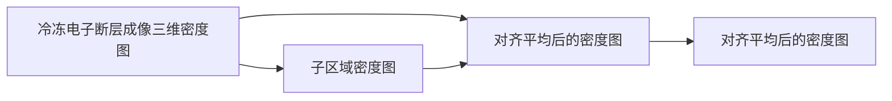
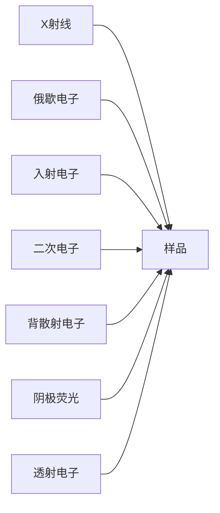
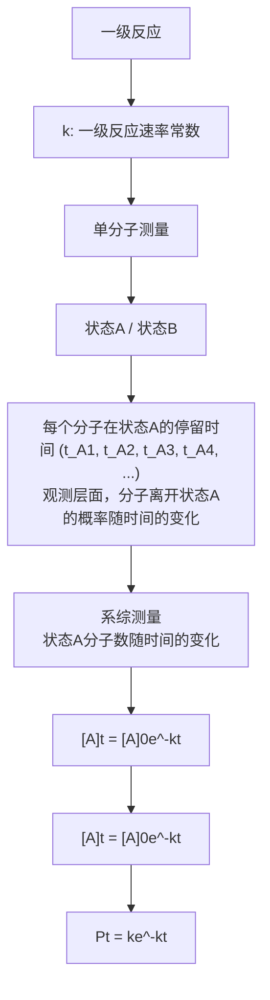

(A)

text_image

0°投影
30°投影
60°投影
90°投影
120°投影
用少量投影重构
大量投影的重构
权重背投影算法

(B)

flowchart

图26-19 冷冻电子断层成像的三维重构算法示意图

(图 26-19B)。该算法的优化目标是将重构好的三维密度图重新投影回实验照片时能够重现实验照片中的图像信息。如果二者的信息不一致，那么就将这个信息的差异作为一种修正，更新三维重构的密度图。迭代这个过程，直到投影和实验数据的一致性达到指定的标准。

由于低信噪比和缺失楔问题，冷冻电子断层成像重构出来的密度图通常非常难以解释。特别是在沿着信息缺失的方向上，分处上下层的蛋白质颗粒会变得模糊，甚至融合起来难以分辨（见图6-14）。因此，如何补全缺失的信号以及增强图像的显示，对冷冻电子断层成像来讲是至关重要的。随着人工智能技术的发展，利用人工神经网络对生物结构信息的学习能力，依托一定的训练信息来补全以及改善图像中的结构信息的技术正在快速发展。

## (3) 子断层重构平均与原位生物大分子结构解析

通过冷冻电子断层成像方法生成的密度图，虽然其中包含了高分辨率的结构信息，但由于受到信噪比和缺失楔问题的影响，其直观分辨率通常不高，一般在

1.0\~2.0 nm 分辨率的范围内。因此，为了提高分辨率，解析其中的原位生物大分子结构，需要进行进一步的处理，这就是子断层重构平均技术。子断层重构平均技术的原理和方法与单颗粒技术非常相似，其基本思路是从细胞的冷冻电子断层成像密度图中（图 26-20A），挖取出感兴趣的蛋白质颗粒（图 26-20B），通过对大量颗粒的对齐和平均，来获得高分辨率的生物大分子三维重构（图 26-20C）。该技术与单颗粒技术非常类似，主要区别是子断层重构平均技术的输入数据是三维的颗粒数据，而不是颗粒的二维投影图像。原则上来讲，在细胞中分布的蛋白质颗粒是随机取向的。因此，尽管每一个局部蛋白质颗粒都受到缺失楔问题的（A）在细胞的三维重构密度图中挑选颗粒。（B）使用类似单颗粒技术的方法对颗粒进行三维对齐，测定颗粒取向。（C）将对齐的颗粒进行三维重构。

flowchart

图 26-20 子断层重构平均原理示意图

影响，但当对大量取向不同的颗粒进行平均之后，不同颗粒之间的信息可以互相补偿，最终在提高信噪比的同时消除缺失楔问题。

在使用子断层重构平均方法进行结构解析时，相对于单颗粒技术，也存在一些特殊的问题，这是在实际的技术使用中所需要处理和解决的。由于要解析的大分子颗粒是处于细胞环境之中的，被周围的蛋白质等细胞物质所围绕，目前有两种比较主要的处理方式。一种是从重构好的三维细胞结构密度图中直接挖取所需的颗粒进行处理，这种方法的优点是原理简单，但缺点是挖取的颗粒的数据质量受限于整个细胞三维重构质量，主要受大面积样品在电子束辐照时发生的弯曲变形的影响。另一种方法是直接使用原始的倾转系列照片进行最终的三维重构计算。这种方法的优点是可以最大限度地使用不受影响的原始数据，能够更精确地处理不同颗粒的局部离焦量和样品形变引起的问题。但缺点是计算复杂度较高，且受到蛋白质在细胞投影路径上其它重叠蛋白质信号的影响，使最终角度测定精度受限。

尽管目前子断层重构平均方法仍面临诸多困难，尤其是在数据采集效率和数据处理方法方面，但该技术展现出了巨大的应用潜力，使得在细胞原位直接测定生物大分子的高分辨率结构成为可能。

## 26.3.4 新技术与新进展

使用透射电子显微镜观察生物样品始于上世纪30年代，但对生物样品的观察始终面临着诸多技术挑战，如辐照损伤、样品冷冻以及数据分析算法复杂等。因此，直到2000年之后，冷冻电镜技术才逐步实现了原子级分辨率的结构成像和解析，成为生物大分子或细胞结构高分辨率研究的重要工具。这些进展与多个技术的突破密切相关。

相机技术发展在实现原子分辨率的技术突破中处于至关重要的地位。透射电子显微镜的分辨率在几十年前就已经能够达到原子分辨率，但主要局限在材料科学领域，针对那些无机的晶体材料，比如金属、陶瓷和半导体材料。这些材料对电子辐照损伤耐受度比较高，可承受数百甚至数万电子每平方埃的辐照。因此，通过单次成像就可以直接实现原子分辨率的结构观察。但是，对于不耐辐照的生物样品，冷冻电镜技术就需要应对低剂量成像所带来的一系列问题，从而对冷冻电镜成像和相机的性能产生了比较苛刻的需求。一方面因成像的信噪比很低（通常低于0.1，甚至0.01），需要相机有足够的电子探测灵敏度。另一方面生物样品一般要求亚微米级的成像面积（材料科学应用中的高分辨成像面积通常在几纳米到几十纳米尺寸范围内），以保证足够的数据获取效率或适配样品的尺寸，这就需要在相对较低的放大倍数下成像。从采样定理的角度来看，就是要求相机在接近于采样定理极限分辨率（尼奎斯特频率）的条件下拍照。由于相机的信息记录能力在接近于相机的尼奎斯特频率时会迅速衰减，相应的相机性能评估指标被称为探测器量子效率（detective quantum efficiency，DQE），反映了在不同的空间频率下相机输入和输出信号的谱信噪比的比值。DQE通常在傅里叶空间中随空间频率的增加而衰减。在早期的冷冻电镜成像中（图26-21），人们曾经早期电镜以底片方式来记录图像（左）。底片本身利用感光材料来直接记录电子信号，中间转化过程较少，因此对信号的记录能力较强。但其主要缺点是需要定影—显影—扫描这一系列复杂的数字图像产生流程，效率很低，且无法实时看到图像。以CCD（也有部分基于CMOS的）为主的数码相机具有实时的图像记录效率。但是，由于探测器对高能电子辐照耐受能力差，导致形成数码图像需要通过光电转换—光传导—探测器记录的复杂过程，使得图像信号在转换过程中发生显著损失，在生物样品成像条件下无法记录高分辨率信号。直接电子探测相机可以直接探测电子，不需要复杂的电-光转化过程，且快可实现每秒数十到上千帧图像记录的速度。

图26-21 冷冻电镜相机原理示意图

使用过底片以及具有光电转换层的CCD相机，这些相机需要扫描仪扫描或者需要电子到光子的能量转换和传输，导致成像效率很低或者DQE随空间频率增加而迅速衰减，无法满足冷冻电镜生物样本高分辨率成像的需求。

为了能够改善相机的高频信号记录能力，人们发展了能够直接探测电子的直接电子探测相机（图26-21）。直接电子探测技术在2013年前后取得快速进展，并且在直接电子探测的基础上实现了电子计数，类似于光学显微镜中的超分辨率荧光技术，从而使相机的信息记录分辨率得到显著提高。同时，直接电子探测相机都具有很高的帧率，这使得拍摄具有多帧的电影模式照片成为可能，改变了之前以单张照片为主的拍照方式。电影模式照片是由一系列连续拍摄的照片（帧）组成，且每帧照片的曝光时间极短，以至于可以忽略样品在曝光期间的运动。电影模式使得追踪冷冻电镜样品在成像时的漂移并实现漂移纠正成为可能。此外，对于多帧的图像，每一帧所记录时样品的累积电子辐照损伤是不一样的。人们研究发现，辐照损伤首先影响的是高分辨率信号，而低分辨率信号可以容忍很大的辐照剂量。这就使得可以按照受辐照的多少对不同帧里的信号施加不同的权重，在尽量保持可用的图像信号同时，也尽量减少受到辐照损伤的结构信号的干扰。最终电子直接探测相机和电子计数技术的应用将单颗粒冷冻电镜技术从亚纳米分辨率推高至近原子甚至原子分辨率。

算法的快速发展一直是冷冻电镜技术发展的一个关键推动力。在相机技术发展的同时，基于贝叶斯统计推断的单颗粒三维重构算法的应用在很大程度上提升了单颗粒三维重构和三维分类的精确度和可靠性，直接助力了冷冻电镜分辨率革命的实现。此外，单颗粒三维重构算法的发展也推动了各种像差计算纠正技术的发展。对每个大分子颗粒的衬度传递函数中离焦量、像散、束倾斜以及各种高阶相差的精确测定和纠正，在推高冷冻电镜单颗粒三维重构分辨率至原子水平中发挥了关键的作用。

随着冷冻电镜结构解析技术的分辨率越来越高，应用范围越来越广。基于人工智能的各种算法技术也逐渐渗透到冷冻电镜技术之中。这些技术大概可以分为几大类:一类是用于蛋白质颗粒识别和分割的目标检测技术；一类是针对冷冻电镜密度图的信息修复的，例如各种图像降噪技术和冷冻电子断层成像中的缺失楔消除技术；还有一类是针对三维重构以及动态柔性结构分析的。这些人工智能技术的应用显著提高了冷冻电镜技术的技术能力和可应用的范围，使得高精度甚至是动态的生物分子结构信息更加易于获得和易于解释。

除了上述提到的技术，还有更多的新兴技术正在不断地被应用于冷冻电镜领域，例如在硬件方面有相位板、图像能量过滤器、图像色差矫正器等，在新的成像原理方面还有叠层成像、扫描透射成像等来自材料科学领域的技术。新的技术和思路的发展正在推动冷冻电镜技术不断向前发展，使之成为在原子水平上理解生命过程的最直接也是最有力的工具。代找电子书资源，新书可代做扫描制作加微信 asxiao90

## 26.4 扫描电子显微学技术

扫描电子显微镜（scanning electron microscope，SEM）是透射电镜之外的另一种电子显微镜子类型，广泛应用于材料科学和生命科学等微观结构研究领域。与透射电镜不同，扫描电镜利用聚焦的电子束在样品表面进行栅格式扫描成像。扫描电镜除了用于研究样品表面的结构形貌之外，还可使用丰富的激发信号来形成与成分或样品表面状态相关的图像。

## 26.4.1 成像原理与二次电子像

扫描电子显微镜的结构主要由两部分组成:一部分是光源部分，用于产生会聚的电子束并控制电子束在样品表面进行栅格式逐点扫描；另一部分是探测器，用于探测从样品表面上激发出来的信号。扫描栅格与图像的像素栅格点对点对应。在每个扫描点上激发出来的信号被探测器探测到之后，相应的信号强度会被记录到图像对应的像素之上。不同于透射电镜的多像素探测器（相机），扫描电镜的探测器是一种单像素探测器。同一台扫描电镜中可能会有多个不同的探测器，位于不同位置或有不同的探测原理，用于接收不同的激发信号。

来自光源的入射电子（或称初级电子）打到样品后，会与样品的表面发生相互作用，激发出多种不同的信号（图26-22）。这些信号主要包括背散射电子、二次电子、X射线、俄歇电子、阴极荧光等带电粒子和光子。这些信号被不同的探测器接收到，进而产生样品图像。二次电子和背散射电子是扫描电镜成像的最常用信号。

flowchart

图26-22 入射电子与样品相互作用

背散射电子是初级电子束与样品中原子核进行弹性散射或非弹性散射后产生的与初级电子入射方向大致相反的高能电子，范围最大可达样品数百纳米的深度。背散射电子从样品表面逃逸出去的方向和数量与初级电子入射方向和样品表面之间的夹角有关，从而能够表征样品表面的形貌信息，形成形貌衬度。同时，背散射电子的产率与样品平均原子序数也相关。平均原子序数越高，背散射电子越多，图像就越明亮。因此，被散射电子也常被用于原子序数衬度成像。

二次电子是初级电子与样品表面弱束缚价电子产生非弹性散射而激发的电子，能量一般小于 $50\mathrm{eV}$，产生深度在样品表面 $10\mathrm{nm}$ 内。二次电子对样品表面形状非常敏感，产生形貌衬度，能有效地反映出样品表面的形貌细节。一般来讲，二次电子的激发与样品成分关系不大，因此二次电子像的衬度主要是与样品的形貌相关的。同时，由于二次电子的能量比较低，其从样品表面逃逸的概率受到样品表面电荷电场的显著影响，使其成像衬度易于受到样品表面电场状态的影响。扫描电镜中二次电子有多种不同的产生方式，通常被划分为几个不同的类型。由入射的初级电子轰击样品直接激发的二次电子，被称为一型二次电子。由背散射电子在样品内运动激发的二次电子，称为二型二次电子。由初级电子和样品台、电镜腔室壁以及电子枪极靴发生碰撞而产生的二次电子，称为三型二次电子。一型二次电子的发射位置直接和电子激发位置相关，位置精度最高，因此一型电子的成像分辨率最高。二型二次电子是在背散射电子逃逸出样品时激发，其逃逸位置相对于入射电子位置可能有较大的差别，因此其成像分辨率不如一型二次电子高。三型二次电子一般被归为系统背景噪声。二次电子的成像分辨率最高可达到 $5\sim 10\mathrm{nm}$。

## 26.4.2 生物样品表面形貌表征

扫描电镜在生命科学中的应用多数是为了获取生物样品表面的精细结构特征。由于扫描电镜的样品台区域和透射电镜类似，是一个真空环境，从而也需要对样品的含水问题进行处理，例如冷冻或干燥。此外，多数生物样本及其表面都是电的不良导体，电子束入射导入的电荷经常会对二次电子成像造成显著的干扰，产生大面积阴影或导致图像模糊。因此，生物样本一般需要经过一定的表面处理或样品制备流程后才能使用扫描电镜进行观察。

图 26-23 扫描电镜观察不同类型样品表面特征

（A）四膜虫表面。（B）植物叶片断面，显示植物栅栏组织、叶肉细胞、维管束和气孔。（C）乳滴混合液。（D）酵母细胞断面。（A，刘炳成惠赠；B-D，李晓敏惠赠）

根据样品的结构特点和研究目的不同，扫描电镜中的样品处理方法也不尽相同。对于表面干燥的样品，如植物种子、花粉、毛发和昆虫外壳等，经过表面清理就可以直接置于样品台上成像观察（图26-23A）。对于外层含水量较少的样品，比如植物的茎、叶、细菌和藻类等样品，常用的方法是经过快速冷冻和表面升华后，再放入扫描电镜观察（图26-23B、C）。对于动植物组织内部、培养的细胞和水生生物等含水量较大的样品，需要经过取材、化学固定、脱水、干燥和树脂包埋等过程后，才能放入扫描电镜中观察（图26-23D）。

## 26.4.3 冷冻蚀刻技术

冷冻刻蚀技术（freeze-etching）是一种用于观察含水生物样本精细结构特征的技术，能够观察到断裂面上细微的膜性结构及膜上蛋白质。该技术流程包括如下的步骤（图26-24A）:首先用液氮或者液氦快速冷冻样品，然后将冷冻后的样品快速转移到冷冻蚀刻仪器中，用刀片断裂样品。冷冻的样品往往会从结构相对脆弱的地方断裂开，比如膜上磷脂双分子层间的疏水位置。这样就会暴露出膜上的蛋白质。在真空中升华可以进一步增加蛋白质在膜上的浮雕效果。而后沿 $45^{\circ}$ 入射角在样品表面镀上一层细腻的重金属膜，比如铂，用于形成形貌对比衬度；之后再沿 $90^{\circ}$ 喷镀一层碳膜，以稳定重金属膜，形成一层复型膜。然后使用腐蚀的方法将生物组织去除，取下复型膜。之后将复型膜移到电镜载网上进行扫描电镜或者透射电镜观察。样品也可以在镀完重金属膜后直接利用扫描电镜观察断裂面细节。冷冻刻蚀的样品通过快速冷冻制备，其展示结构接近于活体状态。图26-24B、C是使用扫描电镜观察叶绿体断裂面展示的不同光强对叶绿体膜上光合作用蛋白质分布排列的影响。冷冻蚀刻制备的复型膜，具有很强的立体感且能耐受电子束轰击和长期保存。

## 26.4.4 扫描电镜三维成像技术

扫描电镜相对于透射电镜来讲具有巨大的样品室空间，从而可以集成样品切割装置来实现对样品的微加工，以及实现基于微加工的三维成像。扫描电镜中常用的微加工装置有金刚石刀连续切片装置和聚焦离子束装置。集成了聚焦离子束装置的扫描电镜也被称为双束扫描电镜。扫描电镜中集成的金刚石刀连续切片装置通常只在常温下切割经过树脂包埋处理的生物样品，可以把一个样品切成多个连续的薄片。聚焦离子束切割是一种物质去除型的切割方式。因此，使用聚焦离子束切割通常是为了观察切割后暴露出来的平面区域，可以用于常温和冷冻两种样品的切割。基于样品切割的三维成像技术大概有两种主要的思路或方法。

图26-24 冷冻蚀刻技术流程和应用

（A）冷冻蚀刻技术步骤。（B）高光强条件下的叶绿体类囊体膜。（C）低光强条件下的叶绿体类囊体膜。图中EF（exoplasmic fracture）表示基粒内断裂后暴露出的断裂面，PF（protoplasmic fracture）表示叶绿体基粒外表面断裂面。EF后的s表示叶绿体基粒垛叠处的膜区域（stacked membrane），u表示叶绿体基粒非垛叠处的膜区域（unstacked membrane）。(B、C，引自Kirchhoff H, et al. Biochemistry, 2007, 46(39): 11169-11176. ©2007 American Chemical Society)

一种方法是将体样品切割为一系列薄片后再通过分析获得三维结构信息，主要针对经过树脂包埋处理的常温体样品。大块体样品首先经过金刚石刀连续切割，形成适合透射电镜成像的薄片。然后，将这些薄片转移到透射电镜中，用前述的电子断层成像方法进行成像和三维重构。最后，通过将所有切片的三维重构密度图拼接起来，得到体样品的三维密度图。这种方法获得的三维结构分辨率主要受限于样品成像分辨率以及染色和树脂包埋处理后能够保留下来的样品结构细节。这种方法的另一个显著缺点是数据采集、样品保存和三维重构过程比较复杂。

另一种方法是以连续切片方式不断地暴露出新表面，通过表面成像，拼接重构出样品的三维结构。这种方法操作起来比较简单，重构出的结构分辨率在切割方向上由切片厚度决定，在平行于切片的方向上由扫描电镜成像分辨率决定。对于切割表面成像，需要根据不同的样品形式选择不同的方法。常温染色样品因采用了重金属染色，成像衬度来自重金属元素，因此常用背散射电子成像。对于直接冷冻未经染色处理的含水生物样品，其成分主要是生物体本身的碳、氢、氧和氮等轻元素，背散射电子像衬度差，可以用二次电子来成像。根据切割去除的方法不同，该方法又可分为两类。一类是基于金刚石刀切割的方法，主要用于染色和包埋处理后的常温样品，常见方法有系列块表面扫描电镜技术（serial block-face SEM，SBF-SEM）和自动化带收集超薄切片扫描电镜成像技术（automatic tape-collecting ultramicrotome SEM，ATUM-SEM）。另一类是使用聚焦离子束进行切割的方法，例如聚焦离子束扫描电镜技术（focused ion beam SEM，FIB-SEM）。下面对这几个方法进行更加详细的介绍。

系列块表面扫描电镜技术（SBF-SEM）是将配有金刚石刀的超薄切片机整合到扫描电镜中（图26-25A）。在扫描电镜真空腔室内对树脂包埋的样品块用金刚石刀在原位进行削片，用扫描电镜对暴露出来的切面拍照成像，而后再沿着样品厚度（$z$ 轴）的方向不断切片，并对新鲜的切面连续成像，这样进行下去就可以获取样品沿 $z$ 轴的一系列二维照片，然后将这些二维照片合并重叠就能够得到大尺度样品的三维结构。目前该技术的分辨率能达到 $xy$ 面内 $5\mathrm{nm}$，$z$ 轴方向上 $10\mathrm{nm}$。$z$ 轴方向上的分辨率取决于金刚石刀切片时的厚度。自动化带收集超薄切片扫描电镜成像技术（ATUM-SEM）也是在切片机上用金刚石刀对样品进行连续超薄切片，但在切片的同时使用一个连续转动的收集带来收集切片，并将切片转移到硅片上按次序保存（图26-25A）。之后，再使用扫描电镜成像对切片成像，获取连续的一系列二维照片，并将照片按层拼接重构出三维结构。ATUM-SEM技术相对于SBF-SEM的优势是可将切片和成像分开，获得图像的同时也能将样品保存下来，供科研人员对珍贵样品反复研究；也可以将切片用于透射电镜，提高了数据采集利用率和实验操作上的灵活性，但分辨率较第一种方法低。这两种方法处理的样品的尺度都能到毫米级。

图 26-25 利用扫描电镜研究样品三维结构技术（A）几种扫描电镜和透射电镜研究样品三维结构技术示意图。（B）用 FIB-SEM 研究高等植物未光照叶绿体的黄化质体三维结构。

SBF-SEM 和 ATUM-SEM 都是采用钻石刀对样品进行剪切，这个过程中有可能出现褶皱和碎片，且切割应力会影响生物结构，不利于扫描成像。而且使用金刚石刀切割也很难保证切片厚度和精准度。为了解决这个问题，近年来聚焦离子束被越来越多地使用，以提高切割精度和消除切割引入的结构应力破坏问题。聚焦离子束扫描电镜技术（FIB-SEM）在扫描电镜舱室中用聚焦离子束取代金刚石刀对样品进行连续减薄，在暴露出样品表面后进行扫描电镜成像。这个过程与 SBF-SEM 相似，但是聚焦离子束减薄更加精准，切割出的表面也更加平整。目前该技术的分辨率能达到 xy 平面内 3 nm，z 轴方向上 3 nm。而且该方法不仅限于常温染色包埋样品，也适用于冷冻含水生物样品。FIB-SEM 目前是微米级尺度下获取样品三维结构的分辨率最高的方法。作为一个示例，图 26-25B 展示了叶绿体光形态建成过程中未见光时黄化质体（etioplast）的结构。该样品使用高压冷冻方法冷冻，在冷冻替代后经树脂包埋制备成常温样品。然后，利用聚焦离子束按 5 nm 步长消减厚度，得到整个黄化质体的一系列照片，最终重构得到三维结构密度图。密度图中展示了一个网格结构（prolamellar body）。

上面基于切片的成像技术是对样品切开后的刨面进行扫描成像的。刨面通常是平整的，形貌信息非常微弱。因此，对于经过树脂包埋后的染色生物样品，主要是利用背散射电子进行成像，反映出样品中重金属染色剂在不同生物结构中的分布状态，得到反映样品结构的成像信息。对于冷冻之后的含水生物样本，其中不包含重金属元素，二次电子成像信号很弱，但人们发现在特定成像条件下可以使用二次电子成像的方式来获得生物结构的图像。这里二次电子的衬度产生可能与切割暴露出的细胞内容物的极性结构有关，含水量较高的区域通常体现为明亮的衬度，而脂类成分较高的区域以及蛋白质聚集体都显示为较暗的衬度。这种二次电子成像的分辨率基本能够达到常温样品同样的水平，可实现对不同生物样品各种膜结构、细胞器、核仁、异染色质、核孔复合体等结构精准成像（图26-26）。

图 26-26 通过聚焦离子束切割暴露出的冷冻含水生物样品切面的二次电子像

（A）衣藻。（B）人皮肤鳞癌细胞。（C）HeLa细胞。

(D) 小鼠肝脏组织。

## ※ 本章小结

显微成像技术是现代科学研究中用于观察和分析物质微观结构的重要工具。该技术通过各种方法放大样本细节，使研究者能够洞察到肉眼无法分辨的微观世界，对于生物学、医学、材料科学和纳米科技等领域的发展具有深远的影响。

在本章中，我们介绍了显微成像的基本原理和多种类型的显微镜，涉及使用不同类型的波（光波或电子波）作为探测源，并通过透镜或电子束扫描等手段实现成像。光学显微镜利用可见光照明样本，并通过透射或反射光观察，具有成本低廉、操作简便的特点，但其分辨率受限于光波的衍射特性。相比之下，电子显微镜使用电子束，能够达到更高的分辨率，甚至达到原子级别，但设备成本较高。显微成像中的一些关键概念包括光路、透镜成像原理、像与衍射、傅里叶变换、波函数、分辨率、点扩展函数和采样定理等。这些概念共同构成了显微成像的理论基础，对于理解和改进成像技术至关重要。

本章还详细介绍了各种显微镜所采用的成像技术，主要包括光学显微技术、冷冻透射电子显微学三维重构和扫描电子显微成像技术。光学显微技术通过不同的成像模式（如明场、暗场、偏光、相差等）提高成像对比度和分辨率。我们着重探讨了超分辨率成像技术，这些技术通过各种方法突破了传统光学衍射极限，实现了更高分辨率的成像。例如，受激辐射损耗技术和单分子定位技术等。冷冻透射电子显微学方法通过结合使用电子束和特殊的样品制备技术，实现了生物大分子结构的原子级分辨率三维结构重建。单颗粒三维重构技术是一项关键技术，它允许研究者从随机取向的生物大分子颗粒中获取结构信息。通过计算方法确定颗粒的取向并进行三维重构，可以获得接近原子分辨率的结构密度图。冷冻电子断层成像技术则适用于非重复性生物样本，如细胞和细胞器，通过样品的旋转和成像，构建出细胞内的三维结构密度图。扫描电子显微镜则通过电子束与样品相互作用产生的信号来观察样品的表面形貌和成分分布。扫描电子显微镜的三维成像技术利用了样品切割和微加工技术，如聚焦离子束和连续切片技术，来获取样品的三维结构信息。这些技术能够提供高分辨率的三维图像，有助于研究者更好地理解样品的微观结构。

本章希望通过基本原理和常用技术原理的介绍，让读者能够理解显微成像的基本概念和应用；并通过对一些问题的探讨，使读者可以对显微成像技术的原理和应用有更全面的认识。

## ※ 思考题

1. 为什么说傅里叶变换和理想凸透镜在功能上是非常一致的？
2. 如何理解点扩展函数和卷积计算，二者的关系是什么？在一个光学系统中，点扩展函数是如何影响分辨率的？
3. 结构光超分辨通过条纹来实现频域搬移，所能移动的频域范围由什么决定？线性结构光能够实现的最高分辨率是多少？
4. 受激辐射损耗超分辨利用环形光的损耗效应实现超分辨。其损耗效率由什么决

定？有哪些方法可以实现低功率下的超分辨？

5. 如果要实现 $20 \mathrm{~nm}$ 的单分子定位超分辨成像, 则样品的染色浓度需要达到多少分子每平方微米? 如果物镜的数值孔径是 1.4 , 发射波长是 $600 \mathrm{~nm}$, 则探测的光子数 $N$ 要达到多少以上, 才可以实现这一分辨率?
6. 透射电镜成像的三种衬度形成理论的共同点是什么？
7. 透镜的像差对一个显微镜来说一般是不利的，但是，为什么在透射电镜中物镜像差反倒成了实现相位衬度成像的关键因素？这些像差对透射电镜成像是否也存在一些负面效应呢？
8. 结合之前章节的学习，厄瓦耳反射球作图的原理和中心截面定理之间的关系是什么？
9. 单颗粒三维重构的分辨率是如何估计的？影响单颗粒三维重构分辨率的因素有哪些？
10. 冷冻电子断层成像技术和单颗粒技术的异同点有哪些？
11. 基于扫描电镜的生物成像和透射电镜生物成像有哪些原理上的不同？二者可以互相取代吗？为什么？
12. 生物样品的冷冻为什么一定要形成非晶态的冰？

## ※ 扩展阅读

## 图书

陈梦谪. 金属物理研究方法:第二分册 [M]. 北京:冶金工业出版社，1982.

王蓉.电子衍射物理教程[M].北京:冶金工业出版社，2002.

李方华. 电子晶体学与图像处理 [M]. 上海: 上海科学技术出版社, 2009.

南京工学院数学教研组.积分变换 [M].北京:高等教育出版社，1978.

Frank J. Three-dimensional electron microscopy of macromolecular assemblies[M]. 2nd ed. Oxford: Oxford University Press, 2006.

Lakowicz J R. Principles of fluorescence spectroscopy[M]. 3rd ed. New York: Springer, 2010.

Murphy D B, Davidson M W. Fundamentals of light microscopy and electronic imaging[M/OL]. 2nd ed. Hoboken: Wiley-Blackwell, 2013.

## 综述

Jacquemet G, Carisey A F, Hamidi H, et al. The cell biologist's guide to super-resolution microscopy[J]. J Cell Sci, 2020, 133(11):jcs240713.

Sahl S J, Hell S W, Jakobs S. Fluorescence nanoscopy in cell biology[J]. Nat Rev Mol Cell Biol, 2017, 18(11):685–701.

## 研究论文

De Rosier D J, Klug A. Reconstruction of three dimensional structures from electron

- micrographs[J]. Nature, 1968, 217(5124):130-134.
- Dubochet J, Chang J J, Freeman R, et al. Frozen aqueous suspensions[J]. Ultramicroscopy, 1982, 10(1/2):55–61.
- Grant T, Grigorieff N. Measuring the optimal exposure for single particle cryo-EM using a 2.6 Å reconstruction of rotavirus VP6[J]. eLife, 2015, 4:e06980.
- Henderson R, Unwin P N T. Three-dimensional model of purple membrane obtained by electron microscopy[J]. Nature, 1975, 257(5521):28–32.
- Li X M, Mooney P, Zheng S, et al. Electron counting and beam-induced motion correction enable near-atomic-resolution single-particle cryo-EM[J]. Nat Methods, 2013, 10(6):584–590.
- Liao M F, Cao E H, Julius D, et al. Structure of the TRPV1 ion channel determined by electron cryo-microscopy[J]. Nature, 2013, 504(7478):107-112.
- Lin C, Zhang L, Zhang Z Y, et al. Locating cellular contents during cryoFIB milling using cellular secondary-electron imaging[J]. J Struct Biol, 2023, 215(3):108005.
- Marton L. Electron microscopy of biological objects[J]. Nature, 1934, 133(3372):911.
- Merk A, Bartesaghi A, Banerjee S, et al. Breaking Cryo-EM resolution barriers to facilitate drug discovery[J]. Cell, 2016, 165(7):1698–1707.
- Sigworth F J. A maximum-likelihood approach to single-particle image refinement[J]. J Struct Biol, 1998, 122(3):328-339.
- Taylor K A, Glaeser R M. Electron diffraction of frozen, hydrated protein crystals[J]. Science, 1974, 186(4168):1036–1037.

## 单分子技术

单分子技术是指在微观尺度上，对单个或少数几个分子进行测量与操控的相关技术的集合。依据所测得的物理信号类型，单分子技术可大致分为三个主要类别:电学技术、光学技术和力学技术。由于篇幅有限，在本章中我们将简要介绍其中具有代表性的技术方法。

微观尺度上的分子结构、其动态变化以及分子间的相互作用构成了生命过程的基础。对分子性质的精确测量与表征，是生物物理学研究不可或缺的一部分。由于测量技术灵敏度的限制，研究者长期无法直接观测单个分子，而必须将大量分子同步至一致的状态，以便利用X射线晶体衍射、等温滴定量热法、表面等离子共振等系综测量技术测量大量分子的宏观或均一的物理和化学性质，包括解析分子的结构、定量热力学和动力学参数等。

自 20 世纪 70 年代以来，测量技术的灵敏度得到了突破性的提高，这使研究者有能力直接测量并分析单个分子的性质，无需耗费大量时间与精力将众多分子同步至同一状态或构象。单分子分析技术带来的技术革新，使得研究人员仅需少量样本，便能在非平衡态乃至平衡态下，定量地表征分子的动态行为，测量相互作用的动力学和热力学参数，揭示传统系综测量中隐藏的分子瞬态、分子间异质性、平行反应路径等关键信息，从而深化了我们对分子性质与功能的理解。

尽管生命体的细胞内含有大量的生物大分子，然而某些承担关键生化过程的生物大分子浓度却仅维持在纳摩尔至皮摩尔水平，表明这些至关重要的生物大分子在细胞中的数量极为有限。单分子技术的高灵敏度以及表征分子层面自发随机过程的理论模型，为研究这类生物大分子和其调控的生化过程提供了卓越的技术手段和理论基础。

## 27

## 27.1 单分子的特性

通常来说，单个分子的性质表现出以下特性（图 27-1）:

首先，在单分子水平测量得到的物理量，如电信号、光信号和力信号，往往都呈现出离散化的特性，即分子只停留在一些特定的状态。由于状态之间不存在其它中间态，因而分子在不同状态之间的转变都呈现出突跃的特性。与之相对应的，系综测量得到的往往是大量分子性质的加和或平均，因而其整体性质的改变通常呈现为渐变性。

其次，在单分子层面对动态过程进行表征时，最直观的物理量是分子在特定状态中的停留时间（又被称为驻留时间）。通过对大量分子在某一特定状态下驻留时间的统计，我们能够获得该类分子离开该状态的随时间变化的概率分布，从而进一步计算出分子发生化学反应或是在不同状态之间转变的反应速率常数。

再次，鉴于分子在各个不同状态之间的转变是在其转变概率的支配下随机发生的，因此，即使起始状态相同的分子，它们随时间演变的过程也并不一致。转变概率所固有的随机性导致了分子间的非均质性，故在实验研究中需对众多分子进行测量，

以期得到在统计学上具有可靠性的结果。

flowchart

图 27-1 单分子测量的特性

在单分子层面，观察到的分子驻留在特定状态，其在不同状态间的转变过程表现出突跃性，即变化呈方波形态。相对而言，通过系综宏观测量得到的大量分子性质，则呈现出逐渐过渡的渐变特征。在单分子测量中，通过统计分子在各个状态的停留时间，可以定量出分子离开某一特定状态的概率。这一概率，其本质为宏观层面的反应速率常数在微观层面即单个分子层面上的具体体现。

最后，处于热力学平衡状态的宏观系统，其内部各类分子的组成比例以及可测量的各种物理量均不会随时间而变化。然而，在微观尺度上，分子处于动态平衡中，即在各个可及的状态之间自发地、随机地发生转变，并且在统计意义上遵循热力学平衡的原则。因此，即便对处在热力学平衡状态的系统进行单分子级别的测量，也能够准确量化其重要的动力学和热力学参数，这是通过宏观的系综测量所无法实现的。

## 27.2 单分子电学技术

## 27.2.1 膜片钳

人类第一次实现对单个蛋白质分子的活动进行观测，来自对离子通道的电学研究。离子通道是一类特殊的膜蛋白，开放之后允许特定的离子跨越细胞膜流动。离子通道是细胞电活动的基础，其动力学特性和结构特点在本书第12章中有详细的描述。早期对离子通道的研究集中在大量离子通道共同作用产生的宏观电流。例如，当一个细胞的膜电位从-100 mV快速去极化到 +50 mV 时，电压门控钾通道产生的电流会逐渐增大，直到达到平衡态（图 27-2；平均电流，参见 12.2.1 节）。很早人们就意识到，单个离子通道的动力学并不遵从这样连续变化的曲线，而是可能呈现出量子化和离散化的特性。单个离子通道在开放和关闭的状态中快速切换（即单通道的电流是一系列“方波”），两个状态切换的概率受到膜电位的调控。细胞中电压门控钾通道的电流随电压变化的动力学曲线，来自大量通道产生的电流叠加在一起的结果（知识窗 27-1）。

1976年，德国神经科学家贝尔特·萨克曼（Bert Sakmann）和埃尔温·内尔（Erwin Neher）一起报道了膜片钳（patch clamp）技术，首次实现了对单通道电流的记录。萨克曼和内尔将玻璃毛细管拉制成尖端很细的微电极，尖端开口直径约3\~5μm。利用微距操作器精细地移动玻璃电极，将其尖端开口贴附在细胞膜上。这样，流过电极的电流全部来自玻璃电极开口处吸附的那一小片细胞膜（这一技术因此称为膜片

line

| Time (ms) | Vm (mV) | Im (pA) |
| --- | --- | --- |
| 0 | -100 | ~0 |
| 0~38 | 50 | ~-2 to 2 |
| 38~42 | -100 | ~-2 to 0 |

图27-2 电压门控钾通道的单通道电流与多个离子通道的平均电流

(改编自Hille B. Ion Channels of Excitable Membranes, 3rd ed. Sinauer Associates, 2001)

## 知识窗27-1

## 从宏观电流推测单通道性质

如何从宏观的电流推测单个离子通道的性质？早在单分子技术产生以前，人们就尝试使用波动分析（fluctuation analysis）的数学方法解决这一问题。如果观察一个细胞中某种离子通道的总电流曲线，会发现它并不完全是平滑的，上面会有很多噪声。除仪器噪声外，这些噪声主要源自不同的通道分子的随机开放和关闭过程。利用波动分析方法能从电流的噪声中获得关于单通道电流的信息。当离子通道群体具有特定的均值电流时，如果电流的噪声（方差）较大，表明开放的离子通道数量较少，但每个通道的电流较大；反之，如果电流的噪声（方差）较小，表明离子通道数量较多，但是单通道电流较小。可见通过分析离子通道群体总电流的均值和方差之间的关系，可以揭示单个离子通道的部分性质。波动分析方法虽然取得了很多重要的结果，但毕竟只是一种间接手段，并不是对单个离子通道的直接观测，因此有很多局限性。首先，波动分析方法通常假设单个离子通道的状态转换是接近瞬时的，即单通道电流是方波，这一假设缺乏严格的依据。此外，有一些单通道的性质难以通过波动分析的方法研究，例如:单个通道的电流是否是全或无的？是否有多种亚开放的中间状态？为了回答这些重要的科学问题，人们长期以来渴望能有一种方法直接观测流过单个离子通道的电流。

钳）。因为电极开口很小，如果某种离子通道在细胞膜上的密度较小，可以做到在这片膜上只有单个通道蛋白。最初的实验在青蛙肌肉细胞膜上进行，成功记录到了单个乙酰胆碱受体（AChR）的电流（图27-3A；知识窗27-2）。实现单通道记录的一个关键是提高玻璃电极和细胞膜之间的密封性。如果玻璃电极与细胞膜之间有缝隙，与细胞外液不绝缘，那么实验系统中各种电流就会都被记录电极接收到，从而干扰对电极尖端细胞膜上单通道的记录。萨克曼和内尔发展了很多技巧来增强玻璃电极与细胞膜贴合的紧密度（如抛光电极开口等）。在最早实现单通道记录的报道中，玻璃电极在膜片钳状态下的尖端阻抗约为 $40\mathrm{M}\Omega$ ，现在的膜片钳实验通常可以实现大于$1000\mathrm{M}\Omega$ 的尖端阻抗，意味着玻璃电极和细胞膜结合地极其紧密。

膜片钳技术是人类第一次实现了对单个蛋白质分子生理活动的观测。萨克曼和内尔因这项具有划时代意义的研究，荣获了1991年度的诺贝尔生理学或医学奖。膜片钳记录证明了单个离子通道在不同状态之间的切换是非常快速的，印证了自霍奇金和赫胥黎以来神经科学家基于宏观电流做出的大量推测。例如，在霍奇金-赫胥黎模型中，电压门控钠通道在膜电位去极化时开放概率增大，但是之后会快速进入失活状态（参见12.2.1节）。单通道记录的结果印证了这一点，电压门控钠通道的开放状态全都集中在膜电位去极化的初期。单通道记录同时也拓展了对电压门控钠通道门控机制的理解。离子通道在不同状态之间的切换是一个随机过程，通过对这个随机过程进行建模，拟合单通道记录中测量到的数据，如一个钠通道开放后距离关闭的时间间隔分布，可以表征离子通道存在哪些状态以及这些状态之间切换的概率。这些定量建模分

图 27-3 膜片钳记录

（A）萨克曼和内尔在青蛙肌细胞上进行的膜片钳记录。两根电极插入肌肉细胞内部通过传统的电压钳（VC）方式控制肌细胞内部的电压。玻璃电极（P）贴合在细胞膜上记录单个乙酰胆碱受体的电流，玻璃

电极内部的溶液中添加了配体乙酰胆碱（ACh）。VG为虚拟接地电路。（B）不同的膜片钳记录模式。（A，改编自Sakmann B, et al. Nature, 1976, 260(5554): 799-802）