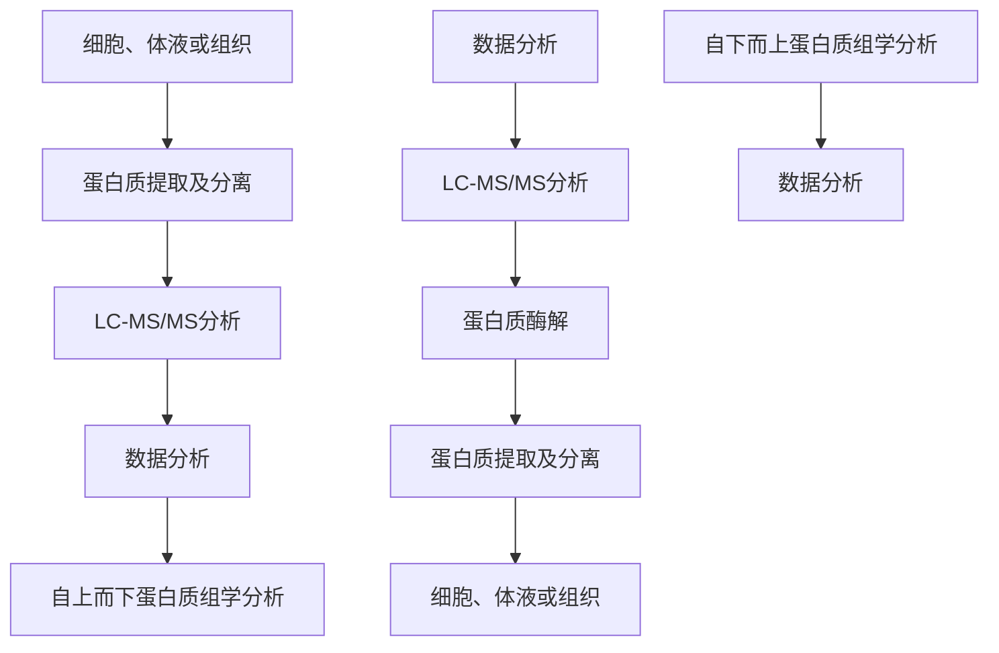
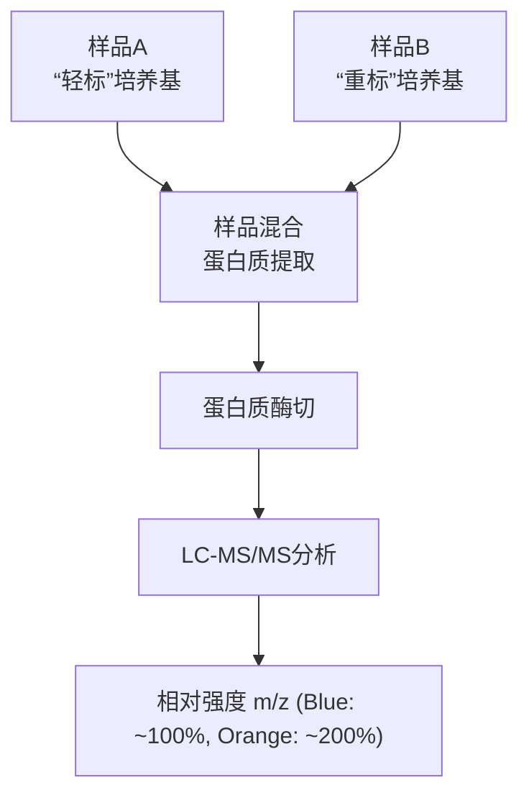
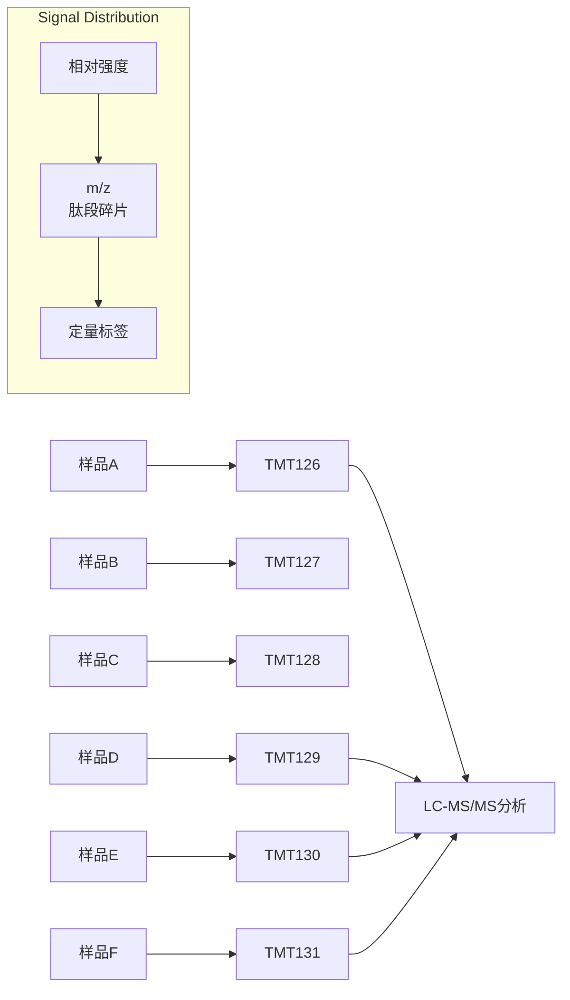
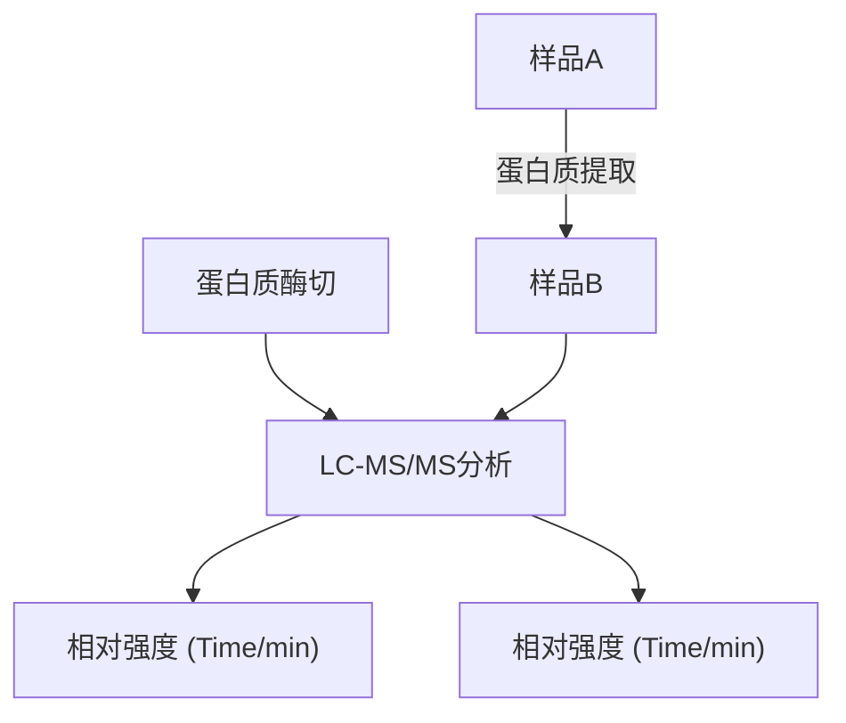
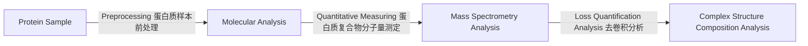
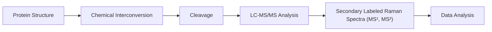

工具。TOF仪器的主要优点包括:① TOF质量分析器的 $m / z$ 范围可以达到 $10^{5}$ 量级；②谱图采集速率快，接近 $10^{3}\mathrm{Hz}$，能够瞬时产生完整的质谱谱图；③离子损失少，有助于实现高灵敏度检测；④设计和构造相对简单。现代TOF仪器能够进行精确的质量测量和串联质谱分析。

四极杆质量分析器是由沃尔夫冈·保罗（Wolfgang Paul，1913—1993）在20世纪50年代开发的，其结构由四个沿 $z$ 轴方向延伸的几何形状完全相同的双曲面棒状电极组成。从横截面（$xy$ 平面）看，这四个电极对称排列，其中 $x$ 轴方向和 $y$ 轴方向的两个电极分别用导线连接（图28-6A）。在 $x$ 轴和 $y$ 轴的两对电极之间施加高频交流电压，当离子沿 $z$ 轴方向进入四极杆电场时，受到与其电性相反的一对电极的吸引及与其电性相同的另一对电极的排斥而发生偏转。由于施加在电极上的电压是高频交流电压，离子在任何一个方向上发生偏转的时间极短，不足以到达与其电性相反的电极。随着在 $x$ 轴和 $y$ 轴方向上的吸引力和排斥力快速周期性变化，离子在四极杆电场中也发生周期性偏转（$xy$ 平面）的渐动（$z$ 轴方向）。在 $x$ 轴和 $y$ 轴两对电极之间还可以同时施加直流和交流电压，使得指定 $m/z$ 范围外的离子无法顺利通过四极杆电场，从而选择目标离子。如果施加在电极上的直流电压强度为 $U$，高频交流电压强度为 $V$（频率为 $\omega$），则作用在离子上的电势为 $\phi_0 = U + V \cos \omega t$。通过调节直流和交流电压的强度，可使一个具有较小的 $m/z$ 范围的离子保持稳定的飞行轨迹，顺利穿过四极杆电场，而该质荷比范围外的其它离子则被滤掉。通过连续改变直流电压和交流电压的强度，可使不同质荷比的离子依次通过四极杆到达离子检测器，完成一次质量分析。由于理想双曲面电极的加工和装配较为困难，四极杆质量分析器中常采用圆柱形电极替代双曲面电极，通过调整四极杆围绕界面的半径使其电场分布接近于理想双曲面电极产生的电场（图28-6B）。四极杆质谱仪结构简单、成本低、易于操作和维护，但质量分辨率较低，且扫描速度慢。

研发理想的质量分析器无疑是质谱领域永恒的话题。为此，科特·布朗尼（Curt Brunnee，1928—2023）在1987年撰写了一篇长达113页的综述，这篇题为“是否存在理想的质量分析器？”的综述激励了正在攻读博士学位的亚历山大·马卡洛夫（Alexander Makarov）。11年后，马卡洛夫开发出了静电场轨道阱质量分析器。更令人惊叹的是，2005年以轨道阱为基础的商业质谱仪问世。如今轨道阱质谱仪已遍布全球的质谱实验室。轨道阱是一种不依赖磁场或射频电场来激发离子运动的离子阱，离子在由纺锤形中央电极和桶状外电极组成的静电场中运动（图28-7）。中央电极对离子的静电引力与离子径向运动的离心力相互抵消，维持离子运动轨迹的稳定性。除径向运动外，轨道阱中的离子还会围绕中心电极在两个外部电极之间轴向振荡。不同质荷比的离子具有不同的轴向振荡频率，形成独立运动的离子束。各离子束在经过中间位置的检测器时会产生镜像电流，不同质荷比的离子产生具有不同轴向谐振频率 $\omega_{z}$ 的正弦波形镜像电流。镜像电流信号通过快速傅里叶变换转换成频谱信号，可用于准确读取离子的质荷比。静电场轨道

图28-6 四极杆质量分析仪

(A) 4个电极的分布示意图。

(B) 离子传输示意图。

text_image

左侧电极
右侧电极
中心电极
φ
z
时间/ms
相对强度
傅里叶变换
m/z
频谱

图 28-7 轨道阱质量分析仪示意图

离子阱在离子质量检测方面具有高达 $5 \times 10^{5}$ 的分辨率和小于 $1\mathrm{ppm}$ 的质量测量精度。近十年来，轨道阱质谱仪已成为生物分子检测尤其是蛋白质组学中最常用的质量分析仪器。但对马卡洛夫而言，轨道阱并不是理想质量分析器的终点，近十年来，他的团队又开发了以飞行时间质谱为基础的非对称轨道无损质量分析器，为生物聚合物分析，包括单细胞蛋白质组学，提供了高通量和高灵敏度的检测仪器。

## 28.2.3 离子检测器

最简单的离子检测器是法拉第杯，其原理是离子撞击杯壁，通过电荷转移产生电流，并由高阻抗电阻器放大测量。法拉第杯测量的电流与入射离子的数量和电荷相关，检测灵敏度较低。

随着扫描型质谱仪的发展，电子倍增器成为最广泛使用的质谱检测器。这些检测器放大高能离子撞击倍增电极表面释放的次级电子，能够将离子电流放大约 $10^{8}$ 倍。电子倍增的原理是次级电子加速撞击更高电压的电极表面，释放出更多电子。通过与多个倍增极（dynode）碰撞，能够产生类似于雪崩的电子流，被灵敏的前置放大器检测。次级电子级联放大也可在连续电子倍增管中进行，这种检测器被称为隧道电子倍增器（channeltron electron multiplier，CEM）或隧道电子管（channeltron），与离散式倍增极相比，其结构更紧凑，成本更低。

电光离子检测器也是常用的离子检测器，它将微通道板电子倍增器与光电倍增管结合，实现离子的计数检测。其原理是将正离子加速，使其撞击电光转换器产生次级电子，次级电子被加速后撞击荧光屏，释放出大量的光子。这些光子再进入光电倍增器中以级联方式完成信号扩增。

FTICR和轨道阱仪器则不使用离子计数检测器，而是利用外电极上感应出的镜像电流实现离子数量的检测。

## 28.2.4 串联质谱 / 复合型质谱及其蛋白质序列解析

尽管分子质量的精确测量可以推导出分子式，但无法提供分子结构信息，这是仅基于分子质量的质谱分析的一个重大缺陷。为获得分子结构信息，串联质谱技术应运而生。串联质谱（tandem mass spectrometry）也被称为质谱/质谱（MS/MS）联用。串联质谱是通过获得特定质荷比离子的碎片信息，推断出分子的结构或序列。串联质谱至少包括两步，即一级质谱（$\mathrm{MS}^1$）和二级质谱（$\mathrm{MS}^2$）分析。通常使用 $\mathrm{MS}^2$、$\mathrm{MS}^3$ 和 $\mathrm{MS}^n$ 表示串联质谱检测的级数。串联质谱有两种基本的仪器构架:第一种是空间串联质谱，在空间上串联安装两个质量分析器，利用第一个质量分析器（Q1分析器）隔离出特定质荷比离子，并在中间过渡区域（Q2碰撞池）进行碎裂，最后将碎片送入第二个质量分析器（Q3分析器）进行质量分析（图28-8A）；第二种是时间串联质谱，其原理是利用离子阱类型的质量分析器，按时序进行离子选择、离子隔离、碎裂和碎片离子检测（图28-8B）。时间串联质谱更容易扩展为多级质谱分析，即多级前体离子的选择和多级碎片离子的检测。

离子通常在碰撞池中解离成碎片。最常用的解离方法是碰撞诱导解离（collision-induced dissociation，CID），也称为碰撞活化解离（collision-activated dissociation，CAD）。CID通过加速分子离子使其获得较高动能，随后使其与惰性气体分子发生碰撞，从而将动能转化为内能，使分子发生碎裂。CID常采用氦气或氮气作为碰撞气体，待测分子离子与气体分子发生低能碰撞后产生碎片。当振动能量超过一定阈值时，会导致键能较低的共价键断裂。蛋白质和肽段类离子的肽键可被质子活化，键能降低，因此CID会引起肽键断裂，产生在二级质谱图（即MS/MS或 $\mathrm{MS}^2$ ）中检测

代找电子书资源，新书可代做扫描制作加微信 asxiao90到的 b 序列离子和 y 序列离子（图 28-9）。这些碎片峰的质量差可用于确定蛋白质和肽段的氨基酸序列。其它常用的离子碎裂方式见知识窗 28-1。

(A)

图28-8 串联质谱示意图（A）三重四极杆质谱仪示意图。（B）时间串联质谱仪示意图。

chemical

Polymer chain structure with repeating units labeled a1 to a3 and variable x, y, z annotations

图28-9 肽段碎片化产生的二级离子示意图

其中 a、b、c 序列离子由包含肽段 N 端的碎片产生，x、y、z 序列离子由包含肽段 C 端的碎片产生

bar

| Ion | m/z | Relative Intensity |
| --- | --- | --- |
| a2+ | ~110 | 50 |
| b2+ | ~140 | 20 |
| y1+ | ~180 | 30 |
| y2+ | ~230 | 10 |
| b3+ | ~260 | 10 |
| y3+ | ~340 | 80 |
| y4+ | ~460 | 100 |
| y5+ | ~570 | 75 |
| y6+ | ~640 | 10 |

图28-10 经CID碎裂后的肽段离子二级谱图

在大部分二级质谱图中，相邻两个碎片离子峰的质量差等于某个氨基酸残基的质量。通过测量碎片峰的质量，我们可以确定肽段的序列。图28-10展示了一张标注了碎片离子峰特征的肽段的二级谱图。根据相邻两个b离子或y离子的质量差，我们可以推断出该肽段离子的序列。数据库搜索软件的开发极大地提高了二级谱图的解析能力，可在 $1\mathrm{min}$ 内解析上万张二级谱图。

从串联质谱的概念出发，将不同类型的质量分析器整合成复合型仪器是近30年来质谱发展的趋势。这些复合型仪器为生物医学研究提供通用且经济的解决方案。复合型仪器有多种组合，从早期的多扇区、反射飞行时间（reflectron TOF，ReTOF）质谱仪、TOF/TOF质谱仪、三重四极杆质谱仪、四极杆-飞行时间（quadrupole-TOF，QTOF）串联质谱仪、线性离子阱-静电场轨道离子阱（linear ion trap-orbitrap，LIT-orbitrap）串联质谱仪、四极杆-静电场轨道离子

## 知识窗28-1

## 其它常见的碎裂方式

电子捕获解离（electron capture dissociation，ECD）:与CID基于碰撞能量再分配的原理不同，ECD是通过低能量的自由电子与质子化的多电荷蛋白质或肽段离子反应放热，引起 $\mathrm{N - C_{\alpha}}$ 键的断裂，形成c和z序列离子。ECD主要用于运行维护成本较高的FTICR质谱仪上。

电子转移解离（electron transfer dissociation，ETD）:其碎裂原理与ECD类似，主要生成c、z序列离子。但ETD是阴离子与质子化的带多电荷的蛋白质或肽段离子反应，将一个电子从阴离子转移到肽段阳离子上引起肽段碎裂。ECD和ETD可以裂解带有高电荷的大质量肽段和完整蛋白质，得到完整的碎片信息，且可保留蛋白质或肽段氨基酸侧链上的修饰基团，如磷酸化、N- 和 O-糖基化、磺化等，因此 ETD 成为分析蛋白质翻译后修饰和完整蛋白质的重要工具。

紫外光诱导解离（ultraviolet photodissociation, UVPD）:与CID不同，UVPD的原理是能量较高的紫外光光子与质子化的带多电荷的蛋白质或肽段离子发生反应，蛋白质或多肽离子通过吸收一个或多个紫外光光子（每光子约6eV）增加离子内能，从而发生裂解。UVPD产生的碎片更为丰富和随机，提高了质谱仪对完整蛋白质的测序能力。

阱（quadrupole-orbitrap，Q-orbitrap）串联质谱仪到最新的 timsTOF 质谱仪和 Astral 质谱仪。这些复合型仪器可以实现多个质量分析器的联用，提高检测速度、分析通量和检测灵敏度。例如，Astral 质谱仪能够在 1 s 内采集 200 张 MS/MS 质谱图，在 15 min 内鉴定上万个蛋白，成为系统生物学研究的重要工具。

## 28.3 质谱方法在系统生物学和化学生物学中的应用

分析表明，人类基因组有约2万个编码基因，这些基因通过可变剪接和翻译后修饰（post-translational modification，PTM）在单个细胞中产生近百万种蛋白质变体，参与调控复杂的生物学过程。因此，自2003年科学家们成功绘制人类基因组图谱以来，研究者们的探索重心逐渐转向人类蛋白质组。同时，代谢物作为蛋白质活性和功能的表征，其变化也反映出细胞的生命活动以及机体的生理或病理过程。28.2节中介绍的串联质谱技术是准确鉴定蛋白质种类、翻译后修饰和代谢物的重要工具，蛋白质组学和代谢组学则为生物过程中的复杂调控网络、机制和功能提供了系统解析的手段。本节将简要介绍几种常用的组学技术。

## 28.3.1 蛋白质组学

蛋白质组学（proteomics）利用质谱技术系统研究生物体中的多种蛋白质，旨在从整体角度确定细胞或组织内动态变化的蛋白质组成、表达水平与修饰状态，鉴定蛋白质之间的相互作用，从而揭示蛋白质的功能和生命活动规律。蛋白质组学包括对特定细胞或器官的蛋白质种类、表达水平及变化（定量蛋白质组学）、蛋白质的生物学功能（功能蛋白质组学）、蛋白质相互作用网络（相互作用蛋白质组学）、蛋白质的结构（结构蛋白质组学）的分析，并探究翻译后修饰对蛋白质结构和功能的影响（修饰蛋白质组学）。纳升液相-串联质谱联用系统（nano liquid chromatography-tandem mass spectrometry，nano LC-MS/MS）是蛋白质组学分析中最常用的技术。蛋白质组学分析主要采用两种策略:自下而上法（bottom-up）和自上而下法（top-down）（图28-11）。

自下而上法是目前蛋白质组学中使用最广泛的技术。该方法首先利用蛋白酶将蛋白质分解成肽段，这些肽段通过色谱柱分离后，进入质谱仪进行分析；基于质谱分析产生的一级和二级谱图进行数据库搜索和匹配，以鉴定样品中蛋白质。蛋白质组学数据库包含所有蛋白质酶解产生的理论肽段序列信息。自下而上法可以鉴定蛋白质种类、修饰类型和位点、突变位点等，并提供蛋白质的定量信息。

自上而下法是直接对完整蛋白质进行质谱分析。该方法能够获得蛋白质变体的信息，包括完整序列、修饰种类、修饰程度及组合等。然而，由于缺乏高通量的完整蛋白质分离方法和高效的质谱碎裂技术，自上而下法尚未广泛应用于蛋白质组学分析。因此，以下介绍的蛋白质组学技术主要采用自下而上法。

图28-11 基于高分辨质谱的蛋白质组学分析策略

flowchart

## (1) 定量蛋白质组学

定量蛋白质组学通过稳定同位素标记或非标记的方式研究不同样品之间蛋白质组的变化情况，主要的三种定量蛋白质组学方法如图28-12所示。

细胞培养中氨基酸稳定同位素标记（stable isotopic labeling using amino acids in cell culture，SILAC）技术是将带有不同稳定同位素标记的氨基酸掺入细胞或模式动物的蛋白质中，以进行不同状态下细胞或模式动物中蛋白质组的同时定量分析。常用的稳定同位素标记氨基酸包括 ${}^{2}\mathrm{H}$ 、${}^{13}\mathrm{C}$ 和 ${}^{15}\mathrm{N}$ 标记的赖氨酸或精氨酸。SILAC技术不仅可以用于分析不同条件（如基因编辑、药物刺激等）下细胞或模式生物的蛋白质组变化，还可以用于建立目标蛋白质互作网络，或用于确定蛋白质合成和降解的速率。

等量标签（isobaric mass tag）标记技术是对蛋白质酶解后产生的肽段进行化学标记，将源自不同样品的肽段标记上不同的稳定同位素标签。目前使用最广泛的两种商品化等量标签试剂为iTRAQ和TMT，它们均由反应基团、平衡基团和报告离子基团三部分组成。等量标签标记的定量蛋白质组学方法可以同时分析最多35个样品的蛋白质组，但缺点是样品制备过程较为复杂，实验成本较高。

非标记定量蛋白质组学是利用肽段在质谱中的相对丰度进行定量分析。相对丰度的计算可以使用肽段的色谱峰面积或色谱峰最高点的信号强度。该方法适用于临床队列的蛋白质组学分析。由于实验中每个样品独立进行LC-MS/MS分析，因此非标记定量蛋白质组学的数据可靠性与重现性依赖于样品制备过程与质谱仪器状态。

## (2) 翻译后修饰蛋白质组学

蛋白质的翻译后修饰种类复杂多样。9.5节介绍了组蛋白修饰与非组蛋白修饰的主要类型与功能。质谱技术可以对翻译后修饰的蛋白质进行系统性分析，也被称为翻译后修饰蛋白质组学。翻译后修饰蛋白质组学不仅可以解析翻译后修饰类型，还能够鉴定被修饰的氨基酸残基位点。下面将以磷酸化、糖基化和泛素化这三种常见蛋白质修饰为例简要介绍翻译后修饰蛋白质组学的分析方法。

(A)

flowchart

(B)

flowchart

(C)

flowchart

图 28-12 三种主要的定量蛋白质组学方法图示

（A）SILAC 技术，其主要过程为:经过轻标氨基酸与重标氨基酸标记的两种细胞样品混合后提取蛋白质组分，酶切后使用质谱对“轻标”与“重标”肽段进行定量分析。（B）等量标签标记定量蛋白质组学技术，以 TMT 标记为例展示等量标签标记原理，6 种样品（A～F）的蛋白质经酶切后分别使用 6 种 TMT 标签试剂（TMT126～131）进行

标记，标记完成后进行混合，二级质谱中肽段碎片用于氨基酸序列鉴定，同时报告离子的相对信号强度（定量标签）用于不同样品来源的肽段定量。（C）非标记定量蛋白质组学技术，每种样品经过蛋白质酶切后，分别进行质谱分析，色谱峰面积或色谱峰最高点的信号强度用于不同样品中同一蛋白质或肽段的相对定量。

磷酸化修饰主要发生在丝氨酸、苏氨酸或酪氨酸残基，是最常见的蛋白质翻译后修饰类型。蛋白激酶和磷酸酶通过动态调控蛋白质磷酸化修饰的水平以调节细胞的信号转导。发生磷酸化修饰的蛋白质或肽段会有 $n \times 79.9663\mathrm{Da}$ （$n$ 表示磷酸化修饰的个数）的质量正偏移。如图28-13所示，磷酸化肽段的二级质谱中的b、y系列离子可用于鉴定氨基酸序列和修饰位点。如果修饰位点为丝氨酸或苏氨酸，其二级碎片会存在98 Da的中性丢失（即分子中不带电荷的基团丢失），可用于进一步确认磷酸化修饰位点。

糖基化修饰也是一种常见的蛋白质修饰类型，真核生物主要有 $N-$ 糖基化和 $O-$ 糖基化两类糖基化修饰。 $N-$ 糖基化发生在天冬酰胺残基的侧链胺基上，而 $O-$ 糖基化则发生在丝氨酸或苏氨酸侧链羟基上。糖基化修饰基团一般为聚糖形式，即多种单

spectrogram

| Ion Label | m/z (approx) |
| --- | --- |
| \(b_{1}^{+}\) | ~105 |
| \(y_{1}^{+}\) | ~110 |
| \(b_{2}^{+}\) | ~160 |
| \(y_{2}^{+}\) | ~170 |
| \(b_{3}^{+}\) | ~280 |
| \(y_{3}^{+}\) | ~290 |
| \(b_{4}^{+}\) | ~400 |
| \(y_{4}^{+}\) | ~410 |
| \(b_{4}^{+}\) | ~460 |
| \(y_{5}^{+}-98\) | ~470 |
| \(b_{5}^{+}\) | ~560 |
| \(y_{6}^{+}-98\) | ~610 |
| \(b_{6}^{+}\) | ~710 |
| \(MH^{2+}-98\) | ~750 |
| \(y_{7}^{+}-98\) | ~810 |
| \(b_{7}^{+}\) | ~920 |
| \(y_{8}^{+}-98\) | ~930 |
| \(b_{8}^{+}\) | ~1030 |
| \(y_{9}^{+}-98\) | ~1060 |
| \(b_{9}^{+}-98\) | ~1120 |
| \(y_{10}^{+}-98\) | ~1210 |
| \(b_{10}^{+}-98\) | ~1250 |
| \(y_{11}^{+}-98\) | ~1330 |
| \(y_{12}^{+}-98\) | ~1450 |

图28-13 磷酸化肽段的$\mathrm{MS}^2$ 质谱图

该图为SPARCL1蛋白的一条磷酸化肽段（序列为HIQETEWQSQEGK）的二级质谱图，图中标记了b、y系列的离子。该肽段有13个氨基酸残基，C端为赖氨酸，谱图中检测到 $y_{1}\sim y_{3}$ 离子和 $b_{1}\sim b_{10}$ 离子，以及发生中性丢失（-98）后的 $y_{5}\sim y_{12}$ 和 $b_{9}\sim b_{10}$ 离子，提示第9位丝氨酸（S294）被磷酸化修饰。其中 $MH^{2+}_{-98}$ 为双电荷分子离子中性丢失（-98）产生的碎片离子。

糖通过糖苷键形成的多糖。糖蛋白质组学（glycoproteomics）的目的是鉴定蛋白质发生糖基化修饰的残基位点和糖型，而糖组学（glycomics）则进一步解析聚糖结构、单糖组成、糖苷连接方式以及糖序列。糖组学分析使用去糖基化酶释放蛋白质上修饰的糖基。由于糖肽中糖苷键相较于肽键更弱，CID优先碎裂糖苷键，无法产生丰富的肽段序列信息，因此蛋白质组学研究中常采用电子捕获解离（ECD）或电子转移解离（ETD）。其中ETD用于表征肽段序列及修饰位点，而CID则用于表征寡糖结构。

磷酸化与糖基化修饰的蛋白质通常丰度较低，因此蛋白质组学分析中需进行富集。常用的磷酸化和糖基化蛋白质组学富集方法见知识窗28-2。

泛素化修饰是在蛋白质的赖氨酸侧链氨基上连接一个或多个含有76个氨基酸的泛素蛋白。自下而上法中胰蛋白酶将蛋白质大分子酶解成肽段，泛素化修饰的蛋白质会产生含有双甘氨酸修饰的赖氨酸（K-GG）的肽段，因此蛋白质泛素化修饰的鉴定依据为赖氨酸残基存在114.043 Da（G-G）的质量偏移。泛素化修饰蛋白质组学常利用抗体富集包含K-GG的肽段，然后通过质谱对修饰肽段进行定性和定量分析。

## 28.3.2 代谢组学与脂质组学

代谢组学（metabonomics）通过系统分析生物体内所有的代谢产物，包括氨基酸、糖类和脂质，以解析生命过程，是功能基因组学的重要组成部分。代谢组学这一概念于1999年正式被提出，随后该技术逐渐被应用于研究生物体代谢调控及发现小分子标志物，以用于疾病诊断、预测和疗效评价。近年来，脂质组学（lipidomics）作为代谢组学的一个分支，逐渐发展成为一个独立的技术领域。

## 知识窗28-2

## 磷酸化和糖基化蛋白质组学富集方法

目前富集磷酸化肽段的方法有:①固相金属亲和色谱法，即通过带正电的金属离子如  $Fe^{3+}$ 、 $Cu^{2+}$  等与带负电的磷酸基团结合，对磷酸化肽段进行富集。②金属氧化物 / 氢氧化物亲和色谱法，如  $TiO_{2}$  在酸性条件下带正电，可与阴离子结合，其中与磷酸根的结合作用最强。③离子交换色谱法，利用磷酸化肽段在低 pH 下仍带负电的特性进行分离和富集。④抗体富集法，利用针对磷酸化修饰酪氨酸的抗体富集含磷酸化酪氨酸的肽段。

糖基化蛋白质组学富集方法主要有:①凝集素亲和技术。多种凝集素被用于富集带有不同糖链的糖蛋白和肽段，如伴刀豆凝集素可富集 N- 糖基化的糖链；大豆凝集素（soybean agglutinin，SBA）可富集含有半乳糖的糖基化蛋白；麦胚凝集素（wheat germ agglutinin，WGA）可富集含 N- 乙酰葡萄糖胺基团或唾液酸的糖蛋白。②肼化学富集法。利用高氯酸盐等将糖蛋白氧化成醛，通过连接在树脂上的肼富集带有被氧化的醛基的肽段。③亲水作用色谱法。利用糖肽中糖基的强亲水性特征，与亲水固定相结合，从而与非糖基化肽段分离。

生物体的代谢产物具有多种多样的化学结构，这给代谢组学分析技术的发展带来困难和挑战。哺乳动物的代谢组中有超过20 000种代谢物分子，植物的初级和次级代谢产物总数超过400 000种，而目前的代谢组学技术只能鉴定出其中不足30%的分子。代谢组学分析流程主要包括代谢产物提取、色谱分离和质谱数据采集三个部分（图28-14）。

代谢组学分析可以使用直接进样模式，其优点是能够在 $2\sim 3\mathrm{min}$ 完成高通量分析。然而，由于生物样品代谢物组成复杂，所有分子同时进入质谱检测时，会因离子化竞争产生抑制效应，从而影响痕量分子的分析。色谱-质谱联用能够富集代谢产物并减少单位时间内进入质谱仪的分子种类，使复杂的代谢物组分在不同时间完成分析，提高了检测灵敏度。液相色谱（liquid chromatography，LC）或气相色谱（gas

图28-14 代谢组学分析流程

flowchart

## 知识窗28-3

## 离子淌度

离子淌度（ion mobility）的核心原理是测量电场驱动下离子在具有气体阻尼环境的漂移管中的迁移速率。不同离子由于横截面积、电荷量和结构差异，在漂移管中具有不同迁移速率，以此实现分离。离子淌度可用于分析代谢物的同分异构体。离子淌度质谱仪具有结构简单、快速、灵敏和小巧便携的特点，在安检、化学武器、爆炸物与毒品检测、在线检测等领域被广泛应用。

chromatography，GC）是代谢组学分析中最常用的色谱技术。气相色谱-质谱联用（GC-MS）主要用于挥发性代谢物分析，如植物中的酯类、酚类等挥发性风味物质；非挥发性代谢物则通过化学衍生化，变为可挥发性物质后，再进行GC-MS分析。液相色谱-质谱联用（LC-MS）仪操作简单并具有更广的分子适用性，其中反相液相色谱和亲水作用色谱使用最为普遍。色谱-质谱联用技术可以利用质荷比、色谱保留时间和信号强度这些三维信息实现代谢产物的定性和定量，还可结合离子淌度（知识窗28-3）分析代谢物的结构和构象。

## 28.3.3 蛋白质 - 配体复合物分析

蛋白质-配体相互作用可以改变蛋白质的分子结构，影响其生物功能。鉴定蛋白质-配体复合物的组成是理解蛋白质-配体相互作用的关键。9.6节已经介绍了蛋白质与配体相互作用的检测技术，其中亲和纯化质谱技术是研究蛋白质-配体复合物的重要工具。该技术可以利用代谢组学筛选与蛋白质互作的小分子配体，也可以利用蛋白质组学鉴定相互作用的蛋白质。

邻近标记质谱可用于分析活细胞中的蛋白质-蛋白质相互作用和蛋白质复合物。该技术原理是将目标蛋白质与生物素连接酶等标记酶融合表达，对目标蛋白质的邻近蛋白质进行生物素等标记，随后富集被标记的蛋白质并进行质谱分析（图28-15）。

近年来，热蛋白质组构象分析（thermal proteome profiling，TPP）被广泛应用于鉴定小分子的靶标蛋白质。TPP技术利用蛋白质与配体相互作用后热稳定性增加这一特

flowchart

图28-15 邻近标记质谱分析流程

以基于生物素连接酶（BioID，TurboID）的方法为例，该方法通过目标蛋白质与生物素连接酶融合表达，生物素连接酶将生物标记到邻近蛋白质上，通过链和亲霉素对修饰蛋白进行富集后，利用蛋白质组学鉴定与目标蛋白相互作用的蛋白质大分子。图中POI为目标分子，连接的绿色部分为生物素连接酶，B表示生物素。

line

| Temperature \(({}^{\circ}C)\) | Relative Intensity (Control Group) | Relative Intensity (Treatment Group) |
| --- | --- | --- |
| 35 | ~1.05 | ~1.05 |
| 40 | ~0.98 | ~1.02 |
| 45 | ~0.85 | ~0.95 |
| 50 | ~0.60 | ~0.75 |
| 55 | ~0.10 | ~0.50 |
| 60 | ~0.02 | ~0.25 |
| 65 | ~0.01 | ~0.10 |
| 70 | ~0.01 | ~0.02 |

图28-16 热蛋白组学分析流程

以细胞裂解液为对象进行 TPP 分析的 6 个步骤:①提取细胞裂解液并分成两份，分别进行小分子或对照处理；②将小分子处理组和对照组的细胞提取物分为 10 等份；③将每份样品在不同温度下加热；④超速

离心后提取上清液，即为可溶蛋白质，利用胰蛋白酶进行酶切，并使用TMT试剂分别进行标记；⑤使用质谱进行TMT标记的定量蛋白质组学分析；⑥分析每种蛋白质在小分子处理组和对照组中的热稳定曲线。方法中使用的温度梯度可根据实验需求调整。

性来鉴定与配体结合的靶蛋白。其原理为:利用蛋白质组学分析不同温度下可溶蛋白含量变化，获得蛋白质的热稳定曲线，对比有无小分子的情况下蛋白质热稳定曲线，即可确定该小分子的靶蛋白（图28-16）。TPP技术的优势在于不需要对小分子进行化学改造，适用于复杂体系的蛋白质靶点研究。

## 28.4 质谱方法在结构生物学中的应用

蛋白质结构的确立是理解其功能的基础。结构生物学利用冷冻电镜、X射线晶体学、核磁共振波谱学等生物物理技术来解析蛋白质的结构。同时，以质谱为基础发展起来的分析方法，包括非变性质谱技术、化学交联质谱分析、氢氘交换质谱分析和化学标记质谱等，也为蛋白质复合物的结构解析提供重要信息。其中，非变性质谱技术可以提供蛋白质复合物的组成和配比关系；而化学交联质谱、氢氘交换质谱和化学标记质谱则能够鉴定蛋白质复合物的作用界面。本节将概述非变性质谱、化学交联质谱和氢氘交换质谱技术。

## 28.4.1 非变性质谱技术

非变性质谱（native mass spectrometry）是一种利用电喷雾技术将蛋白质或蛋白质复合物从非变性溶剂中直接喷入质谱进行分析的方法。该技术采用质谱兼容的溶剂体系和温和的电离方式，最大程度地保持生物大分子的折叠状态和非共价相互作用，从而提供蛋白质或蛋白质复合物的分子质量、寡聚态、构象、异质性，以及蛋白质-配体结合、复合物中蛋白质亚基相互作用和化学计量学等信息。非变性质谱不仅可用于分析常规蛋白质和蛋白质复合物，还可用于各种大分子组装体的分析，如核糖体蛋白质复合物、蛋白质-脂质复合物、核酸结构和非共价蛋白质-药物复合物等。该技术具有灵敏、快速和专一等特点，现已广泛应用于结构生物学和生物制药等领域。

非变性质谱分析的关键在于离子源和质量分析器的选择。目前ESI尤其是nanoESI是非变性质谱中最常用的电离方法。在特定条件下，ESI能够维持分子内和分子间的非共价相互作用，将非共价结合的蛋白质复合物完整地转移至气相中并被质谱仪检测，从而获得复合物的分子量、亚基组成的化学计量比和相互结合形式等信息。与变性条件下电离的蛋白质相比，非变性条件下电喷雾电离产生的蛋白质大分子带有较少数目的电荷，因此需要利用具备高 $m / z$ 检测能力的质量分析器进行检测。常用的质谱仪包括四极杆-飞行时间串联质谱仪、轨道阱质谱仪或FTICR质谱仪。

非变性质谱分析流程包括样品前处理、质谱检测和数据处理（图28-17）。样品前处理中需将蛋白质置换至醋酸铵或碳酸氢铵等挥发性盐溶液中，以维持蛋白质的天然状态，并减少盐离子与蛋白质形成加合物造成的信号损失，然后利用电喷雾等离子源将蛋白质离子化后送至质谱仪中进行质量测定。数据处理流程通常包括离子价态分布的确定、去卷积、数据库比对、验证和可视化。去卷积能够从电荷分布获得蛋白质或复合物分子的分子量，从而获得样品中包含的蛋白质变体、蛋白质复合物的结构组成以及复合物亚基的化学计量学信息。

尽管非变性质谱技术已取得显著进展，但仍有较大的改进空间，包括简化样品处理过程，提升仪器灵敏度、分析通量和自动化程度，实现内源性蛋白质复合物的直接或原位分析。非变性质谱与冷冻电镜、氢氘交换质谱、交联质谱等技术的有机结合将推动结构生物学的发展，助力新药研发。

图28-17 非变性质谱分析流程

非变性质谱分析包括三个主要流程，分别是蛋白样品前处理（即除盐）、质谱检测和质谱数据处理。

flowchart

膜蛋白及其复合物的结构一直是结构生物学的研究热点。冷冻电镜的发展极大地加速了膜蛋白复合物的结构解析。常用的细胞膜蛋白提取方法是利用表面活性剂胶束，但这种方法无法准确确定复合物亚基的化学计量和脂质分子的配比。通过非变性质谱检测，可以提供这些方面的信息。例如，图28-18展示了多个直接从大肠杆菌内膜分离获得的蛋白质复合物的质谱图，包括能够结合一个或两个 $\mathrm{HemeO_3}$ 和HemeB因子以及心磷脂分子的 $(\mathrm{CyoB})_2(\mathrm{CyoC})_1(\mathrm{CyoD})_1$ （图28-18A）、AppX和CydX及CydAB形成的异源四聚体（图28-18B）、ExbD和ExbB五聚体孔形成的Ton复合物（图28-18B）、跨越内外膜的多药物外排泵 $(\mathrm{AcrB})_3(\mathrm{AcrZ})_2(\mathrm{AcrA})_1(\mathrm{TolC})_1$ 和$(\mathrm{MdtB})_2(\mathrm{MdtA})_3(\mathrm{TolC})_2$ （图28-18C），以及与SecY或SecYG或SecYEG结合的ATP酶。由此可见，非变性质谱能够确定膜蛋白质复合物在天然状态下的化学计量，并揭示传统结构生物学方法难以检测的蛋白质相互作用。

bubble

| Category | m/z (Panel A) Relative Intensity | m/z (Panel B) Relative Intensity |
| --- | --- | --- |
| 28+ | ~95 | — |
| 27+ | ~60 | — |
| CydX | ~10 | — |
| CydB | ~15 | — |
| CydA | ~10 | — |
| 18+ | — | ~95 |
| 22+ | — | ~40 |
| 21+ | — | ~50 |
| 20+ | — | ~60 |
| 25+ | — | ~70 |
| 19+ | — | ~50 |
| ExbD | — | ~30 |
| ExbB | — | ~30 |
| TonB | — | ~30 |
| SecG | ~95 | — |
| SecE | ~95 | — |
| SecY | ~95 | — |
| SecY (Inset C) | N/A | ~95 |
| 52+ (Inset C) | N/A | ~95 |
| 53+ (Inset C) | N/A | ~95 |
| 54+ (Inset C) | N/A | ~95 |
| 52+ (Inset C) | N/A | ~60 |
| 53+ (Inset C) | N/A | ~60 |
| 54+ (Inset C) | N/A | ~60 |
| 44+ (Inset C) | N/A | ~80 |
| 41+ (Inset C) | N/A | ~90 |
| 54+ (Inset C) | N/A | ~30 |

图28-18 大肠杆菌内膜细胞色素、多药物转运蛋白形成的Ton复合物、ATP酶与SecYEG转位子形成的复合物的非变性质谱

（A）细胞色素bo3氧化酶的质谱图。CDL，心磷脂（cardiolipin）。

（B）CydAB细胞色素bd氧化酶（红色）和五聚体ExbB及其复合物

（黄色）的质谱图。（C）多药物外排泵AcrAB、MdtAB以及ATP酶的质谱图，ATP酶分别和SecY（蓝色）、SecYG（绿色）或SecYEG（黄色）结合，电荷价态分别为 $52^{+}$ 、 $53^{+}$ 和 $54^{+}$ 的复合物。灰色为质谱没有检测到的亚基。（数据自Chorev D S, et al. Science, 2018, 362(6416): 829-834）

## 28.4.2 化学交联质谱技术

化学交联质谱（chemical crosslinking mass spectrometry，CXMS）技术是研究蛋白质结构及蛋白质复合物相互作用界面的重要工具。该技术利用化学交联剂将蛋白质内部或蛋白复合物中各亚基之间邻近的氨基酸残基以共价键形式连接，然后通过质谱技术鉴定发生交联的氨基酸位点，为解析蛋白质结构和蛋白质-蛋白质相互作用的界面提供线索。

在过去20多年中，化学交联质谱由最初分析纯化的蛋白质复合体发展到解析细胞中的蛋白质相互作用网络。目前，绝大多数化学交联质谱实验采用自下而上蛋白质组学方法，即在交联反应后对共价连接的蛋白质进行蛋白酶消化，利用液相色谱-质谱方法分析酶切后的肽段混合物，从而鉴定蛋白质复合物亚基的相互作用界面（图28-19）。新型交联试剂和分析软件的开发促进了化学交联质谱技术的发展。交联剂通常由两个反应基团和它们之间的交联臂组成，反应基团负责与特定的氨基酸反应，交联臂的长度决定了被连接分子之间的距离，并可在交联臂上添加功能基团以实现交联肽段的富集或定量分析。目前最常使用的交联剂是基于琥珀酰亚胺酯的交联剂，如DSS、BS3和DSSO。这三者均为连接氨基的交联剂，具有臂长适中（$10.1\sim 11.4\AA$）和反应特异性好的优点。

与传统的蛋白质结构解析和相互作用研究技术相比，化学交联质谱技术的优势在于能够捕获强度较弱或瞬时的蛋白质结构及相互作用，且能够实现活细胞原位蛋白质复合物分析，获取蛋白质柔性区域结构、膜蛋白质和大蛋白质组合的结构信息。

图28-19 化学交联质谱技术流程

化学交联质谱技术包括4个步骤，分别是交联剂交联反应、酶切、液相色谱-质谱联用（LC-MS/MS）分析和数据处理。

flowchart

## 28.4.3 氢氘交换质谱技术

氢氘交换质谱（hydrogen-deuterium exchange mass spectrometry，HDX-MS）技术是将具有天然构象的蛋白质或复合物溶入氘水中进行氢和氘的交换，然后通过质谱测量蛋白质不同序列片段的氢氘交换速率，以获得蛋白质的构象信息。蛋白质中的氢原子分为三类（图28-20）:第一类是与蛋白质中心碳原子相连的氢原子（C—H），不发生氢氘交换；第二类是蛋白质N端和氨基酸侧链上的氢原子（—OH，—SH，—NH），氢氘交换速率快，难以用质谱检测；第三类是蛋白质主链上的酰胺氢原子，其交换速率相对缓慢，氢氘交换质谱技术主要检测这类氢原子的氢氘交换速率。蛋白质的氢氘交换速率受反应的环境（如pH、温度、压力、离子强度和有机溶剂比例）以及蛋白质结构与构象的影响。位于蛋白质表面的酰胺氢原子发生较快的氢氘交换；相反，形成氢键或被埋藏在结构内部的酰胺氢原子，以及与配体结合区域的酰胺氢原子，氢氘交换速率则非常缓慢。通过测量不同条件下主链酰胺氢原子的氢氘交换速率，可以解析蛋白质结构、蛋白质-蛋白质或蛋白质-配体相互作用、变构效应以及翻译后修饰引起的构象变化。

20世纪50年代，研究人员首次发现蛋白质中的氢原子和重水中的氘原子存在交换现象。他们使用密度梯度管测定氢氘交换速率，并将氢氘交换应用于蛋白质动力学研究，奠定了氢氘交换技术的理论基础。90年代初期，研究人员将电喷雾电离质谱与氢氘交换技术结合，发展了氢氘交换质谱技术。目前，氢氘交换质谱技术主要基于自下而上的蛋白质组学方法，流程如图28-21所示。将进行了不同时长氢氘交换反应的蛋白质样品进行低温酸性猝灭和快速酶解，随后采用液相色谱-质谱联用技术分析酶解肽段物，并利用软件进行数据分析，从而得到不同肽段的氢氘交换速率。氢氘交换技术能够采用自动化前处理与进样分析，精准控制氢氘交换反应的时长。氢氘交换质谱技术已成为结构生物学研究领域的重要工具，主要用于研究蛋白质折叠、动力学、结构变化、蛋白质与配体的相互作用以及蛋白质聚合状态。

chemical

Complex peptide or nucleotide molecular structure with multiple amide and thioamide linkages

图28-20 蛋白质中的三种氢原子图示

图中展示了三种具有不同交换速率的氢原子:与中心碳原子相连的氢原子（红色）、侧链氢原子（蓝色）、主链的酰胺氢原子（黄色）。

图28-21 氢氘交换质谱技术流程图

氢氘交换质谱分析包括4个步骤，分别为氘标记、反应猝灭及酶切、质谱数据采集和分析。

flowchart

氢氘交换质谱的技术优势在于实验简单、样品需求量少和实验周期短，因此该技术经常被用于分析膜蛋白、无序蛋白和超大蛋白质复合物，以及蛋白质的动态变化，与经典的蛋白质结构研究方法形成互补。该技术存在的问题是需要高纯度蛋白质样品并且严格控制设备的环境温度，数据分析复杂以及数据解析自动化程度低。这些问题的解决将会进一步推动氢氘交换质谱技术在复杂蛋白质样品结构生物学研究和生物制药领域中的应用。

人畜共患拉沙病毒（Lassa virus）是危及人类生命的病毒。这种病毒编码一个L聚合酶，负责病毒基因组的转录和复制。在复制后期，多功能Z蛋白与L聚合酶相互作用，关闭RNA合成并启动病毒颗粒的组装。然而，Z蛋白调控L聚合酶活性的机制尚不清楚。研究人员利用冷冻电镜解析了拉沙病毒的L聚合酶与Z蛋白及病毒RNA形成的复合物的结构，并根据冷冻电镜和结构模拟结果推测，Z蛋白可能将L聚合酶的基序D和E固定，以限制L聚合酶发挥功能所需的构象变化（图28-22A）。通过氢氘交换分析，研究人员发现基序D和E的肽段在野生型Z蛋白存在下的氘代率显著降低，表明这些基序在与Z蛋白结合时流动性受到限制（图28-22B、C）。作为阴性对照，Z蛋白Trp35Ala突变体未能显著改变拉沙病毒的L聚合酶的氢氘交换速率。与野生型Z蛋白相比，Phe36Ala突变体的结合可以降低L聚合酶的氘代率，但程度较轻。氢氘交换质谱的结果表明，Z蛋白结合诱导了L聚合酶的两个催化基序的构象变化，从而抑制RNA合成。这一结果补充了冷冻电镜数据的不足，证实了结构模拟的推测。