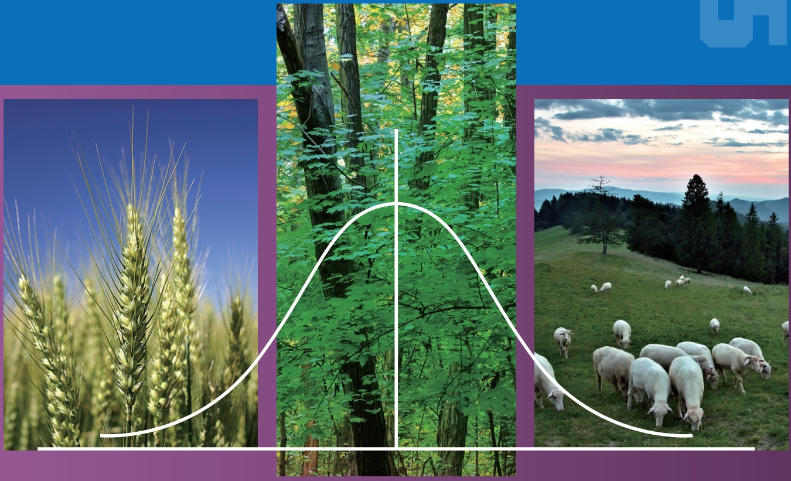

# 封面、前言与目录 / Front matter

原始 PDF 第 1–12 页。

五X

“十二五”普通高等教育本科国家级规划教材普通高等教育“十一五”国家级规划教材

# 生命科学经典教材系列|

# 生物统计学

## （第六版）

李春喜 姜丽娜 邵 云 张黛静 马建辉 **编著**

BIOMETRICS

SP

科学出版社

---

“十二五”普通高等教育本科国家级规划教材

普通高等教育“十一五”国家级规划教材

生命科学经典教材系列

# 生物统计学

（第六版）

李春喜 姜丽娜 邵 云 张黛静 马建辉 编著

科学出版社

北 京

---

## 内 容 简 介

本教材较为系统地介绍了生物统计学的基本原理和方法，在简要叙述了生物统计学的产生、发展及其研究对象与作用，数据的来源与整理，数据特征的描述统计，概率与概率分布、抽样分布的基础上，着重介绍了统计推断、非参数检验、列联分析、方差分析、直线回归与相关分析、可直线化的非线性回归分析、协方差分析、多元线性回归与相关分析、逐步回归与通径分析和多项式回归分析，同时对试验设计原理及对比设计、随机区组设计、拉丁方设计、裂区设计、交叉设计、正交设计、均匀设计等常用试验设计及其统计分析进行了详细叙述。

本教材重点介绍了生物统计学的基础知识，结合当今生物学的发展特点，引入相关的实例分析，通俗易懂，具有一定的深度和广度，可供综合性大学、师范院校生物类及其相关专业的本科生作为教材使用，也可作为从事生命科学、农业科学、林业科学、医药学、畜牧兽医、水产科学、食品科学等专业的科研工作者、教师和研究生的参考书。

## 图书在版编目（CIP）数据

生物统计学/李春喜等编著.—6 版.—北京:科学出版社，2023.8

“十二五”普通高等教育本科国家级规划教材 普通高等教育“十一五”

国家级规划教材 生命科学经典教材系列

ISBN 978-7-03-076039-5

Ⅰ.①生… Ⅱ.①李… Ⅲ.①生物统计-高等学校-教材 Ⅳ.①Q-332

中国国家版本馆 CIP 数据核字（2023）第 139064 号

责任编辑:丛 楠 马程迪 / 责任校对:严 娜

责任印制:师艳茹 / 封面设计:图阅社

## 科学出版社出版

北京东黄城根北街 16 号

邮政编码:100717

http://www.sciencep.com

## 三河市宏图印务有限公司 印刷

科学出版社发行 各地新华书店经销

\*

1997 年 8 月第 一 版 开本:787×1092 1/16

2023 年 8 月第 六 版 印张:24 1/2

2023 年 8 月第一次印刷 字数:581 000

定价: **69.80** 元

（如有印装质量问题，我社负责调换）

---

## 第六版前言

自 1997 年本教材第一版问世 26 年来，已历经 5 次修订再版。进入 21 世纪以来，生物科学发展迅速，研究工作的定量化与信息化成为其主要特征。在本次修订过程中，我们以党的二十大精神为指引，以为党育人、为国育才为初心使命，以助力科技自立自强为己任，坚持以生命科学类本科生学习要求为重点、兼顾研究生工具课程学习要求，秉承“循序渐进、强化基础、先易后难、注重实践”的基本理念，用数学的语言深化和精准化地描述生命科学领域的现象和问题，强调教材内容与生命科学发展需要的匹配，注重吸收国外教材中的先进理念与统计方法，不断调整和完善本教材体系。

在前 5 版的基础上，本版教材在结构上从以下 4 个方面进行了修订和完善:一是详细、透彻补充完善了描述统计的相关内容，强化了统计学的图形描述理念；二是调整、完善了部分章节内容，增加了非参数检验，完善了列联分析；三是调整了试验设计有关内容的章节布局，增加了交叉设计与均匀设计及其统计分析；四是引入二维码形式，延伸和扩展了相关内容。

在具体内容方面，本教材第六版较为系统地介绍了生物统计学的基本原理和方法，在简要叙述生物统计学的产生、发展及其研究对象与作用，数据的来源与整理，数据特征的描述统计，概率与概率分布、抽样分布的基础上，着重介绍了统计推断、非参数检验、列联分析、方差分析、直线回归与相关分析、可直线化的非线性回归分析、协方差分析、多元线性回归与相关分析、逐步回归与通径分析和多项式回归分析，同时对试验设计原理及对比设计、随机区组设计、拉丁方设计、裂区设计、交叉设计、正交设计、均匀设计等常用试验设计及其统计分析进行了详细阐述。

与国内外同类教材相比，本教材第六版重点突出了以下特点:一是准确定位读者群。以生命科学类本科生学习要求为重点，兼顾研究生工具课程学习，同时也可供从事生命科学、农林科学、医药学、畜牧兽医、水产科学、食品科学等专业的教师与科研工作者参考。二是合理安排教材内容。注重理论与实践的结合，注重全面、实用，重点突出统计学在生命科学研究与实践中的应用。三是强化基础知识与扩展内容的结合。教材内容以满足本科生、研究生学习要求为基础，力争做到结构编排合理、知识深入浅出，采用二维码延伸阅读等形式扩展知识内容。

特别感谢科学出版社的编辑为本教材的出版和发行给予的大力支持和帮助。在科学出版社、河南省教育厅和河南师范大学一如既往的支持下，在各位读者的关怀和帮助下，本教材先后被评为“十一五”“十二五”国家级规划教材，获得首届河南省优秀教材特等奖，本教材作者李春喜先后被评为第二届、第三届“科学出版社百名优秀作者”，在此一并感谢。

本教材能够多次再版，始终得到了广大读者的支持和帮助。由于作者学识有限，编写内容定有不当之处，还望读者朋友继续给予关心和帮助，多提宝贵意见。

李春喜

2023 年 1 月于河南师范大学

---

## 第一版前言

生物统计学是运用数理统计的原理和方法来分析和解释生物界各种现象和试验调查资料的一门科学。随着生物学的不断发展，对生物体的研究和观察已不再局限于定性的描述，而是需要从大量调查和测定数据中，应用统计学方法，分析和解释其数量上的变化，以正确制定试验计划，科学地对试验结果进行分析，从而作出符合科学实际的推断。目前，生物统计学在农学、林学、畜牧、医药、卫生、生态、环保等领域已有广泛应用，但在纯生物学研究方面的应用，不管是在深度上还是广度上都不及上述领域。有鉴于此，在生物学研究中，迫切需要加强生物统计学的应用，对高校生物类专业，它也是一门应被十分重视的工具课程。本书正是为了满足这些需要而编写的。

本书的写作是在作者多年从事生物统计学教学和应用研究的基础上完成的。书中的内容主要侧重于各种统计方法的应用，在统计原理方面，一般只作概念上的介绍和公式的简单推导，对有些较复杂的统计公式则只给出公式，其目的主要是让读者不但对统计学原理有较全面的了解，更重要的是结合实例了解和掌握各种常用统计方法。在本书的安排上，全书共分十二章，概括起来主要有五个方面:第一章至第三章介绍统计和概率的基础知识，包括生物统计学的概念和内容、数据的搜集与整理、平均数和变异数的计算、概率和概率分布等；第四章、第五章介绍统计推断，包括样本平均数的检验、样本频率的检验、方差同质性检验、非参数检验和 χ2检验；第六章至第九章介绍统计分析方法，主要内容有方差分析、直线回归与相关分析、可直线化的曲线回归分析、多元回归与相关分析、逐步回归分析、多项式回归、协方差分析；第十章、第十一章介绍抽样与试验设计，主要包括抽样误差估计、抽样方法、抽样方案制订及常见的试验设计，如对比设计、随机区组设计、正交设计及其相应的统计分析方法；第十二章对近年来应用越来越多的多元统计分析进行了简单介绍。每章都附有一定数量的思考练习题，供读者参考。

本书中的例子主要有两个来源，一个是近年来有关生物学、农学、林学、医学、畜牧、水产、环保等领域或学科的实际研究资料，另一个是有关著作中的一些例题。崔党群教授在百忙中通审了全书，并提出了富有建设性的建议。贾玉书同志承担了本书的大部分绘图工作。姜丽娜同志在本书的录排中做了大量工作。在本书的出版过程中，得到了科学出版社的大力支持，特别是张晓春同志在书稿的编审和发行方面做了大量工作，在此一并表示谢意。

本书通俗易懂，具有一定的深度和广度，适合生物学、农学、医学、畜牧、水产、环保等领域或学科的科学工作者阅读，也可供本、专科院校生物类师生作为教材使用。

由于作者水平的限制和资料占有的局限性，本书难免会有错误和不妥之处，敬请读者批评指正，以便日后修订完善。

李春喜 王文林

1997 年 3 月

---

## 目 录

## 第 1 章 概论

## 第一节 生物统计学的概念与作用

一、生物数据的变异性 .
二、什么是生物统计学 ..
三、生物统计学的内容与作用 .

## 第二节 数据类型及特征 .

一、数据类型 ............... ................ 4
二、数据主要特征 .............. ............. 5
三、数据统计中的常用术语 .

## 第三节 统计学的发展 10

一、古典记录统计学 .......... ............ 10
二、近代描述统计学 ..... ............ 10
三、现代推断统计学 ..... ............. 11

## 思考练习题 12

## 第 2 章 数据的描述统计 13

## 第一节 数据的来源 .. . 13

一、调查 ................. ..................... 13
二、试验 .. ..................... 20

## 第二节 数据整理与频数分布 .. ... 28

一、数据的预处理 ........... ............... 28
二、数据整理与频数分布表 ..
三、频数分布图 .. ........... 35

## 第三节 数据特征的定量描述 ........ 39

一、集中性描述 ..
二、变异程度描述 .
三、分布形态特征描述 .

## 思考练习题 54

## 第 3 章 概率与概率分布 56

## 第一节 事件及其概率 .. 56

一、事件、频率与概率 . .............. 56
二、事件关系与概率计算 ..... .......... 58
三、大数定律 ........... .............. 61

## 第二节 离散性概率分布 . 62

一、随机变量 .......... ............... 62

---

·iv·

生物统计学

二、离散性随机变量的概率分布 . ... 63
三、离散性随机变量的数学期望和方差... ....... 63
四、二项分布 ...... ....... 64
五、泊松分布 ....

## 第三节 连续性概率分布 . 69

一、概率密度函数 . ............ 69
二、正态分布 ....
三、其他连续性概率分布 ....... ........... 74

## 第四节 抽样分布 77

一、抽样试验与无偏估计 .. ............ 77
二、样本平均数的抽样分布 .... ........... 78
三、样本频率的抽样分布 ....... ........... 81
四、正态总体抽样分布 ..... ............ 82

## 思考练习题 .. .. 85

## 第 4 章 统计推断 .. 86

## 第一节 假设检验的原理与方法 . ... 86

一、假设检验的概念 . ............. 86
二、假设检验的步骤 . ............ 87
三、双尾检验与单尾检验 . ....... 89
四、假设检验中的两类错误与功效 . ........ 90

## 第二节 样本平均数的假设检验 .. 92

一、一个样本平均数的假设检验 . ............ 92
二、两个样本平均数的假设检验 .......... 94

## 第三节 样本频率的假设检验 ..... 101

一、一个样本频率的假设检验 .......... 101
二、两个样本频率的假设检验 ...... 103

## 第四节 样本方差同质性检验 ........ 105

一、一个样本方差的同质性检验 ......... 105
二、两个样本方差的同质性检验 ..... 106

## 第五节 参数估计的原理与方法 . ...... 107

一、估计量与估计值 .. ........... 107
二、参数估计的原理 ..... .............. 108
三、一个总体参数的估计 .......... 109
四、两个总体参数的估计 ........... 111
五、基于参数估计的样本容量的确定 ......... 113

## 思考练习题 . .. 115

---

目 录

·v·

## 第 5 章 非参数检验 ... 117

## 第一节 游程检验 .... 117

一、游程的概念 . ............118
二、游程检验的步骤 .. ........... 118

## 第二节 符号检验 ..120

一、一个样本的符号检验 ..... .............120
二、两个配对样本的符号检验 . ..........121

## 第三节 秩和检验 ..122

一、秩和检验的原理和方法 .. ...........122
二、单样本 Wilcoxon 符号秩检验 ..........123
三、两个样本的 Wilcoxon 符号秩检验 .........124

## 第四节 H 检验——多样本比较的秩和检验 ......129

一、原始数据多样本比较的秩和检验 ..........129
二、频数表数据的多样本比较秩和检验 . ...........130

## 思考练习题 .. .....131

## 第 6 章 列联分析 . ...132

## 第一节 列联表与 χ2统计数 . .....132

一、分类数据与列联表 . ............132
二、χ2 统计数 .............. ..............135

## 第二节 拟合优度检验 ......136

## 第三节 独立性检验 . ....139

一、2×2 列联表的独立性检验 . ..........139
二、2×C 列联表的独立性检验 ...........141
三、R×C 列联表的独立性检验 . ............142

## 第四节 Fisher 精确检验与 McNemar 检验 . ......143

一、Fisher 精确检验 . .......143
二、McNemar 检验 ......145

## 第五节 列联表中的相关系数 ......146

一、φ 相关系数 . ............146
二、列联相关系数 ..... .......147
三、V 相关系数 . ..............147
四、三种相关系数的比较 .. ...........148

## 第六节 差分概率的置信区间与相对风险 .....148

一、差分概率的置信区间 ....... ............148
二、相对风险与比值比 .. ...........150

## 思考练习题 ..151

---

·vi·

生物统计学

## 第 7 章 方差分析 .... 153

## 第一节 方差分析的基本原理 ....... 153

一、方差分析的基本思想 .... ........... 153
二、方差分析的数学模型 .. .......... 154
三、方差分析的基本假定 ....... 156
四、平方和与自由度的分解 . .......... 156
五、统计假设的显著性检验——F 检验 ........ 159
六、平均数的多重比较 . ........... 161

## 第二节 单因素方差分析 ...... 165

一、组内观测次数相等的方差分析 . ............ 166
二、组内观测次数不相等的方差分析 ........... 168

## 第三节 二因素方差分析 .... 170

一、无重复观测值的二因素方差分析 ......... 170
二、具有重复观测值的二因素方差分析..... ......... 174

## 第四节 多因素方差分析 .... 180

## 第五节 方差分析缺失数据的估计和数据转换 ..... 185

一、方差分析缺失数据的估计方法 .......... 185
二、方差分析的数据转换 . ............ 186

## 思考练习题 . .. 190

## 第 8 章 直线回归与相关分析 .. 192

## 第一节 回归和相关的概念 .... 192

## 第二节 直线回归分析 . .... 193

一、直线回归方程的建立 . ............ 193
二、直线回归的数学模型和基本假定 ........... 196
三、直线回归的假设检验 ....... 197
四、直线回归的区间估计 ..... 200
五、直线回归的应用及注意问题 ...... 204

## 第三节 直线相关分析 ... ....... 205

一、相关系数和决定系数 ..... 205
二、相关系数的假设检验 ...... 206
三、相关系数的区间估计 ............ 207
四、应用直线相关的注意事项 . ......... 208

## 思考练习题 .. ... 208

## 第 9 章 可直线化的非线性回归分析 .. ...... 210

## 第一节 非线性回归的直线化 .... 210

一、曲线类型的确定 . ............. 210
二、数据变换的方法 . ........... 211

---

目 录

·vii·

第二节 倒数函数曲线 .........212

第三节 指数函数曲线 .......215

第四节 对数函数曲线 .....217

第五节 幂函数曲线 . ....219

第六节 Logistic 生长曲线 ........222

一、Logistic 生长曲线的由来和基本特征 ..........222
二、Logistic 生长曲线方程的配合 .........222

思考练习题 ..224

## 第 10 章 试验设计及其统计分析 ...226

第一节 试验设计的类型 . .....226

一、对比设计 ................ ................226
二、完全随机设计 ........ ............227
三、随机区组设计 ...... ............228
四、拉丁方设计 ....... ..............229
五、裂区设计 ............ ...............229
六、交叉设计 ............ ..............230
七、析因设计 ............ ...............231
八、正交设计 ............ ..............231
九、均匀设计 ........... ..............232

第二节 对比设计及其统计分析 .. ....233

一、邻比设计及其统计分析 ... ............233
二、间比设计及其统计分析 ... ...........235
三、配对设计及其统计分析 ... ...........236

第三节 随机区组设计及其统计分析 ... .......237

一、单因素随机区组设计及其统计分析 .. ..........237
二、二因素随机区组设计及其统计分析 .. .......240

第四节 拉丁方设计及其统计分析 .....244

一、拉丁方设计方法 .. ............244
二、拉丁方设计试验数据的线性模型及统计分析 . .......245

第五节 裂区设计及其统计分析 .. ....248

一、裂区设计方法 ... ...............248
二、裂区设计试验数据的线性模型与统计分析 ....... ...........248

第六节 交叉设计及其统计分析 .. ....255

一、交叉设计的基本步骤 ....... ............255
二、交叉设计试验数据统计分析 ..... ..........256

第七节 正交设计及其统计分析 .. ....258

一、正交表及其特点 ......... .............258
二、正交试验的基本方法 .. ..........260

---

·viii·

生物统计学

三、正交设计试验数据的统计分析 ......... 263

第八节 均匀设计及其统计分析 . ..... 269

一、均匀设计表及其特点 ... ........ 269
二、均匀设计的基本方法 ........... 271
三、均匀设计试验数据的统计分析 .. .......... 274

思考练习题 . .... 275

## 第 11 章 协方差分析 ... 278

第一节 协方差分析的基本概念 ...... 278

一、协方差分析的意义和作用 .......... 278
二、协方差分析的数学模型 .. ........... 280
三、协方差分析的基本假定 .......... 280

第二节 单向分组数据的协方差分析 ...... 280

一、计算各项变异的平方和、乘积和与自由度 ..... ......... 282
二、检验 x 和 y 是否存在直线回归关系 .. ......... 283
三、检验矫正平均数 i  y（= ）间的差异显著性 . ......... 284
四、矫正平均数 $\overline { { y } } _ { i ( x = \overline { { x } } ) }$ 间的多重比较 .......... 285

第三节 两向分组数据的协方差分析 ..... 287

一、乘积和与自由度的分解 ........... 288
二、检验 x 和 y 是否存在线性回归关系 . ........ 289
三、检验矫正平均数 i  y（= ）间的差异显著性 . ......... 290

思考练习题 .. .... 291

## 第 12 章 多元线性回归与相关分析 . .... 292

第一节 多元线性回归分析 . .... 292

一、多元线性回归模型 ............ 292
二、多元线性回归方程的建立 .......... 293
三、多元线性回归检验和置信区间 . ........ 299

第二节 多元相关分析 . ..... 305

一、多元相关分析及其假设检验 .......... 305
二、偏相关分析 . ............ 307

思考练习题 . .. 311

## 第 13 章 逐步回归与通径分析 ...... 313

第一节 逐步回归分析 . .... 313

一、后退逐步回归 .............. ............... 314
二、前进逐步回归 ............ .............. 319
三、逐步回归需要注意的问题 ........... 324

第二节 通径分析 .... 324

一、通径分析的基本概念 ........... 324
二、通径系数的求解方法 ........... 325

---

目 录

·ix·

## 三、通径分析的假设检验 . ..........328

思考练习题 . .....331

## 第 14 章 多项式回归分析 . ...332

第一节 多项式回归的数学模型 .. .......332

第二节 多项式回归方程的建立 .. .....333

一、多项式回归方程的建立与求解 .......... ...........333
二、多项式回归方程的图示 ... .............335

第三节 多项式回归方程的假设检验 .....336

第四节 相关指数 .....337

第五节 正交多项式回归分析 . .....338

一、正交多项式回归分析原理 . ............338
二、正交多项式回归分析示例 ..... ...........339

思考练习题 . ....341

## 主要参考文献 ...342

## 附表 . ...344

附表 1 正态分布的累积函数 F（u）值表 . .....344
附表 2 正态离差（u）值表（双尾） .....346
附表 3 t 值表（双尾） .....346
附表 4 χ2值表（右尾） .......347
附表 5 F 值表（右尾） .....348
附表 6 游程检验表 ...352
附表 7 符号检验表 . .....353
附表 8 Wilcoxon 符号秩检验表（n=5～18） .....354
附表 9 Whitney-Mann-Wilcoxon 秩和分布表 .....356
附表 10 三样本比较秩和检验 H 界值表 . .......359
附表 11 新复极差检验 SSR 值表 . .......360
附表 12 q 值表（双尾） ......361
附表 13 r 与 R 的临界值表 ......362
附表 14 正交拉丁方表 . .......363
附表 15 常用正交表 .....364
附表 16 均匀设计表 .....373
附表 17 正交多项式系数表 ...377
