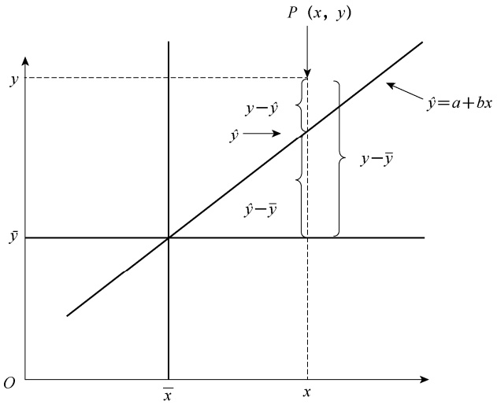
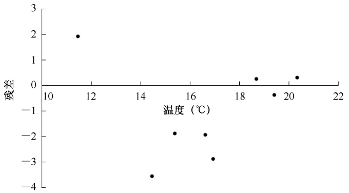
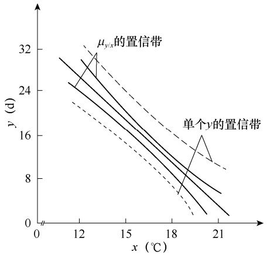
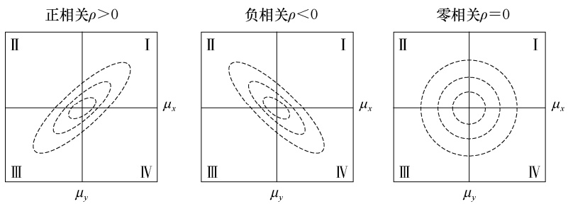

# 第8章直线回归与相关分析

原始 PDF 第 204–221 页。

第 8 章

# 直线回归与相关分析

## 本章提要

直线回归与相关是建立两变量间定量关系的最基本方法。本章主要讨论:

• 回归与相关的概念；
• 直线回归方程建立及检验；
• 直线相关分析及相关系数检验。

前面所讨论的统计方法，通常只涉及一个变量。两个或两个以上变量，其相互关系有两类，一类是变量间存在确定的函数关系，如长方形的面积 $S { = } a b$ 、气体定律 $PV = RT$ 等。这些变量依公式关系而存在，只要知道了其中一个或多个变量值就可以准确地计算出另外变量的值。这类例子在生物界较少存在。另一类是变量间存在不确定的函数关系，不能用确定的函数式来表示。例如，人的身高和体重的关系，通常身高越高、体重越重。但是身高与体重之间不存在确定的函数关系，知道身高并不能得知准确的体重；同样，知道体重也不会得知准确的身高。对于多个变量，一个变量发生变化，其他变量也会跟着发生变化，在统计上常采用回归（regression）与相关（correlation）的分析方法探讨多变量间的变化规律。

## 第一节 回归和相关的概念

变量间的相互关系，常见的有因果关系和平行关系。因果关系是指一个变量的变化受另一个变量或几个变量的制约。例如，微生物的繁殖速度受温度、湿度、光照等因素的影响，子女的身高受父母身高的影响等。平行关系是指两个以上变量之间共同受到另外因素的影响。例如，人的身高与体重之间的关系，兄弟身高之间的关系等。

对于两个变量，常用符号 x、 y 表示，如果通过 n 次试验或调查获得两个变量的成对观测值，可表示为 $\left( x _ { 1 } , y _ { 1 } \right) , \left( x _ { 2 } , y _ { 2 } \right) , \cdots , \left( x _ { n } , y _ { n } \right)$ 。为了直观地表示 x 和 y 的变化关系，可将每一对观测值在平面直角坐标系中表示成一个点，做成散点图（scatter chart）。从散点图可以看出:①两个变量间关系的性质和程度；②两个变量间关系的类型，是直线型还是曲线型；③是否有异常观测值的干扰等。图 8-1 是 3 幅两个变量的散点图。从图中可以看出，图 8-1（a）、（b）都是趋向于直线型的，但图 8-1（a）的两个变量关系较图 8-1（b）更密切，且是正向的，即随 x 增加 y 也增加；而图 8-1（b）是负向的，即随 x 增加 y 减小；图 8-1（c）两个变量之间的关系则趋向于曲线型。用散点图表示两个变量之间的关系只是进行了定性研究，为了定量地探讨它们之间的规律性，必须根据观测值将其理论关系推导出来。

---

第 8 章 直线回归与相关分析

·193·

scatter

| x | y |
| --- | --- |
| ~1.05 | ~0.9 |
| ~1.2 | ~1.4 |
| ~1.25 | ~1.6 |
| ~1.3 | ~1.05 |
| ~1.35 | ~1.5 |
| ~1.4 | ~1.9 |
| ~1.5 | ~1.6 |
| ~1.6 | ~2.0 |
| ~1.65 | ~2.2 |
| ~1.7 | ~2.3 |
| ~1.8 | ~2.6 |
| ~1.9 | ~2.05 |
| ~2.0 | ~2.6 |
| ~2.1 | ~2.5 |
| ~2.15 | ~3.0 |
| ~2.3 | ~2.8 |
| ~2.4 | ~3.25 |
| ~2.7 | ~3.45 |

(a) 正向直线关系

scatter

| x | y |
| --- | --- |
| ~0.4 | ~3.3 |
| ~0.6 | ~2.6 |
| ~0.8 | ~3.6 |
| ~0.9 | ~3.1 |
| ~1.0 | ~2.7 |
| ~1.2 | ~1.8 |
| ~1.3 | ~2.3 |
| ~1.4 | ~2.9 |
| ~1.5 | ~3.2 |
| ~1.6 | ~2.6 |
| ~1.7 | ~2.2 |
| ~1.9 | ~1.2 |
| ~2.0 | ~1.7 |
| ~2.1 | ~2.4 |
| ~2.3 | ~2.7 |
| ~2.4 | ~1.6 |
| ~2.6 | ~1.0 |
| ~2.8 | ~2.0 |
| ~3.1 | ~1.1 |

(b)负向直线关系

scatter

| x | y |
| --- | --- |
| ~0.7 | ~0.6 |
| ~1.0 | ~0.75 |
| ~1.2 | ~0.9 |
| ~1.3 | ~0.75 |
| ~1.6 | ~1.05 |
| ~1.8 | ~1.2 |
| ~2.0 | ~1.3 |
| ~2.2 | ~1.0 |
| ~2.3 | ~1.7 |
| ~2.4 | ~1.2 |
| ~2.4 | ~1.45 |
| ~2.5 | ~1.95 |
| ~2.6 | ~2.5 |
| ~2.7 | ~2.3 |
| ~2.7 | ~2.85 |
| ~2.8 | ~3.8 |
| ~2.9 | ~3.2 |
| ~2.9 | ~1.55 |

(c) 曲线关系

图 8-1 x 与 y 之间的关系

如果两个变量间的关系属于因果关系，一般用回归分析（regression analysis）来研究。表示原因的变量称为自变量（independent variable），常用 x 表示，一般自变量是固定的（试验时预先确定的），没有随机误差或者随机误差较小；表示结果的变量称为因变量或依变量（dependent variable），常用 $y$ 表示，它是随 x 的变化而变化的，具有随机误差。例如，作物施肥量和产量之间的关系，前者是表示原因的变量，为事先确定的，是自变量；后者是表示结果的变量，为依变量，且具有随机误差。若对于变量 x 的每一个可能值 $x _ { i } ,$ ，都有随机变量$y _ { i }$ 的一个分布与之相对应，则称随机变量 y 对变量 x 存在回归关系。研究“一因一果”，即一个自变量与一个依变量的回归分析称为一元回归分析（one factor regression analysis）；研究“多因一果”，即多个自变量与一个依变量的回归分析称为多元回归分析（multiple regression analysis）。一元回归可分为直线回归（linear regression）与曲线回归（curve regression）两种；多元回归可分为多元线性回归（multiple linear regression）与多元非线性回归（multiple nonlinear regression）两种。回归分析的目的是揭示变量之间的因果关系，建立回归方程，并通过回归方程由自变量来预测和控制依变量。

如果两个变量间的关系属于平行关系，一般用相关分析（correlation analysis）来进行研究。在相关分析中，变量 x 和 y 无自变量和依变量之分，且都具有随机误差。两个随机变量x 和 y，对于其中任一随机变量的每一个可能的值，另一个随机变量都有一个确定的分布与之相对应，则称这两个随机变量间存在相关关系。对两个变量间的直线关系进行相关分析称为直线相关（linear correlation）分析或简单相关（simple correlation）分析；对多个变量进行相关分析时，研究一个变量与多个变量间的线性相关称为复相关（multiple correlation）分析；研究其余变量保持不变的情况下两个变量间的线性相关称为偏相关（partial correlation）分析。

本章主要探讨直线回归分析和直线相关分析。

## 第二节 直线回归分析

直线回归是回归分析中最基本、最简单的一种，故又称为简单回归（simple regression）。

## 一、直线回归方程的建立

研究回归关系时，对自变量 x 的每一个取值 $x _ { i } ,$ ，都有 y 的一个分布与之对应。即当 $x   =   x _ { i }$时， $y _ { i }$ 的平均数 $\mu _ { y / x = x _ { i } }$ 与之是相对应的， $\mu _ { y / x = x _ { i } }$ 称为 y 的条件平均数（conditional mean）。在这

---

·194·

生物统计学

种情况下，我们可以利用直线回归方程（linear regression equation）来描述 $x$ 与 $y$ 的均值的关系，其一般形式为

$$
\hat {y} = a + b x \tag {8-1}
$$

式（8-1）为 $^ { \prime \prime } y$ 依 x 的直线回归方程”。其中，x 为自变量； $\hat { y }$ 为与 x 值相对应的依变量 y 的总体平均数的点估计值； $a$ 为当 $x { = } 0$ 时的 $\hat { y }$ 值，即直线在 $y$ 轴上的截距（intercept），称为回归截距（regression intercept）； $b$ 为回归直线的斜率（slope），称为回归系数（regression coefficient），其含义是自变量 x 改变一个单位，依变量 $y$ 平均增加或减少的单位数。

如果两个变量在散点图上呈线性关系，就可用直线回归方程来进行描述。为了使$\hat { y } { = } a { + } b x$ 能最好地反映 $y$ 和 x 两变量间的数量关系，根据最小二乘法（method of least square），a、b 应使依变量的观测值与回归估计值的离差平方和最小，即

$$
Q = \sum_ {1} ^ {n} (y - \hat {y}) ^ {2} = \sum_ {1} ^ {n} (y - a - b x) ^ {2} = \text {最小值} \tag {8-2}
$$

根据微积分学中的极值原理，必须使 Q 对 a、b 的一阶偏导数值为 $0$ :

$$
\begin{array}{l} \frac {\partial Q}{\partial a} = - 2 \sum (y - a - b x) = 0 \\ \frac {\partial Q}{\partial b} = - 2 \sum (y - a - b x) x = 0 \\ \end{array}
$$

整理得正规方程组（normal equation group）:

$$
\left\{ \begin{array}{l} a n + b \sum x = \sum y \\ a \sum x + b \sum x ^ {2} = \sum x y \end{array} \right.
$$

解方程组，得

$$
a = \overline {{y}} - b \overline {{x}} \tag {8-3}
$$

$$
b = \frac {\sum x y - \frac {\sum x \sum y}{n}}{\sum x ^ {2} - \frac {\left(\sum x\right) ^ {2}}{n}} = \frac {\sum (x - \bar {x}) (y - \bar {y})}{\sum (x - \bar {x}) ^ {2}} = \frac {S P}{S S _ {x}} \tag {8-4}
$$

式中，分子 $\sum (x - \bar{x})(y - \bar{y})$ 为 $x$ 的离均差和 $y$ 的离均差乘积和（mean deviation product sum），简称乘积和（product sum），记作 $S P$ 或 $S S _ { x y } ;$ ；分母 $\sum ( x - { \overline { { x } } } ) ^ { 2 }$ 为 x 的离均差平方和（mean A deviation sum of square），记作 $S S _ { x }$

回归直线在平面直角坐标系中的位置取决于$a \cdot$ $b$ 的取值。由图 8-2 可以看出， $a   \geq   0$ ，表示回归直线在第Ⅰ象限与 $y$ 轴相交； $a { \leq } 0$ ，表示回归直线在第Ⅰ象限与 $x$ 轴相交。 $b   \geq   0$ ，表示 $y$ 随 $x$ 的增加而增加； $b   \leq   0$ ，表示 $y$ 随 $x$ 的增加而减小； $b { = } 0$ 或与 $0$差异不显著，表示 $y$ 的变化与 $x$ 的取值无关，两变量不存在直线回归关系。这只是对 $a$ 和 b 的统计学解释，对于具体数据， $a$ 和 $b$ 通常还有专业上的实际意义。

line

| Condition | Description |
| --- | --- |
| a > 0, b = 0 | Horizontal line at y=1.0 |
| a > 0, b < 0 | Downward sloping line starting from y=1.0 |
| a > 0, b > 0 | Upward sloping line starting from y=0.5 |
| a < 0, b > 0 | Downward sloping line starting from x=0.5 |

图 8-2 直线回归方程 $\hat { y }   =   a   +   b x$ 的图像

将 $x$ 的取值代入直线回归方程，可计算出 $\hat { y }$ 值，

---

第 8 章 直线回归与相关分析

·195·

研究 $y$ 和 $\hat { y }$ 之间的关系，可发现回归方程的 3 个基本性质。

性质 1 $Q = \sum (y - \bar{y})^2 =$ 最小值；

性质 2 $\sum (y - \hat{y}) = 0;$

性质 3 回归直线通过中心点（ x，y ）。

将式（8-3）代入式（8-1），得到直线回归方程的另一种形式:

$$
\hat {y} = \overline {{y}} - b \overline {{x}} + b x = \overline {{y}} + b (x - \overline {{x}}) \tag {8-5}
$$

例 **8-1** 有人研究了黏虫孵化历期平均温度 $( x , ~ \mathrm { { ^ \circ C } } )$ 与历期天数（y，d）之间的关系，试验数据列于表 8-1。试建立直线回归方程。

表 8-1 黏虫孵化历期平均温度与历期天数

| 序号 | 1 | 2 | 3 | 4 | 5 | 6 | 7 | 8 |
| --- | --- | --- | --- | --- | --- | --- | --- | --- |
| 平均温度(x,°C) | 11.8 | 14.7 | 15.6 | 16.8 | 17.1 | 18.8 | 19.5 | 20.4 |
| 历期天数(y,d) | 30.1 | 17.3 | 16.7 | 13.6 | 11.9 | 10.7 | 8.3 | 6.7 |

（1）计算回归分析的 6 个一级数据:

$$
\begin{array}{l} \sum x = 1 1. 8 + 1 4. 7 + \dots + 2 0. 4 = 1 3 4. 7 0 \\ \sum x ^ {2} = 1 1. 8 ^ {2} + 1 4. 7 ^ {2} + \dots + 2 0. 4 ^ {2} = 2 3 2 3. 1 9 \\ \sum y = 3 0. 1 + 1 7. 3 + \dots + 6. 7 = 1 1 5. 3 0 \\ \sum y ^ {2} = 3 0. 1 ^ {2} + 1 7. 3 ^ {2} + \dots + 6. 7 ^ {2} = 2 0 3 9. 0 3 \\ \end{array}
$$

$$
\begin{array}{c} \sum x y = 1 1. 8 \times 3 0. 1 + 1 4. 7 \times 1 7. 3 + \dots + 2 0. 4 \times 6. 7 = 1 8 0 1. 6 7 \\ n = 8 \end{array}
$$

（2）由一级数据计算 5 个二级数据:

$$
\begin{array}{l} S S _ {x} = \sum x ^ {2} - \frac {\left(\sum x\right) ^ {2}}{n} = 2 3 2 3. 1 9 - \frac {1 3 4 . 7 0 ^ {2}}{8} = 5 5. 1 7 8 8 \\ S S _ {y} = \sum y ^ {2} - \frac {\left(\sum y\right) ^ {2}}{n} = 2 0 3 9. 0 3 - \frac {1 1 5 . 3 0 ^ {2}}{8} = 3 7 7. 2 6 8 8 \\ S P = \sum x y - \frac {\sum x \sum y}{n} = 1 8 0 1. 6 7 - \frac {1 3 4 . 7 0 \times 1 1 5 . 3 0}{8} = - 1 3 9. 6 9 3 8 \\ \overline {{x}} = \frac {\sum x}{n} = \frac {1 3 4 . 7 0}{8} = 1 6. 8 3 7 5 \\ \overline {{y}} = \frac {\sum y}{n} = \frac {1 1 5 . 3 0}{8} = 1 4. 4 1 2 5 \\ \end{array}
$$

（3）计算 b 值和 a 值:

$$
b = \frac {S P}{S S _ {x}} = \frac {- 1 3 9 . 6 9 3 8}{5 5 . 1 7 8 8} = - 2. 5 3 1 7
$$

$$
a = \overline {{y}} - b \overline {{x}} = 1 4. 4 1 2 5 - (- 2. 5 3 1 7) \times 1 6. 8 3 7 5 = 5 7. 0 4 0 0
$$

（4）建立黏虫孵化历期天数依历期平均温度的直线回归方程:

$$
\hat {y} = 5 7. 0 4 0 0 - 2. 5 3 1 7 x
$$

---

·196·

生物统计学

scatter

| \(x ({}^{\circ}C)\) | y (d) |
| --- | --- |
| ~11.5 | ~31 |
| ~14.5 | ~17 |
| ~15.5 | ~16 |
| ~16.5 | ~14 |
| ~17 | ~12 |
| ~18.5 | ~10 |
| ~19 | ~8 |
| ~20 | ~7 |

图 8-3 黏虫孵化平均温度（x）与历期天数（y）的关系

或

$$
\hat {y} = 1 4. 4 1 2 5 - 2. 5 3 1 7 (x - 1 6. 8 3 7 5)
$$

从回归方程可知，黏虫孵化历期平均温度每增加 $1   \mathrm { ^ { \circ } C }$ ，孵化历期就减少 2.5317d，当历期平均温度为 $0   \mathrm { ^ { \circ } C }$ 时，孵化历期为 57.04d。但是，由于本例 $x$ 的取值只为 $11.8 \sim 20.4   ^{\circ} C$ $x   =   0$ 不在此区间，是否符合 $\hat{y}=57.0400-2.5317x$ 的变化规律，有待于实践进一步验证。

从该数据直线回归方程的图形（图 8-3）可以看出，尽管 $\hat{y}=57.0400-2.5317x$ 可以作为该数据的回归方程，但是并不是所有的散点均恰好落在回归直线上，而是比较靠近回归直线，这说明用 x 去估计 y 是

有随机误差的，因此必须根据回归的数学模型对随机误差进行估计，并对回归方程进行检验。

## 二、直线回归的数学模型和基本假定

## （一）直线回归的数学模型

在直线回归中，y 总体的每一个观测值可分解为三部分，即 $y$ 的总体平均数 $\mu _ { y }$ 、因 $x$ 引起 y 的变异 $\beta \left( x - \mu _ { x } \right)$ 及 $y$ 的随机误差 $\varepsilon _ { \mathrm { c } }$ 。因此，直线回归的数学模型为

$$
y = \mu_ {y} + \beta (x - \mu_ {x}) + \varepsilon \tag {8-6}
$$

或

$$
y = \alpha + \beta x + \varepsilon \tag {8-7}
$$

式（8-6）和式（8-7）为总体数据直线回归的数学模型，其各部分含义如下。

（1）常量 α。α 是总体回归截距，是回归直线在纵坐标的截距，它是 y 的本底水平，即 $x$对 y 没有任何作用时 y 的数量表现。它属于不能用 x 来估计的部分。
（2） $\beta x$ 的部分。 $\beta$ 为总体回归系数， $\beta x$ 表示依变量 $y$ 的取值改变中，由 $y$ 与自变量 $x$ 的线性回归关系所引起变化的部分，即可以由 x 直接估计的部分。
（3）回归估计误差 $\varepsilon \circ \varepsilon$ 为随机误差，也称为回归估计误差（errors of regression）或残差、剩余（residual）。它表示依变量 $y$ 的取值改变中由自变量 x 以外的其他所有未进入该模型或未知、但可能与 $y$ 有关的随机和非随机因素共同引起变化的部分，即不能由 x 直接估计的部分。也就是说，在回归方程中，第 i 个观察对象的残差 $\varepsilon _ { i }$ 是其依变量 $y$ 的实测值 $y _ { i }$ 与其估计值 $\hat { y } _ { i }$ 之差。

如果是样本数据，直线回归的数学模型为

$$
y = \overline {{y}} + b (x - \overline {{x}}) + e \tag {8-8}
$$

或

$$
y = a + b x + e \tag {8-9}
$$

式（8-8）和式（8-9）中，a、b、e 分别为 a、 $\beta .$ 、ε 的估计值。

---

第 8 章 直线回归与相关分析

·197·

## （二）直线回归的基本假定

按上述直线回归模型进行回归分析，应符合如下基本假定。

（1）x 是没有误差的固定变量，至少和 y 比较起来，x 的误差是小到可以忽略的。而 y是随机变量，且具有随机误差。
（2）x 的任一值都对应着一个 y 总体，且呈正态分布，其平均数 $\mu_{y/x}=a+\beta x$ ，方差 $\sigma _ { y / x } ^ { 2 }$ 受偶然因素的影响，不因 x 的变化而改变。
（3）随机误差 ε 是相互独立的，且呈正态分布，服从 $N ( 0 , \sigma _ { \varepsilon } ^ { 2 } )$

直线回归分析建立在以上这些基本假定之上。如果试验数据不满足这些假定，就不能进行直线回归分析，但有些数据经适当处理后可满足这些假设，然后再进行直线回归分析。

## 三、直线回归的假设检验

任何两个变量之间都可通过前面的方法建立一个直线回归方程，该方程是否有意义，关键在于回归是否达到显著水平。我们知道，即使 x、y 所在的总体回归系数 $\beta { = } 0$ ，由于抽样误差，其样本回归系数 b 也不一定为零，因此需用方差分析或 t 检验进行假设检验。在讨论假设检验之前，我们先来分析依变量 y 的变异来源。

## （一）直线回归的变异来源

从图 8-4 可以看出，在直线回归中，依变量 y 是随机变量，y 的总变异 $( y \mathrm { - } { \overline { { y } } } )$ 可以分解为两部分，即由 x 变异引起的变异 $( \hat { y } \mathrm { - } \overline { { y } } )$ 和误差所引起的变异 $( y { - } { \hat { y } } )$ 。因此:

text_image

P (x, y)
ŷ=a+bx
y-ŷ
ŷ-ȳ
y-ȳ
ȳ-ȳ
O
x̄
ȳ
ȳ

图 8-4 （ - ） y y 的分解图

$$
\begin{array}{l} \sum (y - \bar {y}) ^ {2} = \sum [ (\hat {y} - \bar {y}) + (y - \hat {y}) ] ^ {2} \\ = \sum (\hat {y} - \bar {y}) ^ {2} + \sum (y - \hat {y}) ^ {2} + 2 \sum (\hat {y} - \bar {y}) (y - \hat {y}) \\ \end{array}
$$

由直线回归方程 $\hat{y} = \overline{y} + b \left( x - \overline{x} \right)$ ，得

---

·198·

生物统计学

$$
\begin{array}{l} \sum (\hat {y} - \bar {y}) (y - \hat {y}) = \sum b (x - \bar {x}) [ (y - \bar {y}) - b (x - \bar {x}) ] \\ = \sum b (x - \bar {x}) (y - \bar {y}) - b ^ {2} \sum (x - \bar {x}) ^ {2} \\ = b S P - b ^ {2} S S _ {x} = b S P - b S P = 0 \\ \end{array}
$$

则有

$$
\sum (y - \bar {y}) ^ {2} = \sum (\hat {y} - \bar {y}) ^ {2} + \sum (y - \hat {y}) ^ {2} \tag {8-10}
$$

式中， $\sum ( y - \bar{y} )^2$ 为依变量 $y$ 的离均差平方和，称为离均差平方和或总平方和，记作 $S S _ { y }$ 或$SS_{ 总 }$ ，表明随机变量 y 的总变异。

$\sum ( \hat { y } - \overline { { y } } ) ^ { 2 }$ 为由 x 变异引起 $y$ 变异的平方和，称为回归平方和（regression sum of square），记作 $U$ 或 $SS_{ 回归句 }$ 。它反映在 $y$ 的总变异中由于 $x$ 与 $y$ 的直线关系而引起 y 变异的部分，也就是在总平方和中可以用 x 解释的部分。U 在总平方和中的占比越大，说明回归效果越好。

$\sum ( y - { \hat { y } } ) ^ { 2 }$ 为误差因素引起的平方和，称为离回归平方和或残差平方和（剩余平方和）（residual sum of square），记作 $Q 、 SS_{ 离回归 }$ 或 $SS _{ 剩余 }$ 。它反映除去 x 与 $y$ 的直线回归关系外的其余因素使 y 发生变异的部分，即反映 x 对 y 的线性影响之外的其他因素对 y 变异的作用，也就是在总平方和中无法用 $x$ 解释的部分。在散点图上，各实测点离回归直线越近，Q 值也就越小，说明直线回归的估计误差越小。

因此，式（8-10）也可记作

$$
S S _ {y} = U + Q \tag {8-11}
$$

其中，

$$
U = \sum (\hat {y} - \bar {y}) ^ {2} = \sum [ \bar {y} + b (x - \bar {x}) - \bar {y} ] ^ {2} = b ^ {2} \sum (x - \bar {x}) ^ {2} = b ^ {2} S S _ {x} = b S P = \frac {S P ^ {2}}{S S _ {x}} \tag {8-12}
$$

$$
Q = S S _ {y} - U \tag {8-13}
$$

由于直线回归只涉及 1 个自变量，所以回归平方和的自由度为 1。离回归平方和的自由度为 $n - 1 - 1 = n - 2$ ，离回归平方和除以相应自由度即离回归方差，记作 $s _ { y / x } ^ { 2 } , s _ { y / x } ^ { 2 }$ 的平方根值即离回归标准差或残差标准差（residual standard deviation），习惯上也称为回归估计标准误（standard error of regression），即

$$
s _ {y / x} = \sqrt {\frac {Q}{n - 2}} \tag {8-14}
$$

例 **8-2** 试计算例 8-1 数据的回归平方和、离回归平方和及回归估计标准误。

根据前面计算结果，可得

$$
U = b S P = - 2. 5 3 1 7 \times (- 1 3 9. 6 9 3 8) = 3 5 3. 6 6 2 8
$$

$$
Q = S S _ {y} - U = 3 7 7. 2 6 8 8 - 3 5 3. 6 6 2 5 = 2 3. 6 0 6 0
$$

$$
s _ {y / x} = \sqrt {\frac {Q}{n - 2}} = \sqrt {\frac {2 3 . 6 0 6 0}{8 - 2}} = 1. 9 8 3 4
$$

## （二）残差图

在实际应用中，除了前面介绍的 $y$ 与 $x$ 散点图外，观察各种残差的特征也具有重要意义。由每一个 $\hat { y } _ { i }$ 残差 $( \; y _ { i }   -   \hat { y } _ { i } \; )$ 所构成的散点图称为残差图（residual plot）。如果线性模型适用，

---

第 8 章 直线回归与相关分析

·199·

没有异常值，那么拟合回归线能够描述数据的趋势，在残差图中表现出随机特性。图 8-5 描述了黏虫孵化历期平均温度与历期天数残差图，从该图中看不出异常特征，因此我们认为回归模型适用于这些数据。

scatter

| 温度 \(({}^{\circ}C)\) | 残差 |
| --- | --- |
| ~11.5 | ~1.9 |
| ~14.5 | ~-3.6 |
| ~15.5 | ~-1.9 |
| ~16.7 | ~-2.0 |
| ~17.0 | ~-2.9 |
| ~18.7 | ~0.3 |
| ~19.5 | ~-0.4 |
| ~20.4 | ~0.3 |

图 8-5 黏虫孵化历期平均温度（x）与历期天数（y）残差图

## （三）F 检验

两个变量是否存在线性关系，可采用 F 检验法进行。假设 $H _ { 0 } ;$ :两变量间无线性关系，对 $H _ { A }$ :两变量有线性关系。在无效假设下，回归方差与离回归方差的比值服从 $d f _ { 1 }   =   1$ 和$df_{2}=n-2$ 的 F 分布，可用

$$
F = \frac {\frac {U}{1}}{\frac {Q}{n - 2}} = \frac {U}{Q} \times (n - 2) \tag {8-15}
$$

来检验直线回归方程的显著性。

例 **8-3** 用 F 检验的方法检验例 8-1 数据直线回归关系的显著性。

假设 $H _ { 0 } ;$ 黏虫孵化历期平均温度 x 与历期天数 y 之间无线性关系； $H _ { A } ;$ :二者存在线性关系。

将 F 检验结果列于表 8-2。

表 8-2 例 8-1 数据直线回归关系的假设检验

| 变异来源 | df | SS | $s^2$ | F | $F_{0.05}$ | $F_{0.01}$ |
| --- | --- | --- | --- | --- | --- | --- |
| 回归 | 1 | 353.6628 | 353.6628 | 89.891** | 5.99 | 13.74 |
| 离回归 | 6 | 23.6060 | 3.9343 |  |  |  |
| 总变异 | 7 | 377.2688 |  |  |  |  |

因 $F { \geq } F _ { 0 . 0 1 }$ ，所以否定 $H _ { 0 }$ ，接受 $H _ { A }$ ，说明黏虫孵化历期平均温度与历期天数之间有极显著的直线回归关系。

## （四）t 检验

采用 t 检验也可以检验线性回归关系的显著性。假设 $H _ { 0 } \colon \beta { = } 0$ ，对 $H _ { A } \colon \beta \neq 0$

$s _ { b }$ 的结构

---

·200·

生物统计学

该方法是检验样本回归系数 b 是否来自 $\beta { = } 0$ 的双变量总体，以推断线性回归的显著性。

回归系数的标准误 $S _ { b }$ 和在 $H _ { 0 }$ 成立下的 t 值为

$$
s _ {b} = \sqrt {\frac {\sum (y - \hat {y}) ^ {2}}{(n - 2) \sum (x - \bar {x}) ^ {2}}} = \frac {s _ {y / x}}{\sqrt {S S _ {x}}} \tag {8-16}
$$

$$
t = \frac {b - \beta}{s _ {b}} = \frac {b}{s _ {b}} \tag {8-17}
$$

式（8-17）遵循 $df = n - 2$ 的 t 分布，由 t 值可得出样本回归系数 b 落在 $\beta { = } 0$ 总体中的区间概率。

例 **8-4** 用 t 检验的方法检验例 8-1 数据回归关系的显著性。

前面已计算出 $s_{y/x}=1.9834,\quad SS_{x}=55.1788,\quad b=-2.5317$ ，所以

$$
s _ {b} = \frac {S _ {y / x}}{\sqrt {S S _ {x}}} = \frac {1 . 9 8 3 4}{\sqrt {5 5 . 1 7 8 8}} = 0. 2 6 7 0
$$

$$
t = \frac {b}{s _ {b}} = \frac {- 2 . 5 3 1 7}{0 . 2 6 7 0} = - 9. 4 8 2
$$

查附表 3，当 $df = n - 2 = 8 - 2 = 6$ 时， $t_{0.01} = 3.707$ $| t | = 9.482 > t_{0.01}$ ，应否定 $H _ { 0 } ,$ ，接受$H _ { A }$ ，认为黏虫孵化历期平均温度与历期天数之间有极显著的直线回归关系。

上述 t 检验和 F 检验，都是对直线回归关系的假设检验，二者的检验结果是完全一致的。因为在同一概率值下， $df_{1}=1,\;df_{2}=n-2$ 的一尾 F 值为 $df = n - 2$ 的双尾 t 值的平方，且计算出的 F 值也是 t 值的平方。本例中 $t^{2}=(-9.482)^{2}=89.908$ 与 $F { = } 8 9 . 8 9 1$ 的微小差异是在计算过程中有效位数的不同而造成的。由式（8-18）可以证明:

$$
t ^ {2} = \left(\frac {b}{s _ {b}}\right) ^ {2} = \frac {b ^ {2}}{\frac {s _ {y / x} ^ {2}}{S S _ {x}}} = \frac {b ^ {2} S S _ {x}}{s _ {y / x} ^ {2}} = \frac {U}{\frac {Q}{n - 2}} = F \tag {8-18}
$$

## 四、直线回归的区间估计

当确定直线回归关系显著之后，既可用样本统计数 a、b 来估计总体参数 $$\alpha  、  \beta ,$$ ，又可利用回归方程去估计某一 x 值对应 y 总体的平均数和预测单个 $y$ 值所在的区间。

## （一）回归截距和回归系数的置信区间

根据公式 $a   =   \overline { { y } }   -   b \overline { { x } }$ ，得到回归截距 a 的方差为

$$
s _ {a} ^ {2} = s _ {y / x} ^ {2} \left(\frac {1}{n} + \frac {\overline {{x}} ^ {2}}{S S _ {x}}\right)
$$

因而回归截距 a 的标准误 $s _ { a }$ 和 t 值为

$$
s _ {a} = s _ {y / x} \sqrt {\frac {1}{n} + \frac {\bar {x} ^ {2}}{S S _ {x}}} \tag {8-19}
$$

$$
t = \frac {a - \alpha}{s _ {a}} \tag {8-20}
$$

---

第 8 章 直线回归与相关分析

·201·

式（8-20）服以 $df = n - 2$ 的 t 分布，所以总体回归截距 $\alpha$ 的置信区间为

$$
(L _ {1} = a - t _ {a} s _ {a}, L _ {2} = a + t _ {a} s _ {a}) \tag {8-21}
$$

由于 $\frac { b \mathrm { ~ - ~ } \beta } { s _ { b } }$ 服从 $df = n - 2$ 的 t 分布，故总体回归系数 $\beta$ 的置信区间为

$$
(L _ {1} = b - t _ {\alpha} s _ {b}, L _ {2} = b + t _ {\alpha} s _ {b}) \tag {8-22}
$$

例 **8-5** 试计算例 8-1 数据回归截距和回归系数的 95%置信区间。

由式（8-19），求得

$$
s _ {a} = s _ {y / x} \sqrt {\frac {1}{n} + \frac {\overline {{x}} ^ {2}}{S S _ {x}}} = 1. 9 8 3 4 \times \sqrt {\frac {1}{8} + \frac {1 6 . 8 3 7 5 ^ {2}}{5 5 . 1 7 8 8}} = 4. 5 5 0 1
$$

查附表 3， $t_{0.05(6)} = 2.447$ ，根据式（8-21）得回归截距 95%的置信区间为

$$
L _ {1} = a - t _ {0. 0 5} s _ {a} = 5 7. 0 4 0 0 - 2. 4 4 7 \times 4. 5 5 0 1 = 4 5. 9 0 5 9
$$

$$
L _ {2} = a + t _ {0. 0 5} s _ {a} = 5 7. 0 4 0 0 + 2. 4 4 7 \times 4. 5 5 0 1 = 6 8. 1 7 4 1
$$

表明在研究黏虫孵化历期平均温度与历期天数关系时，将有 95%的总体回归截距在（45.9059d，68.1741d）这一区间内。

同理，根据式（8-22），所求回归系数 95%的置信区间为

$$
L _ {1} = b - t _ {0. 0 5} s _ {b} = - 2. 5 3 1 7 - 2. 4 4 7 \times 0. 2 6 7 0 = - 3. 1 8 5 0
$$

$$
L _ {2} = b + t _ {0. 0 5} s _ {b} = - 2. 5 3 1 7 + 2. 4 4 7 \times 0. 2 6 7 0 = - 1. 8 7 8 4
$$

说明黏虫孵化历期平均温度和历期天数的总体回归系数在（-3.1850，-1.8784）区间的可靠度为 95%。

## （二） $\mu _ { y / x }$ 的置信区间和单个 y 的预测区间

由 x 的任一值对应 y 总体的平均数 $\mu _ { y / x }$ 的样本估计值为 $\hat{y} = \overline{y} + b \left( x - \overline{x} \right)$ ，这一估计值受 y和 b 的抽样误差的影响。对于给定的 x，预测总体平均数 $\mu _ { y / x }$ 时 ŷ 的方差为

$$
s _ {\hat {y}} ^ {2} = s _ {y / x} ^ {2} \left[ \frac {1}{n} + \frac {(x - \bar {x}) ^ {2}}{S S _ {x}} \right]
$$

于是， $\hat { y }$ 的标准误为

$$
s _ {\hat {y}} = s _ {y / x} \sqrt {\frac {1}{n} + \frac {(x - \bar {x}) ^ {2}}{S S _ {x}}} \tag {8-23}
$$

而且 $\frac { \hat { y } \mathrm {  —  } \mu _ { { \scriptstyle y } / { \scriptstyle x } } } { s _ { \hat { y } } }$ 服从 $df = n - 2$ 的 t 分布，所以 $\mu _ { y / x }$ 的置信区间为

$$
(L _ {1} = \hat {y} - t _ {\alpha} s _ {\hat {y}}, L _ {2} = \hat {y} + t _ {\alpha} s _ {\hat {y}}) \tag {8-24}
$$

如果由回归方程去预测 x 为某一值时 $y$ 的观测值所在区间，则 y 观测值不仅受 $\overline { { y } }$ 和 b 的影响，还受随机误差的影响。预测单个 y 观测值的方差为

$$
s _ {y} ^ {2} = s _ {y / x} ^ {2} \left[ 1 + \frac {1}{n} + \frac {(x - \bar {x}) ^ {2}}{S S _ {x}} \right]
$$

---

·202·

生物统计学

单个 y 值的标准误为

$$
s _ {y} = s _ {y / x} \sqrt {1 + \frac {1}{n} + \frac {(x - \overline {{x}}) ^ {2}}{S S _ {x}}} \tag {8-25}
$$

而且 $\frac { y \mathrm { - } \hat { y } } { s _ { y } }$ 近似服从 $df = n - 2$ 的 t 分布，所以某一 x 值对应 y 观测值的预测区间为

$$
(L _ {1} = \hat {y} - t _ {\alpha} s _ {y}, L _ {2} = \hat {y} + t _ {\alpha} s _ {y}) \tag {8-26}
$$

$\mu _ { y / x }$ 的置信区间和单个 y 的预测区间的意义相似。但 $\mu _ { y / x }$ 的置信区间是对常量（总体参数）的推断，主要用于推断总体平均数；而单个 y 的预测区间是对变量的推断，主要用于推断单一变量。

例 **8-6** 试根据例 8-1 数据，估计黏虫孵化历期平均温度为 $1 5   \mathrm { ^ \circ C }$ 时历期天数为多少天（取95%置信概率）？若某年的历期平均温度为 $1 5   \mathrm { ^ \circ C }$ ，该年黏虫孵化的历期天数为多少天（取 95%置信概率）？

根据题意可知，第一个问题是估计 $x { = } 1 5$ 时 y 总体平均数的置信区间，第二个问题是估计 $x { = } 1 5$ 时对应 y 观测值所在的观测区间。

当 $x { = } 1 5$ 时，有

$$
\hat {y} = a + b x = 5 7. 0 4 0 0 + (- 2. 5 3 1 7) \times 1 5 = 1 9. 0 6 4 5
$$

根据式（8-23）和式（8-25），有

$$
s _ {\hat {y}} = s _ {y / x} \sqrt {\frac {1}{n} + \frac {(x - \bar {x}) ^ {2}}{S S _ {x}}} = 1. 9 8 3 4 \times \sqrt {\frac {1}{8} + \frac {(1 5 - 1 6 . 8 3 7 5) ^ {2}}{5 5 . 1 7 8 8}} = 0. 8 5 5 8
$$

$$
s _ {y} = s _ {y / x} \sqrt {1 + \frac {1}{n} + \frac {(x - \bar {x}) ^ {2}}{S S _ {x}}} = 1. 9 8 3 4 \times \sqrt {1 + \frac {1}{8} + \frac {(1 5 - 1 6 . 8 3 7 5) ^ {2}}{5 5 . 1 7 8 8}} = 2. 1 6 0 2
$$

由式（8-24），当 $x { = } 1 5$ 时， $\mu _ { y / x }$ 的 95%置信区间为

$$
L _ {1} = \hat {y} - t _ {0. 0 5} s _ {\hat {y}} = 1 9. 0 6 4 5 - 2. 4 4 7 \times 0. 8 5 5 8 = 1 6. 9 7 0 3
$$

$$
L _ {2} = \hat {y} + t _ {0. 0 5} s _ {\hat {y}} = 1 9. 0 6 4 5 + 2. 4 4 7 \times 0. 8 5 5 8 = 2 1. 1 5 8 6
$$

即当黏虫孵化历期的平均温度为 $1 5   \mathrm { ^ \circ C }$ 时，历期平均天数的95%置信区间为（16.9703d，21.1586d）。

由式（8-26）， $x { = } 1 5$ 时，对应 $y$ 观测值的 95%置信区间为

$$
L _ {1} = \hat {y} - t _ {0. 0 5} s _ {y} = 1 9. 0 6 4 5 - 2. 4 4 7 \times 2. 1 6 0 2 = 1 3. 7 7 8 5
$$

$$
L _ {2} = \hat {y} + t _ {0. 0 5} s _ {y} = 1 9. 0 6 4 5 + 2. 4 4 7 \times 2. 1 6 0 2 = 2 4. 3 5 0 5
$$

即某年黏虫孵化历期平均温度为 15℃时，该年黏虫孵化历期天数的 95%置信区间为（13.7785d，24.3505d）。

## （三） $\mu _ { y / x }$ 的置信区间和单个 y 观测值预测区间图示（预测精度）

我们知道回归的一个实际作用是进行预测（forecast）。在此，我们将区分给定 x 值时平均数 μ 值的预测和给定 x 值时单个 y 值的预测。我们还要比较这两种不同预测类型的 $\mu _ { y }$精度。

在例 8-1 中，我们根据回归直线 $\hat{y}=57.0400-2.5317x$ 进行预测。使用回归直线，我们可

---

第 8 章 直线回归与相关分析

·203·

以预测黏虫孵化温度为 $1 5   \mathrm { ^ \circ C }$ 时，黏虫孵化天数为 $57.0400 - 2.5317 \times 15 = 19.0645$ 。如果我们不是估计所有黏虫孵化温度为 $1 5   \mathrm { ^ \circ C }$ 时的黏虫孵化的平均天数，我们只是希望预测一只黏虫$1 5   \mathrm { ^ \circ C }$ 时的孵化天数，我们应该如何进行预测？我们的估计值是一样的，即 $\hat{y} = 19.0645 d$ 。也就是说，对于给定的 x 值，无论我们是估计 μ / 还是单个 y 值，我们都同样使用回归直线。 $\mu _ { y / x }$然而，这两种估计的精度是不一样的。

预测单个 y 值的精度远低于 μ / ，这是因为除了回归直线的不确定性（例如，我们对回 $\mu _ { y / x }$归截距和回归系数估计的不确定性）之外，对于相同的 x 值，y 值也存在不确定的潜在变异。例如，黏虫在 15℃时孵化历期天数存在变异，即 $s_{y/x} = \sqrt{\frac{Q}{n - 2}}$ 。由式（8-23）和式（8-25）可以看出， $s _ { \hat { y } }$ 和 $s _ { y }$ 都与 $( x - { \overline { { x } } } ) ^ { 2 }$ 有关，它们之间是变形的双曲线关系，所以 $s _ { \hat { y } }$ 和 $s _ { y }$ 的估计值因 x 的不同而异，当 $x   =   { \overline { { x } } }$ 时取最小值，即 $\mu _ { y / x }$ 和单个 $y$ 的估计区间最小。如果将置信区间制作成图，便可从图上进行推断和预测。

例 **8-7** 制作例 8-1 数据 $\mu _ { y / x }   9 5 \%$ 的置信区间和单个 $y$ 的 95%预测区间图。

首先根据 x 的取值范围选取间距为 1 的 9 个 $x$ 值，将各个 x 值代入回归方程 $\hat{y}=57.0400 -$ 2.5317x，得到相应的 ŷ 值，然后计算相应的 $s _ { \hat { y } }$ 和 $s _ { y }$ 值以及 $t _ { 0 . 0 5 } s _ { \hat { y } }$ 和 $t _ { 0 . 0 5 } s _ { y }$ ，从而估计出 $\mu _ { y / x }$ 置信区间和单个 $y$ 的 95%预测区间，计算结果见表 8-3。

表 8-3 例 8-1 数据 $\mu _ { y / x }$ 95%的置信区间与单个 y 的 95%预测区间

<table><tr><td rowspan="2">(1) $x$ </td><td rowspan="2">(2) $\hat{y}$ </td><td colspan="4"> $\mu_{y/x}$ 的95%置信区间的计算</td><td colspan="4"> $y$ 的95%置信区间的计算</td></tr><tr><td>(3) $s_{\hat{y}}$ </td><td>(4) $t_{0.05}s_{\hat{y}}$ </td><td colspan="2">(5)( $L_1, L_2$ )</td><td>(6) $s_y$ </td><td>(7) $t_{0.05}s_y$ </td><td colspan="2">(8)( $L_1, L_2$ )</td></tr><tr><td>12</td><td>26.7</td><td>1.47</td><td>3.6</td><td>23.1</td><td>30.3</td><td>2.47</td><td>6.0</td><td>20.6</td><td>32.7</td></tr><tr><td>13</td><td>24.1</td><td>1.24</td><td>3.0</td><td>21.1</td><td>27.2</td><td>2.34</td><td>5.7</td><td>18.4</td><td>29.9</td></tr><tr><td>14</td><td>21.6</td><td>1.03</td><td>2.5</td><td>19.1</td><td>24.1</td><td>2.24</td><td>5.5</td><td>16.1</td><td>27.1</td></tr><tr><td>15</td><td>19.1</td><td>0.86</td><td>2.1</td><td>17.0</td><td>21.2</td><td>2.16</td><td>5.3</td><td>13.8</td><td>24.4</td></tr><tr><td>16</td><td>16.5</td><td>0.74</td><td>1.8</td><td>14.7</td><td>18.3</td><td>2.12</td><td>5.2</td><td>11.4</td><td>21.7</td></tr><tr><td>17</td><td>14.0</td><td>0.70</td><td>1.7</td><td>12.3</td><td>15.7</td><td>2.10</td><td>5.1</td><td>8.9</td><td>19.2</td></tr><tr><td>18</td><td>11.5</td><td>0.77</td><td>1.9</td><td>9.6</td><td>13.3</td><td>2.13</td><td>5.2</td><td>6.3</td><td>16.7</td></tr><tr><td>19</td><td>8.9</td><td>0.91</td><td>2.2</td><td>6.7</td><td>11.2</td><td>2.18</td><td>5.3</td><td>3.6</td><td>14.3</td></tr><tr><td>20</td><td>6.4</td><td>1.10</td><td>2.7</td><td>3.7</td><td>9.1</td><td>2.27</td><td>5.5</td><td>0.9</td><td>12.0</td></tr></table>

将表 8-3 中的（1）列 x 的值分别与（5）列的 $L _ { 1 }$ 和 $L _ { 2 }$ 的值在坐标系中作成散点，分别连接以 x 与 $L _ { 1 }  、 x$ 与 $L _ { 2 }$ 为坐标的点，得到两条曲线，这两条曲线中间的区域即 μ / 的 95%置信 $\mu _ { y / x }$区间，简称 $\mu _ { y / x }$ 的 95%置信带（confidence belt）。将表 8-3 中的（1）列 $x$ 的值分别与（8）列的 $L _ { 1 }$ 和 $L _ { 2 }$ 的值在坐标系中做成散点，分别连接以 $x$ 与 $L _ { 1 }$ 、 $x$ 与 $L _ { 2 }$ 为坐标的点，也得到两条曲线，这两条曲线中间的区域即单个 $y$ 的 95%预测区间，简称为单个 $y$ 值的 95%置信带。由图 8-6 可以看出，单个 $y$ 的置信带要比 μ / 的置信带宽；x 偏离 $\mu _ { y / x }$ $\overline { { x } }$ 越远，置信带越宽，预测效果越差。通过图 8-6 中 $\mu _ { y / x }$ 与单个 y 的 95%置信带，就可由黏虫孵化历期平均温度对孵化历期天数总体平均数的置信区间做出估计及对单个 $y$ 观测值的区间直接做出预报。

---

·204·

生物统计学

## 五、直线回归的应用及注意问题

## （一）直线回归的应用

直线回归方程主要应用于以下 3 个方面。

（1）描述两个变量的依存关系:通过直线回归方程或回归系数的假设检验，若认为两个变量间存在直线回归关系，则可以利用直线回归方程描述 x 和 y 两个变量之间的数量关系。
（2）在一定范围内对依变量 y 进行预测:在自变量 x 的观测范围内对依变量 y 进行估计，就是把自变量 x 代入回归方程对依变量 y 进行估计。一般常用区

间估计求出当 x 取某定值时 y 值的波动范围，从而进行预测。

line

| x \(({}^{\circ}C)\) | y (d)::Series 1 | y (d)::Series 2 | y (d)::Series 3 | y (d)::Series 4 |
| --- | --- | --- | --- | --- |
| 10 | ~30 | ~26 | ~25 | ~22 |
| 13 | ~28 | ~24 | ~22 | ~19 |
| 15 | ~24 | ~20 | ~18 | ~15 |
| 18 | ~16 | ~13 | ~11 | ~8 |
| 20 | ~10 | ~7 | ~5 | ~2 |
| 21 | ~6 | ~4 | — | — |

图 8-6 $\mu _ { y / x }$ 与单个 y 的 95%置信带

（3）通过控制自变量 x 来对依变量 y 进行控制:根据实际工作需求，利用回归方程进行逆运算，通过控制（control）自变量 x 的取值来限定依变量 y 在一定范围内的波动。

## （二）应用直线回归时应注意的问题

（1）进行回归分析要有意义。变量间是否存在直线回归关系，求出的直线回归方程是否有意义，都必须由各具体学科本身来决定，并且还要在实践中进行检验。回归只能作为一种统计分析手段，帮助认识和解释事物的客观规律，绝不能把风马牛不相及的数据凑到一起进行分析，否则将会造成根本性的错误。
（2）回归变量的确定。如果两个有内在联系的变量之间是一种依存的因果关系，应该以“因”的变量为 x，以“果”的变量为 y。如果变量之间并无明显的因果关系，则应以易于测定、较为稳定或变异较小的变量作为自变量 x。在研究两个变量之间的关系时，要求其余变量尽量保持在同一水平，否则，回归分析就可能会导致不可靠甚至完全虚假的结果。例如，人的身高和胸围之间的关系，如果体重固定，身高较高的人，胸围一定较小，但如果体重在变化，其结果就会发生变化。
（3）观测值要尽可能多。在进行回归关系分析时，两个变量成对观测值应尽可能多一些，这样可提高分析的准确性。一般至少有 5 对观测值，同时变量 x 的取值范围要尽可能大一些。
（4）回归方程应进行检验。回归方程建立后必须做假设检验，只有经检验拒绝了无效假设，回归方程才有意义。一个不显著的回归系数并不意味着变量之间没有回归关系，而只能说明两个变量间没有显著的直线回归关系，这并不排除有能够更好描述它们关系的非线性方程的存在。
（5）预测和外推要谨慎。使用回归方程计算估计值时，一般不可把估计的范围扩大到建立方程时的自变量的取值范围之外。如果超出这个取值范围，变量间的关系类型可能会发生改变，所以回归预测必须限制自变量 x 的取值区间，外推要谨慎，否则会得出错误的结果。

---

第 8 章 直线回归与相关分析

·205·

## 第三节 直线相关分析

## 一、相关系数和决定系数

如果两个变量间呈线性关系，但不需要由一个变量来估计另一个变量，只需了解两个变量的相关程度（degree of correlation）及相关性质，可以通过计算表示两个变量相关程度和性质的统计数——相关系数（correlation coefficient）来进行研究。

直线相关常用于分析双变量正态分布的数据。设有一双变量总体数据，两个变量分别用x、y 来表示，总体个体数为 N，这 N 对观测值在平面直角坐标系中可用坐标点来表示。如将x 轴和 y 轴平移，使原点位于点 $( \mu _ { x } , ~ \mu _ { y } )$ 上，则原坐标（x，y）转变为 $(x - \mu_{x}, y - \mu_{y})$ 。若多数数据散点在Ⅰ、Ⅲ象限，由于在Ⅰ象限中， $x - \mu_{x} > 0, y - \mu_{y} > 0$ ，在Ⅲ象限中， $x - \mu_{x} < 0$ $y - \mu_{y} < 0$ ，其离均差的乘积和 $\sum (x - \mu_{x})(y - \mu_{y}) > 0$ ，因此在Ⅰ、Ⅲ象限散点越多，这个正值的乘积和越大。由于在Ⅱ象限中， $x - \mu_{x} < 0, y - \mu_{y} > 0$ ，在Ⅳ象限中， $x - \mu_{x} > 0, \quad y - \mu_{y} < 0$其离均差的乘积和 $\sum (x - \mu_{x})(y - \mu_{y}) < 0$ ，因此若散点在Ⅱ、Ⅳ象限越多，则这个负值的乘积和越大。若散点均匀地分布在 4 个象限中，由于正负相消， $\sum (x - \mu_{x})(y - \mu_{y}) = 0$ 或接近于 $0 ,$ 。参见图 8-7。

图 8-7 三种不同的总体相关散点图

由此可见，乘积和可以表示直线相关的两个变量的相关程度和性质。但是，不同双变量数据的乘积和无可比性，因为 x 和 y 的变异程度及其度量单位和 N 的大小都会影响乘积和。要消除这种影响，可将离均差除以各自的标准差，再以 N 除之。因此，定义双变量总体的相关系数 $\rho$ 值为

$$
\rho = \frac {1}{N} \sum \left[ \left(\frac {x - \mu_ {x}}{\sigma_ {x}}\right) \left(\frac {y - \mu_ {y}}{\sigma_ {y}}\right) \right] = \frac {\sum (x - \mu_ {x}) (y - \mu_ {y})}{\sqrt {\sum (x - \mu_ {x}) ^ {2} \sum (y - \mu_ {y}) ^ {2}}} \tag {8-27}
$$

式中， $\rho$ 称为 Pearson 相关系数，与两个变量的变异程度、度量单位及 N 的大小均没有关系，因而可用来比较不同双变量总体的相关程度和性质。

当研究的是样本数据时，样本相关系数 r 值为

$$
r = \frac {\sum (x - \bar {x}) (y - \bar {y})}{\sqrt {\sum (x - \bar {x}) ^ {2} \sum (y - \bar {y}) ^ {2}}} = \frac {S P}{\sqrt {S S _ {x} S S _ {y}}} = \sqrt {\frac {U}{S S _ {y}}} \tag {8-28}
$$

---

·206·

生物统计学

从式（8-28）中可以看出，两个变量在相关系数计算中的地位是平等的，没有自变量和依变量之分，这是与回归系数的主要区别。相关系数 r 的实质就是变量 x 引起 y 变异的回归平方和占 y 变异总平方和比率的平方根。因此，r 的取值区间为［-1，1］。若 r 的绝对值为1，称为绝对相关（absolute correlation）或完全相关（complete correlation）；r 的绝对值越接近于 1，相关程度越高；若 r 的绝对值为 0，称为绝对无关（absolute irrelevance）或完全无关（complete irrelevance）或零相关（null correlation）；r 的绝对值越接近于 0，越无相关性。r 的正与负，是表示相关性质的。r 为正值表示正相关（positive correlation），即 x 增大时 y也增大； $r$ 为负值表示负相关（negative correlation），即 x 增大时 y 反而减小。

统计中还有另外一个表示相关程度的统计数——决定系数（coefficient of determination）。决定系数定义为相关系数 r 的平方，其计算公式为

$$
r ^ {2} = \frac {S P ^ {2}}{S S _ {x} S S _ {y}} = \frac {b S P}{S S _ {y}} = \frac {U}{S S _ {y}} = 1 - \frac {Q}{S S _ {y}} \tag {8-29}
$$

因此， $r ^ { 2 }$ 的含义是变量 x 引起 $y$ 变异的回归平方和占 $y$ 变异总平方和的比率。 $r ^ { 2 }$ 的取值范围为［0，1］，它只能表示相关程度而不能表示相关性质。

例 **8-8** 求例 8-1 数据黏虫孵化历期平均温度与历期天数的相关系数和决定系数。

根据前面的计算结果，可得

$$
r = \frac {S P}{\sqrt {S S _ {x} \cdot S S _ {y}}} = \frac {- 1 3 9 . 6 9 3 8}{\sqrt {5 5 . 1 7 8 8 \times 3 7 7 . 2 6 8 8}} = - 0. 9 6 8 2
$$

$$
r ^ {2} = (- 0. 9 6 8 2) ^ {2} = 0. 9 3 7 4
$$

以上结果表明，黏虫孵化历期平均温度与历期天数呈负相关，即平均温度越高，历期天数越少。 $r^{2}=0.9374$ 表明 $y$ 的变异有 93.74%可用 $y$ 与 $x$ 二者之间的线性关系来解释。

## 二、相关系数的假设检验

由于抽样误差的存在，从 $\rho { = } 0$ 的双变量正态总体中抽出的样本相关系数 r 不一定等于 0。所以，为了判断 r 所代表的总体是否存在直线相关，必须计算 r 来自 $\rho { = } 0$ 总体的概率。因此，需进行相关系数的假设检验。

相关系数的标准误 $s _ { r }$ 和 t 值为

$$
s _ {r} = \sqrt {\frac {1 - r ^ {2}}{n - 2}} \tag {8-30}
$$

$$
t = \frac {r - \rho}{s _ {r}} \tag {8-31}
$$

式（8-31）服从自由度 $df = n - 2$ 的 t 分布。检验时，假设 $H_{0}:\rho=0;\ H_{A}:\rho\neq0$ 。在无效假设下，式（8-31）可写为

$$
t = \frac {r}{s _ {r}} = \frac {r \sqrt {n - 2}}{\sqrt {1 - r ^ {2}}} \tag {8-32}
$$

例 **8-9** 试检验例 8-8 中所求相关系数的显著性。

首先假设 $H_{0}:\ \rho = 0;\ H_{A}:\ \rho \neq 0$ 。然后计算相关系数的标准误 $s _ { r }$ 和 t 值:

---

第 8 章 直线回归与相关分析

·207·

$$
\begin{array}{l} s _ {r} = \sqrt {\frac {1 - r ^ {2}}{n - 2}} = \sqrt {\frac {1 - (- 0 . 9 6 8 2) ^ {2}}{8 - 2}} = 0. 1 0 2 1 \\ t = \frac {r}{s _ {r}} = \frac {- 0 . 9 6 8 2}{0 . 1 0 2 1} = - 9. 4 8 3 \\ \end{array}
$$

査附表 3， $t_{0.01(6)} = 3.707 , \quad |t| > t_{0.01}$ ，应否定 $H _ { 0 }$ ，接受 $H _ { A }$ ，说明黏虫孵化历期平均温度与历期天数之间存在着极显著的负相关关系。

前面对回归系数进行的假设检验中，t 值为-9.483，与相关系数所做检验的 t 值是相等的，说明相关的显著性与回归的显著性是一致的，这也可从二者的计算公式推导出，即

$$
\begin{array}{l} t _ {b} = \frac {b}{s _ {b}} = \frac {b \sqrt {S S _ {x}}}{\sqrt {\frac {S S _ {y} - b S P}{n - 2}}} = \frac {b \sqrt {S S _ {x}}}{\sqrt {\frac {S S _ {y} \left(1 - \frac {b S P}{S S _ {y}}\right)}{n - 2}}} \\ = \frac {\frac {S P}{\sqrt {S S _ {x} \cdot S S _ {y}}}}{\sqrt {\frac {1 - \frac {S P ^ {2}}{S S _ {x} \cdot S S _ {y}}}{n - 2}}} = \frac {r}{\sqrt {\frac {1 - r ^ {2}}{n - 2}}} = \frac {r}{s _ {r}} = t _ {r} \tag {8-33} \\ \end{array}
$$

相关系数的假设检验也可不必计算 t 值，可直接从附表 13 中查出 $df = n - 2$ 的 $r _ { \alpha }$ 临界值，从而做出统计推断。

## 三、相关系数的区间估计

如果相关系数的假设检验达到显著水平，还需要用 r 去估计 $\rho$ 所在的区间。但是，相关系数的绝对值不可能大于 1，所以只要 $\rho$ 不等于 0，r 的抽样分布就不服从 t 分布或 u 分布。因此，要估计总体相关系数 $\rho$ 的置信区间，需要将 r 转换成 z，即 Fisher 提出的 $z$ 转换（z-transformation），z 值近似服从正态分布。

$$
z = 0. 5 \ln \frac {1 + r}{1 - r} = 1. 1 5 1 3 \lg \frac {1 + r}{1 - r} \tag {8-34}
$$

$z$ 值的标准误为

$$
\sigma_ {z} = \sqrt {\frac {1}{n - 3}} \tag {8-35}
$$

这样就用 z± $\mu _ { a } \sigma _ { z }$ 求出置信区间:

$$
(L _ {1} = z - u _ {\alpha} \sigma_ {z}, L _ {2} = z + u _ {\alpha} \sigma_ {z}) \tag {8-36}
$$

然后将 $L _ { 1 }$ 和 $L _ { 2 }$ 反转换为 $\rho$ 值的置信区间的下限 $L _ { 1 } ^ { \prime }$ 和上限 $L _ { 2 } ^ { \prime }$ 。还原时可用式（8-37）:

$$
L ^ {\prime} = \frac {\mathrm{e} ^ {2 L} - 1}{\mathrm{e} ^ {2 L} + 1} \tag {8-37}
$$

例 **8-10** 试求例 8-1 数据中总体 $\rho$ 的 95%置信区间。

---

·208·

生物统计学

将 r=-0.9682 转换为 z 值:

$$
z = 0. 5 \ln \frac {1 + r}{1 - r} = 0. 5 \ln \frac {1 - 0 . 9 6 8 2}{1 + 0 . 9 6 8 2} = - 2. 0 6 2 7
$$

算出 $\sigma _ { z }$ ，进而可求出 $L _ { 1 }$ 和 $L _ { 2 }$ :

$$
\sigma_ {z} = \sqrt {\frac {1}{n - 3}} = \sqrt {\frac {1}{8 - 3}} = 0. 4 4 7 2
$$

$$
L _ {1} = z - 1. 9 6 \sigma_ {z} = - 2. 0 6 2 7 - 1. 9 6 \times 0. 4 4 7 2 = - 2. 9 3 9 2
$$

$$
L _ {2} = z + 1. 9 6 \sigma_ {z} = - 2. 0 6 2 7 + 1. 9 6 \times 0. 4 4 7 2 = - 1. 1 8 6 2
$$

然后将 $L _ { 1 }$ 和 $L _ { 2 }$ 反转换为 $\rho$ 值的置信限:

$$
L _ {1} ^ {\prime} = \frac {\mathrm{e} ^ {2 L _ {1}} - 1}{\mathrm{e} ^ {2 L _ {1}} + 1} = \frac {\mathrm{e} ^ {2 \times (- 2 . 9 3 9 2)} - 1}{\mathrm{e} ^ {2 \times (- 2 . 9 3 9 2)} + 1} = \frac {- 0 . 9 9 7 2}{1 . 0 0 2 8} = - 0. 9 9 4 4
$$

$$
L _ {2} ^ {\prime} = \frac {\mathrm{e} ^ {2 L _ {2}} - 1}{\mathrm{e} ^ {2 L _ {2}} + 1} = \frac {\mathrm{e} ^ {2 \times (- 1 . 1 8 6 2)} - 1}{\mathrm{e} ^ {2 \times (- 1 . 1 8 6 2)} + 1} = \frac {- 0 . 9 0 6 7}{1 . 0 9 3 3} = - 0. 8 2 9 3
$$

直线回归与相关参数的区间估计一览表

黏虫孵化历期平均温度与历期天数的总体相关系数 $\rho$ 的95% 置信区间为（-0.9944，-0.8293）。

## 四、应用直线相关的注意事项

（1）直线相关分析时对变量的要求。直线相关分析所涉及的两个变量应该都服从正态分布。如果数据不符合正态分布，应先通过变量转换，使之正态化，再根据转换值分析其相关关系。
（2）相关系数应进行检验。根据公式计算出的相关系数仅是样本相关系数，它是总体相关系数的一个估计值，与总体相关系数之间存在着抽样误差，要判断两个事物之间有无相关及相关的密切程度，必须进行假设检验。只有当检验拒绝了无效假设时，才可认为两个事物间存在着真实的相关关系，然后根据计算出的相关系数的大小来判断相关关系的密切程度。
（3）变量观测值应尽可能多。在进行相关分析时，两个变量成对观测值应尽可能多一些。这是由于在 $\rho { = } 0$ 的总体中所得 r 的抽样分布，在 $n   \geq   5$ 时才逐渐转为近似正态分布，所以进行相关分析时一般至少要有 5 对观测值。
（4）正确理解相关系数的含义。相关分析是用相关系数来描述两个变量之间相互关系的密切程度和性质，而两个变量之间的关系既可能是因果关系，也可能是平行关系。绝不可以因为两个变量间的相关系数具有统计学意义，就认为二者之间存在实际意义上的因果关系。不过，当两变量之间的内在联系未被认识之前，相关分析可从数量上为其理论研究提供线索。一个不显著的相关系数并不意味着变量之间没有关系，而只能说明两变量间没有显著的直线相关关系。

## 思考练习题

习题 **8.1** 什么叫回归分析？回归截距和回归系数的统计学意义是什么？

习题 **8.2** 直线回归中总变异可分解为哪几部分？每一部分的平方和如何计算？

---

第 8 章 直线回归与相关分析

·209·

习题 **8.3** 什么叫相关分析？相关系数和决定系数各具有什么意义？

习题 **8.4** 下表是某地区 4 月下旬平均气温与 5 月上旬 50 株棉苗蚜虫头数的数据。

| 年份 | 1969 | 1970 | 1971 | 1972 | 1973 | 1974 | 1975 | 1976 | 1977 | 1978 | 1979 | 1980 |
| --- | --- | --- | --- | --- | --- | --- | --- | --- | --- | --- | --- | --- |
| 4月下旬平均气温(x,°C) | 19.3 | 26.6 | 18.1 | 17.4 | 17.5 | 16.9 | 16.9 | 19.1 | 17.9 | 17.5 | 18.1 | 19.0 |
| 5月上旬50株棉蚜虫数(y,头) | 86 | 197 | 8 | 29 | 28 | 29 | 23 | 12 | 14 | 64 | 50 | 112 |

（1）应用最小二乘法建立直线回归方程。
（2）对回归系数进行假设检验。
（3）该地区 4 月下旬平均温度为 18℃时，5 月上旬 50 株棉苗蚜虫预期为多少头？

习题 **8.5** 在研究代乳粉营养价值时，用大白鼠做试验，得大白鼠进食量（x，g）和体重增加量（y，g）数据见下表。

| 鼠号 | 1 | 2 | 3 | 4 | 5 | 6 | 7 | 8 |
| --- | --- | --- | --- | --- | --- | --- | --- | --- |
| 进食量 | 800 | 780 | 720 | 867 | 690 | 787 | 934 | 750 |
| 增重量 | 185 | 158 | 130 | 180 | 134 | 167 | 186 | 133 |

（1）试用直线回归方程描述其关系。
（2）根据以上计算结果，求其回归系数的 95%置信区间。
（3）试估计进食量为 900g 时，大白鼠的体重平均增加多少，计算其 95%置信区间。
（4）求进食量为 900g 时，单个 y 的 95%预测区间。

习题 **8.6** 用白菜 16 棵，将每棵纵剖两半，一半受冻，一半未受冻，测定其维生素 C 含量（mg/g），结果见下表。试计算 Pearson 相关系数 r 和决定系数，检验相关系数的显著性；并估计 Pearson 相关系数 r 的 95%置信区间。

| 未受冻 | 39.01 | 34.23 | 30.82 | 32.13 | 43.03 | 36.71 | 28.74 | 26.03 |
| --- | --- | --- | --- | --- | --- | --- | --- | --- |
| 受冻 | 33.29 | 34.75 | 37.93 | 34.38 | 41.52 | 34.87 | 34.93 | 30.95 |
| 未受冻 | 30.15 | 22.21 | 30.81 | 29.58 | 33.49 | 30.07 | 38.52 | 41.27 |
| 受冻 | 38.90 | 26.86 | 34.57 | 32.02 | 42.37 | 31.55 | 39.08 | 35.00 |

参考答案
