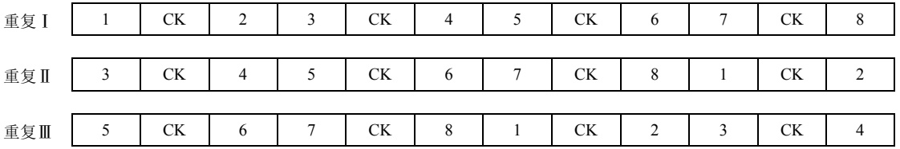
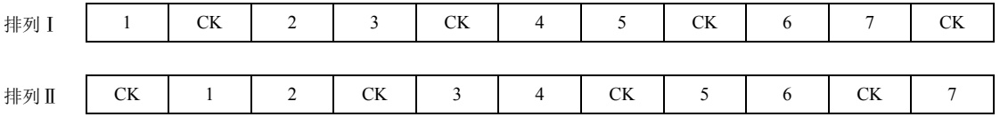
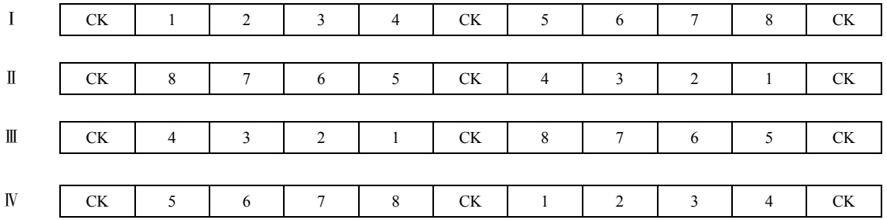
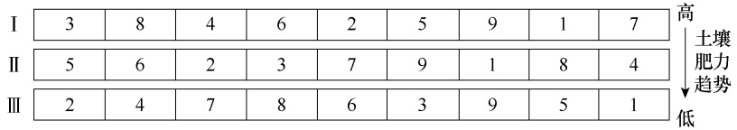
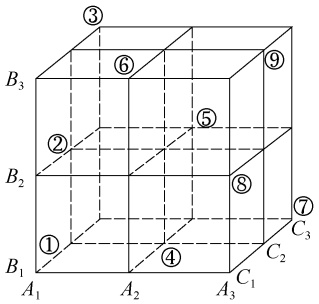
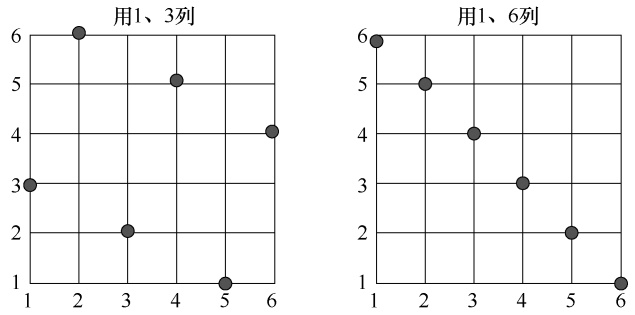

# 第10章试验设计及其统计分析

原始 PDF 第 238–289 页。

第 10 章

# 试验设计及其统计分析

## 本章提要

试验设计及其统计分析是生物统计学的重要内容之一，在生物学研究中发挥着重要的工具作用。本章主要讨论:

• 试验设计主要类型及其特点；
• 重点介绍对比设计、随机区组设计、拉丁方设计、裂区设计、交叉设计、正交设计、均匀设计等常用试验设计和统计分析方法。

第 2 章在阐述数据来源时，初步介绍了试验的概念与基本要求、试验设计的基本要素、试验误差及其控制途径、试验设计必须遵循的基本原则，以及如何制订试验方案。本章在简述试验设计主要类型、概念和特点的基础上，通过案例重点介绍常用试验设计及其统计分析方法。

## 第一节 试验设计的类型

在第 2 章，我们已经知道试验设计包含受试对象、试验因素和处理效应三个要素。开展试验设计，就是围绕这三个要素进行合理、有效的因素、水平设置及科学组合，并根据试验条件合理布局和安排的过程。一个科学、有效的试验设计一般要达到三个要求:一是试验误差小、试验精度高、试验数据的可靠性强；二是设计效率高，用较少的人力、物力、财力和时间获得较多而可靠的数据信息；三是便于开展统计分析，尽可能多地挖掘试验数据的有效信息，从而进行正确的推断。

根据试验的研究目的不同，研究者要选用合理的试验设计和数据统计分析方法。生物学研究中，试验设计的类型较多，也有不同的分类方法。根据试验处理因素数量，试验设计可分为单因素设计、二因素设计和多因素设计。根据试验中处理是否全部实施，可分为完全实施试验设计和部分实施试验设计。按照具体的试验设计方法，有对比设计、完全随机设计、随机区组设计、拉丁方设计、裂区设计、交叉设计、析因设计、正交设计、均匀设计等。

## 一、对比设计

对比设计（comparison design）是一种最简单的试验设计方法，常适用于单因素试验，是设置一个或几个试验组与多个对照组进行比较，试验组常按顺序排列。为降低试验误差，常常通过增加重复数来提高试验的精确度。

---

第 10 章 试验设计及其统计分析

·227·

对比设计一般需要安排对照（control），用 CK 表示，作为各处理比较的标准。对照的类型包括空白对照、标准对照、自身对照和试验对照等。医学试验中常用安慰剂作为对照，用盲法（单盲法和双盲法）进行对比试验。

对比设计包括邻比设计、间比设计和配对设计等类型。邻比设计（neighbor comparison design）是每一个处理均直接排列于对照旁边，使每个处理都能与相邻的对照进行比较，能充分反映出处理的效应。

对比设计中，如果试验处理数过多，可采用对照小区相对较少的间比设计（interphase comparison design），即在每个重复的各处理排列中，位于第一小区和末尾小区一定是 CK 区，中间每隔相同数目的若干处理小区（通常是 4～9 个）设置一个 CK 区。与邻比设计相比，间比设计的每个处理不一定与 CK 相邻。

配对设计（paried design）是将受试对象按配对条件配成对子，使同一对中的受试对象条件相同或相近；再将各对中的两个受试对象随机分配到试验组和对照组（或两个不同处理组）接受不同的处理。例如，将年龄、体重、遗传基础较为一致的动物配成对子，再随机分配每对中的两个受试对象接受不同试验处理；半叶法测定植物叶片的光合速率；观察每一位受试对象药物试验前后某种生理指标的变化，都是配对设计。

## 二、完全随机设计

完全随机设计（completely random design）是将受试对象按随机化原则分配到不同的处理组中。在完全随机设计中，试验中每个处理的所有重复随机地分配到试验单元中，即每个处理占有每个试验单元的机会是相等的。

完全随机设计中，通常不考虑个体差异的影响。假定一项研究中，处理数为 8（i=1，2，…，8）、重复数为 3（j=1，2，3），则有 24 个（i，j）组合，需要 24 个受试对象。这 24个（i，j）组合随机排列，即完全随机设计。完全随机设计中，各处理的重复数可以相同也可以不同。但在总体样本含量相同的情况下，各处理组重复数相等时效率最高。

二因素及多因素试验也可以采用完全随机设计。以二因素为例，假设因素 A 有 a 个水平，B 有 b 个水平，则研究中有 ab 个处理，如果重复数为 n，则需要有 abn 个受试对象。这 abn个受试对象随机排列，即可得到 abn 个观测值。

完全随机设计保证每个受试对象都有相同机会接受任何一种处理，而不受试验人员主观倾向的影响。受试对象的初始条件比较一致时，可采用完全随机设计。这种设计应用了试验设计的重复和随机化两个原则，因此能使试验结果受非处理因素的影响基本一致，真实反映出试验的处理效应。但由于没有体现局部控制原则，完全随机设计要求其在尽可能一致的试验条件下进行试验。

完全随机设计的数据，常采用方差分析的方法，分析单因素的处理效应、二因素及多因素的主效和互作效应。第 7 章介绍的方差分析就是基于完全随机设计的。

完全随机设计具有突出的优点:一是设计容易，处理数与重复数都不受限制，适用于试验条件、环境、受试对象差异较小的试验；二是统计分析简单，无论所获得的试验数据各处理重复数相同与否，都可采用 t 检验或方差分析法进行统计分析。完全随机设计也有明显的缺点:由于未应用局部控制原则，非试验因素的影响被归入试验误差，因而试验误

---

·228·

生物统计学

差较大，试验的精确性较低。因此，在试验条件、环境、受试对象差异较大时，不宜采用此种设计方法。

## 三、随机区组设计

完全随机设计要求在试验过程中，除试验处理不同之外，其余非试验因素（环境条件）应尽可能相同。由于客观条件的限制，试验的环境不可能完全相同时，如果采用完全随机设计，可能使得不同试验处理所占有的环境条件不同，试验处理之间的可比性大大降低，增大试验误差，试验结果的准确性下降。例如，田间试验中土壤变化会出现肥力不一致，较大空间试验的光照与温度条件会出现控制不一样等情况，这就需要通过随机区组设计来“清除”这种人为不易控制的非试验条件的不一致性。

随机区组设计（randomized block design）是根据非试验因素将试验环境划分成若干个区组，使得每个区组内的差异尽可能小；然后将每个区组划分成若干小区，将处理随机安排在小区内。在该设计的区组安排中，区组的划分应使区组内非试验因素差异最小而区组间非试验因素差异最大，将可控的非试验因素及条件相同或相近的受试对象安排在同一区组。

随机区组设计按试验因素多少可分为单因素随机区组设计、二因素随机区组设计和多因素随机区组设计等；按实施程度可分为随机完全区组设计和随机不完全区组设计。

随机完全区组设计（randomized complete block design）是指根据局部控制的原则将整个试验划分为若干区组，在同一区组内每个处理均出现，且各处理在区组内随机排列。例如，有 A、B 两个因素，水平数各为 a 和 b，其全部处理就是 ab 个水平组合数，将所有 ab 个处理全部安排在同一区组内的设计就是二因素完全随机区组设计。

随机不完全区组设计（randomized incomplete block design）是将整个试验划分为若干区组，每个区组只包括参加试验的部分处理，每个区组内处理的排列次序是随机的。随机不完全区组设计有多种方法，平衡不完全区组设计是其中的一种。平衡不完全区组设计（balanced incomplete block design，BIB）是指将 ν 个处理安排于 b 个区组的一种试验设计方法。该设计中包括以下参数:①k，区组的大小，指每个区组包含 k 个不同处理；②γ，处理的重复数，指每个处理在 γ 个不同的区组中出现；③λ，相遇数，指任何一对处理在 λ 个不同的区组中相遇。平衡不完全区组设计的参数满足下列条件: $\textcircled{i} b k = v \gamma ; \quad \textcircled{2} \gamma ( k - 1 ) = \lambda ( v - 1 )$ ③b≥v 或者 $\gamma { \geq } k _ { \circ }$ 。当 $k = v, \lambda = \gamma = b$ 时，即随机完全区组设计。

随机区组设计体现了试验设计重复、随机和局部控制三原则，可以将区组间的变异（区组效应）从试验误差中分离出来，从而有效降低试验误差，获得较高的试验精确性。同时，该设计把条件近乎一致的受试对象分在同一区组，再将同一区组的受试对象随机分配到不同处理组内，加大了处理之间的可比性。与拉丁方设计、裂区设计相比，虽然都考虑了处理因素与区组因素，但随机区组设计方法更简单易行。在实际应用随机区组设计时，处理数以≤20为宜。如果处理数目过多，区组的规模必然增大，区组内的误差也会相应增大，这样局部控制的效率就会降低。但在随机区组设计中，处理或处理组合也不能太少，如果太少，误差项自由度若太小，误差就会相应增大，也会降低假设检验的灵敏度。

---

第 10 章 试验设计及其统计分析

·229·

## 四、拉丁方设计

随机区组设计通过局部控制原则可以控制并分解非试验条件单向不一致的区组效应。但如果出现非试验条件的双向不一致变异，就需要采用具有双向区组控制功能的拉丁方设计。

拉丁方（Latin square）一词最早是由英国统计学家 R. A. Fisher 提出的。其含义为，将 k个不同符号排成一个 k 阶方阵，使每一个符号在每一行、每一列都仅出现一次，这个方阵称为 k×k 拉丁方。拉丁方设计（Latin square design）就是在行和列两个方向上都进行局部控制，每一行区组、每一列区组均包含一套完全的处理，是比随机区组设计多一个区组的设计。

进行拉丁方设计，首先需要根据试验的处理数 k 选择一个 k×k 的标准方，然后进行列随机、行随机和处理随机排列。在进行拉丁方试验数据的统计分析中，可以从总试验效应中分解出行效应、列效应和处理效应，当处理效应差异显著时，对处理进行多重比较。

拉丁方设计的特点是处理数、重复数、行数、列数都相等。当行间、列间皆有明显差异时，其行、列两个区组的变异均可以从试验误差中分解出来。因此在控制试验误差、提高试验精确度方面，应用拉丁方设计比随机区组设计更为有效。Cochran 经过 8 年的田间试验表明，拉丁方试验的误差方差约为随机区组试验的 73%。但拉丁方设计需保持行、列、处理数三者相等，如正方形的试验空间，缺乏伸缩性。因此，试验处理数一般不能太多，以 5～10个为宜，且在对试验精确度有较高要求时使用。处理数大于 10 个，试验庞大，很难实施；处理数≤4，误差项自由度不足。为了较精确地估计试验误差和检验处理效应，拉丁方试验设计要求误差自由度不小于 12，最好大于 20。

如果处理因素不是一个而是多个，但供试单元不能增加，可以在拉丁方的基础上以不增加试验次数为前提引进另一因素，通过希腊拉丁方设计来解决问题。希腊拉丁方设计（Greek-Latin square design）也称为正交拉丁方设计（orthogonal Latin square design），是在一个用拉丁字母表示的 k×k 拉丁方上，再整合一个用希腊字母表示的 k×k 拉丁方，并使每个希腊字母和拉丁字母都共同出现一次，且仅共同出现一次。

希腊拉丁方设计可容纳 4 个因素，即行、列、希腊字母、拉丁字母所代表的因素。每个因素都有 k 个水平，进行 k2次试验。这 4 个因素中常只有一个代表需要检验的处理效应，其他均为希望排除的非试验因素的影响。因此，采用此设计可控制三种非试验因素的变异性。希腊拉丁方设计可以节省试验次数，但在应用时要求各因素水平数相同且无交互作用。

## 五、裂区设计

在试验处理组合数较多，而不同试验因素重要性不一样或因素可控性存在差异等特殊条件下，可采用裂区设计。根据试验要求和目的不同，将试验空间因素按不同要求分成主区因素（主因素）和副区因素（副因素），并根据主、副区的不同，将试验因素分别安排在主、副区。

裂区设计（split plot design）是在一个区组上，先按一个因素（主因素或主处理）的水平数划分主区，用于安排主因素；在主区内再按第二个因素（副因素或副处理）的水平数划分副区，安排副因素。这种设计是将主区（main plot）分裂成副区，所以称为裂区设计。主区内的小区称副区（secondary plot）或裂区（split plot），对第二个因素来讲，主区就是一个完

---

·230·

生物统计学

全区组；但是从整个试验所有处理组合来讲，主区又是一个不完全区组。

裂区设计是将主处理设在主区，副处理设于主区内的副区，副区之间比主区之间的试验空间更为接近。因此进行统计分析时，可分别估算主区与副区的试验误差，而后者常小于前者，即副处理比主处理试验精度高。

裂区设计通常在下列情况下应用:①一个因素的各处理比另一个因素的各处理需要更大区域时，为了实施和管理上的方便而应用裂区设计。需要较大区域的因素宜作为主处理，设在主区，而另一个需要区域较小的因素可设置于副区。②试验中某一个因素的主效比另一个因素的主效更为重要，而且要求进行更精确的比较，或两个因素的交互作用比其主效更为重要时，宜采用裂区设计，将要求精度较高的因素作为副处理，另一个因素作为主处理。③根据以往的研究，知道某一个因素的效应比另一个因素的效应更大时也可采用裂区设计，将可能表现较大差异的因素作为主处理。④试验设计需临时改动再加入一个试验因素时，可在原试验设计中的小区（主区）中再划分若干个小区（副区），增加一个试验因素，这样就成了裂区设计。当然，一般情况下我们还是要强调事先的周密设计，这种临时再改变设计方案的做法只是一种在可能情况下的补救措施。

## 六、交叉设计

如果研究中需要考虑的因素（以 A 表示）有 2 个水平（以 $A _ { 1 }$ 和 $A _ { 2 }$ 表示），同时要求这 2个水平要先后作用于每一个受试对象，此时，受试对象和处理顺序成为 2 个重要的非试验因素，可以考虑用 2×2 交叉设计。

2×2 交叉设计（cross-over design）是让全部受试对象中的一半接受处理的顺序为“先$A _ { 1 }$ 后 ${A_{2}}^{\prime \prime}$ ，另一半接受处理的顺序为“先 $A _ { 2 }$ 后 ${A_{1}}^{\mathrm{\tiny{~ 另 ~}}}$ ，从而使 ${ } ^ { \circ }   A _ { 1 }$ 和 $A _ { 2 }$ 处理”在两组受试者中施加的先后顺序是“交叉”的，故称为“成组交叉设计”。另外，也可以将全部受试对象按照某些重要的非试验因素配成 n 对，用随机的方法决定每对中的一个接受“先 $A _ { 1 }$ 后 ${A_{2}}^{\prime \prime}$ 的顺序，另一个接受处理的顺序为“先 $A _ { 2 }$ 后 $\text{∠ }A_{1} 丿$ ，这称为“配对交叉设计”。2×2 交叉设计是在自身配对设计基础上发展起来的，该设计考虑了 1 个处理因素（两个水平），2 个与处理因素无交互作用的非处理因素（试验阶段和受试对象）对试验结果的影响。虽然只有 1 个处理因素，但由于控制了试验阶段和受试对象差异的影响，也可认为是 3 因素（处理因素、试验阶段、受试对象）的试验设计。

交叉设计是医学试验常用的特殊自身对照设计，将自身比较与组间设计思路综合，使每个受试者随机在两个或多个试验阶段分别接受指定的处理。交叉设计具有配对设计的优点，可减少个体间差异，减少样本容量，又能平衡试验顺序对结果的影响；同时，能控制时间因素（试验阶段）对处理因素的影响，优于自身对照设计，因而试验效率较高。交叉设计中，各受试对象均接受试验因素所设计的处理，符合医德要求。但是，由于两种处理先后作用于同一受试对象，交叉设计仅限于处理的效应在短时间就能消失的研究，否则易造成两种处理的效应混杂。因此，对于同一受试对象先后接受不同处理之间要有一定的“空白”时间，此时间长短因具体情况而定。如果是药物使用时间较长，且受试对象观测指标的数值难以恢复到原先的水平时，应慎重使用。交叉设计中两次观察时间不能过长，处理不能有持久效应，而且不能分析交互作用。为消除患者的心理作用或防止研究者暗示，多采用盲法进行交叉设计。

---

第 10 章 试验设计及其统计分析

·231·

## 七、析因设计

析因设计（factorial design）是一种多因素的交叉分组设计，探求多因素（两个或两个以上）的主效应和因素间的交互效应。

析因设计以完全随机设计、随机区组设计和拉丁方设计为基础，有完全随机析因设计、随机区组析因设计、裂区析因设计、混杂析因设计、部分析因设计等种类。研究中如果考虑 $k(k \geqslant 2)$个因素同时施加于受试对象（因素施加没有先后顺序之分）且对观测指标的影响地位相等，涉及全部试验因素各水平的全面组合，该设计就称为 k 因素析因设计或全因子设计。

析因设计不仅可检验每个因素各水平间的差异，而且可检验各因素间的交互作用。两个或多个因素如存在交互作用，表示各因素不是各自独立的，而是一个因素的水平有改变时，另一个或几个因素的效应也相应有所改变；反之，如不存在交互作用，表示各因素具有独立性，一个因素的水平有所改变时不影响其他因素的效应。例如，A、B 两种治疗高血压的新药，即 A、B 两个因素，每个因素各有两个水平（不使用与使用， $A_{1} 、 A_{2} 、 B_{1} 、 B_{2})$ ），交叉可形成 4 个处理组。将每个因素的所有水平都互相交叉形成处理组，属全组合试验。可用于研究 A、B 两个因素内部不同水平间有无差异，以及 A、B 因素间是否存在交互作用 $( A   \times   B )$

析因设计要求各处理组间在均衡性方面的要求与随机设计一致，各处理组样本含量应尽可能相同，且析因设计包含了各因素不同水平的全部组合试验，因而具有均衡性和全面性。它的最大优点是所获得的信息量很多，可以准确地估计各因素的主效应及各因素间的交互作用，通过各因素各水平组合的比较找出最佳组合。其最大的缺点是所需要的试验次数多，因此耗费的人力、物力和时间也较多，当所考察的试验因素和水平较多时，研究者很难承受。

## 八、正交设计

在多因素试验中，随着试验因素和水平数的增加，处理组合数急剧增加。要全面实施这么庞大的试验是相当困难的。因而，D. J. Finney 倡议了部分试验法。而后日本学者田口玄一倡导利用正交表设计部分试验，称为正交试验。

正交设计（orthogonal design）是利用正交表（orthogonal table），在全部试验处理组合中，挑选部分有代表性的水平组合（处理组合）进行试验。通过部分实施了解全面试验情况，从中找出较优的处理组合。这样可以大大节省人、财、物和时间，使一些难以实施的多因素试验得以实施。

正交表是按正交性排列好的用于安排多因素试验的表格，是正交设计的基本工具。正交表常以 $L _ { n } \; ( m ^ { k } )$ 表示，L 表示正交表，L 右下角的 n 表示正交表的行数，也就是试验的次数；括号内 m 表示因素的水平数，m 右上方指数 k 表示正交表的列数，是最多可以安排因素（包括互作）的个数。

在正交设计中，安排试验、分析结果均在正交表上进行。常用的正交表，已由数学工作者制订出来（附表 15），试验时只要根据试验条件直接套用就行了，不需要另行编制。例如，要进行一个 4 因素 3 水平的多因素试验，如果全面实施则需要 $3 ^ { 4 } { = } 8 1$ 个处理组合，在试验中因规模太大而难以实施。但是，如果采用一张 $L _ { 9 } ~ ( 3 ^ { 4 } )$ 的正交表安排试验，则只要 9 个处理组合就够了。

---

·232·

生物统计学

正交表的列之间具有正交性，正交性具体表现在两个方面:①均匀分散性，即正交表的每一列中，不同数字（各种水平）出现的次数相等。例如， $L _ { 9 } ~ ( 3 ^ { 4 } )$ 中，每一列中，有 1、2、3 三个不同数字，它们在每列中各出现 3 次；②整齐可比性，即正交表任意两列中，“有序数对”出现次数相等。

正交表有等水平正交表和混合正交表两种类型。等水平正交表是指试验因素均相等的正交表，如 $L_{4} (2^{3}) 、 L_{8} (2^{7}) 、 L_{9} (3^{4}) 、 L_{25} (5^{6})$ ）。混合正交表是在试验因素的水平不相同时使用的正交表，其代号为 $L_{n} \left( m_{1}^{k_{1}} \times m_{2}^{k_{2}} \right)$ ），表示正交表有 n 行，有 $k _ { 1 }$ 列 $m _ { 1 }$ 水平和 $k _ { 2 }$ 列 $m _ { 2 }$ 水平。例如， $L_{18} (6 \times 3^6)$ ）表示有 1 列 6 水平和 6 列 3 水平一共 18 行的正交表。

## 九、均匀设计

均匀设计（uniform design）是在正交设计的基础上，不考虑试验数据的整齐可比性，只考虑让数据点在试验范围内均匀分散，将试验实施的次数减少至比正交试验设计更少。它由我国著名数学家方开泰教授和王元教授在 1978 年共同提出，是数论方法中的“伪蒙特卡罗方法”的一个应用。这种单纯地从数据点分布均匀性出发的试验设计方法，称为均匀设计。

对于均匀设计来说，每个因素的每个水平仅做一次试验，因而试验次数与最高水平数相等，当水平数增加时，试验数仅随水平数的增加而增加。例如，某因素的水平数为 8，采用正交设计，至少需要 64 次试验；采用均匀设计，则仅需要 8 次试验，而试验效果基本相同。再如，5 因素 31 水平试验，正交设计需做 961 次试验，采用均匀设计只需做 31 次试验，其效果基本相同。均匀设计的最大特点是试验次数等于因素的最大水平数，而不是平方的关系。

均匀设计和正交设计相似，也是通过一套精心设计的均匀设计表来进行试验设计安排的。均匀设计表（uniform design table）是根据数论在多维数值积分中的应用原理构造而成的，以 $U _ { n } ~ ( q ^ { s } )$ 或 $U _ { n } ^ { * } \; ( q ^ { s } )$ 表示（附表 16）。其中， $\text{" }U \text{" }$ 表示均匀设计， $\text{" }n "$ 表示要做 n 次试验，${ } ^ { \mathrm { ~  ~ } } q ^ { \mathrm { ~  ~ } }$ 表示每个因素有 q 个水平， $^ { \mathfrak { a } } { \mathcal { S } } ^ { \flat }$ 表示该表有 s 列。U 的右上角加“\*”和不加“\*”代表两种不同类型的均匀设计表。通常加“\*”的均匀设计表有更好的均匀性，应优先选用。当试验数 n 给定时，通常 $U _ { n }$ 表比 $U _ { n }$ \*表能安排更多的因素。故当试验因素数较多，且超过 $U _ { n } ^ { \mathrm { ~   ~ } ^ { 1 } }$ 的使用范围时可使用 $U _ { n }$ 表。例如， $U _ { 7 } ~ ( 7 ^ { 4 } )$ ）表示要做 7 次试验，每个因素有 7 个水平，该表有4 列，可安排 4 个因素。

均匀设计表和正交表一样，也有等水平和不等水平两种。每个均匀设计表均有一个附加的使用表（附表 16），它指示我们如何从设计表中选用适当的列，以及由这些列所组成的试验方案的均匀度，表中的偏差（discrepancy，D）表示均匀设计表的均匀度。偏差值越小，表示均匀度越好。

当试验中拟考察的因素很多，因素的水平也较多时，即使采用正交设计，仍感到试验次数太多，此时可以考虑选用均匀设计。均匀设计主要适用于原因变量取值范围大、水平多（一般不少于 5）的场合。对于研究问题为定量因素且各因素及其交互作用的重要性一概不知的大规模试验研究，可通过均匀设计进行因素筛选。当因素和水平的数目缩小后，可以再改用正交设计或析因设计进行详细的试验研究。

---

第 10 章 试验设计及其统计分析

·233·

## 第二节 对比设计及其统计分析

## 一、邻比设计及其统计分析

在田间试验中，邻比法排列的特点是每一个处理均直接排列于对照旁边，使每个处理都能与相邻的对照进行比较，能充分反映出处理的效应。具体进行小区排列时，同一个重复内各处理小区顺序排列；每一个重复内的第一个小区应安排为处理区，第二个小区安排为对照区，以后每隔两个处理小区设置一个对照区，同时必须使每一个重复的最后一个处理区的一侧有对照区；不同重复间常采用阶梯式排列。设置重复时，要注意不同重复间的相同处理不要排列在同一平面试验场所的一条直线上，可采用阶梯式或逆向式排列。

例如，有一小麦品种的田间比较试验，对照品种以 CK 表示，参试的 8 个小麦品种以阿拉伯数字（1、2、3、4、5、6、7、8）表示。采用邻比设计，3 次重复，可以采用图 10-1 的方法进行田间排列。

flowchart

This image displays a structured data structure or memory layout diagram, showing the bit positions (1-8) of three different operations: Repeat I, Repeat II, and Repeat III.

图 10-1 处理数为 8 的邻比法排列示意图

Ⅰ、Ⅱ、Ⅲ代表重复；1、2、…、8 代表处理；CK 为对照

由图 10-1 可以看出，在邻比设计中，由于处理区与对照区相连接，土壤、气候等环境条件相近，二者相比较时，容易反映出处理与对照之间的真实差异，即使减少重复也能达到应有的精确度。

邻比设计中，如果处理数为偶数，如图 10-1 所示（处理数为 8），每一个重复内的第一个小区常安排为处理区，第二个小区安排为 CK，以后每隔两个处理小区设立一个 CK 区，同时必须使最后一个处理区的一侧有 CK 区，这种排列法可以节省一个对照小区；如果处理数为奇数（图 10-2），在小区排列时，每一个重复开头，无论先排处理区（排列方式Ⅰ）还是先排 CK 区（排列方式Ⅱ），其 CK 小区数均是相同的。图 10-2 是处理数为 7 的邻比法排列示意图。

text_image

排列Ⅰ
1	CK	2	3	CK	4	5	CK	6	7	CK
排列Ⅱ
CK	1	2	CK	3	4	CK	5	6	CK	7

图 10-2 处理数为 7 的邻比法排列示意图

Ⅰ、Ⅱ代表重复；1、2、…、7 代表处理；CK 为对照

邻比设计的优点是简单易行，便于观察比较；缺点是对照小区太多，一般要占试验地空间面积的 1/3。因此，采用邻比设计通常要求处理数为 10 以内，或者进行简单对比试验时可采用此法。

---

·234·

生物统计学

例 **10-1** 某育种站进行水稻品系比较试验，参试 6 个品系，另外设一个对照品种（CK），采用邻比法设计，重复 3 次，田间小区分布如图 10-3 所示。水稻成熟后，进行小区产量（kg/6m2）测定，结果列于图 10-3 各小区内。试分析品种间的产量差异。

| I | 1 (19) | CK (18) | 2 (18) | 3 (14) | CK (15) | 4 (17) | 5 (18) | CK (16) | 6 (17) |
| --- | --- | --- | --- | --- | --- | --- | --- | --- | --- |
| II | 3 (15) | CK (16) | 4 (18) | 5 (17) | CK (15) | 6 (16) | 1 (16) | CK (17) | 2 (18) |
| III | 5 (18) | CK (17) | 6 (17) | 1 (19) | CK (16) | 2 (17) | 3 (16) | CK (16) | 4 (17) |

图 10-3 6 个水稻品系邻比设计田间分布图及各小区产量（kg/6m2）

此例为单因素试验，参试的 6 个品系可以看作 6 个处理。由于邻比设计中各小区处理为顺序排列，未体现试验设计的随机原则，不能正确地估计出无偏的试验误差，其试验结果不能采用方差分析的方法进行显著性检验，其数据分析常采用百分数法。

（1）将各品系在不同重复中的小区产量相加，得到各品系及相邻 CK 产量总和 $T _ { i }$ 及平均数 ${ \overline { { x } } } _ { i }   ,$ 。
（2）计算各品系的相对生产力（relative productive power），即该品系产量对邻近 CK 产量的百分数。

$$
\text{对相邻CK的百分数} = \frac {\text {某处理总和}}{\text {邻近CK总和}} \times 100 \% = \frac {\text {某处理平均值}}{\text {邻近CK平均值}} \times 100 \% \tag{10 - 1}
$$

例如，品系 1 对邻近 CK 的百分数 $\frac{54}{51} \times 100\% = 105.88\%$ ，其余品系皆类推，计算结果列于表 10-1。

表 10-1 水稻品系比较试验（邻比法）产量分析表

<table><tr><td rowspan="2">品系</td><td colspan="3">各重复小区产量(kg/6 $m^2$ )</td><td rowspan="2"> $T_i$ </td><td rowspan="2"> $\bar{x}_i$ </td><td rowspan="2">对邻近CK的百分数(%)</td></tr><tr><td>I</td><td>II</td><td>III</td></tr><tr><td>1</td><td>19</td><td>16</td><td>19</td><td>54</td><td>18.00</td><td>105.88</td></tr><tr><td> $CK_1$ </td><td>18</td><td>17</td><td>16</td><td>51</td><td>17.00</td><td>100.00</td></tr><tr><td>2</td><td>18</td><td>18</td><td>17</td><td>53</td><td>17.67</td><td>103.92</td></tr><tr><td>3</td><td>14</td><td>15</td><td>16</td><td>45</td><td>15.00</td><td>95.74</td></tr><tr><td> $CK_2$ </td><td>15</td><td>16</td><td>16</td><td>47</td><td>15.67</td><td>100.00</td></tr><tr><td>4</td><td>17</td><td>18</td><td>17</td><td>52</td><td>17.33</td><td>110.64</td></tr><tr><td>5</td><td>18</td><td>17</td><td>18</td><td>53</td><td>17.67</td><td>110.42</td></tr><tr><td> $CK_3$ </td><td>16</td><td>15</td><td>17</td><td>48</td><td>16.00</td><td>100.00</td></tr><tr><td>6</td><td>17</td><td>16</td><td>17</td><td>50</td><td>16.67</td><td>104.17</td></tr></table>

（3）进行推断:对产量数据而言，对邻近 CK 的百分数（相对生产力）如果大于 100%，其百分数越高，就越可能优于对照品种。但也不能认为超过 100% 的所有品种都是显著优于对照的，这是因为将品种与相邻 CK 相比只是减少了误差，而实际上误差仍然存在。一般试

---

第 10 章 试验设计及其统计分析

·235·

验很难察觉处理间差异在 5% 以下的显著性，因此，对于对比设计的试验结果，要判断某品种生产力的好坏，其相对生产力一般至少应超过 CK 10%。相对生产力仅超过对照 CK 5%左右的品种，均需要继续试验再进行推断。当然，由于不同试验的误差大小不同，上述标准仅供参考。

本例中，品系 4、品系 5 的产量超过 CK 10%以上，可以认为它们确实优于对照；品系 1超过 CK 5.88%，尚需进一步试验验证。

## 二、间比设计及其统计分析

对比设计中，如果试验处理数过多，可采用对照小区数相对较少的间比设计。间比设计是在一个重复内排列的第一小区和末尾小区一定是 CK 区，中间每隔相同数目的若干处理小区（通常是 4～9 个）设置一个 CK 区；通常设置重复 2～4 个，每个重复可排成一排或多排。当重复排成多排时，多采用逆向式排列。

图 10-4 为 8 个处理、重复 4 次的间比法排列示意图。与邻比设计相比，间比设计试验结果的精度不够高，但在一个试验中可以包括较多的处理。

text_image

I CK 1 2 3 4 CK 5 6 7 8 CK
II CK 8 7 6 5 CK 4 3 2 1 CK
III CK 4 3 2 1 CK 8 7 6 5 CK
IV CK 5 6 7 8 CK 1 2 3 4 CK

图 10-4 处理数为 8 的间比法排列示意图

Ⅰ、Ⅱ、Ⅲ、Ⅳ代表重复；1、2、…、8 代表处理；CK 为对照

与邻比设计一样，间比设计中各小区处理也是顺序排列，不能正确地估计试验误差，其试验结果的统计分析一般也采用百分数法。

例 **10-2** 有 8 个双孢菇品系的鉴定试验，另加一标准品种 CK，采用间比设计，4 次重复，小区计产面积 $2 \mathrm { m } ^ { 2 }$ ，每隔 4 个品系设一个 CK，其菇床排列如图 10-4 如示。所得小区产量（kg）整理后列于表 10-2，试进行双孢菇小区产量的统计分析。

表 10-2 双孢菇品系鉴定试验（间比法）产量分析表

<table><tr><td rowspan="2">品系</td><td colspan="4">各重复小区产量(kg/2 $m^2$ )</td><td rowspan="2"> $T_i$ </td><td rowspan="2"> $\overline{x}_i$ </td><td rowspan="2"> $\overline{CK}$ </td><td rowspan="2">对 $\overline{CK}$ (%)</td><td rowspan="2">排序</td></tr><tr><td>I</td><td>II</td><td>III</td><td>IV</td></tr><tr><td> $CK_1$ </td><td>25.3</td><td>24.9</td><td>24.4</td><td>27.0</td><td>101.6</td><td>25.40</td><td></td><td></td><td></td></tr><tr><td>1</td><td>24.3</td><td>25.0</td><td>25.4</td><td>25.1</td><td>99.8</td><td>24.95</td><td>24.0</td><td>103.96</td><td>4</td></tr><tr><td>2</td><td>26.2</td><td>26.1</td><td>26.8</td><td>26.3</td><td>105.4</td><td>26.35</td><td>24.0</td><td>109.79</td><td>2</td></tr><tr><td>3</td><td>22.1</td><td>21.0</td><td>22.5</td><td>22.2</td><td>87.8</td><td>21.95</td><td>24.0</td><td>91.46</td><td>7</td></tr><tr><td>4</td><td>24.7</td><td>24.3</td><td>21.6</td><td>23.6</td><td>94.2</td><td>23.55</td><td>24.0</td><td>98.13</td><td>5</td></tr></table>

---

·236·

生物统计学

续表

<table><tr><td rowspan="2">品系</td><td colspan="4">各重复小区产量(kg/2 $m^2$ )</td><td rowspan="2"> $T_i$ </td><td rowspan="2"> $\overline{x}_i$ </td><td rowspan="2"> $\overline{CK}$ </td><td rowspan="2">对 $\overline{CK}$ (%)</td><td rowspan="2">排序</td></tr><tr><td>I</td><td>II</td><td>III</td><td>IV</td></tr><tr><td> $CK_2$ </td><td>23.6</td><td>22.3</td><td>21.4</td><td>23.1</td><td>90.4</td><td>22.60</td><td></td><td></td><td></td></tr><tr><td>5</td><td>26.6</td><td>22.7</td><td>25.7</td><td>25.2</td><td>100.2</td><td>25.05</td><td>23.1</td><td>108.44</td><td>3</td></tr><tr><td>6</td><td>20.0</td><td>21.2</td><td>21.0</td><td>20.2</td><td>82.4</td><td>20.60</td><td>23.1</td><td>89.18</td><td>8</td></tr><tr><td>7</td><td>25.9</td><td>25.8</td><td>26.0</td><td>27.9</td><td>105.6</td><td>26.40</td><td>23.1</td><td>114.29</td><td>1</td></tr><tr><td>8</td><td>24.3</td><td>22.5</td><td>21.1</td><td>22.7</td><td>90.6</td><td>22.65</td><td>23.1</td><td>98.05</td><td>6</td></tr><tr><td> $CK_3$ </td><td>24.8</td><td>24.4</td><td>22.6</td><td>22.6</td><td>94.4</td><td>23.60</td><td></td><td></td><td></td></tr></table>

根据表 10-2 试验数据，按照间比设计统计分析方法计算出各品系与对照比较的百分数。

首先，计算各品系及对照的总和 $T _ { i }$ 与平均数 $\overline { { x } } _ { i }$ 。

其次，计算各品系的理论对照标准 $\overline { { \mathrm { C K } } }$ 。理论对照标准 $\overline { { \mathrm { C K } } }$ 为前后两个对照产量的平均数，即品系 1、2、3、4 的理论对照标准:

$$
\overline {{\mathrm{CK}}} = \frac {1}{2} (\mathrm{CK} _ {1} + \mathrm{CK} _ {2}) = \frac {1}{2} (2 5. 4 0 + 2 2. 6 0) = 2 4. 0 0
$$

品系 5、6、7、8 的理论对照标准:

$$
\overline {{\mathrm{CK}}} = \frac {1}{2} (\mathrm{CK} _ {2} + \mathrm{CK} _ {3}) = \frac {1}{2} (2 2. 6 0 + 2 3. 6 0) = 2 3. 1 0
$$

第三，计算各品系的相对生产力，即各品系产量对其理论对照标准产量 $\overline { { \mathrm { C K } } }$ 的百分数。例如，品系 1 对理论对照标准 CK 的产量百分数为 $24.95/24.00 \times 100\% = 103.96\%$ 。类似地，可以计算出其他品系对理论对照标准 $\overline { { \mathrm { C K } } }$ 的产量百分数。

第四，进行排序。根据各品系对理论对照标准 $\overline { { \mathrm { C K } } }$ 的产量百分数，按从大到小顺序排序，依次为品系 7 为第 1 位，品系 2 为第 2 位，…，品系 6 为第 8 位。

最后，得出试验结论。相对生产力超过对照 $1 0 \%$ 的有 1 个品系，为品系 7，达到 14.29%；相对生产力超过对照 $5\% \sim 10\%$ 的有 3 个品系，分别为品系 2、品系 5 和品系 1。

## 三、配对设计及其统计分析

配对试验设计中，以影响研究结果的主要非研究因素作为配对条件，做到“对子间可不一致，对子内尽可能一致”。采用配对设计方法适用以下几种情形:①配对的两个受试对象分别接受两种不同的处理；②同一受试对象接受两种不同的处理；③同一受试对象处理前后的结果进行比较（自身配对）；④同一受试对象的两个部位给予不同的处理。例如，动物试验中以种属、品系、窝别、性别相同，年龄、体重相近进行配对；临床试验中以性别相同，年龄、职业、生活工作条件、病情等相同或相近进行配对。某些医学试验研究中的自身对照也可看作配对设计，如某指标治疗前后的比较（平行样本），同一受试对象不同部位、不同器官的比较，同一标本不同检测方法的比较。

配对试验设计方法简单，通过配对降低了非研究因素对试验指标的影响。由于同一对子内两个个体间的试验条件接近，而不同对子间的差异可通过统计处理进行计算，控制了试验误差，提高了试验的精确性。但配对试验设计仅适用于 2 个处理的试验，具有一定的局限性。

---

第 10 章 试验设计及其统计分析

·237·

配对试验设计，一般要求其差值为正态总体。如果是数值变量数据，常用分析方法为成对数据 t 检验、配对设计的 Wilcoxon 符号秩和检验；如果是分类变量数据，常用配对 $2   \times   2$ 列联表 $\chi ^ { 2 }$ 检验。以上分别在第 4 章、第 5 章、第 6 章做了介绍，此处不再赘述。

## 第三节 随机区组设计及其统计分析

随机区组设计是通过对存在单向变异的非试验条件设置区组、进行局部控制的试验设计方法，它能有效降低试验误差，提高试验精度。本节主要介绍单因素随机区组设计、二因素随机区组设计及其试验数据的统计分析。

## 一、单因素随机区组设计及其统计分析

## （一）单因素随机区组设计

单因素随机区组设计（randomized block design of one-factor）只考虑一个处理因素，将受试对象分成若干区组，每个区组内随机安排各个处理。

以田间试验为例，田间土壤常表现为邻近区域土壤肥力相近的特点，如果试验处理数或重复数较多，试验田面积相应增大，土壤差异也要随之增大。如果不同处理的各个重复小区进行完全随机安排，则由于土壤肥力差异增大，即使增加试验重复数，也不能最有效地降低误差。为了克服这种现象，研究中可将整块试验田按照与土壤肥力变化趋势垂直的方向设置与重复数相同的区组，每一个区组内再按处理数目划分成小区，一个小区安排一个处理。因此每一个区组内（同一个重复）的不同处理间土壤差异较小，不同区组（重复）间土壤差异较大，而区组间的差异则可以运用适当的统计方法予以分解，此时能影响试验误差的主要是区组内不同小区间非常小的土壤差异，从而有效减小试验误差，提高试验精度。随机区组设计排列如图 10-5 所示。

text_image

I 3 8 4 6 2 5 9 1 7
II 5 6 2 3 7 9 1 8 4
III 2 4 7 8 6 3 9 5 1
高
↓ 土壤肥力趋势
低

图 10-5 9 个处理 3 次重复随机区组试验排列示意图

Ⅰ、Ⅱ、Ⅲ表示区组；1、2、…、9 表示处理

随机区组设计在动物试验上也称为窝组设计（fossa design），这是因为同窝组动物来源相同，不同窝组动物差异较大，所以常以窝组为单位安排试验。在同一个窝组（区组）内各试验动物的安排是随机的。

对于完全区组来说，由于每个处理在每个区组内都做了一次试验，有几个区组，处理就做了几次试验，因此，处理的重复次数=区组数。

## （二）单因素随机区组试验数据的线性模型与统计分析

在单因素随机区组设计中，设试验有 k 个处理、n 个区组，整个试验共有 nk 个观测值，每一观测值 $x _ { i j }$ 的线性模型为

---

·238·

生物统计学

$$
x _ {i j} = \mu + \alpha_ {i} + \beta_ {j} + \varepsilon_ {i j} \tag {10-2}
$$

式中， $\mu$ 为总体平均值； $\alpha _ { i }$ 为处理效应 $(i = 1, 2, \cdots, k); \beta_{j}$ 为区组效应 $(j = 1, 2, \cdots, n)$ $\varepsilon _ { i j }$ 为随机误差，来自总体 $N \left( 0 , \sigma ^ { 2 } \right)$

根据式（10-2），对试验数据进行方差分析时，总平方和与总自由度均可分解为区组、处理和误差的相应部分，即

$$
\left\{ \begin{array}{l} \text {总平方和} S S _ {T} = S S _ {r} + S S _ {t} + S S _ {e} \\ \text {总自由度} d f _ {T} = d f _ {r} + d f _ {t} + d f _ {e} \end{array} \right. \tag {10-3}
$$

式中，T 为总和； $r$ 为区组；t 为处理；e 为随机误差。

各部分平方和计算如下:

$$
\left\{ \begin{array}{l} \text {矫正数} C = \frac {T ^ {2}}{n k} \\ \text {总平方和} S S _ {T} = \sum_ {i = 1} ^ {k} \sum_ {j = 1} ^ {n} \left(x _ {i j} - \bar {x}\right) ^ {2} = \sum_ {1} ^ {n k} x ^ {2} - C \\ \text {区组平方和} S S _ {r} = k \sum_ {j = 1} ^ {n} \left(\bar {x} _ {r} - \bar {x}\right) ^ {2} = \frac {\sum_ {j = 1} ^ {n} T _ {r} ^ {2}}{k} - C \\ \text {处理平方和} S S _ {t} = n \sum_ {i = 1} ^ {k} \left(\bar {x} _ {t} - \bar {x}\right) ^ {2} = \frac {\sum_ {i = 1} ^ {k} T _ {t} ^ {2}}{n} - C \\ \text {误差平方和} S S _ {e} = \sum_ {i = 1} ^ {k} \sum_ {j = 1} ^ {n} \left(x _ {i j} - \bar {x} _ {r} - \bar {x} _ {t} + \bar {x}\right) ^ {2} = S S _ {T} - S S _ {r} - S S _ {t} \end{array} \right. \tag {10-4}
$$

各部分自由度计算如下:

$$
\left\{ \begin{array}{l} \text {总自由度} d f _ {T} = n k - 1 \\ \text {区组自由度} d f _ {r} = n - 1 \\ \text {处理自由度} d f _ {t} = k - 1 \\ \text {误差自由度} d f _ {e} = d f _ {T} - d f _ {t} - d f _ {r} = (n - 1) (k - 1) \end{array} \right. \tag {10-5}
$$

例 **10-3** 有一个小麦品系比较试验，共有 8 个品种（以 A、B、C、D、E、F、G、H 作为品种代号，其中 A 为标准品种）。试验采用随机区组设计，设置 3 次重复，田间排列及小区计产 $\left(\mathrm{kg}/40\mathrm{m}^{2}\right)$ 结果如图 10-6 所示。试采用方差分析的方法对试验数据进行分析。

| 区组I | B10.8 | F10.1 | A10.9 | E11.8 | H9.3 | G10.0 | C11.1 | D9.1 |
| --- | --- | --- | --- | --- | --- | --- | --- | --- |
| 区组II | C12.5 | E13.9 | G11.5 | H10.4 | B12.3 | A9.1 | D10.7 | F10.6 |
| 区组III | A12.2 | C10.5 | E16.8 | G14.1 | D10.1 | H14.4 | F11.8 | B14.0 |

图 10-6 小麦品系比较试验田间排列和产量结果

---

第 10 章 试验设计及其统计分析

·239·

（1）原始资料的整理。将小区产量结果整理成区组和处理两向表（表 10-3），分别计算各处理总和 $T _ { t }$ 及平均数 $\overline { { x } } _ { t }$ 、各区组总和 $T _ { r }$ 和全试验总和 $T _ { \circ }$

表 10-3 小麦品系比较试验（随机区组设计）的产量结果 $\left( \mathrm{kg} / 40 \mathrm{m}^{2} \right)$

<table><tr><td rowspan="2">品种</td><td colspan="3">区组</td><td rowspan="2"> $T_t$ </td><td rowspan="2"> $\overline{x}_t$ </td></tr><tr><td>I</td><td>II</td><td>III</td></tr><tr><td>A</td><td>10.9</td><td>9.1</td><td>12.2</td><td>32.2</td><td>10.7</td></tr><tr><td>B</td><td>10.8</td><td>12.3</td><td>14.0</td><td>37.1</td><td>12.4</td></tr><tr><td>C</td><td>11.1</td><td>12.5</td><td>10.5</td><td>34.1</td><td>11.4</td></tr><tr><td>D</td><td>9.1</td><td>10.7</td><td>10.1</td><td>29.9</td><td>10.0</td></tr><tr><td>E</td><td>11.8</td><td>13.9</td><td>16.8</td><td>42.5</td><td>14.2</td></tr><tr><td>F</td><td>10.1</td><td>10.6</td><td>11.8</td><td>32.5</td><td>10.8</td></tr><tr><td>G</td><td>10.0</td><td>11.5</td><td>14.1</td><td>35.6</td><td>11.9</td></tr><tr><td>H</td><td>9.3</td><td>10.4</td><td>14.4</td><td>34.1</td><td>11.4</td></tr><tr><td> $T_r$ </td><td>83.1</td><td>91.0</td><td>103.9</td><td>T=278.0</td><td></td></tr></table>

（2）平方和分解。

$$
C = \frac {T ^ {2}}{n k} = \frac {2 7 8 . 0 ^ {2}}{3 \times 8} = 3 2 2 0. 1 7
$$

$$
S S _ {T} = \sum_ {1} ^ {n k} x ^ {2} - C = (1 0. 9 ^ {2} + 9. 1 ^ {2} + \dots + 1 4. 4 ^ {2}) - 3 2 2 0. 1 7 = 8 4. 6 1
$$

$$
S S _ {r} = \frac {\sum_ {1} ^ {n} T _ {r} ^ {2}}{k} - C = \frac {8 3 . 1 ^ {2} + 9 1 . 0 ^ {2} + 1 0 3 . 9 ^ {2}}{8} - 3 2 2 0. 1 7 = 2 7. 5 6
$$

$$
S S _ {t} = \frac {\sum_ {1} ^ {k} T _ {t} ^ {2}}{n} - C = \frac {3 2 . 2 ^ {2} + 3 7 . 1 ^ {2} + \cdots + 3 4 . 1 ^ {2}}{3} - 3 2 2 0. 1 7 = 3 4. 0 8
$$

$$
S S _ {e} = S S _ {T} - S S _ {r} - S S _ {t} = 8 4. 6 1 - 2 7. 5 6 - 3 4. 0 8 = 2 2. 9 7
$$

（3）自由度分解。

$$
d f _ {T} = n k - 1 = 3 \times 8 - 1 = 2 3
$$

$$
d f _ {r} = n - 1 = 3 - 1 = 2
$$

$$
d f _ {t} = k - 1 = 8 - 1 = 7
$$

$$
d f _ {e} = (n - 1) (k - 1) = (3 - 1) \times (8 - 1) = 1 4
$$

（4）列方差分析表进行 $F$ 检验。由表 10-4 可知，品种间的 $F$ 值达显著水平，区组间的 $F$值达极显著水平。

表 10-4 表 10-3 数据的方差分析

| 变异来源 | df | SS | $s^2$ | F | $F_{0.05}$ | $F_{0.01}$ |
| --- | --- | --- | --- | --- | --- | --- |
| 区组间 | 2 | 27.56 | 13.78 | 8.40** | 3.74 | 6.51 |
| 品种间 | 7 | 34.08 | 4.87 | 2.97* | 2.76 | 4.28 |
| 误差 | 14 | 22.97 | 1.64 |  |  |  |
| 总变异 | 23 | 84.61 |  |  |  |  |

---

·240·

生物统计学

随机区组试验中，设置区组和估算区组间变异的目的，是为了在判断试验因素对试验结果的影响中排除不同条件的干扰，提高试验精度。区组之间的差异有多大，试验者一般并不关心。本例中，区组间的 F 值极显著，说明本试验中区组作为局部控制手段，对减少误差是相当有效的。

（5）多重比较。本例中，区组间差异极显著，由于一般试验的目的不是研究区组效应，所以可不必进行区组间的多重比较。品种间差异显著，因试验设有对照（标准品种 A），故采用 LSD 法进行多重比较。

计算平均数差数标准误:

$$
s _ {\overline {{x}} _ {1} - \overline {{x}} _ {2}} = \sqrt {\frac {2 s _ {e} ^ {2}}{n}} = \sqrt {\frac {2 \times 1 . 6 4}{3}} = 1. 0 5 (\mathrm{kg/40m} ^ {2})
$$

误差自由度 $d f { \equiv } 1 4$ 时， $t_{0.05(14)} = 2.145, \quad t_{0.01(14)} = 2.977$ ，计算 $L S D _ { \alpha }$ 值:

$$
L S D _ {0. 0 5} = 2. 1 4 5 \times 1. 0 5 = 2. 2 5 2 (\mathrm{kg/40m} ^ {2})
$$

$$
L S D _ {0. 0 1} = 2. 9 7 7 \times 1. 0 5 = 3. 1 2 6 (\mathrm{kg} / 4 0 \mathrm{m} ^ {2})
$$

各品种与对照相比较的差异显著性见表 10-5。

表 10-5 各品种与 CK 比较的差异显著性结果（LSD 法）

| 品种 | $\overline{x}_t (kg/40m^2)$ | 与 CK 差值及显著性 | 品种 | $\overline{x}_t (kg/40m^2)$ | 与 CK 差值及显著性 |
| --- | --- | --- | --- | --- | --- |
| E | 14.2 | 3.5** | C | 11.4 | 0.7 |
| B | 12.4 | 1.7 | F | 10.8 | 0.1 |
| G | 11.9 | 1.2 | D | 10.0 | -0.7 |
| H | 11.4 | 0.7 | A (CK) | 10.7 |  |

例 10-3 试验数据按完全随机设计的方差分析及其与随机区组设计的比较

结果表明:除品种 E 与对照 A 产量有极显著差异外，其他品种与对照均无显著差异。

## 二、二因素随机区组设计及其统计分析

二因素随机区组设计（randomized block design of two-factors）试验包含两个因素（以 A、B 表示），设 A 因素有 a 个水平，B 因素有 b 个水平，区

组数为 n。试验中两因素各水平组成 ab 个处理组合。由于二因素随机区组设计是完全区组，这样就可以参照图 10-5，在每个区组内随机安排全部 $a b$ 个处理组合。

二因素随机区组设计全部试验共有 abn 个观测值，每一观测值 $x _ { i j k }$ 的线性模型为

$$
x _ {i j k} = \mu + \alpha_ {i} + \beta_ {j} + (\alpha \beta) _ {i j} + \gamma_ {k} + \varepsilon_ {i j k} \tag {10-6}
$$

式中， $\mu$ 为总体平均数； $\alpha _ { i }$ 为 A 因素主效 $(i = 1, 2, \cdots, a); \beta_{j}$ 为 B 因素主效 $(j = 1, 2, \cdots$ $b )$ ）； $( \alpha \beta ) _ { i j }$ 为 $A B$ 交互作用效应； $\gamma _ { k }$ 为区组效应 $(k = 1, 2, \cdots, n)$ $\varepsilon _ { i j k }$ 为随机误差，服从 N $( 0 , ~ \sigma ^ { 2 } )$ 分布。

二因素随机区组试验的处理效应可进一步分解为 A 因素、B 因素和 AB 互作三部分效应，即处理平方和 $\mathit { S S } _ { t } = \mathit { S S } _ { A } + \mathit { S S } _ { B } + \mathit { S S } _ { A B }$ ，处理自由度 $df_{t} = df_{A} + df_{B} + df_{AB}$ 。因此，二因素随机区组

---

第 10 章 试验设计及其统计分析

·241·

试验数据相应的平方和与自由度可分解为

$$
\left\{ \begin{array}{l} S S _ {T} = S S _ {r} + S S _ {A} + S S _ {B} + S S _ {A B} + S S _ {e} \\ d f _ {T} = d f _ {r} + d f _ {A} + d f _ {B} + d f _ {A B} + d f _ {e} \end{array} \right. \tag {10-7}
$$

式中， $T$ 为总和； $r$ 为区组； $e$ 为随机误差；A 为 A 因素；B 为 B 因素；AB 为两因素互作。

各部分平方和可由下列各式计算:

$$
\left\{ \begin{array}{l} C = \frac {\left(\sum x\right) ^ {2}}{a b n} = \frac {T ^ {2}}{a b n} \\ S S _ {T} = \sum_ {1} ^ {a b n} (x - \bar {x}) ^ {2} = \sum_ {1} ^ {a b n} x ^ {2} - C \\ S S _ {r} = a b \sum_ {1} ^ {n} (\bar {x} _ {r} - \bar {x}) ^ {2} = \frac {\sum_ {1} ^ {n} T _ {r} ^ {2}}{a b} - C \\ S S _ {t} = n \sum_ {1} ^ {a b} (\bar {x} _ {i j} - \bar {x}) ^ {2} = \frac {\sum_ {1} ^ {a b} T _ {A B} ^ {2}}{n} - C \\ S S _ {A} = b n \sum_ {1} ^ {a} (\bar {x} _ {i} - \bar {x}) ^ {2} = \frac {\sum_ {1} ^ {a} T _ {A} ^ {2}}{b n} - C \\ S S _ {B} = a n \sum_ {1} ^ {b} (\bar {x} _ {j} - \bar {x}) ^ {2} = \frac {\sum_ {1} ^ {b} T _ {B} ^ {2}}{a n} - C \\ S S _ {A B} = n \sum_ {1} ^ {a b} (\bar {x} _ {i j} - \bar {x} _ {i} - \bar {x} _ {j} + \bar {x}) ^ {2} = S S _ {t} - S S _ {A} - S S _ {B} \\ S S _ {e} = \sum_ {1} ^ {a b n} (x - \bar {x} _ {r} - \bar {x} _ {i j} + \bar {x}) ^ {2} = S S _ {T} - S S _ {r} - S S _ {t} \end{array} \right. \tag {10-8}
$$

各部分自由度的计算公式如下:

$$
\left\{ \begin{array}{l} d f _ {T} = a b n - 1 \\ d f _ {r} = n - 1 \\ d f _ {t} = a b - 1 \\ d f _ {A} = a - 1 \\ d f _ {B} = b - 1 \\ d f _ {A B} = (a - 1) (b - 1) \\ d f _ {e} = (a b - 1) (n - 1) \end{array} \right. \tag {10-9}
$$

例 **10-4** 为探讨橡胶树品系与栽培密度对年产干胶量的影响，现设计了一个 2 因素 4 次重复的随机区组试验，其中参试品系（A 因素）有 2 个品系，栽培密度（B 因素）有 3 种方式（表 10-6）。产量 $\mathrm{(kg/667m^{2})}$ ）数据列于表 10-7，试对该试验数据进行方差分析。

---

·242·

生物统计学

表 10-6 橡胶品系及栽培密度对年产干胶量影响试验方案

<table><tr><td rowspan="2">品系(A)</td><td colspan="3">栽培密度(B)</td></tr><tr><td> $B_1$ (3m×6m)</td><td> $B_2$ (4m×6m)</td><td> $B_3$ (3.5m×6m)</td></tr><tr><td> $A_1$ </td><td> $A_1B_1$ </td><td> $A_1B_2$ </td><td> $A_1B_3$ </td></tr><tr><td> $A_2$ </td><td> $A_2B_1$ </td><td> $A_2B_2$ </td><td> $A_2B_3$ </td></tr></table>

表 10-7 不同处理的橡胶产量 $\mathrm{(kg/667m^{2})}$

<table><tr><td rowspan="2">处理</td><td colspan="4">区组</td><td rowspan="2"> $T_{AB}$ </td></tr><tr><td>I</td><td>II</td><td>III</td><td>IV</td></tr><tr><td> $A_1B_1$ </td><td>56</td><td>45</td><td>43</td><td>46</td><td>190</td></tr><tr><td> $A_2B_1$ </td><td>65</td><td>61</td><td>60</td><td>63</td><td>249</td></tr><tr><td> $A_1B_2$ </td><td>60</td><td>50</td><td>45</td><td>48</td><td>203</td></tr><tr><td> $A_2B_2$ </td><td>60</td><td>58</td><td>56</td><td>60</td><td>234</td></tr><tr><td> $A_1B_3$ </td><td>66</td><td>57</td><td>50</td><td>50</td><td>223</td></tr><tr><td> $A_2B_3$ </td><td>53</td><td>53</td><td>48</td><td>55</td><td>209</td></tr><tr><td> $T_r$ </td><td>360</td><td>324</td><td>302</td><td>322</td><td>T=1308</td></tr></table>

（1）数据整理。按处理和区组将数据整理成两向分组表（表 10-7），在表 10-7 中计算出处理总和 $T _ { A B \mathrm { { ^ \circ } } }$ 区组总和 $T _ { r }$ 和全试验总和 $T _ { \circ }$ 按品系和栽培密度将数据整理成两向表（表 10-8），在表 10-8 中计算出 A 因素（品系）各水平总和 $T _ { A }$ 和 $B$ 因素（栽培密度）各水平总和 $T _ { B } .$ 。

表 10-8 橡胶产量数据按品系和栽培密度的两向表

<table><tr><td rowspan="2">品系(A)</td><td colspan="3">栽培密度(B)</td><td rowspan="2"> $T_A$ </td></tr><tr><td> $B_1 (3m×6m)$ </td><td> $B_2 (4m×6m)$ </td><td> $B_3 (3.5m×6m)$ </td></tr><tr><td> $A_1$ </td><td>190</td><td>203</td><td>223</td><td>616</td></tr><tr><td> $A_2$ </td><td>249</td><td>234</td><td>209</td><td>692</td></tr><tr><td> $T_B$ </td><td>439</td><td>437</td><td>432</td><td>T=1308</td></tr></table>

（2）平方和与自由度的分解。

$$
C = \frac {T ^ {2}}{a b n} = \frac {1 3 0 8 ^ {2}}{2 \times 3 \times 4} = 7 1 2 8 6
$$

$$
S S _ {T} = \sum x ^ {2} - C = 5 6 ^ {2} + 4 5 ^ {2} + \dots + 5 5 ^ {2} - 7 1 2 8 6 = 1 0 3 6
$$

$$
S S _ {r} = \frac {\sum T _ {r} ^ {2}}{a b} - C = \frac {3 6 0 ^ {2} + 3 2 4 ^ {2} + 3 0 2 ^ {2} + 3 2 2 ^ {2}}{2 \times 3} - 7 1 2 8 6 = 2 9 1. 3 3
$$

$$
S S _ {t} = \frac {\sum T _ {A B} ^ {2}}{n} - C = \frac {1 9 0 ^ {2} + 2 4 9 ^ {2} + \cdots + 2 0 9 ^ {2}}{4} - 7 1 2 8 6 = 5 8 3
$$

---

第 10 章 试验设计及其统计分析

·243·

$$
S S _ {A} = \frac {\sum T _ {A} ^ {2}}{b n} - C = \frac {6 1 6 ^ {2} + 6 9 2 ^ {2}}{3 \times 4} - 7 1 2 8 6 = 2 4 0. 6 7
$$

$$
S S _ {B} = \frac {\sum T _ {B} ^ {2}}{a n} - C = \frac {4 3 9 ^ {2} + 4 3 7 ^ {2} + 4 3 2 ^ {2}}{2 \times 4} - 7 1 2 8 6 = 3. 2 5
$$

$$
S S _ {A B} = S S _ {t} - S S _ {A} - S S _ {B} = 5 8 3 - 2 4 0. 6 7 - 3. 2 5 = 3 3 9. 0 8
$$

$$
S S _ {e} = S S _ {T} - S S _ {r} - S S _ {t} = 1 0 3 6 - 2 9 1. 3 3 - 5 8 3 = 1 6 1. 6 7
$$

$$
d f _ {T} = a b n - 1 = 2 \times 3 \times 4 - 1 = 2 3
$$

$$
d f _ {r} = n - 1 = 4 - 1 = 3
$$

$$
d f _ {t} = a b - 1 = 2 \times 3 - 1 = 5
$$

$$
d f _ {A} = a - 1 = 2 - 1 = 1
$$

$$
d f _ {B} = b - 1 = 3 - 1 = 2
$$

$$
d f _ {A B} = (a - 1) (b - 1) = (2 - 1) \times (3 - 1) = 2
$$

$$
d f _ {e} = (a b - 1) (n - 1) = (2 \times 3 - 1) \times (4 - 1) = 1 5
$$

（3）列方差分析表，进行 F 检验。将上述计算结果列入表 10-9。

表 10-9 橡胶产量的方差分析表

| 变异来源 | df | SS | $s^2$ | F | $F_{0.05}$ | $F_{0.01}$ |
| --- | --- | --- | --- | --- | --- | --- |
| 区组间 | 3 | 291.33 | 97.11 | 9.01** | 3.29 | 5.42 |
| 品系(A) | 1 | 240.67 | 240.67 | 22.33** | 4.54 | 8.68 |
| 栽培密度(B) | 2 | 3.25 | 1.63 | &lt;1 | 3.68 | 6.36 |
| A×B | 2 | 339.08 | 169.54 | 15.73** | 3.68 | 6.36 |
| 误差 | 15 | 161.67 | 10.78 |  |  |  |
| 总变异 | 23 | 1036 |  |  |  |  |

按固定模型分析，除栽培密度差异未达显著外，区组间、品系间、品系×栽培密度的互作差异均达极显著水平，因而需进行多重比较。

（4）多重比较。随机区组试验中，区组间的显著性不是统计分析的目的，故区组间的比较可免去；对于品系，只有两个水平，不必进行多重比较，因 $T _ { A _ { 2 } }   =   6 9 2$ 大于 $T _ { A _ { 1 } } { = } 6 1 6$ ，故品系 $A _ { 2 }$ 极显著优于品系 $A _ { 1 }$ 。因此只需对品系×栽培密度互作进行多重比较，比较不同品系下各栽培密度的橡胶产量。

本例多重比较采用 LSD 法。计算样本平均数差数标准误:

$$
s _ {\overline {{x}} _ {1} - \overline {{x}} _ {2}} = \sqrt {\frac {2 s _ {e} ^ {2}}{n}} = \sqrt {\frac {2 \times 1 0 . 7 8}{4}} = 2. 3 2 (\mathrm{kg/667m} ^ {2})
$$

当误差自由度 $d f _ { e }   =   1 5$ 时， $t_{0.05(15)} = 2.131, \quad t_{0.01(15)} = 2.947$ ，因此:

$$
L S D _ {0. 0 5} = t _ {0. 0 5} \cdot s _ {\overline {{x}} _ {1} - \overline {{x}} _ {2}} = 2. 1 3 1 \times 2. 3 2 = 4. 9 4 (\mathrm{kg/667m} ^ {2})
$$

$$
L S D _ {0. 0 1} = t _ {0. 0 1} \cdot s _ {\bar {x} _ {1} - \bar {x} _ {2}} = 2. 9 4 7 \times 2. 3 2 = 6. 8 4 (\mathrm{kg} / 6 6 7 \mathrm{m} ^ {2})
$$

---

·244·

生物统计学

从表 10-10 可以看出，橡胶品系 $A _ { 1 }$ 以 $3.5 m  \times 6 m$ 密度的产量最高，显著高于 $4m \times 6m$极显著高于 $3 m  \times 6 m$ ；品系 $A _ { 2 }$ 以 $3 m  \times 6 m$ 密度的产量最高，极显著高于 $3.5m \times 6m, 4m \times 6m$的产量显著高于 $3.5 m  \times 6 m$ 。综合来看，以 $A _ { 2 } B _ { 1 }$ 和 $A _ { 2 } B _ { 2 }$ 效果最好，且二者间无显著差异。从节约成本角度看，则优先选择 $A _ { 2 } B _ { 2 }$ ，即选择品系 2 且栽培密度为 $4\mathrm{m} \times 6\mathrm{m}$

表 10-10 不同橡胶品系下栽培密度对产量作用的差异显著性

<table><tr><td rowspan="3">密度</td><td colspan="3">品系 $A_{1}$ </td><td rowspan="3">密度</td><td colspan="3">品系 $A_{2}$ </td></tr><tr><td rowspan="2">平均产量(kg/667m2)</td><td colspan="2">差异显著性</td><td rowspan="2">平均产量(kg/667m2)</td><td colspan="2">差异显著性</td></tr><tr><td>0.05</td><td>0.01</td><td>0.05</td><td>0.01</td></tr><tr><td> $B_{3}$ (3.5m×6m)</td><td>55.75</td><td>a</td><td>A</td><td> $B_{1}$ (3m×6m)</td><td>62.25</td><td>a</td><td>A</td></tr><tr><td> $B_{2}$ (4m×6m)</td><td>50.75</td><td>b</td><td>AB</td><td> $B_{2}$ (4m×6m)</td><td>58.50</td><td>a</td><td>AB</td></tr><tr><td> $B_{1}$ (3m×6m)</td><td>47.50</td><td>b</td><td>B</td><td> $B_{3}$ (3.5m×6m)</td><td>52.25</td><td>b</td><td>B</td></tr></table>

## 第四节 拉丁方设计及其统计分析

拉丁方设计，就是在行和列两个方向上都进行局部控制，使行、列两向皆成完全区组或重复，是比随机区组多一个区组的设计，进行处理之间比较时就不会受到行、列区组间变异的影响，易于分析处理效应。

## 一、拉丁方设计方法

在动物试验中，如要控制来自两个方面的系统误差，且在动物头数较少情况下，常采用拉丁方设计。例如，研究 5 种不同饲料（分别用 A、B、C、D、E 表示）对乳牛产乳量影响的试验中，乳牛产乳量除受饲料（处理因素）影响外，还与乳牛个体及泌乳期有关。在研究中，我们选择 5 头乳牛（分别以Ⅰ、Ⅱ、Ⅲ、Ⅳ、Ⅴ表示），每头乳牛的泌乳期分为 5 个阶段（分别为 1 月、2 月、3 月、4 月、5 月），随机分配 5 种不同饲料，可采用 $5   \times   5$ 的拉丁方设计（表 10-11）。

表 10-11 饲料类型对乳牛产乳量影响的拉丁方设计

<table><tr><td rowspan="2">牛号</td><td colspan="5">泌乳期</td></tr><tr><td>1月</td><td>2月</td><td>3月</td><td>4月</td><td>5月</td></tr><tr><td>I</td><td>A</td><td>B</td><td>C</td><td>D</td><td>E</td></tr><tr><td>II</td><td>B</td><td>A</td><td>E</td><td>C</td><td>D</td></tr><tr><td>III</td><td>C</td><td>D</td><td>A</td><td>E</td><td>B</td></tr><tr><td>IV</td><td>D</td><td>E</td><td>B</td><td>A</td><td>C</td></tr><tr><td>V</td><td>E</td><td>C</td><td>D</td><td>B</td><td>A</td></tr></table>

下面以此为例说明拉丁方试验设计的方法步骤。

1.选择标准方 标准拉丁方（standard Latin square）简称标准方，是指代表处理的字母，在第一行和第一列皆为顺序排列的拉丁方。标准方的数目较多。附表14列出了 $3 \times 3 , 4 \times 4$ $5 \times 5、7 \times 7、8 \times 8$ 的拉丁方，供进行拉丁方试验设计时选用。

---

第 10 章 试验设计及其统计分析

·245·

拉丁方设计时，首先根据试验的处理数 k 选一个 k×k 的标准拉丁方。本例中，处理数为5，需要选一个 5×5 的标准方，如可以选择附表 14 中 5×5 的Ⅳ（表 10-11 所表示的标准方），如图 10-7（1）所示。

2.列随机 用随机数字（如 32145）调整标准方的列顺序。本例中，将第 3 列调至第1 列，第 1 列调至第 3 列，其余列不动，如图 10-7（2）所示。
3.行随机 用随机数字（如 25431）调整列随机后得到的拉丁方。本例中，将第 2 行调至第 1 行，第 5 行调至第 2 行，第 4 行调至第 3 行，第 3 行调至第 4 行，第 1 行调至第 5行。如图 10-7（3）所示。
4.处理随机 将处理（饲料）的编号按随机数字（如 51342）的顺序进行随机排列。本例中，5 号=A、1 号=B、3 号=C、4 号=D、2 号=E，如图 10-7（4）所示。

|  | 1 | 2 | 3 | 3 | 5 |  | 3 | 2 | 1 | 4 | 5 |  |  |  |  |  |  |  |  |  |  |  |
| --- | --- | --- | --- | --- | --- | --- | --- | --- | --- | --- | --- | --- | --- | --- | --- | --- | --- | --- | --- | --- | --- | --- |
| 1 | A | B | C | D | E | 1 | C | B | A | D | E | 2 | E | A | B | C | D | 2 | 5 | 1 | 3 | 4 |
| 2 | B | A | E | C | D | 2 | E | A | B | C | D | 5 | D | C | E | B | A | 4 | 3 | 2 | 1 | 5 |
| 3 | C | D | A | E | B | 3 | A | D | C | E | B | 4 | B | E | D | A | C | 1 | 2 | 4 | 5 | 3 |
| 4 | D | E | B | A | C | 4 | B | E | D | A | C | 3 | A | D | C | E | B | 5 | 4 | 3 | 2 | 1 |
| 5 | E | C | D | B | A | 5 | D | C | E | B | A | 1 | C | B | A | D | E | 3 | 1 | 5 | 4 | 2 |

图 10-7 拉丁方试验设计的步骤图示

本例中，饲料类型对乳牛产乳量影响的试验，采用拉丁方设计，经上述随机重排后，可得表 10-12 的拉丁方试验设计方案，同时将试验的乳牛产量（kg）结果也列于表 10-12。

表 10-12 5 种饲料类型对乳牛产乳量（kg）影响的拉丁方设计及试验结果

<table><tr><td rowspan="2">牛号</td><td colspan="5">泌乳期</td><td rowspan="2"> $T_r$ </td></tr><tr><td>1月</td><td>2月</td><td>3月</td><td>4月</td><td>5月</td></tr><tr><td>I</td><td>E 300</td><td>A 320</td><td>B 390</td><td>C 390</td><td>D 380</td><td>1780</td></tr><tr><td>II</td><td>D 420</td><td>C 390</td><td>E 280</td><td>B 370</td><td>A 270</td><td>1730</td></tr><tr><td>III</td><td>B 350</td><td>E 360</td><td>D 400</td><td>A 260</td><td>C 400</td><td>1770</td></tr><tr><td>IV</td><td>A 280</td><td>D 400</td><td>C 390</td><td>E 280</td><td>B 370</td><td>1720</td></tr><tr><td>V</td><td>C 400</td><td>B 380</td><td>A 350</td><td>D 430</td><td>E 320</td><td>1880</td></tr><tr><td> $T_i$ </td><td>1750</td><td>1850</td><td>1810</td><td>1730</td><td>1740</td><td>T=8880</td></tr></table>

拉丁方设计，行或列区组间的变异越大，拉丁方设计的效果越明显。若某一方向的区组间变异不大，则拉丁方设计的功效不如随机完全区组设计。部分原因是双向区组控制条件比单向区组控制有更小的误差自由度。

## 二、拉丁方设计试验数据的线性模型及统计分析

拉丁方设计试验数据的线性模型为

$$
x _ {i j (t)} = \mu + \alpha_ {i} + \beta_ {j} + \gamma_ {t} + \varepsilon_ {i j (t)} \tag {10-10}
$$

---

·246·

生物统计学

式中， $x _ { i j ( t ) }$ 代表拉丁方的 i 横行、j 纵列的交叉观测值；t 代表处理； $\mathcal { E } _ { i j ( t ) }$ 为随机误差，且服从正态分布 $N \left( 0 , \sigma ^ { 2 } \right)$ ）。如果处理与纵列或横行区组有交互作用存在，则交互作用与误差相混杂，不能得到正确的误差估计，难以进行正确的检验。不过，只要非试验因素差异不太大，一般假定不存在互作。

拉丁方试验中行、列皆成区组，根据式（10-10），在试验结果统计分析中比随机区组多一项区组间变异，即总变异可分解为处理间、行区组间、列区组间和试验误差 4 个部分。数据的平方和与自由度分解如下:

总平方和

即

$$
\sum_ {1} ^ {k ^ {2}} (x - \overline {{x}}) ^ {2} = k \sum_ {1} ^ {k} (\overline {{x}} _ {r} - \overline {{x}}) ^ {2} + k \sum_ {1} ^ {k} (\overline {{x}} _ {c} - \overline {{x}}) ^ {2} + k \sum_ {1} ^ {k} (\overline {{x}} _ {t} - \overline {{x}}) ^ {2} + \sum_ {1} ^ {k ^ {2}} (x - \overline {{x}} _ {r} - \overline {{x}} _ {c} - \overline {{x}} _ {t} + 2 \overline {{x}}) ^ {2} \tag {10-11}
$$

式中， $x$ 为各处理观测值； $\overline { { x } } _ { r }$ 为行区组平均数； $\overline { { x } } _ { c }$ 为列区组平均数； ${ \overline { { x } } } _ { t }$ 为处理平均数； $\overline { { x } }$ 为全试验平均数。

总自由度

即

$$
k ^ {2} - 1 = (k - 1) + (k - 1) + (k - 1) + (k - 1) (k - 2) \tag {10-12}
$$

例 **10**-5 上述研究 5 种不同饲料（分别用 A、B、C、D、E 表示）对乳牛产乳量影响的$5   \times   5$ 拉丁方设计，乳牛产乳量见表 10-12。试进行拉丁方设计试验结果的统计分析。

（1）数据整理。将试验资料按横行、纵行排列，并计算总和，整理成表 10-12；饲料处理的总和 $( T _ { t } )$ 和平均数 $( \overline { { x } } _ { t } )$ 列于表 10-13。

表 10-13 例 10-5 资料中不同饲料处理的总和和平均数

| 饲料 | 5号(A) | 1号(B) | 3号(C) | 4号(D) | 2号(E) | 总和 |
| --- | --- | --- | --- | --- | --- | --- |
| $T_t$ | 1480 | 1860 | 1970 | 2030 | 1540 | 8880 |
| $\overline{x}_t$ | 296 | 372 | 394 | 406 | 308 |  |

（2）平方和与自由度分解。

矫正数

总平方和 $SS_{T}=\sum x^{2}-C=300^{2}+320^{2}+\cdots+320^{2}-3154176=63224$

纵列（月份）平方和

$$
= \frac {1}{5} \times (1 7 5 0 ^ {2} + 1 8 5 0 ^ {2} + \dots + 1 7 4 0 ^ {2}) - 3 1 5 4 1 7 6 = 2 1 4 4
$$

横行（乳牛）平方和

$$
= \frac {1}{5} \times (1 7 8 0 ^ {2} + 1 7 3 0 ^ {2} + \dots + 1 8 8 0 ^ {2}) - 3 1 5 4 1 7 6 = 3 2 2 4
$$

---

第 10 章 试验设计及其统计分析

·247·

$$
= \frac {1}{5} \times (1 4 8 0 ^ {2} + 1 8 6 0 ^ {2} + \dots + 1 5 4 0 ^ {2}) - 3 1 5 4 1 7 6 = 5 0 5 0 4
$$

总自由度

纵列（月份）自由度

横行（乳牛）自由度

处理（饲料）自由度 dft=5-1=4

误差自由度 dfe=24-4-4-4=12

（3）列出方差分析表。将上述计算结果列入表 10-14，并计算 F 值。

表 10-14 饲料类型对乳牛产乳量影响的方差分析表

| 变异来源 | df | SS | $s^2$ | F | $F_{0.05}$ | $F_{0.01}$ |
| --- | --- | --- | --- | --- | --- | --- |
| 纵列(月份)间 | 4 | 2144 | 536.00 |  |  |  |
| 横行(乳牛)间 | 4 | 3224 | 806.00 |  |  |  |
| 处理(饲料)间 | 4 | 50504 | 12626.00 | 20.61** | 3.26 | 5.41 |
| 误差 | 12 | 7352 | 612.67 |  |  |  |
| 总变异 | 24 | 63224 |  |  |  |  |

查附表 5， $F_{0.05(4,\ 12)}=3.26,\ F_{0.01(4,\ 12)}=5.41$ ，计算所得 $F=20.61>5.41$ ，即 $P { \leq } 0 . 0 1$ ，表示 5 种不同的饲料间存在极显著差异。

（4）多重比较:本例采用 q 检验法进行多重比较。

计算平均数误:

$$
s _ {\bar {x}} = \sqrt {\frac {s _ {e} ^ {2}}{k}} = \sqrt {\frac {6 1 2 . 6 7}{5}} = 1 1. 0 7 (\mathrm{kg})
$$

当 $d f _ { e }   =   1 2$ 时，由 q 值表查得 M 为 2、3、4、5 时的 $q _ { 0 . 0 5 }$ 和 $q _ { 0 . 0 1 }$ ，并计算得 $L S R _ { 0 . 0 5 }$ 和$L S R _ { 0 . 0 1 }$ ，列于表 10-15。

表 10-15 例 10-5 资料 q 检验的 LSR 值

| M | $q_{0.05}$ | $q_{0.01}$ | $LSR_{0.05}$ | $LSR_{0.01}$ |
| --- | --- | --- | --- | --- |
| 2 | 3.08 | 4.32 | 34.096 | 47.822 |
| 3 | 3.77 | 5.04 | 41.734 | 55.793 |
| 4 | 4.20 | 5.50 | 46.494 | 60.885 |
| 5 | 4.51 | 5.84 | 49.926 | 64.649 |

以表 10-15 的 LSR 值对各饲料组的乳牛产量进行检验，其差异显著性结果列于表 10-16。

---

·248·

生物统计学

表 10-16 不同饲料的乳牛产乳量多重比较（q 法）

<table><tr><td rowspan="2">饲料名称</td><td rowspan="2">平均产乳量( $\overline{x}_{t_i}$ )</td><td colspan="2">差异显著性</td></tr><tr><td> $\alpha=0.05$ </td><td> $\alpha=0.01$ </td></tr><tr><td>4号(D)</td><td>406</td><td>a</td><td>A</td></tr><tr><td>3号(C)</td><td>394</td><td>a</td><td>A</td></tr><tr><td>1号(B)</td><td>372</td><td>a</td><td>A</td></tr><tr><td>2号(E)</td><td>308</td><td>b</td><td>B</td></tr><tr><td>5号(A)</td><td>296</td><td>b</td><td>B</td></tr></table>

多重比较结果表明，4 号、3 号、1 号饲料与 2 号、5 号饲料之间的差异均达极显著水平。从平均数来看，4 号饲料效果最好，其次是 3 号饲料和 1 号饲料，5 号饲料效果最差。

## 第五节 裂区设计及其统计分析

## 一、裂区设计方法

完全随机设计、随机区组设计、拉丁方设计的效率比较

进行裂区设计，首先要根据试验因素的重要性明确因素的主次；然后根据试验的重复数将试验空间划分成与重复数相同的若干区组，在一个区组中，先按主因素的水平数划分出主区，安排主处理；主区内再按副因素的水平数划分出副区，安排副处理。主处理与副处理在小区中的排列可以采用完全随机、随机区组、拉丁方设计。

裂区设计中，每个主处理在每一主区中仅重复一次；副处理在一个区组中重复的次数=主处理的水平数。

例如，在一个甜菜试验研究中，欲分析绿肥耕翻时期（A 因素）与施用氮肥量（B 因素）对甜菜产量的影响。采用裂区设计，A 因素分为早、晚两个水平 $( \mathcal { A } _ { 1 }  、 \mathcal { A } _ { 2 } )$ 置于主区，B 因素为施肥量 4 个水平 $(B_{1}、B_{2}、B_{3}、B_{4})$ 置于副区。主区、副区均采用随机区组设计，主区重复 3 次，田间种植如图 10-8 所示。

<table><tr><td colspan="8">I</td><td colspan="8">II</td><td colspan="8">III</td></tr><tr><td colspan="4"> $A_1$ </td><td colspan="4"> $A_2$ </td><td colspan="4"> $A_1$ </td><td colspan="4"> $A_2$ </td><td colspan="4"> $A_1$ </td><td colspan="4"> $A_2$ </td></tr><tr><td> $B_4$ </td><td> $B_3$ </td><td> $B_1$ </td><td> $B_2$ </td><td> $B_2$ </td><td> $B_4$ </td><td> $B_1$ </td><td> $B_3$ </td><td> $B_1$ </td><td> $B_4$ </td><td> $B_3$ </td><td> $B_2$ </td><td> $B_3$ </td><td> $B_1$ </td><td> $B_4$ </td><td> $B_2$ </td><td> $B_4$ </td><td> $B_1$ </td><td> $B_2$ </td><td> $B_3$ </td><td> $B_3$ </td><td> $B_4$ </td><td> $B_2$ </td><td> $B_1$ </td></tr></table>

图 10-8 甜菜绿肥耕翻时期与氮肥施用量裂区试验设计田间种植图

## 二、裂区设计试验数据的线性模型与统计分析

在裂区试验中，设有 A 和 B 两个试验因素，A 因素为主处理，具 a 个水平；B 因素为副处理，具 b 个水平；区组数为 n，试验共有 abn 个观测值。其任一观测值 $x _ { i j k }$ 的线性模型为

---

第 10 章 试验设计及其统计分析

·249·

$$
x _ {i j k} = \mu + \gamma_ {k} + \alpha_ {i} + \delta_ {i k} + \beta_ {j} + (\alpha \beta) _ {i j} + \varepsilon_ {i j k} \tag {10-13}
$$

式中， $\mu$ 为总体平均数； $\gamma _ { k }$ 为区组效应 $(k = 1, 2, \cdots, n); \alpha_{i}$ 为主处理（A 因素）效应$(i = 1, 2, \cdots, a); \beta_{j}$ 为副处理（B 因素）效应 $(j = 1, 2, \cdots, b); (\alpha\beta)_{ij}$ 为 $A   \times   B$ 互作效应；$\delta _ { i k }$ 和 $\varepsilon _ { i j k }$ 分别为主区误差（error of main plot）和副区误差（error of secondary plot），并分别服从 $N \left( 0 , \sigma _ { a } ^ { 2 } \right)$ 和 $N \left( 0 , \sigma _ { b } ^ { 2 } \right)$ 。

根据式（10-13），裂区设计数据的平方和与自由度可分解为

$$
\left\{ \begin{array}{l} S S _ {T} = S S _ {r} + S S _ {A} + S S _ {e _ {a}} + S S _ {B} + S S _ {A B} + S S _ {e _ {b}} \\ d f _ {T} = d f _ {r} + d f _ {A} + d f _ {e _ {a}} + d f _ {B} + d f _ {A B} + d f _ {e _ {b}} \end{array} \right. \tag {10-14}
$$

其中，

$$
\left\{ \begin{array}{l} S S _ {m} + S S _ {s} = S S _ {T} \\ S S _ {A} + S S _ {B} + S S _ {A B} = S S _ {t} \\ S S _ {A} + S S _ {r} + S S _ {e _ {a}} = S S _ {m} \\ S S _ {B} + S S _ {A B} + S S _ {e _ {b}} = S S _ {s} \\ S S _ {e _ {a}} + S S _ {e _ {b}} = S S _ {e} \\ d f _ {m} + d f _ {s} = d f _ {T} \\ d f _ {A} + d f _ {B} + d f _ {A B} = d f _ {t} \\ d f _ {A} + d f _ {r} + d f _ {e _ {a}} = d f _ {m} \\ d f _ {B} + d f _ {A B} + d f _ {e _ {b}} = d f _ {s} \\ d f _ {e _ {a}} + d f _ {e _ {b}} = d f _ {e} \end{array} \right. \tag {10-15}
$$

式（10-14）和式（10-15）中，T 为总和；r 为区组；t 为处理； $m$ 为主处理；s 为副处理；A为 A 因素；B 为 B 因素；AB 为两因素互作； $e$ 为试验误差； $e _ { a }$ 为主区误差（误差 $a ) ; e _ { b }$ 为副区误差（误差 b）。

各部分平方和计算公式如下。

主区部分:

$$
\left\{ \begin{array}{l l} \text {矫正数} & C = \frac {T ^ {2}}{a b n} \\ \text {总平方和} & S S _ {T} = \sum x ^ {2} - C \\ \text {主区平方和} & S S _ {m} = \frac {1}{b} \sum T _ {m} ^ {2} - C \\ A \text {因素平方和} & S S _ {A} = \frac {1}{b n} \sum T _ {A} ^ {2} - C \\ \text {区组平方和} & S S _ {r} = \frac {1}{a b} \sum T _ {r} ^ {2} - C \\ \text {主区误差平方和} & S S _ {e _ {a}} = S S _ {m} - S S _ {A} - S S _ {r} \end{array} \right. \tag {10-16}
$$

副区部分:

---

·250·

生物统计学

$$
\left\{ \begin{array}{l l} \text {处理间平方和} & S S _ {t} = \frac {1}{n} \sum T _ {t} ^ {2} - C \\ \text {副区平方和} & S S _ {s} = \sum x ^ {2} - \frac {1}{b} \sum T _ {m} ^ {2} = S S _ {T} - S S _ {m} \\ B \text {因素平方和} & S S _ {B} = \frac {1}{a n} \sum T _ {B} ^ {2} - C \\ A \times B \text {平方和} & S S _ {A B} = S S _ {t} - S S _ {A} - S S _ {B} \\ \text {副区误差平方和} & S S _ {e _ {b}} = S S _ {T} - S S _ {A} - S S _ {e _ {a}} - S S _ {B} - S S _ {A B} \\ & = S S _ {T} - S S _ {r} - S S _ {t} - S S _ {e _ {a}} \end{array} \right. \tag {10-17}
$$

裂区设计各项变异来源和相应的自由度见表 10-17。

表 10-17 二裂式裂区试验设计自由度的分解

<table><tr><td colspan="2">变异来源</td><td>df</td></tr><tr><td rowspan="4">主区部分</td><td>区组</td><td>n-1</td></tr><tr><td>A</td><td>a-1</td></tr><tr><td>误差( $e_a$ )</td><td>(a-1)(n-1)</td></tr><tr><td>主区变异</td><td>an-1</td></tr><tr><td rowspan="5">副区部分</td><td>处理</td><td>ab-1</td></tr><tr><td>B</td><td>b-1</td></tr><tr><td>A×B</td><td>(a-1)(b-1)</td></tr><tr><td>误差( $e_b$ )</td><td>a(b-1)(n-1)</td></tr><tr><td>副区变异</td><td>an(b-1)</td></tr><tr><td colspan="2">总变异</td><td>abn-1</td></tr></table>

由表 10-17 可见，二裂式裂区设计和二因素随机区组设计在分析上的不同，仅在于前者有主区部分和副区部分，因而有主区误差和副区误差，分别用于检验主区处理和副区处理及主、副处理互作的显著性。由式（10-14）～式（10-17）可知， $d f _ { e }$ 、 $S S _ { e }$ 分别为随机区组设计误差项的自由度和平方和， $d f _ { e _ { a } }$ $d f _ { e _ { b } }$ 分别为裂区设计误差 $e _ { a }$ 和误差 $e _ { b }$ 的自由度， $S S _ { e _ { a } }  、 S S _ { e _ { b } }$ 分别为误差 $e _ { a }$ 和误差 $e _ { b }$ 的平方和。而其余各项变异来源的自由度和平方和皆与随机区组设计相同。由此说明，裂区试验设计和二因素随机区组试验设计在变异来源上的区别为前者有误差项的再分解。这是由裂区设计的每一个主区都包括一套副处理的特点决定的。

具体计算时，裂区试验需以副区为基本单位。另外，在多重比较时，还需注意裂区试验中有以下 4 类平均数差数标准误的比较，其标准误的计算也各不相同。现以 LSD 法为例进行说明。

（1）主区因子两水平平均数差数标准误 $S _ { \overline { { a } } _ { \mathrm { l } } - \overline { { a } } _ { 2 } }$ 为

$$
s _ {\overline {{a _ {1}}} - \overline {{a _ {2}}}} = \sqrt {\frac {2 s _ {e _ {a}} ^ {2}}{b n}} \tag {10-18}
$$

（2）副区因子两水平平均数差数标准误 $S _ { \overline { { b } } _ { 1 } - \overline { { b } } _ { 2 } }$ 为

---

第 10 章 试验设计及其统计分析

·251·

$$
s _ {\overline {{b}} _ {1} - \overline {{b}} _ {2}} = \sqrt {\frac {2 s _ {e _ {b}} ^ {2}}{a n}} \tag {10-19}
$$

（3）同一主区因子水平的两个副区因子水平平均数差数标准误 $S _ { \overline { { a _ { i } b } } _ { 1 } } { - } \overline { { a _ { i } b _ { 2 } } }$ 为

$$
s _ {\overline {{a _ {i} b _ {1}}} - \overline {{a _ {i} b _ {2}}}} = \sqrt {\frac {2 s _ {e _ {b}} ^ {2}}{n}} \tag {10-20}
$$

（4）同一副区因子水平的两个主区因子水平平均数差数标准误 $S _ { \overline { { a _ { 1 } b } } _ { j } - \overline { { a _ { 2 } b _ { j } } } }$ 为

$$
s _ {\overline {{a _ {1} b _ {j}}} - \overline {{a _ {2} b _ {j}}}} = \sqrt {\frac {2 (b - 1) s _ {e _ {b}} ^ {2} + s _ {e _ {a}} ^ {2}}{b n}} \tag {10-21}
$$

前 3 种情况下 t 检验的方法为 $\scriptstyle t   = { \frac { { \overline { { x } } } _ { 1 }   -   { \overline { { x } } } _ { 2 } } { S _ { { \overline { { x } } } _ { 1 }   -   { \overline { { x } } } _ { 2 } } } }$ ，最后一种比较包括 $s _ { e _ { a } } ^ { 2 }$ 和 $s _ { e _ { b } } ^ { 2 }$ 两种误差，因为这两种误差并不相等，需采取加权方法来计算。因此进行 t 检验时也应对 $\mathcal { d } f _ { e _ { a } }$ 下的 t 值 $t _ { a }$ 与 $\mathcal { M } _ { e _ { b } }$下的 t 值 $t _ { b }$ 加权，于是有

$$
t = \frac {(b - 1) s _ {e _ {b}} ^ {2} t _ {b} + s _ {e _ {a}} ^ {2} t _ {a}}{(b - 1) s _ {e _ {b}} ^ {2} + s _ {e _ {a}} ^ {2}} \tag {10-22}
$$

下面以具体实例对裂区设计试验数据的统计分析进行介绍。

例 **10-6** 前述图 10-8 开展的甜菜绿肥耕翻时期（A 因素）与氮肥施用量（B 因素）对甜菜产量影响的裂区试验设计中，小区产量 $( \mathbf { k g } )$ 数据列于表 10-18。试对该数据进行方差分析。

表 10-18 甜菜绿肥耕翻时期与氮肥施用量裂区试验区组和处理两向表

<table><tr><td rowspan="2">主区因子(A)</td><td rowspan="2">副区因子(B)</td><td colspan="3">区组</td><td rowspan="2"> $T_t$ </td><td rowspan="2"> $\bar{x}_t$ </td></tr><tr><td>I</td><td>II</td><td>III</td></tr><tr><td rowspan="5"> $A_1$ </td><td> $B_1$ </td><td>13.8</td><td>13.5</td><td>13.2</td><td>40.5</td><td>13.5</td></tr><tr><td> $B_2$ </td><td>15.5</td><td>15.0</td><td>15.2</td><td>45.7</td><td>15.2</td></tr><tr><td> $B_3$ </td><td>21.0</td><td>22.7</td><td>22.3</td><td>66.0</td><td>22.0</td></tr><tr><td> $B_4$ </td><td>18.9</td><td>18.3</td><td>19.6</td><td>56.8</td><td>18.9</td></tr><tr><td> $T_m$ </td><td>69.2</td><td>69.5</td><td>70.3</td><td> $T_{A_1}=209.0$ </td><td> $\bar{x}_{A_1}=17.4$ </td></tr><tr><td rowspan="5"> $A_2$ </td><td> $B_1$ </td><td>19.3</td><td>18.0</td><td>20.5</td><td>57.8</td><td>19.3</td></tr><tr><td> $B_2$ </td><td>22.2</td><td>24.2</td><td>25.4</td><td>71.8</td><td>23.9</td></tr><tr><td> $B_3$ </td><td>25.3</td><td>24.8</td><td>28.4</td><td>78.5</td><td>26.2</td></tr><tr><td> $B_4$ </td><td>25.9</td><td>26.7</td><td>27.6</td><td>80.2</td><td>26.7</td></tr><tr><td> $T_m$ </td><td>92.7</td><td>93.7</td><td>101.9</td><td> $T_{A_2}=288.6$ </td><td> $\bar{x}_{A_2}=24.0$ </td></tr><tr><td colspan="2"> $T_r$ </td><td>161.9</td><td>163.2</td><td>172.2</td><td>T=497.3</td><td> $\bar{x}=20.7$ </td></tr></table>

（1）结果整理。将试验数据整理成表 10-18，并进一步按 A 因素和 B 因素做两向分类，整理成表 10-19。

---

·252·

生物统计学

表 10-19 表 10-18 数据主区因素与副区因素两向表

<table><tr><td colspan="2"> $B$ </td><td> $B_{1}$ </td><td> $B_{2}$ </td><td> $B_{3}$ </td><td> $B_{4}$ </td><td> $T_{A}$ </td><td> $\overline{x}_{A}$ </td></tr><tr><td rowspan="2"> $A$ </td><td> $A_{1}$ </td><td>40.5</td><td>45.7</td><td>66.0</td><td>56.8</td><td>209.0</td><td>17.4</td></tr><tr><td> $A_{2}$ </td><td>57.8</td><td>71.8</td><td>78.5</td><td>80.2</td><td>288.3</td><td>24.0</td></tr><tr><td colspan="2"> $T_{B}$ </td><td>98.3</td><td>117.5</td><td>144.5</td><td>137.0</td><td> $T=497.3$ </td><td> $\overline{x}=20.7$ </td></tr><tr><td colspan="2"> $\overline{x}_{B}$ </td><td>16.4</td><td>19.6</td><td>24.1</td><td>22.8</td><td></td><td></td></tr></table>

表 10-18 和表 10-19 中， $T _ { r }$ 为各区组总和； $T _ { t }$ 为各处理总和； $T _ { A }$ 为 A 因素各水平总和；$T _ { B }$ 为 B 因素各水平总和； $T _ { m }$ 为各主区总和；T 为全试验总和； $\overline { { x } } _ {   { \cal A } }  、 \overline { { x } } _ {   { \cal B } }  、 \overline { { x } } _ {   { \cal t } } .$ 、x分别为主区、副区、处理、全部试验数据平均值。

（2）平方和与自由度的分解。根据表 10-17，将各项变异来源的自由度直接填入表 10-20中。平方和的分解为

$$
\begin{array}{l} C = \frac {T ^ {2}}{a b n} = \frac {4 9 7 . 3 ^ {2}}{2 \times 4 \times 3} = 1 0 3 0 4. 4 7 \\ S S _ {T} = \sum x ^ {2} - C = 1 3. 8 ^ {2} + 1 3. 5 ^ {2} + \dots + 2 7. 6 ^ {2} - 1 0 3 0 4. 4 7 \\ = 1 0 8 2 0. 5 9 - 1 0 3 0 4. 4 7 = 5 1 6. 1 2 \\ S S _ {m} = \frac {1}{b} \sum T _ {m} ^ {2} - C = \frac {1}{4} \times (6 9. 2 ^ {2} + 6 9. 5 ^ {2} + \dots + 1 0 1. 9 ^ {2}) - 1 0 3 0 4. 4 7 \\ = 1 0 5 7 9. 3 9 - 1 0 3 0 4. 4 7 = 2 7 4. 9 2 \\ S S _ {A} = \frac {1}{b n} \sum T _ {A} ^ {2} - C = \frac {1}{4 \times 3} \times (2 0 9. 0 ^ {2} + 2 8 8. 3 ^ {2}) - 1 0 3 0 4. 4 7 \\ = 1 0 5 6 6. 4 9 - 1 0 3 0 4. 4 7 = 2 6 2. 0 2 \\ S S _ {r} = \frac {1}{a b} \sum T _ {r} ^ {2} - C = \frac {1}{2 \times 4} \times (1 6 1. 9 ^ {2} + 1 6 3. 2 ^ {2} + 1 7 2. 2 ^ {2}) - 1 0 3 0 4. 4 7 \\ = 1 0 3 1 2. 3 4 - 1 0 3 0 4. 4 7 = 7. 8 7 \\ S S _ {e _ {a}} = S S _ {m} - S S _ {A} - S S _ {r} = 2 7 4. 9 2 - 2 6 2. 0 2 - 7. 8 7 = 5. 0 3 \\ S S _ {t} = \frac {1}{n} \sum T _ {t} ^ {2} - C = \frac {1}{3} \times \left(4 0. 5 ^ {2} + 4 5. 7 ^ {2} + \dots + 8 0. 2 ^ {2}\right) - 1 0 3 0 4. 4 7 \\ = 1 0 8 0 0. 4 5 - 1 0 3 0 4. 4 7 = 4 9 5. 9 8 \\ S S _ {B} = \frac {1}{a n} \sum T _ {B} ^ {2} - C = \frac {1}{2 \times 3} \times (9 8. 3 ^ {2} + 1 1 7. 5 ^ {2} + \dots + 1 3 7 ^ {2}) - 1 0 3 0 4. 4 7 \\ = 1 0 5 1 9. 7 3 - 1 0 3 0 4. 4 7 = 2 1 5. 2 6 \\ S S _ {A B} = S S _ {t} - S S _ {A} - S S _ {B} = 4 9 5. 9 8 - 2 6 2. 0 2 - 2 1 5. 2 6 = 1 8. 7 0 \\ S S _ {e _ {b}} = S S _ {T} - S S _ {r} - S S _ {t} - S S _ {e _ {a}} = 5 1 6. 1 2 - 7. 8 7 - 4 9 5. 9 8 - 5. 0 3 = 7. 2 4 \\ \end{array}
$$

（3）列方差分析表，进行 F 检验。按变异来源将上述计算结果填入表 10-20。表 10-20中， $e _ { a }$ 为主区误差，用以检验区组间和主处理（A）的显著性； $e _ { b }$ 为副区误差，用以检验副处理（B）和 $A   \times   B$ 互作的显著性。

---

第 10 章 试验设计及其统计分析

·253·

表 10-20 甜菜绿肥耕翻时期与氮肥施用量裂区试验数据方差分析表

<table><tr><td colspan="2">变异来源</td><td>df</td><td>SS</td><td> $s^2$ </td><td>F</td><td> $F_{0.05}$ </td><td> $F_{0.01}$ </td></tr><tr><td rowspan="3">主区部分</td><td>区组</td><td>2</td><td>7.87</td><td>3.94</td><td>1.56</td><td>19.00</td><td>99.00</td></tr><tr><td>耕翻时期(A)</td><td>1</td><td>262.02</td><td>262.02</td><td>103.98**</td><td>18.51</td><td>98.45</td></tr><tr><td>主区误差( $e_a$ )</td><td>2</td><td>5.03</td><td>2.52</td><td></td><td></td><td></td></tr><tr><td rowspan="3">副区部分</td><td>氮肥用量(B)</td><td>3</td><td>215.26</td><td>71.75</td><td>119.58**</td><td>3.49</td><td>5.95</td></tr><tr><td>A×B</td><td>3</td><td>18.70</td><td>6.23</td><td>10.38**</td><td>3.49</td><td>5.95</td></tr><tr><td>副区误差( $e_b$ )</td><td>12</td><td>7.24</td><td>0.6</td><td></td><td></td><td></td></tr><tr><td colspan="2">总变异</td><td>23</td><td>516.12</td><td></td><td></td><td></td><td></td></tr></table>

表 10-20 中 F 检验结果表明:①区组间差异不显著，说明本试验区组的设置未能很好地控制试验误差；②不同绿肥耕翻时期之间有极显著差异；③不同氮肥施用量间有极显著差异；④不同氮肥施用量的作用因前茬绿肥耕翻时期而异，即前茬绿肥耕翻时期与氮肥施用量互作对甜菜产量有极显著的影响。

（4）多重比较。对 F 检验达到极显著的效应，还必须分别进行各效应产量平均数间差异显著性检验，即进行多重比较。

A. 不同绿肥耕翻时期（A）间比较:因为只有两个水平，因此不必进行多重比较。F 检验表明，晚耕翻 $\left( \bar{x}_{A_{2}} = 24.0  kg  \right)$ 极显著优于早耕翻 $\left( \bar{x}_{A_{1}} = 17.4   kg  \right)$ ）。
B. 氮肥施用量（B）间比较:以不同氮肥施用量小区产量平均值进行 LSD 检验:

$$
s _ {\overline {{b}} _ {1} - \overline {{b}} _ {2}} = \sqrt {\frac {2 s _ {e _ {b}} ^ {2}}{a n}} = \sqrt {\frac {2 \times 0 . 6 0}{2 \times 3}} = 0. 4 4 7 (\mathrm{kg})
$$

查 t 值表，当自由度 $df_{e_{b}} = 12$ 时， $t_{0.05(12)} = 2.179, \quad t_{0.01(12)} = 3.056$ ，因此，

$$
L S D _ {0. 0 5} = t _ {0. 0 5} \times s _ {\overline {{b}} _ {1} - \overline {{b}} _ {2}} = 2. 1 7 9 \times 0. 4 4 7 = 0. 9 7 (\mathrm{kg})
$$

$$
L S D _ {0. 0 1} = t _ {0. 0 1} \times s _ {\overline {{b}} _ {1} - \overline {{b}} _ {2}} = 3. 0 5 6 \times 0. 4 4 7 = 1. 3 7 (\mathrm{kg})
$$

对各氮肥施用量小区平均产量进行显著性检验，结果列于表 10-21。

表 10-21 4 种施氮量甜菜小区产量平均值及其差异显著性（LSD 法）

<table><tr><td rowspan="2">氮肥施用量</td><td rowspan="2">小区产量 $(\bar{x}_{B_1}, \text{kg})$ </td><td colspan="2">差异显著性</td></tr><tr><td> $\alpha=0.05$ </td><td> $\alpha=0.01$ </td></tr><tr><td> $B_3$ </td><td>24.1</td><td>a</td><td>A</td></tr><tr><td> $B_4$ </td><td>22.8</td><td>b</td><td>A</td></tr><tr><td> $B_2$ </td><td>19.6</td><td>c</td><td>B</td></tr><tr><td> $B_1$ </td><td>16.4</td><td>d</td><td>C</td></tr></table>

检验结果表明，各氮肥施用量之间除 $B _ { 3 }$ 与 $B _ { 4 }$ 达到显著差异外，其他均存在着极显著的差异。其中以 $B _ { 3 }$ 为最好，其次是 $B_{4},\ B_{2},\ B_{1}$ 效果最差。

C. 绿肥耕翻时期×氮肥施用量互作的比较:同一绿肥耕翻时期内不同施氮水平的比较，该项比较的平均数差数标准误为

$$
s _ {\overline {{a _ {i} b _ {1}}} - \overline {{a _ {i} b _ {2}}}} = \sqrt {\frac {2 s _ {e _ {b}} ^ {2}}{n}} = \sqrt {\frac {2 \times 0 . 6 0}{3}} = 0. 6 3 2 (\mathrm{kg})
$$

---

·254·

生物统计学

查 t 值表，当自由度 $df_{e_{b}} = 12$ 时， $t_{0.05(12)} = 2.179, \quad t_{0.01(12)} = 3.056$ ，因此，

$$
L S D _ {0. 0 5} = 2. 1 7 9 \times 0. 6 3 2 = 1. 3 8 (\mathrm{kg})
$$

$$
L S D _ {0. 0 1} = 3. 0 5 6 \times 0. 6 3 2 = 1. 9 3 (\mathrm{kg})
$$

对绿肥耕翻时期与氮肥施用量互作的小区平均产量进行显著性检验，结果列于表 10-22。

表 10-22 不同绿肥耕翻时期条件下氮肥施用量的差异显著性（LSD 法）

<table><tr><td colspan="4"> $A_1$ (早耕期)</td><td colspan="4"> $A_2$ (晚耕期)</td></tr><tr><td rowspan="2">氮肥施用量</td><td rowspan="2">产量( $\bar{x}_{i_i}$ )</td><td colspan="2">差异显著性</td><td rowspan="2">氮肥施用量</td><td rowspan="2">产量( $\bar{x}_{i_i}$ )</td><td colspan="2">差异显著性</td></tr><tr><td> $\alpha=0.05$ </td><td> $\alpha=0.01$ </td><td> $\alpha=0.05$ </td><td> $\alpha=0.01$ </td></tr><tr><td> $B_3$ </td><td>22.0</td><td>a</td><td>A</td><td> $B_4$ </td><td>26.7</td><td>a</td><td>A</td></tr><tr><td> $B_4$ </td><td>18.9</td><td>b</td><td>B</td><td> $B_3$ </td><td>26.2</td><td>a</td><td>A</td></tr><tr><td> $B_1$ </td><td>15.2</td><td>c</td><td>C</td><td> $B_2$ </td><td>23.9</td><td>b</td><td>B</td></tr><tr><td> $B_2$ </td><td>13.5</td><td>d</td><td>C</td><td> $B_1$ </td><td>19.3</td><td>c</td><td>C</td></tr></table>

多重比较结果（表 10-22）表明，绿肥早耕翻以 $B _ { 3 }$ 氮肥施用量的产量效果为最佳，晚耕翻以 $B _ { 3 }$ 和 $B _ { 4 }$ 氮肥施用量的产量效果为最佳。将表 10-22 左右两部分综合起来看，晚耕翻绿肥再加上氮肥施用量 $B _ { 4 }$ 、 $B _ { 3 }$ 的产量效果为最好。

D. 同一氮肥施用量水平下不同绿肥耕翻时期效应的比较: $A _ { 1 } B _ { 1 }$ 与 $\mathcal { A } _ { 2 } B _ { 1 }  、 \mathcal { A } _ { 1 } B _ { 2 }$ 与 $A _ { 2 } B _ { 2 }$ $A _ { 1 } B _ { 3 }$ 与 $A _ { 2 } B _ { 3 }$ 及 $A _ { 1 } B _ { 4 }$ 与 $A _ { 2 } B _ { 4 }$ 的比较属此类。其平均数差数标准误为

$$
s _ {\overline {{a _ {1} b _ {j}}} - \overline {{a _ {2} b _ {j}}}} = \sqrt {\frac {2 \left[ (b - 1) s _ {e _ {b}} ^ {2} + s _ {e _ {a}} ^ {2} \right]}{b n}} = \sqrt {\frac {2 \times [ (4 - 1) \times 0 . 6 0 + 2 . 5 2 ]}{4 \times 3}} = 0. 8 4 9 (\mathrm{kg})
$$

查 t 值表，当自由度 $d f _ { e _ { b } } { = } 2$ 时， $t_{0.05(2)}=4.303,\quad t_{0.01(2)}=9.925$ ；当自由度 $d f _ { e _ { b } }   =   1 2$ 时， $t_{0.05(12)} =$ 2.179、 $t_{0.01(12)} = 3.056$ ，于是有

$$
t _ {0. 0 5} = \frac {(b - 1) s _ {e _ {b}} ^ {2} t _ {b} + s _ {e _ {a}} ^ {2} t _ {a}}{(b - 1) s _ {e _ {b}} ^ {2} + s _ {e _ {a}} ^ {2}} = \frac {(4 - 1) \times 0 . 6 0 \times 2 . 1 7 9 + 2 . 5 2 \times 4 . 3 0 3}{(4 - 1) \times 0 . 6 0 + 2 . 5 2} = \frac {1 4 . 7 6 6}{4 . 3 2} = 3. 4 1 8
$$

$$
t _ {0. 0 1} = \frac {(b - 1) s _ {e _ {b}} ^ {2} t _ {b} + s _ {e _ {a}} ^ {2} t _ {a}}{(b - 1) s _ {e _ {b}} ^ {2} + s _ {e _ {a}} ^ {2}} = \frac {(4 - 1) \times 0 . 6 0 \times 3 . 0 5 6 + 2 . 5 2 \times 9 . 9 2 5}{(4 - 1) \times 0 . 6 0 + 2 . 5 2} = \frac {3 0 . 5 1 2}{4 . 3 2} = 7. 0 6 3
$$

$$
L S D _ {0. 0 5} = 3. 4 1 8 \times 0. 8 4 9 = 2. 9 0 2 (\mathrm{kg})
$$

$$
L S D _ {0. 0 1} = 7. 0 6 3 \times 0. 8 4 9 = 5. 9 9 6 (\mathrm{kg})
$$

同一氮肥施用量水平下不同绿肥耕翻时期效应比较列于表 10-23。结果表明，在氮肥施用量 $B _ { 1 }  、  B _ { 3 }$ 水平下，绿肥的两种耕翻时期间有显著差异；在氮肥施用量 $B_{2} 、 B_{4}$ 水平下，绿肥的两种耕翻时期间有极显著差异。

二因素裂区设计与二因素随机区组设计在误差分析上的不同

（5）结论。本试验中，绿肥晚耕翻的产量效果优于早耕翻；氮肥施用量以 $B _ { 3 }$ 效果最好；在晚耕翻条件下，以氮肥施用量 $B _ { 3 }$ 和 $B _ { 4 }$ 产量最高；甜菜产量的最优处理组合为 $A _ { 2 } B _ { 3 }$ 或 $A _ { 2 } B _ { 4 }$ ，即绿肥晚耕翻+氮肥施用量 $B _ { 3 }$ 或绿肥晚耕翻+氮肥施用量 $B _ { 4 }$ 处理为最优的处理组合。

---

第 10 章 试验设计及其统计分析

·255·

表 10-23 同一氮肥施用量下不同绿肥耕翻时期的差异显著性（LSD 法）

<table><tr><td rowspan="2">氮肥施用量</td><td colspan="2">产量(kg)</td><td rowspan="2"> $\overline{x}_{t_{\mathrm {a_1}}} - \overline{x}_{t_{\mathrm {a_2}}}$ </td></tr><tr><td> $\overline{x}_{t_{\mathrm {a_1}}}$ (早耕翻)</td><td> $\overline{x}_{t_{\mathrm {a_2}}}$ (晚耕翻)</td></tr><tr><td> $B_1$ </td><td>13.5</td><td>19.3</td><td>5.8*</td></tr><tr><td> $B_2$ </td><td>15.2</td><td>23.9</td><td>8.7**</td></tr><tr><td> $B_3$ </td><td>22.0</td><td>26.2</td><td>4.2*</td></tr><tr><td> $B_4$ </td><td>18.9</td><td>26.7</td><td>7.8**</td></tr></table>

## 第六节 交叉设计及其统计分析

交叉设计是指按事先设计好的试验次序，在各个时期对受试对象先后实施各种处理，以比较处理组间差异的设计，是一种特殊的自身对照的试验设计方法。本节以最简单的 2×2交叉设计为例，介绍交叉设计的基本步骤与试验数据的统计分析方法。

## 一、交叉设计的基本步骤

某研究者欲以 12 只大白鼠为受试对象，采用交叉设计研究两种参数电针刺激个体后痛阈值上升情况。交叉设计的基本步骤如下。

1.确定两个处理因素或一个因素的两个水平 此研究中，选用 A、B 两种参数电针刺激，同时还要考虑个体差异与 A、B 顺序对痛阈值的影响。
2.确定同质性好的研究对象，配对或随机分为两组 此研究中，选用 12 只大白鼠作为研究对象，按条件相近者进行配对并依次编号。本例中，12 只大白鼠配成 6 对，依次编号为:1，2；3，4；5， $6 ;$ …；11，12。
3.随机确定每对中研究对象的试验顺序或两组的试验顺序 对受试对象的试验顺序进行随机。本例中，规定随机数字为奇数时，配对中的单号个体先用 A 后用 B，双号个体先用 B 后用 A；随机数字为偶数时，配对中的单号个体先用 B 后用 A，双号个体先用 A 后用 B，如表 10-24 所示。

表 10-24 A、B 两种参数电针刺激大白鼠分组及试验顺序表

<table><tr><td>大白鼠号</td><td>1</td><td>2</td><td>3</td><td>4</td><td>5</td><td>6</td><td>7</td><td>8</td><td>9</td><td>10</td><td>11</td><td>12</td></tr><tr><td>随机数字</td><td colspan="2">3</td><td colspan="2">2</td><td colspan="2">5</td><td colspan="2">6</td><td colspan="2">9</td><td colspan="2">7</td></tr><tr><td>用药顺序</td><td>AB</td><td>BA</td><td>BA</td><td>AB</td><td>AB</td><td>BA</td><td>BA</td><td>AB</td><td>AB</td><td>BA</td><td>AB</td><td>BA</td></tr></table>

分组结果为:1、4、5、8、9、11 号大白鼠处理顺序是 A、B；2、3、6、7、10、12 号大白鼠处理顺序是 B、 A。

4.试验实施 试验结果如表 10-25 所示。

---

·256·

生物统计学

表 10-25 A、B 两种参数（mA）电针刺激后大白鼠痛阈值上升数

<table><tr><td rowspan="2">大白鼠编号</td><td colspan="4">阶段</td><td rowspan="2">个体合计 $\left( {\sum {x}_{i}}\right)$ </td></tr><tr><td colspan="2">I</td><td colspan="2">II</td></tr><tr><td>1</td><td>A</td><td>2.6</td><td>B</td><td>2.0</td><td>4.6</td></tr><tr><td>2</td><td>B</td><td>2.2</td><td>A</td><td>2.8</td><td>5.0</td></tr><tr><td>3</td><td>B</td><td>3.0</td><td>A</td><td>3.4</td><td>6.4</td></tr><tr><td>4</td><td>A</td><td>2.4</td><td>B</td><td>1.6</td><td>4.0</td></tr><tr><td>5</td><td>A</td><td>3.5</td><td>B</td><td>3.0</td><td>6.5</td></tr><tr><td>6</td><td>B</td><td>2.0</td><td>A</td><td>2.4</td><td>4.4</td></tr><tr><td>7</td><td>B</td><td>3.2</td><td>A</td><td>3.8</td><td>7.0</td></tr><tr><td>8</td><td>A</td><td>2.4</td><td>B</td><td>2.0</td><td>4.4</td></tr><tr><td>9</td><td>A</td><td>2.0</td><td>B</td><td>1.6</td><td>3.6</td></tr><tr><td>10</td><td>B</td><td>2.8</td><td>A</td><td>3.2</td><td>6.0</td></tr><tr><td>11</td><td>A</td><td>2.5</td><td>B</td><td>1.6</td><td>4.1</td></tr><tr><td>12</td><td>B</td><td>2.6</td><td>A</td><td>3.2</td><td>5.8</td></tr><tr><td>阶段合计 $\left( {\sum {x}_{j}}\right)$ </td><td></td><td>31.2</td><td></td><td>30.6</td><td>61.8</td></tr><tr><td>处理合计 $\left( {\sum {x}_{k}}\right)$ </td><td></td><td>A 34.2</td><td></td><td>B 27.6</td><td></td></tr></table>

## 二、交叉设计试验数据统计分析

交叉设计试验数据常用方差分析、秩和检验的方法进行统计分析。这里仅介绍交叉设计试验数据的方差分析。

例 **10**-7 某研究者欲通过 12 只大白鼠研究两种参数电针刺激个体后痛阈值上升情况，采用交叉试验设计，试对试验数据进行方差分析。

对例 10-7 交叉设计进行方差分析，有 3 种检验假设:①A、B 不同参数电针刺激后大白鼠痛阈值上升数相同；②Ⅰ、Ⅱ两阶段大白鼠痛阈值上升数相同；③各大白鼠痛阈值上升数相同。

在此交叉设计试验中，处理因素为 A、B 两个参数的电针刺激，即 $k { = } 2$ ，个体数 $n { = } 1 2$处理分Ⅰ、Ⅱ两阶段（也是 k=2），整个试验共有 kn 个观测值。

任一观测值 $x _ { i j k }$ 的线性模型为

$$
x _ {i j k} = \mu + \alpha_ {i} + \beta_ {j} + \gamma_ {k} + \varepsilon_ {i j k} \tag {10-23}
$$

根据式（10-23），交叉设计的平方和与自由度可分解为

$$
\left\{ \begin{array}{l} S S _ {T} = S S _ {d} + S S _ {s} + S S _ {t} + S S _ {e} \\ d f _ {T} = d f _ {d} + d f _ {s} + d f _ {t} + d f _ {e} \end{array} \right. \tag {10-24}
$$

式中， $S S _ { T }  、 S S _ { d }  、 S S _ { s }  、 S S _ { t }  、 S S _ { e }$ 为总平方和与个体、阶段、处理、误差的平方和； $\textstyle { d f _ { T ^ { \prime } } }$ $\mathcal { d } f _ { d ^ { \cdot } }$ dfs、dft、 $d f _ { e }$ 为各项的自由度。

各项平方和计算公式为

---

第 10 章 试验设计及其统计分析

·257·

$$
\left\{ \begin{array}{l} C = \frac {\left(\sum x\right) ^ {2}}{k n} \\ S S _ {T} = \sum x ^ {2} - C \\ S S _ {d} = \frac {\sum \left(\sum x _ {i}\right) ^ {2}}{k} - C \\ S S _ {s} = \frac {\sum \left(\sum x _ {j}\right) ^ {2}}{n} - C \\ S S _ {t} = \frac {\sum \left(\sum x _ {k}\right) ^ {2}}{n} - C \\ S S _ {e} = S S _ {T} - S S _ {d} - S S _ {s} - S S _ {t} \end{array} \right. \tag {10-25}
$$

各项自由度计算公式为

$$
\left\{ \begin{array}{l} d f _ {T} = k n - 1 \\ d f _ {d} = n - 1 \\ d f _ {s} = k - 1 \\ d f _ {t} = k - 1 \\ d f _ {e} = (k - 1) (n - 2) \end{array} \right. \tag {10-26}
$$

根据式（10-25）和式（10-26），本例的平方和与自由度计算如下:

$$
C = \frac {\left(\sum x\right) ^ {2}}{2 n} = \frac {6 1 . 8 ^ {2}}{2 4} = 1 5 9. 1 3 5
$$

$$
S S _ {T} = \sum x ^ {2} - C = 1 6 8. 2 2 0 - 1 5 9. 1 3 5 = 9. 0 8 5
$$

$$
S S _ {d} = \frac {\sum \left(\sum x _ {i}\right) ^ {2}}{2} - C = \frac {4 . 6 ^ {2} + 5 . 0 ^ {2} + \cdots + 5 . 8 ^ {2}}{2} - 1 5 9. 1 3 5 = 7. 1 1 5
$$

$$
S S _ {s} = \frac {\sum \left(\sum x _ {j}\right) ^ {2}}{n} - C = \frac {3 1 . 2 ^ {2} + 3 0 . 6 ^ {2}}{1 2} - 1 5 9. 1 3 5 = 0. 0 1 5
$$

$$
S S _ {t} = \frac {\sum \left(\sum x _ {k}\right) ^ {2}}{n} - C = \frac {\left(\sum A\right) ^ {2} + \left(\sum B\right) ^ {2}}{n} - C
$$

$$
= \frac {3 4 . 2 ^ {2} + 2 7 . 6 ^ {2}}{1 2} - 1 5 9. 1 3 5 = 1. 8 1 5
$$

$$
S S _ {e} = S S _ {T} - S S _ {d} - S S _ {s} - S S _ {t} = 9. 0 8 5 - 7. 1 1 5 - 0. 0 1 5 - 1. 8 1 5 = 0. 1 4 0
$$

$$
d f _ {T} = k n - 1 = 2 \times 1 2 - 1 = 2 3
$$

$$
d f _ {d} = n - 1 = 1 2 - 1 = 1 1
$$

$$
d f _ {s} = k - 1 = 2 - 1 = 1
$$

$$
d f _ {t} = k - 1 = 2 - 1 = 1
$$

$$
d f _ {e} = (k - 1) (n - 2) = (2 - 1) \times (1 2 - 2) = 1 0
$$

将平方和与自由度的结果列入表 10-26，并进行各项方差计算，进行 F 检验。

---

·258·

生物统计学

表 10-26 例 10-7 大白鼠痛阈值研究交叉设计方差分析表

| 变异来源 | df | SS | $s^2$ | F | $F_{0.05}$ | $F_{0.01}$ |
| --- | --- | --- | --- | --- | --- | --- |
| 个体间 | 11 | 7.115 | 0.647 | 46.21** | 2.94 | 4.77 |
| 阶段间 | 1 | 0.015 | 0.015 | 1.07 | 4.96 | 10.04 |
| 处理间 | 1 | 1.815 | 1.815 | 129.64** | 4.96 | 10.04 |
| 误差 | 10 | 0.140 | 0.014 |  |  |  |
| 总变异 | 23 | 9.085 |  |  |  |  |

方差分析表明，进行电针刺激后，个体间和处理间都存在极显著的差异，两个阶段间没有明显的差异。对研究者来说，主要是关心 A、B 不同参数电针刺激后大白鼠痛阈值上升数是否有差别；然后才是检验其他两个非处理因素（阶段、个体）是否影响痛阈值的变化。因此，可以首先判断 A 参数的电针刺激后大白鼠痛阈值上升数极显著高于 B 参数。对于不同个体受电针刺激后痛阈值上升数的比较，可以先求出多重比较的标准误，然后进行两两比较就可以了。

## 第七节 正交设计及其统计分析

正交设计是利用正交表，在全部试验处理组合中，挑选部分有代表性的水平组合（处理组合）进行试验。本节中，我们首先介绍正交表的特点，然后用具体实例介绍如何使用正交表进行正交试验，并进行统计分析。

## 一、正交表及其特点

## （一）正交表的表示

正交表（附表 15）常以 $L _ { n } \; ( m ^ { k } )$ 表示，L 表示正交表，L 右下角的 n 表示正交表的行数，也就是试验的次数；括号内 m 表示因素的水平数，m 的右上方指数 k 表示正交表的列数，是最多可以安排因素（包括互作）的个数。以 $L _ { 9 } ~ ( 3 ^ { 4 } )$ 正交表为例，此表共有 4 列，表示允许安排 4 个因素；每一列都有 1、2、3 三种数字，代表各因素的 3 个水平；表中有 9 个横行，代表 9 个不同处理组合（treatment unit）。

用 $L _ { 9 } ~ ( 3 ^ { 4 } )$ 进行试验设计（表 10-27），最多可以安排 4 个因素，每个因素取 3 个水平，一共做 9 次试验。表 10-27 右侧一列具体列出了试验的各个水平组合。

## （二）正交表的特点

从 $L _ { 9 } ( 3 ^ { 4 } )$ 正交表可以看出，正交表的正交性体现在以下两个方面:①正交表的每一列中，不同数字（各种水平）出现的次数相等。 $L _ { 9 } ( 3 ^ { 4 } )$ 正交表中，每一列有 1、2、3 三个不同数字，它们在每列中各出现 3 次，表明正交表是均衡分散的。②正交表任两列中，将同一横行的两个数值看成“有序数对”，每一个有序数对出现的次数相等。 $L _ { 9 } ( 3 ^ { 4 } )$ 正交表中，有序数对共有 9 种:（1，1）、（1，2）、（1，3）、（2，1）、（2，2）、（2，3）、（3，1）、（3，2）、

---

第 10 章 试验设计及其统计分析

·259·

表 10-27 $L _ { 9 }$ $( \mathbf { 3 } ^ { 4 } )$ 正交表

<table><tr><td rowspan="2" colspan="2">列号</td><td>A</td><td>B</td><td>C</td><td>D</td><td rowspan="2">水平组合</td></tr><tr><td>1</td><td>2</td><td>3</td><td>4</td></tr><tr><td rowspan="9">试验号</td><td>1</td><td>1</td><td>1</td><td>1</td><td>1</td><td> $A_1B_1C_1D_1$ </td></tr><tr><td>2</td><td>1</td><td>2</td><td>2</td><td>2</td><td> $A_1B_2C_2D_2$ </td></tr><tr><td>3</td><td>1</td><td>3</td><td>3</td><td>3</td><td> $A_1B_3C_3D_3$ </td></tr><tr><td>4</td><td>2</td><td>1</td><td>2</td><td>3</td><td> $A_2B_1C_2D_3$ </td></tr><tr><td>5</td><td>2</td><td>2</td><td>3</td><td>1</td><td> $A_2B_2C_3D_1$ </td></tr><tr><td>6</td><td>2</td><td>3</td><td>1</td><td>2</td><td> $A_2B_3C_1D_2$ </td></tr><tr><td>7</td><td>3</td><td>1</td><td>3</td><td>3</td><td> $A_3B_1C_3D_3$ </td></tr><tr><td>8</td><td>3</td><td>2</td><td>1</td><td>1</td><td> $A_3B_2C_1D_1$ </td></tr><tr><td>9</td><td>3</td><td>3</td><td>2</td><td>2</td><td> $A_3B_3C_2D_2$ </td></tr></table>

（3，3），它们各出现一次，也就是说每个因素的每一水平与另一个因素的各个水平各组合一次，也仅组合一次，即正交表任意两列中“有序数对”出现次数相等。这表明任意两因素的搭配是均衡的，因此正交表是整齐可比的。

基于正交表的这两个性质，正交试验具有两个特点。

1.均衡分散 正交表挑选出来的这部分水平组合，在全部可能的水平组合中分布均匀，因此代表性强，能较好地反映全面试验实施的情况。例如，设有一个 3 因素 3 水平试验，若进行全面试验，共有 $3 ^ { 3 } { = } 2 7$ 个处理，它们的水平组合为

$$
A _ {1} B _ {1} \left\{ \begin{array}{l} C _ {1} ① \\ C _ {2} \\ C _ {3} \end{array} \right.
$$

$$
A _ {2} B _ {1} \left\{ \begin{array}{l} C _ {1} \\ C _ {2} ④ \\ C _ {3} \end{array} \right.
$$

$$
A _ {3} B _ {1} \left\{ \begin{array}{l} C _ {1} \\ C _ {2} \\ C _ {3} \end{array} \right. ⑦
$$

$$
A _ {1} B _ {2} \left\{ \begin{array}{l} C _ {1} \\ C _ {2} \\ C _ {3} \end{array} \right. ②
$$

$$
A _ {2} B _ {2} \left\{ \begin{array}{l} C _ {1} \\ C _ {2} \\ C _ {3} \end{array} \right. ⑤
$$

$$
A _ {3} B _ {2} \left\{ \begin{array}{l} C _ {1} ⑧ \\ C _ {2} \\ C _ {3} \end{array} \right.
$$

$$
A _ {1} B _ {3} \left\{ \begin{array}{l} C _ {1} \\ C _ {2} \\ C _ {3} \end{array} \right. ③
$$

$$
A _ {2} B _ {3} \left\{ \begin{array}{l} C _ {1} ⑥ \\ C _ {2} \\ C _ {3} \end{array} \right.
$$

$$
A _ {3} B _ {3} \left\{ \begin{array}{l} C _ {1} \\ C _ {2} \\ C _ {3} \end{array} \right. ⑨
$$

若选用 $L _ { 9 } ~ ( 3 ^ { 4 } )$ 正交表，用①、②、…、⑨表示 9 个水平组合就是表 10-27 中正交表所选出的试验号。9 个试验点在三维空间中的分布见图 10-9。图中正方体的全部 27 个交叉点代表全面试验的 27个试验点，由正交表确定的 9 个试验点均匀散布在其中。具体来说，从任一方向将正方体分为 3 个平面，每个平面含有 9 个交叉点，其中都是恰有 3 个是正交表安排的试验点。再将每一平面的中间位置

text_image

③
B₃
⑥
⑨
②
⑤
B₂
⑧
⑦
C₃
B₁
①
A₁
A₂
A₃
C₁

图 10-9 $L _ { 9 } ~ ( 3 ^ { 4 } )$ 正交表 9 个试验点的分布

---

·260·

生物统计学

各添加一条行线段和一条列线段，这样每个平面各有三条等间隔的行线段和列线段，则在每一行上恰有一个试验点，每一列上也恰有一个试验点，可见这 9 个试验点在全面试验的 27 个试验组合中是均衡分散的。

2.整齐可比 由于正交表中各因素的水平是两两正交的，因此，任一因素任一水平下都均衡地包含着其他因素的各水平。

例如， $\mathcal{A}_{1} 、 \mathcal{A}_{2} 、 \mathcal{A}_{3}$ 条件下各有 3 种 B 水平、3 种 C 水平，即

$$
A _ {1} \left\{ \begin{array}{l} B _ {1} C _ {1} \\ B _ {2} C _ {2} \\ B _ {3} C _ {3} \end{array} \right. \quad A _ {2} \left\{ \begin{array}{l} B _ {1} C _ {2} \\ B _ {2} C _ {3} \\ B _ {3} C _ {1} \end{array} \right. \quad A _ {3} \left\{ \begin{array}{l} B _ {1} C _ {3} \\ B _ {2} C _ {1} \\ B _ {3} C _ {2} \end{array} \right.
$$

当比较 A 因素的 3 个水平 $( \mathbf { \mathit { A } } _ { 1 }  、 \mathbf { \mathit { A } } _ { 2 }$ 和 $A _ { 3 } )$ 时，其余两个因素 B、C 的效应彼此抵消，余下的只有 A 效应和试验误差，此时 3 组的区别仅在于 A 因素的水平不同，因此这 3 个水平组就具有明显的可比性。在比较 B 因素 $(B_{1}、B_{2}、B_{3})$ ）、C 因素 $(C_{1}、C_{2}、C_{3})$ 时也是同样情况。

由上述特性分析可以看出，对于一个正交表来说，我们可以通过以下三个变换得到一系列与它等价的正交表:①正交表的任意两列之间可以相互交换，这使得因素可以自由安排在正交表的各列上。②正交表的任意两行之间可以相互交换，这使得试验的顺序可以自由选择，行的位置互换后“有序数对”没有变。③正交表的每一列中不同数字之间可以任意交换，这使得因素的水平可以自由安排。

## （三）正交表的类型

1.等水平正交表 试验因素均相等的正交表，如 $L_{4} (2^{3})  、 L_{8} (2^{7})  、 L_{9} (3^{4})  、 L_{25} (5^{6})$
2.混合正交表 试验因素的水平不相同的正交表，如 $L _ { 1 6 } ( 4 ^ { 3 }   \times   2 ^ { 6 } )$ ），表示有 3 列 4 水平和 6 列 2 水平的共 16 行的正交表。

## 二、正交试验的基本方法

正交试验的安排、分析均是借助于正交表进行的。利用正交表安排试验，一般包括以下几个步骤。

## （一）确定试验因素数和水平数

根据试验目的确定试验要研究的因素。生物体的生长发育会涉及较多的影响因素。在生物学试验中，如果对研究的问题了解得较少，可多选择一些因素；对研究的问题了解得较多，可少选择一些因素，抓住主要因素进行研究。因素选好后要确定因素的水平，每个因素的水平可以相等，也可以不等。对于重要的或需要详细了解的因素，水平可适当多一些；而对另一些需要相对粗放了解的因素，水平可适当少一些。每个因素的水平，一般以 2～4 个为宜。

例 **10-8** 为解决花菜留种问题，进一步提高花菜种子的产量和质量，科研人员考察了浇水、施肥、病害防治和移入温室时间对花菜留种的影响，设计了一个 4 因素 2 水平的正交试验。各因素及其水平见表 10-28。

---

第 10 章 试验设计及其统计分析

·261·

表 10-28 花菜留种正交试验的因素与水平表

| 因素 | 水平1 | 水平2 |
| --- | --- | --- |
| A:浇水次数 | 不干死为原则,整个生长期只浇1次或2次水 | 根据生长需水量和自然条件浇水,但不过湿 |
| B:喷药次数 | 发现病害即喷药 | 每半月喷一次 |
| C:施肥次数 | 开花期施硫酸铵 | 进室发根期、抽薹期、开花期和结实期各施肥一次 |
| D:进室时间 | 11月初 | 11月15日 |

## （二）选用合适的正交表

进行正交设计时，需根据试验因素和水平数，以及是否需要分析因素间的互作来选择合适的正交表。其基本原则是:所选的正交表既要能安排下全部试验因素（包括互作），又要使部分试验的水平组合数尽可能少。

在正交试验中，正交表的选择需要考虑以下几个方面:①试验因素的水平数=正交表中的水平数；②因素个数（包括交互作用）≤正交表的列数；③各因素及交互作用的自由度之和＜所选正交表的总自由度，以估计试验误差；④若各因素及交互作用的自由度之和=所选正交表总自由度，则可采用有重复正交试验估计试验误差。

例如，某制药厂进行了提高抗生素发酵单位的试验，设计了 8 个试验因素，每个因素各设 3 个水平。如果采用正交设计试验，并考虑 $A \times B, A \times C$ 互作效应，则最少需要做的试验次数 $(3 - 1) \times 8 + (3 - 1) \times (3 - 1) \times 2 + 1 = 25$ ，因此应选用 $L _ { 2 7 } ~ ( 3 ^ { 1 3 } )$ 正交表安排试验。

对于各因素水平数不相等的试验，处理组合数也依照上述原则确定。例如，要进行一个$4^{1} (A) \times 2^{3} (B 、 C 、 D)$ 的多因素试验，全面实施的处理组合数为 $4^{1} \times 2^{3} = 32$ 次。若采用正交设计，不考虑互作时，最少的试验次数为 $(4 - 1) + (2 - 1) \times 3 + 1 = 7$ ；若考虑 $A \times B, A \times C$互作，则最少的试验数为 $(4 - 1) + (2 - 1) \times 3 + (4 - 1) \times (2 - 1) \times 2 + 1 = 13$ ，因而选用 $L _ { 1 6 }$ $( 4 ^ { 1 }   \times   2 ^ { 1 2 } )$ 正交表安排试验比较合适。

对于上述 4 因素 2 水平试验设计，如果不考虑互作，最少的试验次数即处理组合数= $(2 - 1) \times 4 + 1 = 5$ ，这样可以从 2n因素正交表中选用处理组合数稍多于 5 的正交表安排试验，因此，对于例 10-8 的试验设计，选用 $L _ { 8 } ~ ( 2 ^ { 7 } )$ 正交表比较合适。

## （三）进行表头设计，列出试验方案

所谓表头设计（table heading design），就是把试验因素和要考察的交互作用分别安排到正交表各列的过程。一个正交表中的列，有基本列和交互列之分，基本列就是各因素所占的列，交互列则为两因素交互作用所占的列。

表头设计原则如下:①不能使主效应之间、主效应与交互作用间有混杂现象。所谓混杂，就是指在正交表的同列中，安排了两个或两个以上的因素或交互作用，这样，就无法区分同一列中这些不同因素或交互作用对试验指标的影响效果。因此当因素数少于列数时，尽量不在交互列中安排试验因素。②当存在交互作用时，需查交互作用表，将交互作用安排在合适的列上。

在表头设计中，为了避免混杂，应该优先安排主要因素、重点要考察的因素、涉及交

---

·262·

生物统计学

互作用较多的因素；然后安排次要因素、不涉及交互作用的因素。对于上述 4 因素 2 水平的花菜留种试验，若只考虑 A×B 和 $A \times C$ 互作，可选用 $L _ { 8 } ~ ( 2 ^ { 7 } )$ 正交表，其表头设计见表 10-29。

表 10-29 例 10-8 花菜留种正交试验的表头设计

| 列号 | 1 | 2 | 3 | 4 | 5 | 6 | 7 |
| --- | --- | --- | --- | --- | --- | --- | --- |
| 因素 | A | B | A×B | C | A×C |  | D |

表头设计好后，把正交表中安排各因素的列（不包含欲考察的交互作用列）中的每个水平数字换成该因素的实际水平值，便形成了正交试验方案。

上述 $L _ { 8 } ~ ( 2 ^ { 7 } )$ 中，第 1 列放 A 因素（浇水次数），就把第 1 列中数字 1 都换成 A 的第一水平（浇水 1 次或 2 次），数字 2 都换成 A 的第二水平（需要就浇）。第 2 列、第 3 列和第 7列以此类推。该正交试验方案列于表 10-30。

表 10-30 花菜留种的正交试验方案

| 试验号(处理组合) | 1列浇水次数(A) | 2列喷药次数(B) | 3列施肥方法(C) | 7列进室时间(D) |
| --- | --- | --- | --- | --- |
| 1 | 1浇水1次或2次 | 1发病喷药 | 1开花施 | 1 11月初 |
| 2 | 1浇水1次或2次 | 1发病喷药 | 2施4次 | 2 11月15日 |
| 3 | 1浇水1次或2次 | 2半月喷药1次 | 1开花施 | 2 11月15日 |
| 4 | 1浇水1次或2次 | 2半月喷药1次 | 2施4次 | 1 11月初 |
| 5 | 2需要就浇 | 1发病喷药 | 1开花施 | 2 11月15日 |
| 6 | 2需要就浇 | 1发病喷药 | 2施4次 | 1 11月初 |
| 7 | 2需要就浇 | 2半月喷药1次 | 1开花施 | 1 11月初 |
| 8 | 2需要就浇 | 2半月喷药1次 | 2施4次 | 2 11月15日 |

由正交表的性质可知，试验号并非试验顺序，为了排除误差干扰，试验号可随机进行；安排试验方案时，部分因素的水平可采用随机安排。

## （四）试验实施

正交试验方案做出后，就可按试验方案进行试验。如果选用的正交表较小，各列都被安排了试验因素，对试验结果进行方差分析时，无法估算试验误差；若选用较大的正交表，则试验的处理组合数会急剧增加。为了解决这个问题，可采用重复试验或重复抽样的方法解决这一问题。重复抽样不同于重复试验，重复抽样是从同一次试验中抽取几个样品进行观测或测试，使得每个处理组合可得到若干重复数据。

通过正交试验设计，可以解决以下问题:①判断各因素及其交互作用的主次顺序，即哪个是主要因素，哪个是次要因素；②判断因素对试验指标影响的显著程度；③找出试验因素的优水平和试验范围内的最优组合，即试验因素各取什么水平时，试验指标最好；④分析因素与试验指标之间的关系，即当因素变化时，试验指标是如何变化的，为进一步试验指明方向；⑤分析各因素之间的交互作用情况；⑥估计试验误差的大小。

---

第 10 章 试验设计及其统计分析

·263·

## 三、正交设计试验数据的统计分析

正交设计试验数据可进行直观分析（visual analysis）和方差分析。

## （一）正交设计试验数据的直观分析

直观分析可以推断因素的主次顺序，选定因素的优水平和水平组合，是正交试验结果分析最常用方法。以 $L _ { n } ~ ( m ^ { k } )$ 正交表为例，通过 $L _ { n } \; (   m ^ { k } )$ 正交表，可以获得 n 个观测值 $x_{i} (i = 1, 2, \cdots, n)$ ），其数据如表 10-31 所示。在数据分析时，交互作用一律当作因素看待。作为因素，各级交互作用都可以安排在能考察交互作用的正交表的相应列上，它们对试验指标的影响情况都可以进行分析。

表 10-31 $L _ { n } ~ ( m ^ { k } )$ 正交数据表

<table><tr><td rowspan="2">试验号</td><td colspan="6">列号</td><td rowspan="2">试验指标 $(x_i)$ </td></tr><tr><td>1</td><td>2</td><td>...</td><td>j</td><td>...</td><td>k</td></tr><tr><td>1</td><td>1</td><td>...</td><td>...</td><td>...</td><td>...</td><td>...</td><td> $x_1$ </td></tr><tr><td>2</td><td>1</td><td>...</td><td>...</td><td>...</td><td>...</td><td>...</td><td> $x_2$ </td></tr><tr><td>⋮</td><td>⋮</td><td></td><td></td><td></td><td></td><td></td><td>⋮</td></tr><tr><td>n</td><td>m</td><td>...</td><td>...</td><td>...</td><td>...</td><td>...</td><td> $x_n$ </td></tr><tr><td> $T_{j1}$ </td><td> $T_{11}$ </td><td> $T_{21}$ </td><td>...</td><td> $T_{j1}$ </td><td>...</td><td> $T_{k1}$ </td><td></td></tr><tr><td> $T_{j2}$ </td><td> $T_{12}$ </td><td> $T_{22}$ </td><td>...</td><td> $T_{j2}$ </td><td>...</td><td> $T_{k2}$ </td><td></td></tr><tr><td>⋮</td><td>⋮</td><td>⋮</td><td></td><td>⋮</td><td></td><td>⋮</td><td></td></tr><tr><td> $T_{jm}$ </td><td> $T_{1m}$ </td><td> $T_{2m}$ </td><td>...</td><td> $T_{jm}$ </td><td>...</td><td> $T_{km}$ </td><td></td></tr><tr><td> $\overline{x}_{j1}$ </td><td> $\overline{x}_{11}$ </td><td> $\overline{x}_{21}$ </td><td>...</td><td> $\overline{x}_{j1}$ </td><td>...</td><td> $\overline{x}_{k1}$ </td><td></td></tr><tr><td> $\overline{x}_{j2}$ </td><td> $\overline{x}_{12}$ </td><td> $\overline{x}_{22}$ </td><td>...</td><td> $\overline{x}_{j2}$ </td><td>...</td><td> $\overline{x}_{k2}$ </td><td></td></tr><tr><td>⋮</td><td>⋮</td><td>⋮</td><td></td><td>⋮</td><td></td><td>⋮</td><td></td></tr><tr><td> $\overline{x}_{jm}$ </td><td> $\overline{x}_{1m}$ </td><td> $\overline{x}_{2m}$ </td><td>...</td><td> $\overline{x}_{jm}$ </td><td>...</td><td> $\overline{x}_{km}$ </td><td></td></tr><tr><td> $R_j$ </td><td> $R_1$ </td><td> $R_2$ </td><td>...</td><td> $R_j$ </td><td>...</td><td> $R_m$ </td><td></td></tr></table>

1.计算各列因素水平（互作）值的和与平均数 表 10-31 中，有 k 列，每列有 m 个水平，可以计算出每列各水平所对应观测值（试验指标）的总和 $T _ { j m }$ 与平均值 $\overline { { x } } _ { j m }$ $T _ { j m } ( j { = } 1$ 2，…，k）表示第 j 列因素 m 水平所对应观测值的总和， $\overline{x}_{jm} (j = 1, 2, \cdots, k)$ 表示第 j 列因素 m 水平所对应观测值的平均值。

根据试验目的，通过 $T _ { j m }  、  \overline { { x } } _ { j m }$ 的值，可以分析第 j 列因素的最优水平。

2.计算各列因素（互作）水平值的极差 第 j 列因素的极差 $R_{j}=\overline{x}_{jm(\max)}-\overline{x}_{jm(\min)}$ $(j = 1, 2, \cdots, k)$ ，它表示第 j 列因素水平波动时，试验指标的变动幅度。 $R _ { j }$ 越大，说明该因素对试验指标的影响越大。根据 $\left\lceil R _ { j } \right\rceil$ 大小，可以判断因素对试验指标影响的主次顺序。

例 **10-9** 将例 10-8 花菜留种的正交试验结果列于表 10-32，试对数据进行直观分析。

---

·264·

生物统计学

表 10-32 花菜留种正交试验结果的直观分析

<table><tr><td rowspan="2">试验号</td><td>A</td><td>B</td><td> $A \times B$ </td><td>C</td><td> $A \times C$ </td><td>D</td><td rowspan="2">种子产量(g/10m2)</td></tr><tr><td>1</td><td>2</td><td>3</td><td>4</td><td>5</td><td>7</td></tr><tr><td>1</td><td>1</td><td>1</td><td>1</td><td>1</td><td>1</td><td>1</td><td>350</td></tr><tr><td>2</td><td>1</td><td>1</td><td>1</td><td>2</td><td>2</td><td>2</td><td>325</td></tr><tr><td>3</td><td>1</td><td>2</td><td>2</td><td>1</td><td>1</td><td>2</td><td>425</td></tr><tr><td>4</td><td>1</td><td>2</td><td>2</td><td>2</td><td>2</td><td>1</td><td>425</td></tr><tr><td>5</td><td>2</td><td>1</td><td>2</td><td>1</td><td>2</td><td>2</td><td>200</td></tr><tr><td>6</td><td>2</td><td>1</td><td>2</td><td>2</td><td>1</td><td>1</td><td>250</td></tr><tr><td>7</td><td>2</td><td>2</td><td>1</td><td>1</td><td>2</td><td>1</td><td>275</td></tr><tr><td>8</td><td>2</td><td>2</td><td>1</td><td>2</td><td>1</td><td>2</td><td>375</td></tr><tr><td> $T_1$ </td><td>1525</td><td>1125</td><td>1325</td><td>1250</td><td>1400</td><td>1300</td><td rowspan="5">T=2625</td></tr><tr><td> $T_2$ </td><td>1100</td><td>1500</td><td>1300</td><td>1375</td><td>1225</td><td>1325</td></tr><tr><td> $\overline{x}_1$ </td><td>381.25</td><td>281.25</td><td>331.25</td><td>312.50</td><td>350.00</td><td>325.00</td></tr><tr><td> $\overline{x}_2$ </td><td>275.00</td><td>375.00</td><td>325.00</td><td>343.75</td><td>306.25</td><td>331.25</td></tr><tr><td>R</td><td>106.25</td><td>-93.75</td><td>6.25</td><td>-31.25</td><td>43.75</td><td>-6.25</td></tr></table>

（1）逐列计算各因素同一水平之和。

第 1 列 A 因素各水平之和为

$$
T _ {A _ {1}} = 3 5 0 + 3 2 5 + 4 2 5 + 4 2 5 = 1 5 2 5 (\mathrm{g/10m} ^ {2})
$$

$$
T _ {A _ {2}} = 2 0 0 + 2 5 0 + 2 7 5 + 3 7 5 = 1 1 0 0 (\mathrm{g} / 1 0 \mathrm{m} ^ {2})
$$

第 2 列 B 因素各水平之和为

$$
T _ {B _ {1}} = 3 5 0 + 3 2 5 + 2 0 0 + 2 5 0 = 1 1 2 5 (\mathrm{g} / 1 0 \mathrm{m} ^ {2})
$$

$$
T _ {B _ {2}} = 4 2 5 + 4 2 5 + 2 7 5 + 3 7 5 = 1 5 0 0 (\mathrm{g} / 1 0 \mathrm{m} ^ {2})
$$

同理，可计算其他因素各水平之和（结果列于表 10-32）。

（2）逐列计算各水平的平均数。

第 1 列 A 因素各水平的平均数分别为

$$
\overline {{x}} _ {A _ {1}} = \frac {T _ {1}}{\frac {n}{2}} = \frac {1 5 2 5}{\frac {8}{2}} = 3 8 1. 2 5 (\mathrm{g} / 1 0 \mathrm{m} ^ {2})
$$

$$
\overline {{x}} _ {A _ {2}} = \frac {T _ {2}}{\frac {n}{2}} = \frac {1 1 0 0}{\frac {8}{2}} = 2 7 5. 0 0 (\mathrm{g} / 1 0 \mathrm{m} ^ {2})
$$

第 2 列 B 因素各水平的平均数分别为

$$
\overline {{x}} _ {B _ {1}} = \frac {T _ {1}}{\frac {n}{2}} = \frac {1 1 2 5}{\frac {8}{2}} = 2 8 1. 2 5 (\mathrm{g} / 1 0 \mathrm{m} ^ {2})
$$

$$
\overline {{x}} _ {B _ {2}} = \frac {T _ {2}}{\frac {n}{2}} = \frac {1 5 0 0}{\frac {8}{2}} = 3 7 5. 0 0 (\mathrm{g/10m} ^ {2})
$$

---

第 10 章 试验设计及其统计分析

·265·

同理，计算第 3、4、5、7 列各水平的平均数，结果列于表 10-32。

（3）水平选优与组合选优。根据各因素水平的和或平均数，可以找出各因素的最优水平。对于试验指标影响较大的交互作用，还应列出二元表，计算两个因素不同组合所对应的试验指标平均值，以找出其优化组合。

本例中， $A$ 取 $A _ { 1 }  、  B$ 取 $B _ { 2 }  、  C$ 取 $C_{2} 、 D$ 取 $D _ { 2 }$ 为好，即花菜留种最好的栽培管理方式为$A _ { 1 } B _ { 2 } C _ { 2 } D _ { 2 }$ 。由于 $A \times C$ 对产量影响较大，所以花菜留种条件还不能这样选取。而 A 和 C 究竟选哪个水平，应根据 A 与 C 的最优组合来确定。所以还要对 $A   \times   C$ 的交互作用进行分析。

$A \times C$ 交互作用的直观分析是求 A 与 C 形成的处理组合平均数:

$$
A _ {1} C _ {1}: \frac {3 5 0 + 4 2 5}{2} = 3 8 7. 5 (\mathrm{g} / 1 0 \mathrm{m} ^ {2})
$$

$$
A _ {1} C _ {2}: \frac {3 2 5 + 4 2 5}{2} = 3 7 5. 0 (\mathrm{g/10m} ^ {2})
$$

$$
A _ {2} C _ {1}: \frac {2 0 0 + 2 7 5}{2} = 2 3 7. 5 (\mathrm{g/10m} ^ {2})
$$

$$
A _ {2} C _ {2}: \frac {2 5 0 + 3 7 5}{2} = 3 1 2. 5 (\mathrm{g} / 1 0 \mathrm{m} ^ {2})
$$

由此可知， $A _ { 1 }$ 与 $C _ { 1 }$ 水平组合时花菜种子产量最高。因此，在考虑 $A   \times   C$ 交互作用的情况下，花菜留种的最适条件应为 $A _ { 1 } B _ { 2 } C _ { 1 } D _ { 2 }$ 。它正是 3 号处理组合，也是 8 个处理组合中产量最高者。但 4 号处理组合与 3 号处理组合产量一样，二者有无差异，尚需进行方差分析。若选出的优处理组合不在试验中，还需要再进行一次试验，以确定选出的处理组合是否最优。

（4）逐列计算各水平平均数的差值（极差）。

第 1 列 A 因子各水平平均数的差值为

$$
R _ {A} = \overline {{x}} _ {A _ {1}} - \overline {{x}} _ {A _ {2}} = 3 8 1. 2 5 - 2 7 5. 0 0 = 1 0 6. 2 5 (\mathrm{g/10m} ^ {2})
$$

第 2 列 B 因子各水平平均数的差值为

$$
R _ {B} = \overline {{x}} _ {B _ {1}} - \overline {{x}} _ {B _ {2}} = 2 8 1. 2 5 - 3 7 5. 0 0 = - 9 3. 7 5 (\mathrm{g/10m} ^ {2})
$$

同理，可计算出第 3、4、5、7 列各水平平均数，结果列于表 10-32。

根据极差确定各因素及交互作用对结果的影响。本例中，每个因素只有两个水平，由表10-32 可以看出，浇水次数（A）和喷药次数（B）的 | R | 分居第一、二位，是影响花菜种子产量的关键性因子，其次是 $A   \times   C$ 互作和施肥方法（C），进室时间（D）和 $A   \times   B$ 互作影响较小。

（5）绘制因素水平趋势图。以各因素水平为横坐标，试验指标的平均值为纵坐标，绘制因素与指标趋势图。由因素与指标趋势图可以更直观地看出试验指标随着因素水平的变化而变化的趋势，可为进一步试验指明方向。本例中，因各因素只有 2 个水平，可不必绘制因素水平趋势图。

## （二）正交设计试验数据的方差分析

直观分析中，通过极差可以评价各因素对试验指标影响的程度。判断因素对试验指标影响的显著程度，就需要对数据进行方差分析。

正交设计是多因素试验设计，一般包含 3 个以上的因素，其方差分析方法同多因素数据分析，也是通过平方和与自由度分解，计算 F 统计数，生成方差分析表，对因素效应和交互

---

·266·

生物统计学

效应的显著性进行检验。

F 检验时，要用到误差项平方和 $S S _ { e }$ 及其自由度 $d f _ { e }$ ，而随机误差是通过正交表上空白列得到的。因此，进行方差分析，所选择的正交表应留出一定空列。当无空列时，应进行重复试验，以估计试验误差。误差自由度一般不应小于 2， $d f _ { e }$ 小， $F$ 检验的灵敏度低，有时即使因素对试验指标有影响，F 检验也检验不出来。为了增加 $d f _ { e } ,$ ，提高 $F$ 检验的灵敏度，在进行显著性检验之前，可先将各因素和互作的方差与误差方差进行比较，如果 $s_{因素}^{2} \quad (s_{互作}^{2}) < 2s_{e}^{2}$可将这些因素或互作的平方和、自由度并入误差的平方和、自由度，使误差的平方和与自由度增大，可以提高 F 检验的灵敏度。

$L _ { n } ~ ( m ^ { k } )$ 正交表中数据的方差分析结构如表 10-33 所示。表 10-33 中，因素（包含互作）数为 k，每个因素有 m 个水平，试验组合有 n 个，对于每一因素而言，重复数为 $r = n / m 。 T_{jm}^{2}$ $(j = 1, 2, \cdots, k)$ 表示第 j 列因素 m 水平所对应的观测值的和的平方。

表 10-33 $L _ { n } ~ ( m ^ { k } )$ 正交表及方差分析数据计算表格

<table><tr><td rowspan="3">试验号</td><td colspan="6">表头设计及列号</td><td rowspan="3">试验指标 $(x_i)$ </td></tr><tr><td>A</td><td>B</td><td>...</td><td>...</td><td>...</td><td>...</td></tr><tr><td>1</td><td>2</td><td>...</td><td>j</td><td>...</td><td>k</td></tr><tr><td>1</td><td>1</td><td>...</td><td>...</td><td>...</td><td>...</td><td>...</td><td> $x_1$ </td></tr><tr><td>2</td><td>1</td><td>...</td><td>...</td><td>...</td><td>...</td><td>...</td><td> $x_2$ </td></tr><tr><td> $\vdots$ </td><td> $\vdots$ </td><td></td><td></td><td></td><td></td><td></td><td> $\vdots$ </td></tr><tr><td>n</td><td>m</td><td>...</td><td>...</td><td>...</td><td>...</td><td>...</td><td> $x_n$ </td></tr><tr><td> $T_{j1}$ </td><td> $T_{11}$ </td><td> $T_{21}$ </td><td>...</td><td> $T_{j1}$ </td><td>...</td><td> $T_{k1}$ </td><td></td></tr><tr><td> $T_{j2}$ </td><td> $T_{12}$ </td><td> $T_{22}$ </td><td>...</td><td> $T_{j2}$ </td><td>...</td><td> $T_{k2}$ </td><td></td></tr><tr><td> $\vdots$ </td><td> $\vdots$ </td><td> $\vdots$ </td><td></td><td> $\vdots$ </td><td></td><td> $\vdots$ </td><td></td></tr><tr><td> $T_{jm}$ </td><td> $T_{1m}$ </td><td> $T_{2m}$ </td><td>...</td><td> $T_{jm}$ </td><td>...</td><td> $T_{km}$ </td><td></td></tr><tr><td> $T_{j1}^2$ </td><td> $T_{11}^2$ </td><td> $T_{21}^2$ </td><td>...</td><td> $T_{j1}^2$ </td><td>...</td><td> $T_{k1}^2$ </td><td></td></tr><tr><td> $T_{j2}^2$ </td><td> $T_{12}^2$ </td><td> $T_{22}^2$ </td><td>...</td><td> $T_{j2}^2$ </td><td>...</td><td> $T_{k2}^2$ </td><td></td></tr><tr><td> $\vdots$ </td><td> $\vdots$ </td><td> $\vdots$ </td><td></td><td> $\vdots$ </td><td></td><td> $\vdots$ </td><td></td></tr><tr><td> $T_{jm}^2$ </td><td> $T_{1m}^2$ </td><td> $T_{2m}^2$ </td><td>...</td><td> $T_{jm}^2$ </td><td>...</td><td> $T_{km}^2$ </td><td></td></tr></table>

## 1.平方和与自由度的分解

（1）平方和分解。

$$
\left\{ \begin{array}{l} \text {矫正数} \quad C = \frac {T ^ {2}}{n} \\ \text {总平方和} \quad S S _ {T} = \sum_ {i = 1} ^ {n} (x - \bar {x}) ^ {2} = \sum_ {i = 1} ^ {n} x ^ {2} - C \\ \text {每列平方和} \quad S S _ {j} = \frac {1}{r} \sum_ {i = 1} ^ {m} T _ {j i} ^ {2} - C \\ \text {误差平方和} \quad S S _ {e} = S S _ {T} - \sum_ {j = 1} ^ {k} S S _ {j} \end{array} \right. \tag {10-27}
$$

---

第 10 章 试验设计及其统计分析

·267·

式中， $S S _ { j }$ 是第 j 列中各水平对应的试验数据平均值与总平均值的离差平方和，反映了该列水平在变动时所引起的试验数据的波动情况。

根据第 j 列是因素列、互作列还是空列，SS 的含义不同:①如果是因素列，SS 反映了该因素的离差平方和；②如果是互作列，SS 称为交互作用的离差平方和；③如果是空列，SS表示由于试验误差和未被考察的因素（交互作用）所引起的波动，通常将其看作试验误差的离差平方和，用于显著性检验。

例 10-9 中，一个因素只有两个水平，其平方和可以 $\frac{S S=\frac{\left(T_{1}-T_{2}\right)^{2}}{n}}{}$ 计算，其中 $T _ { 1 }$ 和 $T _ { 2 }$ 为两个水平各自的总和，n 为整个试验的数据总个数。

对例 10-9 数据，平方和计算如下:

$$
C = \frac {T ^ {2}}{n} = 2 6 2 5 ^ {2} / 8 = 8 6 1 3 2 8. 1 2 5
$$

$$
S S _ {T} = \sum x ^ {2} - C = (3 5 0 ^ {2} + 3 2 5 ^ {2} + \dots + 3 7 5 ^ {2}) - 8 6 1 3 2 8. 1 2 5 = 4 6 7 9 6. 8 7 5
$$

$$
S S _ {A} = \frac {(1 5 2 5 - 1 1 0 0) ^ {2}}{8} = 2 2 5 7 8. 1 2 5
$$

$$
S S _ {B} = \frac {(1 1 2 5 - 1 5 0 0) ^ {2}}{8} = 1 7 5 7 8. 1 2 5
$$

$$
S S _ {C} = \frac {(1 2 5 0 - 1 3 7 5) ^ {2}}{8} = 1 9 5 3. 1 2 5
$$

$$
S S _ {D} = \frac {(1 3 0 0 - 1 3 2 5) ^ {2}}{8} = 7 8. 1 2 5
$$

$$
S _ {A B} = \frac {(1 3 2 5 - 1 3 0 0) ^ {2}}{8} = 7 8. 1 2 5
$$

$$
S S _ {A C} = \frac {(1 4 0 0 - 1 2 2 5) ^ {2}}{8} = 3 8 2 8. 1 2 5
$$

$$
\begin{array}{l} S S _ {e} = S S _ {T} - S S _ {A} - S S _ {B} - S S _ {C} - S S _ {D} - S S _ {A B} - S S _ {A C} \\ = 4 6 7 9 6. 8 7 5 - 2 2 5 7 8. 1 2 5 - 1 7 5 7 8. 1 2 5 - 1 9 5 3. 1 2 5 - 7 8. 1 2 5 - 7 8. 1 2 5 - 3 8 2 8. 1 2 5 \\ = 7 0 3. 1 2 5 \\ \end{array}
$$

（2）自由度分解。

$$
\left\{ \begin{array}{l l} {\text {总自由度}} & {d f _ {T} = n - 1} \\ {\text {列自由度}} & {d f _ {j} = m - 1} \\ {\text {误差自由度}} & {d f _ {e} = d f _ {T} -  \sum_ {j = 1} ^ {k} d f _ {j} = (n - 1) - k (m - 1)} \end{array} \right. \tag {10-28}
$$

对例 10-9 数据，自由度计算如下:

$$
d f _ {T} = 8 - 1 = 7
$$

$$
d f _ {A} = d f _ {B} = d f _ {C} = d f _ {D} = d f _ {A B} = d f _ {A C} = 2 - 1 = 1
$$

---

·268·

生物统计学

$$
\begin{array}{l} d f _ {e} = d f _ {T} - d f _ {A} - d f _ {B} - d f _ {C} - d f _ {D} - d f _ {A B} - d f _ {A C} \\ = 7 - 1 - 1 - 1 - 1 - 1 - 1 = 1 \\ \end{array}
$$

2.列出方差分析表，进行 F 检验 将以上数据列于表 10-34。方差分析结果表明，各项变异来源的 F 值均不显著，其主要原因是误差项自由度偏小。解决这个问题的根本办法是增加试验的重复数，也可以将 F 值小于 1 的变异项（即 D 因素和 $A   \times   B$ 互作）的平方和与自由度和误差项的平方和与自由度合并，作为误差项平方和的估计值 $( S S _ { e } )$ ，这样既可以增加试验误差的自由度 $(   d f _ { e } ^ { \prime }   )$ ，又可以减少误差项的方差，从而提高假设检验的灵敏度。

表 10-34 花菜留种正交试验结果方差分析

| 变异来源 | df | SS | $s^2$ | F | $F_{0.05}$ | $F_{0.01}$ |
| --- | --- | --- | --- | --- | --- | --- |
| 浇水次数(A) | 1 | 22578.125 | 22578.125 | 32.11 | 161 | 405 |
| 喷药次数(B) | 1 | 17578.125 | 17578.125 | 25.00 | 161 | 405 |
| 施肥方式(C) | 1 | 1953.125 | 1953.125 | 2.78 | 161 | 405 |
| 进室时间(D) | 1 | 78.125 | 78.125 | &lt;1 | 161 | 405 |
| A×B | 1 | 78.125 | 78.125 | &lt;1 | 161 | 405 |
| A×C | 1 | 3828.125 | 3828.125 | 5.44 | 161 | 405 |
| 试验误差 | 1 | 703.125 | 703.125 |  |  |  |
| 总变异 | 7 | 46796.875 |  |  |  |  |

合并后的误差项平方和为

$$
S S _ {e} ^ {\prime} = S S _ {e} + S S _ {D} + S S _ {A B} = 7 0 3. 1 2 5 + 7 8. 1 2 5 + 7 8. 1 2 5 = 8 5 9. 3 7 5
$$

合并后的误差项自由度为 3。合并后的方差分析结果列入表 10-35。

表 10-35 花菜留种正交试验的方差分析（去掉 $F { \leq } 1$ 因子后）

| 变异来源 | df | SS | $s^2$ | F | $F_{0.05}$ | $F_{0.01}$ |
| --- | --- | --- | --- | --- | --- | --- |
| 浇水次数(A) | 1 | 22578.125 | 22578.125 | 78.82** | 10.13 | 34.12 |
| 喷药次数(B) | 1 | 17578.125 | 17578.125 | 61.36** | 10.13 | 34.12 |
| 施肥方式(C) | 1 | 1953.125 | 1953.125 | 6.82 | 10.13 | 34.12 |
| A×C | 1 | 3828.125 | 3828.125 | 13.36* | 10.13 | 34.12 |
| 试验误差 | 3 | 859.375 | 286.458 |  |  |  |
| 总变异 | 7 | 46796.875 |  |  |  |  |

由表 10-35 可知，浇水次数（A）、喷药次数（B）的 $F$ 值均达极显著水平； $A \times C$ 互作的F 值达显著水平。可见，假设检验的灵敏度明显提高。

3.互作分析与处理组合选优 由于浇水次数（A）极显著、施肥方法（C）不显著、 $A   \times   C$显著，所以浇水次数（A）和施肥方法（C）的最优水平应根据 $A   \times   C$ 而定，即在 $A _ { 1 }$ 确定为最优水平后，在 $A _ { 1 }$ 水平上比较 $C _ { 1 }$ 和 $C _ { 2 }$ ，确定施肥方法（C）的最优水平。

$$
A _ {1} C _ {1} \text {的平均数} = \frac {3 5 0 + 4 2 5}{2} = 3 8 7. 5 (\mathrm{g} / 1 0 \mathrm{m} ^ {2})
$$

---

第 10 章 试验设计及其统计分析

·269·

$$
A _ {1} C _ {2} \text {的平均数} = \frac {3 2 5 + 4 2 5}{2} = 3 7 5. 0 (\mathrm{g/10m} ^ {2})
$$

因此，施肥方法（C）取 $C _ { 1 }$ 水平较好；喷药次数（B）取 $B _ { 2 }$ 较好；进室时间（D）水平间差异不显著，取哪一个水平都行。所以最优处理组合为: $A _ { 1 } B _ { 2 } C _ { 1 } D _ { 1 }$ 或 $A _ { 1 } B _ { 2 } C _ { 1 } D _ { 2 }$ 。

## 第八节 均匀设计及其统计分析

和正交设计相似，均匀设计也是通过均匀设计表来进行试验设计的。本节将介绍均匀设计表的特点，通过均匀设计表安排试验的方法，并对试验数据进行统计分析。

## 一、均匀设计表及其特点

## （一）均匀设计表的表示

均匀设计表（附表 16）以 $U _ { n } \mathrm { ~ } ( q ^ { s } )$ 或 $U _ { n } ^ { ^ { * } } ( q ^ { s } )$ 表示，其中， ${ } ^ { \epsilon } U ^ { \prime \prime }$ 表示均匀设计， $\text{" }n "$表示试验次数， ${ } ^ { \mathrm { ~  ~ } } q ^ { \mathrm { ~  ~ } }$ 表示每个因素的水平数， $^ { \bullet \bullet } { S } ^ { \bullet \bullet }$ 表示该表的列数。U 的右上角加 $a _ { * }$ 和不加 $a _ { * }$ 代表两种不同类型的均匀设计表。例如， $U _ { 7 } ~ ( 7 ^ { 4 } )$ 均匀设计表，可以安排 7 次试验，每个因素有 7 个水平；该表有 4 列，可安排 4 个因素（表 10-36）。 $U _ { 6 } ^ { * } ~ ( 6 ^ { 6 } )$ 均匀设计表，表示需要进行 6 次试验，每个因素有 6 个水平，一共可以安排 6 个因素（表 10-37）。

表 10-36 均匀设计表 $U _ { 7 } ~ ( 7 ^ { 4 } )$

| 试验号 | 1 | 2 | 3 | 4 |
| --- | --- | --- | --- | --- |
| 1 | 1 | 2 | 3 | 6 |
| 2 | 2 | 4 | 6 | 5 |
| 3 | 3 | 6 | 2 | 4 |
| 4 | 4 | 1 | 5 | 3 |
| 5 | 5 | 3 | 1 | 2 |
| 6 | 6 | 5 | 4 | 1 |
| 7 | 7 | 7 | 7 | 7 |

表 10-37 均匀设计表 $U _ { 6 } ^ { * } ~ ( { \bf 6 } ^ { 6 } )$

| 试验号 | 1 | 2 | 3 | 4 | 5 | 6 |
| --- | --- | --- | --- | --- | --- | --- |
| 1 | 1 | 2 | 3 | 4 | 5 | 6 |
| 2 | 2 | 4 | 6 | 1 | 3 | 5 |
| 3 | 3 | 6 | 2 | 5 | 1 | 4 |
| 4 | 4 | 1 | 5 | 2 | 6 | 3 |
| 5 | 5 | 3 | 1 | 6 | 4 | 2 |
| 6 | 6 | 5 | 4 | 3 | 2 | 1 |

## （二）均匀设计表的特点

均匀设计表和正交表一样，也有等水平和不等水平两种。以等水平均匀设计表 $U _ { 6 } ^ { * } ~ ( 6 ^ { 6 } )$

---

·270·

生物统计学

为例，由表 10-37 可以看出均匀设计表有如下特点。

（1）每个因素的每个水平做一次且仅进行一次试验。
（2）任意两个因素的试验点绘制在平面网格上，每行、每列有且仅有一个试验点。

性质（1）和（2）反映了均匀设计安排的均衡性。

（3）任意两列组成的试验方案一般并不等价。

对于均匀设计表来说，任意两列组成的试验方案一般并不等价。以 $U _ { 6 } ^ { * } ~ ( 6 ^ { 6 } )$ 为例，如图 10-10 所示，其中 1、3 两列的点散布比较均匀，而 1、6 两列的点散布并不均匀。使用均匀设计表时不能随意选列，而应当选择均匀性较好的列。

通常加“\*”的均匀设计表有更好的均匀性，应优先选用。当试验数 n 给定时，通常 $U _ { n }$表比 $U _ { n } ^ { * }$ 表能安排更多的因素。故当因素数较多时，且超过 $U _ { n } ^ { * }$ 的使用范围时可使用 $U _ { n }$ 表。

图 10-10 均匀设计表 $U _ { 6 } ^ { * } ~ ( 6 ^ { 6 } )$ 中两列的试验方案图

（4）等水平均匀设计表的试验次数与该表的水平数相等。
（5）水平数为奇数的均匀设计表和水平数为偶数的均匀设计表之间具有确定的关系。

将奇数表划去最后一行，可得到水平数比原奇数表少 1 的偶数表。这时，试验次数减少，而使用表不变，同时相应的偏差值会改变。试验次数 n 为奇数时， $U _ { n }$ 表通常比 $U _ { n } ^ { * }$ 表能安排更多的因素，而 $U _ { n } ^ { * }$ 表比 $U _ { n }$ 表有更好的均匀性，应优先使用。
（6）均匀设计表中各列的因素水平不能像正交表那样可以任意改变顺序，而只能按照原来的顺序进行平滑。

通常将均匀设计表原来最后一个水平与第一个水平衔接起来，组成一个封闭圈，然后从任一个水平处开始定为第一个水平，按顺时针或逆时针方向，排出第二个水平、第三个水平，直至最后一个水平。

（7）当试验次数相同时，均匀设计比正交设计均匀性要好得多。

当偏差相近时，正交设计的试验次数比均匀设计能增加 4 倍至几十倍（表 10-38）。

表 10-38 水平数相同时正交设计与均匀设计的偏差比较

| 正交设计(OD) | 偏差(D) | 均匀设计(UD) | 偏差(D) |
| --- | --- | --- | --- |
| $L_{36}$($6^2$) | 0.1597 | $U_6^*(6^2)$ | 0.1875 |
| $L_{49}$($7^2$) | 0.1378 | $U_7^*(7^2)$ | 0.1582 |
| $L_{64}$($8^2$) | 0.1211 | $U_8^*(8^2)$ | 0.1445 |
| $L_{81}$($9^2$) | 0.1080 | $U_9^*(9^2)$ | 0.1574 |
| $L_{100}$($10^2$) | 0.0975 | $U_{10}^*(10^2)$ | 0.1125 |

---

第 10 章 试验设计及其统计分析

·271·

续表

| 正交设计(OD) | 偏差(D) | 均匀设计(UD) | 偏差(D) |
| --- | --- | --- | --- |
| $L_{121}$($11^{2}$) | 0.0888 | $U_{11}^{*}$($11^{2}$) | 0.1136 |
| $L_{144}$($12^{2}$) | 0.0816 | $U_{12}^{*}$($12^{2}$) | 0.1163 |
| $L_{169}$($13^{2}$) | 0.0754 | $U_{13}^{*}$($13^{2}$) | 0.0962 |
| $L_{225}$($15^{2}$) | 0.0656 | $U_{15}^{*}$($15^{2}$) | 0.0833 |
| $L_{324}$($18^{2}$) | 0.0548 | $U_{18}^{*}$($18^{2}$) | 0.0779 |

## （三）均匀设计表的使用

每个均匀设计表均有一个附加的使用表，它指示我们如何从设计表中选用适当的列，以及由这些列所组成的试验方案的均匀度。表 10-39 是 $U _ { 7 } ~ ( 7 ^ { 4 } )$ 使用表，使用表中第一列为因素个数列，表中数字是试验的因素数；第二列是列号，指定了各种因素数进行试验时该如何选择设计表的列；第三列是偏差，表示均匀设计表的均匀度。偏差值越小，表示均匀度越好。由 $U _ { 7 } ~ ( 7 ^ { 4 } )$ 使用表可知，如果有两个因素，应选用 1、3 两列来安排试验；若有三个因素，应选用 1、2、3 三列。

表 10-39 均匀设计表 $U _ { 7 } ~ ( 7 ^ { 4 } )$ 使用表

<table><tr><td>因素数</td><td></td><td colspan="3">列号</td><td>偏差(D)</td></tr><tr><td>2</td><td>1</td><td>3</td><td></td><td></td><td>0.2398</td></tr><tr><td>3</td><td>1</td><td>2</td><td>3</td><td></td><td>0.3721</td></tr><tr><td>4</td><td>1</td><td>2</td><td>3</td><td>4</td><td>0.4760</td></tr></table>

## （四）均匀设计的使用范围

当试验中拟考察的因素较多，因素的水平也较多时，即使用正交设计，仍感到试验次数太多时，可以考虑选用均匀设计。

均匀设计主要适用于变量取值范围大，水平多（一般不少于 5）的场合，常用于定量因

素的试验研究。通常是对所研究的问题中诸因素及其交互作用的重要性一概不知的大规模（或每做一次试验，费用十分昂贵的）试验研究，通过此设计可进行因素筛选。当因素和水平的数目缩小后，可以再改用正交设计或析因设计，进行详细研究。

正交设计与均匀设计的偏差与效率比较

## 二、均匀设计的基本方法

均匀设计通过均匀设计表来安排试验。其步骤和正交设计很相似，但也有一些不同之处。我们通过例子说明均匀设计的应用。

例 **10-10** 在发酵法生产肌苷的研究中，培养基由葡萄糖、酵母粉、玉米粉、尿素、硫酸铵、磷酸二氢钾、氯化钾、硫酸镁和碳酸钙等组成。由于培养基成分较多，现拟通过均匀设计确定最佳培养基方案。

1.根据试验目的确定试验指标 根据研究目的，选定适宜的衡量试验结果优劣的观

---

·272·

生物统计学

测指标即试验指标。此例中，选择酵液产肌苷量（mg/mL）为试验指标，其值越高越好。

2.选因素，定水平 根据试验目的，结合专业知识，筛选对试验指标有影响的因素，在确定因素的水平时，要考虑以下几个方面:①试验范围尽可能宽一些，以防止最佳条件的遗漏；②每个因素的水平可适当多取一些，使试验点分布更均匀；③各因素的水平数可以不一样。

例 10-10 中，根据有关资料，选定葡萄糖浓度、尿素浓度、酵母浓度、硫酸铵浓度、玉米浆浓度 5 种成分作为试验因素，每个因素取 10 个水平（表 10-40）。

表 10-40 发酵法生产肌苷试验因素水平表

| 水平 | 葡萄糖(%) | 尿素(%) | 酵母(%) | 硫酸铵(%) | 玉米浆(%) |
| --- | --- | --- | --- | --- | --- |
| 1 | 8.5 | 0.25 | 1.5 | 1.00 | 0.55 |
| 2 | 9.0 | 0.30 | 1.6 | 1.05 | 0.60 |
| 3 | 9.5 | 0.35 | 1.7 | 1.10 | 0.65 |
| 4 | 10.0 | 0.40 | 1.8 | 1.15 | 0.70 |
| 5 | 10.5 | 0.45 | 1.9 | 1.20 | 0.75 |
| 6 | 11.0 | 0.50 | 2.0 | 1.25 | 0.80 |
| 7 | 11.5 | 0.55 | 2.1 | 1.30 | 0.85 |
| 8 | 12.0 | 0.60 | 2.2 | 1.35 | 0.90 |
| 9 | 12.5 | 0.65 | 2.3 | 1.40 | 0.95 |
| 10 | 13.0 | 0.70 | 2.4 | 1.45 | 1.00 |

3.选择均匀设计表 根据拟研究的因素数和试验次数来选择合适的均匀设计表，这是均匀设计关键的一步。

因为均匀设计方案没有整齐可比性，结果的分析需采用多元回归分析，得到描述多个（m个）因素与试验指标（y）间的统计关系（多元线性回归方程及多项式回归方程的建立将在第 12～14 章进行详细介绍）。

如果各因素与试验指标之间有线性关系，其多元回归方程为

$$
\hat {y} = a + b _ {1} x _ {1} + b _ {2} x _ {2} + \dots + b _ {i} x _ {i} + \dots + b _ {m} x _ {m} (i = 1, 2, \dots , m) \tag {10-29}
$$

为了求出 m 个回归系数 $b _ { i } ,$ ，就要列出 m 个方程。为了对回归方程进行检验，还需要增加一次试验，即需要 m+1 次试验，这就要求选择 $n \geq m + 1$ 的设计表。

如果各因素与试验指标之间是非线性关系，或者因素间有交互作用，需要建立多元高次方程。例如，当因素与试验指标为二次关系时，其回归方程为

$$
\hat {y} = b _ {0} + \sum_ {i = 1} ^ {m} b _ {i} x _ {i} + \sum_ {i = 1, j = 1, i \neq j} ^ {T} b _ {T} x _ {i} x _ {j} + \sum_ {i = 1} ^ {m} b _ {i} x _ {i} ^ {2} \tag {10-30}
$$

式中， $x _ { i } x _ { j }$ 表示因素间的交互效应； $x _ { i } ^ { 2 }$ 表示因素二次项。回归方程的回归系数（不计常数项 a）个数为 $m+m+\frac{m\left (m-1  \right ) }{2}$ ，其中，m 为因素个数， $\frac { m ( m - 1 ) } { 2 }$ 为交互项个数。

为求得二次项和交互项，需要选用试验次数大于回归系数总数的均匀设计表。

例如，当因素数为 3 时:

---

第 10 章 试验设计及其统计分析

·273·

（1）各因素与试验指标为线性关系:回归方程系数与因素个数相同，即 $m { = } 3$ ，可选用试验次数为 5 的 $U _ { 5 } ~ ( 5 ^ { 4 } )$ 表安排试验。
（2）各因素的二次项与试验指标有关系:此时，回归方程的系数是因素数的 2 倍，即$2 \times 3 = 6$ ，试验次数要 6 次，至少应选用 $U _ { 7 } ~ ( 7 ^ { 6 } )$ 表安排试验。
（3）因素间互作与试验指标有关系:回归方程的系数个数为 $3+3+\frac{3(3-1)}{2}=9$ ，至少应选用 $U _ { 1 0 } ~ ( 1 0 ^ { 1 0 } )$ 表安排试验。

由此可知，因素的多少和因素方次的大小直接影响试验工作量。为了减少试验次数，在安排试验之前，应以专业知识初步判断各因素对试验指标影响的情况，以及各因素之间是否存在交互作用，删去影响不显著的因素和影响小的交互作用和二次项，以减少回归系数。

试验次数与被考察因素的个数有关，建议试验次数选为因素数的 3 倍左右为宜，这样选择的均匀设计表均匀性好，也有利于以后的建模和优化。

例 10-10 中，考虑到有的因素与试验指标之间可能存在二次关系，即需要考察某些因素的平方项，至少要进行 10 次试验，选用 $U _ { 1 0 } ~ ( 1 0 ^ { 1 0 } )$ ）均匀设计表。

4.利用均匀设计使用表安排因素 均匀设计表选定以后，从均匀设计的使用表中选出列号，将因素分别安排到这些列号上，并将这些因素的水平按所在列的指示分别对应，则试验就安排好了。

（1）若为等水平表，则根据因素个数在使用表上查出可安排因素的列，各因素依其重要程度为序，依次排在表上，通常先排重要的、希望了解的因素。
（2）若为混合水平表，则按水平把各因素分别安排在具有相应水平的列中。各因素所在列确定后，将各因素的各列水平代码换成相应因素的具体水平值，即得到试验方案。如果均匀设计表的水平数＞设置的水平数，如 $U _ { 1 2 } ~ ( 1 2 ^ { 1 1 } )$ 的水平数为 12，而因素只设置 6 个水平，这时可采用拟水平的方法安排试验，将设置的每个水平重复一次排入所用的均匀设计表中。例 10-10 中，根据 $U _ { 1 0 } ~ ( 1 0 ^ { 1 0 } )$ ）的使用表，当有 5 个因素时，应安排在第 1、2、3、5、7 列，把 5 个因素随机安排在这 5 列，再把每列的代码换成对应因素的水平值，即得到试验方案，如表 10-41 所示。

表 10-41 肌苷生产试验方案及试验结果

| 水平 | 葡萄糖($x_1$, %) | 尿素($x_2$, %) | 酵母($x_3$, %) | 硫酸铵($x_4$, %) | 玉米浆($x_5$, %) | 肌苷量(mg/mL) |
| --- | --- | --- | --- | --- | --- | --- |
| 1 | 8.5 (1) | 0.30 (2) | 1.7 (3) | 1.20 (5) | 0.85 (7) | 20.87 |
| 2 | 9 (2) | 0.40 (4) | 2.0 (6) | 1.45 (10) | 0.65 (3) | 17.15 |
| 3 | 9.5 (3) | 0.50 (6) | 2.3 (9) | 1.15 (4) | 1.00 (10) | 21.09 |
| 4 | 10 (4) | 0.60 (8) | 1.5 (1) | 1.40 (9) | 0.80 (6) | 23.06 |
| 5 | 10.5 (5) | 0.70 (10) | 1.8 (4) | 1.10 (3) | 0.60 (2) | 23.48 |
| 6 | 11.0 (6) | 0.25 (1) | 2.1 (7) | 1.35 (8) | 0.95 (9) | 23.40 |
| 7 | 11.5 (7) | 0.35 (3) | 2.4 (10) | 1.05 (2) | 0.75 (5) | 17.87 |
| 8 | 12.0 (8) | 0.45 (5) | 1.6 (2) | 1.30 (7) | 0.55 (1) | 26.17 |
| 9 | 12.5 (9) | 0.55 (7) | 1.9 (5) | 1.00 (1) | 0.90 (8) | 26.79 |
| 10 | 13.0 (10) | 0.65 (9) | 2.2 (8) | 1.25 (6) | 0.70 (4) | 14.80 |

---

·274·

生物统计学

## 三、均匀设计试验数据的统计分析

均匀设计的试验点没有整齐可比性的特点，其数据通常采用直观分析和回归分析。均匀设计表中也存在空列，即没有安排因素的列。与正交设计不同，空列既不能用于考察交互作用，也不能用于估计试验误差。

例 **10-11** 例 10-10 采用均匀设计发酵法确定生产肌苷的试验方案，试验结果列于表 10-41中。试对该均匀设计试验数据进行统计分析。

## （一）均匀设计试验数据的直观分析

如果试验目的是寻找一个较优的工艺条件，可以采用直观分析法。从已实施的试验点中挑选出一个试验指标最好的点，该点相应的因素水平组合即较优工艺条件。由于均匀设计的试验点充分均匀分布，由已做的试验点中筛选出的优化工艺条件与在整个试验范围内通过全面试验寻找的优化工艺条件逼近。该法经大量实践证明，是有效的。

表 10-41 中，对试验指标进行直观比较，可以看出第 9 次试验的数值最高，其所对应的条件即较优的工艺条件。本例中，培养基中，葡萄糖 12.5%、尿素 0.55%、酵母 1.9%、硫酸铵 1.00%、玉米浆 0.90%时，产肌苷量最高。

## （二）均匀设计试验数据的回归分析

回归分析（线性回归或多项式回归）可对模型中因素进行回归显著性检验，根据因素偏回归平方和的大小确定该因素对回归的重要性；在各因素间无相关关系时，因素偏回归平方和的大小也体现了它对试验指标影响的重要性。

对数据进行回归分析，可解决如下问题:①获得反映各试验因素与试验指标之间的回归方程；②由标准回归系数的大小，可判断出试验因素对指标影响的主次；③根据回归方程的极值点可得出优化工艺条件。

例 10-11 中，采用回归分析的方法，计算表 10-41 中的数据，得到回归系数和标准回归系数，列于表 10-42。

表 10-42 例 10-11 肌苷生产试验数据回归分析结果

|  | 常数 | $x_{1}$ | $x_{2}$ | $x_{4}$ | $x_{5}$ | $x_{1}^{2}$ | $x_{3}^{2}$ | $x_{4}^{2}$ | $x_{5}^{2}$ |
| --- | --- | --- | --- | --- | --- | --- | --- | --- | --- |
| 回归系数 | 75.002 | 12.882 | -4.852 | -106.321 | -120.996 | -0.563 | -3.089 | 30.665 | 84.084 |
| 标准回归系数 |  | 4.570 | -0.187 | -4.091 | -4.656 | -4.667 | -0.929 | 3.745 | 5.030 |

由表 10-42，可得回归方程:

$$
\begin{array}{l} \hat {y} = 7 5. 0 0 2 + 1 2. 8 8 2 x _ {1} - 4. 8 5 2 x _ {2} - 1 0 6. 3 2 1 x _ {4} - 1 2 0. 9 9 6 x _ {5} - 0. 5 6 3 x _ {1} ^ {2} - 3. 0 8 9 x _ {3} ^ {2} \\ + 3 9. 6 6 5 x _ {4} ^ {2} + 8 4. 0 8 4 x _ {5} ^ {2} \\ \end{array}
$$

经 $F$ 检验， $F=3551.67>F_{0.05(8,1)}=238.88$ ，表明回归方程显著。

根据标准回归系数的绝对值，可以判断各因素对指标影响的主次顺序为葡萄糖浓度$( x _ { 1 } ) >$ 玉米浆浓度 $( x _ { 5 } ) >$ 硫酸铵浓度 $( x _ { 4 } ) >$ 尿素浓度 $( x _ { 2 } )$ ）。

---

第 10 章 试验设计及其统计分析

·275·

对回归方程求偏导，得到极值:

$$
\left\{ \begin{array}{l} \frac {\partial y}{\partial x _ {1}} = 1 2. 8 8 2 - 2 \times 0. 5 6 3 x _ {1} = 0 \\ \frac {\partial y}{\partial x _ {4}} = - 1 0 6. 3 1 + 2 \times 3 9. 6 6 5 x _ {4} = 0 \\ \frac {\partial y}{\partial x _ {5}} = 1 2 0. 9 9 6 + 2 \times 8 4. 0 8 4 x _ {5} = 0 \end{array} \right.
$$

解方程，在试验范围内确定最优条件为: $x_{1,\ \max} = 11.44,\ x_{2,\ \min} = 0.25,\ x_{3,\ \min} = 1.50$ $x_{4,\  min } = 1.34,\ x_{5,\  min } = 0.72$ 。由此，在试验范围内可得到培养基配方优化如下:葡萄糖 11.44%、尿素 0.25%、酵母 1.5%、硫酸铵 1.34%、玉米浆 0.72%。

## 思考练习题

习题 **10.1** 常用试验设计有哪些类型？各有什么特点，其适用范围是什么？

习题 **10.2** 简述对正交设计数据进行直观分析的合理性。

习题 **10.3** 用对比设计进行大豆品种比较试验，产量 $\left( \mathrm{kg/100m^2} \right)$ 结果如下表所示，试对数据进行统计分析。

| 品种 | CK | A | B | CK | C | D | CK | E | F | CK |
| --- | --- | --- | --- | --- | --- | --- | --- | --- | --- | --- |
| I | 20.3 | 20.1 | 19.0 | 15.7 | 20.7 | 21.6 | 17.8 | 20.7 | 17.3 | 19.1 |
| II | 20.0 | 18.4 | 20.0 | 16.8 | 17.8 | 18.1 | 16.4 | 14.9 | 14.9 | 16.2 |
| III | 16.8 | 17.3 | 17.0 | 14.7 | 16.9 | 15.6 | 13.9 | 12.8 | 18.6 | 14.8 |

习题 **10.4** 下表为某养殖场使用 4 种不同饲料饲喂猪的增重（kg）结果。试对数据进行统计分析。

| 窝组 | A | B | C | D | $T_r$ |
| --- | --- | --- | --- | --- | --- |
| I | 14 | 14 | 16 | 15 | 59 |
| II | 16 | 15 | 14 | 12 | 57 |
| III | 16 | 12 | 15 | 12 | 55 |
| IV | 15 | 13 | 14 | 13 | 55 |
| V | 15 | 14 | 15 | 13 | 57 |
| $T_t$ | 76 | 68 | 74 | 65 | T=283 |

习题 **10.5** 为了研究湿度和温度对黏虫卵发育历期（d）的影响，用 3 种湿度 4 种温度处理黏虫卵，采用随机区组设计，重复 4 次，结果如下表所示。试对数据进行方差分析。

<table><tr><td rowspan="2">相对湿度(%)</td><td rowspan="2">温度(°C)</td><td colspan="4">历期(d)</td></tr><tr><td>I</td><td>II</td><td>III</td><td>IV</td></tr><tr><td rowspan="4">100</td><td>26</td><td>93.2</td><td>91.2</td><td>90.7</td><td>92.2</td></tr><tr><td>28</td><td>87.6</td><td>85.7</td><td>84.2</td><td>82.4</td></tr><tr><td>30</td><td>79.2</td><td>74.5</td><td>79.3</td><td>70.4</td></tr><tr><td>32</td><td>67.7</td><td>69.3</td><td>67.6</td><td>68.1</td></tr></table>

---

·276·

生物统计学

续表

<table><tr><td rowspan="2">相对湿度(%)</td><td rowspan="2">温度(°C)</td><td colspan="4">历期(d)</td></tr><tr><td>I</td><td>II</td><td>III</td><td>IV</td></tr><tr><td rowspan="4">70</td><td>26</td><td>89.4</td><td>88.7</td><td>86.3</td><td>88.5</td></tr><tr><td>28</td><td>86.4</td><td>85.3</td><td>86.7</td><td>84.2</td></tr><tr><td>30</td><td>77.2</td><td>76.3</td><td>74.5</td><td>85.7</td></tr><tr><td>32</td><td>70.1</td><td>72.1</td><td>70.3</td><td>69.5</td></tr><tr><td rowspan="4">40</td><td>26</td><td>99.9</td><td>99.2</td><td>93.3</td><td>94.5</td></tr><tr><td>28</td><td>91.3</td><td>94.6</td><td>92.3</td><td>91.1</td></tr><tr><td>30</td><td>82.7</td><td>81.3</td><td>84.5</td><td>86.8</td></tr><tr><td>32</td><td>75.3</td><td>74.1</td><td>72.3</td><td>71.4</td></tr></table>

习题 **10.6** 为了研究 5 种不同温度对蛋鸡产蛋量的影响，将 5 栋鸡舍的温度设为 A、B、C、D、E，把各栋鸡舍的鸡群产蛋期分为 5 期，由于各鸡群和产蛋期的不同对产蛋量（枚）有较大的影响，因此采用拉丁方设计，把鸡群和产蛋期作为单位组设置，得到 5×5 拉丁方设计，其试验设计及试验结果如下表所示，表中括号内数值为产蛋量（枚）。试对该数据进行统计分析。

<table><tr><td rowspan="2">产蛋期</td><td colspan="5">鸡群</td></tr><tr><td>1</td><td>2</td><td>3</td><td>4</td><td>5</td></tr><tr><td>I</td><td>D(23)</td><td>E(21)</td><td>A(24)</td><td>B(21)</td><td>C(19)</td></tr><tr><td>II</td><td>A(22)</td><td>C(20)</td><td>E(20)</td><td>D(21)</td><td>B(22)</td></tr><tr><td>III</td><td>E(20)</td><td>A(25)</td><td>B(26)</td><td>C(22)</td><td>D(23)</td></tr><tr><td>IV</td><td>B(25)</td><td>D(22)</td><td>C(25)</td><td>E(21)</td><td>A(23)</td></tr><tr><td>V</td><td>C(19)</td><td>B(20)</td><td>D(24)</td><td>A(22)</td><td>E(19)</td></tr></table>

习题 **10.7** 以裂区设计研究提取方法（A 因素，主区因素）、提取浓度（B 因素，副区因素）对细胞转化（个/mm2）的影响，试验设计及结果如下表所示。试对数据进行统计分析。

<table><tr><td rowspan="2" colspan="2">提取方法(A)</td><td colspan="3">I</td><td colspan="3">II</td><td colspan="3">III</td></tr><tr><td> $A_1$ </td><td> $A_2$ </td><td> $A_3$ </td><td> $A_1$ </td><td> $A_2$ </td><td> $A_3$ </td><td> $A_1$ </td><td> $A_2$ </td><td> $A_3$ </td></tr><tr><td rowspan="4">提取浓度(B)</td><td> $B_1$ </td><td>43</td><td>47</td><td>42</td><td>41</td><td>44</td><td>44</td><td>44</td><td>48</td><td>45</td></tr><tr><td> $B_2$ </td><td>48</td><td>54</td><td>39</td><td>45</td><td>49</td><td>43</td><td>50</td><td>53</td><td>54</td></tr><tr><td> $B_3$ </td><td>50</td><td>51</td><td>46</td><td>53</td><td>55</td><td>45</td><td>54</td><td>52</td><td>52</td></tr><tr><td> $B_4$ </td><td>49</td><td>55</td><td>49</td><td>54</td><td>53</td><td>53</td><td>53</td><td>57</td><td>58</td></tr></table>

习题 **10.8** 研究人员以 6 只家兔为材料，研究了胰岛素的生物检定。研究中，采用交叉设计以消除不同试验日期可能引起的偏差。下表数据为应用胰岛素后家兔的血糖下降百分率。表中， $S   .$ 与 T 分别代表标准品和检品。研究中，第一次试验将 3 只家兔用作标准品检定，3 只家兔用作检品检定；第二次试验是将上次检定标准品的家兔用来检定检品，将上次检定检品的家兔用来检定标准品。试对数据进行方差分析。

| 兔号 | 1 | 2 | 3 | 4 | 5 | 6 | 合计 |
| --- | --- | --- | --- | --- | --- | --- | --- |
| 第一次试验 | S(52.2) | T(37.0) | S(29.3) | T(44.6) | S(35.8) | T(41.7) | 240.6 |
| 第二次试验 | T(39.1) | S(49.6) | T(53.1) | S(40.6) | T(48.6) | S(41.8) | 272.8 |
| 合计 | 91.3 | 86.6 | 82.4 | 85.2 | 84.4 | 83.5 | 513.4 |

---

第 10 章 试验设计及其统计分析

·277·

习题 **10.9** 某校在研究利用木霉酶解稻草粉的优良工艺条件时，发现曲种比例、水量多少、pH 大小等因素取不同水平时对稻草粉糖化的质量有很大影响，因此设计了 3 因素 3 水平的正交设计试验，其试验设计及结果如下表所示。试用直观分析及方差分析的方法对试验结果进行统计分析。

<table><tr><td rowspan="2">试验号</td><td colspan="3">因素</td><td rowspan="2">测定指标(酶解得糖率,%)</td></tr><tr><td>A(曲比)</td><td>B(水量)</td><td>C(pH)</td></tr><tr><td>1</td><td>1(3:7)</td><td>1(7)</td><td>1(4)</td><td>8.89</td></tr><tr><td>2</td><td>1(3:7)</td><td>2(9)</td><td>2(4.5)</td><td>7.00</td></tr><tr><td>3</td><td>1(3:7)</td><td>3(5)</td><td>3(5)</td><td>7.50</td></tr><tr><td>4</td><td>2(5:5)</td><td>1(7)</td><td>2(4.5)</td><td>10.08</td></tr><tr><td>5</td><td>2(5:5)</td><td>2(9)</td><td>3(5)</td><td>7.56</td></tr><tr><td>6</td><td>2(5:5)</td><td>3(5)</td><td>1(4)</td><td>8.00</td></tr><tr><td>7</td><td>3(7:3)</td><td>1(7)</td><td>3(5)</td><td>6.72</td></tr><tr><td>8</td><td>3(7:3)</td><td>2(9)</td><td>1(4)</td><td>11.34</td></tr><tr><td>9</td><td>3(7:3)</td><td>3(5)</td><td>2(4.5)</td><td>9.50</td></tr></table>

习题 **10.10** 在猕猴桃籽油超声波提取试验中，采用均匀设计研究超声时间 $( x _ { 1 } )$ 、超声强度 $( x _ { 2 } )$溶剂用量（液固比， $x _ { 3 } )$ 三个因素对提取率（y）的影响，每个因素各取 6 个水平，采用 $U _ { 6 } ^ { ^ { * } } ~ ( 6 ^ { 4 } )$ 均匀设计表，且根据使用表选择第 1、2、3 列安排试验。试验方案及结果见下表。试对数据进行回归分析，并进行回归方程的显著性检验。

<table><tr><td rowspan="2">试验号</td><td colspan="3">因素</td><td rowspan="2">提取率y(%)</td></tr><tr><td> $x_1$ (min)</td><td> $x_2$ (%)</td><td> $x_3$ (液固比)</td></tr><tr><td>1</td><td>1(10)</td><td>2(60)</td><td>3(6)</td><td>26.34</td></tr><tr><td>2</td><td>2(20)</td><td>4(80)</td><td>6(12)</td><td>29.55</td></tr><tr><td>3</td><td>3(30)</td><td>6(100)</td><td>2(4)</td><td>26.98</td></tr><tr><td>4</td><td>4(40)</td><td>1(50)</td><td>5(10)</td><td>27.48</td></tr><tr><td>5</td><td>5(50)</td><td>3(70)</td><td>1(2)</td><td>25.77</td></tr><tr><td>6</td><td>6(60)</td><td>5(90)</td><td>4(8)</td><td>28.74</td></tr></table>

参考答案
