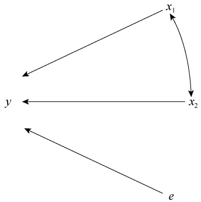
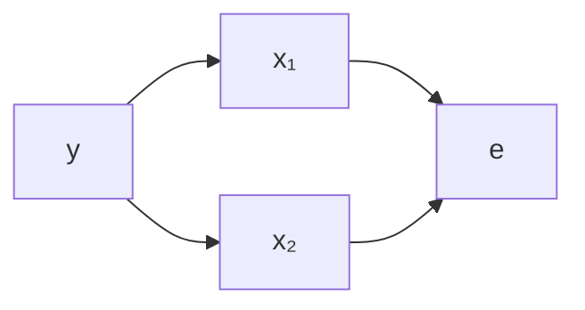
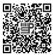
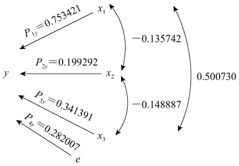
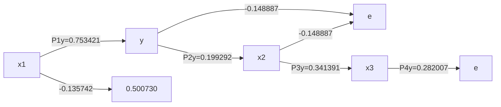

# 第13章逐步回归与通径分析

原始 PDF 第 325–343 页。

第 13 章

# 逐步回归与通径分析

## 本章提要

逐步回归和通径分析是多元统计分析的重要方法。本章主要讨论:

• 针对多个自变量建立最优回归方程的逐步回归分析方法；
• 将自变量 $x _ { i }$ 与依变量 y 的相关系数分解为 $x _ { i }$ 对 y 的直接作用与间接影响的通径分析。

前面介绍了利用多元线性回归分析和偏相关分析研究多个相关变量间的线性关系。对于一组多变量数据，在很多情况下，往往既包含对依变量 y 具有显著线性效应的自变量，又包含对 y 不具有显著线性效应的自变量。在进行多元线性回归分析时，必须将没有显著效应的自变量剔除，以使所得到的多元线性回归方程中的自变量 $x _ { i }$ 对依变量 y 均具有显著效应。剔除不显著自变量的过程称为自变量的统计选择，所得到的仅包含显著自变量的多元线性回归方程，称为最优多元线性回归方程（the best multiple linear regression equation）。最优多元线性回归方程能准确地分析和预测依变量 y，可通过逐步回归分析的方法建立。

通径分析是另一种研究多个相关变量间线性关系的统计方法，具有精确、直观的特点。1921 年，美国统计遗传学家 S.Wright 首先提出了通径系数的概念，后经不断完善和改进，通径分析已在研究遗传相关、遗传力和确定选择指数、性状的直接作用及间接作用等方面广泛应用，主要用来阐述数量遗传学中的理论问题，在相关的变量中对其原因和结果的分析具有一定的理论价值和实践意义。

## 第一节 逐步回归分析

逐步回归（stepwise regression）分析方法的基本思路是从大量可供选择的变量中逐个淘汰不显著自变量或逐个选入显著的自变量，建立回归分析的预测或者解释模型，按照方法可分为后退逐步回归和前进逐步回归。

后退逐步回归（backward stepwise regression），是逐个淘汰不显著自变量的回归方法。从 m 元回归分析开始，每步剔除一个不显著且偏回归平方和最小的自变量；在每次剔除一个偏回归不显著且平方和最小的自变量之后，对回归方程和各自变量重新进行假设检验。这是因为自变量间往往存在着相关性，当剔除某一个不显著的自变量之后，其对依变量的影响很大部分可以加到另外的自变量对依变量的影响上，原来不显著的自变量可能变为显著，而原来显著的自变量也可能变为不显著。因此，为了获得最优方程，回归计算需要一步一步进行下去。如此反复，直到回归方程所包含的自变量全部显著为止，此时所建立的回归方程即

---

·314·

生物统计学

最优回归方程。当自变量个数较多，而显著的自变量又较少时，采用这种方法比较麻烦；但当自变量较少，且大多都显著时，这种方法就比较实用。

前进逐步回归（forward stepwise regression）是逐个引入显著自变量的回归方法。从一元回归分析开始，按各自变量对 y 作用的秩次，依次每步仅选入一个对 $y$ 作用显著的自变量，且每引入一个自变量后，对在此之前已引入的自变量进行重新检验，有不显著者即剔除，直到选入的自变量都显著，而未被选入的自变量都不显著为止，此时建立的回归方程即最优回归方程。

## 一、后退逐步回归

后退逐步回归也称为逐个淘汰不显著自变量的回归方法。具体步骤如下。

首先，进行 m 元回归分析。在 $y$ 与自变量 $x_{1} 、 x_{2} 、 \cdots 、 x_{m}$ 的回归分析中，进行 m 元回归分析。若各自变量的偏回归皆显著，分析结束；若有一个或一个以上自变量的偏回归不显著，则剔除偏回归平方和最小的自变量，进入下一步 $m   -   1$ 元回归分析。

其次，进行 $m   -   1$ 元回归分析。在系数矩阵 A 中将剔除的自变量所在的行、列和其 K 列划去，重新计算 $m   -   1$ 阶系数矩阵的逆矩阵元素。如果这一步仍有一个以上自变量的偏回归不显著，则再将偏回归平方和最小的那个自变量舍去，进一步进行分析。

如此重复进行，直至留下所有自变量的偏回归系数皆显著，即得最优回归方程。

例 **13-1** 测定了某小麦品种 15 株植株的单株穗数 $x _ { 1 1 }$ 、每穗结实小穗数 $x _ { 2 } .$ 、百粒重 $x _ { 3 } ( \mathbf { g } )$株高 $x_{4}   (cm)$ 和单株籽粒产量 $y ~ ( \mathbf { g } )$ ），结果列于表 13-1。试建立 $y$ 依 $x _ { i }$ 的最优回归方程。

表 13-1 小麦单株性状调查数据

| 株号 | 单株穗数($x_1$) | 每穗结实小穗数($x_2$) | 百粒重($x_3$,g) | 株高($x_4$,cm) | 单株籽粒产量(y,g) |
| --- | --- | --- | --- | --- | --- |
| 1 | 10 | 23 | 3.6 | 113 | 15.7 |
| 2 | 9 | 20 | 3.6 | 106 | 14.5 |
| 3 | 10 | 22 | 3.7 | 111 | 17.5 |
| 4 | 13 | 21 | 3.7 | 109 | 22.5 |
| 5 | 10 | 22 | 3.6 | 110 | 15.5 |
| 6 | 10 | 23 | 3.5 | 103 | 16.9 |
| 7 | 8 | 23 | 3.3 | 100 | 8.6 |
| 8 | 10 | 24 | 3.4 | 114 | 17.0 |
| 9 | 10 | 20 | 3.4 | 104 | 13.7 |
| 10 | 10 | 21 | 3.4 | 110 | 13.4 |
| 11 | 10 | 23 | 3.9 | 104 | 20.3 |
| 12 | 8 | 21 | 3.5 | 109 | 10.2 |
| 13 | 6 | 23 | 3.2 | 114 | 7.4 |
| 14 | 8 | 21 | 3.7 | 113 | 11.6 |
| 15 | 9 | 22 | 3.6 | 105 | 12.3 |

按后退逐步回归，逐个淘汰不显著自变量，进行回归分析。

（1）建立 m 元线性回归方程。本例中， $m=4, n=15$ ，由实际观测数据可以建立四元线性回归方程。

---

第 13 章 逐步回归与通径分析

·315·

首先，由表 13-1 计算一级数据和二级数据，并列于表 13-2。

表 13-2 表 13-1 数据四元线性回归分析的一级数据和二级数据

<table><tr><td colspan="2">一级数据</td><td colspan="2">二级数据</td></tr><tr><td> $\sum x_1=141$ </td><td> $\sum x_1x_2=3089$ </td><td> $SS_1=33.6$ </td><td> $SP_{24}=9.333333$ </td></tr><tr><td> $\sum x_2=329$ </td><td> $\sum x_1x_3=501.1$ </td><td> $SS_2=20.933333$ </td><td> $SP_{2y}=3.273333$ </td></tr><tr><td> $\sum x_3=53.1$ </td><td> $\sum x_1x_4=15266$ </td><td> $SS_3=0.456$ </td><td> $SP_{34}=-0.4$ </td></tr><tr><td> $\sum x_4=1625$ </td><td> $\sum x_1y=2121.3$ </td><td> $SS_4=273.333333$ </td><td> $SP_{3y}=7.206$ </td></tr><tr><td> $\sum y=217.1$ </td><td> $\sum x_2x_3=1164.2$ </td><td> $SS_y=239.889333$ </td><td> $SP_{4y}=-1.666667$ </td></tr><tr><td> $\sum x_1^2=1359$ </td><td> $\sum x_2x_4=35651$ </td><td> $SP_{12}=-3.6$ </td><td> $\overline{x}_1=9.4$ </td></tr><tr><td> $\sum x_2^2=7237$ </td><td> $\sum x_2y=4765$ </td><td> $SP_{13}=1.96$ </td><td> $\overline{x}_2=21.933333$ </td></tr><tr><td> $\sum x_3^2=188.43$ </td><td> $\sum x_3x_4=5752.1$ </td><td> $SP_{14}=-9$ </td><td> $\overline{x}_3=3.54$ </td></tr><tr><td> $\sum x_4^2=176315$ </td><td> $\sum x_3y=775.74$ </td><td> $SP_{1y}=80.56$ </td><td> $\overline{x}_4=108.333333$ </td></tr><tr><td> $\sum y^2=3382.05$ </td><td> $\sum x_4y=23517.5$ </td><td> $SP_{23}=-0.46$ </td><td> $\overline{y}=14.473333$ </td></tr></table>

其次，由式（12-7）将四元正规方程组的系数矩阵和一个四阶单位矩阵填入表 13-3，组成算阵 A，计算 A 阵的逆矩阵 $\boldsymbol { A } ^ { - 1 }$ 的各 $c _ { i j }$ 值，列入表 13-3。

表 13-3 表 13-1 数据的四元线性回归计算

<table><tr><td rowspan="2">说明</td><td rowspan="2">行</td><td colspan="4">列</td><td rowspan="2"> $K_1$ </td><td rowspan="2"> $K_2$ </td><td rowspan="2"> $K_3$ </td><td rowspan="2"> $K_4$ </td></tr><tr><td>1</td><td>2</td><td>3</td><td>4</td></tr><tr><td rowspan="4">算阵A</td><td>1</td><td>33.6</td><td>-3.6</td><td>1.96</td><td>-9</td><td>1</td><td>0</td><td>0</td><td>0</td></tr><tr><td>2</td><td>-3.6</td><td>20.933333</td><td>-0.46</td><td>9.333333</td><td>0</td><td>1</td><td>0</td><td>0</td></tr><tr><td>3</td><td>1.96</td><td>-0.46</td><td>0.456</td><td>-0.4</td><td>0</td><td>0</td><td>1</td><td>0</td></tr><tr><td>4</td><td>-9</td><td>9.333333</td><td>-0.4</td><td>273.333333</td><td>0</td><td>0</td><td>0</td><td>1</td></tr><tr><td rowspan="4">算阵B</td><td>1</td><td>33.6</td><td>-0.107143</td><td>0.058333</td><td>-0.267857</td><td>0.029761</td><td>0</td><td>0</td><td>0</td></tr><tr><td>2</td><td>-3.6</td><td>20.547619</td><td>-0.012167</td><td>0.407300</td><td>0.005214</td><td>0.048667</td><td>0</td><td>0</td></tr><tr><td>3</td><td>1.96</td><td>-0.250000</td><td>0.338625</td><td>0.669841</td><td>-0.168416</td><td>0.035930</td><td>2.953120</td><td>0</td></tr><tr><td>4</td><td>-9</td><td>8.369047</td><td>0.226825</td><td>267.361970</td><td>0.000982</td><td>-0.001554</td><td>-0.002505</td><td>0.003740</td></tr><tr><td rowspan="4"> $A^{-1}$  $(c_{ij})$ </td><td>1</td><td>0.040183</td><td>0.002757</td><td>-0.169073</td><td>0.000982</td><td></td><td></td><td></td><td></td></tr><tr><td>2</td><td>0.002757</td><td>0.049750</td><td>0.036971</td><td>-0.001554</td><td></td><td></td><td></td><td></td></tr><tr><td>3</td><td>-0.169073</td><td>0.036971</td><td>2.954798</td><td>-0.002505</td><td></td><td></td><td></td><td></td></tr><tr><td>4</td><td>0.000982</td><td>-0.001554</td><td>-0.002505</td><td>0.003740</td><td></td><td></td><td></td><td></td></tr></table>

第三，根据式（12-13），有

$$
\left( \begin{array}{c} b _ {1} \\ b _ {2} \\ b _ {3} \\ b _ {4} \end{array} \right) = \left( \begin{array}{c c c c} 0. 0 4 0 1 8 3 & 0. 0 0 2 7 5 7 & - 0. 1 6 9 0 7 3 & 0. 0 0 0 9 8 2 \\ 0. 0 0 2 7 5 7 & 0. 0 4 9 7 5 0 & 0. 0 3 6 9 7 1 & - 0. 0 0 1 5 5 4 \\ - 0. 1 6 9 0 7 3 & 0. 0 3 6 9 7 1 & 2. 9 5 4 7 9 8 & - 0. 0 0 2 5 0 5 \\ 0. 0 0 0 9 8 2 & - 0. 0 0 1 5 5 4 & - 0. 0 0 2 5 0 5 & 0. 0 0 3 7 4 0 \end{array} \right) \times \left( \begin{array}{c} 8 0. 5 6 \\ 3. 2 7 3 3 3 \\ 7. 2 0 6 \\ - 1. 6 6 6 6 6 7 \end{array} \right)
$$

---

·316·

生物统计学

解得 $b_{1}=2.026180,\quad b_{2}=0.653997,\quad b_{3}=7.796938,\quad b_{4}=0.049697。$

第四，根据式（12-22），计算 $U _ { i } ;$

$$
U _ {1} = \frac {b _ {1} ^ {2}}{c _ {1 1}} = \frac {2 . 0 2 6 1 8 0 ^ {2}}{0 . 0 4 0 1 8 3} = 1 0 2. 1 6 7 7
$$

$$
U _ {2} = \frac {b _ {2} ^ {2}}{c _ {2 2}} = \frac {0 . 6 5 3 9 9 7 ^ {2}}{0 . 0 4 9 7 5 0} = 8. 5 9 7 2
$$

$$
U _ {3} = \frac {b _ {3} ^ {2}}{c _ {3 3}} = \frac {7 . 7 9 6 9 3 8 ^ {2}}{2 . 9 5 4 7 9 8} = 2 0. 5 7 4 1
$$

$$
U _ {4} = \frac {b _ {4} ^ {2}}{c _ {4 4}} = \frac {0 . 0 4 9 6 9 7 ^ {2}}{0 . 0 0 3 7 4 0} = 0. 6 6 0 4
$$

第五，根据式（12-16）和式（12-17），计算 $U _ { y / 1 2 3 4 }$ 和 $Q _ { y / 1 2 3 4 } \mathbf { : }$

$$
\begin{array}{l} U _ {y / 1 2 3 4} = b _ {1} S P _ {1 y} + b _ {2} S P _ {2 y} + b _ {3} S P _ {3 y} + b _ {4} S P _ {4 y} \\ = 2. 0 2 6 1 8 0 \times 8 0. 5 6 + 0. 6 5 3 9 9 7 \times 3. 2 7 3 3 3 3 \\ + 7. 7 9 6 9 3 8 \times 7. 2 0 6 + 0. 0 4 9 6 9 7 \times (- 1. 6 6 6 6 6 7) = 2 2 1. 4 7 1 7 \\ \end{array}
$$

$$
Q _ {y / 1 2 3 4} = S S _ {y} - U _ {y / 1 2 3 4} = 2 3 9. 8 8 9 3 - 2 2 1. 4 7 1 7 = 1 8. 4 1 7 6
$$

最后，多元线性回归方程和偏回归系数的假设检验:四元线性回归方程和回归系数的假设检验均采用 F 检验，结果列于表 13-4。

表 13-4 表 13-1 数据四元线性回归和偏回归系数的假设检验

| 变异来源 | df | SS | $s^2$ | F | $F_{0.05}$ | $F_{0.01}$ |
| --- | --- | --- | --- | --- | --- | --- |
| 四元线性回归 | 4 | 221.4717 | 55.3679 | 30.06** | 3.48 | 5.99 |
| 因$x_1$的偏回归 | 1 | 102.1677 | 102.1677 | 55.47** | 4.96 | 10.04 |
| 因$x_2$的偏回归 | 1 | 8.5972 | 8.5972 | 4.67 | 4.96 | 10.04 |
| 因$x_3$的偏回归 | 1 | 20.5741 | 20.5741 | 11.17** | 4.96 | 10.04 |
| 因$x_4$的偏回归 | 1 | 0.6604 | 0.6604 | &lt;1 | 4.96 | 10.04 |
| 离回归 | 10 | 18.4176 | 1.8418 |  |  |  |
| 总变异 | 14 | 239.8893 |  |  |  |  |

表 13-4 表明，四元线性回归方程达极显著，但 $x _ { 2 }$ 和 $x _ { 4 }$ 偏回归系数都不显著，其中以 $x _ { 4 }$的偏回归平方和最小。所以，应首先剔除 $x _ { 4 }$

（2）建立 m-1 元线性回归方程。本例 $m-1=4-1=3, n=15 。$

将表 13-3 算阵 A 的第 4 行和第 4 列划去，得到三元系数矩阵；再将 $K _ { 4 }$ 列划去，得到三阶单位矩阵，这样可求得系数矩阵的逆矩阵 $\boldsymbol { A } ^ { - 1 } ( \boldsymbol { c } _ { i j } )$ 的各个元素值，结果列于表 13-5。

表 13-5 表 13-1 数据的三元线性回归计算（剔除 $x _ { 4 } )$

<table><tr><td rowspan="2">说明</td><td rowspan="2">行</td><td colspan="3">列</td><td rowspan="2"> $K_1$ </td><td rowspan="2"> $K_2$ </td><td rowspan="2"> $K_3$ </td></tr><tr><td>1</td><td>2</td><td>3</td></tr><tr><td rowspan="3">算阵A</td><td>1</td><td>33.6</td><td>-3.6</td><td>1.96</td><td>1</td><td>0</td><td>0</td></tr><tr><td>2</td><td>-3.6</td><td>20.933333</td><td>-0.46</td><td>0</td><td>1</td><td>0</td></tr><tr><td>3</td><td>1.96</td><td>-0.46</td><td>0.456</td><td>0</td><td>0</td><td>1</td></tr><tr><td rowspan="3">算阵B</td><td>1</td><td>33.6</td><td>-0.107143</td><td>0.058333</td><td>0.029761</td><td>0</td><td>0</td></tr><tr><td>2</td><td>-3.6</td><td>20.547619</td><td>-0.012167</td><td>0.005214</td><td>0.048667</td><td>0</td></tr><tr><td>3</td><td>1.96</td><td>-0.250000</td><td>0.338625</td><td>-0.168416</td><td>0.035930</td><td>2.953120</td></tr></table>

---

第 13 章 逐步回归与通径分析

·317·

续表

<table><tr><td rowspan="2">说明</td><td rowspan="2">行</td><td colspan="3">列</td><td rowspan="2"> $K_{1}$ </td><td rowspan="2"> $K_{2}$ </td><td rowspan="2"> $K_{3}$ </td></tr><tr><td>1</td><td>2</td><td>3</td></tr><tr><td rowspan="3"> $A^{-1}(c_{ij})$ </td><td>1</td><td>0.039926</td><td>0.003165</td><td>-0.168416</td><td></td><td></td><td></td></tr><tr><td>2</td><td>0.003165</td><td>0.049105</td><td>0.035930</td><td></td><td></td><td></td></tr><tr><td>3</td><td>-0.168416</td><td>0.035930</td><td>2.953120</td><td></td><td></td><td></td></tr></table>

首先，由

$$
\left( \begin{array}{c} b _ {1} \\ b _ {2} \\ b _ {3} \end{array} \right) = \left( \begin{array}{c c c} 0. 0 3 9 9 2 6 & 0. 0 0 3 1 6 5 & - 0. 1 6 8 4 1 6 \\ 0. 0 0 3 1 6 5 & 0. 0 4 9 1 0 5 & 0. 0 3 5 9 3 0 \\ - 0. 1 6 8 4 1 6 & 0. 0 3 5 9 3 0 & 2. 9 5 3 1 2 0 \end{array} \right) \times \left( \begin{array}{c} 8 0. 5 6 \\ 3. 2 7 3 3 3 \\ 7. 2 0 6 \end{array} \right)
$$

解得: $b_{1} = 2.013139$ ， $b_{2}=0.674643$ $b_{3}=7.830227$ 。

其次，计算 $U _ { i } ;$

$$
\begin{array}{l} U _ {1} = \frac {b _ {1} ^ {2}}{c _ {1 1}} = \frac {2 . 0 1 3 1 3 9 ^ {2}}{0 . 0 3 9 9 2 6} = 1 0 1. 5 0 6 0 \\ U _ {2} = \frac {b _ {2} ^ {2}}{c _ {2 2}} = \frac {0 . 6 7 4 6 4 3 ^ {2}}{0 . 0 4 9 1 0 5} = 9. 2 6 8 8 \\ U _ {3} = \frac {b _ {3} ^ {2}}{c _ {3 3}} = \frac {7 . 8 3 0 2 2 7 ^ {2}}{2 . 9 5 3 1 2 0} = 2 0. 7 6 1 9 \\ \end{array}
$$

第三，计算 $U _ { y / 1 2 3 }$ 和 $\mathcal { Q } _ { y / 1 2 3 } ;$ :

$$
\begin{array}{l} U _ {y / 1 2 3} = b _ {1} S P _ {1 y} + b _ {2} S P _ {2 y} + b _ {3} S P _ {3 y} \\ = 2. 0 1 3 1 3 9 \times 8 0. 5 6 + 0. 6 7 4 6 4 3 \times 3. 2 7 3 3 3 3 + 7. 8 3 0 2 2 7 \times 7. 2 0 6 = 2 2 0. 8 1 1 4 \\ Q _ {y / 1 2 3} = S S _ {y} - U _ {y / 1 2 3 4} = 2 3 9. 8 8 9 3 - 2 2 0. 8 1 1 4 = 1 9. 0 7 7 9 \\ \end{array}
$$

最后，多元线性回归方程和偏回归系数的假设检验:三元线性回归方程和回归系数的假设检验仍然采用 F 检验，结果列于表 13-6。

表 13-6 表 13-1 数据三元线性回归和偏回归系数的假设检验（剔除 $x _ { 4 } )$

| 变异来源 | df | SS | $s^2$ | F | $F_{0.05}$ | $F_{0.01}$ |
| --- | --- | --- | --- | --- | --- | --- |
| 三元线性回归 | 3 | 220.8114 | 73.6038 | 42.44** | 3.59 | 6.22 |
| 因 $x_1$ 的偏回归 | 1 | 101.5060 | 101.5060 | 58.53** | 4.84 | 9.65 |
| 因 $x_2$ 的偏回归 | 1 | 9.2688 | 9.2688 | 5.34* | 4.84 | 9.65 |
| 因 $x_3$ 的偏回归 | 1 | 20.7619 | 20.7619 | 11.97** | 4.84 | 9.65 |
| 离回归 | 11 | 19.0779 | 1.7344 |  |  |  |

表 13-6 表明，三元线性回归方程和 3 个自变量的偏回归系数均达极显著或显著水平，因此不需要再进行自变量的剔除。

对于回归截距 $a ,$ ，根据式（12-5），则有

$$
\begin{array}{l} a = \overline {{y}} - b _ {1} \overline {{x}} _ {1} - b _ {2} \overline {{x}} _ {2} - b _ {3} \overline {{x}} _ {3} \\ = 1 4. 4 7 3 3 3 3 - 2. 0 1 3 1 3 9 \times 9. 4 - 0. 6 7 4 6 4 3 \times 2 1. 9 3 3 3 3 3 - 7. 8 3 0 2 2 7 \times 3. 5 4 = - 4 6. 9 6 6 3 \\ \end{array}
$$

因此，最优线性回归方程为

---

·318·

生物统计学

$$
\hat {y} = - 4 6. 9 6 6 3 + 2. 0 1 3 1 x _ {1} + 0. 6 7 4 6 x _ {2} + 7. 8 3 0 2 x _ {3}
$$

该方程的估计标准误 $S _ { y / 1 2 3 }$ 为

$$
s _ {y / 1 2 3} = \sqrt {\frac {Q _ {y / 1 2 3}}{n - m - 1}} = \sqrt {\frac {1 9 . 0 7 7 9}{1 5 - 3 - 1}} = 1. 3 2 (\mathrm{g})
$$

该方程的意义是:当 $x _ { 2 }$ 、 $x _ { 3 }$ 保持一定（平均水平）时， $x _ { 1 }$ （每株穗数）每增加 1 穗，y平均增加 2.01g；当 $x _ { 1 }  、 x _ { 3 }$ 保持一定（平均水平）时， $x _ { 2 }$ （每穗结实小穗数）每增加 1 个小穗，$y$ 平均增加 0.67g；当 $x _ { 1 }  、  x _ { 2 }$ 保持一定（平均水平）时， $x _ { 3 }$ （百粒重）每增加 1g，y 平均增加7.83g。用 $x_{1} 、 x_{2} 、 x_{3}$ 估计单株籽粒产量的标准误为 1.32g。

对于后退逐步回归建立最优回归方程，还可以采用下面的方法，即在进行 m 元回归分析的基础上，余下自变量的偏回归系数和逆矩阵 $A ^ { - 1 }$ 中 $c _ { i j }$ 的计算，可根据剔除前的偏回归系数和 $c _ { i j } ,$ ，通过公式直接求出。

设 $x _ { k }$ 为剔除的自变量，则

$$
b _ {i} ^ {*} = b _ {i} - \frac {c _ {i k} b _ {k}}{c _ {k k}} \quad (i \neq k) \tag {13-1}
$$

$$
c _ {i j} ^ {*} = c _ {i j} - \frac {c _ {i k} c _ {k j}}{c _ {k k}} (i, j \neq k) \tag {13-2}
$$

下面结合例子说明这一方法的应用。

例 **13-2** 试对例 12-1 数据采用后退逐步回归方法建立最优回归方程。

根据前面偏回归系数假设检验的结果， $x _ { 3 }$ 的偏回归系数不显著，故应剔除 $x _ { 3 }$ 。剔除 $x _ { 3 }$后，有

$$
\begin{array}{l} b _ {1} ^ {*} = b _ {1} - \frac {c _ {1 3}}{c _ {3 3}} b _ {3} = 0. 9 7 0 8 - \frac {0 . 0 0 1 1 0 2}{0 . 0 0 7 7 1 3} \times (- 0. 0 1 5 3 4) = 0. 9 7 3 0 \\ b _ {2} ^ {*} = b _ {2} - \frac {c _ {2 3}}{c _ {3 3}} b _ {3} = - 0. 1 7 6 3 - \frac {- 0 . 0 1 7 4 7 2}{0 . 0 0 7 7 1 3} \times (- 0. 0 1 5 3 4) = - 0. 2 1 1 1 \\ c _ {1 1} ^ {*} = c _ {1 1} - \frac {c _ {1 3} c _ {3 1}}{c _ {3 3}} = 0. 6 2 6 8 8 7 - \frac {0 . 0 0 1 1 0 2 \times 0 . 0 0 1 1 0 2}{0 . 0 0 7 7 1 3} = 0. 6 2 6 7 3 0 \\ c _ {1 2} ^ {*} = c _ {2 1} ^ {*} = c _ {1 2} - \frac {c _ {1 3} c _ {3 2}}{c _ {3 3}} = 0. 0 2 2 9 4 8 - \frac {0 . 0 0 1 1 0 2 \times (- 0 . 0 1 7 4 7 2)}{0 . 0 0 7 7 1 3} = 0. 0 2 5 4 7 3 \\ c _ {2 2} ^ {*} = c _ {2 2} - \frac {c _ {2 3} c _ {3 2}}{c _ {3 3}} = 0. 0 6 6 7 1 3 - \frac {(- 0 . 0 1 7 4 7 2) \times (- 0 . 0 1 7 4 7 2)}{0 . 0 0 7 7 1 3} = 0. 0 2 8 1 3 4 \\ a ^ {*} = \overline {{y}} - b _ {1} ^ {*} \overline {{x}} _ {1} - b _ {2} ^ {*} \overline {{x}} _ {2} = 2. 3 2 8 7 5 - 0. 9 7 3 0 \times 2. 7 0 - (- 0. 2 1 1 1) \times 3. 3 3 7 5 = 0. 4 0 6 2 \\ \end{array}
$$

因 $x _ { 1 }$ 的偏回归平方和 $U_{x_{1}}^{*}=\frac{(b_{1}^{*})^{2}}{c_{11}^{*}}=\frac{0.9730^{2}}{0.626730}=1.5106$

因 $x _ { 2 }$ 的偏回归平方和 $U_{x_{2}}^{*}=\frac{(b_{2}^{*})^{2}}{c_{22}^{*}}=\frac{(-0.2111)^{2}}{0.028134}=1.5845$

回归平方和 ${ \boldsymbol { U } } _ { y / 1 2 } ^ { * }$ 与离回归 $\boldsymbol { \mathcal { Q } } _ { y / 1 2 } ^ { * }$ 为

$$
\begin{array}{l} U _ {y / 1 2} ^ {*} = b _ {1} ^ {*} S P _ {1 y} + b _ {2} ^ {*} S P _ {2 y} \\ = 0. 9 7 3 0 \times 1. 9 2 7 8 + (- 0. 2 1 1 1) \times (- 9. 2 4 5 6 2) = 3. 8 2 7 9 \\ \end{array}
$$

---

第 13 章 逐步回归与通径分析

·319·

$$
Q _ {y / 1 2} ^ {*} = S S _ {y} - U _ {y / 1 2} ^ {*} = 4. 0 7 6 9 - 3. 8 2 7 9 = 0. 2 4 9 0
$$

剔除 $x _ { 3 }$ 后的二元线性回归 $F$ 检验结果列于表 13-7。

表 13-7 例 12-1 数据剔除 $x _ { 3 }$ 后的二元线性回归和偏回归系数的 F 检验

| 变异来源 | df | SS | $s^2$ | F | $F_{0.05}$ | $F_{0.01}$ |
| --- | --- | --- | --- | --- | --- | --- |
| 二元线性回归 | 2 | 3.8279 | 1.9140 | 38.4327** | 5.79 | 13.27 |
| 因$x_1$的偏回归 | 1 | 1.5106 | 1.5106 | 30.3333** | 6.61 | 16.26 |
| 因$x_2$的偏回归 | 1 | 1.5845 | 1.5845 | 31.8173** | 6.61 | 16.26 |
| 离回归 | 5 | 0.2490 | 0.0489 |  |  |  |
| 总变异 | 7 | 4.0769 |  |  |  |  |

从表 13-7 可以看出，剔除 $x _ { 3 }$ （降水天数/d）后， $x _ { 1 }$ （三化螟越冬虫口密度，头/ $6 6 6 . 7 \mathrm { m } ^ { 2 }$取其对数值）和 $x_{2} \left( 3 \sim 4 \right)$ 月日平均降水量/mm）的偏回归均达极显著水平，所以第一代幼虫虫口密度（头 $/ 6 6 6 . 7 \mathrm { m } ^ { 2 }$ ，取其对数为 $y )$ 的最优回归方程为

$$
\hat {y} = 0. 4 0 6 2 + 0. 9 7 3 0 x _ {1} - 0. 2 1 1 1 x _ {2}
$$

该方程的估计标准误为

$$
s _ {y / 1 2} = \sqrt {\frac {Q _ {y / 1 2} ^ {*}}{n - m - 1}} = \sqrt {\frac {0 . 2 4 9 0}{8 - 2 - 1}} = 0. 2 2 3 2 (\text {头} / 6 6 6. 7 \mathrm{m} ^ {2})
$$

## 二、前进逐步回归

前进逐步回归是指每一次都选入一个显著的自变量，建立回归模型的分析方法。其方法步骤如下所述。

（一）计算各变量的简单相关系数，得 $m   +   1$ 阶相关矩阵 $\pmb { R } ^ { ( 0 ) }$

$$
\boldsymbol {R} ^ {(0)} = \left( \begin{array}{c c c c c} r _ {1 1} ^ {(0)} & r _ {1 2} ^ {(0)} & \dots & r _ {1 m} ^ {(0)} & r _ {1 y} ^ {(0)} \\ r _ {2 1} ^ {(0)} & r _ {2 2} ^ {(0)} & \dots & r _ {2 m} ^ {(0)} & r _ {2 y} ^ {(0)} \\ \vdots & \vdots & & \vdots & \vdots \\ r _ {m 1} ^ {(0)} & r _ {m 2} ^ {(0)} & \dots & r _ {m m} ^ {(0)} & r _ {n y} ^ {(0)} \\ r _ {y 1} ^ {(0)} & r _ {y 2} ^ {(0)} & \dots & r _ {y m} ^ {(0)} & r _ {y y} ^ {(0)} \end{array} \right) \tag {13-3}
$$

或简记为 $\boldsymbol { R } ^ { ( 0 ) } = \left[ r _ { i j } ^ { ( 0 ) } \right] \quad ( i , j = 1 , 2 , \cdots , m , y )$

## （二）选入自变量逐步回归

以 $\pmb { R } ^ { ( 0 ) }$ 为基础，每进行一步回归选入一个显著的自变量，并对相关矩阵进行一次变换。基本步骤如下。

第一步，将 $\boldsymbol { R } ^ { ( 0 ) } = \left[ r _ { i j } ^ { ( 0 ) } \right]$ 变为 $\pmb { R } ^ { ( 1 ) } = [ r _ { i j } ^ { ( 1 ) } ]$

第二步，将 $\pmb { R } ^ { ( 1 ) }   =   [ r _ { i j } ^ { ( 1 ) } ]$ 变为 $\boldsymbol{R}^{(2)}=\left[r_{ij}^{(2)}\right]$

第 k 步，将 $\boldsymbol{R}^{(k-1)} = \left[ r_{ij}^{(k-1)} \right]$ 变为 $\boldsymbol{R}^{(k)}=[r_{ij}^{k(1)}]$

---

·320·

生物统计学

在第 k 步 $(k = 1, 2, \cdots, m + 1)$ ），由式（13-4）计算任一尚未入选自变量 $x _ { i }$ 的标准偏回归平方和:

$$
U _ {i} ^ {(k)} = \frac {[ r _ {i y} ^ {(k - 1)} ] ^ {2}}{r _ {i i} ^ {(k - 1)}} \tag {13-4}
$$

设最大 $U _ { i } ^ { ( k ) }$ 的自变量为 $x _ { l } ( i { = } l )$ ），则 $x _ { l }$ 在第 k 步是否入选由

$$
F = \frac {U _ {l} ^ {(k)}}{\frac {r _ {y y} ^ {(k - 1)} - U _ {l} ^ {(k)}}{n - m - 1}} \tag {13-5}
$$

决定。若 $F > F _ { \alpha ( 1 , n - m - 1 ) }$ （m 为第 k 步已入选的自变量的个数），则引入自变量 $x _ { 1 }$ ，并将 $\pmb { R } ^ { ( k - 1 ) }$ 变换成 $\pmb { R } ^ { ( k ) }$

变换时由元素 $r _ { i j } ^ { ( k - 1 ) }$ 计算元素 $r _ { i j } ^ { ( k ) }$ 的通式为

$$
\left\{ \begin{array}{l} r _ {l l} ^ {(k)} = \frac {1}{r _ {l l} ^ {(k - 1)}} \quad (i = l, j = l) \\ r _ {l j} ^ {(k)} = \frac {r _ {l j} ^ {(k - 1)}}{r _ {l l} ^ {(k - 1)}} \quad (i = l, j \neq l) \\ r _ {i l} ^ {(k)} = - \frac {r _ {i l} ^ {(k - 1)}}{r _ {l l} ^ {(k - 1)}} \quad (i \neq l, j = l) \\ r _ {i j} ^ {(k)} = r _ {i j} ^ {(k - 1)} - \left[ \frac {r _ {i l} ^ {(k - 1)} r _ {l j} ^ {(k - 1)}}{r _ {l l} ^ {(k - 1)}} \right] \quad (i, j \neq l) \end{array} \right. \tag {13-6}
$$

由 $\pmb { R } ^ { ( k ) }$ 可得到任一已经入选自变量 $x _ { i }$ （包括 $x _ { l } )$ 的标准偏回归系数、偏回归平方和、离回归平方和及 $F$ 值:

$$
b _ {i} ^ {k} = r _ {i y} ^ {(k)} \tag {13-7}
$$

$$
U _ {i} ^ {(k)} = \frac {[ b _ {i} ^ {(k)} ] ^ {2}}{r _ {i i} ^ {(k)}} \tag {13-8}
$$

$$
Q ^ {(k)} = r _ {y y} ^ {(k)} \tag {13-9}
$$

$$
F = \frac {\frac {\left[ b _ {i} ^ {(k)} \right] ^ {2}}{r _ {i i} ^ {(k)}}}{\frac {r _ {y y} ^ {(k)}}{n - m - 1}} \tag {13-10}
$$

由上式，可决定在 $x _ { l }$ 前入选的自变量是否需要剔除。

前进逐步回归的每一步计算都是重复上述程序，直至余下自变量的最大 $U _ { i }$ 不显著为止。

## （三）计算偏回归系数，建立最优回归方程

自变量挑选结束即可建立最优回归方程，但由于上述程序所得的各种统计数都是标准化的，因此最后还应将其还原为原来单位的统计数。

---

第 13 章 逐步回归与通径分析

·321·

在第 k 步，原来单位的统计数和标准化统计数的关系为

$$
U _ {x _ {i}} = U _ {i} ^ {(k)} S S _ {y} \tag {13-11}
$$

$$
Q = Q ^ {(k)} S S _ {y} \tag {13-12}
$$

偏回归系数 $b _ { i }$ 和标准偏回归系数 $b _ { i } ^ { ( k ) }$ 的关系则为

$$
b _ {i} = b _ {i} ^ {(k)} \sqrt {\frac {S S _ {y}}{S S _ {i}}} \tag {13-13}
$$

回归方程的估计标准误为

$$
s _ {y / 1 2 \dots m} = \sqrt {\frac {Q ^ {(k)} S S _ {y}}{n - m - 1}} \tag {13-14}
$$

例 **13-3** 对例 13-1 数据，采用前进逐步回归方法，建立最优回归方程。

（1）计算相关矩阵。根据该数据的二级数据（表 13-2），计算各变量间的简单相关系数，得到相关矩阵 $\pmb { R } ^ { ( 0 ) }$ 。

$$
\boldsymbol {R} ^ {(0)} = \left( \begin{array}{c c c c c} 1 & - 0. 1 3 5 7 4 2 & 0. 5 0 0 7 3 0 & - 0. 0 9 3 9 1 3 & 0. 8 9 7 3 1 4 \\ - 0. 1 3 5 7 4 2 & 1 & - 0. 1 4 8 8 8 7 & 0. 1 2 3 3 8 8 & 0. 0 4 6 1 9 2 \\ 0. 5 0 0 7 3 0 & - 0. 1 4 8 8 8 7 & 1 & - 0. 0 3 5 8 2 9 & 0. 6 8 8 9 8 0 \\ - 0. 0 9 3 9 1 3 & 0. 1 2 3 3 8 8 & - 0. 0 3 5 8 2 9 & 1 & - 0. 0 0 6 5 0 9 \\ 0. 8 9 7 3 1 4 & 0. 0 4 6 1 9 2 & 0. 6 8 8 9 8 0 & - 0. 0 0 6 5 0 9 & 1 \end{array} \right)
$$

（2）选择第一个自变量。计算各自变量的标准偏回归平方和。由式（13-4），得

$$
U _ {1} ^ {(1)} = \frac {\left[ r _ {1 y} ^ {(0)} \right] ^ {2}}{r _ {1 1} ^ {(0)}} = \frac {0 . 8 9 7 3 1 4 ^ {2}}{1} = 0. 8 0 5 1 7 2
$$

$$
U _ {2} ^ {(1)} = \frac {\left[ r _ {2 y} ^ {(0)} \right] ^ {2}}{r _ {2 2} ^ {(0)}} = \frac {0 . 0 4 6 1 9 2 ^ {2}}{1} = 0. 0 0 2 1 3 4
$$

$$
U _ {3} ^ {(1)} = \frac {[ r _ {3 y} ^ {(0)} ] ^ {2}}{r _ {3 3} ^ {(0)}} = \frac {0 . 6 8 8 9 8 0 ^ {2}}{1} = 0. 4 7 4 6 9 3
$$

$$
U _ {4} ^ {(1)} = \frac {[ r _ {4 y} ^ {(0)} ] ^ {2}}{r _ {4 4} ^ {(0)}} = \frac {(- 0 . 0 0 6 5 0 9) ^ {2}}{1} = 0. 0 0 0 0 4 2
$$

因 $x _ { 1 }$ 的偏回归平方和最大， $x _ { 1 }$ 是否入选回归方程，应对其进行 F 检验。由式（13-5），得

$$
F = \frac {U _ {1} ^ {(1)}}{\frac {r _ {y y} ^ {(0)} - U _ {1} ^ {(1)}}{n - m - 1}} = \frac {\frac {0 . 8 0 5 1 7 2}{1 - 0 . 8 0 5 1 7 2}}{1 5 - 1 - 1} = 5 3. 7 3 ^ {* *}
$$

由于 $F > F_{0.01\ (1:\ 13)} = 9.07$ ，故引入自变量 $x _ { 1 }$ 。

以 l=1 代入式（13-6），计算 $r _ { i j } ^ { ( 1 ) }$ ）的值，将 $\pmb { R } ^ { ( 0 ) }$ 变换成 $\pmb { R } ^ { ( 1 ) }$ ，变换相关矩阵。

$$
\boldsymbol {R} ^ {(1)} = \left( \begin{array}{c c c c c} 1 & - 0. 1 3 5 7 4 2 & 0. 5 0 0 7 3 0 & - 0. 0 9 3 9 1 3 & 0. 8 9 7 3 1 4 \\ 0. 1 3 5 7 4 2 & 0. 9 8 1 5 7 4 & - 0. 0 8 0 9 1 7 & 0. 1 1 0 6 4 0 & 0. 1 6 7 9 9 5 \\ - 0. 5 0 0 7 3 0 & - 0. 0 8 0 9 1 7 & 0. 7 4 9 2 6 9 & 0. 0 1 1 1 9 6 & 0. 2 3 9 6 6 8 \\ 0. 0 9 3 9 1 3 & 0. 1 1 0 6 4 0 & 0. 0 1 1 1 9 6 & 0. 9 9 1 1 8 0 & 0. 0 7 7 7 6 0 \\ - 0. 8 9 7 3 1 4 & 0. 1 6 7 9 9 5 & 0. 2 3 9 6 6 8 & 0. 0 7 7 7 6 0 & 0. 1 9 4 8 2 8 \end{array} \right)
$$

---

·322·

生物统计学

（3）选择第二个自变量。计算余下自变量的标准偏回归平方和。由式（13-4），得

$$
U _ {2} ^ {(2)} = \frac {[ r _ {2 y} ^ {(1)} ] ^ {2}}{r _ {2 2} ^ {(1)}} = \frac {0 . 1 6 7 9 9 5 ^ {2}}{0 . 9 8 1 5 7 4} = 0. 0 2 8 7 5 2
$$

$$
U _ {3} ^ {(2)} = \frac {[ r _ {3 y} ^ {(1)} ] ^ {2}}{r _ {3 3} ^ {(1)}} = \frac {0 . 2 3 9 6 6 8 ^ {2}}{0 . 7 4 9 2 9 6} = 0. 0 7 6 6 6 2
$$

$$
U _ {4} ^ {(2)} = \frac {\left[ r _ {4 y} ^ {(1)} \right] ^ {2}}{r _ {4 4} ^ {(1)}} = \frac {0 . 0 7 7 7 6 0 ^ {2}}{0 . 9 9 1 1 8 0} = 0. 0 0 6 1 0 0
$$

因 $x _ { 3 }$ 的偏回归平方和最大，所以对其进行 $F$ 检验。由式（13-5），得

$$
F = \frac {U _ {3} ^ {(2)}}{\frac {r _ {y y} ^ {(1)} - U _ {3} ^ {(2)}}{n - m - 1}} = \frac {0 . 0 7 6 6 2}{\frac {0 . 1 9 4 8 2 8 - 0 . 0 7 6 6 6 2}{1 5 - 2 - 1}} = 7. 7 9 ^ {*}
$$

由于 $F > F_{0.05(1,12)} = 4.75$ ，故本步引入自变量 $x _ { 3 }$ 之后，进行相关矩阵变换。将l=3代入式（13-6），将 $\pmb { R } ^ { ( 1 ) }$ 变换成 $\pmb { R } ^ { ( 2 ) }$

$$
\boldsymbol {R} ^ {(2)} = \left( \begin{array}{c c c c c} 1. 3 3 4 6 3 4 & - 0. 0 8 1 6 6 6 & - 0. 6 6 8 2 9 1 & - 0. 1 0 1 3 9 5 & 0. 7 3 7 1 4 6 \\ 0. 0 8 1 6 6 6 & 0. 9 7 2 8 3 5 & 1. 0 7 9 9 4 6 & 0. 1 1 1 8 4 9 & 0. 1 9 3 8 7 8 \\ 0. 6 6 8 2 9 1 & - 0. 1 0 7 9 9 5 & 1. 3 3 4 6 3 4 & 0. 0 1 4 9 4 3 & 0. 3 1 9 8 6 9 \\ 0. 1 0 1 3 9 5 & 0. 1 1 1 8 4 9 & - 0. 1 0 4 9 4 3 & 0. 9 9 1 0 1 3 & 0. 0 7 4 1 7 9 \\ - 0. 7 3 7 1 4 6 & 0. 1 9 3 8 7 8 & - 0. 3 1 9 8 6 9 & 0. 0 7 4 1 7 9 & 0. 1 1 8 1 6 6 \end{array} \right)
$$

然后检验在 $x _ { 3 }$ 入选前已入选的自变量 $x _ { 1 }$ 的偏回归显著性。由式（13-7），得

$$
b _ {1} ^ {(2)} = r _ {1 y} ^ {(2)} = 0. 7 3 7 1 4 6
$$

由式（13-10），得

$$
F = \frac {\frac {[ b _ {1} ^ {(2)} ] ^ {2}}{r _ {1 1} ^ {(2)}}}{\frac {r _ {y y} ^ {(2)}}{n - m - 1}} = \frac {\frac {0 . 7 3 7 1 4 6 ^ {2}}{1 . 3 3 4 6 3 4}}{\frac {0 . 1 1 8 1 6 6}{1 5 - 2 - 1}} = 4 1. 3 5 ^ {* *}
$$

由于 $F > F_{0.01(1,12)} = 9.33$ ，故自变量 $x _ { 1 }$ 不应剔除。

（4）选择第三个自变量。计算余下自变量 $x _ { 2 }$ 、 $x _ { 4 }$ 的标准偏回归平方和。由式（13-4），得

$$
U _ {2} ^ {(3)} = \frac {[ r _ {2 y} ^ {(2)} ] ^ {2}}{r _ {2 2} ^ {(2)}} = \frac {0 . 1 9 3 8 7 8 ^ {2}}{0 . 9 7 2 8 3 5} = 0. 0 3 8 6 3 8
$$

$$
U _ {4} ^ {(3)} = \frac {[ r _ {4 y} ^ {(2)} ] ^ {2}}{r _ {4 4} ^ {(2)}} = \frac {0 . 0 7 4 1 7 9 ^ {2}}{0 . 9 9 1 0 1 3} = 0. 0 0 5 5 5 2
$$

其中， $x _ { 2 }$ 的标准偏回归平方和最大，故对其进行 F 检验。由式（13-5），得

$$
F = \frac {U _ {2} ^ {(3)}}{\frac {r _ {y y} ^ {(2)} - U _ {2} ^ {(3)}}{n - m - 1}} \frac {0 . 0 3 8 6 3 8}{\frac {0 . 1 1 8 1 6 6 - 0 . 0 3 8 6 3 8}{1 5 - 3 - 1}} = 5. 3 4 ^ {*}
$$

由于 $F > F_{0.05(1,11)} = 4.84$ ，故本步选入自变量 $x _ { 2 }$ ，并进行相关矩阵变换。

将 l=2 代入式（13-6），将 $\pmb { R } ^ { ( 2 ) }$ 变换成 $\pmb { R } ^ { ( 3 ) }$

---

第 13 章 逐步回归与通径分析

·323·

$$
\boldsymbol {R} ^ {(3)} = \left( \begin{array}{c c c c c} 1. 3 4 1 4 9 0 & 0. 0 8 3 4 9 6 & - 0. 6 5 9 2 2 5 & - 0. 0 9 2 0 0 6 & 0. 7 5 3 4 2 1 \\ 0. 0 8 3 9 4 6 & 1. 0 2 7 9 2 4 & 0. 1 1 1 0 1 1 & 0. 1 1 4 9 7 2 & 0. 1 9 9 2 9 2 \\ - 0. 6 5 9 2 2 5 & 0. 1 1 1 0 1 1 & 1. 3 4 6 6 2 3 & 0. 0 2 7 3 5 9 & 0. 3 4 1 3 9 1 \\ 0. 0 9 2 0 0 6 & - 0. 1 1 4 9 7 2 & - 0. 0 2 7 3 5 9 & 0. 9 7 8 1 5 3 & 0. 0 5 1 8 8 8 \\ - 0. 7 5 3 4 2 1 & - 0. 1 9 9 2 9 2 & - 0. 3 4 1 3 9 1 & 0. 0 5 1 8 8 8 & 0. 0 7 9 5 2 8 \end{array} \right)
$$

对 $x _ { 2 }$ 入选前已入选的自变量 $x _ { 1 }$ 和 $x _ { 3 }$ 的偏回归显著性进行检验。由式（13-7），得

$$
b _ {1} ^ {(3)} = r _ {1 y} ^ {(3)} = 0. 7 5 3 4 2 1
$$

$$
b _ {3} ^ {(3)} = r _ {3 y} ^ {(3)} = 0. 3 4 1 3 9 1
$$

由式（13-10），对 $x _ { 1 }$ ，有

$$
F = \frac {\frac {\left[ b _ {1} ^ {(3)} \right] ^ {2}}{r _ {1 1} ^ {(3)}}}{\frac {r _ {y y} ^ {(3)}}{n - m - 1}} = \frac {\frac {0 . 7 5 3 4 2 1 ^ {2}}{1 . 3 4 1 4 9 0}}{\frac {0 . 0 7 9 5 2 8}{1 5 - 3 - 1}} = 5 8. 5 3 ^ {* *}
$$

对 $x _ { 3 }$ ，有

$$
F = \frac {\frac {\left[ b _ {3} ^ {(3)} \right] ^ {2}}{r _ {3 3} ^ {(3)}}}{\frac {r _ {y y} ^ {(3)}}{n - m - 1}} = \frac {\frac {0 . 3 4 1 3 9 1 ^ {2}}{1 . 3 4 6 6 2 3}}{\frac {0 . 0 7 9 5 2 8}{1 5 - 3 - 1}} = 1 1. 9 7 ^ {* *}
$$

以上两个 $F$ 值均大于 $F_{0.05(1,11)} = 9.65$ ，故 $x _ { 1 }$ 和 $x _ { 3 }$ 不应剔除。

（5）选择第 4 个自变量。计算余下自变量 $( x _ { 4 } )$ 的标准偏回归平方和与 $F$ 值

$$
U _ {4} ^ {(4)} = \frac {0 . 0 5 1 8 8 8 ^ {2}}{0 . 9 7 8 1 5 3} = 0. 0 0 2 7 5 2
$$

$$
F = \frac {0 . 0 0 2 7 5 2}{\frac {0 . 0 7 9 5 2 8 - 0 . 0 0 2 7 5 2}{1 5 - 4 - 1}} = 0. 3 6
$$

由于 $F < F_{0.05(1,10)} = 4.96$ ，故自变量 $x _ { 4 }$ 不应入选。至此，自变量的选取结束，所选入的 3个自变量为 $x _ { 1 }$ 、 $x _ { 2 }$ $x _ { 3 }$

（6）计算偏回归系数，建立最优回归方程。根据式（13-13），得

$$
b _ {1} = b _ {1} ^ {(3)} \sqrt {\frac {S S _ {y}}{S S _ {1}}} = 0. 7 5 3 4 2 1 \times \sqrt {\frac {2 3 9 . 8 8 9 3 3 3}{3 3 . 6}} = 2. 0 1 3 1 3 9
$$

$$
b _ {2} = b _ {2} ^ {(3)} \sqrt {\frac {S S _ {y}}{S S _ {2}}} = 0. 1 9 9 2 9 2 \times \sqrt {\frac {2 3 9 . 8 8 9 3 3 3}{2 0 . 9 3 3 3 3 3}} = 0. 6 7 4 6 4 3
$$

$$
b _ {3} = b _ {3} ^ {(3)} \sqrt {\frac {S S _ {y}}{S S _ {3}}} = 0. 3 4 1 3 9 1 \times \sqrt {\frac {2 3 9 . 8 8 9 3 3 3}{0 . 4 5 6}} = 7. 8 3 0 2 2 7
$$

---

·324·

生物统计学

由式（12-5），得

$$
\begin{array}{l} a = \overline {{y}} - b _ {1} \overline {{x}} _ {1} - b _ {2} \overline {{x}} _ {2} - b _ {3} \overline {{x}} _ {3} \\ = 1 4. 7 3 3 3 3 - 2. 0 1 3 1 3 9 \times 9. 4 - 0. 6 7 4 6 4 3 \times 2 1. 9 3 3 3 3 3 - 7. 8 3 2 0 2 7 \times 3. 5 4 \\ = - 4 6. 7 1 2 7 \\ \end{array}
$$

故表 13-1 数据单株籽粒产量的最优回归方程为

$$
\hat {y} = - 4 6. 7 1 2 7 + 2. 0 1 3 1 x _ {1} + 0. 6 7 4 6 x _ {2} + 7. 8 3 2 0 x _ {3}
$$

由式（13-9），计算该方程的离回归平方和:

$$
Q ^ {(3)} = r _ {y y} ^ {(3)} = 0. 0 7 9 5 2 8
$$

由式（13-14），计算该方程的估计标准误:

$$
s _ {y / 1 2 3} = \sqrt {\frac {Q ^ {(3)} S S _ {y}}{n - m - 1}} = \sqrt {\frac {0 . 0 7 9 5 2 8 \times 2 3 9 . 8 8 9 3 3 3}{1 5 - 3 - 1}} = 1. 3 2 (\mathrm{g})
$$

上述结果与例 13-1 计算结果是基本一样的（结果稍有误差系数据四舍五入所致）。

## 三、逐步回归需要注意的问题

1.自变量的选择 自变量的选择应根据专业知识和前人已开展的研究，从专业角度选择有关自变量。
2.自变量引入和剔除的显著性水平不同 在逐步回归分析中，引入和剔除自变量的显著性水平 α 值是不同的，要求 $\alpha_{进} < \alpha_{出}$ 。如果 $\alpha_{进} \geq \alpha_{出}$ ，当某个自变量的显著性 P 值在 $\alpha_{ 进 }$ 和 $\alpha_{ 出 }$之间，这个自变量将被引入、剔除、再引入、再剔除……循环往复。

## 第二节 通 径 分 析

从多元线性回归分析中我们知道，偏回归系数 $b _ { i }$ 是依变量 y 随自变量 $x _ { i }$ 变化而变化的反应量，这一反应量的大小和通径的重要性是相互联系的。但是，由于各个 $x _ { i }$ 单位及变异度（标准差）均不同，各个 $x _ { i }$ 对 y 的贡献大小就不能直接进行比较。相关分析中，变量之间是一种平等关系（互为因果）。例如， $x _ { i }$ 和 $y$ 间的相关系数的大小仅表示 $x _ { i }$ 与 $y$两个变量之间关系的密切程度，但无法解释和分析这种关系的构成和来源。通径分析（path analysis）可将相关系数 $r _ { i y }$ 剖分为 $x _ { i }$ 对 y 的直接作用（通径系数）和 $x _ { i }$ 通过与其相关的各个 $x _ { j }$ 对 y 的间接作用（间接通径系数）。因此，通径分析是分析相关变量间因果关系的一种统计方法。

## 一、通径分析的基本概念

## （一）通径图

设依变量 $y$ 与自变量 $x_{1} 、 x_{2} 、 \cdots 、 x_{m}$ 之间存在线性关系，且 $x_{1} 、 x_{2} 、 \cdots 、 x_{m}$ 彼此相关，根据式（12-4），则有

$$
\hat {y} = a + b _ {1} x _ {1} + b _ {2} x _ {2} + \dots + b _ {m} x _ {m} \tag {13-15}
$$

---

第 13 章 逐步回归与通径分析

·325·

或

$$
y = a + b _ {1} x _ {1} + b _ {2} x _ {2} + \dots + b _ {m} x _ {m} + e \tag {13-16}
$$

式中， $e$ 为 $y$ 与 之间的误差，也称为剩余因子（residual factor），可用图 13-1 表示变量间的关系。

从图 13-1 可以看出，图中存在两种路径，一种是表示 $x _ { i }$ 到 $y$ 之间的单向路径（单箭头线），即从因到果的路径，我们称之为通径（path），也称为直接通径；另一种是表示自变量间平行关系的双向路径（双向箭头），即互为因果的路径，称为相关线（correlation line），也称为间接通径。这种用来表示相关变量间因果关系与平行关系的箭形图称为通径图（path chart）。

flowchart

图 13-1 自变量 $x _ { i }$ 与依变量 $y$ 的通径图

## （二）通径系数

通径图能够直观、形象地表达相关变量间的关系，但研究中仍需进一步用数值表示因果关系中原因对结果影响的相对重要程度与性质、平行关系中变量间相关的相对重要程度与性质。为从数量关系上表示通径的相对重要程度与性质，我们将 $x _ { i }$ 对 $y$ 直接作用的统计量称为通径系数（path coefficient），用 $P _ { i y }$ 表示。

## 二、通径系数的求解方法

表示 $x _ { i }$ 对 $y$ 直接作用的通径系数 $P _ { i y }$ 既可以通过对偏回归系数 $b _ { i }$ 标准化得到，也可以利用相关系数 $r _ { i j } , r _ { i y }$ 进行计算，而 $x _ { i }$ 对 $y$ 间接作用（即间接通径系数）则可由 $r _ { i j } P _ { i y }$ 算出，从而进行原因对结果的直接作用、间接作用的分析。

## （一）偏回归系数标准化计算通径系数

偏回归系数 $b _ { i }$ 就是在通径上的平均反应量，但 $b _ { i }$ 本身并不能表示自变量的相对重要程度。这是因为: $\textcircled{i} b _ { i }$ 带有单位，单位不同，就无法比较； $\textcircled{2} b _ { i }$ 单位相同，如果 $x _ { i }$ 的变异度（标准差）不同，也是不能比较的。因此，可将 $y _ { 1 }$ 、 $x _ { i }$ 和剩余项 $e$ 进行标准化变换，使 $y  、 x _ { i }$和 $e$ 转变为不带单位的相对数。所谓标准化，就是各变量值减去平均值后，再除以各自的标准差。

由式（13-15）可得

$$
\overline {{y}} = a + b _ {1} \overline {{x}} _ {1} + b _ {2} \overline {{x}} _ {2} + \dots + b _ {m} \overline {{x}} _ {m} \tag {13-17}
$$

式（13-16）和式（13-17）相减，可得

$$
y - \overline {{y}} = b _ {1} (x _ {1} - \overline {{x}} _ {1}) + b _ {2} (x _ {2} - \overline {{x}} _ {2}) + \dots + b _ {m} (x _ {m} - \overline {{x}} _ {m}) + e \tag {13-18}
$$

将式（13-18）等号两端各除以 $S _ { y }$ ，并进行恒等变形，有

$$
\frac {y - \overline {{y}}}{s _ {y}} = b _ {1} \frac {s _ {1}}{s _ {y}} \cdot \frac {x _ {1} - \overline {{x}} _ {1}}{s _ {1}} + b _ {2} \frac {s _ {2}}{s _ {y}} \cdot \frac {x _ {2} - \overline {{x}} _ {2}}{s _ {2}} + \dots + b _ {m} \frac {s _ {m}}{s _ {y}} \cdot \frac {x _ {m} - \overline {{x}} _ {m}}{s _ {m}} + \frac {s _ {e}}{s _ {y}} \cdot \frac {e}{s _ {e}} \tag {13-19}
$$

式中， $s_{1} 、 s_{2} 、 \cdots 、 s_{m}$ 和 $s _ { e }$ 分别为 $x_{1} 、 x_{2} 、 \cdots 、 x_{m}$ 和 $e$ 的标准差。 $b_{1}\frac{s_{1}}{s_{y}}  、 b_{2}\frac{s_{2}}{s_{y}}  、 \cdots  、 b_{m}\frac{s_{m}}{s_{y}}$ 即

---

·326·

生物统计学

自变量 $x_{1} 、 x_{2} 、 \cdots 、 x_{m} \to y$ 的通径系数，分别用 $P_{1y}、P_{2y}、\cdots、P_{my}$ 表示，代表自变量 $x _ { 1 }  、 x _ { 2 }  、 \cdots$ $x _ { m }$ 对 $y$ 影响的相对重要程度和性质，即

$$
P _ {i y} = b _ {i} \frac {s _ {i}}{s _ {y}} = b _ {i} \sqrt {\frac {S S _ {i}}{S S _ {y}}} \tag {13-20}
$$

$P _ { i y }$ 的意义是:在 $x _ { i } { \rightarrow } y$ 通径上， $x _ { i }$ 若增加一个标准差单位， $y$ 将增加 $( P _ { i } \geq 0 )$ 或减少 $( P _ { i } { < } 0 )$ $P _ { i }$ 个标准差单位。因此，通径系数可以看成自变量 $x _ { i }$ 对依变量 $y$ 的标准效应，由| $P _ { i y } \left[ \right.$ 值的大小可确定 $x _ { i }$ 对 $y$ 的相对重要性。

对于 $\frac { s _ { e } } { s _ { y } }$ ，则为剩余项 e 的通径系数，用 $P _ { e y }$ 表示，即

$$
P _ {e y} = \sqrt {\frac {S S _ {e}}{S S _ {y}}} \tag {13-21}
$$

将式（13-20）变换可得

通径系数的性质

$$
b _ {i} = P _ {i y} \sqrt {\frac {S S _ {y}}{S S _ {i}}} \tag {13-22}
$$

式（13-22）实际上就是式（13-13），仅是将 $b _ { i } ^ { ( k ) }$ 改写成了 $P _ { i y }$ ，因此 $P _ { i y }$ 就是标准化了的偏回归系数。

## （二）相关系数计算通径系数

将式（13-22）代入式（12-6），再对第 i 个方程等号两边各除以 $\sqrt { \SS _ { i } \cdot \SS _ { y } }$ ，则式（12-6）可变形为如下正规方程组:

$$
\left\{ \begin{array}{c} P _ {1 y} + r _ {1 2} P _ {2 y} + \dots + r _ {1 m} P _ {m y} = r _ {1 y} \\ r _ {1 2} P _ {1 y} + P _ {2 y} + \dots + r _ {2 m} P _ {m y} = r _ {2 y} \\ \vdots \quad \vdots \quad \quad \quad \quad \quad \quad \quad \quad \quad \quad \quad \quad \quad \quad \quad \quad \quad \quad \quad \quad \quad \quad \quad \quad \quad (1 3 - 2 3) \\ r _ {1 m} P _ {1 y} + r _ {2 m} P _ {2 y} + \dots + P _ {m y} = r _ {m y} \end{array} \right.
$$

式（13-23）说明每个自变量 $x _ { i }$ 与依变量 y 的相关系数均可剖分为自变量 $x _ { i }$ 对依变量 y的直接作用与间接作用的代数和，即 $x _ { i }$ 与 y 的相关系数 $r _ { i y }$ 等于 $x _ { i }$ 到 $y$ 的直接通径系数 $P _ { i y }$ 和通过与其相关的各个 $x_{j} (j = 1, 2, \cdots, m; j \neq i)$ 对 $y$ 的所有间接通径系数 $\sum _ { j \neq i } ^ { m } r _ { i j } P _ { j y }$ 之和。

式（13-23）可写成如下矩阵形式

$$
\left( \begin{array}{c c c c} r _ {1 1} & r _ {1 2} & \dots & r _ {1 m} \\ r _ {2 1} & r _ {2 2} & \dots & r _ {2 m} \\ \vdots & \vdots & & \vdots \\ r _ {m 1} & r _ {m 2} & \dots & r _ {m m} \end{array} \right) \times \left( \begin{array}{c} P _ {1 y} \\ P _ {2 y} \\ \vdots \\ P _ {m y} \end{array} \right) = \left( \begin{array}{c} r _ {1 y} \\ r _ {2 y} \\ \vdots \\ r _ {m y} \end{array} \right) \tag {13-24}
$$

如果将相关系数 $r _ { i j }$ 、 $r _ { i y }$ 计算出来，便可按式（13-23）［或式（13-24）］计算出所对应的通径系数 $P _ { i y }$

例 **13-4** 试计算例 13-1 数据的通径系数。

在例 13-3 中，该数据的相关系数已经算出，将其直接代入式（13-23）得标准正规方程

---

第 13 章 逐步回归与通径分析

·327·

组（由于 $x _ { 4 }$ 已剔除，不再参加通径分析）。

$$
\left\{ \begin{array}{c} P _ {1 y} - 0. 1 3 5 7 4 2 P _ {2 y} + 0. 5 0 0 7 3 0 P _ {3 y} = 0. 8 9 7 3 1 4 \\ - 0. 1 3 5 7 4 2 P _ {1 y} + \quad P _ {2 y} - \quad 1 4 8 8 8 7 P _ {3 y} = 0. 0 4 6 1 9 2 \\ 0. 5 0 0 7 3 0 P _ {1 y} - 0. 1 4 8 8 8 7 P _ {2 y} + \quad P _ {3 y} = 0. 6 8 8 9 8 0 \end{array} \right.
$$

对上述正规方程组用简化表解法求解（表 13-8）:将系数矩阵列入表 13-8 的算阵 A，并将乘积和列向量 K 伴随其后。算阵 B 各元素的计算方法同多元回归一样，其计算结果也列于表 13-8 中。

表 13-8 例 13-1 数据 $\langle \mathbf { x } _ { 4 }$ 已剔除）通径系数的求解

<table><tr><td rowspan="2">说明</td><td rowspan="2">i</td><td colspan="3">j</td><td rowspan="2">K</td></tr><tr><td>1</td><td>2</td><td>3</td></tr><tr><td rowspan="3">算阵A</td><td>1</td><td>1</td><td>-0.135742</td><td>0.500730</td><td>0.897314</td></tr><tr><td>2</td><td>-0.135742</td><td>1</td><td>-0.148887</td><td>0.046192</td></tr><tr><td>3</td><td>0.500730</td><td>-0.148887</td><td>1</td><td>0.688980</td></tr><tr><td rowspan="3">算阵B</td><td>1</td><td>1</td><td>-0.135742</td><td>0.500730</td><td>0.897314</td></tr><tr><td>2</td><td>-0.13572</td><td>0.981574</td><td>-0.082436</td><td>0.171149</td></tr><tr><td>3</td><td>0.500730</td><td>-0.080917</td><td>0.742599</td><td>0.341391</td></tr><tr><td colspan="2"> $P_{iy}$ </td><td>0.753421</td><td>0.199292</td><td>0.341391</td><td></td></tr></table>

表 13-8 中 $P _ { 1 y }$ 、 $P _ { 2 y }$ 、 $P _ { 3 y }$ 的计算方法与多元回归中逆矩阵各元素的算法相同，即由算阵 B可建立如下方程组:

$$
\left\{ \begin{array}{c} P _ {1 y} - 0. 1 3 5 7 5 2 P _ {2 y} + 0. 5 0 0 7 3 0 P _ {3 y} = 0. 8 9 7 3 1 4 \\ P _ {2 y} - 0. 0 8 2 4 3 6 P _ {3 y} = 0. 1 7 1 1 4 9 \\ P _ {3 y} = 0. 3 4 1 3 9 1 \end{array} \right.
$$

解方程组，得 $P_{1y}=0.753421$ $P_{2y}=0.199292$ $P_{3y}=0.341391$ 。实际上，这些数值就是例 13-3中得到的标准偏回归系数。

根据以上求得的通径系数，可分别得到 6 个间接通径系数:

$$
r _ {1 2} P _ {2 y} = - 0. 1 3 5 7 4 2 \times 0. 1 9 9 2 9 2 = - 0. 0 2 7 0 5 2
$$

$$
r _ {1 3} P _ {3 y} = 0. 5 0 0 7 3 0 \times 0. 3 4 1 3 9 1 = 0. 1 7 0 9 4 5
$$

$$
r _ {2 1} P _ {1 y} = - 0. 1 3 5 7 4 2 \times 0. 7 5 3 4 2 1 = - 0. 1 0 2 2 7 1
$$

$$
r _ {2 3} P _ {3 y} = - 0. 1 4 8 8 8 7 \times 0. 3 4 1 3 9 1 = - 0. 0 5 0 8 2 9
$$

$$
r _ {3 1} P _ {1 y} = 0. 5 0 0 7 3 0 \times 0. 7 5 3 4 2 1 = 0. 3 7 7 2 6 0
$$

$$
r _ {3 2} P _ {2 y} = - 0. 1 4 8 8 8 7 \times 0. 1 9 9 2 9 2 = - 0. 0 2 9 6 7 2
$$

以上计算结果可用图 13-2 进行说明。

通过计算结果和图 13-2 可以看出，3 个自变量对单株产量 y 的直接影响中，每株穗数 $x _ { 1 }$ 的直接作用最大，其 $P_{1y}=0.753421$ ；其次是百粒重 $x _ { 3 }$ ，其$P_{3y}=0.341391$ ；每穗结实小穗数 $x _ { 2 }$ 的直接作用最小，其 $P_{2y}=0.199292$ 。对各个间接通径系数的分析发现，

flowchart

图 13-2 之间的通径关系

每株穗数 通过百粒重 对产量 所产生的间接作用较大，其 。尽管每

---

·328·

生物统计学

株穗数 $x _ { 1 }$ 通过 $x _ { 2 }$ 对单株产量 y 所产生一定负值的间接作用 $(r_{12}P_{2y} = -0.027052)$ ），但由于 $P _ { 1 y }$ 和 $r _ { 1 3 } P _ { 3 y }$ 的值较大，因而就使每株穗数 $x _ { 1 }$ 对 $y$ 的贡献较大，二者的相关系数达到了0.897314；百粒重 $x _ { 3 }$ 对 $y$ 的间接作用分别为 $r_{13}P_{1y}=0.377260$ $r_{32}P_{2y} = -0.029672$ ，连同$x _ { 3 }$ 对 y 的直接作用，使得 $x _ { 3 }$ 与 $y$ 也产生了比较密切的正相关关系，二者之间的相关系数达到了 0.688980。因此，每株穗数 $x _ { 1 }$ 和百粒重 $x _ { 3 }$ 对增加单株产量具有重要的作用。至于每穗结实小穗数 $x _ { 2 }$ ，其直接通径系数和间接通径系数均较小，对单株产量的改变无大的影响，可不必过多考虑。

## 三、通径分析的假设检验

由上述可知，通径分析就是标准化变量的多元线性回归分析，直接通径系数是变量标准化后的偏回归系数。因而，其假设检验的方法与偏回归系数一样，包括回归方程的检验和通径系数的检验，这两种方法是完全等价的。

## （一）回归方程的检验

将式（13-15）中的依变量 y 和自变量 $x _ { i }$ 分别进行标准化变换，令

$$
y ^ {\prime} = \frac {y - \overline {{y}}}{\sqrt {S S _ {y}}}, x _ {i} ^ {\prime} = \frac {x _ {i} - \overline {{x}} _ {i}}{\sqrt {S S _ {i}}} (i = 1, 2, \dots , m)
$$

则标准化变量的 m 元线性回归方程为

$$
\hat {y} ^ {\prime} = b _ {1} ^ {\prime} x _ {1} ^ {\prime} + b _ {2} ^ {\prime} x _ {2} ^ {\prime} + \dots + b _ {m} ^ {\prime} x _ {m} ^ {\prime} \tag {13-25}
$$

式中， $b_{i}^{\prime}=b_{i}\frac{\sqrt{SS_{i}}}{\sqrt{SS_{y}}}=b_{i}\frac{s_{i}}{s_{y}}\quad(i=1,\ 2,\ \cdots,\ m)$ 为标准化变量的偏回归系数，即通径系数。

令 $P _ { i y } { = } b _ { i } ^ { \prime }$ ，式（13-25）可改为

$$
\hat {y} ^ {\prime} = P _ {1 y} x _ {1} ^ {\prime} + P _ {2 y} x _ {2} ^ {\prime} + \dots + P _ {m y} x _ {m} ^ {\prime} \tag {13-26}
$$

对每个直接通径系数 $P _ { i y }$ 进行平方，可得出每个自变量 $x _ { i }$ 的直接决定系数（coefficient of determination） $R _ { i } ^ { 2 }$ ，即

$$
R _ {i} ^ {2} = P _ {i y} ^ {2} \tag {13-27}
$$

自变量 $x _ { i }$ 通过 $x _ { j }$ 对依变量 y 的间接决定系数 $R _ { i j } ^ { 2 }$ 为

$$
R _ {i j} ^ {2} = 2 P _ {i y} r _ {i j} P _ {j y} \tag {13-28}
$$

而总的决定系数 $R ^ { 2 }$ 等于各直接与间接决定系数之和，即

$$
\begin{array}{l} R ^ {2} = P _ {1 y} r _ {1 y} + P _ {2 y} r _ {2 y} + \dots + P _ {m y} r _ {m y} \\ = \sum_ {i = 1} ^ {m} P _ {i y} ^ {2} + 2 \sum_ {i <   j} ^ {m} P _ {i y} r _ {i j} P _ {j y} = \sum_ {i = 1} ^ {m} R _ {i} ^ {2} + \sum_ {i <   j} ^ {m} R _ {i j} ^ {2} \tag {13-29} \\ \end{array}
$$

某一自变量

xi 对 y 的贡

献大小

决定系数 $R ^ { 2 }$ 可用来表示自变量对依变量的相对重要程度，对通径分析结果进行评价。如果 $R ^ { 2 } { = } 1$ ，表明通径分析已包括主要相关性状，分析结果能够表达各性状间的关系；如果 $R ^ { 2 }$ 与 1 相差较大，表明通径分析缺失了主要相关性状。

对标准化变量的多元线性回归，其 $r _ { y y } { = } 1$ ，回归平方和为决定系数 $R ^ { 2 }$ ，则回归平方和 U′为

---

第 13 章 逐步回归与通径分析

·329·

$$
U ^ {\prime} = P _ {1 y} r _ {i 1 y} + P _ {2 y} r _ {2 y} + \dots + P _ {m y} r _ {m y} = R ^ {2} \tag {13-30}
$$

对剩余因子 $e ,$ ，假定它与各个 $x _ { i }$ 独立，其通径系数 $P _ { e y }$ 为

$$
P _ {e y} = \sqrt {1 - R ^ {2}} \tag {13-31}
$$

将剩余因子的通径系数 $P _ { e y }$ 平方即剩余平方和 $Q ^ { \prime } ,$ ，也就是剩余因子 $P _ { e y }$ 的决定系数 $R _ { e } ^ { 2 } ,$ 。因此，有

$$
Q ^ {\prime} = R _ {e} ^ {2} = P _ {e y} ^ {2} = 1 - R ^ {2} \tag {13-32}
$$

则对标准化变量多元线性回归方程检验的 F 值为

$$
F = \frac {\frac {R ^ {2}}{m}}{\frac {1 - R ^ {2}}{n - m - 1}} \tag {13-33}
$$

式（13-33）中，F 服从 $F _ { ( m , n - m - 1 ) }$ 分布。

## （二）通径系数的检验

各 $x _ { i }$ 对 y 的通径系数 $P _ { i y }$ 的检验可用 F 检验和 t 检验两种方法。

1.F 检验 F 检验中， $F _ { i }$ 值为

$$
F _ {i} = \frac {\frac {P _ {i y} ^ {2}}{c _ {i i}}}{\frac {1 - R ^ {2}}{n - m - 1}} \tag {13-34}
$$

式中， $c _ { i i }$ 为相关矩阵 R 的逆矩阵 $R ^ { - 1 }$ 的主对角线的元素。 $F _ { i }$ 服从 $F_{(m,\ n-m-1)}$ 分布。

2.t 检验 对通径系数进行 t 检验时，先求出通径系数的标准误 $s _ { P _ { i v } }$ :

$$
s _ {P _ {i y}} = \sqrt {\frac {1 - R ^ {2}}{n - m - 1}} \cdot \sqrt {c _ {i i}} \tag {13-35}
$$

其 t 值为

$$
t _ {i} = \frac {P _ {i y}}{s _ {P _ {i y}}} \tag {13-36}
$$

$t _ { i }$ 服从 $t _ { ( n - m - 1 ) }$ 分布。

注意，这里介绍的 F 检验和 t 检验是等价的，在实际进行通径系数假设检验时，只选用其中一种方法即可。

例 **13-5** 试对例 13-4 所计算的通径系数进行显著性检验。

例 13-4 已将各个自变量 $x _ { i }$ 的通径系数算出，分别为 $P_{1y}=0.753424$ $P_{2y}=0.199292$ $P_{3y}=0.341391$

（1）F 检验。根据式（13-26），可建立标准变量的多元线性回归方程为

$$
\hat {y} ^ {\prime} = 0. 7 5 3 4 2 1 x _ {1} ^ {\prime} + 0. 1 9 9 2 9 2 x _ {2} ^ {\prime} + 0. 3 4 1 3 9 1 x _ {3} ^ {\prime}
$$

由式（13-30），有

$$
\begin{array}{l} U ^ {\prime} = R ^ {2} = P _ {1 y} r _ {1 y} + P _ {2 y} r _ {2 y} + P _ {3 y} r _ {3 y} \\ = 0. 7 5 3 4 2 1 \times 0. 8 9 7 3 1 4 + 0. 1 9 9 2 9 2 \times 0. 0 4 6 1 9 2 + 0. 3 4 1 3 9 1 \times 0. 6 8 8 9 8 0 \\ = 0. 9 2 0 4 7 2 \\ \end{array}
$$

---

·330·

生物统计学

剩余平方和为

$$
Q ^ {\prime} = 1 - R ^ {2} = 1 - 0. 9 2 0 4 7 2 = 0. 0 7 9 5 2 8
$$

剩余项的通径系数为

$$
P _ {e y} = \sqrt {1 - R ^ {2}} = \sqrt {1 - 0 . 9 2 0 4 7 2} = 0. 2 8 2 0 0 7
$$

因此，对上述标准化变量多元线性回归方程检验的 $F$ 值为

$$
F = \frac {\frac {R ^ {2}}{m}}{\frac {1 - R ^ {2}}{n - m - 1}} = \frac {\frac {0 . 9 2 0 4 7 2}{3}}{\frac {1 - 0 . 9 2 0 4 7 2}{1 5 - 3 - 1}} = 4 2. 4 3 8 8 ^ {* *}
$$

查附表 5， $F_{0.05(3,11)} = 3.59$ $F_{0.01   (3,11)} = 6.22$ $F { \geq } F _ { 0 . 0 1 }$ ，说明每株穗数 $x _ { 1 }$ 、每穗结实小穗数 $x _ { 2 } .$ 、百粒重 $x _ { 3 }$ 标准化后的多元线性回归方程达到极显著水平。

对于通径系数的检验可根据式（13-34）［或式（13-36）］进行检验。利用例 13-3 的相关矩阵 $\pmb { R } ^ { ( 0 ) }$ 的前三列、前三行中与 $x_{1} 、 x_{2} 、 x_{3}$ 有关的相关系数 $r _ { i j }$ ，建立相关矩阵 $\pmb { R } _ { ( 3 \times 3 ) }$ ，求其逆矩阵 $\pmb { R } _ { ( 3 \times 3 ) } ^ { - 1 }$ ，得 $c _ { 1 1 }   =   1 . 3 4 1 4 8 9$ $c_{22} = 1.027923$ $c_{33} = 1.346622$ 。于是，有

$$
\begin{array}{l} F _ {1} = \frac {\frac {P _ {1 y} ^ {2}}{c _ {1 1}}}{\frac {1 - R ^ {2}}{n - m - 1}} = \frac {\frac {0 . 7 5 3 4 2 1 ^ {2}}{1 . 3 4 1 4 8 9}}{\frac {1 - 0 . 9 2 0 4 7 2 ^ {2}}{1 5 - 3 - 1}} = 5 8. 5 2 7 8 ^ {* *} \\ F _ {2} = \frac {\frac {P _ {2 y} ^ {2}}{c _ {2 2}}}{\frac {1 - R ^ {2}}{n - m - 1}} = \frac {\frac {0 . 1 9 9 2 9 2 ^ {2}}{1 . 0 2 7 9 2 3}}{\frac {1 - 0 . 9 2 0 4 7 2 ^ {2}}{1 5 - 3 - 1}} = 5. 3 4 4 3 ^ {*} \\ F _ {3} = \frac {\frac {P _ {3 y} ^ {2}}{c _ {3 3}}}{\frac {1 - R ^ {2}}{n - m - 1}} = \frac {\frac {0 . 3 4 1 3 9 1 ^ {2}}{1 . 3 4 6 6 2 2}}{\frac {1 - 0 . 9 2 0 4 7 2 ^ {2}}{1 5 - 3 - 1}} = 1 1. 9 7 1 0 ^ {* *} \\ \end{array}
$$

查附表 5， $F_{0.05(1,11)}=4.84,\quad F_{0.01(1,11)}=9.65,\quad F_{1}、F_{3}$ 均大于 $F _ { 0 . 0 1 }$ ， $F _ { 2 }$ 大于 $F _ { 0 . 0 5 }$ ，说明通径系数 $P _ { 1 y } , P _ { 3 y }$ 达到极显著水平， $P _ { 2 y }$ 仅达显著水平。

（2）t 检验。先计算通径系数标准误:

$$
s _ {P _ {1 y}} = \sqrt {\frac {1 - R ^ {2}}{n - m - 1}} \cdot \sqrt {c _ {1 1}} = \sqrt {\frac {1 - 0 . 9 2 0 4 7 2}{1 5 - 3 - 1}} \cdot \sqrt {1 . 3 4 1 4 8 9} = 0. 0 9 8 4 8 2
$$

$$
s _ {P _ {2 y}} = \sqrt {\frac {1 - R ^ {2}}{n - m - 1}} \cdot \sqrt {c _ {2 2}} = \sqrt {\frac {1 - 0 . 9 2 0 4 7 2}{1 5 - 3 - 1}} \cdot \sqrt {1 . 0 2 7 9 2 3} = 0. 0 8 6 2 0 7
$$

$$
s _ {P _ {3 y}} = \sqrt {\frac {1 - R ^ {2}}{n - m - 1}} \cdot \sqrt {c _ {3 3}} = \sqrt {\frac {1 - 0 . 9 2 0 4 7 2}{1 5 - 3 - 1}} \cdot \sqrt {1 . 3 4 6 6 2 2} = 0. 0 9 8 6 7 0
$$

再计算 t 值:

$$
t _ {1} = \frac {P _ {1 y}}{s _ {P _ {1 y}}} = \frac {0 . 7 5 3 4 2 1}{0 . 0 9 8 4 8 2} = 7. 6 5 0 3 ^ {* *}
$$

$$
t _ {2} = \frac {P _ {2 y}}{s _ {P _ {2 y}}} = \frac {0 . 1 9 9 2 9 2}{0 . 0 8 6 2 0 7} = 2. 3 1 1 8 ^ {*}
$$

---

第 13 章 逐步回归与通径分析

·331·

$$
t _ {3} = \frac {P _ {3 y}}{s _ {P _ {3 y}}} = \frac {0 . 3 4 1 3 9 1}{0 . 0 9 8 6 7 0} = 3. 4 5 9 9 ^ {* *}
$$

查附表 3， $t_{0.05   (11)} = 2.201$ $t_{0.01   (1,11)} = 3.106, \quad t_1.$ 、 $t _ { 3 }$ 均大于 $t _ { 0 . 0 1 }$ ， $t _ { 2 }$ 大于 $t _ { 0 . 0 5 }$ ，即通径系数$P _ { 1 y }  、  P _ { 3 y }$ 达到极显著水平， $P _ { 2 y }$ 仅达显著水平。从以上数据可看出， $F$ 检验和 t 检验的结果是一样的。

和多元回归分析情况一样，在通径分析中，如果有一个或一个以上的 $P _ { i y }$ 不显著，也必须逐个删除（每次删除 t 值或 F 最小又不显著的那一个），直至余下的 $P _ { i y }$ 均显著为止。删除一个自变量后，所有的通径系数 $P _ { i y }$ 均会改变数值，但是与偏回归和偏相关的一致性仍会保持。删除与依变量 y 直接通径系数不显著的自变量后，仍需要重新计算余下的自变量 $x _ { i }$ 与依变量 y 的通径系数并进行假设检验。

## 思考练习题

习题 **13.1** 什么叫逐步回归？什么是最优多元回归方程？在多元线性回归分析中，应用逐步回归方法建立多元线性回归最优方程有哪两种方法？如何剔除不显著的自变量？

习题 **13.2** 什么是通径系数？怎样计算通径系数？通径分析的基本含义是什么？

习题 **13.3** 下表为某县 1960～1971 年的 1 月雨量 $(x_{1},\ \mathrm{mm})$ 、3 月上旬平均温度 $( x _ { 2 } , \mathrm { ~  ~ C ~ } )$ 、3 月中旬平均温度 $(x_{3}, \mathrm{^{c}C})$ 、2 月雨量 $(x_{4},\ \mathrm{mm})$ 和第一代三化螟高峰期 $( y ,$ ，以 4 月 30 日为 0）的测定结果。试应用逐步回归方法求预报第一代三化螟高峰期的最优线性回归方程及该方程的离回归标准误。

| $x_1$ | $x_2$ | $x_3$ | $x_4$ | y |
| --- | --- | --- | --- | --- |
| 47.5 | 11.1 | 9.0 | 30.6 | 17 |
| 42.9 | 8.1 | 9.5 | 32.3 | 21 |
| 20.2 | 6.7 | 11.1 | 37.4 | 26 |
| 0.2 | 8.5 | 8.9 | 21.5 | 23 |
| 67.0 | 6.8 | 9.4 | 61.6 | 20 |
| 5.5 | 5.0 | 9.5 | 83.5 | 30 |
| 44.4 | 10.0 | 11.1 | 24.1 | 22 |
| 8.9 | 6.1 | 9.5 | 24.9 | 26 |
| 39.0 | 7.1 | 10.8 | 10.2 | 27 |
| 74.2 | 4.4 | 6.8 | 54.9 | 23 |
| 15.9 | 4.6 | 3.8 | 74.2 | 23 |
| 26.4 | 4.1 | 5.8 | 50.7 | 27 |

习题 **13.4** 根据习题 13.3 数据，试进行第一代三化螟高峰期 $( y )$ 与 1 月雨量 $( x _ { 1 } )$ 、3 月上旬平均温度 $( x _ { 2 } )$ 、3 月中旬平均温度 $( x _ { 3 } )$ 、2 月雨量 $( x _ { 4 } )$ 的通径分析，并对通径系数进行显著性检验。

参考答案
