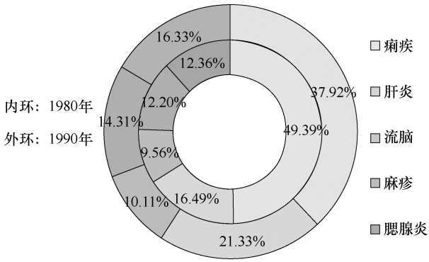

donut

| Category | 1980 (%) | 1990 (%) |
| --- | --- | --- |
| 痢疾 | 49.39 | 37.92 |
| 肝炎 | 16.49 | 21.33 |
| 流脑 | 9.56 | 10.11 |
| 麻疹 | 12.20 | 14.31 |
| 腮腺炎 | 12.36 | 16.33 |

图 2-7 某市 1980 年和 1990 年 5 种传染病发病构成环形图

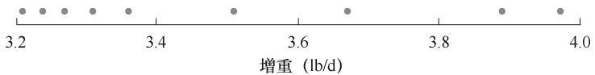

scatter

| X (lb/d) |
| --- |
| ~3.21 |
| ~3.24 |
| ~3.27 |
| ~3.30 |
| ~3.34 |
| ~3.50 |
| ~3.68 |
| ~3.89 |
| ~3.97 |

图 2-8 肉牛增重点线图

6.散点图 散点图（scatter chart）又称为散布图，适合于表示数值数据的频数分布，对计数数据和计量数据的频数分布都适用。作图时，用横坐标表示变量的自然值或组中值，纵坐标表示频数。根据图中的各点分布走向和密集程度来判断变量之间的关系。以例 2-5 中100 只来亨鸡每月产蛋数的频数分布和例 2-7 中 150 尾鲢鱼体长的频数分布为例做出散点图（图 2-9 和图 2-10）。

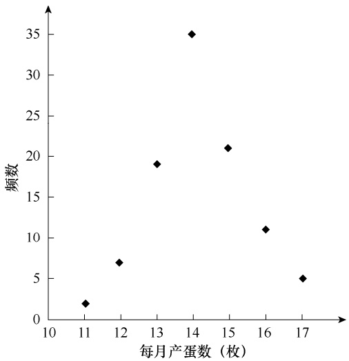

scatter

| 每月产蛋数 (枚) | 频数 |
| --- | --- |
| 11 | 2 |
| 12 | 7 |
| 13 | 19 |
| 14 | 35 |
| 15 | 21 |
| 16 | 11 |
| 17 | 5 |

图 2-9 来亨鸡每月产蛋数频数分布散点图

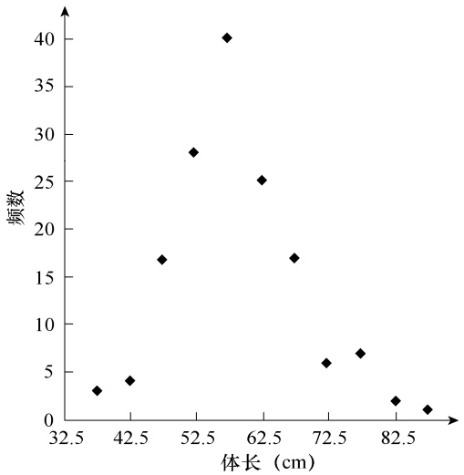

scatter

| 体长 (cm) | 频数 |
| --- | --- |
| ~38 | 3 |
| ~42 | 4 |
| ~48 | 17 |
| ~52 | 28 |
| ~57 | 40 |
| ~62 | 25 |
| ~68 | 17 |
| ~72 | 6 |
| ~78 | 7 |
| ~82 | 2 |
| ~88 | 1 |

图 2-10 鲢鱼体长频数分布散点图

7.折线图 折线图（broken line chart）也称为多边形图（polygon chart），也是表示计量数据频数分布的一种方法。作折线图时，以横坐标表示各组组中值，纵坐标表示频数，在各组组中值的垂线上，按该组频数应占高度标记一个点，把相邻的点用直线段顺次连接起来，即成折线图。以例 2-7 中 150 尾鲢鱼体长的频数分布为例做出多边形图（图 2-11）。
8.累积频率图 根据累积频率，可以绘制出累积频率图。以例 2-6 小麦穗粒数的分布绘制其累积频率图（图 2-12）。

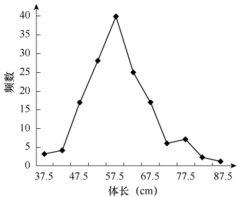

line

| 体长 (cm) | 频数 |
| --- | --- |
| 37.5 | 3 |
| 40.0 | 4 |
| 45.0 | 17 |
| 50.0 | 28 |
| 57.5 | 40 |
| 62.5 | 25 |
| 67.5 | 17 |
| 72.5 | 6 |
| 77.5 | 7 |
| 82.5 | 2 |
| 87.5 | 1 |

图 2-11 鲢鱼体长频数分布折线图

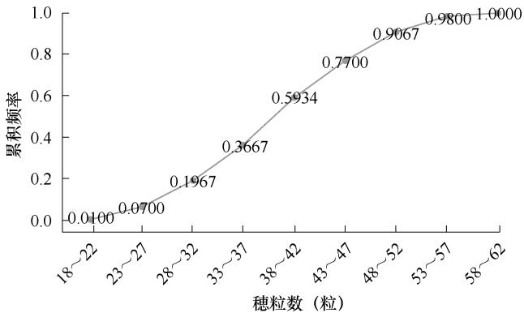

line

| 穗粒数 (粒) | 累积频率 |
| --- | --- |
| 18~22 | 0.0100 |
| 23~27 | 0.0700 |
| 28~32 | 0.1967 |
| 33~37 | 0.3667 |
| 38~42 | 0.5934 |
| 43~47 | 0.7700 |
| 48~52 | 0.9067 |
| 53~57 | 0.9800 |
| 58~62 | 1.0000 |

图 2-12 小麦穗粒数的累积频率图

9.线图 线图（line graph）是指在平面坐标上用不同线段升降来表示时间序列计量数据变化特征和规律的图形。常见的线图是以纵横坐标轴为算术尺度、表示时间变化趋势的普通线图。如果纵坐标轴为对数尺度、横坐标轴为算术尺度所表示消长趋势的则为半对数线图（semi-logarithmic line graph）。由于线图表现的是连续性数据的变化趋势，所以制作线图时图体不能折断。

例 **2-10** 某地 1968～1974 年男女结核病死亡率数据如表 2-14 所示。所制作的男女结核病死亡率线图如图 2-13 所示。

表 2-14 某地 1968～1974 年男女结核病死亡率（1/10 万）

| 年份 | 男 | 女 | 年份 | 男 | 女 |
| --- | --- | --- | --- | --- | --- |
| 1968 | 50.19 | 37.54 | 1972 | 35.59 | 24.08 |
| 1969 | 42.97 | 25.00 | 1973 | 38.31 | 24.10 |
| 1970 | 45.37 | 27.88 | 1974 | 25.29 | 16.00 |
| 1971 | 44.42 | 25.10 |  |  |  |

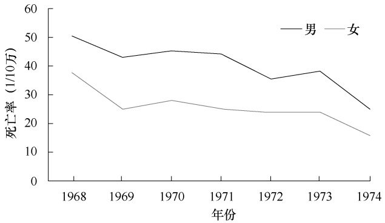

line

| 年份 | 男 (1/10万) | 女 (1/10万) |
| --- | --- | --- |
| 1968 | ~50 | ~38 |
| 1969 | ~43 | ~25 |
| 1970 | ~45 | ~28 |
| 1971 | ~44 | ~25 |
| 1972 | ~35 | ~24 |
| 1973 | ~38 | ~24 |
| 1974 | ~25 | ~16 |

图 2-13 男女结核病死亡率线图

图 2-13 是纵横坐标轴均为算术尺度的普通线图。从图中可以看出两点:一是随时间变化的男女结核病死亡率均呈下降趋势；二是男女结核病死亡率时间变化两线图相比，男性死亡率高于女性。

**10**.雷达图 雷达图（radar chart）也称为网络图、蜘蛛网图、极坐标图或 Kiviat 图，是以二维图表的形式从同一点开始的多个轴上表示多变量数值数据的图形方法。相对于平行坐标图，雷达图的坐标轴为径向（放射）排列。对于图 2-13 线图，所显示的是两个变量的变化趋势，可以在平面直角坐标系中进行绘图。如果所研究的变量是三个，可以绘制成三维立体图，但绘图难度会加大。当变量多于三个时，运用一般的点图方法就很难绘制了。这时，就需要使用多变量数据的图示方法，如雷达图、脸谱图、星座图、连接向量图等。这里只介绍较为常见的雷达图。

设有 K 个变量，其雷达图的做法是:先做一个圆，将圆 K 等分，得到 K 个点，将其 K 个点与圆心相连，得到 K 个辐射状的半径，即 K 个变化的坐标轴；在每个坐标轴上划分若干相同尺度的刻度，将相邻坐标上等刻度点用虚线或渐变色连成雷达刻度标尺；根据各样本的数值在相应 K个坐标轴上进行标记，将相邻标记点连接后就形成了雷达。以例 2-8 某市 1980 年和 1990 年 5 种传染病发病构成为例制作雷达图（图 2-14），表示了 1980 年和 1990 年 5 种传染病构成百分比。从中可以看出:一是两年度均以痢疾发病占比最大；二是 1990 年较 1980 年痢疾占比下降，但肝炎和腮腺炎占比上升。

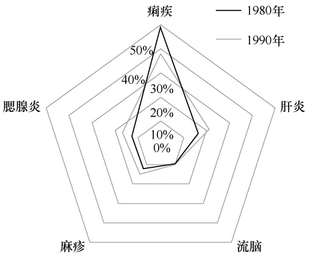

radar

| Dimension | 1980年 (%) | 1990年 (%) |
| --- | --- | --- |
| 痢疾 | ~55 | ~45 |
| 肝炎 | ~20 | ~20 |
| 流脑 | ~15 | ~15 |
| 麻疹 | ~15 | ~15 |
| 腮腺炎 | ~15 | ~15 |

图 2-14 某市 1980 年和 1990 年5 种传染病发病构成雷达图

## 第三节 数据特征的定量描述

通过数据的分组整理、制作频数分布表和频数分布图，对数据分布的基本形态和特征有了大致的了解。为进一步认识和分析数据分布的特征和规律，还需要找到度量数据变量集中性和变异程度两大特征的特征值（eigenvalue），同时对反映数据分布形状的偏度和峰度特征进行度量。这三个方面的定量描述分别反映了数据分布特征的不同侧面，本节将重点介绍数据特征的基本概念、计算方法、特点及应用场合等。

## 一、集中性描述

集中性（centrality）也称为集中趋势（central tendency），是一组数据在趋势上有着向某一中心聚集，或者说以某一数值为中心而分布的性质，它反映了一组数据中心点的位置所在。对数据集中性进行度量就是寻找数据水平的特征值或中心值。在这里，我们将从不同数据类型出发，从低层次的观测数据开始逐步介绍集中性的各个特征值。需要特别指出的是，适用于低层次观测数据集中性特征值的度量，也适用于较高层次的观测数据，因为后者具有前者的数学特性。但反过来，高层次观测数据集中性特征值的度量并不适用于较低层次的观测数据。因此，先用哪一个特征值来反映数据的集中性，要根据所掌握的数据类型和特点来确定。

## （一）众数

众数（mode）是指一组数据中出现频数最多的度量值，用 $M _ { 0 }$ 表示。众数主要用于度量分类数据的集中性，也适用于计数数据或计量数据（以组中值作为中点值）集中性的度量。众数的特点是不受数据中极端值的影响。

对例 2-4，杂交 $\mathrm { F } _ { 2 }$ 代的分离性状属于分类数据，种子颜色和饱满度就是其变量值。在所观测的 556 粒 $\mathrm { F } _ { 2 }$ 代种子中，频数最多的是黄色圆粒，为 315 粒，众数为黄色圆粒这一分离性状，其 $M _ { 0 }$ =黄色圆粒。这就是说，黄色圆粒是豌豆杂交试验 $\mathrm { F } _ { 2 }$ 代分离性状的概括性度量值。当然，对这一变量的代表性需要做进一步分析。同样，对例 2-5，我们知道每月产蛋数为 14枚的频数最多（35 次），可以判断其众数 $M _ { 0 } { = } 1 4 .$ 。对例 2-7 鲢鱼体长的频数分布，组中值为57.5cm 的一组频数最多，为 40 尾，因此其众数 $M _ { 0 } { = } 5 7 . 5$ 。

从以上三个例子的数据分布可以看出，众数是具有明显集中性特点的度量值，频数最多的一组对应的也是其分布图中的最高峰。当然，数据的分布如果没有集中性或最高峰，其众数也可能不存在；如果分布有两个最高峰值，也可以有两个众数。不同分布类型的众数示意图如图 2-15 所示。

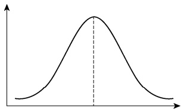

violin

| X | Y |
| --- | --- |
| ~0 | ~0.1 |
| ~25% | ~0.8 |
| ~50% | ~1.0 |
| ~75% | ~0.8 |
| ~100% | ~0.1 |

(a) M0

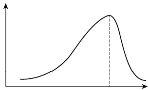

line

| X | Y |
| --- | --- |
| ~0 | ~0.1 |
| ~25% | ~0.8 |
| Peak | ~0.9 |
| ~75% | ~0.1 |

(b) M0

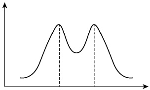

line

| X | Y |
| --- | --- |
| Left Peak | High |
| Center Valley | Low |
| Right Peak | High |

(c) 双众数

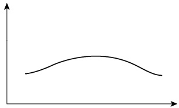

natural_image

Simple line drawing of a curved, bell-shaped curve on a right-pointing axis (no text or symbols)

(d) 无众数

图 2-15 不同数据分布类型的众数示意图

## （二）中位数和分位数

1.中位数 中位数（median）是指对一组数据依大小顺序排列后，处于中间位置的变量值，用 $M _ { d }$ 表示。显然，中位数将全部数据等分为两部分，每一部分各包含 50% 的数据，一半数据大于中位数，一半数据小于中位数。中位数是一个表示位置的特征值，主要用于度量排序后数值数据的集中性特征。中位数不适用于分类数据。

在计算中位数时，当样本容量 n 为奇数时，中位数就是中间那个数值，其公式为

$$
\text {中位数位置} = \frac {n + 1}{2} \tag {2-6}
$$

当样本容量 n 为偶数时，中位数就是中间两个数值之和除以 2，其公式为

$$
\text {中位数位置} = \frac {\frac {n}{2} + \left(\frac {n}{2} + 1\right)}{2} = \frac {n + 1}{2} \tag {2-7}
$$

例 **2-11** 随机抽取 20 株小麦，其株高（cm）数据如下:

$$
\begin{array}{c c c c c c c c c c c c c c c c c c} 8 2 & 7 9 & 8 5 & 8 4 & 8 6 & 8 4 & 8 3 & 8 2 & 8 3 & 8 3 & 8 4 & 8 1 & 8 0 & 8 1 & 8 2 & 8 1 & 8 2 & 8 2 & 8 2 & 8 0 \end{array}
$$

求小麦株高的中位数。

对这些数值按从小到大的顺序排列:

$$
\begin{array}{c c c c c c c c c c c c c c c c c} 7 9 & 8 0 & 8 0 & 8 1 & 8 1 & 8 1 & 8 2 & 8 2 & 8 2 & 8 2 & 8 2 & 8 2 & 8 2 & 8 3 & 8 3 & 8 3 & 8 4 & 8 4 & 8 4 & 8 5 & 8 6 \end{array}
$$

这一序列数据的最小值是 79（cm），最大值为 86（cm）。根据式（2-7），求得中位数的位置为 $\frac{20 + 1}{2} = 10.5$ ，中位数 $\frac{82 + 82}{2} = 82 \left( cm \right)$

显然，可以知道中位数有两个性质。

性质 1 中位数是从中间点将全部数据等分为两部分，它是一个位置代表值，有可能不在数据分布图形的中间。

性质 2 中位数不受端点数据的影响，即其位置与最大值、最小值无关。

2.分位数 与中位数等分全部数据为两部分相类似的还有四分位数（quartile）、十分位数（decile）和百分位数（centile）等，它们分别是用 3 个点、9 个点、99 个点将全部数据4 等分、10 等分和 100 等分。这里只介绍四分位数的计算，其他分位数与之类似。

四分位数也称为四分位点，它通过三个点将全部数据等分为四部分，其中每部分包括 1/4的数据，处在分位点上的数值就是四分位数。显然，正中间的四分位数就是中位数，因此通常所指的四分位数就是第一四分位数（下四分位数，first quartile）和第三四分位数（上四分位数，three quartile）。对未分组数据计算四分位数时，与计算中位数类似，首先对数据进行排序，然后确定四分位数的位置。

$Q _ { 1 }$ 为第一四分位数， $Q _ { 3 }$ 为第三四分位数，则有

$$
Q _ {1} \text {位置} = \frac {n + 1}{4}, Q _ {3} \text {位置} = \frac {3 (n + 1)}{4} \tag {2-8}
$$

例 **2-12** 求例 2-11 中 20 株小麦的株高（cm）的第一四位数和第三四分位数。

$$
\begin{array}{c c c c c c c c c c c c c c c c c} 7 9 & 8 0 & 8 0 & 8 1 & 8 1 & 8 1 & 8 2 & 8 2 & 8 2 & 8 2 & 8 2 & 8 2 & 8 3 & 8 3 & 8 3 & 8 4 & 8 4 & 8 4 & 8 5 & 8 6 \end{array}
$$

利用式（2-8）， $\mathcal { Q } _ { 1 }$ 位置 $= \frac{20  +  1}{4}  =  5.25$ ， 3Q位置 $\frac{3(20 + 1)}{4} = 15.75$ ，则

$$
Q _ {1} = 8 1 + 0. 2 5 \times (8 1 - 8 1) = 8 1 (\mathrm{cm})
$$

$$
Q _ {3} = 8 3 + 0. 7 5 \times (8 4 - 8 3) = 8 3. 7 5 (\mathrm{cm})
$$

通过对例 2-11 的一系列解析，我们分别得到了最小值、最大值、中位数、 $Q _ { 1 }$ 和 $Q _ { 3 }$ ，把这 5 个数值放在一起，称为五数概括（five-number summary）。本节后面将利用五数概括制作箱线图。

## （三）平均数

平均数（mean）简称均数或均值，是全部数据的平均，表示数据中观测值的中心位置，可作为数据的代表值。平均数在统计学中具有重要的地位，是描述数据集中性的特征值。平均数适用于数值数据，不适用于分类数据。

1.算术平均数 算术平均数（arithmetic mean）是总体或样本数据中各个观测值的总和除以观测值的个数所得的商。对于一具有 N 个观测值的有限总体，其观测值为 $X _ { 1 } , X _ { 2 } , \cdots$

$X _ { N }$ ，则总体算术平均数（arithmetic mean of the population）为

$$
\mu = \frac {X _ {1} + X _ {2} + \cdots + X _ {N}}{N} = \frac {\sum_ {i = 1} ^ {N} X _ {i}}{N} \tag {2-9}
$$

对于一具有 $n$ 个观测值的样本，其观测值为 $x_{1}, x_{2}, \cdots, x_{n},$ ，则样本算术平均数（arithmetic mean of the sample）为

$$
\overline {{x}} = \frac {x _ {1} + x _ {2} + \cdots + x _ {n}}{n} = \frac {\sum_ {i = 1} ^ {n} x _ {i}}{n} \tag {2-10}
$$

式（2-9）和式（2-10）中， $\sum$ 为求和符号， $\sum _ { i = 1 } ^ { n } x _ { i }$ 表示 $x _ { i }$ 从 $i { = } 1$ 一直加到 $i { = } n$ ，也可简写为 $\sum _ { i } x _ { i }$或 $\sum x$ ； $\overline { { x } }$ 是 $\mu$ 的估计值。由于 x 应用广泛，常将算术平均数简称为平均数或均值。可以通过以下三种方法来计算算术平均数。

1）直接计算法 当样本较小时可根据算术平均数的定义直接进行计算。

例 **2-13** 求例 2-11 中 20 株小麦的平均株高（cm）。

根据平均数的定义，由式（2-10），得

$$
\bar {x} = \frac {1}{n} \sum x = \frac {1}{2 0} \times (8 2 + 7 9 + \dots + 8 0) = 8 2. 3 (\mathrm{cm})
$$

2）减去（或加上）常数法 若变量 $x _ { i }$ 的值都较大（或较小）且接近某一常数 $a$ 时，可将它们的值都减去（或加上）常数 $a ,$ ，得到一组新的数据，然后再计算平均数，最后重新加上（或减去）常数 a 即得到 $\overline { { x } }$ 。以减去常数 a 为例，设 $y_{1}=x_{1}-a,\ y_{2}=x_{2}-a,\ \cdots,\ y_{n}=x_{n}-a$则有 $x_{1}=y_{1}+a,\ x_{2}=y_{2}+a,\ \cdots,\ x_{n}=y_{n}+a$ ，于是有

$$
\overline {{x}} = \frac {1}{n} \sum_ {i = 1} ^ {n} x _ {i} = \frac {1}{n} \sum_ {i = 1} ^ {n} (y _ {i} + a) = \frac {1}{n} \sum_ {i = 1} ^ {n} y _ {i} + \frac {1}{n} (n a) = \frac {1}{n} \sum_ {i = 1} ^ {n} y _ {i} + a \tag {2-11}
$$

例 **2-14** 用减去常数法求例 2-11 中 20 株小麦的平均株高（cm）。

设 $a { = } 8 0$ ，则有 $y_{1}=82-80=2,\ y_{2}=79-80=-1,\ \cdots,\ y_{20}=80-80=0$ ，代入式（2-11），得

$$
\bar {x} = \frac {1}{n} \sum y + a = \frac {1}{2 0} \times [ 2 + (- 1) + \dots + 0 ] + 8 0 = 8 2. 3 (\mathrm{cm})
$$

3）加权平均法 在具有 n 个数据的样本中，如果数据 $x _ { 1 }$ 出现 $f _ { 1 }$ 次，数据 $x _ { 2 }$ 出现 $f _ { 2 }$次，…，数据 $x _ { k }$ 出现 $f _ { k }$ 次，且 $f_{1}+f_{2}+\cdots+f_{k}=n$ ，则有

$$
\overline {{x}} = \frac {f _ {1} x _ {1} + f _ {2} x _ {2} + \cdots + f _ {k} x _ {k}}{f _ {1} + f _ {2} + \cdots + f _ {k}} = \frac {1}{n} \sum_ {i = 1} ^ {k} f _ {i} x _ {i} \tag {2-12}
$$

式中， $f _ { i }$ 可理解为 $x _ { i }$ 在平均数中的权数（weight），即数值相同的数据出现的频数，因而式（2-12）所求得的 x 称为加权平均数（weighted mean）。有数据分组的就是这种类型，如例2-5 中来亨鸡每个月的产蛋数，按自然数 11～17 进行分组计算其每组的频数（表 2-8），可理解为权数 $f _ { i } ,$ 。

例 **2-15** 利用加权平均法，计算例 2-11 中 20 株小麦株高的加权平均数。

先整理 20 个小麦株高数据，如表 2-15 所示。

表 2-15 20 个小麦株高数据的频数分布

| 株高(x, cm) | 频数(f) | fx | $fx^2$ |
| --- | --- | --- | --- |
| 79 | 1 | 79 | 6241 |
| 80 | 2 | 160 | 12800 |
| 81 | 3 | 243 | 19683 |
| 82 | 6 | 492 | 40344 |
| 83 | 3 | 249 | 20667 |
| 84 | 3 | 252 | 21168 |
| 85 | 1 | 85 | 7225 |
| 86 | 1 | 86 | 7396 |
| 总和 | $\sum f=20$ | $\sum fx=1646$ | $\sum fx^2=135524$ |

由式（2-12），得

$$
\bar {x} = \frac {1}{n} \sum f x = \frac {1}{2 0} \times (7 9 \times 1 + 8 0 \times 2 + \dots + 8 6 \times 1) = 8 2. 3 (\mathrm{cm})
$$

算术平均数具有以下两个重要性质。

性质 1 样本中各观测值与其平均数之差称为离均差（deviation from mean），其总和等于零。证明如下:

$$
\sum (x - \bar {x}) = (x _ {1} - \bar {x}) + (x _ {2} - \bar {x}) + \dots + (x _ {n} - \bar {x}) = (x _ {1} + x _ {2} + \dots + x _ {n}) - n \bar {x} = \sum x - n \bar {x}
$$

因为 $\scriptstyle { \frac { } { x } } = { \frac { \sum x } { n } }$ ，所以 $\sum x = n { \overline { { x } } }$ ，故

$$
\sum (x - \bar {x}) = \sum x - n \bar {x} = 0 \tag {2-13}
$$

性质 2 样本中各观测值与其平均数之差平方的总和，较各观测值与不等于平均数的任一数值离差的平方和为小，即离均差平方和（mean deviation sum of square）为最小，即设$a   \neq   { \overline { { x } } }$ ，则 $\sum (x - \bar{x})^2 < \sum (x - a)^2$ 。证明如下:

$$
\begin{array}{l} \sum (x - a) ^ {2} = \sum [ (x - \bar {x}) + (\bar {x} - a) ] ^ {2} \\ = \sum [ (x - \bar {x}) ^ {2} + 2 (x - \bar {x}) (\bar {x} - a) + (\bar {x} - a) ^ {2} ] \\ = \sum (x - \bar {x}) ^ {2} + 2 \sum (x - \bar {x}) (\bar {x} - a) + \sum (\bar {x} - a) ^ {2} \\ = \sum (x - \bar {x}) ^ {2} + 2 (\bar {x} - a) \sum (x - \bar {x}) + n (\bar {x} - a) ^ {2} \\ \end{array}
$$

已知 $\sum (x - \overline{x}) = \sum x - n\overline{x} = 0$ ，因此 $2(\overline{x}-a)\sum(x-\overline{x})=0$ 。又由于 $n(\overline{x} - a)^{2} > 0$ ，所以

$$
\sum (x - \bar {x}) ^ {2} <   \sum (x - a) ^ {2} \tag {2-14}
$$

算术平均数是描述观测数据集中性的重要特征值，它主要有以下两个作用:①指出一组数据的中心位置，标志着数据所代表性状的数量水平和质量水平；②作为全部数据的代表与其他数据进行比较。

2.几何平均数 几何平均数（geometric mean）是指数据中有 n 个观测值，其乘积开n 次方所得的数值用 $G$ 表示。几何平均数适用于变量 x 为对数正态分布，或经对数转换后呈正态分布的数据。其计算公式为

$$
G = \sqrt [ n ]{x _ {1} \cdot x _ {2} \cdot \dots \cdot x _ {n}} = \sqrt [ n ]{\prod_ {i = 1} ^ {n} x _ {i}} \tag {2-15}
$$

式中， $\Pi$ 为求积符号。

几何平均数主要用于计算比率的平均。例如，生物体重量、体积的增长率变化，药物降解的半衰期，生物体内致病菌的潜伏期等，也可用于反映年度、季节、月份及其他时间段的平均增长率。

例 **2-16** 某省 2015 年的草莓产量为 17.66 万吨，2016 年、2017 年、2018 年分别比上年增长 13.53%、10.12%、2.72%。求各年的平均增长率。

从本例给出的数据可知，各年与上年的比值（发展速度）应在增长率基础上加上 100%，分别应为 113.53%、110.12%和 102.72%，由式（2-15）则平均发展速度为

$$
G = \sqrt [ n ]{x _ {1} \cdot x _ {2} \cdot \dots \cdot x _ {n}} = \sqrt [ 3 ]{1 1 3 . 5 3 \% \times 1 1 0 . 1 2 \% \times 1 0 2 . 7 2 \%} = 1 0 8. 7 0 \%
$$

因此，年平均增长率为 $108.70\% - 100\% = 8.70\%$

在本例中，如果用算术平均数，则有 $\frac{13.53\% + 10.12\% + 2.72\%}{3} = 8.79\%$ ，尽管这一数值与几何平均数相差不大，但其结果是错误的。因为根据各年的增长率，2016 年的产量为 17.66× $113.53\% = 20.05$ （万吨），2017 年的产量为 $20.05 \times 110.12\% = 22.08$ （万吨），2018 年的产量为 $22.08 \times 102.72\% = 22.68$ （万吨）。如果按算术平均数的年平均增长率来计算，2018 年的产量应为 $17.66 \times 108.79\% \times 108.79\% \times 108.79\% = 22.7383$ （万吨），用几何平均数的年平均增长率计算的结果为 $17.66 \times 108.70\% \times 108.70\% \times 108.70\% = 22.6819$ （万吨）。而实际产量为 22.68万吨，显然用几何平均数的年平均增长率计算的结果与实际产量是一致的。这说明，对于比率数据，使用几何平均数要比算术平均数更为合理。

以上计算可用下面的系列公式来进行表述:设开始的数据为 $x _ { 0 } ,$ ，逐年增长率为 $G _ { 1 }$ $G _ { 2 } , \cdots , G _ { n } ,$ ，则第 n 年的数值为

$$
x _ {n} = x _ {0} (1 + G _ {1}) (1 + G _ {2}) \dots (1 + G _ {n}) = x _ {0} \prod_ {i = 1} ^ {n} (1 + G _ {i}) \tag {2-16}
$$

从 $x _ { 0 }$ 到 $x _ { n }$ 用 $n$ 年，每年的增长率都相同，这个增长率 G 就是平均增长率 $\bar { G }$ 。式（2-16）中， $G _ { i }$ 都等于 $\bar { G }$ 。因此，有

$$
(1 + \overline {{G}}) ^ {n} = \prod_ {i = 1} ^ {n} (1 + G _ {i}) \tag {2-17}
$$

$$
\bar {G} = \sqrt [ n ]{\prod_ {i = 1} ^ {n} (1 + G _ {i})} - 1 \tag {2-18}
$$

当所平均的各比率数值差别不大时，算数平均数和几何平均数的结果是相差不大的，当各比率的数值相差较大时，二者的差别就很明显。

对例 2-16，由式（2-18），有

$$
\bar {G} = \sqrt [ n ]{\prod_ {i = 1} ^ {n} (1 + G _ {i})} - 1 = \sqrt [ 3 ]{1 1 3 . 5 3 \% \times 1 1 0 . 1 2 \% \times 1 0 2 . 7 2 \%} - 1 = 8. 7 0\%
$$

其结果与式（2-15）计算的结果再减去 1 是一样的。

如果数据变量值是比率形式的，可以直接用式（2-15）计算几何平均数。如果数据与相

邻值为等比关系，可对各数据取对数相加之和除以 $n ,$ ，再求出反对数，算出几何平均数:

$$
G = \lg^ {- 1} \left[ \frac {1}{n} (\lg x _ {1} + \lg x _ {2} + \dots + \lg x _ {n}) \right] = \lg^ {- 1} \left(\frac {1}{n} \sum_ {i = 1} ^ {n} \lg x _ {i}\right) \tag {2-19}
$$

需要注意的是，当数据中出现 0 或负值时是不宜计算几何平均数的。

3.调和平均数 调和平均数（harmonic mean）又称为倒数平均数，是数据变量倒数的算术平均数的倒数，用 H 表示。其计算公式为

$$
H = \frac {1}{\sum_ {\underline {{i = 1}}} ^ {n} \frac {1}{x _ {i}}} = \frac {n}{\sum_ {i = 1} ^ {n} \frac {1}{x _ {i}}} \tag {2-20}
$$

调和平均数主要用于反映年度或阶段的增长率（生长率）或生长量（规模）。由于调和平均数需要通过变量的倒数来计算，所以只要有一个变量值为零，就不能计算调和平均数。

例 **2-17** 对例 2-16 中的数据，计算调和平均数。

将各年增长率分别加 1，代入式（2-20），有

$$
H = \frac{1}{\sum\frac{1}{x}} = \frac{1}{\frac{1}{3}\times\left(\frac{1}{113.53\%} + \frac{1}{110.12\%} + \frac{1}{102.72\%}\right)} = 108.60\%
$$

$$
\bar{H} = H - 1 = 108.60\% -100\% = 8.60\%
$$

调和平均数易受极端值的影响，且受极小值的影响比受极大值的影响更大。对于同一批数据，不同平均数的计算结果不一样，反映出数据集中趋势的程度是不相同的，其关系是:$\bar{x} > G > H$ ，即算术平均数＞几何平均数＞调和平均数。

对于分组数据 $x _ { i } ,$ ，具有权数 $f _ { i }$ 的情形，由式（2-21）可以求出加权调和平均数:

$$
H = \frac {\sum_ {i = 1} ^ {k} f _ {i}}{\sum_ {i = 1} ^ {k} f _ {i} \frac {1}{x _ {i}}} \tag {2-21}
$$

加权调和平均数是加权算术平均数的另一种形式。通过公式可推导:由于 $\sum { \it f } { = } { \frac { \sum { \it f x } } { \it x } }$ ，故有

$$
\overline {{x}} = \frac {\sum f x}{\sum f} = \frac {\sum f x}{\sum \frac {f x}{x}} = \frac {\sum f x}{\sum f x \frac {1}{x}}
$$

令 $M { = } f x$ ，则

$$
\overline {{x}} = \frac {\sum M}{\sum M \frac {1}{x}} = H
$$

例 **2-18** 计算例 2-11 数据的加权调和平均数。

由式（2-21），有

$$
H = \frac {\sum f}{\sum f \frac {1}{x}} = \frac {1 + 2 + \cdots + 1}{1 \times \frac {1}{7 9} + 2 \times \frac {1}{8 0} + \cdots + 1 \times \frac {1}{8 6}} = 8 2. 3 (\mathrm{cm})
$$

由此可见，调和平均数是算术平均数的变形使用。调和平均数与算术平均数相比，具有两个方面的区别:①变量不同，算术平均数的变量是 x，而调和平均数的变量是 $\frac{1}{x}$ ；②算术平均数的权数是 f 或 n，而调和平均数的权数是 fx 或 $M _ { \circ }$

## （四）众数、中位数和平均数的比较

众数、中位数和平均数是描述数据集中性的三个主要指标，它们既具有密切的联系，也有明显的区别。从数据分布来看，众数始终是一组数据的峰值，中位数是处于一组数据中间位置上的值，而平均数则是全部数据的算术平均。因此，对于具有单峰分布的大多数数据而言，众数、中位数和平均数之间具有如下关系（图 2-16）:①如果数据分布是对称的，众数 $( M _ { 0 } )$中位数 $( M _ { d } )$ 和平均数（ x ）必定相等，即 $M_{0}=M_{d}=\overline{x}$ ；②如果数据是左偏分布，说明数据存在极小值，必然拉动平均数向极小值一方靠拢，而众数和中位数由于是位置代表值，不受极小值的影响，因此三者之间的关系表现为 $\bar{x} < M_{d} < M_{0};$ ；③如果数据是右偏分布，说明数据存在极大值，必然拉动平均数向极大值一方靠拢，因此三者之间的关系表现为 $M_{0} < M_{d} < \overline{x}$

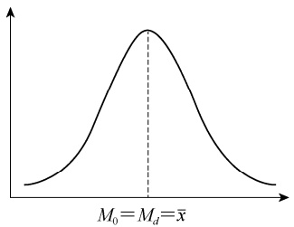

violin

| Metric | Value |
| --- | --- |
| Mean (M0) | Md = x̄ |

(a) 对称分布

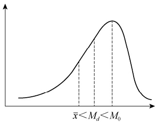

violin

| Threshold | Description |
| --- | --- |
| x̄ < Md < M0 | Vertical dashed line representing the range between x̄ and M0 |

(b) 左偏分布

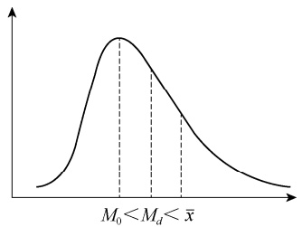

violin

| Threshold | Value |
| --- | --- |
| M0 | ~0.5 |
| Md | ~0.6 |
| x̄ | ~0.7 |

(c) 右偏分布

图 2-16 不同分布的众数、中位数和平均数

众数、中位数和平均数各具有不同特点，其应用的场合也各不相同。在一组数据中，平均数和中位数都具有唯一性，但众数有时不具有唯一性，有时可能会出现两个或多个众数。众数和中位数都是表示位置的代表值，不受极差数据影响，而平均数则利用了全部数据来描述其集中性特征。众数主要适合于分类数据集中性的描述，中位数主要用于按顺序排列的数值数据，平均数则适应于数值数据的计算。相对于众数和中位数，平均数受极差数值影响较大，如果数据的偏斜程度较大，平均数的代表性会变得比较差，这时可选择众数或中位数等位置代表值来描述数据的集中性特征。

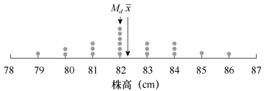

scatter

| 株高 (cm) | Value |
| --- | --- |
| 79 | 1 |
| 80 | 2 |
| 81 | 3 |
| 82 | 4 |
| 83 | 3 |
| 84 | 3 |
| 85 | 1 |
| 86 | 1 |

图 2-17 小麦株高平均数与中位数比较的点线图

进一步对平均数与中位数进行比较，中位数是按数据的数目把数据分成了两等份，而平均数就是数据的“平衡点”。从图 2-17 小麦株高点线图中可以看出，其平均数与中位数不在同一位置。由于中位数只受数据位置的影响，所以只要与求解中位数位置有关的数据不发

生变化，其中位数是不变的，因此中位数具有较强的稳健性（robust）或者抗性（resistant），或者说中位数是稳健的统计数。对平均数来说，它的值与数据总和相关联，会受到任何一数据变动的影响，进而引起 $\overline { { x } }$ 在点线图的坐标位置发生变化，因此可以说平均数是不稳健的统计数。基于以上分析，只要知道数据的数目，就可方便地求出中位数的位置和中位数的值；但平均数的计算，则必须是全部数据参与才能得到。正因为平均数的计算需要所有数据的参与，它更能在表达数据集中性时反映数据的全部信息，因而它比中位数更有效率。

## 二、变异程度描述

前面讨论的集中性只是数据分布的一个特征，它所反映的是各变量向其中心值聚集的程度。数据分布还有另外一个特征，即变异性（variability）。变异性所反映的是各变量值远离中心值的程度，也称离中趋势（scedasticity）或离散（dispersion）程度。用来表示变异性的指标有很多，主要有异众比率、极差和平均离差、四分位差、方差和标准差、变异系数等，其中以标准差和变异系数应用最为广泛。

## （一）异众比率

异众比率（variation ratio）是指分组数据中非众数组的频数占总频数的比率，用 $V _ { r }$ 表示。其计算公式为

$$
V _ {r} = \frac {\sum_ {i = 1} ^ {k} f _ {i} - f _ {m}}{\sum_ {i = 1} ^ {k} f _ {i}} = 1 - \frac {f _ {m}}{\sum_ {i = 1} ^ {k} f _ {i}} \tag {2-22}
$$

式中， $\sum _ { i = 1 } ^ { k } f _ { i }$ 为数据变量值的总频数； $f _ { m }$ 为众数组的频数。

异众比率的作用是衡量众数对一组数据的代表程度。异众比率越大，说明非众数组的频数占总频数的比重越大，众数的代表性就越差；异众比率越小，表明非众数组的频数占总频数的比重越小，众数的代表性越好。既可以用异众比率表征分类数据的变异程度，也可用数值数据计算出异众比率。

例 **2-19** 对例 2-5 数据，计算 100 只来亨鸡每月产蛋数的异众比率。

例 2-5 中，将 100 只来亨鸡每月产蛋数据按照自然数分为 11～17 共 7 个组，其中每月产蛋数 14 个为众数组，即 $M _ { 0 } { = } 1 4$ ，其频数为 35。根据式（2-22），有

$$
V_{r} = \frac{100 - 35}{100} = 1 - \frac{35}{100} = 0.65 = 65\%
$$

结果表明，除 $M _ { 0 } { = } 1 4$ 这一组之外的数据占到 65%，异众比率偏大，说明 $M _ { 0 } { = } 1 4$ 作为众数组之外还有较大变异程度。

## （二）极差和平均离差

1.极差 极差（range）又称为全距，它是一组数据中最大值和最小值之差，一般用R 表示，其计算公式为

$$
R = \max (x _ {1}, x _ {2}, \dots , x _ {n}) - \min (x _ {1}, x _ {2}, \dots , x _ {n}) \tag {2-23}
$$

式中， $\max \left( x_{1}, x_{2}, \cdots, x_{n} \right)$ 和 min $(x_{1}, x_{2}, \cdots, x_{n})$ 分别表示一组数据中的最大值和最小值。

例 **2-20** 计算例 2-7 中 150 尾鲢鱼体长数据（cm）的极差。

根据式（2-23），有

$$
R = 8 5 - 3 7 = 4 8 (\mathrm{cm})
$$

极差在一定程度上能说明数据波动幅度的大小，但它只受数据中两个极端数值大小的影响，不能反映各个中间数据的变异程度。因而，极差不能准确描述出数据的变异特征，只能在研究一组数据的波动范围时表示数据的分散程度或变异特性，具有较大的局限性。

2.平均离差 平均离差（mean deviation）也称为平均绝对差，是各变量值与其均值离差绝对值的平均数，用 MD 表示，其计算公式为

$$
M D = \frac {\sum_ {i = 1} ^ {n} | x _ {i} - \overline {{x}} |}{n} \tag {2-24}
$$

对于分组数据，其计算公式为

$$
M D = \frac {\sum_ {i = 1} ^ {k} f _ {i} \mid x _ {i} - \overline {{x}} \mid}{n} \tag {2-25}
$$

例 **2-21** 求例 2-11 中 20 株小麦株高（cm）的平均离差。

根据式（2-24）可直接计算得出 20 株小麦株高（cm）的平均离差:

$$
M D = \frac {\sum | x _ {i} - \bar {x} |}{n} = \frac {1}{2 0} \times (| 8 2 - 8 2. 3 | + | 7 9 - 8 2. 3 | + \dots + | 8 0 - 8 2. 3 |) = 1. 3 6 (\mathrm{cm})
$$

也可根据式（2-25）通过加权平均得出其平均离差:

$$
M D = \frac {\sum f _ {i} \mid x _ {i} - \bar {x} \mid}{n} = \frac {1}{2 0} \times (1 \times | 7 9 - 8 2. 3 | + 2 \times | 8 0 - 8 2. 3 | + \dots + 1 \times | 8 6 - 8 2. 3 |) = 1. 3 6 (\mathrm{cm})
$$

平均离差是以平均数为中心，反映了每个数据与平均数的平均差异程度，它能全面准确地反映一组数据的分散程度或变异特性。平均离差越大，说明数据的变异程度越大；反之，则说明数据的变异程度越小。为了避免平均数的离差之和等于零，平均离差在计算时对各个数据与平均数之间的离差取绝对值，然后求其平均数，这样就带来了计算上的不便。同时，平均离差在数据性质上也不是最优的，因而在实际中应用得较少。但平均离差的实际意义比较明确，容易理解。

## （三）四分位差与箱线图

四分位差（quartile deviation）也称为四分位数间距（inter quartile range），是第三四分位数和第一四分位数之差，用 $Q _ { d }$ 或 $I Q R$ 表示，其计算公式为

$$
Q _ {d} = Q _ {3} - Q _ {1} \tag {2-26}
$$

四分位差反映了中间 50%数据的变异程度，其数值越小，说明中间的数据越集中；数据越大，说明中间的数据越分散。四分位数不受数据极端值的影响。由于中位数处于数据的中间位置，因此四分位差的大小在一定程度上也说明了中位数对一组数据的代表程度。四分位差适宜于度量经过排序的数值数据的变异程度，但不适合分类数据。

例 **2-22** 求例 2-11 中 20 株小麦的株高（cm）的四分位差。

由例 2-12，已得出第一四分位数 $Q_{1}=81cm$ ，第三四分位数 $Q_{3}=83.75cm$ ，根据式（2-26），有

$$
Q _ {d} = Q _ {3} - Q _ {1} = 8 3. 7 5 - 8 1 = 2. 7 5 (\mathrm{cm})
$$

本节前面部分已提到五数概括的概念。箱形图（boxplot）就是将最小值、最大值、中位数、 $Q _ { 1 }$ 和 $Q _ { 3 }$ 五数概括的图形展现。为了制作箱线图，我们首先要做一个数据线，然后标出最小值、第一四分位数 $Q _ { 1 }$ 、中位数、第三四分位数 $Q _ { 3 }$ 和最大值的位置；其次将 $Q_{1} 、 Q_{3}$ 两个四分位数连接为一个箱子。注意，箱子的长度与四分位差是相等的；最后，我们从 $Q _ { 1 }$ 向下延长至最小值，从 $Q _ { 3 }$ 向上扩展至最大值，一个包含五数概括的箱线图就画好了。

例 **2-23** 根据例 2-11 数据及后续计算结果制作 20 株小麦株高（cm）分布的箱线图。

由例 2-11、例 2-12 和例 2-22，已知 20 株小麦株高数据的最小值是79（cm），最大值为 86（cm），中位数=82（cm），第一四分位数 $Q _ { 1 } { = } 8 1$第三四分位数 $Q_{3}=83.75$ $Q_{d}=2.75\ (cm)$ ，制作出的箱线图如图 2-18所示。

多批数据箱线图

异常值与改进的箱线图

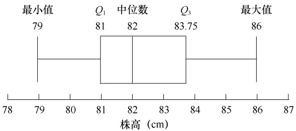

boxplot

| Metric | Value |
| --- | --- |
| 最小值 | 79 |
| Q1 | 81 |
| 中位数 | 82 |
| Q3 | 83.75 |
| 最大值 | 86 |

图 2-18 小麦株高箱线图

## （四）方差和标准差

1.方差 为了度量数据变量的变异程度，对含有 n 个观测值 $x_{1}, x_{2}, \cdots, x_{n}$ 的样本，可以用各个数据离均差的大小来表示，但由于 $\sum (x - \bar{x}) = 0$ ，不能反映样本总的变异程度。若将离均差先平方再求和，即 $\sum ( x - { \overline { { x } } } ) ^ { 2 }$ ，就可消除上述弊病。但这样还有一个缺点，就是离均差平方和常随样本容量大小而改变。为便于比较，用样本容量 n 来除离均差平方和，得到平均的平方和，简称方差（variance）或均方（mean square，MS）。对于样本来说，其方差（sample variance） $s ^ { 2 }$ 为

$$
s ^ {2} = \frac {\sum (x - \bar {x}) ^ {2}}{n - 1} \tag {2-27}
$$

对于总体，其方差（population variance） $\sigma ^ { 2 }$ 为

$$
\sigma^ {2} = \frac {\sum (x - \mu) ^ {2}}{N} \tag {2-28}
$$

式（2-27）中， $n   -   1$ 为自由度（degree of freedom），一般用 $d f$ 表示。式（2-28）中，N 为有限总体容量。

$s ^ { 2 }$ 是 $\sigma ^ { 2 }$ 的最好估计值。方差是度量数据变异的常用指标，在分析数据的变异特征和统计推断中有广泛的应用。

比较式（2-27）和式（2-28），样本方差用 n-1 作为除数。为什么除数是 $n { - } 1$ 不用 n 呢？从字面含义来看，自由度是指一组数据中可以自由取值的个数。当样本容量为 n 时，其样本平均数 x 确定后，只有 n-1 个数据可以自由取值，n 个数据中必有一个不能自由取值。例如，假定一个样本有 3 个数据，且平均数 x=5。这时，这 3 个数据中有两个数据可以自由取值，而另一个则受 x=5 和前面两个数据的限制不能自由取值。如果两个数据分别取值 $x_{1} = 6, x_{2} =$ 7，则 $x _ { 3 }$ 只能取值为 2。当然，前两个数据也可以取其他值，如 $x_{1}=4,\ x_{2}=8$ ，则 $x _ { 3 }$ 取值只能是 3。从实际运用来看，由于 $\sum ( x - { \overline { { x } } } ) ^ { 2 }$ 是一最小平方和，如果以 n 为除数，则所得 $s ^ { 2 }$ 是 $\sigma ^ { 2 }$ 的偏小估计。如果用 n-1 替代 n，则可避免偏小估计的弊端，提高用样本估计总体变异的精度。

## 2.标准差

1）标准差的定义 方差虽能反映数据变量的变异程度，但由于离均差取了平方值，使得它与原始数据的数值和单位都不相适应，需要将方差开方还原，方差的平方根值就是标准差（standard deviation，SD）。样本的标准差（standard deviation of the ample）s 为

$$
s = \sqrt {\frac {\sum (x - \bar {x}) ^ {2}}{n - 1}} \tag {2-29}
$$

总体标准差（standard deviation of the population） $\sigma$ 为

$$
\sigma = \sqrt {\frac {\sum (x - \mu) ^ {2}}{N}} \tag {2-30}
$$

2）标准差的计算 在计算标准差时，首先要先求出平均数，然后求出 $\sum ( x - { \overline { { x } } } ) ^ { 2 }$ ，再按式（2-29）进行计算。这样不仅麻烦，而且当 x 为约数时，容易引起计算误差。所以通常把 $\sum ( x - { \overline { { x } } } ) ^ { 2 }$ 进行下面变形，用原始数据进行计算:

$$
\begin{array}{l} \sum (x - \bar {x}) ^ {2} = \sum (x ^ {2} - 2 x \bar {x} + \bar {x} ^ {2}) = \sum x ^ {2} - 2 \bar {x} \sum x + n \bar {x} ^ {2} = \sum x ^ {2} - 2 \frac {\sum x}{n} \sum x + n \left(\frac {\sum x}{n}\right) ^ {2} \\ = \sum x ^ {2} - 2 \frac {\left(\sum x\right) ^ {2}}{n} + \frac {\left(\sum x\right) ^ {2}}{n} = \sum x ^ {2} - \frac {\left(\sum x\right) ^ {2}}{n} \tag {2-31} \\ \end{array}
$$

代入式（2-29），得

$$
s = \sqrt {\frac {\sum x ^ {2} - \frac {\left(\sum x\right) ^ {2}}{n}}{n - 1}} \tag {2-32}
$$

在实际计算时，当遇到数值较大（或较小）的数据时，为了简化计算过程，可将各观测值都减去（或加上）一个常数，所得的 s 不变。

例 **2-24** 测得 9 名男子前臂长（cm）的样本数据，列于表 2-16，试计算其标准差（设 $x ^ { \prime } { = }$ x-45）。

表 2-16 9 名男子前臂长数据的频数分布

| 前臂长(x, cm) | $x^{2}$ | $x' = x - 45$ | $x'^{2}$ |
| --- | --- | --- | --- |
| 45 | 2025 | 0 | 0 |
| 42 | 1764 | -3 | 9 |
| 44 | 1936 | -1 | 1 |
| 41 | 1681 | -4 | 16 |
| 47 | 2209 | 2 | 4 |
| 50 | 2500 | 5 | 25 |
| 47 | 2209 | 2 | 4 |
| 46 | 2116 | 1 | 1 |
| 49 | 2401 | 4 | 16 |
| $\sum x = 411$ | $\sum x^{2} = 18841$ | $\sum x' = 6$ | $\sum x'^{2} = 76$ |

将表 2-16 数据按两种算法代入式（2-32），得

$$
\begin{array}{l} s = \sqrt {\frac {\sum x ^ {2} - \frac {\left(\sum x\right) ^ {2}}{n}}{n - 1}} = \sqrt {\frac {1 8 8 4 1 - \frac {4 1 1 ^ {2}}{9}}{9 - 1}} = 3. 0 (\mathrm{cm}) \\ s = \sqrt {\frac {\sum x ^ {\prime 2} - \frac {\left(\sum x ^ {\prime}\right) ^ {2}}{n}}{n - 1}} = \sqrt {\frac {7 6 - \frac {6 ^ {2}}{9}}{9 - 1}} = 3. 0 (\mathrm{cm}) \\ \end{array}
$$

两种算法相比，其结果是一样的，但第二种算法更为简便易行。因此，当样本变量数据的数值较大时，用简化后的数据计算标准差 s 可以大大节省计算工作量。

对于分组数据，可采用加权的公式进行计算，其公式为

$$
s = \sqrt {\frac {\sum f (x - \bar {x}) ^ {2}}{n - 1}} = \sqrt {\frac {\sum f x ^ {2} - \frac {\left(\sum f x\right) ^ {2}}{n}}{n - 1}} \tag {2-33}
$$

例 **2-25** 根据表 2-15 数据，计算 20 株小麦株高的标准差。

由表 2-15 可知， $\sum f_{x}=1646,\quad \sum f_{x}^{2}=135524$ ，代入式（2-33），得

$$
s = \sqrt {\frac {\sum f x ^ {2} - \frac {\left(\sum f x\right) ^ {2}}{n}}{n - 1}} = \sqrt {\frac {1 3 5 5 2 4 - \frac {1 6 4 6 ^ {2}}{2 0}}{2 0 - 1}} = 1. 7 5 0 2 (\mathrm{cm})
$$

3）标准差的特性及其作用 标准差是衡量数据变量变异程度的最好指标，它具有以下几个特性:①标准差的大小受多个数据的影响，如果数据间差异较大，其离均差也大，因而标准差也大，反之则小。②在计算标准差时，如果对各数据加上或减去一个常数 a，其标准差不变；如果给各数据乘以或除以一个常数 a，则所得的标准差扩大或缩小了 a 倍。③正态分布情况下，一个样本变量的分布情况可做如下估计，在平均数 x 两侧的 1s 范围内，即 ${ \overline { { x } } } \pm s$ 内的数据约为数据总个数的 68.26%；在平均数 x 两侧的 2s 范围，即 $\overline { { x } } \pm 2 s$ 内的数据个数约为数据总个数的 95.45%；在平均数 x 两侧的 3s 范围内，即 $\overline { { x } } \pm 3 s$ 内的数据个数约为数据总个数的 99.73%。

根据标准差的性质，它可以起到以下几种作用:①表示变量数据分布的变异程度。标准差小，说明数据变量的分布比较密集在平均数附近；标准差大，则表明数据变量的分布变异比较大。因此，可以用标准差的大小判断平均数代表性的强弱。②利用标准差的大小，可以概括地估计出数据变量的频数分布及各类数据在总体中所占的比例。③估计平均数的标准误。在计算平均数的标准误时，可根据样本标准差代替总体标准差进行计算。④进行平均数

的区间估计和变异系数的计算。

与方差不同的是，标准差是有量纲的，它与变量值的计量单位相同，其实际意义比方差清楚。因此，在对实际问题进行分析时，使用较多的是标准差。

## （五）变异系数

标准差是衡量一个样本数据变量分布分散变异程度的重要特征数，但比较两个样本时，当平均数相差悬殊或单位不同时，用标准差来说明它们的变异程度就不合适。为了克服这一缺点，将样本标准差除以样本平均数，得出的百分比就是变异系数（coefficient of variability，CV），也称为离散系数，其计算公式为

$$
CV = \frac{s}{\bar{x}}\times 100\% \tag{2 - 34}
$$

变异系数是样本变量数据的相对变异数，受标准差和平均数两个指标的影响，是不带量纲的纯数。用变异系数可以比较不同样本相对变异程度的大小。

例 **2-26** 某品种水稻在大田栽植，其穗粒数为 44.6，标准差为 17.9；在丰产田栽植，其穗粒数为 65.0，标准差为 18.3，哪种栽植田水稻穗粒数变异程度较大？

将两种栽植田水稻穗粒数的平均数、标准差分别代入式（2-34）:

大田水稻穗粒数的变异系数为

$$
CV = \frac{s}{\bar{x}}\times 100\% = \frac{17.9}{44.6}\times 100\% = 40.13\%
$$

丰产田水稻穗粒数的变异系数为

$$
CV = \frac{s}{\bar{x}}\times 100\% = \frac{18.3}{65.0}\times 100\% = 28.15\%
$$

从两种栽植田水稻穗粒数的变异系数可看出，虽然大田水稻穗粒数的标准差较小，但其变异系数要比丰产田大，说明丰产田水稻穗粒数的整齐度优于大田。

## 三、分布形态特征描述

前面介绍了变量数据分布的集中性和变异程度两个重要特征，但要全面了解数据分布的特点，我们还需要知道变量数据分布的形状是否对称、偏斜程度、扁平程度等，这就需要对变量数据分布形态的偏度和峰度进行描述。

## （一）偏度

偏度（skewness）是对数据分布对称性的描述，其指标是偏度系数（coefficient of skewness），用 SK 表示。“偏度”一词是由皮尔逊（K. Pearson）于 1895 年首次提出的。前面已经提到，可以利用众数、中位数和平均数之间的关系大致判断数据分布偏斜的方向，即数据分布是否对称、是左偏或者是右偏。但要描述偏斜的程度，则需要计算偏度系数。对于未分组数据，其分布偏度系数 SK 的计算公式为

$$
S K = \frac {n \sum (x _ {i} - \overline {{x}}) ^ {3}}{(n - 1) (n - 2) s ^ {3}} \tag {2-35}
$$

式中， $s ^ { 3 }$ 为样本标准差的三次方。