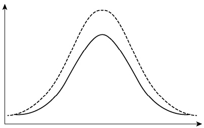
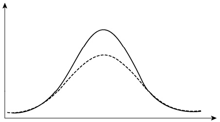
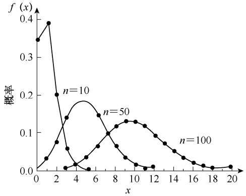
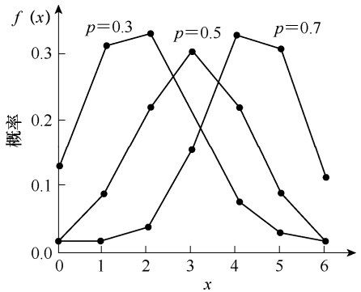
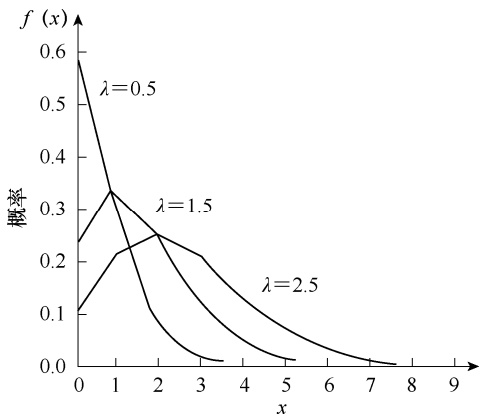

偏度系数 SK 描述了数据分布的非对称程度。如果一组数据的分布是对称的，如标准正态分布，其偏度系数 $S K { = } 0$ ；如果偏度系数明显不等于 0，则表明分布是非对称的。

对于分组数据，偏度系数 SK 可采用式（2-36）进行计算:

$$
S K = \frac {\sum_ {i = 1} ^ {k} f _ {i} (M _ {i} - \overline {{x}}) ^ {3}}{n s ^ {3}} \tag {2-36}
$$

式中， $M _ { i }$ 为组中值。

从式（2-36）可以看到，偏度系数 SK 是离均差三次方的平均数除以标准差的三次方，是一个相对值。当数据分布对称时，离均差三次方后正负离均差可以相互抵消，因而 SK 的分子部分为 0，则 $S K { = } 0$ ；当数据分布不对称时，正负离均差不能抵消，就形成了正或负的偏度系数 $S K _ { \circ }$ 当 SK 为正值时，表示正的离均差值较大，可以判断为右偏或正偏；反之，当SK 为负值时，表示负的离均差值较大，可以判断为左偏或负偏。SK 的值越接近 0，偏斜程度就越小；SK 的绝对值越大，表示的偏斜程度就越大。若 SK 大于 1 或小于-1，称为高度偏态分布；若 SK 在 0.5～1 或 $-0.5  一  -1$ ，则认为是中度偏态分布。

例 **2-27** 计算例 2-11 中 20 株小麦株高（cm）的偏度系数。

根据式（2-36），表 2-15 中株高 x 即式（2-36）中的 $M _ { i } ,$ ，中间数据计算如表 2-17 所示。

表 2-17 例 2-11 中 20 株小麦株高的偏度和峰度计算

| 株高($M_i$,cm) | 频数(f) | $f_i(M_i - \bar{x})^3$ | $f_i(M_i - \bar{x})^4$ |
| --- | --- | --- | --- |
| 79 | 1 | -35.937 | 118.5921 |
| 80 | 2 | -24.334 | 55.9682 |
| 81 | 3 | -6.591 | 8.5683 |
| 82 | 6 | -0.162 | 0.0486 |
| 83 | 3 | 1.029 | 0.7203 |
| 84 | 3 | 14.739 | 25.0563 |
| 85 | 1 | 19.683 | 53.1441 |
| 86 | 1 | 50.653 | 187.4161 |
| 总和 | 20 | 19.08 | 449.514 |

前面例子已计算出 $\overline{x} = 82.3$ $s = 1.7502$ ，将表 2-17 中间数据代入式（2-36），得

$$
S K = \frac {\sum f _ {i} (M _ {i} - \bar {x}) ^ {3}}{n s ^ {3}} = \frac {\sum f _ {i} (M _ {i} - 8 2 . 3) ^ {3}}{2 0 \times 1 . 7 5 0 2 ^ {3}} = \frac {1 9 . 0 8}{2 0 \times 1 . 7 5 0 2 ^ {3}} = 0. 1 7 8
$$

由计算结果可以看出，偏度系数为 0.178，但数值不是太大，说明 20 株小麦株高的数据分布为右偏分布，但偏斜程度不是很大。

## （二）峰度

“峰度”（kurtosis）一词是由皮尔逊（K. Pearson）于 1905 年首次提出的，用来对数据分布扁平或尖峰程度进行描述，其指标是峰度系数（coefficient of kurtosis），用 K 表示。对于未分组的数据，峰度系数 K 的计算公式为

$$
K = \frac {n (n + 1) \sum (x _ {i} - \bar {x}) ^ {4} - 3 (n - 1) \left[ \sum (x _ {i} - \bar {x}) ^ {2} \right] ^ {2}}{(n - 1) (n - 2) (n - 3) s ^ {4}} \tag {2-37}
$$

对于分组数据，峰度系数 K 的计算公式为

$$
K = \frac {\sum_ {i = 1} ^ {k} f _ {i} (M _ {i} - \overline {{x}}) ^ {4}}{n s ^ {4}} - 3 \tag {2-38}
$$

式（2-37）和式（2-38）中， $s ^ { 4 }$ 为样本标准差的四次方。

从式（2-38）可以看到，峰度系数 K 是离均差四次方的平均数除以标准差的四次方，也是一个相对值。峰度系数是与数据的标准正态分布相比而言的，描述数据分布的尖峰或扁平程度。如果一组数据服从标准正态分布，则峰度系数 $K { = } 0$ ；如果峰度系数明显不为 0，则表明数据分布更平或更尖，称为尖峰分布（peak distribution）或扁平分布（flarrer distribution）（图 2-19）。当 K＞0 时为尖峰分布，当 $K { \leq } 0$ 时为扁平分布。

violin

| X | Solid Line (Y) | Dashed Line (Y) |
| --- | --- | --- |
| Left | ~0.1 | ~0.2 |
| Center | ~0.8 | ~1.0 |
| Right | ~0.1 | ~0.2 |

(a) 尖峰分布

line

| X | Solid Line (Y) | Dashed Line (Y) |
| --- | --- | --- |
| Left | ~0.1 | ~0.1 |
| Middle | ~0.9 | ~0.5 |
| Right | ~0.1 | ~0.1 |

(b) 扁平分布

图 2-19 尖峰分布和扁平分布示意图

需要注意的是，式（2-38）中也可以不减 3，这时比较的标准是 3。标准正态分布的峰度系数 K=3，当 $K { \geq } 3$ 时为尖峰分布，曲线比较陡峭，数据主要集中在平均数附近；当 $K { \leq } 3$时为扁平分布，曲线比较平缓，数据分布比较分散。

例 **2-28** 计算例 2-11 中 20 株小麦株高（cm）的峰度系数。

根据式（2-38），对表 2-15 数据进行中间计算（表 2-17）。将有关数据代入式（2-38），得

$$
K = \frac {\sum f _ {i} (M _ {i} - \overline {{x}}) ^ {4}}{n s ^ {4}} - 3 = \frac {4 4 9 . 5 1 4}{2 0 \times 1 . 7 5 0 2 ^ {4}} - 3 = 2. 3 9 5 - 3 = - 0. 6 0 5
$$

由于峰度系数 $K {=} -0.605$ ，说明 20 株小麦株高数据分布与正态分布相比略有一些平峰。

## 思考练习题

习题 **2.1** 什么是抽样调查？常用的抽样调查有哪些基本方法？试比较其优缺点和适用对象。

习题 **2.2** 试验设计的三项原则是什么？它们之间有何关系？

习题 **2.3** 对照有哪些类型？它们的作用是什么？

习题 **2.4** 试验误差的来源有哪些，如何进行控制？

习题 **2.5** 什么是频数分布表？什么是频数分布图？制表和绘图的基本步骤有哪些？

习题 **2.6** 算术平均数与加权平均数形式上有何不同？为什么说它们的实质是一致的？

习题 **2.7** 众数、中位数和平均数之间的关系是什么？

习题 **2.8** 何谓五数概括？如何制作箱线图？

习题 **2.9** 平均数与标准差在统计分析中有什么用处？它们各有哪些特性？

习题 **2.10** 总体和样本的平均数、标准差有什么共同点？又有什么联系和区别？

习题 **2.11** 随机抽样调查了 100 人的血型数据如下:A 型血 23 人，B 型血 17 人，AB 型血 12 人，O 型血 48 人。试计算各血型所占百分比，并制作频数分布表和频数分布图（条形图和饼图）。

习题 **2.12** 某地 100 例 30～40 岁健康男子血清总胆固醇含量（mol/L）测定结果如下:

| 4.77 | 3.37 | 6.14 | 3.95 | 3.56 | 4.23 | 4.31 | 4.71 | 5.69 | 4.12 |
| --- | --- | --- | --- | --- | --- | --- | --- | --- | --- |
| 4.56 | 4.37 | 5.39 | 6.30 | 5.21 | 7.22 | 5.54 | 3.93 | 5.21 | 6.51 |
| 5.18 | 5.77 | 4.79 | 5.12 | 5.20 | 5.10 | 4.70 | 4.74 | 3.50 | 4.69 |
| 4.38 | 4.89 | 6.25 | 5.32 | 4.50 | 4.63 | 3.61 | 4.44 | 4.43 | 4.25 |
| 4.03 | 5.85 | 4.09 | 3.35 | 4.08 | 4.79 | 5.30 | 4.97 | 3.18 | 3.97 |
| 5.16 | 5.10 | 5.85 | 4.79 | 5.34 | 4.24 | 4.32 | 4.77 | 6.36 | 6.38 |
| 4.88 | 5.55 | 3.04 | 4.55 | 3.35 | 4.87 | 4.17 | 5.85 | 5.16 | 5.09 |
| 4.52 | 4.38 | 4.31 | 4.58 | 5.72 | 6.55 | 4.76 | 4.61 | 4.17 | 4.03 |
| 4.47 | 3.40 | 3.91 | 2.70 | 4.60 | 4.09 | 5.96 | 5.48 | 4.40 | 4.55 |
| 5.38 | 3.89 | 4.60 | 4.47 | 3.64 | 4.34 | 5.18 | 6.14 | 3.24 | 4.90 |

试根据所给数据编制频数分布表。

习题 **2.13** 根据习题 2.12 的频数分布表，绘制直方图和多边形图，并简述其分布特征。

习题 **2.14** 根据习题 2.12 的数据，计算平均数、标准差和变异系数。

习题 **2.15** 根据习题 2.12 的数据，找出众数，计算中位数，并与平均数进行比较。

习题 **2.16** 根据习题 2.12 的数据，计算五数概括，并制作该数据分布的箱线图。

习题 **2.17** 根据习题 2.12 的数据，计算该数据分布的偏度系数和峰度系数。

习题 **2.18** 某海水养殖场进行贻贝单养和贻贝与海带混养的对比试验，收获时各随机抽取 50 绳测其毛重（kg），结果分别如下:

单养 50 绳重量数据:45，45，33，53，36，45，42，43，29，25，47，50，43，49，36，30，39，44，35，38，46，51，42，38，51，45，41，51，50，47，44，43，46，55，42，27，42，35，46，53，32，41，48，50，51，46，41，34，44，46；

混养 50 绳重量数据:51，48，58，42，55，48，48，54，39，58，50，54，53，44，45，50，51，57，43，67，48，44，58，57，46，57，50，48，41，62，51，58，48，53，47，57，51，53，48，64，52，59，55，57，48，69，52，54，53，50。

试从平均数、极差、标准差、变异系数几个指标来评估单养与混养的效果，并给出分析结论。

参考答案

# 概率与概率分布

## 本章提要

概率和概率分布是统计推断的基础。本章主要讨论:

• 事件关系与概率计算；
• 离散性随机变量、连续性随机变量及其概率分布；
• 常见理论分布:二项分布、泊松分布和正态分布；
• 抽样分布:样本平均数的抽样分布、样本频率的抽样分布、正态总体抽样分布。

第二章详细叙述了如何通过调查和试验获得样本数据、进行数据整理、编制频数分布表和频数分布图，系统介绍了数据分布集中性、变异程度、分布形状等特征的度量指标与描述方法。但是进行数据统计分析，不能仅是对样本特征进行统计描述这一个方面，还需要通过样本统计数来推断其所属总体的参数，即统计推断。在进行统计推断之前，需要了解事件、概率、概率分布及抽样分布等基础知识。

## 第一节 事件及其概率

概率是对某一特定事件出现可能性大小进行度量的指标。为理解概率的含义，需要首先了解随机试验、事件、频率等基本概念，并在此基础上讨论事件关系和概率计算问题。

## 一、事件、频率与概率

## （一）事件

在自然界中，有许多现象可以预知其在一定条件下是否出现。例如，水在一个标准大气压条件下，加热到 100℃时肯定会沸腾。这种在一定条件下必然出现的现象，称为必然事件（certain event），以 U 表示。必然事件的反面，则不会发生。例如，种子的发芽率不可能超过 100%，这种在一定条件下必然不出现的事件，称为不可能事件（impossible event），以 V 表示。

在自然界中还有另外许多现象，它们在一定条件下出现的结果是偶然的，有可能发生，也可能不发生。例如，小麦种子在播种后可能发芽，也可能不发芽；投掷一枚质地均匀的硬币，其结果可能是硬币正面朝上，也可能是反面朝上。为了研究事件的发生与出现的结果，通常需要通过试验对一定条件下出现的自然现象进行观测或度量。

一个试验如果满足以下三个特性，则称其为一个随机试验（random trial），简称试验（trial）:①试验可以在相同条件下重复进行；②每次试验的可能结果不止一个，但试验的所有可能结果在试验之前是确切知道的；③每次试验总是恰好出现可能结果中的一个，但在试验之前不能确定试验出现的确切结果。上述小麦种子的发芽情况、投掷硬币哪面朝上的情况，都具备随机试验的三个特征，因此都是随机试验。像这种在某些确定条件下进行随机试验可能出现也可能不出现的现象，称为随机事件（random event），简称事件（event）。

对一项随机试验，可以将试验中所有可能结果的全体定义为样本空间（sample space），用符号 Ω 表示，而样本空间中每一个特定的试验结果被称为样本点（sample point）。样本空间是随机试验中所有可能结果的集合，显然它是一个必然事件。例如，设随机试验为抛一颗质地均匀骰子出现向上面的点数，其样本空间 Ω:｛1，2，3，4，5，6｝；投掷一枚质地均匀硬币的样本空间 $Q ;$ :｛正面朝上，反面朝上｝；一粒种子发芽的样本空间 $Q ;$ :｛发芽，不发芽｝；动物性别的样本空间 Ω:｛雄性，雌性｝；一品红花色的样本空间 $Q ;$ :｛红色，粉色，白色｝；等等。

## （二）频率

设事件 A 在 n 次重复试验中发生了 m 次，其比值 $\frac{m}{n}$ 称为事件 A 发生的频率（frequency），记为

$$
W (A) = \frac {m}{n} \tag {3-1}
$$

显然，W（A）是 0～1 的一个数，即 $0 \leqslant W(A) \leqslant 1$

例 **3-1** 为测定某批玉米种子的发芽率，分别取 10，20，50，100，200，500，1000（粒）种子，在相同条件下进行发芽试验，其结果如表 3-1 所示。试计算玉米种子的发芽率。

表 3-1 某批玉米种子的发芽试验结果

| 种子总数(n) | 10 | 20 | 50 | 100 | 200 | 500 | 1000 |
| --- | --- | --- | --- | --- | --- | --- | --- |
| 发芽种子数(m) | 9 | 19 | 47 | 91 | 186 | 459 | 920 |
| 种子发芽率($\frac{m}{n}$) | 0.900 | 0.950 | 0.940 | 0.910 | 0.930 | 0.918 | 0.920 |

从表 3-1 可以清楚地看出，试验中随 n 值的不同，其种子发芽率也不同。当 n 较小时，其发芽率波动较大；随 n 值增大，发芽率的波动性逐渐减小。当 n 充分大时，其频率值就稳定在 0.920 这个数值上。当 n 为 1000 时，玉米种子的发芽频率为

$$
W (A) = \frac {m}{n} = \frac {9 2 0}{1 0 0 0} = 0. 9 2
$$

## （三）概率

由例 3-1 可以引出概率（probability）的定义:某事件 A 在 n 次重复试验中，发生了 m次，当试验次数 n 不断增大时，事件 A 发生的频率 W（A）越来越接近某一确定值 $p   ,$ ，于是定义 $p$ 为事件 A 发生的概率，记为

$$
P (A) = p \tag {3-2}
$$

显然，在一般情况下，不可能完全准确地得到 $p _ { \bot }$ ，常以在 n 充分大时，事件 A 发生的频率作为事件 A 发生概率 $p$ 的近似值，即

$$
P (A) = p = \lim _ {n \to \infty} \frac {m}{n} \tag {3-3}
$$

例 3-1 中 n 为 1000 时，我们可以认为 n 是充分大，则玉米发芽概率 $p$ 可认为是 0.920。 $p$表示了事件 A 发生可能性的大小。根据概率的定义，概率有如下基本性质:①任何事件的概率都在 0～1，即 $0 \leqslant P\left (  A\right )  \leqslant 1$ ；②必然事件的概率等于 1，即 $P ( U )   =   1$ ；③不可能事件的概率等于 0，即 $P\left ( V \right ) = 0$

## 二、事件关系与概率计算

## （一）事件的相互关系

1.和事件 事件 A 和事件 B 至少有一件发生而构成的新事件称为事件 A 和事件 B 的和事件（sum event），以 $A { + } B$ 表示。例如，在检验小麦面粉品质时，随机抽取一个样品的出粉率为 81%以下称为事件 A，随机抽取一个样品的出粉率为 81%～85%称为事件 B，现抽取一个样品的出粉率为 85%以下，则这一新事件即事件 A 和事件 B 的和事件。和事件的定义可推广到多个事件的和，可表示为 $A_{1} + A_{2} + \cdots + A_{n}$ 。
2.积事件 事件 A 和事件 B 同时发生而构成的新事件称为事件 A 和事件 B 的积事件（product event），以 $A \bullet B$ 表示。例如，在调查棉田病虫害发生情况时，以棉铃虫的发生为事件 A，以黄萎病的发生为事件 B，则棉铃虫和黄萎病同时发生这一新事件称为事件 A 和事件B 的积事件。积事件的定义也可推广到多个事件的积，可表示为 $\mathcal{A}_{1} \bullet \mathcal{A}_{2} \bullet \cdots \bullet \mathcal{A}_{n}  。$

3.互斥事件 事件 A 和事件 B 不能同时发生，即 $A \cdot B = V$ ，那么称事件 A 和事件 B为互斥事件（exclusive event）。例如，豌豆的花色分为红花和白花，开红花为事件 A，开白花为事件 B，现一株 $\mathrm { F _ { 1 } }$ 代豌豆，不可能既开红花又开白花，所以开红花和开白花为互斥事件。这一定义也可推广到 $A _ { 1 }$ 、 ${ \it A } _ { 2 } , \cdots , { \it A } _ { n }$ 多个事件。

4.对立事件 事件 A 和事件 B 必有一个事件发生，但二者不能同时发生，即 $A + B =$ $U , A \cdot B = V ,$ ，则称事件 A 与事件 B 互为对立事件（complementary event），事件 B 可表示为A ，事件 A 可表示为 $\overline { { B } }$ 。例如，新生婴儿是男孩为事件 A，新生婴儿是女孩为事件 B，现有一个刚出生的婴儿，要么是男孩要么是女孩，即 $A + B = U$ ，是必然事件，同时又不可能既是男孩又是女孩，即 $A \cdot B   =   V ,$ ，是不可能事件，所以新生婴儿是男孩和新生婴儿是女孩互为对立事件，新生婴儿是女孩也可记为 A ，新生婴儿是男孩也可记为 $\overline { { B } }$ 。

5.独立事件 事件 A 的发生与事件 B 的发生毫无关系，反之，事件 B 的发生也与事件 A 的发生毫无关系，则称事件 A 和事件 B 为独立事件（independent event）。例如，播种两粒玉米，第一粒发芽为事件 A，第二粒发芽为事件 B，第一粒是否发芽不影响第二粒的发芽，第二粒是否发芽也不影响第一粒的发芽，则事件 A 和事件 B 相互独立。如果多个事件 $A _ { 1 }$ $A_{2} 、 \cdots 、 A_{n}$ 彼此独立，则称之为独立事件群（independent event group）。

6.完全事件系 如果多个事件 $A_{1} 、 A_{2} 、 \cdots 、 A_{n}$ 两两相斥，且每次试验结果必然发生其一，则称事件 $A_{1} 、 A_{2} 、 \cdots 、 A_{n}$ 为一个完全事件系（complete event system），恰好等于样本空间。由于 $A_{1} 、 A_{2} 、 \cdots 、 A_{n}$ 相互之间无交叉，所以它们实质上对应的是样本空间中的样本点。例如，抽取一位阿拉伯数字，抽取数字为 0、1、…、9 就构成了完全事件系。

## （二）条件概率

在事件 B 已发生的情况下事件 A 发生的概率，称为事件 A 的条件概率（conditional probability），记作 $P \left( A \left| B \right) \right.$ 。条件概率 $P \left( A \left| B \right) \right.$ 与无条件概率 $P ~ ( A )$ 通常是不一样的。

例 **3-2** 为研究某抗生素的耐药性，随机抽取 574 名成年气管炎患者调查了服用与未服用该药，以及敏感与不敏感的情况（表 3-2）。试计算各个条件概率与无条件概率。

表 3-2 不同人群气管炎患者情况

| 人群 | 敏感(A)人数 | 不敏感($\overline{A}$)人数 | 合计 |
| --- | --- | --- | --- |
| 服用抗生素(B) | 215 | 180 | 395 |
| 未服用抗生素($\overline{B}$) | 106 | 73 | 179 |
| 合计 | 321 | 253 | 574 |

本例中所调查的人数较多，根据概率定义可将频率看作概率。令 A、 A 分别表示敏感和不敏感的人数，B、 $\overline { { B } }$ 分别表示是否服用抗生素。根据条件概率定义，各个条件概率分别为

$$
P (A \mid B) = \frac {2 1 5}{3 9 5} = 0. 5 4 4 3, P (A \mid \bar {B}) = \frac {1 0 6}{1 7 9} = 0. 5 9 2 2
$$

$$
P (\bar {A} \mid B) = \frac {1 8 0}{3 9 5} = 0. 4 5 5 7, P (\bar {A} \mid \bar {B}) = \frac {7 3}{1 7 9} = 0. 4 0 7 8
$$

各个无条件概率分别为

$$
P (A) = \frac {3 2 1}{5 7 4} = 0. 5 5 9 2, P (\bar {A}) = \frac {2 5 3}{5 7 4} = 0. 4 4 0 8
$$

$$
P (B) = \frac {3 9 5}{5 7 4} = 0. 6 8 8 2, P (\bar {B}) = \frac {1 7 9}{5 7 4} = 0. 3 1 1 8
$$

## （三）概率计算法则

1.加法定理 互斥事件 A 和 B 的和事件的概率等于事件 A 和事件 B 的概率之和，称为加法定理（additive theorem），即

$$
P (A + B) = P (A) + P (B) \tag {3-4}
$$

例 **3-3** 调查某玉米田，一穗株占 67.2%，双穗株占 30.7%，空穗株占 2.1%，试计算一穗株和双穗株的概率。

已知:一穗株占 67.2%，即 $P\left (  A\right ) =0.672$ ；双穗株占 30.7%，即 $P\left (  B\right ) =0.307$ ，故所要计算的和事件概率为

$$
P (A + B) = P (A) + P (B) = 0. 6 7 2 + 0. 3 0 7 = 0. 9 7 9
$$

推理 1 如果 $\mathcal{A}_{1} 、 \mathcal{A}_{2} 、 \cdots 、 \mathcal{A}_{n}$ 为 $n$ 个互斥事件，则其和事件的概率为

$$
P (A _ {1} + A _ {2} + \dots + A _ {n}) = P (A _ {1}) + P (A _ {2}) + \dots + P (A _ {n}) \tag {3-5}
$$

推理 2 对立事件 $\overline { { A } }$ 的概率为

$$
P (\bar {A}) = 1 - P (A) \tag {3-6}
$$

推理 3 完全事件系和事件的概率和等于 1。

2.乘法定理 如果事件 A 和事件 B 为独立事件，则事件 A 与事件 B 同时发生的概率等于事件 A 和事件 B 各自概率的乘积，称为乘法定理（multiplication theorem），即

$$
P (A B) = P (A) P (B) \tag {3-7}
$$

例 **3-4** 播种玉米时，每穴播种两粒种子，已知玉米种子的发芽率为 90%，试求每穴两粒种子均发芽的概率和一粒种子发芽的概率。

设第一粒种子发芽为事件 A，第二粒发芽为事件 B，于是有 $P\left (  A\right ) =P\left ( B \right ) =0.90$ $P\left(\bar{A}\right)=P\left(\bar{B}\right)=0.10$ 。

两粒种子均发芽的概率为

$$
P (A B) = P (A) P (B) = 0. 9 0 \times 0. 9 0 = 0. 8 1
$$

一粒种子发芽的概率为

$$
P (A \overline {{B}}) + P (\overline {{A}} B) = P (A) P (\overline {{B}}) + P (\overline {{A}}) P (B) = 0. 9 0 \times 0. 1 0 + 0. 1 0 \times 0. 9 0 = 0. 1 8
$$

推理 如果 $A_{1} 、 A_{2} 、 \cdots 、 A_{n}$ 彼此独立，则

$$
P (A _ {1} A _ {2} \dots A _ {n}) = P (A _ {1}) P (A _ {2}) \dots P (A _ {n}) \tag {3-8}
$$

对条件概率，其计算公式为

$$
P (A \mid B) = \frac {P (A B)}{P (B)} \tag {3-9}
$$

例 **3-5** 根据例 3-2 数据，试计算各个积事件概率和条件概率。

由表 3-2 数据，各个积事件概率分别为

$$
P (A B) = \frac {2 1 5}{5 7 4} = 0. 3 7 4 6, P (A \overline {{B}}) = \frac {1 0 6}{5 7 4} = 0. 1 8 4 7
$$

$$
P (\overline {{A}} B) = \frac {1 8 0}{5 7 4} = 0. 3 1 3 6, \quad P (\overline {{A}} \overline {{B}}) = \frac {7 3}{5 7 4} = 0. 1 2 7 2
$$

根据式（3-9），各个条件概率分别为

$$
P (A \mid B) = \frac {P (A B)}{P (B)} = \frac {0 . 3 7 4 6}{0 . 6 8 8 2} = 0. 5 4 4 3
$$

$$
P (A | \overline {{B}}) = \frac {P (A \overline {{B}})}{P (\overline {{B}})} = \frac {0 . 1 8 4 7}{0 . 3 1 1 8} = 0. 5 9 2 2
$$

$$
P (\bar {A} \mid B) = \frac {P (\bar {A} B)}{P (B)} = \frac {0 . 3 1 3 6}{0 . 6 8 8 2} = 0. 4 5 5 7
$$

$$
P (\overline {{A}} | \overline {{B}}) = \frac {P (\overline {{A}} \overline {{B}})}{P (\overline {{B}})} = \frac {0 . 1 2 7 2}{0 . 3 1 1 8} = 0. 4 0 7 8
$$

3.全概率法则 如果 $B_{1} 、 B_{2} 、 \cdots 、 B_{n}$ 为完全事件系， $P\left(B_{1}+B_{2}+\cdots+B_{n}\right)=1$ ，且 P $(B_i) > 0 \quad (i = 1, 2, \cdots, n)$ ，A 为任意事件，则事件 A 的全概率法则（law of total probability）为

$$
P (A) = \sum_ {i = 1} ^ {n} P (A B _ {i}) = \sum_ {i = 1} ^ {n} P (B _ {i}) P (A | B _ {i}) \tag {3-10}
$$

4.逆概率法则 如果 $B_{1} 、 B_{2} 、 \cdots 、 B_{n}$ 为完全事件系且 $P\left(B_{i}\right)>0\left(i=1,\ 2,\ \cdots,\ n\right)$ A 为任意事件， $P\left(A\right)>0$ ，则由式（3-9），有

$$
P (B _ {i} \mid A) = \frac {P (A B _ {i})}{P (A)} = \frac {P (B _ {i}) P (A \mid B _ {i})}{P (A)} \tag {3-11}
$$

将全概率法则式（3-10）代入式（3-11），得出逆概率法则（law of inverse probability），

也称为贝叶斯定理（Bayes theorem）:

$$
P (B _ {i} \mid A) = \frac {P (B _ {i}) P (A \mid B _ {i})}{\sum_ {i = 1} ^ {n} P (B _ {i}) P (A \mid B _ {i})} \tag {3-12}
$$

贝叶斯定理从形式上看，是将简单的条件概率 $P \left( B _ { i } \middle | A \right)$ 表示成复杂的形式，但在许多情况下，公式右端的 $P ~ ( B _ { i } )$ 和 $P \left( A   \middle |   B _ { i } \right)$ 或为已知，或容易求得，这样在利用贝叶斯定理计算条件概率时还是比较方便的。

例 **3-6** 利用全概率法则和逆概率法则，试根据例 3-2 数据计算各个事件的概率。

由式（3-10）全概率法则，B、 B 为一个完全事件系，敏感（A）和不敏感（ A ）的概率分别为

$$
\begin{array}{l} P (A) = \sum_ {i = 1} ^ {n} P (B _ {i}) P (A | B _ {i}) = P (B) P (A | B) + P (\overline {{B}}) P (A | \overline {{B}}) \\ = 0. 6 8 8 2 \times 0. 5 4 4 3 + 0. 3 1 1 8 \times 0. 5 9 2 2 = 0. 5 5 9 2 \\ \end{array}
$$

$$
P (\bar {A}) = \sum_ {i = 1} ^ {n} P (B _ {i}) P (\bar {A} \mid B _ {i}) = P (B) P (\bar {A} \mid B) + P (\bar {B}) P (\bar {A} \mid \bar {B})
$$

$$
= 0. 6 8 8 2 \times 0. 4 5 5 7 + 0. 3 1 1 8 \times 0. 4 0 7 8 = 0. 4 4 0 8
$$

利用式（3-12）逆概率法则，得出敏感人群中服用抗生素（B）和未服用抗生素 $( \; { \overline { { B } } } \; )$的概率分别为

$$
P (B \mid A) = \frac {P (B) P (A \mid B)}{\sum_ {i = 1} ^ {n} P (B _ {i}) P (A \mid B _ {i})} = \frac {P (B) P (A \mid B)}{P (B) P (A \mid B) + P (\overline {{B}}) P (A \mid \overline {{B}})} = 0. 6 6 9 8
$$

$$
P (\bar {B} \mid A) = \frac {P (\bar {B}) P (A \mid \bar {B})}{\sum_ {i = 1} ^ {n} P (B _ {i}) P (A \mid B _ {i})} = \frac {P (\bar {B}) P (A \mid \bar {B})}{P (B) P (A \mid B) + P (\bar {B}) P (A \mid \bar {B})} = 0. 3 3 0 2
$$

## 三、大数定律

前面已经指出，当 n 充分大时，事件 A 发生的频率 $W \left( A \right)$ 就可代替概率 P（A）。频率和概率之间的关系，实际上就是统计数与参数的关系，频率 W（A）是一个统计数，概率 $P ~ ( A )$是一个参数。为什么可以用频率 W（A）来代替概率 P（A）？这是由于大数定律在起作用。

大数定律（law of large numbers）是概率论中用来阐述大量随机现象平均结果稳定性的一系列定律的总称，最常用的是伯努利定理（Bernoulli’s theorem），可描述为:设 m 是 n 次独立试验中事件 A 出现的次数，而 p 是事件 A 在每次试验中出现的概率，则对于任意小的正数 ε，有如下关系:

$$
\lim _ {n \to \infty} P \left\{\left| \frac {m}{n} - p \right| <   \varepsilon \right\} = 1 \tag {3-13}
$$

式中， $P$ 为 $\boxed { \frac { m } { n } { - } p } { < } \varepsilon .$ 这一事件的概率， $P { = } 1$ 表示这一事件为必然事件。

伯努利定律说明:若试验条件不变，重复次数 n 接近无限时，频率 $\frac{m}{n}$ 与理论概率 $p$ 的差值必定要小于一个任意小的正数 $\varepsilon ,$ ，即这两者可以基本相等，这几乎是一个必然要发生的事件，即 $P { = } 1$

在大数定律中，欣钦定理（Khinchine theorem）是用来说明为什么可以用算术平均数 x 来推断总体平均数 $\mu$ 的。它可描述为:设 $x_{1} 、 x_{2} 、 \cdots 、 x_{n}$ 是来自同一总体的随机变量，对于任意小的正数 ε，有如下关系:

$$
\lim _ {n \to \infty} P \left\{\left| \frac {1}{n} \sum_ {i = 1} ^ {n} x _ {i} - \mu \right| <   \varepsilon \right\} = 1 \tag {3-14}
$$

式（3-14）阐述了当试验重复次数 n 无限增大时，随机变量的算术平均数与总体平均数之间的差一定小于任意小的正数 $\varepsilon ,$ ，也就是 $\overline { { x } }$ 基本上与 $\mu$ 相等，这几乎是一个必然要发生的事件，即 $P { = } 1$ 。

实际上，我们可以这样来理解欣钦定律:设一个随机变量 $x _ { i }$ 由一个总体平均数 $\mu$ 和一个随机误差 $\varepsilon _ { i }$ 所构成，可以用下面的线性模型（linear model）来表达:

$$
x _ {i} = \mu + \varepsilon_ {i} \tag {3-15}
$$

如果从同一总体抽取 n 个随机变量构成一个样本，那么样本平均数可表示为

$$
\bar {x} = \frac {1}{n} \sum_ {i = 1} ^ {n} x _ {i} = \frac {1}{n} \sum_ {i = 1} ^ {n} (\mu + \varepsilon_ {i}) = \mu + \frac {1}{n} \sum_ {i = 1} ^ {n} \varepsilon_ {i}
$$

从上式可以看出，当试验次数 n 越来越大时， $\frac { 1 } { n } \sum _ { i = 1 } ^ { n } \mathcal { E } _ { i } .$ 部分会变得越来越小。因为 $\varepsilon _ { i }$ 有正有负，正负相互抵消，且随着 n 的增大， $\frac { 1 } { n } \sum _ { i = 1 } ^ { n } \varepsilon _ { i } .$ 会变得非常小，使 x 越来越接近 $\mu   \mathrm { { } _ { \circ } }$ 。

从以上解释，我们可以将大数定律通俗地表达为:样本容量越大，样本统计数与总体参数之差越小。有了大数定律作为理论基础，只要从总体中抽取的随机变量相当多，就可以用样本的统计数来估计总体参数。尽管存在随机误差，但通过进行大量的重复试验，其总体特征可以透过个别的偶然现象显示出其必然性，而且这种随机误差可以用数学方法进行估计，在一定范围内也可以得到人为控制，因此完全可以根据样本的统计数来估计总体的参数。

## 第二节 离散性概率分布

明确了事件、概率及其运算法则，只是了解了随机现象及其关系的概念描述和简单计算。若要全面了解随机现象及其发生的规律，就必须知道随机变量及其概率分布，并在此基础上正确应用统计方法去解决各种实际问题。

## 一、随机变量

上节已讲到事件的样本空间概念，它是所有样本点的集合。在一次随机试验中，事件样本点的出现是不确定的。定义一个与事件对应的变量 X，将 X 的某一次取值用 $x _ { i }$ 记作样本空间的样本点，此时的 X 就称为随机变量（random variable）， $x _ { i }$ 就称为随机变量的一个观测值（observed value）或者变量值（value of variable）。

随机变量是一种定义在样本空间 Ω 上的函数，是用数值来描述特定试验一切可能出现的结果，它的取值事先不能确定，结果的出现具有随机性。根据随机变量取值类型的不同，可以将其分为离散性随机变量和连续性随机变量。只能取有限个或可数个值的随机变量称为离散性随机变量（discrete random variable），可以在一个或多个区间取任何值的变量称为连续性随机变量（continuous random variable）。

研究随机变量主要是研究它的取值范围，即取值的概率。随机变量的取值与取这些值的概率之间的对应关系称为随机变量的概率分布（probability distribution）。

## 二、离散性随机变量的概率分布

设离散性随机变量 X 所有可能的取值为 $X = x_{i} (i = 1, 2, \cdots, n)$ ，对于任意一个 $x _ { i }$ 都有一个相应的概率为 $p_{i} (i = 1, 2, \cdots, n)$ ，可用概率函数（probability function）表示为

$$
f (x) = P (X = x _ {i}) = p _ {i} \quad (i = 1, 2, \dots , n) \tag {3-16}
$$

式中， $x _ { i }$ 与 $p _ { i }$ 为数值，表示事件“变量 X 取值为 ${x_{i}}^{ 劵 }$ 的概率等于 $p _ { i ^ { \circ } }$ 。这就是离散性随机变量X 的概率分布。并且，离散性随机变量概率分布具有 $p _ { i } { \geq } 0$ 和 $\sum_{i = 1}^{n}p_{i} = 1\ (i = 1,\ 2,\ \cdots,\ n)$ 的性质。离散性随机变量的概率分布也可用表格的形式表示，如表 3-3 所示。

表 3-3 离散性随机变量的概率分布

| 变量($x_i$) | $x_1$ | $x_2$ | ... | $x_i$ | ... | $x_n$ |
| --- | --- | --- | --- | --- | --- | --- |
| 概率($p_i$) | $p_1$ | $p_2$ | ... | $p_i$ | ... | $p_n$ |

一般离散性随机变量，如 n 粒棉花种子的发芽数、n 枚种蛋的出雏数、n 尾鱼苗的成活数等，其概率分布均可用表 3-3 的格式表示出来。

例 **3-7** 投掷一枚质地均匀的骰子，向上一面所得点数 X 是一个离散性随机变量，求其出现点数的概率分布。

投掷一次骰子所得向上一面的点数有 6 种可能，即点数为 1～6 的任意值。由于骰子是均质的，1～6 每种结果出现的概率是相等的，即都为 $\frac{1}{6}$ ，因而该随机变量的概率函数为

$$
f (x) = P (X = x _ {i}) = \frac {1}{6} \quad (i = 1, 2, \dots , 6)
$$

可能得到点数的概率分布如表 3-4 所示。

表 3-4 投掷一枚质地均匀骰子可能得到点数的概率分布

| 可能得到向上一面的点数($x_i$) | 1 | 2 | 3 | 4 | 5 | 6 |
| --- | --- | --- | --- | --- | --- | --- |
| 概率($p_i$) | 1/6 | 1/6 | 1/6 | 1/6 | 1/6 | 1/6 |

## 三、离散性随机变量的数学期望和方差

与第二章介绍的平均数类似，随机变量的数学期望是对随机变量概率分布的一个概括性度量。离散性随机变量 X 的数学期望（mathematical expectation）是 X 所有可能取值 $x _ { i }   ( i { = } 1$ $2 , \cdots , n )$ 与其相应概率 $p_{i} (i = 1, 2, \cdots, n)$ 乘积之和，用 $\mu$ 或 E（X）表示，即

$$
\mu = E (X) = \sum_ {i} x _ {i} p _ {i} \tag {3-17}
$$

数学期望又称为平均数或均值，它实质上是随机变量所有可能取值的加权平均，其权数就是取值的概率。

离散性随机变量 X 的方差等于 $( x _ { i } - \mu ) ^ { 2 }$ 与相应概率 $p _ { i }$ 乘积之和，用 $\sigma ^ { 2 }$ 或 D（X）表示，即

$$
\sigma^ {2} = D (X) = \sum_ {i} (x _ {i} - \mu) ^ {2} p _ {i} \tag {3-18}
$$

离散性随机变量 X 的标准差等于方差的算术平方根，用 $\sigma$ 或 ${ \sqrt { D \left( X \right) } }$ 表示。

方差（或标准差）反映了随机变量 X 取值的变异程度。由于标准差的计量单位与随机变量相同，相对于方差更容易解释，在实际问题分析中常使用标准差。

例 **3-8** 对例 3-7 投掷一枚质地均匀骰子可能得到向上一面点数的概率分布，求其数学期望、方差和标准差。

根据表 3-4 数据，利用式（3-17）和式（3-18），有

$$
\mu = E (X) = \sum_ {i} x _ {i} p _ {i} = \frac {1}{6} \times (1 + 2 + 3 + 4 + 5 + 6) = 3. 5
$$

$$
\sigma^ {2} = D (X) = \sum_ {i} (x _ {i} - \mu) ^ {2} p _ {i} = \frac {1}{6} \times [ (1 - 3. 5) ^ {2} + (2 - 3. 5) ^ {2} + \dots + (6 - 3. 5) ^ {2} ] = 2. 9 1 7
$$

$$
\sigma = \sqrt {\sigma^ {2}} = 1. 7 0 8
$$

## 四、二项分布

二项分布（binomial distribution）是一种离散性随机变量的分布，生物学研究中经常碰到这种离散性的变量。对于植物、动物、微生物等生物体的某个性状，常常可以把其资料分成两个类型。例如，哺乳动物是雄性还是雌性、种子发芽与不发芽、穗子有芒与无芒、后代成活与死亡等。这样的结果只能是“非此即彼”两种情况，彼此构成对立事件，我们把这种“非此即彼”事件所构成的总体称为二项总体（binomial population），其概率分布称为二项分布。

## （一）二项分布的概率函数

二项总体在进行重复抽样试验中具有如下共同特征。

（1）每次试验只有两个对立结果，如种子发芽或不发芽，分别记作事件 A 与 $\overline { { A } }$ ，它们出现的概率分别为 $p$ 与 $q ( q = 1 - p )$ 。
（2）试验具有重复性和独立性。重复性（repeatability）是指每次试验条件不变，在每次试验中事件 A 出现的概率皆为 $p \circ$ 。独立性（independence）是指任何一次试验中事件 A 的出现与其余各次试验中出现何种结果无关。

设 X 是一个离散性随机变量，它的所有可能取值为 0，1，2，…，n，以 x 表示在 n 次试验中事件 A 出现的次数。其概率分布函数为

$$
P (X = x) = C _ {n} ^ {x} p ^ {x} q ^ {n - x} \tag {3-19}
$$

式中，我们称 $P\left(X=x\right)$ 为随机变量 X 的二项分布，记作 $B ( n , p )$ 。之所以把这个分布称为二项分布，是因为 $C_{n}^{x}=\frac{n!}{x!(n-x)!}$ 恰好等于 $( p + q ) ^ { \textit { n } }$ 牛顿二项式（Newton binomial）展开式中含有 $p ^ { x }$ 的第 x+1 项，这一分布也称为伯努利分布（Bernouli distribution）。展开后有

$$
(p + q) ^ {n} = C _ {n} ^ {0} q ^ {n} + C _ {n} ^ {1} p ^ {1} q ^ {n - 1} + C _ {n} ^ {2} p ^ {2} q ^ {n - 2} + \dots + C _ {n} ^ {x} p ^ {x} q ^ {n - x} + \dots + C _ {n} ^ {n} p ^ {n} = \sum_ {x = 0} ^ {n} C _ {n} ^ {x} p ^ {x} q ^ {n - x} \tag {3-20}
$$

由于 $(p + q)^n = 1$ ，式（3-20）可写为

$$
\sum_ {x = 0} ^ {n} C _ {n} ^ {x} p ^ {x} q ^ {n - x} = \sum_ {x = 0} ^ {n} P (X = x) = 1 \tag {3-21}
$$

若将以上试验重复 N 次，每次在 n 个试验中出现事件 A 为 x 次的理论次数则等于 N 乘以事件 A 出现 x 次的相应概率:

$$
\text {理论次数} = N \cdot P (X = x) \tag {3-22}
$$

二项分布的概率累积函数（probability cumulative function）可用式（3-23）表示:

$$
F (X = x _ {i}) = \sum_ {x = 0} ^ {i} P (X = x _ {i}) \tag {3-23}
$$

## （二）二项分布概率的计算

例 **3-9** 豌豆的红花纯合基因型和白花纯合基因型杂交后，在 $\mathrm { F } _ { 2 }$ 代红花植株与白花植株出现的比率为 3∶1。若每次随机观察 4 株，共观察 100 次，问得红花为 0 株、1 株、2 株、3株和 4 株的概率各是多少？

根据题意，由于红花植株与白花植株在 $\mathrm { F } _ { 2 }$ 代出现的比率为 3∶1，那么出现红花植株的概率 $p { = } 0 . 7 5$ ，出现白花植株的概率 $q { = } 0 . 2 5$ ，观察株数 $n { = } 4$ ，代入式（3-19），其计算结果如表 3-5 所示。

表 3-5 观察 4 株出现红花植株的概率分布表 $(p=0.75, q=0.25)$

| 红花植株概率函数$f(x)$ | $C_{n}^{x}p^{x}q^{n-x}$ | $P(X=x)$ | $F(X=x)$ | $N\cdot P(X=x)$ |
| --- | --- | --- | --- | --- |
| $f(0)$ | $C_{4}^{0}p^{0}q^{4}=1\times 0.75^{0}\times 0.25^{4}$ | 0.0039 | 0.0039 | 0.39 |
| $f(1)$ | $C_{4}^{1}p^{1}q^{3}=4\times 0.75^{1}\times 0.25^{3}$ | 0.0469 | 0.0508 | 4.69 |
| $f(2)$ | $C_{4}^{2}p^{2}q^{2}=6\times 0.75^{2}\times 0.25^{2}$ | 0.2109 | 0.2617 | 21.09 |
| $f(3)$ | $C_{4}^{3}p^{3}q^{1}=4\times 0.75^{3}\times 0.25^{1}$ | 0.4219 | 0.6836 | 42.19 |
| $f(4)$ | $C_{4}^{4}p^{4}q^{0}=1\times 0.75^{4}\times 0.25^{0}$ | 0.3164 | 1.0000 | 31.64 |
| 总和 |  | 1.0000 |  | 100.00 |

例 **3-10** 某批鸡种蛋的孵化率是 0.90，今从该批种蛋中每次任选 5 枚进行孵化，试计算孵出小鸡的各种可能概率。

在此问题中， $n=5, p=0.90, q=1-p=1-0.90=0.10$ ，每次孵化 5 枚种蛋得到小鸡数服从二项分布 B（5，0.90）。获得 0、1、2、3、4、5 只小鸡的概率分别为

$$
P (0) = C _ {5} ^ {0} p ^ {0} q ^ {5} = 1 \times 0. 9 0 ^ {0} \times 0. 1 0 ^ {5} = 0. 0 0 0 0 1
$$

$$
P (1) = C _ {5} ^ {1} p ^ {1} q ^ {4} = 5 \times 0. 9 0 ^ {1} \times 0. 1 0 ^ {4} = 0. 0 0 0 4 5
$$

$$
P (2) = C _ {5} ^ {2} p ^ {2} q ^ {3} = 1 0 \times 0. 9 0 ^ {2} \times 0. 1 0 ^ {3} = 0. 0 0 8 1 0
$$

$$
P (3) = C _ {5} ^ {3} p ^ {3} q ^ {2} = 1 0 \times 0. 9 0 ^ {3} \times 0. 1 0 ^ {2} = 0. 0 7 2 9 0
$$

$$
P (4) = C _ {5} ^ {4} p ^ {4} q ^ {1} = 5 \times 0. 9 0 ^ {4} \times 0. 1 0 ^ {1} = 0. 3 2 8 0 5
$$

$$
P (5) = C _ {5} ^ {5} p ^ {5} q ^ {0} = 1 \times 0. 9 0 ^ {5} \times 0. 1 0 ^ {0} = 0. 5 9 0 4 9
$$

$$
F (X = x) = \sum_ {x = 0} ^ {5} C _ {n} ^ {x} p ^ {x} q ^ {n - x} = 0. 0 0 0 0 1 + 0. 0 0 0 4 5 + 0. 0 0 8 1 0 + 0. 0 7 2 9 0 + 0. 3 2 8 0 5 + 0. 5 9 0 4 9 = 1
$$

例 **3-11** 某小麦品种在田间出现自然变异植株的概率为 0.0045，试计算:

（1）调查 100 株，获得两株或两株以上变异植株的概率是多少？
（2）期望有 0.99 的概率获得 1 株或 1 株以上的变异植株，至少应调查多少株？

本例中，出现变异植株的概率 $p = 0.0045$ ，出现非变异植株的概率 $q = 1 - p = 1 - 0.0045 =$ 0.9955，n=100。

（1）获得两株或两株以上变异植株的概率计算:

获得 0 株、1 株变异植株的概率为

$$
P (0) = C _ {1 0 0} ^ {0} p ^ {0} q ^ {1 0 0} = 1 \times 0. 0 0 4 5 ^ {0} \times 0. 9 9 5 5 ^ {1 0 0} = 0. 6 3 7 0
$$

$$
P (1) = C _ {1 0 0} ^ {1} p ^ {1} q ^ {9 9} = 1 0 0 \times 0. 0 0 4 5 ^ {1} \times 0. 9 9 5 5 ^ {9 9} = 0. 2 8 7 9
$$

由于 $x=0, x=1, x=2, \cdots, x=100$ 是互斥事件，且构成一个完全事件系，故得到两株或两株以上变异植株的概率为

$$
P (x \geqslant 2) = 1 - P (0) - P (1) = 1 - 0. 6 3 7 0 - 0. 2 8 7 9 = 0. 0 7 5 1
$$

（2）调查的株数 n 应满足 $P\left(0\right)=1-0.99=0.01$ ，即满足 $P\left(0\right)=C_{n}^{0}p^{0}q^{n}=0.01$

对于本例，有

$$
0. 9 9 5 5 ^ {n} = 0. 0 1
$$

$$
n \lg 0. 9 9 5 5 = \lg 0. 0 1
$$

$$
n = \frac {\lg 0 . 0 1}{\lg 0 . 9 9 5 5} = \frac {- 2}{- 0 . 0 0 1 9 5 9} \approx 1 0 2 1 (\text {株})
$$

因此，期望有 0.99 的概率得到 1 株或 1 株以上变异植株至少应调查 1021 株。

## （三）二项分布的形状、数学期望与方差

1.二项分布的形状 二项分布的形状是由 n 和 p 两个参数决定的。

（1）当 $p$ 值较小且 n 值不大时，图形是偏倚的。随着 n 值增大，分布逐渐趋于对称，如图 3-1 所示。
（2）当 p 值趋于 0.5 时，分布趋于对称，如图 3-2 所示。

line

| x | n=10 | n=50 | n=100 |
|---|---|---|---|
| 0 | ~0.34 | 0 | 0 |
| 1 | ~0.39 | ~0.03 | ~0.03 |
| 2 | ~0.20 | ~0.07 | ~0.07 |
| 3 | ~0.14 | ~0.14 | ~0.01 |
| 4 | ~0.06 | ~0.18 | ~0.02 |
| 5 | ~0.01 | ~0.18 | ~0.04 |
| 6 | 0 | ~0.15 | ~0.06 |
| 7 | 0 | ~0.10 | ~0.08 |
| 8 | 0 | ~0.07 | ~0.12 |
| 9 | 0 | ~0.04 | ~0.13 |
| 10 | 0 | ~0.02 | ~0.13 |
| 11 | 0 | ~0.01 | ~0.12 |
| 12 | 0 | ~0.01 | ~0.10 |
| 13 | 0 | 0 | ~0.08 |
| 14 | 0 | 0 | ~0.06 |
| 15 | 0 | 0 | ~0.04 |
| 16 | 0 | 0 | ~0.03 |
| 17 | 0 | 0 | ~0.02 |
| 18 | 0 | 0 | ~0.01 |
| 19 | 0 | 0 | ~0.01 |
| 20 | 0 | 0 | ~0.01 |

图 3-1 n 值不同的二项分布

line

| x | f(x)::p=0.3 | f(x)::p=0.5 | f(x)::p=0.7 |
|---|---|---|---|
| 0 | ~0.13 | ~0.02 | ~0.02 |
| 1 | ~0.31 | ~0.09 | ~0.02 |
| 2 | ~0.34 | ~0.22 | ~0.04 |
| 3 | — | ~0.30 | ~0.16 |
| 4 | — | ~0.22 | ~0.33 |
| 5 | — | ~0.09 | ~0.31 |
| 6 | — | ~0.02 | ~0.11 |

图 3-2 p 值不同的二项分布

2.二项分布的数学期望与方差 若随机变量 X 服从二项分布，则有二项分布的数学期望（平均数）为

$$
\mu_ {x} = E (X) = \sum x _ {i} P (x _ {i}) = n p \tag {3-24}
$$

二项分布的方差为

$$
\sigma^ {2} = D (X) = \sum (x _ {i} - \mu) ^ {2} P (x _ {i}) = n p q \tag {3-25}
$$

二项分布的标准差为

$$
\sigma = \sqrt {\sigma^ {2}} = \sqrt {n p q} \tag {3-26}
$$

例 **3-12** 求例 3-9 豌豆的红花纯合基因型和白花纯合基因型杂交后 $\mathrm { F } _ { 2 }$ 代红花植株的数学期望、方差和标准差。

例 3-9 中对红花植株与白花植株的观察， $n=4,\ p=0.75$ ，由式（3-24）、式（3-25）和式（3-26）可求得红花株数出现的数学期望（平均数）、方差和标准差分别为

$$
\mu_ {x} = n p = 4 \times 0. 7 5 = 3. 0 (\text {株})
$$

$$
\sigma^ {2} = n p q = 4 \times 0. 7 5 \times 0. 2 5 = 0. 7 5 \text {(株} ^ {2})
$$

$$
\sigma = \sqrt {n p q} = \sqrt {4 \times 0 . 7 5 \times 0 . 2 5} = 0. 8 6 6 0 (\text {株})
$$

## 五、泊松分布

在生物学研究中，有许多事件出现的概率很小，而样本容量或试验次数却很大，即有很小的 p 值和很大的 n 值。这时，二项分布就变成另外一种特殊的分布，即泊松分布（Poisson distribution）。例如，显微镜视野内染色体有变异的细胞计数、由突变而引起的遗传病患者数的分布、田间小区内出现变异植株的计数、作物种子田内杂草的计数、单位容积的水或牛奶中细菌的数目、家畜产怪胎数、样方内少见植物的个体数等都属于泊松分布。

泊松分布也是一种离散性随机变量的分布，其分布的概率函数为

$$
P (X = x) = \frac {\mathrm{e} ^ {- \lambda} \lambda^ {x}}{x !} \tag {3-27}
$$

且有

$$
\sum_ {x = 0} ^ {\infty} P (X = x) = \mathrm{e} ^ {- \lambda} \sum_ {x = 0} ^ {\infty} \frac {\lambda^ {x}}{x !} = \mathrm{e} ^ {- \lambda} \mathrm{e} ^ {\lambda} = 1 \tag {3-28}
$$

式（3-27）和式（3-28）中，λ 为参数， $\lambda  =  np ; \mathrm { ~ e ~ }$ 为自然对数底，近似值为 2.71828； $x { = } 0$ ，1，2……

泊松分布的数学期望、方差、标准差为

$$
\mu = E (X) = \lambda \tag {3-29}
$$

$$
\sigma^ {2} = D (X) = \lambda \tag {3-30}
$$

$$
\sigma = \sqrt {\sigma^ {2}} = \sqrt {\lambda} \tag {3-31}
$$

从式（3-29）和式（3-30）可以知道，泊松分布的参数 λ 不但是其分布的平均数 $\mu ,$ ，而且还是方差 $\sigma ^ { 2 } ,$ 。我们把具有参数 λ 的泊松分布记作 P（λ）。

泊松分布的形状由参数 λ 所确定。当 λ 较小时，泊松分布是偏倚的，如图 3-3 所示。随λ 增大，分布逐渐对称。当 λ 无限增大时，泊松分布逐渐逼近正态分布 N（λ，λ）。当 $\lambda { = } 2 0$时，泊松分布基本逼近正态分布 N（λ，λ）；当 $\lambda { = } 3 0$ 时，泊松分布已和正态分布非常接近；

line

| x | \(\lambda=0.5\) | \(\lambda=1.5\) | \(\lambda=2.5\) |
|---|---|---|---|
| 0 | ~0.58 | ~0.24 | ~0.11 |
| 1 | ~0.33 | ~0.33 | ~0.22 |
| 2 | ~0.11 | ~0.25 | ~0.26 |
| 3 | ~0.02 | ~0.11 | ~0.21 |
| 4 | — | ~0.04 | ~0.14 |
| 5 | — | ~0.01 | ~0.09 |
| 6 | — | — | ~0.05 |
| 7 | — | — | ~0.02 |
| 8 | — | — | ~0.01 |

图 3-3 λ 值不同的泊松分布

当 $\lambda { = } 5 0$ 时，这两种分布除一种是离散性的和一种是连续性的之外，已没有多大区别。

泊松分布在生物学研究中有广泛的应用:①在生物学研究中，有许多小概率事件，其发生概率 $p$往往小于 0.1，甚至小于 0.01。例如，两对交换率为0.1 的连锁基因在 $\mathrm { F } _ { 2 }$ 代出现纯合新个体的概率只有$2 \times 0.05^{2} = 0.0050$ ；自花授粉植物出现天然异交或突变的概率往往小于 0.01；等等。对于这些小概率事件，都可以用泊松分布描述其概率分布，从而做出需要的频率预期。②由于泊松分布是描述小概率事件的，因而二项分布当 $p { \leq } 0 . 1$ 和 $n p { < } 5$ 时，可用泊

松分布来近似。

例 **3-13** 用显微镜检查某食品样本内结核菌的数目，对在某些视野内各小方格中的细菌数目加以计数，然后按不同的细菌数把格子分类，记录每类中的格子数目，结果如表 3-6 所示。试计算各种细菌数的理论格子数。

表 3-6 食品样本内结核菌计数的泊松分布

| 细菌数(x) | 实际格子数 | P(X=x) | 理论格子数 |
| --- | --- | --- | --- |
| 0 | 5 | 0.0506 | 5.97 |
| 1 | 19 | 0.1511 | 17.83 |
| 2 | 26 | 0.2253 | 26.59 |
| 3 | 26 | 0.2240 | 26.43 |
| 4 | 21 | 0.1671 | 19.72 |
| 5 | 13 | 0.0997 | 11.76 |
| 6 | 5 | 0.0496 | 5.85 |
| 7 | 1 | 0.0211 | 2.49 |
| 8 | 1 | 0.0079 | 0.93 |
| 9 | 1 | 0.0026 | 0.31 |
| 合计 | 118 | 0.9990 | 117.88 |

各小方格中出现细菌数是小概率事件，服从泊松分布。现从样本数据中计算出每个格子中的细菌平均数:

$$
\bar {x} = \frac {\sum f x}{n} = \frac {1}{1 1 8} \times (0 \times 5 + 1 \times 1 9 + \dots + 9 \times 1) = 2. 9 8 3 1 (\text {个})
$$

用样本平均数 x 估计总体平均数 $\mu ,$ ，即 λ，代入式（3-27），计算当 $x = 0, 1, 2, \cdots, 9$时的概率 $P\left(X=x\right)$ ），填入表 3-6 第三列中。根据理论次数= $N \cdot P (X = x)$ 计算各个细菌数的理论格子数，结果列入表 3-6 第四列。

例 **3-14** 例 3-11 数据中小麦品种中出现变异植株的概率 $p = 0.0045$ ，可以看成小概率事件。试用泊松分布求解例 3-11 所提的两个问题。