## （1）先求 λ:

$$
\lambda = n p = 1 0 0 \times 0. 0 0 4 5 = 0. 4 5
$$

代入式（3-27），有

$$
P (0) = \frac {\mathrm{e} ^ {- 0 . 4 5} 0 . 4 5 ^ {0}}{0 !} = \mathrm{e} ^ {- 0. 4 5} = 0. 6 3 7 6
$$

$$
P (1) = \frac {\mathrm{e} ^ {- 0 . 4 5} 0 . 4 5 ^ {1}}{1 !} = 0. 4 5 \times \mathrm{e} ^ {- 0. 4 5} = 0. 2 8 6 9
$$

所以，调查 100 株获得两株或两株以上变异植株的概率为

$$
P (x \geqslant 2) = 1 - P (0) - P (1) = 1 - 0. 6 3 7 6 - 0. 2 8 6 9 = 0. 0 7 5 5
$$

## （2）调查的株数 n 应满足:

$$
\mathrm{e} ^ {- \lambda} = \mathrm{e} ^ {- n p} = 0. 0 1
$$

因此，有

$$
n = \frac {\lg 0 . 0 1}{- p \mathrm{lge}} = \frac {- 2}{- 0 . 0 0 4 5 \times 0 . 4 3 4 2 9} = 1 0 2 3 (\text {株})
$$

上述结果与例 3-10 的结果很接近，数值的差异是由于计算过程中小数位数精度不一致所产生的。

超几何分布

## 第三节 连续性概率分布

## 一、概率密度函数

回顾上一节有关“随机变量和概率分布”的定义，连续性随机变量可以直观地理解为“可以在某一个或多个区间内取任意数值的随机变量”，在数轴上它的所有取值充满一个或多个区间，因此它不是计数数据，而是计量数据。这是连续性随机变量与离散性随机变量的本质区别，也决定了这两类随机变量概率的不同:对一个离散性随机变量，可以计算其某一特定取值的概率；而对连续性随机变量，必须在某一区域内考虑相应的概率问题。与离散性随机变量概率分布相对应，连续性随机变量主要是通过概率密度函数来描述不同范围内取值的概率。

当试验数据为连续性随机变量时，一般通过分组整理成频数分布表（表 2-12）。如果从总体中抽取样本的容量 n 相当大，则频率分布就趋于稳定，我们将它近似地看成总体的概率分布。下面通过频率分布曲线进行讨论。

根据表 2-11 计算鲢鱼体长的<u>频率</u>密度 $\left( \frac{ 频率 }{ 组距 } \right)$ 作直方图，如图 3-4 所示。在直方图中，同一组内的频率密度是相等的，每一个直方图的矩形面积就表示该组的频率，直方图中每一个小矩形的上边中点连接起来就得到一条阶梯形曲线。可以想象，当样本容量 n 不断增加时，相应的组距不断减少，那么直方条越来越多、越来越细，阶梯形曲线逐渐趋于光滑。当 n 无限大时，频率转化为概率，频率密度就转化为概率密度，阶梯形曲线也就转化为一条光滑的连续曲线，这时频率密度分布也就转化为概率密度分布了，此曲线称为连续性随机变量 X 的概率密度曲线（probability density curve），如图 3-5 所示。表示这一曲线的函数 f（x）称为连续性随机变量 X 的概率密度函数（probability density function）。

对于一个连续性随机变量 X，取值于某一区间 $( x _ { 1 } , x _ { 2 } )$ 内的概率即图 3-5 中阴影部分的面积，这一面积可表示为函数 $f \left( x \right)$ 的积分，即

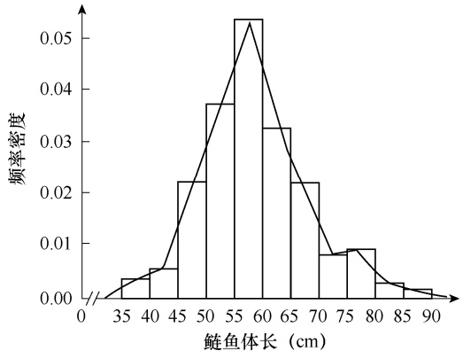

histogram

| 鲢鱼体长 (cm) | 频率密度 |
| --- | --- |
| 35~40 | ~0.003 |
| 40~45 | ~0.005 |
| 45~50 | ~0.022 |
| 50~55 | ~0.037 |
| 55~60 | ~0.053 |
| 60~65 | ~0.032 |
| 65~70 | ~0.022 |
| 70~75 | ~0.008 |
| 75~80 | ~0.009 |
| 80~85 | ~0.003 |
| 85~90 | ~0.001 |

图 3-4 鲢鱼体长的频率密度分布图

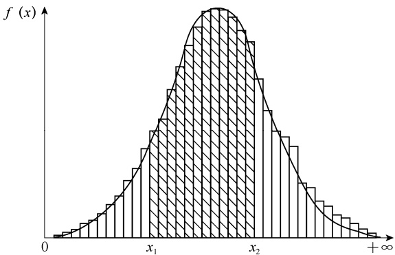

histogram

| X | f(x) |
| --- | --- |
| 0 | ~0.05 |
| \(x_{1}\) | ~0.65 |
| \(x_{2}\) | ~0.85 |
| \(+\infty\) | ~0.05 |

图 3-5 鲢鱼体长的概率密度分布图

$$
P (x _ {1} <   X = x \leqslant x _ {2}) = \int_ {x _ {1}} ^ {x _ {2}} f (x) \mathrm{d} x \tag {3-32}
$$

式（3-32）即连续性随机变量概率密度函数的表达式。由此可见，连续性随机变量概率的分布由概率密度函数 f（x）所确定。

对于随机变量 X 在区间 $( - \infty , + \infty )$ 内进行抽样，事件 $\text{" } - \infty  <  X  =  x  <  + \infty  \text{" }$ 为必然事件，所以有

$$
P (- \infty <   X = x \leqslant + \infty) = \int_ {- \infty} ^ {+ \infty} f (x) \mathrm{d} x = 1 \tag {3-33}
$$

式（3-33）表示概率密度函数 $f \left( x \right)$ 曲线与 x 轴所围成的面积为 1。

## 二、正态分布

正态分布（normal distribution）也称为高斯分布（Gauss distribution），是一种连续性随机变量的概率分布。它的分布状态是多数变量都围绕在平均值左右，由平均值到分布的两侧，变量数减少。正态分布是一种在统计理论和应用上最重要的分布。试验误差的分布一般服从于这种分布，许多生物现象的计量数据均近似服从这种分布。同时，在一定条件下，正态分布还可作为离散性随机变量或其他连续性随机变量的近似分布。例如，当 n 相当大或 $p$ 与 $q$基本接近时，二项分布接近于正态分布；当 λ 较大时，泊松分布也接近正态分布。有些总体虽然并不服从正态分布，但从总体中随机抽取的样本容量相当大时，其样本平均数的分布也近似于正态分布。这样，就可以用正态分布代替其他分布进行概率计算和统计推断。

## （一）正态分布的概率密度函数

正态分布的概率密度函数可由二项分布的概率函数在 $n   \to   \infty$ 时导出，其方程为

$$
f (x) = \frac {1}{\sigma \sqrt {2 \pi}} \mathrm{e} ^ {- \frac {1}{2} \left(\frac {x - \mu}{\sigma}\right) ^ {2}} \tag {3-34}
$$

式中， $f \left( x \right)$ 为正态分布的概率密度函数，表示随机变量 X 的某一 x 值出现的概率密度函数值； $\mu$ 为总体平均数； $\sigma$ 为总体标准差； $\pi$ 为圆周率，近似值为 3.1415926；e 为自然对数底，近似值为 2.71828。

正态分布记为 $N \left( \mu , \sigma ^ { 2 } \right)$ ），表示具有平均数为 $\mu _ { \gamma }$ 、方差为 $\sigma ^ { 2 }$ 的正态分布。 $\mu$ 和 $\sigma$ 是正态分布的两个主要参数，一个正态分布完全由参数 $\mu$ 和 $\sigma$ 来决定。正态分布曲线（normal distribution curve）如图 3-6 所示。

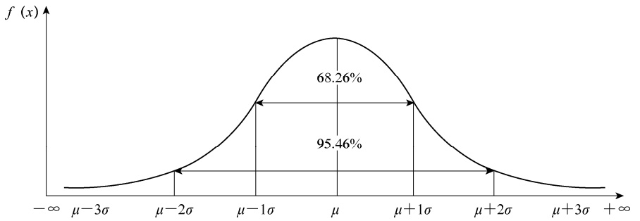

violin

| Interval | Percentage |
| --- | --- |
| \(\mu - 1\sigma\) to μ | 68.26% |
| \(\mu - 2\sigma\) to μ + 2σ | 95.46% |

图 3-6 正态分布曲线

## （二）正态分布的特征

正态分布具有以下特征:①当 $x   =   \mu$ 时， $f \left( x \right)$ 有最大值 $\frac { 1 } { \sigma \sqrt { 2 \pi } }$ ，所以，正态分布曲线是以平均数 $\mu$ 处为峰值的曲线。②当 $x { - } \mu$ 的绝对值相等时， $f \left( x \right)$ 值也相等，所以正态分布是以 $\mu$ 为中心向左右两侧对称的分布。 $\textcircled{3}  \frac { x {  一  } \mu } { \sigma }$ 的绝对值越大， $f \left( x \right)$ 值就越小，但 $f \left( x \right)$ 永远不会等于 0，所以正态分布以 $x$ 轴为渐近线，x 的取值区间为 $( - \infty , + \infty )$ 。④正态分布曲线完全由参数 $\mu$ 和 $\sigma$ 来决定。 $\mu$ 确定正态分布曲线在 x 轴上的中心位置， $\mu$ 减小，曲线左移；$\mu$ 增大，曲线右移。 $\sigma$ 确定正态分布曲线的展开程度， $\sigma$ 越小，曲线展开程度越小，曲线越陡高； $\sigma$ 越大，曲线展开程度越大，曲线越宽。不同 $\mu$ 值和不同 σ 值的正态分布曲线比较见图 3-7 和图 3-8。⑤正态分布曲线在 $x { = } \mu { \pm } \sigma$ 处各有一个拐点（knee point），曲线通过拐点时改变弯曲方向。⑥正态分布曲线的 x 在区间 $( - \infty , + \infty )$ 皆可取值，这样就构成了 $x$ 取值的完全事件系，因此，正态分布的概率密度曲线与渐近线 x 轴所围成的全部面积必然等于 1。

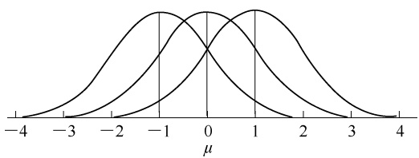

violin

| \(\mu\) | Curve 1 (Peak) | Curve 2 (Peak) | Curve 3 (Peak) |
| --- | --- | --- | --- |
| -4 | ~0.05 | 0 | 0 |
| -3 | ~0.25 | ~0.05 | 0 |
| -2 | ~0.65 | ~0.25 | ~0.05 |
| -1 | ~0.95 | ~0.65 | ~0.25 |
| 0 | ~0.75 | ~0.95 | ~0.65 |
| 1 | ~0.35 | ~0.75 | ~0.95 |
| 2 | ~0.15 | ~0.35 | ~0.95 |
| 3 | ~0.05 | ~0.15 | ~0.65 |
| 4 | 0 | ~0.05 | ~0.35 |

图 3-7 $\mu$ 值不同、 $\sigma$ 值相同的 3 条正态曲线

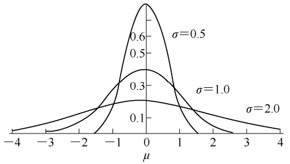

violin

| \(\mu\) | \(\sigma=0.5\) | \(\sigma=1.0\) | \(\sigma=2.0\) |
| --- | --- | --- | --- |
| -4 | 0 | ~0.02 | ~0.03 |
| -3 | 0 | ~0.05 | ~0.08 |
| -2 | 0 | ~0.12 | ~0.15 |
| -1 | ~0.15 | ~0.25 | ~0.20 |
| 0 | 1.0 | ~0.40 | ~0.22 |
| 1 | ~0.15 | ~0.25 | ~0.20 |
| 2 | 0 | ~0.12 | ~0.15 |
| 3 | 0 | ~0.05 | ~0.10 |
| 4 | 0 | 0 | ~0.05 |

图 3-8 $\mu$ 值相同、 $\sigma$ 值不同的 3 条正态曲线

## （三）标准正态分布

对于一个正态分布， $\mu$ 确定了分布曲线的中心位置， $\sigma$ 则确定了分布曲线的变异度。不同的正态分布有不同的 $\mu$ 和 $\sigma ,$ ，所以对 $N \left( \mu , \sigma ^ { 2 } \right)$ 来说不是一条曲线，而是一个曲线系统。为便于一般化应用，需将正态分布标准化（standardization）。令 $\mu = 0 , \sigma ^ { 2 } = 1$ ，则正态分布概率密度函数式（3-34）即可标准化为

$$
f (u) = \frac {1}{\sqrt {2 \pi}} \mathrm{e} ^ {- \frac {1}{2} u ^ {2}} \tag {3-35}
$$

从几何意义上说，正态分布的标准化实质上是将坐标轴进行平移和尺度转换，使正态分布

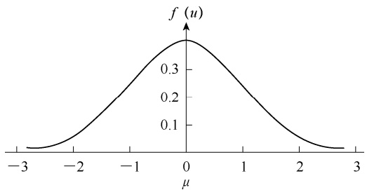

contour

| \(\mu\) | f(u) |
| --- | --- |
| -3 | ~0.01 |
| -2 | ~0.08 |
| -1 | ~0.25 |
| 0 | ~0.37 |
| 1 | ~0.25 |
| 2 | ~0.08 |
| 3 | ~0.01 |

图 3-9 标准正态分布曲线

具有平均数 $\mu { = } 0$ ，标准差 $\sigma { = } 1$ 。将随机变量 u服从于 $\mu = 0 , \sigma ^ { 2 } = 1$ 的正态分布称为标准正态分布（standard normal distribution），又称为 u 分布（u-distribution），记作 N（0，1）。f（u）称为标准正态分布方程（standard normal distribution equation）或 u 分布方程（u-distribution equation），标准正态分布曲线见图 3-9。

对于任何一个服从正态分布 $N \left( \mu , \sigma ^ { 2 } \right)$ 的

随机变量 X，都可以进行标准化变换:

$$
u = \frac {x - \mu}{\sigma} \tag {3-36}
$$

式中，u 为标准正态离差（standard normal deviate），它表示离开平均数 $\mu$ 有几个标准差 $\sigma _ { \circ }$

标准正态分布的概率累积函数记作 $F \mathrm { ~ } ( u )$ ，它是变量 u 小于某一定值 $u _ { i }$ 的概率，这需要对式（3-35）计算从-∞到 $u _ { i }$ 的定积分，即

$$
F (u _ {i}) = P (u \leqslant u _ {i}) = \int_ {- \infty} ^ {u _ {i}} f (u) \mathrm{d} u \tag {3-37}
$$

对于 u 落在区间（a，b）的概率（图 3-10 中的阴影部分），有

$$
P (a \leqslant u \leqslant b) = \int_ {a} ^ {b} \frac {1}{\sqrt {2 \pi}} \mathrm{e} ^ {- \frac {1}{2} u ^ {2}} \mathrm{d} u \tag {3-38}
$$

## （四）正态分布的概率计算

由于正态分布的概率累积函数应用广泛，统计学家已计算好实际需要的各个 $F ( u )$ 值，列于附表 1。在计算一般正态分布的概率时，只需将服从正态分布的随机变量x取值区间的上、下限按式（3-36）转换成 u 取值区间的上、下限，再查附表 1 即可（图 3-10）。例如，查附表 $F(-1.0)=0.1587,F(2.0)=0.97725.$

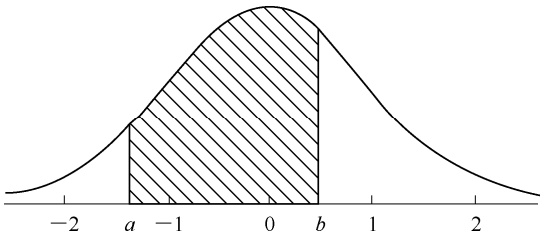

area

| X-axis | Area |
| --- | --- |
| < a | N/A |
| a ~ b | Shaded (between -a and b) |

图 3-10 标准正态分布的概率计算

例 **3-15** 设 u 服从正态分布 N（0，1），试求: $\textcircled{i} P \left( u \leqslant 1 \right)$ ； $\textcircled{2} P ~ ( u \textgreater 1 )$ ）； $P(-2.0<$ $u \leqslant 1.5 ; \textcircled{4} P \left( \left| u \right| > 2.58 \right)$ ）。

查附表 1，得

（1） $P\ (u \leqslant 1) = F\ (u = 1) = 0.8413$

（2） $P\left(u>1\right)=1-P\left(u\leqslant1\right)=1-F\left(u=1\right)=1-0.8413=0.1587$
（3） $P\left(-2.0<u\leqslant1.5\right)=F\left(u=1.5\right)-F\left(u=-2.0\right)=0.93319-0.02275=0.91044$
（4） $P\left( \left| u \right| > 2.58 \right) = P\left( u > 2.58 \right) + P\left( u \leqslant - 2.58 \right) = 1 - F\left( u = 2.58 \right) + F\left( u = - 2.58 \right) =$ $1-0.99506+0.00494=0.00988$

例 **3-16** 试计算下列概率值: $P\left( \mu - \sigma < x \leqslant \mu + \sigma \right); \textcircled{2} P\left( \mu - 2\sigma < x \leqslant \mu + 2\sigma \right); \textcircled{3} P\left( \mu - \right.$ $$3 \sigma { < } x { \leqslant } \mu { + } 3 \sigma ) ; \textcircled{4} P$ $( \mu { - } 1 . 9 6 \sigma { < } x { \leqslant } \mu { + } 1 . 9 6 \sigma ) ; \textcircled{5} P$ $( \mu { - } 2 . 5 8 \sigma { < } x { \leqslant } \mu { + } 2 . 5 8 \sigma ) ; \textcircled{e} P$ $( x { > } \mu$+$ $1.96\sigma, x \leqslant \mu - 1.96\sigma); \textcircled{7} P \left( x > \mu + 2.58\sigma, x \leqslant \mu - 2.58\sigma \right)$

首先，根据式（3-36）求 u 值，然后查附表 1，进行概率计算:

$$
u _ {2} = \frac {x - \mu}{\sigma} = \frac {(\mu + \sigma) - \mu}{\sigma} = 1
$$

$$
P (\mu - \sigma <   x \leqslant \mu + \sigma) = P (- 1 <   u \leqslant 1) = F (u = 1) - F (u = - 1)
$$

$$
= 0. 8 4 1 3 - 0. 1 5 8 7 = 0. 6 8 2 6
$$

$$
u _ {2} = \frac {x - \mu}{\sigma} = \frac {(\mu + 2 \sigma) - \mu}{\sigma} = 2
$$

$$
P (\mu - 2 \sigma <   x \leqslant \mu + 2 \sigma) = P (- 2 <   u \leqslant 2) = F (u = 2) - F (u = - 2)
$$

$$
= 0. 9 7 7 2 5 - 0. 0 2 2 7 5 = 0. 9 5 4 5
$$

$$
u _ {2} = \frac {x - \mu}{\sigma} = \frac {(\mu + 3 \sigma) - \mu}{\sigma} = 3
$$

$$
P (\mu - 3 \sigma <   x \leqslant \mu + 3 \sigma) = P (- 3 <   u \leqslant 3) = F (u = 3) - F (u = - 3)
$$

$$
= 0. 9 9 8 6 5 - 0. 0 0 1 3 5 = 0. 9 9 7 3
$$

$$
u _ {2} = \frac {x - \mu}{\sigma} = \frac {(\mu + 1 . 9 6 \sigma) - \mu}{\sigma} = 1. 9 6
$$

$$
P (\mu - 1. 9 6 \sigma <   x \leqslant \mu + 1. 9 6 \sigma) = P (- 1. 9 6 <   u \leqslant 1. 9 6) = F (u = 1. 9 6) - F (u = - 1. 9 6)
$$

$$
= 0. 9 7 5 0 - 0. 0 2 5 0 = 0. 9 5
$$

$$
u _ {2} = \frac {x - \mu}{\sigma} = \frac {(\mu + 2 . 5 8 \sigma) - \mu}{\sigma} = 2. 5 8
$$

$$
P (\mu - 2. 5 8 \sigma <   x \leqslant \mu + 2. 5 8 \sigma) = P (- 2. 5 8 <   u \leqslant 2. 5 8) = F (u = 2. 5 8) - F (u = - 2. 5 8)
$$

$$
= 0. 9 9 5 0 6 - 0. 0 0 4 9 4 = 0. 9 9 0 1 2
$$

$$
= 1 - F (u = 1. 9 6) + F (u = - 1. 9 6)
$$

$$
= 1 - 0. 9 7 5 0 + 0. 0 2 5 0 = 0. 0 5
$$

$$
\begin{array}{l} = 1 - F (u = 2. 5 8) + F (u = - 2. 5 8) \\ = 1 - 0. 9 9 5 0 6 + 0. 0 0 4 9 4 = 0. 0 0 9 8 8 \approx 0. 0 1 \\ \end{array}
$$

上述计算结果参见图 3-6。从上述计算可知，虽然标准正态分布 u 的取值区间为 $( - \infty$ $+ \infty )$ ），但实际上 $|u| > 2.58$ 的概率只有 $0.01,\ \left| u \right| > 1.96$ 的概率也只有 0.05。也就是说，在$\mu \pm 1 . 9 6 \sigma$ 和 $\mu \pm 2 . 5 8 \sigma$ 范围内已分别包含了 95%和 99%的变量，即 $|x - \mu| > 1.96\sigma$ 和 $\left| x - \mu \right| >$ 2.58σ 的概率只有 5%和 1%。

以上在计算 $|x - \mu| > 1.96\sigma$ 和 $|x - \mu| > 2.58\sigma$ 的概率时均为双尾概率（two-tailed probability），即左尾概率和右尾概率之和。由于双尾概率值经常使用，为减少计算的麻烦，附表 2［正态离差（u）值表］列出了双尾概率取某一显著水平α 时的u 临界值（critical value），即分位数（fractile），记为 $u _ { \alpha } ,$ ，可直接查用。例如，可查得 $p { = } 0 . 0 5$ 时， $u_{0.05}=1.96;\ p=0.01$ 时， $u_{0.01} = 2.58$ 。

例 **3-17** 调查某玉米品种穗长（cm），其资料服从正态分布 N（15.7，1.04）。试计算:①玉米穗长的 95%范围值；②玉米穗长＞16cm 的概率。

已知玉米穗长服从正态分布， $\mu = 15.7 (cm) , \sigma^{2} = 1.04 (cm^{2})$ ，则 $\sigma=\sqrt{1.04}=1.02\ (cm)$

（1）查附表 2，双尾概率 $u_{0.05} = 1.96$ ，则有玉米穗长的 95%范围值上下限为

上限: $15.7+1.96\times1.02=17.70\left (  cm  \right )$

下限:15.7-1.96×1.02=13.70（cm）

（2）已知 $x > 16  cm$ ，求得 $u = \frac{x - \mu}{\sigma} = \frac{16 - 15.7}{1.02} = 0.29$ ，查附表 1， $F\left(0.29\right)=0.6141$ ，因此，有

$$
P (x > 1 6) = P (u > 0. 2 9) = 1 - F (0. 2 9) = 1 - 0. 6 1 4 1 = 0. 3 8 5 9
$$

对应于双尾概率， $x \leqslant \mu - 1.96\sigma$ 或 $x > \mu + 1.96\sigma$ 的概率称为单尾概率（one-tailed probability）。例如，

数据正态性

的评估方法

$$
P (x \leqslant \mu - 1. 9 6 \sigma) = P (x > \mu + 1. 9 6 \sigma) = 0. 0 2 5
$$

$$
P (x \leqslant \mu - 1. 6 4 \sigma) = P (x > \mu + 1. 6 4 \sigma) = 0. 0 5
$$

$$
P (x \leqslant \mu - 2. 3 3 \sigma) = P (x > \mu + 2. 3 3 \sigma) = 0. 0 1
$$

此时， $u_{0.025}=1.96,\quad u_{0.05}=1.64,\quad u_{0.01}=2.33 。$

## 三、其他连续性概率分布

除上面介绍的正态分布外，常见的连续性变量概率分布还有均匀分布和指数分布。

## （一）均匀分布

均匀分布又称为规则分布。植物种群中个体分布的理想状态是等距分布，即个体之间保持一定的均匀间距。标准的均匀分布在自然情况下极为罕见，而人工栽培的农作物保持有一定株行距的田间分布即均匀分布。

对于随机变量 X 只在区间［a，b］内取值，其概率分布常用均匀分布来描述。如果随机变量 X 服从概率密度函数:

$$
f (x) = \left\{ \begin{array}{l l} \frac {1}{b - a}, & a <   x \leqslant b (a <   b) \\ 0, & \text {其他} \end{array} \right. \tag {3-39}
$$

则称 X 服从 $[ a , b ]$ 上的均匀分布（uniform distribution），记作 $U \left( a , b \right)$ ，如图 3-11 所示。

由图 3-11 可以看出，均匀分布的随机变量 X 在其取值范围 $[ a , b ]$ 内的概率密度函数是个常数，与其位置没有关系。由于图中矩形的高度是个常数，等于 $\frac { 1 } { b ^ { - } a }$ ，这样随机变量 X在其取值范围 $[ a , b ]$ 内矩形的总面积等于 1。均匀分布的累积概率函数（图 3-12）为

$$
F (X = x) = \left\{ \begin{array}{l} 0, x \leqslant a \\ \frac {x - a}{b - a}, a <   x \leqslant b (a <   b) \\ 1, x > b \end{array} \right. \tag {3-40}
$$

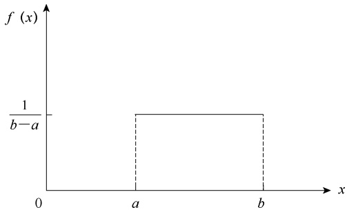

area

| X | f(x) |
| --- | --- |
| a | 1/(b-a) |
| b | 1/(b-a) |

图 3-11 均匀分布的概率密度函数

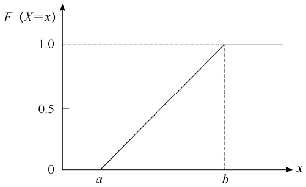

line

| x | F (X=x) |
| --- | --- |
| a | 0 |
| b | 1.0 |

图 3-12 均匀分布的累积概率函数

均匀分布的数学期望（平均数）和方差是

$$
\mu = E (X) = \frac {a + b}{2} \tag {3-41}
$$

$$
\sigma^ {2} = D (X) = \frac {1}{1 2} (b - a) ^ {2} \tag {3-42}
$$

例 **3-18** 调查某自然保护区天然油松林种群空间分布状况，其平均间距为 30m，最小间距不小于 5m。现随机抽取任一棵油松，其与相邻油松株距 10m 的概率是多少？

设某棵油松与相邻油松间的距离 X 服从 $(a = 5, b = 30)$ 的均匀分布，由式（3-39），其概率密度函数为

$$
f (x) = \left\{ \begin{array}{l l} \frac {1}{2 5}, & 5 <   x \leqslant 2 5 \\ 0, & \text {其他} \end{array} \right.
$$

因此，某棵油松与相邻油松间的距离 X 落入区间（5，30）的任一子区间（5，10）的概率为

$$
\frac {1 0 - 5}{2 5} = 0. 2 0
$$

## （二）指数分布

指数分布是用于描述发生某一特定事件所需时间的一种连续性分布。例如，动植物的寿命、微生物繁殖若干倍所需时间等，这些随机变量 X 通常可以认为只能取非负值，因而常用近似的服从指数分布来描述。

如果随机变量 X 服从概率密度函数:

$$
f (x) = \left\{ \begin{array}{l} \lambda \mathrm{e} ^ {- \lambda x}, x > 0 (\lambda > 0) \\ 0, \text {其他} \end{array} \right. \tag {3-43}
$$

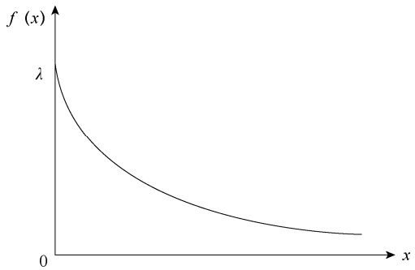

line

| X | f(x) |
| --- | --- |
| 0 | \(\lambda\) |
| >0 | <\(\lambda\) |

图 3-13 指数分布的概率密度函数

则称 X 服从参数 λ 的指数分布（exponential distribution），记作 E（λ），如图 3-13 所示。

与其他连续性随机变量分布一样，服从指数分布的随机变量 X 在某一区间取值的概率等于图 3-13 所示概率密度函数曲线与该区间围成的面积。当随机变量 $X { \leqslant } x$ 时，其取值小于或等于特定值 x 的概率为

$$
P (X \leqslant x) = 1 - \mathrm{e} ^ {- \lambda x} \tag {3-44}
$$

服从指数分布的随机变量 X 在区间（a，b）

$(0 < a \leqslant b)$ 的概率为

$$
P (a <   x \leqslant b) = P (x \leqslant b) - P (x \leqslant a) = \mathrm{e} ^ {- \lambda a} - \mathrm{e} ^ {- \lambda b} \tag {3-45}
$$

指数分布的数学期望（平均数）和方差是

$$
\mu = E (X) = \frac {1}{\lambda} \tag {3-46}
$$

$$
\sigma^ {2} = D (X) = \frac {1}{\lambda^ {2}} \tag {3-47}
$$

例 **3-19** 假设普通雄性家猫的寿命服从 $\lambda { = } \frac { 1 } { 1 0 }$ 的指数分布，计算:①普通雄性家猫寿命超 15 年的概率；②某一雄性家猫年龄为 10 岁，它还能成活 8 年的概率是多少？

当 $\lambda { = } \frac { 1 } { 1 0 }$ 时，随机变量普通雄性家猫的寿命 X 服从指数分布概率密度函数:

$$
f (x) = \left\{ \begin{array}{l l} \frac {1}{1 0} \mathrm{e} ^ {- \frac {1}{1 0} x}, & x > 0 \\ 0, & \text {其他} \end{array} \right.
$$

（1）根据式（3-44），可以直接计算 X≤15 的概率:

$$
P (X \leqslant 1 5) = 1 - \mathrm{e} ^ {- \frac {1}{1 0} \times 1 5} = 1 - \mathrm{e} ^ {- 1. 5} = 1 - 0. 2 2 3 1 = 0. 7 7 6 9
$$

于是，则有

$$
P (X > 1 5) = 1 - P (X \leqslant 1 5) = 1 - 0. 7 7 6 9 = 0. 2 2 3 1
$$

（2）某一雄性家猫年龄为 10 岁，它再活 8 年的时间范围是（10，18），代入式（3-45），得出其概率为

$$
P (1 0 <   X \leqslant 1 8) = \mathrm{e} ^ {- \frac {1}{1 0} \times 1 0} - \mathrm{e} ^ {- \frac {1}{1 0} \times 1 8} = \mathrm{e} ^ {- 1} - \mathrm{e} ^ {- 1. 8} = 0. 3 6 7 9 - 0. 1 6 5 3 = 0. 2 0 2 6
$$

对数正态

分布

## 第四节 抽 样 分 布

从第一章我们了解到，统计学中的核心问题是研究总体与由总体中所取样本的关系，这种关系可从抽样过程和推断过程两个方向来研究。从已知的总体中以一定的样本容量进行随机抽样（图 3-14），由样本的统计数所对应的概率分布称为抽样分布（sampling distribution）。抽样分布不同于由各观测值所形成的总体分布和样本分布，它是指样本统计数的概率分布，如样本平均数的分布、样本频率的分布、样本方差的分布等。因此，抽样分布也称为统计数分布。以样本平均数为例，它是总体平均数的一个估计值，如果按照相同的样本容量、相同的抽样方式反复地抽取样本，每次可以计算一个平均数，所有可能样本的平均数所形成的分布，就是样本平均数的抽样分布。第 4 章介绍的统计推断就是以抽样分布作为理论基础的。

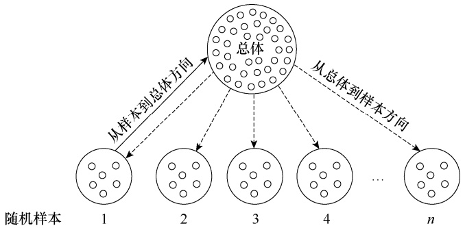

flowchart

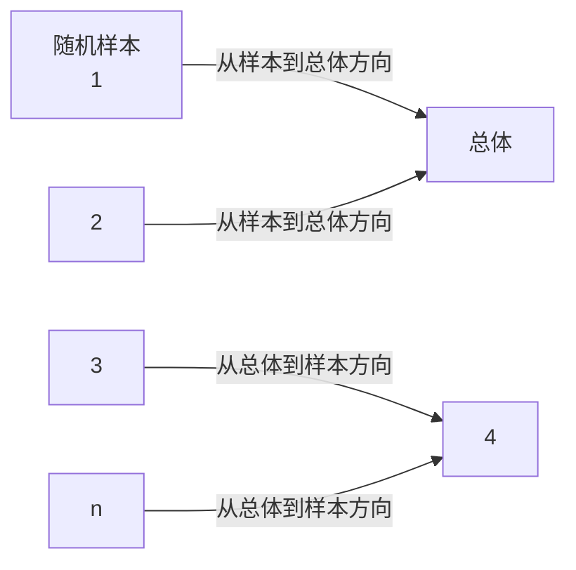

图 3-14 从总体抽取样本的过程

## 一、抽样试验与无偏估计

从总体中抽样必须符合随机的原则，即保证总体中的每一个个体在每一次抽样中都有相同的概率被抽取为样本。从理论上讲，从一个总体中抽取所有可能的样本，就能获得统计数变异的全部信息。但是，这样的抽样试验（sampling experiment）不仅在无限总体中无法做到，就是在许多有限总体中也难以实现。解决这一矛盾的方法是，仅抽取一部分样本，或对小的有限总体进行复置抽样（duplicate sampling），又称为放回抽样（sampling with replacement）。在小总体中进行复置抽样，样本可以从不会耗尽的总体中获得，所以从理论上可以看成总体容量是无限的，因此具有无限总体抽样的性质，即所获得样本是等概率的和随机的。

设有一个 N=3 的近似正态总体，具有变量 3、4、5，由式（2-9）、式（2-28）和式（2-30）可求得 $\mu = 4  、 \sigma^{2} = 0.6667  、 \sigma = 0.8165$ 。现以 n=2 进行独立的复置抽样，可得 $N^{n}=3^{2}=9$ 个样本，其抽样结果列于表 3-7。

表 3-7 由 N=3 的总体进行 n=2 复置抽样所有样本的平均数、方差和标准差

| 样本编号 | 样本值 | $\bar{x}$ | $s^{2}$ | s |
| --- | --- | --- | --- | --- |
| 1 | 3, 3 | 3.0 | 0 | 0 |
| 2 | 3, 4 | 3.5 | 0.5 | 0.7071 |
| 3 | 3, 5 | 4.0 | 2.0 | 1.4142 |
| 4 | 4, 3 | 3.5 | 0.5 | 0.7071 |
| 5 | 4, 4 | 4.0 | 0 | 0 |
| 6 | 4, 5 | 4.5 | 0.5 | 0.7071 |
| 7 | 5, 3 | 4.0 | 2.0 | 1.4142 |
| 8 | 5, 4 | 4.5 | 0.5 | 0.7071 |
| 9 | 5, 5 | 5.0 | 0 | 0 |
| $\sum$ |  | 36.0 | 6.0 | 5.6568 |

根据表 3-7 的数据，可以求出:

样本平均数 x 的平均数为

$$
\mu_ {\bar {x}} = \frac {3 6}{9} = 4 = \mu
$$

样本方差 $s ^ { 2 }$ 的平均数为

$$
\mu_ {s ^ {2}} = \frac {6}{9} = 0. 6 6 6 7 = \sigma^ {2}
$$

样本标准差 s 的平均数为

$$
\mu_ {s} = \frac {5 . 6 5 6 8}{9} = 0. 6 2 8 5 \neq \sigma
$$

在统计学上，如果所有可能样本的某一统计数的平均数等于总体的相应参数，则称该统计数为总体相应参数的无偏估计值（unbiased estimated value）。根据上述计算结果，可以得到以下性质:①样本平均数 x 是总体平均数 $\mu$ 的无偏估计值；②样本方差 $s ^ { 2 }$ 是总体方差 $\sigma ^ { 2 }$的无偏估计值；③样本标准差 s 不是总体标准差 $\sigma$ 的无偏估计值。

## 二、样本平均数的抽样分布

## （一）一个样本平均数的抽样分布

对上述 $N = 3, n = 2$ 抽样试验所得的 9 个样本平均数，整理频数分布表，列于表 3-8。如果对这个 3、4、5 组成的总体再进行 n=4 的抽样试验，共可得 $N ^ { n } { = } 3 ^ { 4 } { = } 8 1$ 个样本平均数，其平均数的频数分布也列于表 3-8。由于从总体中抽出的样本为每一个可能样本，且每个样本中的变量均为随机变量，所以其样本平均数也为随机变量，也形成一定的理论分布，这种理论分布称为样本平均数的概率分布，或称样本平均数的分布（distribution of the sample mean）。

表 3-8 样本容量不同的样本平均数的频数分布

<table><tr><td colspan="4">n=2</td><td colspan="4">n=4</td></tr><tr><td> $\bar{x}$ </td><td>f(频数)</td><td> $f\bar{x}$ </td><td> $f\bar{x}^2$ </td><td> $\bar{x}$ </td><td>f(频数)</td><td> $f\bar{x}$ </td><td> $f\bar{x}^2$ </td></tr><tr><td>3.0</td><td>1</td><td>3</td><td>9.0</td><td>3.00</td><td>1</td><td>3</td><td>9.00</td></tr><tr><td></td><td></td><td></td><td></td><td>3.25</td><td>4</td><td>13</td><td>42.25</td></tr><tr><td>3.5</td><td>2</td><td>7</td><td>24.5</td><td>3.50</td><td>10</td><td>35</td><td>122.50</td></tr><tr><td></td><td></td><td></td><td></td><td>3.75</td><td>16</td><td>60</td><td>225.00</td></tr><tr><td>4.0</td><td>3</td><td>12</td><td>48.0</td><td>4.00</td><td>19</td><td>76</td><td>304.00</td></tr><tr><td></td><td></td><td></td><td></td><td>4.25</td><td>16</td><td>68</td><td>289.00</td></tr><tr><td>4.5</td><td>2</td><td>9</td><td>40.5</td><td>4.50</td><td>10</td><td>45</td><td>202.50</td></tr><tr><td></td><td></td><td></td><td></td><td>4.75</td><td>4</td><td>19</td><td>90.25</td></tr><tr><td>5.0</td><td>1</td><td>5</td><td>25.0</td><td>5.00</td><td>1</td><td>5</td><td>25.00</td></tr><tr><td>Σ</td><td>9</td><td>36</td><td>147.0</td><td>Σ</td><td>81</td><td>324</td><td>1309.50</td></tr></table>

样本平均数的分布与其他分布一样也有两个重要参数，一个是样本平均数的平均数，记作 $\mu _ { \overline { { x } } }$ ；另一个是样本平均数的方差，记作 $\sigma _ { x } ^ { 2 }$ 。根据表 3-8，可求得 $n { = } 2$ 的样本平均数的平均数 $\mu _ { \overline { { x } } }$ 和方差 $\sigma _ { x } ^ { 2 }$ 分别为

$$
\mu_ {\bar {x}} = \frac {\sum f \bar {x}}{N ^ {n}} = \frac {3 6}{9} = 4 = \mu
$$

$$
\sigma_ {\bar {x}} ^ {2} = \frac {1}{N ^ {n}} \left[ \sum f \bar {x} ^ {2} - \frac {\left(\sum f \bar {x}\right) ^ {2}}{N ^ {n}} \right] = \frac {1}{9} \times \left(1 4 7 - \frac {3 6 ^ {2}}{9}\right) = 0. 3 3 3 3 = \frac {\sigma^ {2}}{n}
$$

同样，可求得 $n { = } 4$ 时样本平均数的平均数 $\mu _ { \overline { { x } } }$ 和方差 $\sigma _ { x } ^ { 2 }$ 为

$$
\mu_ {\bar {x}} = \frac {3 2 4}{8 1} = 4 = \mu
$$

$$
\sigma_ {\bar {x}} ^ {2} = \frac {1}{8 1} \times \left(1 3 0 9. 5 0 - \frac {3 2 4 ^ {2}}{8 1}\right) = 0. 1 6 6 7 = \frac {\sigma^ {2}}{n}
$$

由以上抽样试验，可得出样本平均数分布有以下基本性质:

（1）样本平均数分布的平均数等于总体平均数，即

$$
\mu_ {\bar {x}} = \mu \tag {3-48}
$$

（2）样本平均数分布的方差等于总体方差除以样本容量，即

$$
\sigma_ {\bar {x}} ^ {2} = \frac {\sigma^ {2}}{n} \tag {3-49}
$$

进而，有样本平均数的标准误差（standard error，SE），简称平均数的标准误（standard error of mean）:

$$
\sigma_ {\bar {x}} = \frac {\sigma}{\sqrt {n}} \tag {3-50}
$$

（3）如果从正态总体 $N \left( \mu , \sigma ^ { 2 } \right)$ 进行抽样，其样本平均数 x 是一个具有平均数 $\mu _ { \gamma }$ 、方差$\frac{\sigma^{2}}{n}$ 的正态分布，记作 $N \Biggl ( \mu , \frac { \sigma ^ { 2 } } { n } \Biggr )$

（4）如果被抽样总体不是正态总体，但具有平均数 $\mu$ 和方差 $\sigma ^ { 2 }$ ，当样本容量 n 不断增大，样本平均数 $\overline { { x } }$ 的分布也越来越接近正态分布，且具有平均数 $\mu _ { 1 }$ 、方差 $\frac { \sigma ^ { 2 } } { n }$ ，这称为中心极限定理（central limit theorem）。这个定理对于连续性变量或非连续性变量都适用。无论总体为何种分布，一般只要样本容量 $n \geqslant 3 0$ ，就可应用中心极限定理，认为样本平均数 x 的分布是正态分布。在计算样本平均数出现的概率时，其正态离差 u 可按式（3-51）进行标准化:

$$
u = \frac {\overline {{x}} - \mu_ {\overline {{x}}}}{\sigma_ {\overline {{x}}}} = \frac {\overline {{x}} - \mu}{\frac {\sigma}{\sqrt {n}}} \tag {3-51}
$$

## （二）两个样本平均数差数的抽样分布

设有两个相互独立的正态总体，总体一为 $N _ { 1 } { = } 2$ ，具变量 3、6，其平均数 $\mu _ { 1 } { = } 4 . 5$ ，方差$\sigma _ { 1 } ^ { 2 }   =   2 . 2 5$ ，当以 $n _ { 1 } { = } 3$ 进行复置抽样试验，共可得 $2 ^ { 3 } { = } 8$ 个样本，求得 $\mu_{\overline{x}_{1}}=4.5,\ \sigma_{\overline{x}_{1}}^{2}=0.75;$ ；总体二为 $N _ { 2 } { = } 3$ ，具变量 2、4、6，其平均数 $\mu _ { 2 } { = } 4$ ，方差 $\sigma_{2}^{2} = 2.6667$ ，当以 $n _ { 2 } { = } 2$ 进行复置抽样试验，共可得 $3 ^ { 2 } { = } 9$ 个样本，求得 $\mu_{\bar{x}_{2}}=4,\ \sigma_{\bar{x}_{2}}^{2}=1.333$ 。将来自两个总体的样本平均数进行所有可能的比较，得出 72 个样本平均数差数 $( \overline { { x } } _ { 1 }   -   \overline { { x } } _ { 2 } )$ ，其频数分布如表 3-9 所示。

表 3-9 样本平均数差数 $( \overline { { x } } _ { 1 }   -   \overline { { x } } _ { 2 } )$ 的频数分布

| $\overline{x}_{1}-\overline{x}_{2}$ | f(频数) | $f(\overline{x}_{1}-\overline{x}_{2})$ | $f(\overline{x}_{1}-\overline{x}_{2})^{2}$ |
| --- | --- | --- | --- |
| 4 | 1 | 4 | 16 |
| 3 | 5 | 15 | 45 |
| 2 | 12 | 24 | 48 |
| 1 | 18 | 18 | 18 |
| 0 | 18 | 0 | 0 |
| -1 | 12 | -12 | 12 |
| -2 | 5 | -10 | 20 |
| -3 | 1 | -3 | 9 |
| $\sum$ | 72 | 36 | 168 |

根据表 3-9，可求出两个样本平均数差数分布（distribution of the sample mean difference）的平均数 $\mu _ { \overline { { x } } _ { 1 } - \overline { { x } } _ { 2 } }$ 和方差 $\sigma _ { \overline { { x _ { 1 } } } - \overline { { x _ { 2 } } } } ^ { 2 }$

$$
\begin{array}{l} \mu_ {\bar {x} _ {1} - \bar {x} _ {2}} = \frac {\sum f \left(\bar {x} _ {1} - \bar {x} _ {2}\right)}{N _ {1} ^ {n _ {1}} N _ {2} ^ {n _ {2}}} = \frac {3 6}{7 2} = 0. 5 = \mu_ {1} - \mu_ {2} \\ \sigma_ {\bar {x} _ {1} - \bar {x} _ {2}} ^ {2} = \frac {1}{N _ {1} ^ {n _ {1}} N _ {2} ^ {n _ {2}}} \left\{\sum f (\bar {x} _ {1} - \bar {x} _ {2}) ^ {2} - \frac {\left[ \sum f (\bar {x} _ {1} - \bar {x} _ {2}) \right] ^ {2}}{N _ {1} ^ {n _ {1}} N _ {2} ^ {n _ {2}}} \right\} \\ = \frac {1}{7 2} \times \left(1 6 8 - \frac {3 6 ^ {2}}{7 2}\right) = 2. 0 8 3 3 = \sigma_ {\bar {x} _ {1}} ^ {2} + \sigma_ {\bar {x} _ {2}} ^ {2} = \frac {\sigma_ {1} ^ {2}}{n _ {1}} + \frac {\sigma_ {2} ^ {2}}{n _ {2}} \\ \end{array}
$$

根据上述计算，可得两个样本平均数差数分布的基本性质:

（1）两个样本平均数差数分布的平均数等于总体平均数的差数（或样本平均数分布的平均数的差数），即

$$
\mu_ {\overline {{x}} _ {1} - \overline {{x}} _ {2}} = \mu_ {1} - \mu_ {2} \tag {3-52}
$$

（2）两个样本平均数差数分布的方差等于各自总体方差除以各自样本容量之和（或两样本平均数分布的方差之和），即

$$
\sigma_ {\overline {{x}} _ {1} - \overline {{x}} _ {2}} ^ {2} = \sigma_ {\overline {{x}} _ {1}} ^ {2} + \sigma_ {\overline {{x}} _ {2}} ^ {2} = \frac {\sigma_ {1} ^ {2}}{n _ {1}} + \frac {\sigma_ {2} ^ {2}}{n _ {2}} \tag {3-53}
$$

进而，有样本平均数差数的标准误（standard error of the sample mean difference）:

$$
\sigma_ {\overline {{x}} _ {1} - \overline {{x}} _ {2}} = \sqrt {\frac {\sigma_ {1} ^ {2}}{n _ {1}} + \frac {\sigma_ {2} ^ {2}}{n _ {2}}} \tag {3-54}
$$

当 $\sigma_{1}^{2} = \sigma_{2}^{2} = \sigma^{2}$ 时，式（3-53）可简化为

$$
\sigma_ {\overline {{x}} _ {1} - \overline {{x}} _ {2}} ^ {2} = \sigma^ {2} \left(\frac {1}{n _ {1}} + \frac {1}{n _ {2}}\right) \tag {3-55}
$$

当 $n_{1}=n_{2}=n$ 时，式（3-53）可简化为

$$
\sigma_ {\overline {{x}} _ {1} - \overline {{x}} _ {2}} ^ {2} = \frac {\sigma_ {1} ^ {2} + \sigma_ {2} ^ {2}}{n} \tag {3-56}
$$

当 $\sigma_{1}^{2} = \sigma_{2}^{2} = \sigma^{2}$ 且 $n_{1}=n_{2}=n$ 时，式（3-53）可进一步简化为

$$
\sigma_ {\overline {{x}} _ {1} - \overline {{x}} _ {2}} ^ {2} = \frac {2 \sigma^ {2}}{n} \tag {3-57}
$$

（3）从两个独立正态总体 $N \left( \mu _ { 1 } , \sigma _ { \overline { { x } } _ { 1 } } ^ { 2 } \right)$ ）  和 $N \left( \mu _ { 2 } , \sigma _ { \overline { { x } } _ { 2 } } ^ { 2 } \right)$ 中抽出的样本平均数差数的分布也是正态分布，并具有平均数 $\mu _ { 1 } - \mu _ { 2 }$ 和方差 $\sigma _ { \overline { { x } } _ { 1 } - \overline { { x } } _ { 2 } } ^ { 2 }$ ，记作 $N \left( \mu _ { 1 } - \mu _ { 2 } , \sigma _ { \bar { x } _ { 1 } - \bar { x } _ { 2 } } ^ { 2 } \right)$ 。

## 三、样本频率的抽样分布

## （一）一个样本频率的抽样分布

生物学研究中，在研究一些分类变量时要用比例估计，也就是用样本频率 $\hat { p }$ 去推断总体频率 $p _ { \circ }$ 。例如，男女性别占全部人数之比、显隐性性状占总观测数的比例等。为了用样本频率 $\hat { p }$ 去估计总体频率 $p   ,$ ，就需要了解样本频率的抽样分布。

样本频率的抽样分布（sampling distribution of frequency）也称为样本比例的抽样分布（sampling distribution of percentage），是从总体中重复随机抽取容量为 n 的所有样本，获得样本频率的概率分布。样本中具有某一特征的单位数 $x$ 占样本全部单位数 n 的比例称为样本频率，用 $\hat { p }$ 表示，其计算公式为

$$
\hat {p} = \frac {x}{n} \tag {3-58}
$$

可用样本频率 $\hat { p }$ 估计总体频率 $p   .$ 。

由二项分布可知，当 n 充分大时 $(n \geqslant 30)$ ），在复置抽样的条件下，样本频率 $\hat { p }$ 的抽样分布可用正态分布逼近。通过式（3-24）、式（3-25）和式（3-26）可以推导出样本频率（比例）的数学期望（平均数）、方差和标准差:

$$
\mu_ {p} = E (P) = \frac {\mu_ {x}}{n} = \frac {n p}{n} = p \tag {3-59}
$$

$$
\sigma_ {p} ^ {2} = D (P) = \frac {\sigma_ {x} ^ {2}}{n ^ {2}} = \frac {p (1 - p)}{n} \tag {3-60}
$$

$$
\sigma_ {p} = \sqrt {\sigma_ {p} ^ {2}} = \sqrt {\frac {p (1 - p)}{n}} \tag {3-61}
$$

因此，样本频率 $\hat { p }$ 的抽样分布具有平均数 $\mu _ { p } { \mathrm {  三  } } p .$ 、方差 $\sigma_{p}^{2}=\frac{p\left(1-p\right)}{n}$ ，记作 $N \left( \mu _ { p } , \sigma _ { p } ^ { 2 } \right)$

## （二）两个样本频率差数的抽样分布

设两个总体均服从二项分布，分别从两个总体中抽取样本容量为 $n _ { 1 }$ 、 $n _ { 2 }$ 的独立样本，得到样本频率分别为 $\hat { p } _ { 1 }  、 \hat { p } _ { 2 }  。$ 。当两个样本都为大样本时，两个样本频率之差的抽样分布可用正态分布来近似，其数学期望（平均数）、方差和标准差为

$$
\mu_ {p _ {1} - p _ {2}} = E (P _ {1} - P _ {2}) = p _ {1} - p _ {2} \tag {3-62}
$$

$$
\sigma_ {p _ {1} - p _ {2}} ^ {2} = D (P _ {1} - P _ {2}) = \frac {p _ {1} (1 - p _ {1})}{n _ {1}} + \frac {p _ {2} (1 - p _ {2})}{n _ {2}} \tag {3-63}
$$

$$
\sigma_ {p _ {1} - p _ {2}} = \sqrt {\sigma_ {p _ {1} - p _ {2}} ^ {2}} = \sqrt {\frac {p _ {1} (1 - p _ {1})}{n _ {1}} + \frac {p _ {2} (1 - p _ {2})}{n _ {2}}} \tag {3-64}
$$

因此，两个样本频率差数 $\hat { p } _ { 1 } \mathrm { { \overline { { ~ - } } } } \hat { p } _ { 2 }$ 的抽样分布服从正态分布，具有平均数 $\mu_{p_{1}-p_{2}}=p_{1}-p_{2}$方差 $\sigma_{p_{1}-p_{2}}^{2}=\frac{p_{1}\left(1-p_{1}\right)}{n_{1}}+\frac{p_{2}\left(1-p_{2}\right)}{n_{2}}$ ，记作 $N \left( p _ { 1 } - p _ { 2 } , \frac { p _ { 1 } \left( 1 - p _ { 1 } \right) } { n _ { 1 } } + \frac { p _ { 2 } \left( 1 - p _ { 2 } \right) } { n _ { 2 } } \right)$

## 四、正态总体抽样分布

从正态总体 X 抽取样本，再由该样本构造统计数，则该统计数的分布称为正态总体抽样分布（sampling distribution of normal population），主要有 t 分布、 $\chi ^ { 2 }$ 分布和 F 分布 3 个著名的分布。统计实践中，一般用 t 分布、 $\chi ^ { 2 }$ 分布和 F 分布来构造精确的小样本 $(n \leqslant 30)$ 方法。

## （一）t 分布

前面计算样本平均数分布和样本平均数差数分布的概率时，需要总体方差 $\sigma ^ { 2 }$ 已知，或者$\sigma ^ { 2 }$ 未知但样本容量较大 $(n \geqslant 30)$ ），此时用样本方差 $s ^ { 2 }$ 估计 $\sigma ^ { 2 }$ 。但在实际研究中经常遇到总体方差 $\sigma ^ { 2 }$ 未知且样本容量不大 $(n < 30)$ 的情况，如果仍用 $s ^ { 2 }$ 来估计 $\sigma ^ { 2 }$ ，这时 $\frac { \overline { { x } } \overline { { - \mu } } } { s / \sqrt { n } }$ 就不再服从标准正态分布了，而是服从自由度 $df = n - 1$ 的 t 分布（t-distribution），即

$$
t = \frac {\overline {{x}} - \mu}{s _ {\overline {{x}}}} = \frac {\overline {{x}} - \mu}{s / \sqrt {n}} \tag {3-65}
$$

式中， $s _ { \overline { { x } } }$ 为样本平均数的标准误，其计算公式为

$$
s _ {\bar {x}} = \frac {s}{\sqrt {n}} \tag {3-66}
$$

$s _ { \overline { { x } } }$ 为 $\sigma _ { \overline { { x } } }$ 的估计值。

t 分布是英国统计学家 Gosset 于 1908 年以笔名“Student”所发表的论文中提出的，因此也称学生氏 t 分布，简称 t 分布。t 分布的概率密度函数为

$$
f (t) = \frac {\Gamma \left(\frac {d f + 1}{2}\right)}{\sqrt {\pi d f} \Gamma \left(\frac {d f}{2}\right)} \left(1 + \frac {t ^ {2}}{d f}\right) ^ {- \frac {d f + 1}{2}} \tag {3-67}
$$

式中，Γ 为 Γ 函数。

t 分布的数学期望（平均数）和方差分别为

$$
\mu_ {t} = 0 \quad (d f > 1) \tag {3-68}
$$

$$
\sigma_ {t} ^ {2} = \frac {d f}{d f - 2} \quad (d f > 2) \tag {3-69}
$$

t 分布具有以下特征:①t 分布曲线是左右对称的，围绕平均数 $\mu _ { t } { = } 0$ 向两侧递降；②t 分布受自由度 $df = n - 1$ 的制约，每个自由度都有一条 t分布曲线；③和正态分布相比，t 分布为扁平分布，其顶部偏低，尾部偏高，自由度 $df \geqslant 30$ 时，其曲线就比较接近正态分布曲线，当 $df \rightarrow \infty$ 时则和正态分布曲线重合（图 3-15）。

和正态分布一样，t 分布曲线与横轴所围成的

面积也等于 1。各种自由度下双尾概率水平的 t 值，

$P { = } 0 . 0 5$ 的 t 值为 2.228， $P { = } 0 . 0 1$ 的 t 值为 3.169，分别记作 $t_{0.05(10)} = 2.228$ 和 $t_{0.01(10)} = 3.169.$

因此，t 值在区间 $\left[ - t _ { 0 . 0 5 } , + t _ { 0 . 0 5 } \right]$ 内的概率为 0.95，在区间 $\left[ - t _ { 0 . 0 1 } , + t _ { 0 . 0 1 } \right]$ 内的概率为 0.99，

其中 $t_{0.05} 、 t_{0.01}$ 分别称为双尾概率为 5%和 1%的 t 临界值。

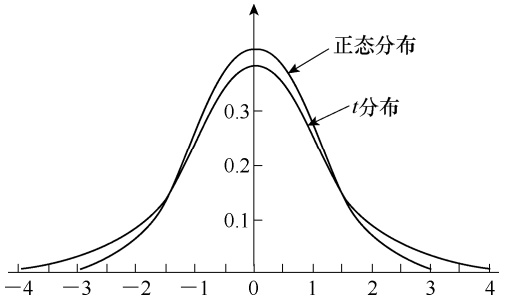

violin

| X | t分布 (Y) | 正态分布 (Y) |
| --- | --- | --- |
| -4 | ~0.01 | ~0.02 |
| -3 | ~0.05 | ~0.08 |
| -2 | ~0.15 | ~0.18 |
| -1 | ~0.32 | ~0.35 |
| 0 | ~0.38 | ~0.42 |
| 1 | ~0.32 | ~0.35 |
| 2 | ~0.15 | ~0.18 |
| 3 | ~0.05 | ~0.08 |
| 4 | ~0.01 | ~0.02 |

图 3-15 正态分布曲线与 t 分布曲线的比较

## （二） $\chi ^ { 2 }$ 分布

在第三节，我们已经知道标准正态离差 $\frac { \overline { { x } } \mathrm { { \textellipsis } } \mu } { \sigma }$ 服从 $N \left( 0 , 1 \right)$ 。假设从标准正态总体中抽取 k 个独立样本，就会得到 $u_{1}^{2}, \quad u_{2}^{2}, \quad \cdots, \quad u_{k}^{2}$ ，则定义它们的和为 $\chi^{2}   ( chi-square )$ ，即

$$
\chi^ {2} = u _ {1} ^ {2} + u _ {2} ^ {2} + \dots + u _ {k} ^ {2} = \sum_ {i = 1} ^ {k} u _ {i} ^ {2} = \sum_ {i = 1} ^ {k} \left(\frac {x - \mu}{\sigma}\right) ^ {2} \tag {3-70}
$$

式（3-70）即 $\chi ^ { 2 }$ 分布（distribution），其自由度为 $df = k - 1$

$\chi ^ { 2 }$ 分布首先由 Abbey 于 1863 年提出，后来由 Hermert 和 K. Pearson 分别于 1875 年和 1900年推导出来。 $\chi ^ { 2 }$ 分布的概率密度函数为

$$
f (\chi^ {2}) = \frac {(\chi^ {2}) ^ {\frac {d f}{2} - 1}}{2 ^ {\frac {d f}{2}} \Gamma \left(\frac {d f}{2}\right)} \mathrm{e} ^ {- \frac {1}{2} \chi^ {2}} \tag {3-71}
$$

$\chi ^ { 2 }$ 分布的概率累积函数为

$$
F (\chi^ {2}) = \int_ {0} ^ {\chi^ {2}} f (\chi^ {2}) \mathrm{d} (\chi^ {2}) \tag {3-72}
$$

$\chi ^ { 2 }$ 分布是连续性随机变量的分布，每个不同的自由度都有一个相应的 $\chi ^ { 2 }$ 分布曲线，所以$\chi ^ { 2 }$ 分布是一组曲线。 $\chi ^ { 2 }$ 分布的特征为: $\textcircled{i} \chi^{2}$ 分布于区间 $\left[0,   +\infty\right)$ ，并且呈反 J 形的偏态分布（skewed distribution）； $\textcircled{2} \chi^{2}$ 分布的偏度系数随自由度降低而增大，当自由度 $d f { = } 1$ 时，曲线以纵轴为渐近线；③随自由度 $d f$ 增大， $\chi ^ { 2 }$ 分布曲线渐趋左右对称，当 $df \geqslant 30$ 时， $\chi ^ { 2 }$ 分布已接近正态分布（图 3-16）。

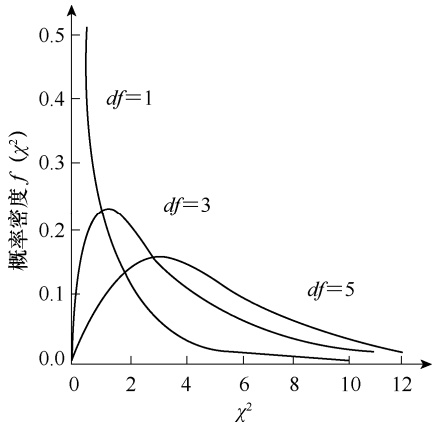

line

| \(\chi^{2}\) | df=1 | df=3 | df=5 |
| --- | --- | --- | --- |
| 0 | 0.5 | 0 | 0 |
| ~1.2 | ~0.23 | ~0.23 | ~0.08 |
| ~3.2 | ~0.05 | ~0.16 | ~0.16 |
| ~12 | — | — | ~0.01 |

图 3-16 不同自由度的 $\chi ^ { 2 }$ 分布曲线

附表 4 列出了各种自由度下不同单尾（右尾）概率的 $\chi ^ { 2 }$ 值。例如，当 $d f { = } 2$ 时，查得 $P { = } 0 . 0 5$ 的 $\chi ^ { 2 }$ 值为 5.99，$P { = } 0 . 0 1$ 的 $\chi ^ { 2 }$ 值为 9.21，分别记作 $\chi^{2}_{0.05(2)} = 5.99, \chi^{2}_{0.01(2)} =$ 9.21，表示 $P\left( \chi^{2} > 5.99 \right) = 0.05$ $P\left( \chi^{2} > 9.21 \right) = 0.01$即所得 $\chi ^ { 2 }$ 值大于 5.99 的概率仅有 5%，大于 9.21 的概率仅有 1%。

## （三）F 分布

设从一正态总体 $N \left( \mu , \sigma ^ { 2 } \right)$ 中随机抽取样本容量为$n _ { 1 }$ 和 $n _ { 2 }$ 的两个独立样本，其样本方差为 $s _ { 1 } ^ { 2 }$ 和 $s _ { 2 } ^ { 2 }$ ，则定义 $s _ { 1 } ^ { 2 }$ 和 $s _ { 2 } ^ { 2 }$ 的比值为 $F ;$ :

$$
F = \frac {s _ {1} ^ {2}}{s _ {2} ^ {2}} \tag {3-73}
$$

此 F 值具有 $s _ { 1 } ^ { 2 }$ 的自由度 $df_{1}=n_{1}-1$ 和 $s _ { 2 } ^ { 2 }$ 的自由度 $df_{2}=n_{2}-1$ 。如果对一正态总体在特定的 $d f _ { 1 }$ 和 $d f _ { 2 }$ 下进行一系列随机独立抽样，则所有可能的 F 值就构成一个 F 分布（F-distribution）。F 分布的概率密度函数是由两个独立 $\chi ^ { 2 }$ 变量的概率密度所构成的联合概率密度函数（joint probability density function），其方程为

$$
f (F) = \frac {\Gamma \left(\frac {d f _ {1} + d f _ {2}}{2}\right)}{\Gamma \left(\frac {d f _ {1}}{2}\right) \Gamma \left(\frac {d f _ {2}}{2}\right)} d f _ {1} ^ {\frac {d f _ {1}}{2}} d f _ {2} ^ {\frac {d f _ {2}}{2}} \frac {F ^ {\frac {d f _ {1}}{2} - 1}}{(d f _ {1} F + d f _ {2}) ^ {\frac {d f _ {1} + d f _ {2}}{2}}} \tag {3-74}
$$

式中，Γ 为 $T$ 函数； $d f _ { 1 }$ 和 $d f _ { 2 }$ 分别为 $s _ { 1 } ^ { 2 }$ 和 $s _ { 2 } ^ { 2 }$ 的自由度。由式（3-74）可知，F 分布是随自由度 $d f _ { 1 }$ 和 $d f _ { 2 }$ 变化而变化的一组曲线。

F 分布的概率累积函数为

$$
F (F) = \int_ {0} ^ {F} f (F) \mathrm{d} F \tag {3-75}
$$

F 分布具有以下特征: $\textcircled{i} F$ 的取值区间为$\left[0,   +\infty \right)$ ；②F 分布的平均数 $\mu _ { F } { = } 1$ ，因为构成 F 值的 $s _ { 1 } ^ { 2 }$ 和 $s _ { 2 } ^ { 2 }$ 都是同一 $\sigma ^ { 2 }$ 的无偏值；③F分布曲线的形状仅取决于 $d f _ { 1 }$ 和 $d f _ { 2 }$ ，在 $d f _ { 1 } { = } 1$和 $df_{1} = 2$ 时，F 分布曲线呈 $\begin{aligned} 产 \end{aligned}$ 重倾斜的反向 J形，当 $df_{1} \geqslant 3$ 时转为右偏曲线（图 3-17）。

附表 5 列出的是 F 分布在不同 $d f _ { 1 }$ $d f _ { 2 }$下 $P { = } 0 . 0 5$ 和 $P { = } 0 . 0 1$ 时的 F 值（右尾）。例

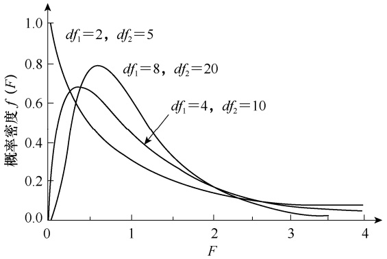

line

| F | df1=2, df2=5 | df1=8, df2=20 | df1=4, df2=10 |
|---|---|---|---|
| 0 | 1.0 | 0.0 | 0.0 |
| ~0.3 | ~0.65 | ~0.65 | ~0.65 |
| ~0.6 | ~0.45 | ~0.78 | ~0.68 |
| ~1.0 | ~0.3 | ~0.55 | ~0.45 |
| ~1.5 | ~0.2 | ~0.3 | ~0.3 |
| ~2.0 | ~0.15 | ~0.18 | ~0.18 |
| ~3.0 | ~0.05 | ~0.08 | ~0.08 |
| ~4.0 | ~0.02 | ~0.06 | ~0.06 |

图 3-17 不同自由度 $d f _ { 1 }$ 和 $d f _ { 2 }$ 的 F 分布

如， $df_{1}=4,\ df_{2}=10$ 时，可查得 $P { = } 0 . 0 5$ 的 F 值为 3.48， $P { = } 0 . 0 1$ 的 F 值为 5.99，分别记作 $F_{0.05(4,10)} = 3.48$ $F_{0.01(4,10)} = 5.99$ ，表示 $P\left(F>3.84\right)=0.05$ ，P $(F > 5.99) = 0.01$ ，即所得$F$ 值大于 3.48 的概率仅有 5%，大于 5.99 的概率仅有 1%。