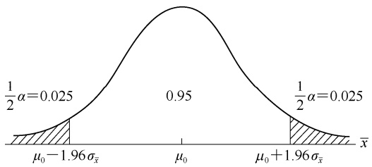
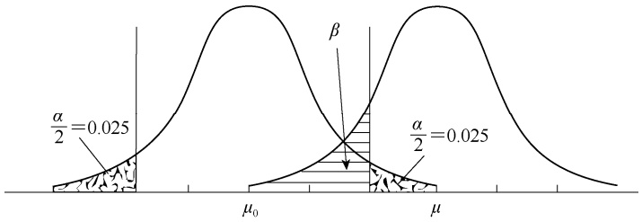

## 思考练习题

习题 **3.1** 试解释必然事件、不可能事件和随机事件，并分别举例。

习题 **3.2** 随机试验的含义是什么？什么是样本空间和样本点？

习题 **3.3** 什么是频率？什么是概率？频率如何转化为概率？

习题 **3.4** 什么是互斥事件？什么是对立事件？什么是独立事件？试举例说明。

习题 **3.5** 什么是条件概率？何谓全概率法则？

习题 **3.6** 什么是随机变量？它有哪些类型？

习题 **3.7** 简述概率密度函数及其图形意义。

习题 **3.8** 什么是正态分布？什么是标准正态分布？正态分布曲线有什么特点 $\textit { ? } \mu$ 和 σ 对正态分布曲线有何影响？

习题 **3.9** 什么是抽样分布？样本平均数的抽样总体与原总体平均数、方差两个参数间有何关系？

习题 **3.10** 已知 u 服从标准正态分布 $N ( 0 ,   1 )$ ，试查 $F ( u )$ 值表计算下列概率值: $P(0.3 < u \leq 1.08)$ $P\ (-1<u\leqslant 1);\quad \textcircled{3} P\ (-2<u\leqslant 2);\quad \textcircled{4} P\ (-1.96<u\leqslant 1.96);\quad \textcircled{5} P\ (-2.58<u\leqslant 2.58)$

习题 **3.11** 设 X 服从正态分布 N（4，16），试通过标准化变换后查 $F \; \left( u \right)$ 值表计算下列概率值:$P\left(-3<x\leqslant4\right);\quad P\left(x\leqslant0.44\right);\quad P\left(x>-1.48\right);\quad \left(4\right)P\left(x>-1\right)$ 。

习题 **3.12** 有一男女比例为 51∶49 的人群，已知男性中 5%是色盲，女性中 0.25%是色盲，现随机抽中了一个色盲者，计算这个色盲者恰好是男性的概率。

习题 **3.13** 水稻糯和非糯为一对等位基因控制，糯稻纯合体为 ww，非糯稻纯合体为 WW，两个纯合亲本杂交后，其 $\mathrm { F _ { 1 } }$ 代为非糯稻杂合体 $W w .$ 。①现以 $\mathrm { F _ { 1 } }$ 代回交于糯稻亲本，在后代 200 株中预期有多少株为糯稻，多少株为非糯稻？试列出糯稻和非糯稻的概率； $\textcircled { 2 }$ 当 $\mathrm { F _ { 1 } }$ 代自交， $\mathrm { F } _ { 2 }$ 代性状分离，其中 3/4为非糯稻，1/4 为糯稻。假定 $\mathrm { F } _ { 2 }$ 代播种了 2000 株，试问糯稻株和非糯稻株各有多少株？

习题 **3.14** 大麦的矮生基因和抗锈基因连锁，以矮生基因与正常抗锈基因杂交，在 $\mathrm { F } _ { 2 }$ 代出现纯合正常抗锈植株的概率仅 0.0036。试计算:①在 $\mathrm { F } _ { 2 }$ 代种植 200 株时，纯合正常抗锈植株的各种可能株数的概率；②若希望有 0.99 的概率保证获得 1 株或 1 株以上纯合正常抗锈植株，则 $\mathrm { F } _ { 2 }$ 代至少应种植多少株？

习题 **3.15** 设对同性别、同月龄的小白鼠接种某种病菌，假定接种后经过一段时间生存的概率为0.425，若 5 只一组进行随机抽样，试问其中“四生一死”的概率有多大？

习题 **3.16** 有一正态分布的平均数为 16，方差为 4，试计算:①落于 10～20 的数据的百分数；②小于 12 或大于 20 的数据的百分数。

习题**3.17** 假设一种有机生物的寿命服从参数λ= $\pm { \frac { 1 } { 2 0 0 } }$ 的指数分布。随机选取一个该物种的新生命，计算:①该有机生物活过 60 年的概率。②该有机生物的寿命在 50～80 年的概率。

习题 **3.18** 查表计算: $\textcircled{i} d f { = } 5$ 时， $P\left(t\leqslant-2.571\right)=?P\left(t>4.032\right)=?\frac{2}{9}df=2$ 时，P $( \chi ^ { 2 } \leqslant 0 . 0 5 ) = ? P ( \chi ^ { 2 } > 5 . 9 9 ) = ? P ( 0 . 0 5 < \chi ^ { 2 } \leqslant 7 . 3 8 ) = ? \textcircled { 3 } d f _ { 1 } = 3 , d f _ { 2 } = 1 0$ 时， $P\left(F>3.71\right)=?$ $P\left(F>6.55\right)=?$

## 本章提要

假设检验和参数估计是统计推断的两个方面。本章主要讨论:

• 假设检验的原理与方法；
• 样本平均数、频率、方差的检验假设；
• 参数估计的原理与方法；
• 基于参数估计的样本容量确定。

第 3 章讨论了从总体到样本的方向，即抽样分布问题。本章将讨论从样本到总体的方向，就是根据这些理论分布由一个样本或一系列样本所得的结果来推断总体的特征，即统计推断（statistical inference）。统计推断主要包括假设检验和参数估计两个方面。

## 第一节 假设检验的原理与方法

## 一、假设检验的概念

在生物学试验和研究中，如果检验一种试验方法的效果、一个品种的优劣、一种药品的疗效，所得试验数据往往存在着一定的差异，此时需要推断这种差异是由随机误差造成的，还是由试验处理所引起的。例如，在同一饲养条件下喂养甲、乙两个品系的肉鸡各 20 只，在 2月龄时测得甲品系的平均体重 $\overline{x}_{1} = 1.5\mathrm{kg}$ ，乙品系的平均体重 $\bar{x}_{2}=1.4\mathrm{kg}$ ，二者之间的 0.1kg 差值，究竟是由甲、乙两个品系来自两个不同的总体，还是由抽样时的随机误差所致？这个问题必须进行统计分析才能回答。因为试验结果中处理效应和误差效应往往混淆在一起，从表面上是不容易分开的，需要采用假设检验的方法，通过概率的计算，才能做出正确的推断。

假设检验（hypothesis test）又称为显著性检验（significance test），是根据总体的理论分布和小概率原理，对未知或不完全知道的总体提出两种彼此对立的假设（无效假设和备择假设），然后由样本的实际结果，经过一定的计算，做出在一定概率意义上应该接受的那种假设的推断。如果抽样结果使小概率事件发生，则拒绝无效假设；如果抽样结果没有使小概率事件发生，则接受无效假设。统计学中，一般认为等于或小于 0.05（或 0.01）的概率为小概率（little probability），而概率等于或小于 0.05（或 0.01）的事件则为小概率事件。通过假设检验，可以正确辨别处理效应和随机误差的效应，从而做出可靠的推断。

## 二、假设检验的步骤

在进行假设检验时，一般应包括以下 4 个步骤。

## （一）提出假设

假设检验首先要对总体提出假设，一般应做两个彼此对立的假设，一个是无效假设（ineffective hypothesis）或零假设（null hypothesis），记作 $H _ { 0 }$ ；另一个是备择假设（alternative hypothesis），记作 $H _ { A } ,$ 。无效假设是直接检验的假设，是对总体提出的一个假想目标。所谓“无效”是指用样本统计数表示的处理效应与总体参数之间没有真实的差异，试验结果中的差异乃是误差所致，即处理“无效”。备择假设是与无效假设相对立的一种假设，即认为试验结果中的差异是由总体参数不同所引起的，即处理“有效”。因此，无效假设与备择假设是对立事件。在检验中，如果接受 $H _ { 0 }$ 则否定 $H _ { A }$ ；如果否定 $H _ { 0 }$ 则接受 $H _ { A }$ 。无效假设的形式是多种多样的，随研究内容不同而不同，但必须遵循两个原则:①无效假设必须是有意义的，根据无效假设是否成立，可以对问题做出回答；②根据无效假设可以算出因抽样误差而获得样本统计数效应的概率。

以样本平均数的假设为例。

1.对一个样本平均数的假设 假设一个样本平均数 x 来自一具有平均数 $\mu$ 的总体，可提出:无效假设 $H _ { 0 } \colon \mu { = } \mu _ { 0 }$ ；备择假设 $H _ { A } \colon \mu \neq \mu _ { 0 } .$ 。

例如，已知硅肺病患者的血红蛋白含量为具有平均数 $\mu_{0}=126 mg/L$ ， $\sigma^{2}=240\left( mg/L \right)^{2}$的正态分布，即 N（126，240）。现用克矽平对 6 位硅肺病患者进行治疗，治疗后测得其平均血红蛋白含量 $\bar{x}=136 mg/L$ 。试问用克矽平治疗硅肺病是否能提高患者的血红蛋白含量？

这是一个样本平均数的假设检验，是要检验克矽平治疗后的血红蛋白含量的总体平均数$\mu$ 是否还是治疗前的 126mg/L，即 $\bar{x}-\mu_{0}=136-126=10\mathrm{mg/L}$ 这一差数是由克矽平治疗造成的，还是由抽样误差所致？这就需要首先提出无效假设 $H _ { 0 } \colon \mu { = } \mu _ { 0 }$ ，同时也要给出对应的备择假设 $H _ { A } : \mu \neq \mu _ { 0 }$ 。因为在无效假设 $H _ { 0 } \colon \mu { = } \mu _ { 0 }$ 成立的条件下，就有一个平均数为 $\mu _ { \bar { x } } = \mu = \mu _ { 0 } =$ $126 mg/L$ ， $\sigma_{\bar{x}}^{2}=\frac{\sigma^{2}}{6}=40\left( mg / L \right)^{2}$ 的正态分布，即 N（126，40），而样本 $\bar{x}=136 mg/L$ 则是此分布中的一个随机变量。

2.对两个样本平均数相比较的假设 假设两个样本平均数 ${ \overline { { x } } } _ { 1 }$ 和 $\overline { { x } } _ { 2 }$ 分别来自具有平均数 $\mu _ { 1 }$ 和 $\mu _ { 2 }$ 的两个总体，则提出:无效假设 $H_{0}: \mu_{1} = \mu_{2}$ ；备择假设 $H _ { A } \colon \mu _ { 1 } \not = \mu _ { 2 }$ 。

例如，要检验两种制剂的疗效是否相同，两个水稻品种的株高是否一致，成年男女的肺活量是否一样等，都属于两个样本平均数相比较的假设。其无效假设 $H_{0}: \mu_{1} = \mu_{2}$ ，认为两个样本所属各自总体的平均数是相等的，即这两个总体是同一个总体，两个样本平均数之间的差值 $( \overline { { x } } _ { 1 } - \overline { { x } } _ { 2 }$ ）是由随机误差所引起的；其备择假设 $H _ { A } \colon \mu _ { 1 } \not = \mu _ { 2 }$ ，则表示两个样本所属各自总体的平均数是不相同的，即这两个总体不是同一个总体，其分别抽样所得样本平均数差值$( \overline { { x } } _ { 1 } - \overline { { x } } _ { 2 } )$ 除随机误差之外，还包含真实的差异。

提出上述无效假设的目的在于:可从假设的总体中推论其样本平均数的随机抽样分布，从而可以算出某一个样本平均数指定值出现的概率，这样就可以根据样本与总体的关系，作为假设检验的理论依据。

与样本平均数的假设检验一样，样本频率、样本方差及多个平均数的假设检验也需根据试验目的提出相应的无效假设和备择假设。

## （二）确定显著水平

在提出无效假设和备择假设后，要确定一个否定 $H _ { 0 }$ 的概率标准，这个概率标准称为显著水平（significance level）或概率水平（probability level），记作 $\alpha _ { \circ }$ 。显著水平是人为规定的小概率界限，统计学中常取 $\alpha { = } 0 . 0 5$ 和 $a { = } 0 . 0 1$ 两个显著水平。

## （三）计算统计数与相应概率

在假设 $H _ { 0 }$ 正确的前提下，根据样本平均数的抽样分布计算出由抽样误差造成的概率。对于上面利用克矽平治疗硅肺病的一个样本平均数的例子，在 $H _ { 0 } \colon \mu { = } \mu _ { 0 }$ 的前提下，可计算得出样本平均数检验的统计数:

$$
u = \frac {\bar {x} - \mu}{\sigma_ {\bar {x}}} = \frac {\bar {x} - \mu}{\sqrt {\sigma^ {2} / n}} = \frac {1 3 6 - 1 2 6}{\sqrt {2 4 0 / 6}} = 1. 5 8
$$

查附表 1， $P\left( \left| u \right| > 1.58 \right) = 2 \times 0.05705 = 0.1141$ ，即在 N（126，40）的总体中，以 $n { = } 6$进行随机抽样，所得平均数 $\bar{x}=136 mg/L$ 与 126mg/L 相差为 10mg/L 以上的概率为 0.1141。这里需要指出的是，假设检验所计算的并不是实得差异本身的概率，而是超过实得差异的概率。概率的大小是推断 $H _ { 0 }$ 是否能够接受的依据。此例中，在 $H _ { 0 }$ 假设下，由于 x 有可能大于 $\mu _ { 0 }$ ，也有可能小于 $\mu _ { 0 }$ ，因此需要考虑差异的正和负两个方面，所以计算的是双尾概率。

## （四）推断是否接受假设

根据小概率原理做出是否接受 $H _ { 0 }$ 的推断。小概率原理（little probability principle）指出:如果假设一些条件，并在假设的条件下能够准确地算出事件 A 出现的概率 a 为很小，则在假设条件下的 n 次独立重复试验中，事件 A 将按预定的概率发生，而在一次试验中则几乎不可能发生。简言之，小概率事件在一次抽样试验中几乎是不可能发生的。如果计算的概率大于0.05（或 0.01），则认为不是小概率事件， $H _ { 0 }$ 的假设可能是正确的，应该接受 $H _ { 0 1 }$ ，同时否定 $H _ { A } ;$反之，如果计算的概率等于或小于 0.05（或 0.01），则否定 $H _ { 0 } ,$ ，接受 $H _ { A ^ { \circ } }$ 。通常把概率 ${ \leqslant } 0 . 0 5$称为差异（difference）显著标准（significance standard），或差异显著水平；概率 $\leq   0 . 0 1$ 称为差异极显著标准（highly significance standard），或差异极显著水平（highly significance level）。如果差异达到显著水平，则在统计数或概率值的右上方标以“\*”；差异达到极显著水平，则在统计数或概率值的右上方标以“\*\*”。

上例中，所计算的概率值为 0.1141，大于 0.05 的显著水平，应接受 $H _ { 0 }$ ，可以推断治疗前后的血红蛋白含量没有显著差异，其差值 10mg/L 应归于误差所致。

在实际应用时，可简化上述计算过程。由第 3 章已知， $P\left( \left| u \right| > 1.96 \right) = 0.05,\ P\left( \left| u \right| > \right.$ $2.58)=0.01$ 。因此，在用 u 分布进行检验时，如果算得 $|u| > 1.96$ ，就是在 $a = 0 . 0 5$ 的水平上达到显著；如果 $|u| > 2.58$ ，就是在 $\alpha { = } 0 . 0 1$ 的水平上达到显著，即达到极显著水平，无须再计算 u 值的概率。因此，在 $H _ { 0 }$ 成立的条件下，由计算统计数得到的概率与显著水平的比较就转变为检验统计数与某一显著水平下的分位数（附表 2）的比较了。本例中 $u = 1.58 < 1.96$所以差异未达到 0.05 显著水平。

综上所述，假设检验的步骤可概括为:①对样本所属总体提出无效假设 $H _ { 0 }$ 和备择假设$H _ { A }$ ；②确定检验的显著水平 $\alpha ;$ ；③在 $H _ { 0 }$ 正确的前提下，计算抽样分布的统计数或相应的概率值；④根据小概率原理，进行差异是否显著的推断。

## 三、双尾检验与单尾检验

进行假设检验时，需要提出无效假设和备择假设。对于备择假设 $H _ { A } \colon \mu \not \models \mu _ { 0 } ,$ ，其总体平均数 $\mu$ 可能大于 $\mu _ { 0 }$ ，也可能小于 $\mu _ { 0 }$ 。在样本平均数的抽样分布中， $\alpha { = } 0 . 0 5$ 时，在区间 $( \mu -$ $1.96\sigma_{\bar{x}}, \mu + 1.96\sigma_{\bar{x}}$ 的 x 有 95%，在这一区间之外（即 x $\leqslant \mu - 1.96\sigma_{\overline{x}}$ 和 $\overline{x} > \mu + 1.96\sigma_{\overline{x}}$ 的 x 只有 5%。同理， $\alpha { = } 0 . 0 1$ 时，在区间 $( \mu - 2.58 \sigma_{\bar{x}} , \mu + 2.58 \sigma_{\bar{x}} )$ ）的 x 有 99%，在这一区间之外（即 $\overline{x} \leqslant \mu - 2.58\sigma_{\overline{x}}$ 和 $\bar{x} > \mu + 2.58\sigma_{\bar{x}}$ 的 x 只有 1%。一般在进行假设检验时，对一定的 α，在区间 $( \mu - u _ { \alpha } \sigma _ { \bar { x } } , \mu + u _ { \alpha } \sigma _ { \bar { x } } )$ 的 x 有 1-α，在这一区间之外（即 $\bar { x } \leqslant \mu - u _ { \alpha } \sigma _ { \bar { x } }$ 和 $\bar{x} > \mu + u_{\alpha} \sigma_{\bar{x}}$的 x 只有 α，前者相当于接受 $H _ { 0 }$ 的区域，简称为接受区（acceptance region）；后者相当于否

定 $H _ { 0 }$ 的区域，简称为否定区（rejection region）（图 4-1），即 $( \mu - u _ { \alpha } \sigma _ { \bar { x } } , \mu + u _ { \alpha } \sigma _ { \bar { x } } )$ 为 $H _ { 0 }$ 的接受区，而 $\overline { { x } }   \leqslant   \mu   -   u _ { \alpha } \sigma _ { \overline { { x } } }$ 和 $\overline { { x } }   >   \mu   +   u _ { \alpha } \sigma _ { \overline { { x } } }$ 为 $H _ { 0 }$ 的两个否定区，其中 $\bar{x} \leqslant \mu - u_{\alpha} \sigma_{\bar{x}}$ 为左尾否定区（left-tailed rejection region）， $\bar{x} > \mu + u_{\alpha} \sigma_{\bar{x}}$ 为右尾否定区（right-tailed rejection region）。接受区和否定区的两个临界值（critical value）则可写成 $\mu \pm u _ { _ { a } } \sigma _ { \overline { { x } } }$

contour

| Interval | Value |
| --- | --- |
| \(\mu_{0} - 1.96\sigma_\)̄ | 0.025 |
| \(\mu_{0}\) | 0.95 |
| \(\mu_{0} + 1.96\sigma_\)̄ | 0.025 |

图 4-1 $\alpha { = } 0 . 0 5$ 时假设检验 $H _ { 0 }$ 的接受区与否定区（双尾）

上述假设检验的两个否定区分别位于分布的两尾，这种具有两个否定区的检验称为双尾检验（two-tailed test）。当假设检验的 $H_{0}: \mu = \mu_{0}$ 时，则 $H _ { A } \colon \mu \neq \mu _ { 0 }$ ，这时备择假设就有两种可能， $\mu { \geq } \mu _ { 0 }$ 或 $\mu { \leqslant } \mu _ { 0 }$ ，也就是说在 $\mu \not = \mu _ { 0 }$ 的情况下，样本平均数 x 有可能落入左尾否定区，也有可能落入右尾否定区，这两种情况都属于 $\mu \not = \mu _ { 0 }$ 的情况。例如，检验某种新药与旧药的治病疗效是否有差别，如果认为新药疗效比旧药好和旧药疗效比新药好两种可能性都存在，相应的假设检验就应该用双尾检验。在生物学研究中，双尾检验的应用是非常广泛的。

但在某些情况下，双尾检验不一定符合实际。例如，根据实际情况，我们已经知道新药疗效不可能不如旧药，于是提出其无效假设 $H _ { 0 } : \mu \leqslant \mu _ { 0 }$ ，备择假设 $H _ { A } : \mu > \mu _ { 0 }$ ，这时 $H _ { 0 }$ 的否定区只有一个，相应的检验也只能考虑一侧的概率。像这种具有左尾或右尾一个否定区的检验称为单尾检验（one-tailed test）。单尾检验的步骤与双尾检验的相同，在査 u 分布表或 t 分布表时，需将双尾概率乘以 2。例如，进行 $a = 0 . 0 5$ 的单尾检验时，对 $H _ { 0 } : \mu > \mu _ { 0 }$ ，需进行左尾检验，其否定区为 $\overline{x} \leqslant \mu - 1.64\sigma_{\overline{x}}$ ；对 $H_{0}:\mu \leqslant \mu_{0}$ ，需进行右尾检验，其否定区为 $\bar{x} > \mu + 1.64\sigma_{\bar{x}}$同理，进行 $\alpha { = } 0 . 0 1$ 的单尾检验时，对 $H _ { 0 } : \mu > \mu _ { 0 }$ ，其否定区为 $\bar{x} \leqslant \mu - 2.33\sigma_{\bar{x}};$ ；对 $H _ { 0 } : \mu \leqslant \mu _ { 0 } ,$

其否定区为 $\overline{x} > \mu + 2.33\sigma_{\overline{x}}$

在实际应用中，根据检验要求和专业知识的判断，尽量进行单尾检验，以提高假设检验的灵敏度。

## 四、假设检验中的两类错误与功效

## （一）假设检验中的两类错误

假设检验是根据一定概率显著水平 $\alpha$ 对总体特征进行的推断。在一定 $\alpha$ 下，否定了 $H _ { 0 } ,$ ，并不等于已证明 $H _ { 0 }$ 不真实；接受了 $H _ { 0 } ,$ ，也不等于已证明 $H _ { 0 }$ 是真实的。如果 $H _ { 0 }$ 是真实的，假设检验却否定了它，就发生了一个否定真实假设的错误，这类错误称为第一类错误 $( \mathrm { t y p e ~ I ~ e r r o r } )$或称为 $\alpha$ 错误（α error），也称为弃真错误（error of abandoning trueness）。例如，对样本平均数的抽样分布，当取概率显著水平 $\alpha {=} 0.05$ 时，x 在区间 $( \mu - 1.96 \sigma_{\bar{x}} , \mu + 1.96 \sigma_{\bar{x}} )$ 的概率为 0.95，x 在区间 $( \mu - 1.96 \sigma_{\bar{x}}, \mu + 1.96 \sigma_{\bar{x}} )$ 之外的概率为 0.05。当 x 一旦落在区间 $( \mu - 1.96 \sigma_{\bar{x}} , \mu + 1.96 \sigma_{\bar{x}} )$之外，假设检验时就会否定 $H _ { 0 } ,$ ，接受 $H _ { A }$ ，这样就会导致错误的推断。不过，发生这类错误的概率很小，只有 0.05。如果取概率显著水平为 $\alpha { = } 0 . 0 1$ ，则 x 在区间 $( \mu - 2.58 \sigma_{\bar{x}} , \mu + 2.58 \sigma_{\bar{x}} )$的概率为 0.99，在区间 $( \mu - 2.58 \sigma_{\bar{x}}, \mu + 2.58 \sigma_{\bar{x}} )$ 之外的概率只有 0.01，即发生 $\alpha$ 错误的可能性更小，只有 0.01。所以，发生第一类错误的概率等于相应的显著水平 $\alpha$ 。

如果 $H _ { 0 }$ 不是真实的，假设检验时却接受了 $H _ { 0 }$ ，否定了 $H _ { A }$ ，这样就犯了接受不真实假设的错误，这类错误称为第二类错误（type Ⅱ error），或称为 $\beta$ 错误（β error），也称为纳伪错误（error of accepting mistake）。

第一类错误和第二类错误既有区别又有联系。二者的区别是，第一类错误只有在否定$H _ { 0 }$ 时才会发生，而第二类错误只有在接受 $H _ { 0 }$ 时才会发生，二者不会同时发生。二者的联系是，在样本容量相同的情况下，发生第一类错误的概率减少，发生第二类错误的概率就会增加；反之，发生第二类错误的概率减少，发生第一类错误的概率就会增加（图 4-2）。例如，将概率显著水平 $\alpha$ 从 0.05 改变到 0.01，就更容易接受 $H _ { 0 }$ ，因此发生第一类错误的概率就降低，但相应地增加了发生第二类错误的概率。显著水平如果定得太高，虽然在否定 $H _ { 0 }$ 时减少了发生第一类错误的概率，但在接受时却可能增加发生第二类错误的概率。

contour

| Metric | Value |
| --- | --- |
| Mean \((\mu)\) | \(\mu_{0}\) |
| Standard Deviation \((\alpha/2)\) | 0.025 |

图 4-2 假设检验中的两类错误

第二类错误的影响因素及降低途径

以上说明，在假设检验时，一个假设的接受或否定，不可能保证百分之百的正确，可能会出现一些错误的推断。

## （二）假设检验的功效

当无效假设 $H _ { 0 }$ 不成立时，我们希望拒绝无效假设 $H _ { 0 }$ 、接受备择假设 $H _ { A }$ 的概率越大越好，这个概率就是假设检验功效（power of test），也称为检验效能。从上面介绍的两类错误来看，假设检验的功效就是指不犯 $\beta$ 错误（第二类错误）的概率，即固定检验显著水平 $\alpha$ 下的 $1   -   \beta$ 值。

以本节克矽平治疗硅肺病患者后的血红蛋白含量数据为例， $\alpha { = } 0 . 0 5$ 时，其接受 $H _ { 0 } .$ 、拒绝 $H _ { A }$ 的概率为 0.1141，该例的检验功效为 $P=1-0.1141=0.8859$ 。

以一个样本平均数假设检验为例，计算检验功效包含以下三个步骤:①确定 $H_{0} 、 H_{A}$ 及检验的显著水平 $\alpha ;$ ；②计算拒绝 $H _ { 0 }$ 的样本平均数 x 的取值范围，即否定区域；③计算 $H _ { A }$ 为真实时，样本平均数 x 位于否定区域的概率，即为该 $H _ { A }$ 的检验功效。

我们知道，假设 $H _ { 0 }$ 正确的前提下， $u = \frac{\overline{x} - \mu_{\overline{x}}}{\sigma_{\overline{x}}} = \frac{\overline{x} - \mu_{0}}{\sigma / \sqrt{n}}$ 。在确定的显著标准 $\alpha$ 条件下，$H _ { A }$ 成立的条件是在 $H _ { 0 }$ 正确的前提下，统计数 $| \textbf { \em u } | > \mathrel { u _ { \alpha } }$ 。而获得较大的｜u｜值取决于较大的差值 $\mid \overline { { x } } \mathrm { ~  一  ~ } \mu _ { 0 }$ ｜、较小的总体方差 $\sigma ^ { 2 }$ 和较大的 n 值。现以克矽平治疗硅肺病患者血红蛋白含量的数据为例，从以下 3 个方面进行分析。

（1）｜ $\overline { { x } } \mathrm { ~ - ~ } \mu _ { 0 }$ ｜的变化。 $\mid \overline { { x } } - \mu _ { 0 } \mid$ 的值与 $\mu _ { 0 }$ 有关。此例中，如果 $\mu_{0}=123 mg/L$ ，而不是 126mg/L，计算 u 值及概率如下:

$$
u = \frac {\bar {x} - \mu}{\sigma_ {\bar {x}}} = \frac {1 3 6 - 1 2 3}{\sqrt {2 4 0 / 6}} = 2. 0 6
$$

$$
P (\mid u \mid > 2. 0 6) = 2 F (u <   - 2. 0 6) = 2 \times 0. 0 1 9 7 0 = 0. 0 3 9 4
$$

检验功效为 $P=1-0.0394=0.9606>0.8859$ 。由此可见，在其他条件不变的情况下， $\mid { \bar { x } } -$ $\mu _ { 0 } \mid$ 增加，检验功效增加。

（2）总体方差 $\sigma ^ { 2 }$ 变化。此例中，如果硅肺病患者血红蛋白含量的总体平均数仍为 $\mu _ { 0 } { \mathrm { = } }$ 126mg/L，而方差 $\sigma ^ { 2 }$ 不是 $240\left( mg/L \right)^{2}$ ，而是降低为 $150\left( mg/L \right)^{2}$ ，计算 u 值及概率如下:

$$
u = \frac {\overline {{x}} - \mu_ {0}}{\sigma / \sqrt {n}} = \frac {1 3 6 - 1 2 6}{\sqrt {1 5 0 / 6}} = 2. 0 0
$$

$$
P (\mid u \mid > 2. 0 0) = 2 F (u <   - 2. 0 0) = 2 \times 0. 0 2 2 7 5 = 0. 0 4 5 5
$$

检验功效为 $P=1-0.0455=0.9545>0.8859$ 。由此可见，在其他条件不变的情况下，总体方差 $\sigma ^ { 2 }$ 降低，检验功效增加。

（3）样本容量 n 变化。此例中，如果硅肺病患者血红蛋白含量的总体参数不变，即 N（126，240），而克矽平治疗患者的样本容量 n 由 6 增大到 10，其样本平均数 x 不变，计算 u值及概率如下:

$$
u = \frac {\overline {{x}} - \mu_ {0}}{\sigma / \sqrt {n}} = \frac {1 3 6 - 1 2 6}{\sqrt {2 4 0 / 1 0}} = 2. 0 4
$$

$$
P (\mid u \mid > 2. 0 4) = 2 F (u <   - 2. 0 4) = 2 \times 0. 0 2 0 6 8 = 0. 0 4 1 3 6
$$

检验功效为 $P=1-0.04136=0.95864>0.8859$ 。由此可见，在其他条件不变的情况下，样本容量 n 增加，检验功效增加。

由上述分析可解释此例中克矽平治疗硅肺病患者血红蛋白含量的差异 10mg/L 未达到显著水平的原因。尽管治疗前后血红蛋白含量有 10mg/L 的差异，从该指标的表观数值来看，这一差值已经不算很小了。但是总体方差 $\sigma^{2}=240\left( mg/L \right)^{2}$ ，说明总体变异较高；且 $n { = } 6$ ，样本容量偏小。此条件下，计算所得 u 值为 1.58，在 $a = 0 . 0 5$ 水平下，小于接受 $H _ { A }$ 的 $u _ { 0 . 0 5 } { = } 1 . 9 6$

推断差异不显著。

因此，要提高检验功效，需综合考虑以下方面:①确定合适的显著标准 $\alpha ;$ ；②有一定的平均数差数；③样本（或所属总体）方差较小；④样本容量较大。

关于假设检验的正确认识

在研究中，我们总是希望得到较高的检验功效。如果将显著水平 α 值增大，此时尽管犯第一类错误的概率增加，而犯第二类错误的概率降低，其检验功效是增加的。如果将 α 值降低，此时犯第一类错误的概率降低，但增加了犯第二类错误的概率，同时降低了功效。因此，在犯第一类错误和第二类错误的风险之间，要做出适当的权衡。

## 第二节 样本平均数的假设检验

## 一、一个样本平均数的假设检验

一个样本平均数的假设检验适用于判断一个样本平均数 x 所属总体平均数 $\mu$ 与已知总体平均数 $\mu _ { 0 }$ 是否有真实差异的检验。

## （一）总体方差 $\sigma ^ { 2 }$ 已知时的检验

当总体方差 $\sigma ^ { 2 }$ 已知时，无论样本是大样本 $(n \geqslant 30)$ 还是小样本 $(n < 30)$ ），样本平均数的分布均服从正态分布，标准化后则服从标准正态分布，即 u 分布。因此，用 u 检验 $(u - \mathrm{test})$法进行假设检验。

例 **4-1** 某渔场按常规方法所育鲢鱼苗 1 月龄的平均体长为 7.25cm，标准差为 1.58cm。为提高鱼苗质量，现采用一个新方法进行育苗，1 月龄时随机抽取 100 尾进行测量，测得其平均体长为 $7.65 cm  。$ 。试问新育苗方法与常规育苗方法所育鲢鱼苗 1 月龄体长有无显著差异？

这是一个样本平均数的假设检验，总体 $\sigma = 1.58  cm , \sigma^{2}$ 为已知，故采用 u 检验；又因新育苗方法的鱼苗体长可能高于常规方法，也可能低于常规方法，故进行双尾检验。

（1）假设 $H_{0}: \mu = \mu_{0} = 7.25  cm$ ，即新育苗方法与常规育苗方法所育鱼苗 1 月龄体长没有差异； $H _ { A } : \mu \neq \mu _ { 0 }$ 。
（2）选取显著水平 $\alpha {=} 0.05$
（3）检验计算:

$$
\sigma_ {\bar {x}} = \frac {\sigma}{\sqrt {n}} = \frac {1 . 5 8}{\sqrt {1 0 0}} = 0. 1 5 8 (\mathrm{cm})
$$

$$
u = \frac {\bar {x} - \mu}{\sigma_ {\bar {x}}} = \frac {7 . 6 5 - 7 . 2 5}{0 . 1 5 8} = 2. 5 3 2
$$

（4）推断:当 $a = 0 . 0 5$ 时， $u_{0.05} = 1.96$ 。实得 $| u | > 1.96,\ P < 0.05$ ，故在 0.05 显著水平上否定 $H _ { 0 }$ 、接受 $H _ { A }$ 。又因 x ${ \geq } \mu _ { 0 }$ ，故认为新育苗法鱼苗 1 月龄体长显著大于常规育苗方法。

例 **4-2** 已知某玉米品种平均穗重 $\mu_{0}=300\mathrm{g}$ ，标准差 $\sigma {=}9.5\mathrm{g}$ 。喷施某种植物生长调节剂后，随机抽取 9 个果穗，重量 $( \mathbf { g } )$ ）分别为 308、305、311、298、315、300、321、294、320。问这种生长调节剂对玉米果穗重量是否有影响？

由题可知， $\sigma = 9.5  g , \sigma^{2}$ 为已知，故用 u 检验；又由于喷施调节剂后玉米果穗重量有可能增加，也可能降低，故进行双尾检验。

（1）假设 $H_{0}:\mu = \mu_{0} = 300 g$ ，即喷施生长调节剂后玉米果穗重量无显著变化； $H _ { A } : \mu \neq \mu _ { 0 }$
（2）选取显著水平 $a = 0 . 0 5$
（3）检验计算:

$$
\bar {x} = \frac {1}{n} \sum x = \frac {1}{9} \times (3 0 8 + 3 0 5 + \dots + 3 2 0) = 3 0 8 (\mathrm{g})
$$

$$
\sigma_ {\bar {x}} = \frac {\sigma}{\sqrt {n}} = \frac {9 . 5}{\sqrt {9}} = 3. 1 6 7 (\mathrm{g})
$$

$$
u = \frac {\bar {x} - \mu}{\sigma_ {\bar {x}}} = \frac {3 0 8 - 3 0 0}{3 . 1 6 7} = 2. 5 2 6
$$

（4）推断:当 $\alpha = 0 . 0 5$ 时， $u_{0.05} = 1.96$ 。实得 $\left| u \right| > 1.96,\ P < 0.05$ ，故在 0.05 显著水平上否定 $H _ { 0 } ,$ ，接受 $H _ { A ^ { \circ } }$ 。又因 $\overline { { x } }   \geq   \mu _ { 0 }$ ，故认为该喷施生长调节剂能够显著增加玉米果穗的重量。

## （二）总体方差 $\sigma ^ { 2 }$ 未知时的检验

1.总体方差 $\sigma ^ { 2 }$ 未知，且 $n \geq 3 0$ ，用 u 检验 当总体方差 $\sigma ^ { 2 }$ 未知时，只要样本容量 n≥ 30，根据中心极限定理，样本平均数的分布近似服从正态分布，因此，可用样本方差 $s ^ { 2 }$ 来估计总体方差 $\sigma ^ { 2 }$ ，仍然用 u 检验法。

例 **4-3** 生产某种纺织品，要求棉花纤维长度平均为 30mm 以上。现有一棉花品种，以$n { = } 4 0 0$ 进行抽查，测得其纤维长度平均为 30.2mm，标准差为 2.5mm。问该棉花品种的纤维长度是否符合纺织品的生产？

由题可知 $\mu_{0}=30\mathrm{mm},\quad \overline{x}=30.2\mathrm{mm},\quad s=2.5\mathrm{mm}$ ，而 $\sigma ^ { 2 }$ 未知，由于 $n=400>30$ ，故可用$s ^ { 2 }$ 来估计 $\sigma ^ { 2 }$ ，进行 u 检验；又由于棉花纤维只有大于 30mm 才符合纺织品生产的要求，故用单尾检验。

（1）假设 $H_{0}: \mu \leqslant \mu_{0}=30 \mathrm{mm}$ ，即该棉花品种纤维长度达不到纺织品生产的要求； $H _ { A } ,$ $\mu > 30  mm$ 。
（2）确定显著水平 $a = 0 . 0 5$
（3）检验计算:

$$
s _ {\bar {x}} = \frac {s}{\sqrt {n}} = \frac {2 . 5}{\sqrt {4 0 0}} = 0. 1 2 5 (\mathrm{mm})
$$

$$
u = \frac {\bar {x} - \mu}{s _ {\bar {x}}} = \frac {3 0 . 2 - 3 0}{0 . 1 2 5} = 1. 6 0 0
$$

（4）推断:当 $\alpha {=} 0.05$ 时，单尾检验临界值 $u_{0.05} = 1.64$ 。实得 $\left| u \right| < 1.64,\ P > 0.05$ ，故在 0.05 显著水平上接受 $H _ { 0 } ,$ ，否定 $H _ { A }$ ，认为该棉花品种纤维长度不符合纺织品生产的要求。

2.总体方差 $\sigma ^ { 2 }$ 未知，且 $n < 3 0$ ，用 t 检验 当总体方差 $\sigma ^ { 2 }$ 未知且样本容量 $n { \leq } 3 0$ 时，就无法使用 u 检验对样本平均数进行假设检验，而须使用 t 检验（t-test）法。事实上，在生物学研究中，由于试验条件和研究对象的限制，有许多研究的样本容量都很难达到 30 以上，因此，t 检验法在生物学研究中具有重要的意义。因为小样本的 $s ^ { 2 }$ 和 $\sigma ^ { 2 }$ 相差较大，由第 3 章的抽样分布可知， $\frac { \overline { { x } } { - \mu } } { S _ { \overline { { x } } } }$ 服从自由度 $df = n - 1$ 的 t 分布。

例 **4-4** 某鱼塘水中的含氧量多年平均为 4.5mg/L。现在该鱼塘设 10 个点采集水样，测定水中含氧量（mg/L）分别为 4.33、4.62、3.89、4.14、4.78、4.64、4.52、4.55、4.48、4.26。试检验该次抽样测定的水中含氧量与多年平均值有无显著差别。

此题 $\sigma ^ { 2 }$ 未知，且 $n { = } 1 0$ ，为小样本，故用 t 检验；又因该次测定的水中含氧量可能高于也可能低于多年平均值，故用双尾检验。

（1）假设 $H_{0}: \mu = \mu_{0} = 4.5  mg/L$ ，即该次测定的水中含氧量与多年平均值没有显著差别；$H _ { A } : \mu \neq \mu _ { 0 }$ 。
（2）选取显著水平 $\alpha {=} 0.05$
（3）检验计算:

$$
\overline {{x}} = \frac {1}{n} \sum x = \frac {1}{1 0} \times (4. 3 3 + 4. 6 2 + \dots + 4. 2 6) = \frac {4 4 . 2 1}{1 0} = 4. 4 2 1 (\mathrm{mg/L})
$$

$$
s = \sqrt {\frac {\sum x ^ {2} - \frac {\left(\sum x\right) ^ {2}}{n}}{n - 1}} = \sqrt {\frac {4 . 3 3 ^ {2} + 4 . 6 2 ^ {2} + \cdots + 4 . 2 6 ^ {2} - \frac {4 4 . 2 1 ^ {2}}{1 0}}{1 0 - 1}} = 0. 2 6 7 (\mathrm{mg/L})
$$

$$
s _ {\bar {x}} = \frac {s}{\sqrt {n}} = \frac {0 . 2 6 7}{\sqrt {1 0}} = 0. 0 8 4 (\mathrm{mg/L})
$$

$$
t = \frac {\bar {x} - \mu}{s _ {\bar {x}}} = \frac {4 . 4 2 1 - 4 . 5}{0 . 0 8 4} = - 0. 9 4 0
$$

（4）推断:査附表 3，当 $df = n - 1 = 9$ 时， $t_{0.05} = 2.262$ 。实得 $\mid t \mid < t_{0.05}, P > 0.05$ ，故在0.05 显著水平上接受 $H _ { 0 }$ ，否定 $H _ { A }$ ，认为该次抽样测定的鱼塘水中含氧量与多年平均含氧量没有显著差别， x 与 $\mu$ 相差 0.079mg/L 属于随机误差所致。

## 二、两个样本平均数的假设检验

两个样本平均数比较的假设检验是检验两个样本平均数 ${ \overline { { x } } } _ { 1 }$ 和 $\overline { { x } } _ { 2 }$ 所属的总体平均数 $\mu _ { 1 }$ 和$\mu _ { 2 }$ 是否来自同一总体。

## （一）总体方差 $\sigma _ { 1 } ^ { 2 }$ 、 $\sigma _ { 2 } ^ { 2 }$ 已知时的检验

在两个总体方差 $\sigma _ { 1 } ^ { 2 }$ 和 $\sigma _ { 2 } ^ { 2 }$ 已知时，无论其样本容量是否大于 30，样本平均数差数的分布都服从正态分布，故用 u 检验法。

在进行两个样本平均数的比较时，需要计算样本平均数差数的标准误 $\sigma _ { \overline { { x } } _ { 1 } - \overline { { x } } _ { 2 } }$ 和 u 值。由第 3 章我们知道，当两样本方差 $\sigma _ { 1 } ^ { 2 }$ 和 $\sigma _ { 2 } ^ { 2 }$ 已知时，两个样本平均数差数的标准误为

$$
\sigma_ {\overline {{x}} _ {1} - \overline {{x}} _ {2}} = \sqrt {\frac {\sigma_ {1} ^ {2}}{n _ {1}} + \frac {\sigma_ {2} ^ {2}}{n _ {2}}} \tag {4-1}
$$

u 值的计算公式为

$$
u = \frac {(\overline {{x}} _ {1} - \overline {{x}} _ {2}) - (\mu_ {1} - \mu_ {2})}{\sigma_ {\overline {{x}} _ {1} - \overline {{x}} _ {2}}} \tag {4-2}
$$

在假设 $H_{0}: \mu_{1} = \mu_{2} = \mu$ 的条件下，u 值为

$$
u = \frac {\overline {{x}} _ {1} - \overline {{x}} _ {2}}{\sigma_ {\overline {{x}} _ {1} - \overline {{x}} _ {2}}} \tag {4-3}
$$

## 1.总体方差 $\sigma _ { 1 } ^ { 2 }  、  \sigma _ { 2 } ^ { 2 }$ 已知，且 $n_{1} \geq 30$ 和 $n_{2} \geq 30$ ，用 u 检验

例 **4-5** 根据多年的资料，某杂交黑麦从播种到开花的天数的标准差为 6.9d，现在相同试验条件下采取两种方法取样调查，A 法调查 400 株，得出从播种到开花的平均天数为 69.5d；B 法调查 200 株，得出从播种到开花的平均天数为 70.3d。试比较两种调查方法所得黑麦从播种到开花的天数有无显著差别。

根据题意，总体方差已知， $\sigma_{1}^{2}=\sigma_{2}^{2}=\sigma^{2}=(6.9d)^{2}, \quad n_{1}=400, \quad n_{2}=200$ ，故用 u 检验；又因事先不知 A、B 两法所得从播种到开花的天数是否相同，需用双尾检验。

（1）假设 $H_{0}: \mu_{1} = \mu_{2}$ ，即 A、B 两法所得从播种到开花的天数相同； $H _ { A } \colon \mu _ { 1 } \not = \mu _ { 2 }$
（2）取显著水平 $\alpha {=} 0.05$
（3）检验计算:

$$
\sigma_ {\overline {{x}} _ {1} - \overline {{x}} _ {2}} = \sigma \sqrt {\frac {1}{n _ {1}} + \frac {1}{n _ {2}}} = 6. 9 \times \sqrt {\frac {1}{4 0 0} + \frac {1}{2 0 0}} = 0. 5 9 8 (\mathrm{d})
$$

$$
u = \frac {\overline {{x}} _ {1} - \overline {{x}} _ {2}}{\sigma_ {\overline {{x}} _ {1} - \overline {{x}} _ {2}}} = \frac {6 9 . 5 - 7 0 . 3}{0 . 5 9 8} = - 1. 3 3 8
$$

（4）推断:由于实得 $\mid u \mid < u_{0.05} = 1.96,\ P > 0.05$ ，故在 0.05 显著水平上接受 $H _ { 0 }$ 、否定$H _ { A }$ ，即 A、B 两种调查方法所得黑麦从播种到开花的天数没有显著差别。

## 2.总体方差 $\sigma _ { 1 } ^ { 2 }  、  \sigma _ { 2 } ^ { 2 }$ 已知，且 $n _ { 1 }$ 或（和） $n _ { 2 } < 3 0$ 时，用 u 检验

例 **4-6** 现用甲、乙两种发酵法生产青霉素，其产品收率的方差分别为 $\sigma_{1}^{2}=0.46\left(\mathrm{g} / \mathrm{L}\right)^{2}$ $\sigma_{2}^{2}=0.37\left(\mathrm{g/L}\right)^{2}$ 。现甲方法测得 25 个数据， $\bar{x}_{1}=3.71 \mathrm{g/L}$ ；乙方法测得 30 个数据， $\bar{x}_{2}=3.46\mathrm{g/L}$问甲、乙两种方法的收率是否相同？

本题中，由于总体方差 $\sigma _ { 1 } ^ { 2 }$ 和 $\sigma _ { 2 } ^ { 2 }$ 已知，故采用 u 检验。因预先不知甲、乙两种方法的青霉素收率孰高孰低，应进行双尾检验。

（1）假设 $H_{0}: \mu_{1} = \mu_{2}$ ，即甲、乙两种方法的青霉素收率相同； $H _ { A } \colon \mu _ { 1 } \not = \mu _ { 2 }$
（2）确定显著水平 $a = 0 . 0 5$
（3）检验计算:

$$
\sigma_ {\overline {{x _ {1}}} - \overline {{x _ {2}}}} = \sqrt {\frac {\sigma_ {1} ^ {2}}{n _ {1}} + \frac {\sigma_ {2} ^ {2}}{n _ {2}}} = \sqrt {\frac {0 . 4 6}{2 5} + \frac {0 . 3 7}{3 0}} = 0. 1 7 5 (\mathrm{g/L})
$$

$$
u = \frac {\overline {{x}} _ {1} - \overline {{x}} _ {2}}{\sigma_ {\overline {{x}} _ {1} - \overline {{x}} _ {2}}} = \frac {3 . 7 1 - 3 . 4 6}{0 . 1 7 5} = 1. 4 2 9
$$

（4）推断:由于 $\mid u \mid < u_{0.05} = 1.96$ $P { \geq } 0 . 0 5$ ，故在 0.05 显著水平上接受 $H _ { 0 } .$ 、否定 $H _ { A }$ ，即甲、乙两种方法的青霉素收率相同，没有显著差异。

## （二）总体方差 $\sigma _ { 1 } ^ { 2 }$ 、 $\sigma _ { 2 } ^ { 2 }$ 未知时的检验

1.总体方差 $\sigma _ { 1 } ^ { 2 }  、  \sigma _ { 2 } ^ { 2 }$ 未知，但 $n_{1} \geq 30$ 和 $n_{2} \geq 30$ 时，用 u 检验 当两总体方差 $\sigma _ { 1 } ^ { 2 }$ 和 $\sigma _ { 2 } ^ { 2 }$未知时，在 $n _ { 1 }  、  n _ { 2 }$ 都是大样本的条件下，根据中心极限定理，其样本平均数差数的分布近似服从正态分布，因此仍可用 u 检验。这时，需用样本平均数差数的标准误 $S _ { \overline { { x } } _ { 1 } - \overline { { x } } _ { 2 } }$ 估计 $\sigma _ { \overline { { x } } _ { 1 } - \overline { { x } } _ { 2 } }$ ，其计算公式为

$$
s _ {\overline {{x}} _ {1} - \overline {{x}} _ {2}} = \sqrt {\frac {s _ {1} ^ {2}}{n _ {1}} + \frac {s _ {2} ^ {2}}{n _ {2}}} \tag {4-4}
$$

u 值的计算公式为

$$
u = \frac {(\overline {{x}} _ {1} - \overline {{x}} _ {2}) - (\mu_ {1} - \mu_ {2})}{s _ {\overline {{x}} _ {1} - \overline {{x}} _ {2}}} \tag {4-5}
$$

在假设 $H_{0}: \mu_{1} = \mu_{2} = \mu$ 的情况下，u 值计算公式为

$$
u = \frac {\overline {{x}} _ {1} - \overline {{x}} _ {2}}{s _ {\overline {{x}} _ {1} - \overline {{x}} _ {2}}} \tag {4-6}
$$

例 **4-7** 为了比较 $42-67 \times  RRIM 603$ 和 $42-67 \times  PB86$ 两个橡胶品种的割胶产量，两个橡胶品种分别随机抽样 55 株和 107 株进行割胶，割胶平均产量分别为 95.4mL/株和 77.6mL/株，割胶产量的方差分别为 936.36（mL/株）2 和 800.89（mL/株）2。试检验两个橡胶品种在割胶产量上是否有显著差别。

由题意，总体方差未知，由于 $n_{1}=55,\ n_{2}=107$ ，均为大样本，用 u 检验法。又因事先不知道两个橡胶品种割胶产量孰高孰低，故用双尾检验。

（1）假设 $H_{0}: \mu_{1} = \mu_{2}$ ，即两个橡胶品种的割胶产量没有显著差别； $H _ { A } \colon \mu _ { 1 } \not = \mu _ { 2 }$
（2）选取显著水平 $\alpha { = } 0 . 0 1$
（3）检验计算:

$$
s _ {\bar {x} _ {1} - \bar {x} _ {2}} = \sqrt {\frac {s _ {1} ^ {2}}{n _ {1}} + \frac {s _ {2} ^ {2}}{n _ {2}}} = \sqrt {\frac {9 3 6 . 3 6}{5 5} + \frac {8 0 0 . 8 9}{1 0 7}} = 4. 9 5 1 (\mathrm{mL/株})
$$

$$
u = \frac {\overline {{x}} _ {1} - \overline {{x}} _ {2}}{s _ {\overline {{x}} _ {1} - \overline {{x}} _ {2}}} = \frac {9 5 . 4 - 7 7 . 6}{4 . 9 5 1} = 3. 5 9 5
$$

（4）推断:由于 $\mid u \mid > u_{0.01} = 2.58$ $P { \leq } 0 . 0 1$ ，故在 0.01 显著水平上否定 $H _ { 0 } ,$ ，接受 $H _ { A }$ ，即两个橡胶品种的割胶产量存在极显著差异。由于 $\overline { { x } } _ { 1 } > \overline { { x } } _ { 2 }$ ，可以推断 $42-67 \times  RRIM 603$的割胶产量极显著高于 $42-67 \times  PB86$

2.总体方差 $\sigma _ { 1 } ^ { 2 }  、  \sigma _ { 2 } ^ { 2 }$ 未知，且 $n _ { 1 }$ 或（和） $n _ { 2 } < 3 0$ 时，用 t 检验 当两个总体方差 $\sigma _ { 1 } ^ { 2 }$ 和$\sigma _ { 2 } ^ { 2 }$ 未知，而 $n _ { 1 }$ 或（和） $n _ { 2 } { < } 3 0$ ，其平均数差数不再服从正态分布，而是服从 t 分布，因此用t 检验。

t 值的计算公式为

$$
t = \frac {(\overline {{x}} _ {1} - \overline {{x}} _ {2}) - (\mu_ {1} - \mu_ {2})}{s _ {\overline {{x}} _ {1} - \overline {{x}} _ {2}}} \tag {4-7}
$$

在假设 $H_{0}: \mu_{1} = \mu_{2} = \mu$ 的情况下，t 值的计算公式为

$$
t = \frac {\overline {{x}} _ {1} - \overline {{x}} _ {2}}{S _ {\overline {{x}} _ {1} - \overline {{x}} _ {2}}} \tag {4-8}
$$

在两个样本平均数的比较中，根据试验设计不同，又分为两类情况，即成组数据平均数比较的 t 检验和成对数据平均数比较的 t 检验，二者都是检验两个样本平均数 ${ \overline { { x } } } _ { 1 }$ 和 $\overline { { x } } _ { 2 }$ 所属总体平均数 $\mu _ { 1 }$ 和 $\mu _ { 2 }$ 是否相等的检验方法。这两类检验经常被用于比较生物学研究中不同处理效应的差异显著性。

1）成组数据平均数比较的 t 检验 成组数据（pooled data）是两个样本的各个变量从各自总体中抽取，两个样本之间的变量没有任何关联，即两个抽样样本彼此独立。这样，无论两个样本容量是否相同，所得数据皆为成组数据。两组数据以组平均数进行相互比较，来检验其差异的显著性。当总体方差 $\sigma _ { 1 } ^ { 2 }$ 和 $\sigma _ { 2 } ^ { 2 }$ 已知，或总体方差 $\sigma _ { 1 } ^ { 2 }$ 和 $\sigma _ { 2 } ^ { 2 }$ 未知，但两个样本均为大样本时，采用 u 检验法检验两组平均数的差异显著性，这在本节前面已做介绍。这里介绍当总体方差 $\sigma _ { 1 } ^ { 2 }$ 和 $\sigma _ { 2 } ^ { 2 }$ 未知，且两样本为小样本 $(n_{1} < 30,\ n_{2} < 30)$ ）时的 t 检验，可分为以下三种情况。

A.方差同质性 $\sigma_{1}^{2}=\sigma_{2}^{2}=\sigma^{2}$ 时的检验。首先，用样本方差 $s _ { 1 } ^ { 2 }$ 和 s22进行加权计算平均数差数的方差 $s _ { e } ^ { 2 } ,$ ，作为对 $\sigma ^ { 2 }$ 的估计，计算公式为

$$
s _ {e} ^ {2} = \frac {s _ {1} ^ {2} (n _ {1} - 1) + s _ {2} ^ {2} (n _ {2} - 1)}{(n _ {1} - 1) + (n _ {2} - 1)} \tag {4-9}
$$

其次，计算两样本平均数差数的标准误为

$$
s _ {\overline {{x}} _ {1} - \overline {{x}} _ {2}} = \sqrt {\frac {s _ {e} ^ {2}}{n _ {1}} + \frac {s _ {e} ^ {2}}{n _ {2}}} \tag {4-10}
$$

当 $n_{1}=n_{2}=n$ 时，式（4-10）可变为

$$
s _ {\overline {{x}} _ {1} - \overline {{x}} _ {2}} = \sqrt {\frac {2 s _ {e} ^ {2}}{n}} \tag {4-11}
$$

此时，式（4-8）中的 t 值服从自由度为 $df = (n_1 - 1) + (n_2 - 1) = n_1 + n_2 - 2$ 的 t 分布。

例 **4-8** 用高蛋白和低蛋白两种饲料饲养 1 月龄大白鼠，在 3 个月时，测定两组大白鼠的增重量（g），两组的数据分别为

高蛋白组:134，146，106，119，124，161，107，83，113，129，97，123；

低蛋白组:70，118，101，85，107，132，94。

试问两种饲料饲养的大白鼠增重量是否有差别？

本题 $\sigma _ { 1 } ^ { 2 }$ 和 $\sigma _ { 2 } ^ { 2 }$ 未知，经 F 检验 $\scriptstyle \sigma _ { 1 } ^ { 2 } = \sigma _ { 2 } ^ { 2 }$ ，且两样本均为小样本，用 t 检验；又因事先不知两种饲料饲养的大白鼠增重量孰高孰低，故用双尾检验。

（1）假设 $H_{0}: \mu_{1} = \mu_{2}$ ，即两种饲料饲养的大白鼠增重量没有差别； $H _ { A } \colon \mu _ { 1 } \not = \mu _ { 2 }$
（2）取显著水平 $\alpha { = } 0 . 0 5$
（3）检验计算:

$$
\overline {{x}} _ {1} = 1 2 0. 1 7 \mathrm{g}, s _ {1} ^ {2} = 4 5 1. 9 7 \mathrm{g} ^ {2}, n _ {1} = 1 2
$$

$$
\overline {{x}} _ {2} = 1 0 1. 0 0 \mathrm{g}, s _ {2} ^ {2} = 4 2 5. 3 3 \mathrm{g} ^ {2}, n _ {2} = 7
$$

$$
\begin{array}{l} s _ {e} ^ {2} = \frac {s _ {1} ^ {2} (n _ {1} - 1) + s _ {2} ^ {2} (n _ {2} - 1)}{(n _ {1} - 1) + (n _ {2} - 1)} = \frac {4 5 1 . 9 7 \times (1 2 - 1) + 4 2 5 . 3 3 \times (7 - 1)}{(1 2 - 1) + (7 - 1)} = 4 4 2. 5 6 8 (\mathrm{g} ^ {2}) \\ s _ {\bar {x} _ {1} - \bar {x} _ {2}} = \sqrt {\frac {s _ {e} ^ {2}}{n _ {1}} + \frac {s _ {e} ^ {2}}{n _ {2}}} = \sqrt {\frac {4 4 2 . 5 6 8}{1 2} + \frac {4 4 2 . 5 6 8}{7}} = 1 0. 0 0 5 (\mathrm{g}) \\ t = \frac {\overline {{x}} _ {1} - \overline {{x}} _ {2}}{s _ {\overline {{x}} _ {1} - \overline {{x}} _ {2}}} = \frac {1 2 0 . 1 7 - 1 0 1 . 0 0}{1 0 . 0 0 5} = 1. 9 1 6 \\ \end{array}
$$

（4）推断:查附表 3， $df=12+7-2=17,\ t_{0.05}=2.110$ 。由于 $\mid t \mid < t_{0.05}, P > 0.05$ ，故接受 $H _ { 0 }$ ，认为两种饲料饲养大白鼠的增重量没有显著差别。
B. $\sigma _ { 1 } ^ { 2 } { \neq } \sigma _ { 2 } ^ { 2 }$ （由 F 检验得知），但 $n_{1}=n_{2}=n$ 时的检验。这种情况仍可用 t 检验法，其计算也与假设两个总体方差 $\scriptstyle \sigma _ { 1 } ^ { 2 } = \sigma _ { 2 } ^ { 2 }$ 的情况一样，只是计算的 t 值服从自由度为 $df = n - 1$ 的 t分布。

例 **4-9** 两个小麦品种千粒重 $( \mathbf { g } )$ 的调查结果如下所示。

品种甲:50，47，42，43，39，51，43，38，44，37；

品种乙:36，38，37，38，36，39，37，35，33，37。

试检验两个品种的千粒重有无显著差异。

此题经 F 检验，得知两个品种千粒重的方差有显著的不同，即 $\sigma_{1}^{2} \neq \sigma_{2}^{2}; n_{1}=n_{2}=10$ ，为小样本，用 t 检验。又因事先不知道甲、乙两个品种千粒重孰高孰低，故使用双尾检验。

（1）假设: $H _ { 0 } \colon \mu _ { 1 } { = } \mu _ { 2 }$ ，两个品种千粒重没有显著差异； $H _ { A } \colon \mu _ { 1 } \neq \mu _ { 2 }$
（2）取显著水平 $\alpha { = } 0 . 0 1$ 。
（3）检验计算:

$$
\overline {{x}} _ {1} = 4 3. 4 \mathrm{g}, s _ {1} ^ {2} = 2 2. 9 3 3 \mathrm{g} ^ {2}
$$

$$
\overline {{x}} _ {2} = 3 6. 6 \mathrm{g}, s _ {2} ^ {2} = 2. 9 3 3 \mathrm{g} ^ {2}
$$

$$
\begin{array}{l} s _ {e} ^ {2} = \frac {s _ {1} ^ {2} (n _ {1} - 1) + s _ {2} ^ {2} (n _ {2} - 1)}{(n _ {1} - 1) + (n _ {2} - 1)} = \frac {2 2 . 9 3 3 \times (1 0 - 1) + 2 . 9 3 3 \times (1 0 - 1)}{(1 0 - 1) + (1 0 - 1)} = 1 2. 9 3 3 (\mathrm{g} ^ {2}) \\ s _ {\bar {x} _ {1} - \bar {x} _ {2}} = \sqrt {\frac {s _ {e} ^ {2}}{n _ {1}} + \frac {s _ {e} ^ {2}}{n _ {2}}} = \sqrt {\frac {2 \times 1 2 . 9 3 3}{1 0}} = 1. 6 0 8 (\mathrm{g}) \\ t = \frac {\overline {{x}} _ {1} - \overline {{x}} _ {2}}{s _ {\overline {{x}} _ {1} - \overline {{x}} _ {2}}} = \frac {4 3 . 4 - 3 6 . 6}{1 . 6 0 8} = 4. 2 2 9 \\ \end{array}
$$

（4）推断:查附表 3， $df = 10 - 1 = 9,\ t_{0.01} = 3.250.$ 。由于 $\mid t \mid > t_{0.01}, P < 0.01$ ，故在 0.01显著水平上否定 $H _ { 0 }$ 、接受 $H _ { A }$ ，认为两个品种千粒重有极显著差异。因 $\overline { { x } } _ { 1 } > \overline { { x } } _ { 2 }$ ，故品种甲的千粒重极显著高于品种 $乙$ 。

C. $\sigma_{1}^{2} \neq \sigma_{2}^{2}, n_{1} \neq n_{2}$ 时的检验。这种情况所构成的统计数 $\frac { \overline { { x } } _ { 1 } \overline { { - \overline { { x } } _ { 2 } } } } { S _ { \overline { { x } } _ { 1 } \overline { { - \overline { { x } } _ { 2 } } } } }$ 不再服从相应的 t 分布，因而只能进行近似的 t 检验。由于 $\sigma _ { 1 } ^ { 2 } { \neq } \sigma _ { 2 } ^ { 2 }$ ，所以计算两个样本平均数差数的标准误时不能使用加权方差，需用两个样本方差 $s _ { 1 } ^ { 2 }$ 和 $s _ { 2 } ^ { 2 }$ 分别估计总体方差 $\sigma _ { 1 } ^ { 2 }$ 和 $\sigma _ { 2 } ^ { 2 }$ ，即

$$
s _ {\overline {{x}} _ {1} - \overline {{x}} _ {2}} = \sqrt {\frac {s _ {1} ^ {2}}{n _ {1}} + \frac {s _ {2} ^ {2}}{n _ {2}}} \tag {4-12}
$$

进行 t 检验时，需要计算 R 和 $d f ^ { \prime }$

$$
R = \frac {s _ {\overline {{x}} _ {1}} ^ {2}}{s _ {\overline {{x}} _ {1}} ^ {2} + s _ {\overline {{x}} _ {2}} ^ {2}} \tag {4-13}
$$

$$
d f ^ {\prime} = \frac {1}{\frac {R ^ {2}}{n _ {1} - 1} + \frac {(1 - R) ^ {2}}{n _ {2} - 1}} \tag {4-14}
$$

$$
t _ {d f ^ {\prime}} = \frac {\overline {{x}} _ {1} - \overline {{x}} _ {2}}{s _ {\overline {{x}} _ {1} - \overline {{x}} _ {2}}} \tag {4-15}
$$

式（4-15）中的 $t _ { d f ^ { \prime } }$ 近似服从自由度为 $d f ^ { \prime }$ 的 t 分布，查 t 值表可得 $t _ { \alpha   ( d f   ? ) }$ 临界值。

例 **4-10** 测定冬小麦‘东方红 3 号’的蛋白质含量（%）10 次，得 $\bar{x}_{1}=14.3\%,s_{1}^{2}=1.621\%^{2}$ ；测定‘农大 $1 9 3   ^ { \prime }$ 的蛋白质含量（%）5 次，得 $\overline{x}_{2}=11.7\%$ $s_{2}^{2}=0.135\%^{2}$ 。试检验两个品种蛋白质含量是否有显著差异。

经 F 检验，得知两个品种蛋白质含量的方差有显著的不同，即 $\sigma _ { 1 } ^ { 2 } { \neq } \sigma _ { 2 } ^ { 2 }$ ；又由于 $n _ { 1 } { \neq } n _ { 2 }$且均小于 30，故需计算 $t _ { d f ^ { \prime } }$ ，进行近似的 t 检验。因预先不知两个品种的蛋白质含量孰高孰低，故使用双尾检验。

（1）假设 $H_{0}: \mu_{1} = \mu_{2}$ ，即两个品种蛋白质含量没有显著差异； $H _ { A } \colon \mu _ { 1 } \not = \mu _ { 2 }$
（2）取显著水平 $\alpha { = } 0 . 0 1$ 。
（3）检验计算:

$$
s_{\overline{x_1}}^2 = \frac{s_1^2}{n_1} = \frac{1.621}{10} = 0.162(\%^2)
$$

$$
s_{\bar{x}_2}^2 = \frac{s_2^2}{n_2} = \frac{0.135}{5} = 0.027(\%^2)
$$

$$
R = \frac {s _ {\bar {x} _ {1}} ^ {2}}{s _ {\bar {x} _ {1}} ^ {2} + s _ {\bar {x} _ {2}} ^ {2}} = \frac {0 . 1 6 2}{0 . 1 6 2 + 0 . 0 2 7} = 0. 8 5 7
$$

$$
d f ^ {\prime} = \frac {1}{\frac {R ^ {2}}{n _ {1} - 1} + \frac {(1 - R) ^ {2}}{n _ {2} - 1}} = \frac {1}{\frac {0 . 8 5 7 ^ {2}}{1 0 - 1} + \frac {(1 - 0 . 8 5 7) ^ {2}}{5 - 1}} = 1 1. 5 3 2 \approx 1 2
$$

$$
s _ {\bar {x} _ {1} - \bar {x} _ {2}} = \sqrt {\frac {s _ {1} ^ {2}}{n _ {1}} + \frac {s _ {2} ^ {2}}{n _ {2}}} = \sqrt {\frac {1 . 6 2 1}{1 0} + \frac {0 . 1 3 5}{5}} = 0. 4 3 5
$$

$$
t _ {d f ^ {\prime}} = \frac {\overline {{x}} _ {1} - \overline {{x}} _ {2}}{s _ {\overline {{x}} _ {1} - \overline {{x}} _ {2}}} = \frac {1 4 . 3 - 1 1 . 7}{0 . 4 3 5} = 5. 9 7 7
$$

（4）推断:査附表 3，当 $\scriptstyle { d f = 1 2 }$ 时， $t_{0.01} = 3.056$ 。由于 $\mid t_{df'} \mid > t_{0.01}, P < 0.01$ ，故在 0.01显著水平上否定 $H _ { 0 1 }$ 、接受 $H _ { A }$ ，认为两个品种蛋白质含量有极显著差异；因 $\overline { { x } } _ { 1 }   > \overline { { x } } _ { 2 }$ ，故‘东方红 3 号’的蛋白质含量极显著高于‘农大 193’。

2）成对数据平均数比较的 t 检验 成对数据（paired data）要求两个样本间配偶成对，每一对样本除随机地给予不同处理外，其他试验条件应尽量一致。采用配对设计方法适用以下几种情形:①配对的两个受试对象分别接受两种不同的处理；②同一受试对象接受两种不同的处理；③同一受试对象处理前后的结果进行比较（自身配对）；④同一受试对象的两个部位给予不同的处理。

对于成对数据，由于同一配对样本内两个供试单位的试验条件非常接近，而不同配对样本间的条件差异又可以通过各个配对样本差数予以消除，因而，可以较大程度地控制试验误差，具有较高的精确度。在试验研究中，为加强某些试验条件的控制，以设计为成对数据的比较效果较好。在进行假设检验时，只要假设两个样本差数的总体为 0，即$H_{0}:\mu_{d}=\mu_{1}-\mu_{2}=0$ ，而不必假定两个样本的总体方差 $\sigma _ { 1 } ^ { 2 }$ 和 $\sigma _ { 2 } ^ { 2 }$ 相同。但对于一些成组数据，即使 $n _ { 1 } { = } n _ { 2 }$ ，也不能进行成对数据的比较，因为成组数据的每一变量都是独立的，没有配对的基础。

设两个样本的变量分别为 $x _ { 1 }$ 和 $x _ { 2 }$ ，共配成 n 对，各对的差数为 $d { = } x _ { 1 } { - } x _ { 2 }$ ，则样本差数平均数 $\bar { d }$ 为

$$
\overline {{d}} = \frac {\sum d}{n} = \frac {\sum (x _ {1} - x _ {2})}{n} = \frac {\sum x _ {1}}{n} - \frac {\sum x _ {2}}{n} = \overline {{x}} _ {1} - \overline {{x}} _ {2} \tag {4-16}
$$

样本差数方差 $s _ { d } ^ { 2 }$ 为

$$
s _ {d} ^ {2} = \frac {\sum (d - \bar {d}) ^ {2}}{n - 1} = \frac {\sum d ^ {2} - \frac {(\sum d) ^ {2}}{n}}{n - 1} \tag {4-17}
$$

样本差数平均数标准误（standard error of the sample difference mean） $s _ { \overline { { d } } }$ 为

$$
s _ {\bar {d}} = \sqrt {\frac {s _ {d} ^ {2}}{n}} = \sqrt {\frac {\sum (d - \bar {d}) ^ {2}}{n (n - 1)}} = \sqrt {\frac {\sum d ^ {2} - \frac {(\sum d) ^ {2}}{n}}{n (n - 1)}} \tag {4-18}
$$

因而，t 为

$$
t = \frac {\overline {{d}} - \mu_ {d}}{s _ {\overline {{d}}}} \tag {4-19}
$$

在假设 $H _ { 0 }$ : $\mu _ { d } { = } 0$ 的情况下，式（4-19）则为

$$
t = \frac {\overline {{d}}}{s _ {\overline {{d}}}} \tag {4-20}
$$

式（4-20）服从自由度 $df = n - 1$ 的 t 分布。

例 **4-11** 在研究动物饮食中缺乏维生素 E 与肝中维生素 A 含量的关系时，将试验动物按性别、体重等配成 8 对，并将每对中的两只试验动物用随机分配法分配在正常饲料组和维生素 E 缺乏组，一定时间后将试验动物处死，测定其肝中维生素 A 的含量，结果如表 4-1 所示，试检验两组饲料对试验动物肝中维生素 A 含量的影响是否有显著差异。

表 4-1 不同饲料饲养下试验动物肝中的维生素 A 含量 $( \mathrm { I U } / \mathrm { g } )$

| 动物配对 | 正常饲料组 | 维生素E缺乏组 | 差数(d) | $d^{2}$ |
| --- | --- | --- | --- | --- |
| 1 | 3550 | 2450 | 1100 | 1210000 |
| 2 | 2000 | 2400 | -400 | 160000 |
| 3 | 3000 | 1800 | 1200 | 1440000 |
| 4 | 3950 | 3200 | 750 | 562500 |
| 5 | 3800 | 3250 | 550 | 302500 |
| 6 | 3750 | 2700 | 1050 | 1102500 |
| 7 | 3450 | 2500 | 950 | 902500 |
| 8 | 3050 | 1750 | 1300 | 1690000 |
| $\Sigma$ |  |  | 6500 | 7370000 |

此题 n=8，为成对数据的 t 检验，因事先不知两组饲料饲喂对试验动物肝中维生素 A 含