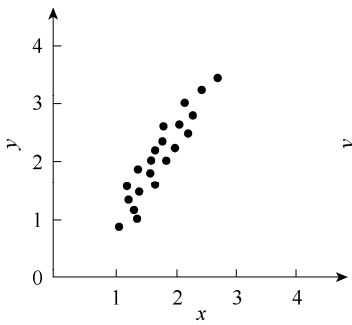
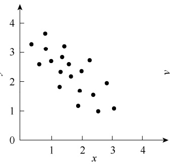
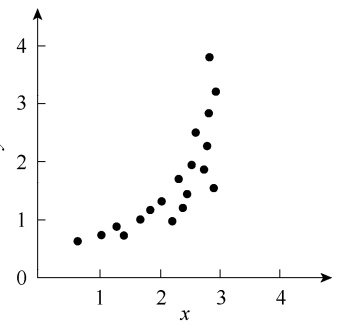
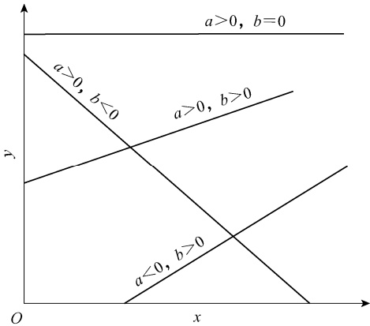
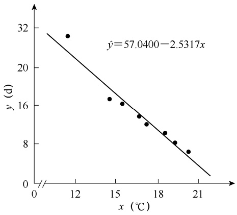

表 7-33 三因素数据的二向表

<table><tr><td colspan="3"></td><td colspan="3"> $B_j$ </td></tr><tr><td rowspan="4"> $A_i$ </td><td> $c_1$ </td><td> $x_{ij11}$ </td><td> $x_{ij12}$ </td><td>...</td><td> $x_{ij1n}$ </td></tr><tr><td> $c_2$ </td><td> $x_{ij21}$ </td><td> $x_{ij22}$ </td><td>...</td><td> $x_{ij2n}$ </td></tr><tr><td> $\vdots$ </td><td> $\vdots$ </td><td> $\vdots$ </td><td></td><td> $\vdots$ </td></tr><tr><td> $c_c$ </td><td> $x_{ijc1}$ </td><td> $x_{ijc2}$ </td><td>...</td><td> $x_{ijcn}$ </td></tr></table>

这样，可用二因素方差分析计算出 $S S _ { A }$ $S S _ { B }$ 和 $S S _ { A B ^ { \circ } }$ 。类似地，也可把 A、C，B、C 二因素的数据列成两向表，用同样方法计算出 $S S _ { A }  、 S S _ { C }$ 和 $S S _ { A C }$ ，以及 $S S _ { B }  、 S S _ { C }$ 和 $S S _ { B C } ,$ ，其中 $S S _ { A ^ { \cdot } }$ $S S _ { B }$ $S S _ { C }$ 不需要重复计算。误差平方和 $S S _ { e }$ 为同一处理 $下 ;$ 数据的变异平方和，即

$$
S S _ {e} = \sum_ {i} \sum_ {j} \sum_ {k} \sum_ {l} (x _ {i j k l} - \overline {{x}} _ {i j k}) ^ {2} \tag {7-40}
$$

总平方和为全部数据的平方和，即

$$
S S _ {T} = \sum_ {i} \sum_ {j} \sum_ {k} \sum_ {l} x _ {i j k l} ^ {2} - \frac {T ^ {2}}{a b c n} \tag {7-41}
$$

总平方和可分解为

$$
S S _ {T} = S S _ {A} + S S _ {B} + S S _ {C} + S S _ {A B} + S S _ {A C} + S S _ {B C} + S S _ {A B C} + S S _ {e} \tag {7-42}
$$

三因素方差分析模型列于表 7-34。

表 7-34 三因素数据方差分析表

<table><tr><td rowspan="2">变异来源</td><td rowspan="2">SS</td><td rowspan="2">df</td><td rowspan="2"> $s^2$ </td><td colspan="2">固定模型</td></tr><tr><td>F</td><td>期望方差</td></tr><tr><td>A</td><td> $SS_A$ </td><td>a-1</td><td> $s_A^2$ </td><td> $\frac{s_A^2}{s_e^2}$ </td><td> $\sigma^2 + bcnn\eta_a^2$ </td></tr><tr><td>B</td><td> $SS_B$ </td><td>b-1</td><td> $s_B^2$ </td><td> $\frac{s_B^2}{s_e^2}$ </td><td> $\sigma^2 + acn\eta_\beta^2$ </td></tr><tr><td>C</td><td> $SS_C$ </td><td>c-1</td><td> $s_C^2$ </td><td> $\frac{s_C^2}{s_e^2}$ </td><td> $\sigma^2 + abnn\eta_\gamma^2$ </td></tr><tr><td>A×B</td><td> $SS_{AB}$ </td><td>(a-1)(b-1)</td><td> $s_{AB}^2$ </td><td> $\frac{s_{AB}^2}{s_e^2}$ </td><td> $\sigma^2 + cn\eta_{\alpha\beta}^2$ </td></tr><tr><td>A×C</td><td> $SS_{AC}$ </td><td>(a-1)(c-1)</td><td> $s_{AC}^2$ </td><td> $\frac{s_{AC}^2}{s_e^2}$ </td><td> $\sigma^2 + bnn\eta_{\alpha\gamma}^2$ </td></tr><tr><td>B×C</td><td> $SS_{BC}$ </td><td>(b-1)(c-1)</td><td> $s_{BC}^2$ </td><td> $\frac{s_{BC}^2}{s_e^2}$ </td><td> $\sigma^2 + an\eta_{\beta\gamma}^2$ </td></tr><tr><td>A×B×C</td><td> $SS_{ABC}$ </td><td>(a-1)(b-1)(c-1)</td><td> $s_{ABC}^2$ </td><td> $\frac{s_{ABC}^2}{s_e^2}$ </td><td> $\sigma^2 + n\eta_{\alpha\beta\gamma}^2$ </td></tr><tr><td>误差</td><td> $SS_e$ </td><td>abc(n-1)</td><td> $s_e^2$ </td><td></td><td> $\sigma^2$ </td></tr><tr><td rowspan="2">变异来源</td><td colspan="3">随机模型</td><td colspan="2">混合模型(假定A、B固定,C随机)</td></tr><tr><td>F</td><td colspan="2">期望方差</td><td>F</td><td>期望方差</td></tr><tr><td>A</td><td></td><td colspan="2"> $\sigma^2 + bcno\sigma_a^2 + cn\sigma_{\alpha\beta}^2 + bn\sigma_{\alpha\gamma}^2 + n\sigma_{\alpha\beta\gamma}^2$ </td><td> $\frac{s_A^2}{s_{AC}^2}$ </td><td> $\sigma^2 + bcnn\eta_a^2 + bn\sigma_{\alpha\gamma}^2$ </td></tr><tr><td>B</td><td></td><td colspan="2"> $\sigma^2 + acno\sigma_\beta^2 + cn\sigma_{\alpha\beta}^2 + an\sigma_{\beta\lambda}^2 + n\sigma_{\alpha\beta\gamma}^2$ </td><td> $\frac{s_B^2}{s_{BC}^2}$ </td><td> $\sigma^2 + acnn\eta_\beta^2 + an\sigma_{\beta\gamma}^2$ </td></tr></table>

续表

<table><tr><td rowspan="2">变异来源</td><td colspan="2">随机模型</td><td colspan="2">混合模型(假定A、B固定,C随机)</td></tr><tr><td>F</td><td>期望方差</td><td>F</td><td>期望方差</td></tr><tr><td>C</td><td></td><td> $\sigma^2+abn\sigma_{\gamma}^2+bn\sigma_{\alpha\gamma}^2+an\sigma_{\beta\gamma}^2+n\sigma_{\alpha\beta\gamma}^2$ </td><td> $\frac{s_C^2}{s_e^2}$ </td><td> $\sigma^2+abn\sigma_{\gamma}^2$ </td></tr><tr><td>A×B</td><td> $\frac{s_{AB}^2}{s_{ABC}^2}$ </td><td> $\sigma^2+cn\sigma_{\alpha\beta}^2+n\sigma_{\alpha\beta\gamma}^2$ </td><td> $\frac{s_{AB}^2}{s_{ABC}^2}$ </td><td> $\sigma^2+cn\eta_{\alpha\beta}^2+n\sigma_{\alpha\beta\gamma}^2$ </td></tr><tr><td>A×C</td><td> $\frac{s_{AC}^2}{s_{ABC}^2}$ </td><td> $\sigma^2+bn\sigma_{\alpha\gamma}^2+n\sigma_{\alpha\beta\gamma}^2$ </td><td> $\frac{s_{AC}^2}{s_e^2}$ </td><td> $\sigma^2+bn\sigma_{\alpha\gamma}^2$ </td></tr><tr><td>B×C</td><td> $\frac{s_{BC}^2}{s_{ABC}^2}$ </td><td> $\sigma^2+an\sigma_{\beta\gamma}^2+n\sigma_{\alpha\beta\gamma}^2$ </td><td> $\frac{s_{BC}^2}{s_e^2}$ </td><td> $\sigma^2+an\sigma_{\beta\gamma}^2$ </td></tr><tr><td>A×B×C</td><td> $\frac{s_{ABC}^2}{s_e^2}$ </td><td> $\sigma^2+n\sigma_{\alpha\beta\gamma}^2$ </td><td> $\frac{s_{ABC}^2}{s_e^2}$ </td><td> $\sigma^2+n\sigma_{\alpha\beta\gamma}^2$ </td></tr><tr><td>误差</td><td></td><td> $\sigma^2$ </td><td></td><td> $\sigma^2$ </td></tr></table>

例 **7-7** 为了研究在猪饲料中添加胱氨酸（因素 A）、甲硫氨酸（因素 B）和蛋白质（因素 C）对猪日增重的影响，设计了如下试验，每一组以两头猪做重复，结果如表 7-35 所示。试对该组数据进行方差分析。

表 7-35 添加不同物质后猪日增重数据

<table><tr><td>胱氨酸(A,%)</td><td>甲硫氨酸(B,%)</td><td>蛋白质(C,%)</td><td colspan="2">日增重(kg)</td><td>合计(kg)</td></tr><tr><td rowspan="6">0</td><td rowspan="2">0</td><td>12</td><td>1.11</td><td>0.97</td><td>2.08</td></tr><tr><td>14</td><td>1.52</td><td>1.45</td><td>2.97</td></tr><tr><td rowspan="2">0.025</td><td>12</td><td>1.09</td><td>0.99</td><td>2.08</td></tr><tr><td>14</td><td>1.27</td><td>1.22</td><td>2.49</td></tr><tr><td rowspan="2">0.050</td><td>12</td><td>0.85</td><td>1.21</td><td>2.06</td></tr><tr><td>14</td><td>1.67</td><td>1.24</td><td>2.91</td></tr><tr><td rowspan="6">0.05</td><td rowspan="2">0</td><td>12</td><td>1.30</td><td>1.00</td><td>2.30</td></tr><tr><td>14</td><td>1.55</td><td>1.53</td><td>3.08</td></tr><tr><td rowspan="2">0.025</td><td>12</td><td>1.03</td><td>1.21</td><td>2.24</td></tr><tr><td>14</td><td>1.24</td><td>1.34</td><td>2.58</td></tr><tr><td rowspan="2">0.050</td><td>12</td><td>1.12</td><td>0.96</td><td>2.08</td></tr><tr><td>14</td><td>1.76</td><td>1.27</td><td>3.03</td></tr><tr><td rowspan="6">0.10</td><td rowspan="2">0</td><td>12</td><td>1.22</td><td>1.13</td><td>2.35</td></tr><tr><td>14</td><td>1.38</td><td>1.08</td><td>2.46</td></tr><tr><td rowspan="2">0.025</td><td>12</td><td>1.34</td><td>1.41</td><td>2.75</td></tr><tr><td>14</td><td>1.40</td><td>1.21</td><td>2.61</td></tr><tr><td rowspan="2">0.050</td><td>12</td><td>1.34</td><td>1.19</td><td>2.53</td></tr><tr><td>14</td><td>1.46</td><td>1.39</td><td>2.85</td></tr><tr><td rowspan="6">0.15</td><td rowspan="2">0</td><td>12</td><td>1.19</td><td>1.03</td><td>2.22</td></tr><tr><td>14</td><td>0.80</td><td>1.29</td><td>2.09</td></tr><tr><td rowspan="2">0.025</td><td>12</td><td>1.36</td><td>1.16</td><td>2.52</td></tr><tr><td>14</td><td>1.42</td><td>1.39</td><td>2.81</td></tr><tr><td rowspan="2">0.050</td><td>12</td><td>1.46</td><td>1.03</td><td>2.49</td></tr><tr><td>14</td><td>1.62</td><td>1.27</td><td>2.89</td></tr><tr><td></td><td>合计</td><td></td><td>31.50</td><td>28.97</td><td>60.47</td></tr></table>

由于胱氨酸、甲硫氨酸和蛋白质添加量都是可控的，所以适用于固定模型。

（1）将数据分别累加，记入表 7-36～表 7-38 中。

表 7-36 表 7-35 数据 A×B 表

<table><tr><td rowspan="2">甲硫氨酸(B)</td><td colspan="4">胱氨酸(A)</td><td rowspan="2"> $T_{.j}.$ </td></tr><tr><td>0</td><td>0.05</td><td>0.10</td><td>0.15</td></tr><tr><td>0</td><td>5.05</td><td>5.38</td><td>4.81</td><td>4.31</td><td>19.55</td></tr><tr><td>0.025</td><td>4.57</td><td>4.82</td><td>5.36</td><td>5.33</td><td>20.08</td></tr><tr><td>0.050</td><td>4.97</td><td>5.11</td><td>5.38</td><td>5.38</td><td>20.84</td></tr><tr><td> $T_{i..}$ </td><td>14.59</td><td>15.31</td><td>15.55</td><td>15.02</td><td>60.47</td></tr></table>

表 7-37 表 7-35 数据 A×C 表

<table><tr><td rowspan="2">蛋白质(C)</td><td colspan="4">胱氨酸(A)</td><td rowspan="2"> $T_{..k}$ </td></tr><tr><td>0</td><td>0.05</td><td>0.10</td><td>0.15</td></tr><tr><td>12</td><td>6.22</td><td>6.62</td><td>7.63</td><td>7.23</td><td>27.70</td></tr><tr><td>14</td><td>8.37</td><td>8.69</td><td>7.92</td><td>7.79</td><td>32.77</td></tr><tr><td> $T_{i..}$ </td><td>14.59</td><td>15.31</td><td>15.55</td><td>15.02</td><td>60.47</td></tr></table>

表 7-38 7-35 数据 B×C 表

<table><tr><td rowspan="2">甲硫氨酸(B)</td><td colspan="2">蛋白质(C)</td><td rowspan="2"> $T_{.j.}$ </td></tr><tr><td>12</td><td>14</td></tr><tr><td>0</td><td>8.95</td><td>10.60</td><td>19.55</td></tr><tr><td>0.025</td><td>9.59</td><td>10.49</td><td>20.08</td></tr><tr><td>0.050</td><td>9.16</td><td>11.68</td><td>20.84</td></tr><tr><td> $T_{..k}$ </td><td>27.70</td><td>32.77</td><td>60.47</td></tr></table>

（2）平方和计算:其中， $a=4, b=3, c=2, n=2.$

$$
C = \frac {T ^ {2}}{a b c n} = \frac {6 0 . 4 7 ^ {2}}{4 \times 3 \times 2 \times 2} = 7 6. 1 7 9 6
$$

$$
S S _ {T} = \sum \sum \sum \sum x _ {i j k l} ^ {2} - C = (1. 1 1 ^ {2} + 0. 9 7 ^ {2} + \dots + 1. 2 7 ^ {2}) - 7 6. 1 7 9 6 = 2. 0 4 0 9
$$

$$
S S _ {t} = \frac {1}{n} \sum \sum \sum T _ {i j k} ^ {2} - C = \frac {2 . 0 8 ^ {2} + 2 . 9 7 ^ {2} + \cdots + 2 . 8 9 ^ {2}}{2} - 7 6. 1 7 9 6 = 1. 2 7 5 7
$$

$$
S S _ {A} = \frac {\sum T _ {i . .} ^ {2}}{b c n} - C = \frac {1 4 . 5 9 ^ {2} + \cdots + 1 5 . 0 2 ^ {2}}{3 \times 2 \times 2} - 7 6. 1 7 9 6 = 0. 0 4 2 7
$$

$$
S S _ {B} = \frac {\sum T _ {. j .} ^ {2}}{a c n} - C = \frac {1 9 . 5 5 ^ {2} + \cdots + 2 0 . 8 4 ^ {2}}{4 \times 2 \times 2} - 7 6. 1 7 9 6 = 0. 0 5 2 6
$$

$$
S S _ {C} = \frac {\sum T _ {* k} ^ {2}}{a b n} - C = \frac {2 7 . 7 0 ^ {2} + 3 2 . 7 7 ^ {2}}{4 \times 3 \times 2} - 7 6. 1 7 9 6 = 0. 5 3 5 5
$$

$$
\begin{array}{l} S S _ {A B} = \frac {\sum \sum T _ {i j .} ^ {2}}{c n} - C - S S _ {A} - S S _ {B} \\ = \frac {5 . 0 5 ^ {2} + 5 . 3 8 ^ {2} + \cdots + 5 . 3 8 ^ {2}}{2 \times 2} - 7 6. 1 7 9 6 - 0. 0 4 2 7 - 0. 0 5 2 6 \\ = 0. 2 5 4 3 \\ \end{array}
$$

$$
\begin{array}{l} S S _ {A C} = \frac {\sum \sum T _ {i . k} ^ {2}}{b n} - C - S S _ {A} - S S _ {C} \\ = \frac {6 . 2 2 ^ {2} + 6 . 6 2 ^ {2} + \cdots + 7 . 7 9 ^ {2}}{3 \times 2} - 7 6. 1 7 9 6 - 0. 0 4 2 7 - 0. 5 3 5 5 \\ = 0. 2 3 9 9 \\ S S _ {B C} = \frac {\sum \sum T _ {. j k} ^ {2}}{a n} - C - S S _ {B} - S S _ {C} \\ = \frac {8 . 9 5 ^ {2} + 1 0 . 6 0 ^ {2} + \cdots + 1 1 . 6 8 ^ {2}}{4 \times 2} - 7 6. 1 7 9 6 - 0. 0 5 6 2 - 0. 5 3 5 5 \\ = 0. 0 8 2 1 \\ S S _ {A B C} = \frac {\sum \sum \sum T _ {i j k} ^ {2}}{n} - C - S S _ {A} - S S _ {B} - S S _ {C} - S S _ {A B} - S S _ {A C} - S S _ {B C} \\ = \frac {2 . 0 8 ^ {2} + 2 . 9 7 ^ {2} + \cdots + 2 . 8 9 ^ {2}}{2} - 7 6. 1 7 9 6 - 0. 0 4 2 7 - 0. 0 5 6 2 - 0. 5 3 5 5 \\ - 0. 2 5 4 3 - 0. 2 3 9 9 - 0. 0 8 2 1 = 0. 0 6 8 5 \\ S S _ {e} = S S _ {T} - S S _ {t} = 2. 0 4 0 9 - 1. 2 7 5 6 = 0. 7 6 5 3 \\ \end{array}
$$

（3）自由度计算:

$$
d f _ {T} = a b c n - 1 = 4 \times 3 \times 2 \times 2 - 1 = 4 7
$$

$$
d f _ {A} = a - 1 = 4 - 1 = 3
$$

$$
d f _ {B} = b - 1 = 3 - 1 = 2
$$

$$
d f _ {c} = c - 1 = 2 - 1 = 1
$$

$$
d f _ {A B} = (a - 1) (b - 1) = (4 - 1) \times (3 - 1) = 6
$$

$$
d f _ {A C} = (a - 1) (c - 1) = (4 - 1) \times (2 - 1) = 3
$$

$$
d f _ {B C} = (b - 1) (c - 1) = (3 - 1) \times (2 - 1) = 2
$$

$$
d f _ {A B C} = (a - 1) (b - 1) (c - 1) = (4 - 1) \times (3 - 1) \times (2 - 1) = 6
$$

$$
d f _ {e} = a b c (n - 1) = 4 \times 3 \times 2 \times (2 - 1) = 2 4
$$

（4）将以上结果列成方差分析表（表 7-39）。

表 7-39 例 7-7 猪日增重数据的方差分析表

| 变异来源 | df | SS | $s^2$ | F | $F_{0.05}$ | $F_{0.01}$ |
| --- | --- | --- | --- | --- | --- | --- |
| 胱氨酸(A) | 3 | 0.0427 | 0.0142 | 0.445 | 3.01 | 4.72 |
| 蛋氨酸(B) | 2 | 0.0526 | 0.0263 | 0.824 | 3.40 | 5.61 |
| 蛋白质(C) | 1 | 0.5355 | 0.5355 | 16.787** | 4.26 | 7.82 |
| A×B | 6 | 0.2543 | 0.0424 | 1.329 | 2.51 | 3.67 |
| A×C | 3 | 0.2399 | 0.0800 | 2.508 | 3.01 | 4.72 |
| B×C | 2 | 0.0821 | 0.0410 | 1.285 | 3.40 | 5.61 |
| A×B×C | 6 | 0.0685 | 0.0114 | 0.357 | 2.51 | 3.67 |
| 误差 | 24 | 0.7653 | 0.0319 |  |  |  |
| 总变异 | 47 | 2.0409 |  |  |  |  |

检验结果表明，蛋白质添加量对猪日增重影响极显著，胱氨酸及甲硫氨酸添加量的影响

不显著，可能的原因是在饲料中并不缺乏这两种氨基酸。

## 第五节 方差分析缺失数据的估计和数据转换

进行方差分析时，其数据体系一般都是按照试验要求事先设计好的，但在试验过程中经常会因意外事件使某一个或某几个数据丢失。例如，收获的作物可能遭到毁坏，动物可能有死亡，或者在记录时可能漏记或记错等。数据的缺失使平方和的线性可加模型无效，因此无法直接进行方差分析。缺失的数据可用统计方法从理论上进行估计，然后用前面介绍过的方法进行方差分析。但有一点必须明确，缺失数据估计并不能恢复原来的数据，只能是补足后不致干扰其余数据，估计的数据并不能提供任何新的信息。因此，试验中应尽量避免这类情况发生。弥补缺失数据的原则是，使补上缺失的数据后，误差平方和最小。

## 一、方差分析缺失数据的估计方法

## （一）一个缺失数据的估计

假定表 7-40 中的 $x _ { 2 3 }$ 是缺失的，需要补上。

表 7-40 缺失一个数据的试验结果

|  | $B_1$ | $B_2$ | $B_3$ | $B_4$ | $B_5$ | $B_6$ | $B_7$ | $B_8$ | 合计 |
| --- | --- | --- | --- | --- | --- | --- | --- | --- | --- |
| $A_1$ | 30 | 39 | 41 | 42 | 42 | 39 | 38 | 38 | 309 |
| $A_2$ | 37 | 46 | x | 43 | 51 | 44 | 35 | 49 | 305+x |
| $A_3$ | 27 | 37 | 36 | 24 | 37 | 41 | 33 | 43 | 278 |
| $A_4$ | 30 | 42 | 35 | 40 | 46 | 47 | 38 | 46 | 324 |
| 总和 | 124 | 164 | 112+x | 149 | 176 | 171 | 144 | 176 | 1216+x |

误差平方和可由下式求出:

$$
\begin{array}{l} S S _ {e} = S S _ {T} - S S _ {A} - S S _ {B} \\ = (3 0 ^ {2} + 3 7 ^ {2} + \dots + x ^ {2} + \dots + 4 6 ^ {2}) \\ - \frac {1}{8} \times \left[ 3 0 9 ^ {2} + (3 0 5 + x) ^ {2} + \dots + 3 2 4 ^ {2} \right] \\ - \frac {1}{4} \times \left[ 1 2 4 ^ {2} + 1 6 4 ^ {2} + (1 1 2 + x) ^ {2} + \dots + 1 7 6 ^ {2} \right] \\ + \frac {1}{3 2} \times (1 2 1 6 + x) ^ {2} \\ \end{array}
$$

为使 $S S _ { e }$ 达到最小，令 $\frac { \mathrm { d } S S _ { e } } { \mathrm { d } x }   =   0 .$ ，则有

$$
2 x - \frac {1}{4} \times (3 0 5 + x) - \frac {1}{2} \times (1 1 2 + x) + \frac {1}{1 6} \times (1 2 1 6 + x) = 0
$$

解该方程，得 $x = 42.857 \approx 43$

把这个数据填在表 7-40 内，方差分析时除总自由度 $d f _ { T }$ 和误差自由度 $d f _ { e }$ 各需减1外，其他仍可以按前面介绍的方法进行。

## （二）缺失两个数据的估计

仍以表 7-40 数据为例，假定 $x _ { 2 3 }$ 和 $x _ { 3 7 }$ 都缺失，分别记为 $x$ 和 $y _ { \circ }$ 。其弥补原则和弥补一个数据是一样的，使 $S S _ { e }$ 达到最小。把表 7-40 数据重新整理成表 7-41。

与缺失一个数据的估计方法类似，计算误差平方和。

表 7-41 缺失两个数据的试验结果

|  | $B_1$ | $B_2$ | $B_3$ | $B_4$ | $B_5$ | $B_6$ | $B_7$ | $B_8$ | 合计 |
| --- | --- | --- | --- | --- | --- | --- | --- | --- | --- |
| $A_1$ | 30 | 39 | 41 | 42 | 42 | 39 | 38 | 38 | 309 |
| $A_2$ | 37 | 46 | x | 43 | 51 | 44 | 35 | 49 | 305+x |
| $A_3$ | 27 | 37 | 36 | 24 | 37 | 41 | y | 43 | 245+y |
| $A_4$ | 30 | 42 | 35 | 40 | 46 | 47 | 38 | 46 | 324 |
| 总和 | 124 | 164 | 112+x | 149 | 176 | 171 | 111+y | 176 | 1183+x+y |

$$
\begin{array}{l} S S _ {e} = S S _ {T} - S S _ {A} - S S _ {B} \\ = (3 0 ^ {2} + 3 7 ^ {2} + \dots + x ^ {2} + \dots + y ^ {2} + \dots + 4 6 ^ {2}) \\ - \frac {1}{8} \times \left[ 3 0 9 ^ {2} + (3 0 5 + x) ^ {2} + (2 4 5 + y) ^ {2} + 3 2 4 ^ {2} \right] \\ - \frac {1}{4} \times \left[ 1 2 4 ^ {2} + 1 6 4 ^ {2} + (1 1 2 + x) ^ {2} + \dots + (1 1 1 + y) ^ {2} + 1 7 6 ^ {2} \right] \\ + \frac {1}{3 2} \times (1 1 8 3 + x + y) ^ {2} \\ \end{array}
$$

为使 $S S _ { e }$ 最小，应满足:

$$
\left\{ \begin{array}{l} \frac {\partial S S _ {e}}{\partial x} = 0 \\ \frac {\partial S S _ {e}}{\partial y} = 0 \end{array} \right.
$$

即

$$
\left\{ \begin{array}{l} 2 x - \frac {1}{4} \times (3 0 5 + x) - \frac {1}{2} \times (1 1 2 + x) + \frac {1}{1 6} \times (1 1 8 3 + x + y) = 0 \\ 2 y - \frac {1}{4} \times (2 4 5 + y) - \frac {1}{2} \times (1 1 1 + y) + \frac {1}{1 6} \times (1 1 8 3 + x + y) = 0 \end{array} \right.
$$

经整理，解得: $x = 42.97$ $y = 30.57$

丢失的两个数据补上后，在进行方差分析时其误差自由度 $d f _ { e }$ 及总自由度 $d f _ { T }$ 均减 2。由于误差自由度减小，F 检验的灵敏度会相应降低，这对分析问题是不利的。因此，在获得试验数据时，要尽可能保持数据的完整性，避免数据缺失。

## 二、方差分析的数据转换

在生物学研究中经常会遇到一些样本，就其本身的性质来说，并不符合方差分析的基本假定。在进行方差分析之前，这些数据必须经过适当处理，即数据转换（transformation of data）以变更测量标尺。样本的非正态性、不可加性和方差异质性通常会连带出现。在进行数据转换中，根据实际经验，主要应考虑处理效应与误差效应的可加性，其次才考虑方差同质性。常用的转换方法如下所述。

## （一）平方根转换

有些生物学观测数据为泊松分布而非正态分布。例如，一定面积上某种杂草株数或昆虫头数等，样本平均数与其方差有某种比例关系。采用平方根转换（square root transformation）可以对方差进行降缩，减少极端大的变量对方差的影响，从而获得同质的方差。一般将原观测值转换成 $\sqrt { x }$ ，数据较小时采用 $\scriptstyle { \sqrt { x + 1 } }$

例如，表 7-42 中所列的一定面积燕麦田中某杂草的株数。从直观上看， $A _ { 1 }  、  A _ { 2 }$ 和 $A _ { 3 1 }$ 、$A _ { 4 }$ 及 $A _ { 5 }$ 间的数据相差太大，方差同质性是不成立的。

表 7-42 中的数据，如算出误差项的方差，它可能是个平均值，用以检验 $\mathbf { \mathit { A } } _ { 1 } , \mathbf { \mathit { A } } _ { 2 }$ 间差数则太小，用来检验 $\textit{A}_{3} 、\textit{A}_{4}$ 及 $A _ { 5 }$ 间的差数则太大。如果把表 7-42 中的数据进行平方根转换（表 7-43），可以看出各个处理的数据范围就相对减小了。

表 7-42 燕麦田中某种杂草的株数（株）

| 处理 | $A_1$ | $A_2$ | $A_3$ | $A_4$ | $A_5$ |
| --- | --- | --- | --- | --- | --- |
| 1 | 438 | 538 | 77 | 17 | 18 |
| 2 | 442 | 422 | 61 | 31 | 26 |
| 3 | 319 | 377 | 151 | 87 | 77 |
| 4 | 380 | 315 | 52 | 16 | 20 |
| $\overline{x}_i$ | 394.75 | 413.00 | 85.25 | 37.75 | 35.25 |

表 7-43 表 7-42 数据的平方根

| 处理 | $A_{1}$ | $A_{2}$ | $A_{3}$ | $A_{4}$ | $A_{5}$ |
| --- | --- | --- | --- | --- | --- |
| 1 | 20.9 | 23.2 | 8.8 | 4.1 | 4.2 |
| 2 | 21.0 | 20.5 | 7.8 | 5.6 | 5.1 |
| 3 | 17.9 | 19.4 | 12.3 | 9.3 | 8.8 |
| 4 | 19.5 | 17.7 | 7.2 | 4.0 | 4.5 |
| $\overline{x}_{i}$ | 19.8 | 20.2 | 9.0 | 5.8 | 5.7 |

对表 7-43 数据进行方差分析，列入表 7-44。

表 7-44 表 7-43 数据的方差分析表

| 变异来源 | df | SS | $s^2$ | F | $F_{0.05}$ | $F_{0.01}$ |
| --- | --- | --- | --- | --- | --- | --- |
| 处理间 | 4 | 866.663 | 216.666 | 46.43** | 3.06 | 4.89 |
| 误差 | 15 | 69.995 | 4.666 |  |  |  |
| 总变异 | 19 | 936.658 |  |  |  |  |

## （二）对数转换

如果已知数据中的效应为相乘性或非相加性，或者标准差（或极差）与平均数成比例时，可以使用对数转换（logarithmic transformation）。一般是将原数据转换为对数（lgx或 lnx），从而使方差变成比较一致而且使效应由相乘性变为相加性。如果原始数据包括 0，可以采用 lg（x+1）转换的方法。通常情况下，对数转换对于削弱大变数的作用要比平方根转换更强。例如，1、10、100 进行平方根转换是 1、3.16、10，进行对数转换则是 0、1、2。

表 7-45 是昆虫生育 5 个不同时期用 3 种捕蛾灯捕获昆虫数目（个）的数据。

表 7-45 捕获昆虫统计资料及捕获数的对数值

<table><tr><td rowspan="2">时期</td><td colspan="3">捕蛾灯</td><td colspan="3">对数值</td></tr><tr><td>I</td><td>II</td><td>III</td><td>I</td><td>II</td><td>III</td></tr><tr><td>1</td><td>19.1</td><td>50.1</td><td>123.0</td><td>1.28</td><td>1.70</td><td>2.09</td></tr><tr><td>2</td><td>23.4</td><td>166.0</td><td>407.4</td><td>1.37</td><td>2.22</td><td>2.61</td></tr><tr><td>3</td><td>39.5</td><td>223.9</td><td>398.1</td><td>1.60</td><td>2.35</td><td>2.60</td></tr><tr><td>4</td><td>23.4</td><td>58.9</td><td>229.1</td><td>1.37</td><td>1.77</td><td>2.36</td></tr><tr><td>5</td><td>16.6</td><td>64.6</td><td>251.2</td><td>1.22</td><td>1.81</td><td>2.40</td></tr><tr><td> $\bar{x}_i$ </td><td>24.4</td><td>112.7</td><td>281.8</td><td>1.37</td><td>1.97</td><td>2.41</td></tr><tr><td>极差</td><td>22.9</td><td>173.8</td><td>284.4</td><td>0.38</td><td>0.65</td><td>0.52</td></tr></table>

由表 7-45 可知，原始数据的平均数和极差近于正比关系，经对数转换后 3 个极差则较为接近，且与平均数无关。将对数转换后的数据进行方差分析，结果列于 7-46。

表 7-46 表 7-45 数据对数转换后数据的方差分析表

| 变异来源 | df | SS | $s^2$ | F | $F_{0.05}$ | $F_{0.01}$ |
| --- | --- | --- | --- | --- | --- | --- |
| 时期间 | 4 | 0.4876 | 0.1219 | 8.08** | 3.84 | 7.01 |
| 捕蛾灯 | 2 | 2.7504 | 1.3752 | 91.17** | 4.46 | 8.65 |
| 误差 | 8 | 0.1200 | 0.0150 |  |  |  |
| 总变异 | 14 | 3.3603 |  |  |  |  |

结果表明，捕蛾灯及捕蛾时期之间的差异均达到极显著水平。

## （三）反正弦转换

如果数据是以比率或以百分数表示的，当 n 值较小 $(n < 30)$ 时，其分布趋向于二项分布，方差分析时应做反正弦转换（arcsine transformation），转换后的数值是以度为单位的角度，因此也称为角度转换（angle transformation）。转换的公式为

$$
\theta = \sin^ {- 1} \sqrt {P} \tag {7-43}
$$

式中，P 为百分数数据；θ 为相应的角度值。

二项分布的特点是其方差与平均数之间有一定的函数关系，即当平均数处于中间数值附近（50%左右）时方差较大。将数据转换成角度以后，接近于 0 和 100%的数值变异度增大，使方差变大，这样有利于满足方差同质性的要求。如果数据中的百分数为 30%～70%，因数据的分布接近于正态分布，通常数据转换与否对分析结果影响不大。

例 **7-8** 有三个玉米品种的种子在相同条件下保存。为了测定保存一段时间后种子的生活力，每个品种随机选取 100 粒种子在培养箱内做发芽试验，重复 7 次，3 个玉米品种的发芽率数据列于表 7-47，试对数据进行方差分析。

表 7-47 三个玉米品种的发芽率（%）

<table><tr><td>品种</td><td></td><td></td><td colspan="5">发芽率(P)</td></tr><tr><td>I</td><td>94.3</td><td>64.1</td><td>47.7</td><td>43.6</td><td>50.4</td><td>80.5</td><td>57.8</td></tr><tr><td>II</td><td>26.7</td><td>9.4</td><td>42.1</td><td>30.6</td><td>40.9</td><td>18.6</td><td>40.9</td></tr><tr><td>III</td><td>18.0</td><td>35.0</td><td>20.7</td><td>31.6</td><td>26.8</td><td>11.4</td><td>19.7</td></tr></table>

表 7-47 的数据是一个服从二项分布的发芽率数据，且有低于30%和高于70%的，先对数据进行反正弦转换，得出各个观测值的反正弦角度 $\theta$ 值，列于表 7-48。然后对表 7-48 数据进行方差分析，列于表 7-49。

表 7-48 表 7-47 数据的反正弦值

<table><tr><td>品种</td><td></td><td></td><td colspan="5">发芽率  $x = \sin^{-1} \sqrt{P}$ </td><td> $T_{i.}$ </td><td> $\bar{x}_{i.}$ </td><td>反转换值</td></tr><tr><td>I</td><td>76.19</td><td>53.19</td><td>43.68</td><td>41.32</td><td>45.23</td><td>63.79</td><td>49.49</td><td>372.89</td><td>53.27</td><td>64.2</td></tr><tr><td>II</td><td>31.11</td><td>17.85</td><td>40.45</td><td>33.58</td><td>39.76</td><td>25.55</td><td>39.76</td><td>228.06</td><td>32.58</td><td>29.0</td></tr><tr><td>III</td><td>25.10</td><td>36.27</td><td>27.06</td><td>34.20</td><td>31.18</td><td>19.73</td><td>26.35</td><td>199.89</td><td>28.56</td><td>22.8</td></tr><tr><td>合计</td><td></td><td></td><td></td><td></td><td></td><td></td><td></td><td>800.84</td><td></td><td></td></tr></table>

表 7-49 表 7-48 数据的方差分析表

| 变异来源 | df | SS | $s^2$ | F | $F_{0.05}$ | $F_{0.01}$ |
| --- | --- | --- | --- | --- | --- | --- |
| 处理间 | 2 | 2461.8228 | 1230.9114 | 14.03** | 3.55 | 6.01 |
| 误差 | 18 | 1579.4927 | 87.7500 |  |  |  |
| 总变异 | 20 | 4041.3155 |  |  |  |  |

F 检验结果表明，三个品种玉米种子发芽率差异极显著。下面用 SSR 法进行多重比较，结果见表 7-50。

$$
s _ {\bar {x}} = \sqrt {\frac {8 7 . 7 5 0 0}{7}} = 3. 5 4
$$

表 7-50 表 7-48 数据的 SSR 值和 LSR 值

| M | $SSR_{0.05}$ | $SSR_{0.01}$ | $LSR_{0.05}$ | $LSR_{0.01}$ |
| --- | --- | --- | --- | --- |
| 2 | 2.97 | 4.07 | 10.51 | 14.41 |
| 3 | 3.12 | 4.27 | 11.04 | 15.12 |

比较结果表明，品种Ⅰ的发芽率极显著高于品种Ⅲ和品种Ⅱ，而品种Ⅱ和品种Ⅲ之间差异不显著。对结果进行解释时，应将各组平均数还原为发芽率。例如，表 7-48 中平均数 53.27，根据 $P = \sin x$ ，还原为 64.2%；平均数 32.58 还原为 29.0%，平均数 28.56 还原为 22.8%。但变换过的数据所算出的方差或标准差不需要再换回原来的数据。

以上介绍了三种数据转换方法。无论采用何种数据转换方法，在对转换后的数据进行方差分析时，若经检验差异显著，在进行平均数的多重比较时需用转换后的数据进行计算。但在解释分析其最终结果时，应还原为原始数值。

无论何种数据转换方法，对于一般非连续性的数据，最好在方差分析前先检查各处理平均数与相应处理内均方是否存在相关性，以及各处理内均方间的变异是否较大。如果存在相关性，或者变异较大，则应考虑对数据做出转换。有时要确定适当的转换方法并不容易，可事先在试验中选取几个平均数为大、中、小的试验处理做转换，哪种方法能使处理平均数与其均方的相关性最小，哪种方法就是最合适的转换方法。另外，还可以使用其他的数据转换方法。例如，当各处理标准差与其平均数的平方成比例时，可进行倒数转换（reciprocal transformation）。

## 思考练习题

习题 **7.1** 什么是方差分析？方差分析的基本思想是什么？进行方差分析一般有哪些步骤？

习题 **7.2** 方差分析应建立在哪三个基本假定基础上？为什么有些数据需经过转换后才能进行方差分析?

习题 **7.3** 什么是变量间的关系强度，其意义是什么？

习题 **7.4** 什么是多重比较? 多重比较有哪些方法? 多重比较的结果如何表示？

习题 **7.5** 为研究氟对种子发芽的影响，分别用 0（对照）、10、50、100 4 种不同浓度（μg/g）的氟化钠溶液处理种子（浸种），每一种浓度处理的种子用培养皿进行发芽试验（每皿 50 粒，每处理重复 3 次）。观察它们的发芽情况，测得芽长数据如下表所示。试做方差分析，并用 LSD 法、SSR 法和q 法分别进行多重比较。

<table><tr><td rowspan="2">处理(μg/g)</td><td colspan="3">芽长(cm)</td></tr><tr><td>1</td><td>2</td><td>3</td></tr><tr><td>0(对照)</td><td>8.9</td><td>8.4</td><td>8.6</td></tr><tr><td>10</td><td>8.2</td><td>7.9</td><td>7.5</td></tr><tr><td>50</td><td>7.0</td><td>5.5</td><td>6.1</td></tr><tr><td>100</td><td>5.0</td><td>6.3</td><td>4.1</td></tr></table>

习题 **7.6** 用同一公猪对 3 头母猪（1 号、2 号、3 号）进行配种试验，所产各头仔猪断奶时的体重（kg）数据如下:

1 号:24.0，22.5，24.0，20.0，22.0，23.0，22.0，22.5；

2 号:19.0，19.5，20.0，23.5，19.0，21.0，16.5；

3 号:16.0，16.0，15.5，20.5，14.0，17.5，14.5，15.5，19.0。

试分析母猪对仔猪体重效应的差异显著性。

习题 **7.7** 选取 4 个品种的家兔，每一个品种用兔 7 只，测定其在不同室温下的血糖值，以每 100mg血液中葡萄糖的含量（mg/100mg）表示，试验数据见下表。试分析:各种家兔血糖值间有无差异？室温对家兔的血糖值有无影响？

<table><tr><td rowspan="2">品种</td><td colspan="7">室温</td></tr><tr><td>35°C</td><td>30°C</td><td>25°C</td><td>20°C</td><td>15°C</td><td>10°C</td><td>5°C</td></tr><tr><td>I</td><td>140</td><td>120</td><td>110</td><td>82</td><td>82</td><td>110</td><td>130</td></tr><tr><td>II</td><td>160</td><td>140</td><td>100</td><td>83</td><td>110</td><td>130</td><td>120</td></tr><tr><td>III</td><td>160</td><td>120</td><td>120</td><td>110</td><td>100</td><td>140</td><td>150</td></tr><tr><td>IV</td><td>130</td><td>110</td><td>100</td><td>82</td><td>74</td><td>100</td><td>120</td></tr></table>

习题 **7.8** 为了从 3 种不同原料和三种不同发酵温度中选出某种物质较为适宜的条件，设计了一个二因素试验，并得到如下结果。试对该组数据进行方差分析。

<table><tr><td rowspan="2">原料(A)</td><td colspan="12">温度(B)</td></tr><tr><td></td><td colspan="4"> $B_1$ (30°C)</td><td colspan="4"> $B_2$ (35°C)</td><td colspan="3"> $B_3$ (40°C)</td></tr><tr><td> $A_1$ </td><td>41</td><td>49</td><td>23</td><td>25</td><td>11</td><td>13</td><td>25</td><td>24</td><td>6</td><td>22</td><td>26</td><td>18</td></tr><tr><td> $A_2$ </td><td>47</td><td>59</td><td>50</td><td>40</td><td>43</td><td>38</td><td>33</td><td>36</td><td>8</td><td>22</td><td>18</td><td>14</td></tr><tr><td> $A_3$ </td><td>43</td><td>35</td><td>53</td><td>50</td><td>55</td><td>38</td><td>47</td><td>44</td><td>30</td><td>33</td><td>26</td><td>19</td></tr></table>

习题 **7.9** 在药物处理大豆种子试验中，使用了大粒、中粒、小粒 3 种类型种子，分别用 5 种浓度、2 种处理时间进行试验处理，播种后 45d 对每种处理各取 2 个样本，每个样本取 10 株测定其干物质质量，求其平均数，结果如下表所示。试进行方差分析。

<table><tr><td rowspan="2">处理时间(A)</td><td rowspan="2">种子类型(C)</td><td colspan="5">浓度(B)</td></tr><tr><td> $B_1(0μg/g)$ </td><td> $B_2(10μg/g)$ </td><td> $B_3(20μg/g)$ </td><td> $B_4(30μg/g)$ </td><td> $B_5(40μg/g)$ </td></tr><tr><td rowspan="6"> $A_1(12h)$ </td><td rowspan="2"> $C_1$ (小粒)</td><td>7.0</td><td>12.8</td><td>22.0</td><td>21.3</td><td>24.2</td></tr><tr><td>6.5</td><td>11.4</td><td>21.8</td><td>20.3</td><td>23.2</td></tr><tr><td rowspan="2"> $C_2$ (中粒)</td><td>13.5</td><td>13.2</td><td>20.8</td><td>19.0</td><td>24.6</td></tr><tr><td>13.8</td><td>14.2</td><td>21.4</td><td>19.6</td><td>23.8</td></tr><tr><td rowspan="2"> $C_3$ (大粒)</td><td>10.7</td><td>12.4</td><td>22.6</td><td>21.3</td><td>24.5</td></tr><tr><td>10.3</td><td>13.2</td><td>21.8</td><td>22.4</td><td>24.2</td></tr><tr><td rowspan="6"> $A_2(24h)$ </td><td rowspan="2"> $C_1$ (小粒)</td><td>3.6</td><td>10.7</td><td>4.7</td><td>12.4</td><td>13.6</td></tr><tr><td>1.5</td><td>8.8</td><td>3.4</td><td>10.5</td><td>13.7</td></tr><tr><td rowspan="2"> $C_2$ (中粒)</td><td>4.7</td><td>9.8</td><td>2.7</td><td>12.4</td><td>14.0</td></tr><tr><td>4.9</td><td>10.5</td><td>4.2</td><td>13.2</td><td>14.2</td></tr><tr><td rowspan="2"> $C_3$ (大粒)</td><td>8.7</td><td>9.6</td><td>3.4</td><td>13.0</td><td>14.8</td></tr><tr><td>8.5</td><td>9.7</td><td>4.2</td><td>12.7</td><td>12.6</td></tr></table>

# 直线回归与相关分析

## 本章提要

直线回归与相关是建立两变量间定量关系的最基本方法。本章主要讨论:

• 回归与相关的概念；
• 直线回归方程建立及检验；
• 直线相关分析及相关系数检验。

前面所讨论的统计方法，通常只涉及一个变量。两个或两个以上变量，其相互关系有两类，一类是变量间存在确定的函数关系，如长方形的面积 $S { = } a b$ 、气体定律 $PV = RT$ 等。这些变量依公式关系而存在，只要知道了其中一个或多个变量值就可以准确地计算出另外变量的值。这类例子在生物界较少存在。另一类是变量间存在不确定的函数关系，不能用确定的函数式来表示。例如，人的身高和体重的关系，通常身高越高、体重越重。但是身高与体重之间不存在确定的函数关系，知道身高并不能得知准确的体重；同样，知道体重也不会得知准确的身高。对于多个变量，一个变量发生变化，其他变量也会跟着发生变化，在统计上常采用回归（regression）与相关（correlation）的分析方法探讨多变量间的变化规律。

## 第一节 回归和相关的概念

变量间的相互关系，常见的有因果关系和平行关系。因果关系是指一个变量的变化受另一个变量或几个变量的制约。例如，微生物的繁殖速度受温度、湿度、光照等因素的影响，子女的身高受父母身高的影响等。平行关系是指两个以上变量之间共同受到另外因素的影响。例如，人的身高与体重之间的关系，兄弟身高之间的关系等。

对于两个变量，常用符号 x、 y 表示，如果通过 n 次试验或调查获得两个变量的成对观测值，可表示为 $\left( x _ { 1 } , y _ { 1 } \right) , \left( x _ { 2 } , y _ { 2 } \right) , \cdots , \left( x _ { n } , y _ { n } \right)$ 。为了直观地表示 x 和 y 的变化关系，可将每一对观测值在平面直角坐标系中表示成一个点，做成散点图（scatter chart）。从散点图可以看出:①两个变量间关系的性质和程度；②两个变量间关系的类型，是直线型还是曲线型；③是否有异常观测值的干扰等。图 8-1 是 3 幅两个变量的散点图。从图中可以看出，图 8-1（a）、（b）都是趋向于直线型的，但图 8-1（a）的两个变量关系较图 8-1（b）更密切，且是正向的，即随 x 增加 y 也增加；而图 8-1（b）是负向的，即随 x 增加 y 减小；图 8-1（c）两个变量之间的关系则趋向于曲线型。用散点图表示两个变量之间的关系只是进行了定性研究，为了定量地探讨它们之间的规律性，必须根据观测值将其理论关系推导出来。

scatter

| x | y |
| --- | --- |
| ~1.05 | ~0.9 |
| ~1.2 | ~1.4 |
| ~1.25 | ~1.6 |
| ~1.3 | ~1.05 |
| ~1.35 | ~1.5 |
| ~1.4 | ~1.9 |
| ~1.5 | ~1.6 |
| ~1.6 | ~2.0 |
| ~1.65 | ~2.2 |
| ~1.7 | ~2.3 |
| ~1.8 | ~2.6 |
| ~1.9 | ~2.05 |
| ~2.0 | ~2.6 |
| ~2.1 | ~2.5 |
| ~2.15 | ~3.0 |
| ~2.3 | ~2.8 |
| ~2.4 | ~3.25 |
| ~2.7 | ~3.45 |

(a) 正向直线关系

scatter

| x | y |
| --- | --- |
| ~0.4 | ~3.3 |
| ~0.6 | ~2.6 |
| ~0.8 | ~3.6 |
| ~0.9 | ~3.1 |
| ~1.0 | ~2.7 |
| ~1.2 | ~1.8 |
| ~1.3 | ~2.3 |
| ~1.4 | ~2.9 |
| ~1.5 | ~3.2 |
| ~1.6 | ~2.6 |
| ~1.7 | ~2.2 |
| ~1.9 | ~1.2 |
| ~2.0 | ~1.7 |
| ~2.1 | ~2.4 |
| ~2.3 | ~2.7 |
| ~2.4 | ~1.6 |
| ~2.6 | ~1.0 |
| ~2.8 | ~2.0 |
| ~3.1 | ~1.1 |

(b)负向直线关系

scatter

| x | y |
| --- | --- |
| ~0.7 | ~0.6 |
| ~1.0 | ~0.75 |
| ~1.2 | ~0.9 |
| ~1.3 | ~0.75 |
| ~1.6 | ~1.05 |
| ~1.8 | ~1.2 |
| ~2.0 | ~1.3 |
| ~2.2 | ~1.0 |
| ~2.3 | ~1.7 |
| ~2.4 | ~1.2 |
| ~2.4 | ~1.45 |
| ~2.5 | ~1.95 |
| ~2.6 | ~2.5 |
| ~2.7 | ~2.3 |
| ~2.7 | ~2.85 |
| ~2.8 | ~3.8 |
| ~2.9 | ~3.2 |
| ~2.9 | ~1.55 |

(c) 曲线关系

图 8-1 x 与 y 之间的关系

如果两个变量间的关系属于因果关系，一般用回归分析（regression analysis）来研究。表示原因的变量称为自变量（independent variable），常用 x 表示，一般自变量是固定的（试验时预先确定的），没有随机误差或者随机误差较小；表示结果的变量称为因变量或依变量（dependent variable），常用 $y$ 表示，它是随 x 的变化而变化的，具有随机误差。例如，作物施肥量和产量之间的关系，前者是表示原因的变量，为事先确定的，是自变量；后者是表示结果的变量，为依变量，且具有随机误差。若对于变量 x 的每一个可能值 $x _ { i } ,$ ，都有随机变量$y _ { i }$ 的一个分布与之相对应，则称随机变量 y 对变量 x 存在回归关系。研究“一因一果”，即一个自变量与一个依变量的回归分析称为一元回归分析（one factor regression analysis）；研究“多因一果”，即多个自变量与一个依变量的回归分析称为多元回归分析（multiple regression analysis）。一元回归可分为直线回归（linear regression）与曲线回归（curve regression）两种；多元回归可分为多元线性回归（multiple linear regression）与多元非线性回归（multiple nonlinear regression）两种。回归分析的目的是揭示变量之间的因果关系，建立回归方程，并通过回归方程由自变量来预测和控制依变量。

如果两个变量间的关系属于平行关系，一般用相关分析（correlation analysis）来进行研究。在相关分析中，变量 x 和 y 无自变量和依变量之分，且都具有随机误差。两个随机变量x 和 y，对于其中任一随机变量的每一个可能的值，另一个随机变量都有一个确定的分布与之相对应，则称这两个随机变量间存在相关关系。对两个变量间的直线关系进行相关分析称为直线相关（linear correlation）分析或简单相关（simple correlation）分析；对多个变量进行相关分析时，研究一个变量与多个变量间的线性相关称为复相关（multiple correlation）分析；研究其余变量保持不变的情况下两个变量间的线性相关称为偏相关（partial correlation）分析。

本章主要探讨直线回归分析和直线相关分析。

## 第二节 直线回归分析

直线回归是回归分析中最基本、最简单的一种，故又称为简单回归（simple regression）。

## 一、直线回归方程的建立

研究回归关系时，对自变量 x 的每一个取值 $x _ { i } ,$ ，都有 y 的一个分布与之对应。即当 $x   =   x _ { i }$时， $y _ { i }$ 的平均数 $\mu _ { y / x = x _ { i } }$ 与之是相对应的， $\mu _ { y / x = x _ { i } }$ 称为 y 的条件平均数（conditional mean）。在这种情况下，我们可以利用直线回归方程（linear regression equation）来描述 $x$ 与 $y$ 的均值的关系，其一般形式为

$$
\hat {y} = a + b x \tag {8-1}
$$

式（8-1）为 $^ { \prime \prime } y$ 依 x 的直线回归方程”。其中，x 为自变量； $\hat { y }$ 为与 x 值相对应的依变量 y 的总体平均数的点估计值； $a$ 为当 $x { = } 0$ 时的 $\hat { y }$ 值，即直线在 $y$ 轴上的截距（intercept），称为回归截距（regression intercept）； $b$ 为回归直线的斜率（slope），称为回归系数（regression coefficient），其含义是自变量 x 改变一个单位，依变量 $y$ 平均增加或减少的单位数。

如果两个变量在散点图上呈线性关系，就可用直线回归方程来进行描述。为了使$\hat { y } { = } a { + } b x$ 能最好地反映 $y$ 和 x 两变量间的数量关系，根据最小二乘法（method of least square），a、b 应使依变量的观测值与回归估计值的离差平方和最小，即

$$
Q = \sum_ {1} ^ {n} (y - \hat {y}) ^ {2} = \sum_ {1} ^ {n} (y - a - b x) ^ {2} = \text {最小值} \tag {8-2}
$$

根据微积分学中的极值原理，必须使 Q 对 a、b 的一阶偏导数值为 $0$ :

$$
\begin{array}{l} \frac {\partial Q}{\partial a} = - 2 \sum (y - a - b x) = 0 \\ \frac {\partial Q}{\partial b} = - 2 \sum (y - a - b x) x = 0 \\ \end{array}
$$

整理得正规方程组（normal equation group）:

$$
\left\{ \begin{array}{l} a n + b \sum x = \sum y \\ a \sum x + b \sum x ^ {2} = \sum x y \end{array} \right.
$$

解方程组，得

$$
a = \overline {{y}} - b \overline {{x}} \tag {8-3}
$$

$$
b = \frac {\sum x y - \frac {\sum x \sum y}{n}}{\sum x ^ {2} - \frac {\left(\sum x\right) ^ {2}}{n}} = \frac {\sum (x - \bar {x}) (y - \bar {y})}{\sum (x - \bar {x}) ^ {2}} = \frac {S P}{S S _ {x}} \tag {8-4}
$$

式中，分子 $\sum (x - \bar{x})(y - \bar{y})$ 为 $x$ 的离均差和 $y$ 的离均差乘积和（mean deviation product sum），简称乘积和（product sum），记作 $S P$ 或 $S S _ { x y } ;$ ；分母 $\sum ( x - { \overline { { x } } } ) ^ { 2 }$ 为 x 的离均差平方和（mean A deviation sum of square），记作 $S S _ { x }$

回归直线在平面直角坐标系中的位置取决于$a \cdot$ $b$ 的取值。由图 8-2 可以看出， $a   \geq   0$ ，表示回归直线在第Ⅰ象限与 $y$ 轴相交； $a { \leq } 0$ ，表示回归直线在第Ⅰ象限与 $x$ 轴相交。 $b   \geq   0$ ，表示 $y$ 随 $x$ 的增加而增加； $b   \leq   0$ ，表示 $y$ 随 $x$ 的增加而减小； $b { = } 0$ 或与 $0$差异不显著，表示 $y$ 的变化与 $x$ 的取值无关，两变量不存在直线回归关系。这只是对 $a$ 和 b 的统计学解释，对于具体数据， $a$ 和 $b$ 通常还有专业上的实际意义。

line

| Condition | Description |
| --- | --- |
| a > 0, b = 0 | Horizontal line at y=1.0 |
| a > 0, b < 0 | Downward sloping line starting from y=1.0 |
| a > 0, b > 0 | Upward sloping line starting from y=0.5 |
| a < 0, b > 0 | Downward sloping line starting from x=0.5 |

图 8-2 直线回归方程 $\hat { y }   =   a   +   b x$ 的图像

将 $x$ 的取值代入直线回归方程，可计算出 $\hat { y }$ 值，

研究 $y$ 和 $\hat { y }$ 之间的关系，可发现回归方程的 3 个基本性质。

性质 1 $Q = \sum (y - \bar{y})^2 =$ 最小值；

性质 2 $\sum (y - \hat{y}) = 0;$

性质 3 回归直线通过中心点（ x，y ）。

将式（8-3）代入式（8-1），得到直线回归方程的另一种形式:

$$
\hat {y} = \overline {{y}} - b \overline {{x}} + b x = \overline {{y}} + b (x - \overline {{x}}) \tag {8-5}
$$

例 **8-1** 有人研究了黏虫孵化历期平均温度 $( x , ~ \mathrm { { ^ \circ C } } )$ 与历期天数（y，d）之间的关系，试验数据列于表 8-1。试建立直线回归方程。

表 8-1 黏虫孵化历期平均温度与历期天数

| 序号 | 1 | 2 | 3 | 4 | 5 | 6 | 7 | 8 |
| --- | --- | --- | --- | --- | --- | --- | --- | --- |
| 平均温度(x,°C) | 11.8 | 14.7 | 15.6 | 16.8 | 17.1 | 18.8 | 19.5 | 20.4 |
| 历期天数(y,d) | 30.1 | 17.3 | 16.7 | 13.6 | 11.9 | 10.7 | 8.3 | 6.7 |

（1）计算回归分析的 6 个一级数据:

$$
\begin{array}{l} \sum x = 1 1. 8 + 1 4. 7 + \dots + 2 0. 4 = 1 3 4. 7 0 \\ \sum x ^ {2} = 1 1. 8 ^ {2} + 1 4. 7 ^ {2} + \dots + 2 0. 4 ^ {2} = 2 3 2 3. 1 9 \\ \sum y = 3 0. 1 + 1 7. 3 + \dots + 6. 7 = 1 1 5. 3 0 \\ \sum y ^ {2} = 3 0. 1 ^ {2} + 1 7. 3 ^ {2} + \dots + 6. 7 ^ {2} = 2 0 3 9. 0 3 \\ \end{array}
$$

$$
\begin{array}{c} \sum x y = 1 1. 8 \times 3 0. 1 + 1 4. 7 \times 1 7. 3 + \dots + 2 0. 4 \times 6. 7 = 1 8 0 1. 6 7 \\ n = 8 \end{array}
$$

（2）由一级数据计算 5 个二级数据:

$$
\begin{array}{l} S S _ {x} = \sum x ^ {2} - \frac {\left(\sum x\right) ^ {2}}{n} = 2 3 2 3. 1 9 - \frac {1 3 4 . 7 0 ^ {2}}{8} = 5 5. 1 7 8 8 \\ S S _ {y} = \sum y ^ {2} - \frac {\left(\sum y\right) ^ {2}}{n} = 2 0 3 9. 0 3 - \frac {1 1 5 . 3 0 ^ {2}}{8} = 3 7 7. 2 6 8 8 \\ S P = \sum x y - \frac {\sum x \sum y}{n} = 1 8 0 1. 6 7 - \frac {1 3 4 . 7 0 \times 1 1 5 . 3 0}{8} = - 1 3 9. 6 9 3 8 \\ \overline {{x}} = \frac {\sum x}{n} = \frac {1 3 4 . 7 0}{8} = 1 6. 8 3 7 5 \\ \overline {{y}} = \frac {\sum y}{n} = \frac {1 1 5 . 3 0}{8} = 1 4. 4 1 2 5 \\ \end{array}
$$

（3）计算 b 值和 a 值:

$$
b = \frac {S P}{S S _ {x}} = \frac {- 1 3 9 . 6 9 3 8}{5 5 . 1 7 8 8} = - 2. 5 3 1 7
$$

$$
a = \overline {{y}} - b \overline {{x}} = 1 4. 4 1 2 5 - (- 2. 5 3 1 7) \times 1 6. 8 3 7 5 = 5 7. 0 4 0 0
$$

（4）建立黏虫孵化历期天数依历期平均温度的直线回归方程:

$$
\hat {y} = 5 7. 0 4 0 0 - 2. 5 3 1 7 x
$$

scatter

| \(x ({}^{\circ}C)\) | y (d) |
| --- | --- |
| ~11.5 | ~31 |
| ~14.5 | ~17 |
| ~15.5 | ~16 |
| ~16.5 | ~14 |
| ~17 | ~12 |
| ~18.5 | ~10 |
| ~19 | ~8 |
| ~20 | ~7 |

图 8-3 黏虫孵化平均温度（x）与历期天数（y）的关系

或

$$
\hat {y} = 1 4. 4 1 2 5 - 2. 5 3 1 7 (x - 1 6. 8 3 7 5)
$$

从回归方程可知，黏虫孵化历期平均温度每增加 $1   \mathrm { ^ { \circ } C }$ ，孵化历期就减少 2.5317d，当历期平均温度为 $0   \mathrm { ^ { \circ } C }$ 时，孵化历期为 57.04d。但是，由于本例 $x$ 的取值只为 $11.8 \sim 20.4   ^{\circ} C$ $x   =   0$ 不在此区间，是否符合 $\hat{y}=57.0400-2.5317x$ 的变化规律，有待于实践进一步验证。

从该数据直线回归方程的图形（图 8-3）可以看出，尽管 $\hat{y}=57.0400-2.5317x$ 可以作为该数据的回归方程，但是并不是所有的散点均恰好落在回归直线上，而是比较靠近回归直线，这说明用 x 去估计 y 是

有随机误差的，因此必须根据回归的数学模型对随机误差进行估计，并对回归方程进行检验。

## 二、直线回归的数学模型和基本假定

## （一）直线回归的数学模型

在直线回归中，y 总体的每一个观测值可分解为三部分，即 $y$ 的总体平均数 $\mu _ { y }$ 、因 $x$ 引起 y 的变异 $\beta \left( x - \mu _ { x } \right)$ 及 $y$ 的随机误差 $\varepsilon _ { \mathrm { c } }$ 。因此，直线回归的数学模型为

$$
y = \mu_ {y} + \beta (x - \mu_ {x}) + \varepsilon \tag {8-6}
$$

或

$$
y = \alpha + \beta x + \varepsilon \tag {8-7}
$$

式（8-6）和式（8-7）为总体数据直线回归的数学模型，其各部分含义如下。

（1）常量 α。α 是总体回归截距，是回归直线在纵坐标的截距，它是 y 的本底水平，即 $x$对 y 没有任何作用时 y 的数量表现。它属于不能用 x 来估计的部分。
（2） $\beta x$ 的部分。 $\beta$ 为总体回归系数， $\beta x$ 表示依变量 $y$ 的取值改变中，由 $y$ 与自变量 $x$ 的线性回归关系所引起变化的部分，即可以由 x 直接估计的部分。
（3）回归估计误差 $\varepsilon \circ \varepsilon$ 为随机误差，也称为回归估计误差（errors of regression）或残差、剩余（residual）。它表示依变量 $y$ 的取值改变中由自变量 x 以外的其他所有未进入该模型或未知、但可能与 $y$ 有关的随机和非随机因素共同引起变化的部分，即不能由 x 直接估计的部分。也就是说，在回归方程中，第 i 个观察对象的残差 $\varepsilon _ { i }$ 是其依变量 $y$ 的实测值 $y _ { i }$ 与其估计值 $\hat { y } _ { i }$ 之差。

如果是样本数据，直线回归的数学模型为

$$
y = \overline {{y}} + b (x - \overline {{x}}) + e \tag {8-8}
$$

或

$$
y = a + b x + e \tag {8-9}
$$

式（8-8）和式（8-9）中，a、b、e 分别为 a、 $\beta .$ 、ε 的估计值。