行直线回归分析，求得 a 和 b，经过数据还原即可得倒数函数方程。

应用 $\scriptstyle { \hat { y } } = { \frac { a + b x } { x } }$ 的条件如下:①x 的观测值无 0 值；②xy 应具有专业意义，而不是抽象的变量；③以 $y ^ { \prime } ( y ^ { \prime } =$ xy）和 x 为坐标绘制出的散点图有明显的直线性；④y′和x 的相关系数差异达到显著。

例 **9-1** 测定‘苏品1号’玉米在不同密度下的平均株重（x， $\mathbf { g } /$ 株）和经济系数 $( y )$ 的关系，结果如表 9-2所示。试对该组数据进行回归分析。

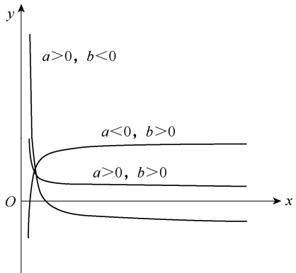

contour

| Condition | Description |
| --- | --- |
| a > 0, b < 0 | Function curve starting from the origin (0,0) |
| a < 0, b > 0 | Function curve starting from the origin (0,0) |
| a > 0, b > 0 | Function curve starting from the origin (0,0) |

图 9-1 倒数函数 $\scriptstyle { \hat { y } } = { \frac { a + b x } { x } }$ 的图示

表 9-2 玉米株重与经济系数的关系

| 密度(千株/667$m^2$) | x | y | $y' = xy$ | $x^2$ | $xy'$ | $y'^2$ | $\hat{y}$ | $y - \hat{y}$ |
| --- | --- | --- | --- | --- | --- | --- | --- | --- |
| 1 | 399 | 0.380 | 151.620 | 159201 | 60496.380 | 22988.624 | 0.384 | -0.004 |
| 2 | 329 | 0.379 | 124.691 | 108241 | 41023.339 | 15547.845 | 0.376 | 0.003 |
| 3 | 247 | 0.371 | 91.637 | 61009 | 22634.339 | 8397.340 | 0.362 | 0.009 |
| 4 | 191 | 0.343 | 65.513 | 36481 | 12512.983 | 4291.953 | 0.344 | -0.001 |
| 5 | 145 | 0.317 | 45.965 | 21025 | 6664.925 | 2112.781 | 0.320 | -0.003 |
| 6 | 119 | 0.301 | 35.819 | 14161 | 4262.461 | 1283.001 | 0.298 | 0.003 |
| 7 | 90 | 0.248 | 22.320 | 8100 | 2008.800 | 498.182 | 0.259 | -0.011 |

（1）绘制散点图，判断曲线类型。根据表 9-2 数据绘制 x 和 y 的散点图（图 9-2），散点图与图 9-1 中 $a   \leq   0$ 、b＞0 的曲线相似。为了能够做出更准确的判断，图 9-3 绘出了 x 与 y′ $(y' = xy)$ 的散点图， $y ^ { \prime } .$ 与 x 之间存在直线关系，这表明选择该倒数函数曲线是适合的。

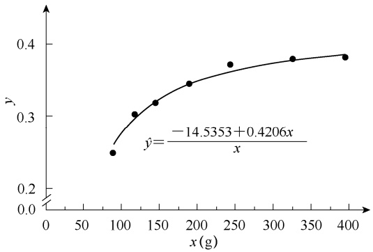

scatter

| x (g) | y |
| --- | --- |
| ~90 | ~0.25 |
| ~120 | ~0.30 |
| ~150 | ~0.32 |
| ~190 | ~0.34 |
| ~240 | ~0.37 |
| ~320 | ~0.38 |
| ~400 | ~0.38 |

图 9-2 经济系数 y 与玉米株重 x 的关系

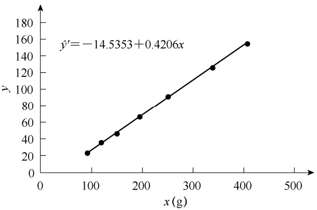

line

| x (g) | y |
| --- | --- |
| ~95 | ~25 |
| ~125 | ~37 |
| ~155 | ~48 |
| ~200 | ~68 |
| ~255 | ~92 |
| ~340 | ~127 |
| ~410 | ~156 |

图 9-3 例 9-1 数据中 $y ^ { \prime }$ 与 x 之间的直线关系

（2）配合倒数函数方程。利用 $y ^ { \prime } )$ 和 x 进行直线回归分析，得到 a 和 b 值，代入式（9-2）即得倒数函数方程。具体步骤如下所述。

第一步，根据表 9-2 数据计算 6 个一级数据:

$$
\begin{array}{l l l} \sum x = 1 5 2 0 & \sum x ^ {2} = 4 0 8 2 1 8 & \sum y ^ {\prime} = 5 3 7. 5 6 5 \\ \sum y ^ {\prime 2} = 5 5 1 1 9. 7 2 7 & \sum x y ^ {\prime} = 1 4 9 6 0 3. 2 2 7 & n = 7 \end{array}
$$

第二步，由 6 个一级数据计算 5 个二级数据:

$$
S S _ {x} = \sum x ^ {2} - \frac {\left(\sum x\right) ^ {2}}{n} = 4 0 8 2 1 8 - \frac {1 5 2 0 ^ {2}}{7} = 7 8 1 6 0. 8 5 7
$$

$$
S S _ {y ^ {\prime}} = \sum y ^ {2} - \frac {\left(\sum y ^ {\prime}\right) ^ {2}}{n} = 5 5 1 1 9. 7 2 7 - \frac {5 3 7 . 5 6 5 ^ {2}}{7} = 1 3 8 3 7. 4 2 3
$$

$$
S P _ {x y ^ {\prime}} = \sum x y ^ {\prime} - \frac {(\sum x) (\sum y ^ {\prime})}{n} = 1 4 9 6 0 3. 2 2 7 - \frac {1 5 2 0 \times 5 3 7 . 5 6 5}{7} = 3 2 8 7 4. 8 2 7
$$

$$
\overline {{x}} = \frac {\sum x}{n} = \frac {1 5 2 0}{7} = 2 1 7. 1 4 3
$$

$$
\overline {{y}} ^ {\prime} = \frac {\sum y ^ {\prime}}{n} = \frac {5 3 7 . 5 6 5}{7} = 7 6. 7 9 5
$$

第三步，计算回归系数 b 和回归截距 a:

$$
b = \frac {S P _ {x y ^ {\prime}}}{S S _ {x}} = \frac {3 2 8 7 4 . 8 2 7}{7 8 1 6 0 . 8 5 7} = 0. 4 2 0 6
$$

$$
a = \overline {{y}} ^ {\prime} - b \overline {{x}} = 7 6. 7 9 5 - 0. 4 2 0 6 \times 2 1 7. 1 4 3 = - 1 4. 5 3 5 3
$$

第四步，将 a 和 b 代入式（9-2），得到 y 和 x 之间的倒数函数方程:

$$
\hat {y} = \frac {- 1 4 . 5 3 5 3 + 0 . 4 2 0 6 x}{x}
$$

（3）直线化回归方程的显著性检验。对直线化后的回归方程进行显著性检验时，我们可以计算 $x$ 与 $y ^ { \prime }$ 的相关系数并对其进行显著性检验。

$$
r _ {x y ^ {\prime}} = \frac {S P _ {x y ^ {\prime}}}{\sqrt {S S _ {x} S S _ {y ^ {\prime}}}} = \frac {3 2 8 7 4 . 8 2 7}{\sqrt {7 8 1 6 0 . 8 5 7 \times 1 3 8 3 7 . 4 2 3}} = 0. 9 9 9 6 ^ {* *}
$$

（4）计算曲线回归方程的相关指数。将 x 的每一取值代入倒数方程 $\frac{-14.5353+0.4206x}{x}$可以得到相应的 $\hat { y } ,$ ，其结果列于表 9-2 中。从每一对 y 与 $\hat { y }$ 的差值大小可看出每一对观测值受随机误差影响的大小，差异越大，随机误差就越大。根据式（9-1），有

$$
R ^ {2} = 1 - \frac {\sum (y - \hat {y}) ^ {2}}{\sum (y - \bar {y}) ^ {2}} = 1 - \frac {0 . 0 0 0 2 4 6}{0 . 0 1 4 4} = 0. 9 8 2 9
$$

表明玉米株重 $( x )$ 和经济系数 $( y )$ 的回归关系用倒数函数方程 $\frac{-14.5353+0.4206x}{x}$ 进行描述，其相关指数达 0.9829，说明该倒数函数拟合程度较好。

## 第三节 指数函数曲线

指数函数（exponential function）常见的有两种形式:

$$
\hat {y} = a \mathrm{e} ^ {b x} \tag {9-6}
$$

$$
\hat {y} = a b ^ {x} \tag {9-7}
$$

在指数函数中，x 是作为指数出现的，系数 b 常用以描述动植物生长、细菌繁殖和经济增长或衰减速率。如图 9-4 所示，当 $a   \geq   0$ 时，如果曲线方程是式（9-6），$b   \geq   0$ 表示是生长型曲线， $b   \leq   0$ 表示是衰减型曲线；如果曲线方程是式（9-7），

$b   \geq   1$ 表示是凹增长型曲线， $0 \leq b \leq 1$ 表示是凸增长型曲线， $b   \leq   0$ 表示是衰减型曲线。

将式（9-6）两边取自然对数，得到:

$$
\ln \hat {y} = \ln a + b x \tag {9-8}
$$

令 $y ^ { \prime } { = } \mathrm { l n } y$ $a ^ { \prime } { = } \ln a$ ，式（9-8）变形为

$$
\hat {y} ^ {\prime} = a ^ {\prime} + b x \tag {9-9}
$$

式（9-9）为式（9-6）直线化后的表达式。

例 **9-2** 棉花红铃虫的产卵数与温度有关，试根据表 9-3 中的数据建立棉花红铃虫产卵数与温度的回归方程。

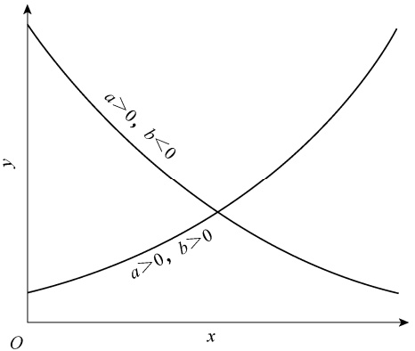

line

| Category | Equation |
| --- | --- |
| Intersection Point | (a, b) |

图 9-4 指数函数 $\hat { y } { = } a \mathbf { e } ^ { b x }$ 的图示

表 9-3 棉花红铃虫产卵数与温度的关系

| 温度(x,°C) | 21 | 23 | 25 | 27 | 29 | 32 | 35 |
| --- | --- | --- | --- | --- | --- | --- | --- |
| 产卵数(y) | 7 | 11 | 21 | 24 | 66 | 115 | 325 |
| y'=lny | 1.9459 | 2.3979 | 3.0445 | 3.1781 | 4.1897 | 4.7449 | 5.7838 |

（1）绘制散点图，判断曲线类型。根据表 9-3 的数据绘制 $( x , y )$ 散点图（图 9-5）。该散点图与图 9-4 中 $b   \geq   0$ 时的曲线相似，选择方程 $\hat { y } { = } a \mathbf { e } ^ { b x }$ 进行曲线拟合。同时，以 $x$ 和 $y ^ { \prime }$ $(y' = \log y)$ 的数据绘制散点图（图 9-6），其直线趋势较为明显，说明配合 $\hat { y } { = } a \mathbf { e } ^ { b x }$ 的曲线方程是适合的。
（2）配合指数曲线方程。以 x 和 $y^{\prime} \left( y^{\prime} = \ln y \right)$ 进行直线回归分析，求出 b 和 $a ^ { \prime }$ ，并将 $a ^ { \prime }$转换为 a，代入 $\hat { y } { = } a \mathbf { e } ^ { b x }$ 即可。具体步骤如下。

第一步，根据表 9-3 数据计算 6 个一级数据:

$$
\sum x = 1 9 2 \quad \sum x ^ {2} = 5 4 1 4 \quad \sum y ^ {\prime} = 2 5. 2 8 4 8
$$

$$
\sum y ^ {\prime 2} = 1 0 2. 4 2 5 8 \quad \sum x y ^ {\prime} = 7 3 3. 7 0 7 9 \quad n = 7
$$

第二步，由 $6$ 个一级数据计算 5 个二级数据:

$$
S S _ {x} = \sum x ^ {2} - \frac {\left(\sum x\right) ^ {2}}{n} = 5 4 1 4 - \frac {1 9 2 ^ {2}}{7} = 1 4 7. 7 1 4 3
$$

相对生长率

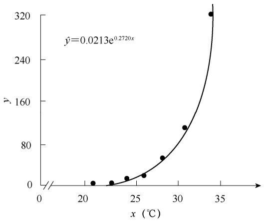

scatter

| \(x ({}^{\circ}C)\) | y |
| --- | --- |
| ~21 | ~5 |
| ~23 | ~8 |
| ~24 | ~15 |
| ~26 | ~25 |
| ~28 | ~55 |
| ~31 | ~110 |
| ~34 | ~320 |

图 9-5 棉花红铃虫产卵数 y 与温度 x 的关系

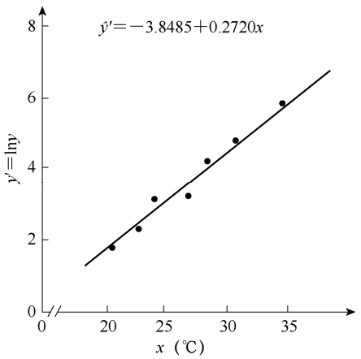

scatter

| x \(({}^{\circ}C)\) | y' = ln y |
| --- | --- |
| ~20.5 | ~1.8 |
| ~23 | ~2.3 |
| ~24 | ~3.1 |
| ~27 | ~3.2 |
| ~28 | ~4.2 |
| ~30.5 | ~4.8 |
| ~34.5 | ~5.9 |

图 9-6 例 9-2 数据中 y′与 x 之间的直线关系

$$
\begin{array}{l} S S _ {y ^ {\prime}} = \sum y ^ {\prime 2} - \frac {\left(\sum y ^ {\prime}\right) ^ {2}}{n} = 1 0 2. 4 2 5 8 - \frac {2 5 . 2 8 4 8 ^ {2}}{7} = 1 1. 0 9 4 2 \\ S P _ {x y ^ {\prime}} = \sum x y ^ {\prime} - \frac {\sum x \sum y ^ {\prime}}{n} = 7 3 3. 7 0 7 9 - \frac {1 9 2 \times 2 5 . 2 8 4 8}{7} = 4 0. 1 8 2 0 \\ \overline {{x}} = \frac {\sum x}{n} = \frac {1 9 2}{7} = 2 7. 4 2 8 6 \\ \overline {{y}} ^ {\prime} = \frac {\sum y ^ {\prime}}{n} = \frac {2 5 . 2 8 4 8}{7} = 3. 6 1 2 1 \\ \end{array}
$$

第三步，计算 b 和 $a ^ { \prime } ;$ :

$$
b = \frac {S P _ {x y ^ {\prime}}}{S S _ {x}} = \frac {4 0 . 1 8 2 0}{1 4 7 . 7 1 4 3} = 0. 2 7 2 0
$$

$$
a ^ {\prime} = \overline {{y}} ^ {\prime} - b \overline {{x}} = 3. 6 1 2 1 - 0. 2 7 2 0 \times 2 7. 4 2 8 6 = - 3. 8 4 8 5
$$

第四步，计算 a 值，将 a、b 代入 $\hat { y } = a \mathbf { e } ^ { b x }$ ，得到曲线方程:

$$
a = \mathrm{e} ^ {a ^ {\prime}} = \mathrm{e} ^ {- 3. 8 4 8 5} = 0. 0 2 1 3
$$

$$
\hat {y} = 0. 0 2 1 3 \mathrm{e} ^ {0. 2 7 2 0 x}
$$

（3）直线化回归方程的显著性检验。检验 $y ^ { \prime } .$ 与 x 的回归关系，计算回归与离回归的平方和:

$$
U = b \cdot S P _ {x y ^ {\prime}} = 0. 2 7 2 0 \times 4 0. 1 8 2 0 = 1 0. 9 2 9 5
$$

$$
Q = S S _ {y ^ {\prime}} - U = 1 1. 0 9 4 2 - 1 0. 9 2 9 5 = 0. 1 6 4 7
$$

$$
F = \frac {\frac {U}{1}}{\frac {Q}{n - 2}} = \frac {1 0 . 9 2 9 5}{\frac {0 . 1 6 4 7}{7 - 2}} = 3 3 1. 8 0 0 ^ {* *}
$$

$F = 331.800 > F_{0.01}$ ，回归关系极显著，说明配合曲线方程 $\hat{y} = 0.0213\mathrm{e}^{0.2720x}$ 是适合的（表 9-4）。

表 9-4 表 9-3 数据 x 与 y′回归关系的显著性检验

| 变异来源 | df | SS | $s^2$ | F | $F_{0.05}$ | $F_{0.01}$ |
| --- | --- | --- | --- | --- | --- | --- |
| 回归 | 1 | 10.9295 | 10.9295 | 331.800** | 6.61 | 16.26 |
| 离回归 | 5 | 0.1647 | 0.0329 |  |  |  |
| 总变异 | 6 | 11.0942 |  |  |  |  |

## 第四节 对数函数曲线

对数函数（logarithmic function）的一般表达式为

$$
\hat {y} = a + b \lg x \tag {9-10}
$$

若令 $\lg x = x'$ ，则式（9-10）可以写成

$$
\hat {y} = a + b x ^ {\prime} \tag {9-11}
$$

式（9-11）为式（9-10）直线化后的表达形式。

如果两个变量的成对观测值在坐标系中的散点图分布趋势类似于对数函数曲线（图 9-7），可配合对数曲线方程 $\hat{y} = a + b \lg x$ 。首先将 x 变量的每一观测值取对数转换为新变量 $x ^ { \prime } ,$ ，然后用 x′与 y 进行直线回归分析，求得 a 和 b，即得到对数函数方程。

例 **9-3** 在水稻育秧中，塑料薄膜青苗床内空气最高温度 $( y , \mathrm { ~  ~ } )$ 和室外空气最高温度 $( x , ~ \mathrm { { ^ \circ C } } )$ 数据如表 9-5 所示。求它们之间的函数关系式。

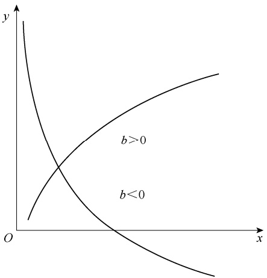

line

| Category | Description |
| --- | --- |
| Curve 1 | b > 0 (Upper curve) |
| Curve 2 | b < 0 (Lower curve) |

图 9-7 对数函数 $\hat{y} = a + b \lg x$ 的图示

表 9-5 苗床内最高温度与空气最高温度的关系

| 序号 | x | y | $x' = \lg x$ | $x'^2$ | $x'y$ | $y^2$ | $\hat{y}$ |
| --- | --- | --- | --- | --- | --- | --- | --- |
| 1 | 7.2 | 13.8 | 0.8573 | 0.7350 | 11.8312 | 190.44 | 16.79 |
| 2 | 7.9 | 21.4 | 0.8976 | 0.8057 | 19.2092 | 457.96 | 18.79 |
| 3 | 11.8 | 24.9 | 1.0719 | 1.1489 | 26.6899 | 620.01 | 27.45 |
| 4 | 12.0 | 32.3 | 1.0792 | 1.1646 | 34.8576 | 1043.29 | 27.81 |
| 5 | 16.9 | 33.6 | 1.2279 | 1.5077 | 41.2570 | 1128.96 | 35.20 |
| 6 | 18.7 | 39.5 | 1.2718 | 1.6176 | 50.2377 | 1560.25 | 37.38 |
| 7 | 18.9 | 40.1 | 1.2765 | 1.6294 | 51.1861 | 1608.01 | 37.61 |
| 8 | 20.2 | 36.9 | 1.3054 | 1.7039 | 48.1675 | 1361.61 | 39.05 |
| 9 | 21.8 | 40.2 | 1.3385 | 1.7915 | 53.8060 | 1616.04 | 40.69 |
| 10 | 22.7 | 42.6 | 1.3560 | 1.8388 | 57.7667 | 1814.76 | 41.57 |
| 11 | 22.9 | 44.6 | 1.3598 | 1.8492 | 60.6487 | 1989.16 | 41.76 |
| 12 | 23.1 | 36.6 | 1.3636 | 1.8594 | 49.9082 | 1339.56 | 41.94 |
| 13 | 23.3 | 35.1 | 1.3674 | 1.8697 | 47.9942 | 1232.01 | 42.13 |
| 14 | 23.6 | 44.4 | 1.3729 | 1.8849 | 60.9573 | 1971.36 | 42.41 |
| 15 | 23.8 | 44.1 | 1.3766 | 1.8950 | 60.7070 | 1944.81 | 42.59 |
| 16 | 27.0 | 43.9 | 1.4314 | 2.0488 | 62.8369 | 1927.21 | 45.31 |
| 17 | 27.6 | 48.3 | 1.4409 | 2.0762 | 69.5959 | 2332.89 | 45.78 |
| 18 | 28.6 | 48.5 | 1.4564 | 2.1210 | 70.6338 | 2352.25 | 46.55 |
| 19 | 30.7 | 46.3 | 1.4871 | 2.2116 | 68.8545 | 2143.69 | 48.08 |
| 20 | 31.4 | 50.4 | 1.4969 | 2.2408 | 75.4453 | 2540.16 | 48.57 |
| 合计 | 420.1 | 767.5 | 25.8350 | 33.9997 | 1022.5905 | 31174.43 |  |

（1）绘制散点图，判断曲线类型。根据表 9-5 的数据绘制 $( x , y )$ 散点图（图 9-8），该散点图与图 9-7 中 b＞0 的曲线相似。为了能够做出更准确的判断，图 9-9 绘出了 $x^{\prime} \left( x^{\prime} = \lg x \right)$与 y 的散点图， $x ^ { \prime } .$ 与 y 之间存在直线关系，这说明选择对数曲线是适合的。

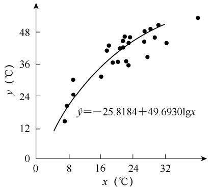

scatter

| \(x ({}^{\circ}C)\) | \(y ({}^{\circ}C)\) |
| --- | --- |
| ~7 | ~15 |
| ~8 | ~21 |
| ~9 | ~24 |
| ~10 | ~30 |
| ~16 | ~31 |
| ~18 | ~40 |
| ~19 | ~42 |
| ~20 | ~36 |
| ~21 | ~36 |
| ~22 | ~36 |
| ~22 | ~41 |
| ~23 | ~42 |
| ~23 | ~47 |
| ~24 | ~47 |
| ~25 | ~36 |
| ~26 | ~40 |
| ~27 | ~48 |
| ~28 | ~49 |
| ~29 | ~47 |
| ~30 | ~49 |
| ~31 | ~43 |
| ~38 | ~53 |

图 9-8 苗床内最高气温 $y$ 与空气最高气温 x 的关系

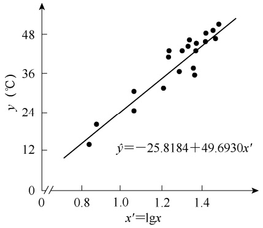

scatter

| x'=lgx | \(y ({}^{\circ}C)\) |
| --- | --- |
| ~0.85 | ~14 |
| ~0.87 | ~20 |
| ~1.05 | ~24 |
| ~1.06 | ~30 |
| ~1.22 | ~31 |
| ~1.23 | ~40 |
| ~1.24 | ~42 |
| ~1.28 | ~36 |
| ~1.30 | ~42 |
| ~1.32 | ~43 |
| ~1.33 | ~45 |
| ~1.34 | ~47 |
| ~1.35 | ~36 |
| ~1.36 | ~37 |
| ~1.37 | ~44 |
| ~1.38 | ~45 |
| ~1.40 | ~47 |
| ~1.42 | ~48 |
| ~1.43 | ~49 |
| ~1.45 | ~48 |

图 9-9 例 9-3 数据中 $x ^ { \prime } .$ 与 $y$ 之间的直线关系

（2）配合对数函数方程。以 $x^{\prime} \left( x^{\prime} = \lg x \right)$ 和 y 进行直线回归分析，求出 a 和 b，并代入式（9-10）即得对数函数方程。具体步骤如下。

第一步，根据表 9-5 数据计算 6 个一级数据:

$$
\sum x ^ {\prime} = 2 5. 8 3 5 0 \quad \sum x ^ {2} = 3 3. 9 9 9 7 \quad \sum y = 7 6 7. 5
$$

$$
\sum y ^ {2} = 3 1 1 7 4. 4 3 \quad \sum x ^ {\prime} y = 1 0 2 2. 5 9 0 5 \quad n = 2 0
$$

第二步，由 6 个一级数据计算 5 个二级数据:

$$
S S _ {x ^ {\prime}} = \sum x ^ {2} - \frac {\left(\sum x ^ {\prime}\right) ^ {2}}{n} = 3 3. 9 9 9 7 - \frac {2 5 . 8 3 5 0 ^ {2}}{2 0} = 0. 6 2 7 3
$$

$$
S S _ {y} = \sum y ^ {2} - \frac {\left(\sum y\right) ^ {2}}{n} = 3 1 1 7 4. 4 3 - \frac {7 6 7 . 5 ^ {2}}{2 0} = 1 7 2 1. 6 1 7 5
$$

$$
S P _ {x ^ {\prime} y} = \sum x ^ {\prime} y - \frac {\sum x ^ {\prime} \sum y}{n} = 1 0 2 2. 5 9 0 5 - \frac {2 5 . 8 3 5 0 \times 7 6 7 . 5}{2 0} = 3 1. 1 7 2 4
$$

$$
\overline {{x}} ^ {\prime} = \frac {\sum x ^ {\prime}}{n} = \frac {2 5 . 8 3 5 0}{2 0} = 1. 2 9 1 8
$$

$$
\overline {{y}} = \frac {\sum y}{n} = \frac {7 6 7 . 5}{2 0} = 3 8. 3 7 5
$$

第三步，计算回归系数 b 和回归截距 a:

$$
b = \frac {S P _ {x ^ {\prime} y}}{S S _ {x ^ {\prime}}} = \frac {3 1 . 1 7 2 4}{0 . 6 2 7 3} = 4 9. 6 9 3 0
$$

$$
a = \overline {{y}} - b \overline {{x}} ^ {\prime} = 3 8. 3 7 5 - 4 9. 6 9 3 0 \times 1. 2 9 1 8 = - 2 5. 8 1 8 4
$$

第四步，将 $a$ 和 b 直接代入式（9-10），得到 $y$ 与 $x$ 的对数函数方程

$$
\hat {y} = - 2 5. 8 1 8 4 + 4 9. 6 9 3 0 \lg x
$$

（3）直线化回归方程的显著性检验。计算 $y$ 与 $x ^ { \prime } .$ 直线回归关系的回归与离回归平方和:

$$
U = b \cdot S P _ {x ^ {\prime} y} = 4 9. 6 9 3 0 \times 3 1. 1 7 2 4 = 1 5 4 9. 0 5 0 1
$$

$$
Q = S S _ {y} - U = 1 7 2 1. 6 1 7 5 - 1 5 4 9. 0 5 0 1 = 1 7 2. 5 6 7 4
$$

$$
F = \frac {\frac {U}{1}}{\frac {Q}{n - 2}} = \frac {1 5 4 9 . 0 5 0 1}{\frac {1 7 2 . 5 6 7 4}{2 0 - 2}} = 1 6 1. 5 7 7 ^ {* *}
$$

$F = 161.577 > F_{0.01}$ ，说明回归关系极显著，配合对数函数是适合的（表 9-6）。

表 9-6 例 9-3 数据中 $y$ 与 x′回归关系的显著性检验

| 变异来源 | df | SS | $s^2$ | F | $F_{0.05}$ | $F_{0.01}$ |
| --- | --- | --- | --- | --- | --- | --- |
| 回归 | 1 | 1549.0501 | 1549.0501 | 161.577** | 4.41 | 8.29 |
| 离回归 | 18 | 172.5674 | 9.5871 |  |  |  |
| 总变异 | 19 | 1721.6175 |  |  |  |  |

利用曲线回归方程进行预测时，可将每一个 x 值转换成 $x ^ { \prime }$ ，再通过回归分析的方法预测出 $y$ 所在区间。表 9-5 最后一列即为每一个 x 值代入曲线回归方程得到相应估计值 $\hat { y }$

## 第五节 幂函数曲线

幂函数（power function）是 $y$ 为 x 某次幂的函数曲线，其方程为

$$
\hat {y} = a x ^ {b} \tag {9-12}
$$

将式（9-12）两边取对数，得

$$
\lg \hat {y} = \lg a + b \lg x \tag {9-13}
$$

令 $y ^ { \prime } = \lg y , x ^ { \prime } = \lg x , a ^ { \prime } = \lg a$ ，得到直线方程:

$$
\hat {y} ^ {\prime} = a ^ {\prime} + b x ^ {\prime} \tag {9-14}
$$

式（9-12）的图形如图 9-10 所示。如果两个变量的散点图类似于图 9-10 中的某一条曲线，说明可用幂函数曲线进行拟合。为了进一步进行验证，可将 x 和 y 都取对数，然后绘出 $x ^ { \prime }$ $(x' = \lg x)$ 和 $y' \left( y' = \lg y \right)$ 的散点图，如果散点呈直线趋势，即说明选用幂函数曲线是适合的。

例 **9-4** 为了研究 $\mathrm { C O } _ { 2 }$ 对变黄期烟叶叶绿素降解的影响，在 30 倍 $\mathrm { C O } _ { 2 }$ 浓度下测定了不同烘烤时间（x，h）下叶绿素含量 $( y ,$ ，占干重%），其结果列于表 9-7。试对该数据进行回归分析。

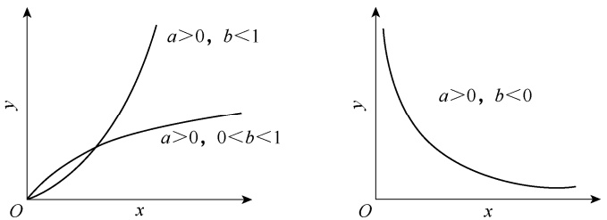

图 9-10 幂指数函数 ${ \hat { y } } { = } a x ^ { b }$ 的图示

表 9-7 烘烤时间与叶绿素含量的关系

| 序号 | x | y | $x' = \lg x$ | $y' = \lg y$ |
| --- | --- | --- | --- | --- |
| 1 | 12 | 0.17430 | 1.0792 | -0.7587 |
| 2 | 15 | 0.11080 | 1.1761 | -0.9555 |
| 3 | 19 | 0.06340 | 1.2788 | -1.1979 |
| 4 | 25 | 0.05310 | 1.3979 | -1.2749 |
| 5 | 32 | 0.04155 | 1.5051 | -1.3814 |
| 6 | 35 | 0.04080 | 1.5441 | -1.3893 |
| 7 | 38 | 0.04020 | 1.5798 | -1.3958 |
| 8 | 41 | 0.03998 | 1.6128 | -1.3982 |
| 9 | 46 | 0.03762 | 1.6628 | -1.4246 |
| 10 | 49 | 0.03538 | 1.6902 | -1.4512 |
| 11 | 58 | 0.03533 | 1.7634 | -1.4519 |

（1）绘制散点图，判断曲线类型。根据表 9-7 的 x 和 y 的成对观测值在坐标系中绘制散点图（图 9-11），该图类似于图 9-10 中 $b   \leq   0$ 的曲线，可试配幂函数曲线。绘出 $x ^ { \prime } ( x ^ { \prime } =$ lgx）和 $y' \left( y' = \lg y \right)$ 的散点图（图 9-12），如散点图呈直线趋势，说明选用幂函数曲线是适合的。

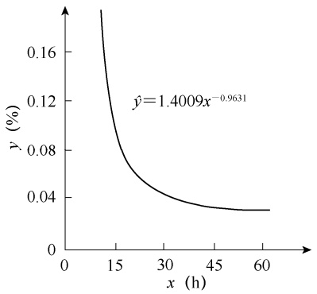

line

| x (h) | y (%) |
| --- | --- |
| ~12 | ~0.18 |
| 15 | ~0.09 |
| 30 | ~0.04 |
| 45 | ~0.03 |
| 60 | ~0.03 |

图 9-11 烘烤时间 x 与叶绿素含量 y 的关系

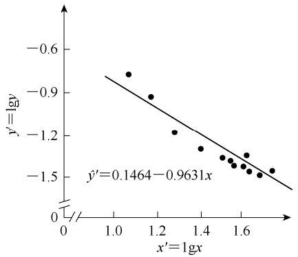

scatter

| x'=1gx | y'=lgv |
| --- | --- |
| ~1.08 | ~-0.75 |
| ~1.18 | ~-0.92 |
| ~1.28 | ~-1.20 |
| ~1.40 | ~-1.35 |
| ~1.50 | ~-1.40 |
| ~1.55 | ~-1.42 |
| ~1.58 | ~-1.45 |
| ~1.62 | ~-1.40 |
| ~1.65 | ~-1.48 |
| ~1.70 | ~-1.48 |
| ~1.75 | ~-1.45 |

图 9-12 例 9-4 数据中 $x ^ { \prime } .$ 与 $y ^ { \prime }$ 之间的直线关系

（2）配合幂函数曲线方程。具体步骤如下。

第一步，计算 6 个一级数据:

$$
\sum x ^ {\prime} = 1 6. 2 9 0 1 \quad \sum x ^ {2} = 2 4. 6 1 4 9 \quad \sum y ^ {\prime} = - 1 4. 0 7 9 4
$$

$$
\sum y ^ {2} = 1 8. 5 3 4 0 \quad \sum x ^ {\prime} y ^ {\prime} = - 2 1. 3 2 2 9 \quad n = 1 1
$$

第二步，由 6 个一级数据计算 5 个二级数据:

$$
S S _ {x ^ {\prime}} = \sum x ^ {2} - \frac {\left(\sum x ^ {\prime}\right) ^ {2}}{n} = 2 4. 6 1 4 9 - \frac {1 6 . 2 9 0 1 ^ {2}}{1 1} = 0. 4 9 0 6
$$

$$
S S _ {y ^ {\prime}} = \sum y ^ {2} - \frac {\left(\sum y ^ {\prime}\right) ^ {2}}{n} = 1 8. 5 3 4 0 - \frac {(- 1 4 . 0 7 9 4) ^ {2}}{1 1} = 0. 5 1 3 1
$$

$$
S P _ {x ^ {\prime} y ^ {\prime}} = \sum x ^ {\prime} y ^ {\prime} - \frac {\sum x ^ {\prime} \sum y ^ {\prime}}{n} = - 2 1. 3 2 2 9 - \frac {1 6 . 2 9 0 1 \times (- 1 4 . 0 7 9 4)}{1 1} = - 0. 4 7 2 5
$$

$$
\overline {{x}} ^ {\prime} = \frac {\sum x ^ {\prime}}{n} = \frac {1 6 . 2 9 0 1}{1 1} = 1. 4 8 0 9
$$

$$
\overline {{y}} ^ {\prime} = \frac {\sum y ^ {\prime}}{n} = \frac {- 1 4 . 0 7 9 4}{1 1} = - 1. 2 7 9 9
$$

第三步，计算 b 和 $a ^ { \prime } ;$

$$
b = \frac {S P _ {x ^ {\prime} y ^ {\prime}}}{S S _ {x ^ {\prime}}} = \frac {- 0 . 4 7 2 5}{0 . 4 9 0 6} = - 0. 9 6 3 1
$$

$$
a ^ {\prime} = \overline {{y}} ^ {\prime} - b \overline {{x}} ^ {\prime} = - 1. 2 7 9 9 - (- 0. 9 6 3 1) \times 1. 4 8 0 9 = 0. 1 4 6 4
$$

第四步，将 a′转换为 a，得到幂函数曲线方程:

$$
a = 1 0 ^ {a ^ {\prime}} = 1 0 ^ {0. 1 4 6 4} = 1. 4 0 0 9
$$

$$
\hat {y} = 1. 4 0 0 9 x ^ {- 0. 9 6 3 1}
$$

（3）直线化回归方程的显著性检验。计算 $y ^ { \prime }$ 与 $x ^ { \prime } .$ 直线回归关系的回归与离回归平方和:

$$
U = b \cdot S P _ {x ^ {\prime} y ^ {\prime}} = - 0. 9 6 3 1 \times (- 0. 4 7 2 5) = 0. 4 5 5 1
$$

$$
Q = S S _ {y ^ {\prime}} - U = 0. 5 1 3 1 - 0. 4 5 5 1 = 0. 0 5 8 0
$$

$$
F = \frac {\frac {U}{1}}{\frac {Q}{n - 2}} = \frac {0 . 4 5 5 1}{\frac {0 . 0 5 8 0}{1 1 - 2}} = 7 0. 6 1 9 ^ {* *}
$$

$F=70.619>F_{0.01}$ ，说明回归关系达到极显著，配合幂函数曲线方程是适合的（表 9-8）。

表 9-8 例 9-4 数据中 $y$ 与 x′回归关系的显著性检验

| 变异来源 | df | SS | $s^2$ | F | $F_{0.05}$ | $F_{0.01}$ |
| --- | --- | --- | --- | --- | --- | --- |
| 回归 | 1 | 0.4551 | 0.4551 | 70.619** | 5.12 | 10.56 |
| 离回归 | 9 | 0.0580 | 0.0064 |  |  |  |
| 总变异 | 10 | 0.5131 |  |  |  |  |

为了更好地说明例 9-4 数据符合幂函数曲线关系，而不是其他类型曲线或直线关系，可将其进行不同曲线方程的拟合，并计算直线化后两个变量之间的相关系数。

幂函数方程: $\hat { y } { = } 1 . 4 0 0 9 x ^ { - 0 . 9 6 3 1 }$ ，lgx 与 y 之间的 $r = - 0 . 9 4 1 7$

对数函数方程: $\hat{y}=0.3147-0.0743\ln x$ lnx 与 $y$ 之间的 $r = - 0 . 8 7 2 0$ ；

指数函数方程: $\hat{y} = 0.1457\mathrm{e}^{-0.0304x}$ ，x 与 lny 之间的 $r   =   - 0 . 8 5 6 2$

直线函数方程: $\hat{y}=0.1372-0.0023x$ 与 $y$ 之间的 $r = - 0 . 7 6 5 2$

以上4个方程，其直线化后两个变量的相关系数均达极显著水平 $r_{0.01(9)} = 0.735$ ，而幂函数曲线直线化后的相关程度最高，表明配合出的幂函数曲线方程 $\hat{y} = 1.4009x^{-0.9631}$ 是最适宜的。

## 第六节 Logistic 生长曲线

## 一、Logistic 生长曲线的由来和基本特征

Logistic 生长曲线（Logistic growth curve）最初由比利时数学家 P. F. Verhulst 于 1838年推导出来，但长期被忽视。直到 20 世纪 20 年代才被生物学家和统计学家 R. Pearl 和 L. J. Reed 重新发现，应用于研究人口生长规律，所以，这种特殊的曲线也称为 Pearl 增长曲线，简称 Pearl 曲线。目前它已广泛应用于动植物的饲养、栽培、资源、生态、环保等方面的模拟研究。

Logistic 生长曲线的基本特点是开始增长缓慢，而在以后的某一范围内迅速增长，达到

一定的限度后又缓慢下来，曲线呈拉长的“S”形，因此，也称为“S”形曲线。相对于对称“S”形曲线，Logistic 生长曲线属于非对称的“S”形曲线，其方程为

对称“S”形曲线

$$
\hat {y} = \frac {K}{1 + a \mathrm{e} ^ {- b x}} \tag {9-15}
$$

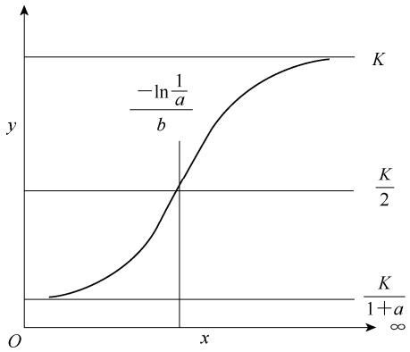

line

| X-axis | Y-axis |
| --- | --- |
| 0 | ~0.2 |
| -ln(1/a/b) | K/2 |
| x | K/2 |
| \(\infty\) | K |

图 9-13 Logistic 生长曲线 $\hat{y} = \frac{K}{1 + a\mathrm{e}^{-bx}}$ 的图示

曲线的图形如图 9-13 所示。

Logistic 生长曲线的基本特征如下。

（1）当 x=0 时， $\hat { y } { = } \frac { K } { 1 { + } a }$ ；当 $x   \to   \infty , \quad \hat { y }   =   K$ 。所以时间为 0 的起始量是 $\frac { K } { 1 + a }$ ，时间无限延长的终极量是 K。
（2）式（9-15）的二阶导数 时，

$x = \frac{- \ln \frac{1}{a}}{b}, \quad \hat{y} = \frac{K}{2}$ ，这说明 y 是随 x 的增加而增

加的。当 $\scriptstyle x = { \frac { - \ln { \frac { 1 } { a } } } { b } }$ 时，曲线有一个拐点（knee point），这时 $\hat { y } { = } \frac { K } { 2 }$ ，恰为终极量 K 的一半。

所以，x 在 $\left[ 0 , { \frac { - \mathrm { l n } { \frac { 1 } { a } } } { b } } \right]$ 区间内，曲线下凹，x 在 $\left( { \frac { - { \ln } { \frac { 1 } { a } } } { b } } , \infty \right)$ 区间内，曲线上凸。

## 二、Logistic 生长曲线方程的配合

从式（9-15）可以看出，只要确定了 K 值，就可利用直线化方法求出方程的两个统计数a 和 b。式（9-15）移项后可得

$$
\frac {K - \hat {y}}{\hat {y}} = a \mathrm{e} ^ {- b x} \tag {9-16}
$$

两边取自然对数后得

$$
\ln \frac {K - \hat {y}}{\hat {y}} = \ln a - b x \tag {9-17}
$$

若令 $\scriptstyle { \hat { y } } ^ { \prime } = \ln { \frac { K - { \hat { y } } } { \hat { y } } }$ $a ^ { \prime } { = } \ln a$ $b ^ { \prime }   =   - b$ ，式（9-17）即

$$
\hat {y} ^ {\prime} = a ^ {\prime} + b ^ {\prime} x \tag {9-18}
$$

因此，可将每一个 y 观测值转换为 $y ^ { \prime } ,$ ，用 $y ^ { \prime } .$ 与 x 进行直线回归分析，即可求出 $a ^ { \prime }$ 和 $b ^ { \prime } ,$ 。在转换时，必须先确定 K 值，K 值的确定方法有下面两种。

（1）如果依变量 y 是累积频率，则 y 无限增大的终极量应为 100（%），可用 $K { = } 1 0 0$ 表示。
（2）当依变量 y 是生长量或繁殖量时，可取 3 对自变量为等间距的观测值 $(x_{1}, y_{1}), (x_{2},$ $y _ { 2 } )$ 和 $(x_{3}, y_{3})$ ），并将其代入式（9-16），得到联立方程组:

$$
\left\{ \begin{array}{l} \frac {K - y _ {1}}{y _ {1}} = a \mathrm{e} ^ {- b x _ {1}} \\ \frac {K - y _ {2}}{y _ {2}} = a \mathrm{e} ^ {- b x _ {2}} \\ \frac {K - y _ {3}}{y _ {3}} = a \mathrm{e} ^ {- b x _ {3}} \end{array} \right.
$$

将方程组中的 a 和 b 消去，得

$$
\frac {y _ {2} (K - y _ {1})}{y _ {1} (K - y _ {2})} = \left[ \frac {y _ {3} (K - y _ {2})}{y _ {2} (K - y _ {3})} \right] ^ {\frac {x _ {1} - x _ {2}}{x _ {2} - x _ {3}}}
$$

如果令 $x_{2}=\frac{x_{1}+x_{3}}{2}$ ，可得

$$
K = \frac {y _ {2} ^ {2} (y _ {1} + y _ {3}) - 2 y _ {1} y _ {2} y _ {3}}{y _ {2} ^ {2} - y _ {1} y _ {3}} \tag {9-19}
$$

例 **9-5** 表 9-9 是某种肉鸡在良好饲养环境条件下的增重数据。试配合 Logistic 生长曲线方程。

表 9-9 肉鸡饲养过程增重数据

| x(周次) | y(kg) | 2.827-y/y | $y'=\ln \frac{2.827-y}{y}$ |
| --- | --- | --- | --- |
| 2 | 0.30 | 8.4233 | 2.1310 |
| 4 | 0.86 | 2.2872 | 0.8273 |
| 6 | 1.73 | 0.6341 | -0.4555 |
| 8 | 2.20 | 0.2850 | -1.2553 |
| 10 | 2.47 | 0.1445 | -1.9342 |
| 12 | 2.67 | 0.0588 | -2.8336 |
| 14 | 2.80 | 0.0096 | -4.6415 |

（1）求终极量 K。取 x 为等间距的 $x_{1}=2、x_{2}=8、x_{3}=14$ 的生长量 $y_{1}=0.30,\ y_{2}=2.20$ 和

$y_{3} = 2.80$ ，由式（9-19）得

$$
K = \frac {2 . 2 0 ^ {2} \times (0 . 3 0 + 2 . 8 0) - 2 \times 0 . 3 0 \times 2 . 2 0 \times 2 . 8 0}{2 . 2 0 ^ {2} - 0 . 3 0 \times 2 . 8 0} = 2. 8 2 7 (\mathrm{kg})
$$

（2）将 y 转换为 $y ^ { \prime } \circ$ 计算出 $\frac{2.827  一  y}{y}$ 和 $y' = \ln \frac{2.827 - y}{y}$ ，分别列于表 9-9。
（3）计算 $x$ 和 $y ^ { \prime }$ 回归分析的二级数据。

$$
S S _ {x} = 1 1 2 \quad S S _ {y ^ {\prime}} = 3 0. 8 0 6 7 \quad S P _ {x y ^ {\prime}} = - 5 8. 2 3 6 3
$$

$$
\overline {{x}} = 8 \quad \overline {{y}} ^ {\prime} = - 1. 1 6 6 0
$$

（4）计算 $b ^ { \prime } .$ 和 $a ^ { \prime }$ ，并转换成 a 和 b，建立 Logistic 方程。

$$
b ^ {\prime} = \frac {S P _ {x y ^ {\prime}}}{S S _ {x}} = \frac {- 5 8 . 2 3 6 3}{1 1 2} = - 0. 5 2 0 0
$$

$$
\begin{array}{l} a ^ {\prime} = \overline {{y}} ^ {\prime} - b ^ {\prime} \overline {{x}} = - 1. 1 6 6 0 - (- 0. 5 2 0 0) \times 8 = 2. 9 9 4 0 \\ a = \mathrm{e} ^ {a ^ {\prime}} = \mathrm{e} ^ {2. 9 9 4 0} = 1 9. 9 6 5 4 \\ b = - b ^ {\prime} = 0. 5 2 0 0 \\ \end{array}
$$

所以，有

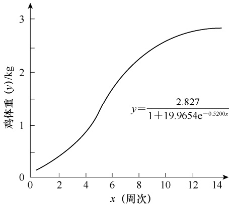

line

| x (周次) | 鸡体重 (y)/kg |
| --- | --- |
| 0 | ~0.15 |
| 2 | ~0.45 |
| 4 | ~0.95 |
| 6 | ~1.75 |
| 8 | ~2.35 |
| 10 | ~2.65 |
| 12 | ~2.80 |
| 14 | ~2.85 |

图 9-14 肉鸡增生的 Logistic 生长曲线

$$
\hat {y} = \frac {2 . 8 2 7}{1 + 1 9 . 9 6 5 4 \mathrm{e} ^ {- 0 . 5 2 0 0 x}}
$$

此方程的图形如图 9-14 所示，并可求 $\hat { y } { = } \frac { K } { 2 } { = }$ 1.4135， $x{=}\frac{{-}{\ln}\frac{1}{a}}{b}{=}5.76$ （ ） 周次 时，是曲线的拐点，生长速率从越来越快开始变为越来越慢，这是此种肉鸡生长的关键时期。

（5）计算 x 和 $y ^ { \prime }$ 的相关系数 $r _ { x y ^ { \prime } } ,$

$$
r _ {x y ^ {\prime}} = \frac {- 5 8 . 2 3 6 3}{\sqrt {1 1 2 \times 3 0 . 8 0 6 7}} = - 0. 9 9 1 4 ^ {* *}
$$

$\left| r_{xy'} \right| = 0.9914 > r_{0.01(5)} = 0.874$ ，达到极显著水平，说明 x 和 $y ^ { \prime }$ 的直线关系是极显著的，表 9-9 的数据配合 Logistic 生长曲线方程是适合的。

## 思考练习题

习题 **9.1** 生物学中常见的曲线类型有哪些？如何确定两个变量之间的曲线类型？

习题 **9.2** 非线性回归曲线进行直线化时，常用的转换方法有哪些？

习题 **9.3** 测定细砂土中毛管水的上升高度 $(y,\  cm )$ 和经历时数（x，h）的关系，其结果如下表所示。试做回归分析。

| 经历时数(x,h) | 12 | 24 | 48 | 96 | 144 | 192 | 240 |
| --- | --- | --- | --- | --- | --- | --- | --- |
| 上升高度(y,cm) | 21 | 34 | 42 | 48 | 53 | 57 | 60 |

习题 **9.4** 下表列出了甘薯薯块在生长过程中的鲜重 $( x , ~ \mathbf { g } )$ 和呼吸强度 $\left[ y,\  mg \  CO _2/(100  g \  FW \cdot  h ) \right]$的数据。为探讨二者的回归关系，试分别建立幂函数方程、对数函数方程及指数函数方程，并分别对

方程的拟合效果进行评价。

| 鲜重(x,g) | 10 | 38 | 80 | 125 | 200 | 310 | 445 | 480 |
| --- | --- | --- | --- | --- | --- | --- | --- | --- |
| 呼吸强度 [y, mg CO2/(100g FW·h)] | 92 | 32 | 21 | 12 | 10 | 7 | 7 | 6 |

习题 **9.5** 玉米淀粉生产中，浸渍时间 $( x , \mathrm { ~ h ~ } )$ 和乳酸菌数 $( y , \mathrm { m L } )$ 的数据记录如下，试建立浸渍时间和乳酸菌数的回归关系。

| 浸渍时间(x,h) | 4 | 12 | 20 | 28 | 36 | 44 |
| --- | --- | --- | --- | --- | --- | --- |
| 乳酸菌数(y,mL) | 226000 | 362000 | 659000 | 839000 | 1612000 | 3004000 |

习题 **9.6** 在动物的饲料配方研究中，发现动物体重 $( y , ~ \mathfrak { g } )$ 和日龄 $( x , \mathrm { ~ d ~ } )$ 存在某种曲线关系，试根据下列数据进行回归关系分析。

| 日龄(x, d) | 0 | 7 | 14 | 21 | 28 | 42 | 56 | 70 |
| --- | --- | --- | --- | --- | --- | --- | --- | --- |
| 体重(y, g) | 105 | 214 | 335 | 560 | 790 | 1290 | 2010 | 2950 |

参考答案

# 试验设计及其统计分析

## 本章提要

试验设计及其统计分析是生物统计学的重要内容之一，在生物学研究中发挥着重要的工具作用。本章主要讨论:

• 试验设计主要类型及其特点；
• 重点介绍对比设计、随机区组设计、拉丁方设计、裂区设计、交叉设计、正交设计、均匀设计等常用试验设计和统计分析方法。

第 2 章在阐述数据来源时，初步介绍了试验的概念与基本要求、试验设计的基本要素、试验误差及其控制途径、试验设计必须遵循的基本原则，以及如何制订试验方案。本章在简述试验设计主要类型、概念和特点的基础上，通过案例重点介绍常用试验设计及其统计分析方法。

## 第一节 试验设计的类型

在第 2 章，我们已经知道试验设计包含受试对象、试验因素和处理效应三个要素。开展试验设计，就是围绕这三个要素进行合理、有效的因素、水平设置及科学组合，并根据试验条件合理布局和安排的过程。一个科学、有效的试验设计一般要达到三个要求:一是试验误差小、试验精度高、试验数据的可靠性强；二是设计效率高，用较少的人力、物力、财力和时间获得较多而可靠的数据信息；三是便于开展统计分析，尽可能多地挖掘试验数据的有效信息，从而进行正确的推断。

根据试验的研究目的不同，研究者要选用合理的试验设计和数据统计分析方法。生物学研究中，试验设计的类型较多，也有不同的分类方法。根据试验处理因素数量，试验设计可分为单因素设计、二因素设计和多因素设计。根据试验中处理是否全部实施，可分为完全实施试验设计和部分实施试验设计。按照具体的试验设计方法，有对比设计、完全随机设计、随机区组设计、拉丁方设计、裂区设计、交叉设计、析因设计、正交设计、均匀设计等。

## 一、对比设计

对比设计（comparison design）是一种最简单的试验设计方法，常适用于单因素试验，是设置一个或几个试验组与多个对照组进行比较，试验组常按顺序排列。为降低试验误差，常常通过增加重复数来提高试验的精确度。

对比设计一般需要安排对照（control），用 CK 表示，作为各处理比较的标准。对照的类型包括空白对照、标准对照、自身对照和试验对照等。医学试验中常用安慰剂作为对照，用盲法（单盲法和双盲法）进行对比试验。

对比设计包括邻比设计、间比设计和配对设计等类型。邻比设计（neighbor comparison design）是每一个处理均直接排列于对照旁边，使每个处理都能与相邻的对照进行比较，能充分反映出处理的效应。

对比设计中，如果试验处理数过多，可采用对照小区相对较少的间比设计（interphase comparison design），即在每个重复的各处理排列中，位于第一小区和末尾小区一定是 CK 区，中间每隔相同数目的若干处理小区（通常是 4～9 个）设置一个 CK 区。与邻比设计相比，间比设计的每个处理不一定与 CK 相邻。

配对设计（paried design）是将受试对象按配对条件配成对子，使同一对中的受试对象条件相同或相近；再将各对中的两个受试对象随机分配到试验组和对照组（或两个不同处理组）接受不同的处理。例如，将年龄、体重、遗传基础较为一致的动物配成对子，再随机分配每对中的两个受试对象接受不同试验处理；半叶法测定植物叶片的光合速率；观察每一位受试对象药物试验前后某种生理指标的变化，都是配对设计。

## 二、完全随机设计

完全随机设计（completely random design）是将受试对象按随机化原则分配到不同的处理组中。在完全随机设计中，试验中每个处理的所有重复随机地分配到试验单元中，即每个处理占有每个试验单元的机会是相等的。

完全随机设计中，通常不考虑个体差异的影响。假定一项研究中，处理数为 8（i=1，2，…，8）、重复数为 3（j=1，2，3），则有 24 个（i，j）组合，需要 24 个受试对象。这 24个（i，j）组合随机排列，即完全随机设计。完全随机设计中，各处理的重复数可以相同也可以不同。但在总体样本含量相同的情况下，各处理组重复数相等时效率最高。

二因素及多因素试验也可以采用完全随机设计。以二因素为例，假设因素 A 有 a 个水平，B 有 b 个水平，则研究中有 ab 个处理，如果重复数为 n，则需要有 abn 个受试对象。这 abn个受试对象随机排列，即可得到 abn 个观测值。

完全随机设计保证每个受试对象都有相同机会接受任何一种处理，而不受试验人员主观倾向的影响。受试对象的初始条件比较一致时，可采用完全随机设计。这种设计应用了试验设计的重复和随机化两个原则，因此能使试验结果受非处理因素的影响基本一致，真实反映出试验的处理效应。但由于没有体现局部控制原则，完全随机设计要求其在尽可能一致的试验条件下进行试验。

完全随机设计的数据，常采用方差分析的方法，分析单因素的处理效应、二因素及多因素的主效和互作效应。第 7 章介绍的方差分析就是基于完全随机设计的。

完全随机设计具有突出的优点:一是设计容易，处理数与重复数都不受限制，适用于试验条件、环境、受试对象差异较小的试验；二是统计分析简单，无论所获得的试验数据各处理重复数相同与否，都可采用 t 检验或方差分析法进行统计分析。完全随机设计也有明显的缺点:由于未应用局部控制原则，非试验因素的影响被归入试验误差，因而试验误差较大，试验的精确性较低。因此，在试验条件、环境、受试对象差异较大时，不宜采用此种设计方法。

## 三、随机区组设计

完全随机设计要求在试验过程中，除试验处理不同之外，其余非试验因素（环境条件）应尽可能相同。由于客观条件的限制，试验的环境不可能完全相同时，如果采用完全随机设计，可能使得不同试验处理所占有的环境条件不同，试验处理之间的可比性大大降低，增大试验误差，试验结果的准确性下降。例如，田间试验中土壤变化会出现肥力不一致，较大空间试验的光照与温度条件会出现控制不一样等情况，这就需要通过随机区组设计来“清除”这种人为不易控制的非试验条件的不一致性。

随机区组设计（randomized block design）是根据非试验因素将试验环境划分成若干个区组，使得每个区组内的差异尽可能小；然后将每个区组划分成若干小区，将处理随机安排在小区内。在该设计的区组安排中，区组的划分应使区组内非试验因素差异最小而区组间非试验因素差异最大，将可控的非试验因素及条件相同或相近的受试对象安排在同一区组。

随机区组设计按试验因素多少可分为单因素随机区组设计、二因素随机区组设计和多因素随机区组设计等；按实施程度可分为随机完全区组设计和随机不完全区组设计。

随机完全区组设计（randomized complete block design）是指根据局部控制的原则将整个试验划分为若干区组，在同一区组内每个处理均出现，且各处理在区组内随机排列。例如，有 A、B 两个因素，水平数各为 a 和 b，其全部处理就是 ab 个水平组合数，将所有 ab 个处理全部安排在同一区组内的设计就是二因素完全随机区组设计。

随机不完全区组设计（randomized incomplete block design）是将整个试验划分为若干区组，每个区组只包括参加试验的部分处理，每个区组内处理的排列次序是随机的。随机不完全区组设计有多种方法，平衡不完全区组设计是其中的一种。平衡不完全区组设计（balanced incomplete block design，BIB）是指将 ν 个处理安排于 b 个区组的一种试验设计方法。该设计中包括以下参数:①k，区组的大小，指每个区组包含 k 个不同处理；②γ，处理的重复数，指每个处理在 γ 个不同的区组中出现；③λ，相遇数，指任何一对处理在 λ 个不同的区组中相遇。平衡不完全区组设计的参数满足下列条件: $\textcircled{i} b k = v \gamma ; \quad \textcircled{2} \gamma ( k - 1 ) = \lambda ( v - 1 )$ ③b≥v 或者 $\gamma { \geq } k _ { \circ }$ 。当 $k = v, \lambda = \gamma = b$ 时，即随机完全区组设计。

随机区组设计体现了试验设计重复、随机和局部控制三原则，可以将区组间的变异（区组效应）从试验误差中分离出来，从而有效降低试验误差，获得较高的试验精确性。同时，该设计把条件近乎一致的受试对象分在同一区组，再将同一区组的受试对象随机分配到不同处理组内，加大了处理之间的可比性。与拉丁方设计、裂区设计相比，虽然都考虑了处理因素与区组因素，但随机区组设计方法更简单易行。在实际应用随机区组设计时，处理数以≤20为宜。如果处理数目过多，区组的规模必然增大，区组内的误差也会相应增大，这样局部控制的效率就会降低。但在随机区组设计中，处理或处理组合也不能太少，如果太少，误差项自由度若太小，误差就会相应增大，也会降低假设检验的灵敏度。