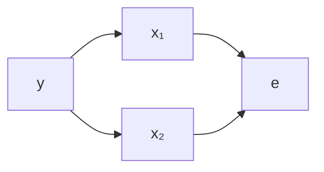
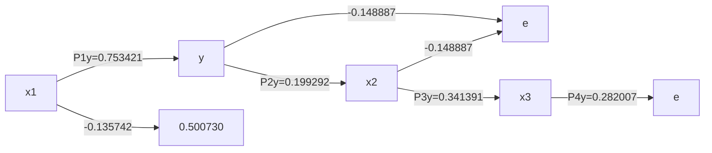
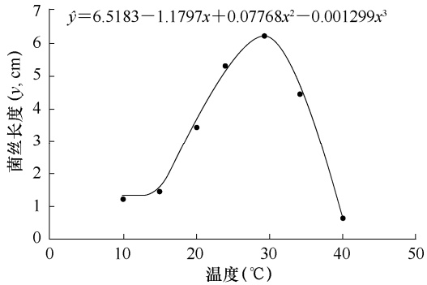

或

$$
y = a + b _ {1} x _ {1} + b _ {2} x _ {2} + \dots + b _ {m} x _ {m} + e \tag {13-16}
$$

式中， $e$ 为 $y$ 与 之间的误差，也称为剩余因子（residual factor），可用图 13-1 表示变量间的关系。

从图 13-1 可以看出，图中存在两种路径，一种是表示 $x _ { i }$ 到 $y$ 之间的单向路径（单箭头线），即从因到果的路径，我们称之为通径（path），也称为直接通径；另一种是表示自变量间平行关系的双向路径（双向箭头），即互为因果的路径，称为相关线（correlation line），也称为间接通径。这种用来表示相关变量间因果关系与平行关系的箭形图称为通径图（path chart）。

flowchart

图 13-1 自变量 $x _ { i }$ 与依变量 $y$ 的通径图

## （二）通径系数

通径图能够直观、形象地表达相关变量间的关系，但研究中仍需进一步用数值表示因果关系中原因对结果影响的相对重要程度与性质、平行关系中变量间相关的相对重要程度与性质。为从数量关系上表示通径的相对重要程度与性质，我们将 $x _ { i }$ 对 $y$ 直接作用的统计量称为通径系数（path coefficient），用 $P _ { i y }$ 表示。

## 二、通径系数的求解方法

表示 $x _ { i }$ 对 $y$ 直接作用的通径系数 $P _ { i y }$ 既可以通过对偏回归系数 $b _ { i }$ 标准化得到，也可以利用相关系数 $r _ { i j } , r _ { i y }$ 进行计算，而 $x _ { i }$ 对 $y$ 间接作用（即间接通径系数）则可由 $r _ { i j } P _ { i y }$ 算出，从而进行原因对结果的直接作用、间接作用的分析。

## （一）偏回归系数标准化计算通径系数

偏回归系数 $b _ { i }$ 就是在通径上的平均反应量，但 $b _ { i }$ 本身并不能表示自变量的相对重要程度。这是因为: $\textcircled{i} b _ { i }$ 带有单位，单位不同，就无法比较； $\textcircled{2} b _ { i }$ 单位相同，如果 $x _ { i }$ 的变异度（标准差）不同，也是不能比较的。因此，可将 $y _ { 1 }$ 、 $x _ { i }$ 和剩余项 $e$ 进行标准化变换，使 $y  、 x _ { i }$和 $e$ 转变为不带单位的相对数。所谓标准化，就是各变量值减去平均值后，再除以各自的标准差。

由式（13-15）可得

$$
\overline {{y}} = a + b _ {1} \overline {{x}} _ {1} + b _ {2} \overline {{x}} _ {2} + \dots + b _ {m} \overline {{x}} _ {m} \tag {13-17}
$$

式（13-16）和式（13-17）相减，可得

$$
y - \overline {{y}} = b _ {1} (x _ {1} - \overline {{x}} _ {1}) + b _ {2} (x _ {2} - \overline {{x}} _ {2}) + \dots + b _ {m} (x _ {m} - \overline {{x}} _ {m}) + e \tag {13-18}
$$

将式（13-18）等号两端各除以 $S _ { y }$ ，并进行恒等变形，有

$$
\frac {y - \overline {{y}}}{s _ {y}} = b _ {1} \frac {s _ {1}}{s _ {y}} \cdot \frac {x _ {1} - \overline {{x}} _ {1}}{s _ {1}} + b _ {2} \frac {s _ {2}}{s _ {y}} \cdot \frac {x _ {2} - \overline {{x}} _ {2}}{s _ {2}} + \dots + b _ {m} \frac {s _ {m}}{s _ {y}} \cdot \frac {x _ {m} - \overline {{x}} _ {m}}{s _ {m}} + \frac {s _ {e}}{s _ {y}} \cdot \frac {e}{s _ {e}} \tag {13-19}
$$

式中， $s_{1} 、 s_{2} 、 \cdots 、 s_{m}$ 和 $s _ { e }$ 分别为 $x_{1} 、 x_{2} 、 \cdots 、 x_{m}$ 和 $e$ 的标准差。 $b_{1}\frac{s_{1}}{s_{y}}  、 b_{2}\frac{s_{2}}{s_{y}}  、 \cdots  、 b_{m}\frac{s_{m}}{s_{y}}$ 即自变量 $x_{1} 、 x_{2} 、 \cdots 、 x_{m} \to y$ 的通径系数，分别用 $P_{1y}、P_{2y}、\cdots、P_{my}$ 表示，代表自变量 $x _ { 1 }  、 x _ { 2 }  、 \cdots$ $x _ { m }$ 对 $y$ 影响的相对重要程度和性质，即

$$
P _ {i y} = b _ {i} \frac {s _ {i}}{s _ {y}} = b _ {i} \sqrt {\frac {S S _ {i}}{S S _ {y}}} \tag {13-20}
$$

$P _ { i y }$ 的意义是:在 $x _ { i } { \rightarrow } y$ 通径上， $x _ { i }$ 若增加一个标准差单位， $y$ 将增加 $( P _ { i } \geq 0 )$ 或减少 $( P _ { i } { < } 0 )$ $P _ { i }$ 个标准差单位。因此，通径系数可以看成自变量 $x _ { i }$ 对依变量 $y$ 的标准效应，由| $P _ { i y } \left[ \right.$ 值的大小可确定 $x _ { i }$ 对 $y$ 的相对重要性。

对于 $\frac { s _ { e } } { s _ { y } }$ ，则为剩余项 e 的通径系数，用 $P _ { e y }$ 表示，即

$$
P _ {e y} = \sqrt {\frac {S S _ {e}}{S S _ {y}}} \tag {13-21}
$$

将式（13-20）变换可得

通径系数的性质

$$
b _ {i} = P _ {i y} \sqrt {\frac {S S _ {y}}{S S _ {i}}} \tag {13-22}
$$

式（13-22）实际上就是式（13-13），仅是将 $b _ { i } ^ { ( k ) }$ 改写成了 $P _ { i y }$ ，因此 $P _ { i y }$ 就是标准化了的偏回归系数。

## （二）相关系数计算通径系数

将式（13-22）代入式（12-6），再对第 i 个方程等号两边各除以 $\sqrt { \SS _ { i } \cdot \SS _ { y } }$ ，则式（12-6）可变形为如下正规方程组:

$$
\left\{ \begin{array}{c} P _ {1 y} + r _ {1 2} P _ {2 y} + \dots + r _ {1 m} P _ {m y} = r _ {1 y} \\ r _ {1 2} P _ {1 y} + P _ {2 y} + \dots + r _ {2 m} P _ {m y} = r _ {2 y} \\ \vdots \quad \vdots \quad \quad \quad \quad \quad \quad \quad \quad \quad \quad \quad \quad \quad \quad \quad \quad \quad \quad \quad \quad \quad \quad \quad \quad \quad (1 3 - 2 3) \\ r _ {1 m} P _ {1 y} + r _ {2 m} P _ {2 y} + \dots + P _ {m y} = r _ {m y} \end{array} \right.
$$

式（13-23）说明每个自变量 $x _ { i }$ 与依变量 y 的相关系数均可剖分为自变量 $x _ { i }$ 对依变量 y的直接作用与间接作用的代数和，即 $x _ { i }$ 与 y 的相关系数 $r _ { i y }$ 等于 $x _ { i }$ 到 $y$ 的直接通径系数 $P _ { i y }$ 和通过与其相关的各个 $x_{j} (j = 1, 2, \cdots, m; j \neq i)$ 对 $y$ 的所有间接通径系数 $\sum _ { j \neq i } ^ { m } r _ { i j } P _ { j y }$ 之和。

式（13-23）可写成如下矩阵形式

$$
\left( \begin{array}{c c c c} r _ {1 1} & r _ {1 2} & \dots & r _ {1 m} \\ r _ {2 1} & r _ {2 2} & \dots & r _ {2 m} \\ \vdots & \vdots & & \vdots \\ r _ {m 1} & r _ {m 2} & \dots & r _ {m m} \end{array} \right) \times \left( \begin{array}{c} P _ {1 y} \\ P _ {2 y} \\ \vdots \\ P _ {m y} \end{array} \right) = \left( \begin{array}{c} r _ {1 y} \\ r _ {2 y} \\ \vdots \\ r _ {m y} \end{array} \right) \tag {13-24}
$$

如果将相关系数 $r _ { i j }$ 、 $r _ { i y }$ 计算出来，便可按式（13-23）［或式（13-24）］计算出所对应的通径系数 $P _ { i y }$

例 **13-4** 试计算例 13-1 数据的通径系数。

在例 13-3 中，该数据的相关系数已经算出，将其直接代入式（13-23）得标准正规方程

组（由于 $x _ { 4 }$ 已剔除，不再参加通径分析）。

$$
\left\{ \begin{array}{c} P _ {1 y} - 0. 1 3 5 7 4 2 P _ {2 y} + 0. 5 0 0 7 3 0 P _ {3 y} = 0. 8 9 7 3 1 4 \\ - 0. 1 3 5 7 4 2 P _ {1 y} + \quad P _ {2 y} - \quad 1 4 8 8 8 7 P _ {3 y} = 0. 0 4 6 1 9 2 \\ 0. 5 0 0 7 3 0 P _ {1 y} - 0. 1 4 8 8 8 7 P _ {2 y} + \quad P _ {3 y} = 0. 6 8 8 9 8 0 \end{array} \right.
$$

对上述正规方程组用简化表解法求解（表 13-8）:将系数矩阵列入表 13-8 的算阵 A，并将乘积和列向量 K 伴随其后。算阵 B 各元素的计算方法同多元回归一样，其计算结果也列于表 13-8 中。

表 13-8 例 13-1 数据 $\langle \mathbf { x } _ { 4 }$ 已剔除）通径系数的求解

<table><tr><td rowspan="2">说明</td><td rowspan="2">i</td><td colspan="3">j</td><td rowspan="2">K</td></tr><tr><td>1</td><td>2</td><td>3</td></tr><tr><td rowspan="3">算阵A</td><td>1</td><td>1</td><td>-0.135742</td><td>0.500730</td><td>0.897314</td></tr><tr><td>2</td><td>-0.135742</td><td>1</td><td>-0.148887</td><td>0.046192</td></tr><tr><td>3</td><td>0.500730</td><td>-0.148887</td><td>1</td><td>0.688980</td></tr><tr><td rowspan="3">算阵B</td><td>1</td><td>1</td><td>-0.135742</td><td>0.500730</td><td>0.897314</td></tr><tr><td>2</td><td>-0.13572</td><td>0.981574</td><td>-0.082436</td><td>0.171149</td></tr><tr><td>3</td><td>0.500730</td><td>-0.080917</td><td>0.742599</td><td>0.341391</td></tr><tr><td colspan="2"> $P_{iy}$ </td><td>0.753421</td><td>0.199292</td><td>0.341391</td><td></td></tr></table>

表 13-8 中 $P _ { 1 y }$ 、 $P _ { 2 y }$ 、 $P _ { 3 y }$ 的计算方法与多元回归中逆矩阵各元素的算法相同，即由算阵 B可建立如下方程组:

$$
\left\{ \begin{array}{c} P _ {1 y} - 0. 1 3 5 7 5 2 P _ {2 y} + 0. 5 0 0 7 3 0 P _ {3 y} = 0. 8 9 7 3 1 4 \\ P _ {2 y} - 0. 0 8 2 4 3 6 P _ {3 y} = 0. 1 7 1 1 4 9 \\ P _ {3 y} = 0. 3 4 1 3 9 1 \end{array} \right.
$$

解方程组，得 $P_{1y}=0.753421$ $P_{2y}=0.199292$ $P_{3y}=0.341391$ 。实际上，这些数值就是例 13-3中得到的标准偏回归系数。

根据以上求得的通径系数，可分别得到 6 个间接通径系数:

$$
r _ {1 2} P _ {2 y} = - 0. 1 3 5 7 4 2 \times 0. 1 9 9 2 9 2 = - 0. 0 2 7 0 5 2
$$

$$
r _ {1 3} P _ {3 y} = 0. 5 0 0 7 3 0 \times 0. 3 4 1 3 9 1 = 0. 1 7 0 9 4 5
$$

$$
r _ {2 1} P _ {1 y} = - 0. 1 3 5 7 4 2 \times 0. 7 5 3 4 2 1 = - 0. 1 0 2 2 7 1
$$

$$
r _ {2 3} P _ {3 y} = - 0. 1 4 8 8 8 7 \times 0. 3 4 1 3 9 1 = - 0. 0 5 0 8 2 9
$$

$$
r _ {3 1} P _ {1 y} = 0. 5 0 0 7 3 0 \times 0. 7 5 3 4 2 1 = 0. 3 7 7 2 6 0
$$

$$
r _ {3 2} P _ {2 y} = - 0. 1 4 8 8 8 7 \times 0. 1 9 9 2 9 2 = - 0. 0 2 9 6 7 2
$$

以上计算结果可用图 13-2 进行说明。

通过计算结果和图 13-2 可以看出，3 个自变量对单株产量 y 的直接影响中，每株穗数 $x _ { 1 }$ 的直接作用最大，其 $P_{1y}=0.753421$ ；其次是百粒重 $x _ { 3 }$ ，其$P_{3y}=0.341391$ ；每穗结实小穗数 $x _ { 2 }$ 的直接作用最小，其 $P_{2y}=0.199292$ 。对各个间接通径系数的分析发现，

flowchart

图 13-2 之间的通径关系

每株穗数 通过百粒重 对产量 所产生的间接作用较大，其 。尽管每株穗数 $x _ { 1 }$ 通过 $x _ { 2 }$ 对单株产量 y 所产生一定负值的间接作用 $(r_{12}P_{2y} = -0.027052)$ ），但由于 $P _ { 1 y }$ 和 $r _ { 1 3 } P _ { 3 y }$ 的值较大，因而就使每株穗数 $x _ { 1 }$ 对 $y$ 的贡献较大，二者的相关系数达到了0.897314；百粒重 $x _ { 3 }$ 对 $y$ 的间接作用分别为 $r_{13}P_{1y}=0.377260$ $r_{32}P_{2y} = -0.029672$ ，连同$x _ { 3 }$ 对 y 的直接作用，使得 $x _ { 3 }$ 与 $y$ 也产生了比较密切的正相关关系，二者之间的相关系数达到了 0.688980。因此，每株穗数 $x _ { 1 }$ 和百粒重 $x _ { 3 }$ 对增加单株产量具有重要的作用。至于每穗结实小穗数 $x _ { 2 }$ ，其直接通径系数和间接通径系数均较小，对单株产量的改变无大的影响，可不必过多考虑。

## 三、通径分析的假设检验

由上述可知，通径分析就是标准化变量的多元线性回归分析，直接通径系数是变量标准化后的偏回归系数。因而，其假设检验的方法与偏回归系数一样，包括回归方程的检验和通径系数的检验，这两种方法是完全等价的。

## （一）回归方程的检验

将式（13-15）中的依变量 y 和自变量 $x _ { i }$ 分别进行标准化变换，令

$$
y ^ {\prime} = \frac {y - \overline {{y}}}{\sqrt {S S _ {y}}}, x _ {i} ^ {\prime} = \frac {x _ {i} - \overline {{x}} _ {i}}{\sqrt {S S _ {i}}} (i = 1, 2, \dots , m)
$$

则标准化变量的 m 元线性回归方程为

$$
\hat {y} ^ {\prime} = b _ {1} ^ {\prime} x _ {1} ^ {\prime} + b _ {2} ^ {\prime} x _ {2} ^ {\prime} + \dots + b _ {m} ^ {\prime} x _ {m} ^ {\prime} \tag {13-25}
$$

式中， $b_{i}^{\prime}=b_{i}\frac{\sqrt{SS_{i}}}{\sqrt{SS_{y}}}=b_{i}\frac{s_{i}}{s_{y}}\quad(i=1,\ 2,\ \cdots,\ m)$ 为标准化变量的偏回归系数，即通径系数。

令 $P _ { i y } { = } b _ { i } ^ { \prime }$ ，式（13-25）可改为

$$
\hat {y} ^ {\prime} = P _ {1 y} x _ {1} ^ {\prime} + P _ {2 y} x _ {2} ^ {\prime} + \dots + P _ {m y} x _ {m} ^ {\prime} \tag {13-26}
$$

对每个直接通径系数 $P _ { i y }$ 进行平方，可得出每个自变量 $x _ { i }$ 的直接决定系数（coefficient of determination） $R _ { i } ^ { 2 }$ ，即

$$
R _ {i} ^ {2} = P _ {i y} ^ {2} \tag {13-27}
$$

自变量 $x _ { i }$ 通过 $x _ { j }$ 对依变量 y 的间接决定系数 $R _ { i j } ^ { 2 }$ 为

$$
R _ {i j} ^ {2} = 2 P _ {i y} r _ {i j} P _ {j y} \tag {13-28}
$$

而总的决定系数 $R ^ { 2 }$ 等于各直接与间接决定系数之和，即

$$
\begin{array}{l} R ^ {2} = P _ {1 y} r _ {1 y} + P _ {2 y} r _ {2 y} + \dots + P _ {m y} r _ {m y} \\ = \sum_ {i = 1} ^ {m} P _ {i y} ^ {2} + 2 \sum_ {i <   j} ^ {m} P _ {i y} r _ {i j} P _ {j y} = \sum_ {i = 1} ^ {m} R _ {i} ^ {2} + \sum_ {i <   j} ^ {m} R _ {i j} ^ {2} \tag {13-29} \\ \end{array}
$$

某一自变量

xi 对 y 的贡

献大小

决定系数 $R ^ { 2 }$ 可用来表示自变量对依变量的相对重要程度，对通径分析结果进行评价。如果 $R ^ { 2 } { = } 1$ ，表明通径分析已包括主要相关性状，分析结果能够表达各性状间的关系；如果 $R ^ { 2 }$ 与 1 相差较大，表明通径分析缺失了主要相关性状。

对标准化变量的多元线性回归，其 $r _ { y y } { = } 1$ ，回归平方和为决定系数 $R ^ { 2 }$ ，则回归平方和 U′为

$$
U ^ {\prime} = P _ {1 y} r _ {i 1 y} + P _ {2 y} r _ {2 y} + \dots + P _ {m y} r _ {m y} = R ^ {2} \tag {13-30}
$$

对剩余因子 $e ,$ ，假定它与各个 $x _ { i }$ 独立，其通径系数 $P _ { e y }$ 为

$$
P _ {e y} = \sqrt {1 - R ^ {2}} \tag {13-31}
$$

将剩余因子的通径系数 $P _ { e y }$ 平方即剩余平方和 $Q ^ { \prime } ,$ ，也就是剩余因子 $P _ { e y }$ 的决定系数 $R _ { e } ^ { 2 } ,$ 。因此，有

$$
Q ^ {\prime} = R _ {e} ^ {2} = P _ {e y} ^ {2} = 1 - R ^ {2} \tag {13-32}
$$

则对标准化变量多元线性回归方程检验的 F 值为

$$
F = \frac {\frac {R ^ {2}}{m}}{\frac {1 - R ^ {2}}{n - m - 1}} \tag {13-33}
$$

式（13-33）中，F 服从 $F _ { ( m , n - m - 1 ) }$ 分布。

## （二）通径系数的检验

各 $x _ { i }$ 对 y 的通径系数 $P _ { i y }$ 的检验可用 F 检验和 t 检验两种方法。

1.F 检验 F 检验中， $F _ { i }$ 值为

$$
F _ {i} = \frac {\frac {P _ {i y} ^ {2}}{c _ {i i}}}{\frac {1 - R ^ {2}}{n - m - 1}} \tag {13-34}
$$

式中， $c _ { i i }$ 为相关矩阵 R 的逆矩阵 $R ^ { - 1 }$ 的主对角线的元素。 $F _ { i }$ 服从 $F_{(m,\ n-m-1)}$ 分布。

2.t 检验 对通径系数进行 t 检验时，先求出通径系数的标准误 $s _ { P _ { i v } }$ :

$$
s _ {P _ {i y}} = \sqrt {\frac {1 - R ^ {2}}{n - m - 1}} \cdot \sqrt {c _ {i i}} \tag {13-35}
$$

其 t 值为

$$
t _ {i} = \frac {P _ {i y}}{s _ {P _ {i y}}} \tag {13-36}
$$

$t _ { i }$ 服从 $t _ { ( n - m - 1 ) }$ 分布。

注意，这里介绍的 F 检验和 t 检验是等价的，在实际进行通径系数假设检验时，只选用其中一种方法即可。

例 **13-5** 试对例 13-4 所计算的通径系数进行显著性检验。

例 13-4 已将各个自变量 $x _ { i }$ 的通径系数算出，分别为 $P_{1y}=0.753424$ $P_{2y}=0.199292$ $P_{3y}=0.341391$

（1）F 检验。根据式（13-26），可建立标准变量的多元线性回归方程为

$$
\hat {y} ^ {\prime} = 0. 7 5 3 4 2 1 x _ {1} ^ {\prime} + 0. 1 9 9 2 9 2 x _ {2} ^ {\prime} + 0. 3 4 1 3 9 1 x _ {3} ^ {\prime}
$$

由式（13-30），有

$$
\begin{array}{l} U ^ {\prime} = R ^ {2} = P _ {1 y} r _ {1 y} + P _ {2 y} r _ {2 y} + P _ {3 y} r _ {3 y} \\ = 0. 7 5 3 4 2 1 \times 0. 8 9 7 3 1 4 + 0. 1 9 9 2 9 2 \times 0. 0 4 6 1 9 2 + 0. 3 4 1 3 9 1 \times 0. 6 8 8 9 8 0 \\ = 0. 9 2 0 4 7 2 \\ \end{array}
$$

剩余平方和为

$$
Q ^ {\prime} = 1 - R ^ {2} = 1 - 0. 9 2 0 4 7 2 = 0. 0 7 9 5 2 8
$$

剩余项的通径系数为

$$
P _ {e y} = \sqrt {1 - R ^ {2}} = \sqrt {1 - 0 . 9 2 0 4 7 2} = 0. 2 8 2 0 0 7
$$

因此，对上述标准化变量多元线性回归方程检验的 $F$ 值为

$$
F = \frac {\frac {R ^ {2}}{m}}{\frac {1 - R ^ {2}}{n - m - 1}} = \frac {\frac {0 . 9 2 0 4 7 2}{3}}{\frac {1 - 0 . 9 2 0 4 7 2}{1 5 - 3 - 1}} = 4 2. 4 3 8 8 ^ {* *}
$$

查附表 5， $F_{0.05(3,11)} = 3.59$ $F_{0.01   (3,11)} = 6.22$ $F { \geq } F _ { 0 . 0 1 }$ ，说明每株穗数 $x _ { 1 }$ 、每穗结实小穗数 $x _ { 2 } .$ 、百粒重 $x _ { 3 }$ 标准化后的多元线性回归方程达到极显著水平。

对于通径系数的检验可根据式（13-34）［或式（13-36）］进行检验。利用例 13-3 的相关矩阵 $\pmb { R } ^ { ( 0 ) }$ 的前三列、前三行中与 $x_{1} 、 x_{2} 、 x_{3}$ 有关的相关系数 $r _ { i j }$ ，建立相关矩阵 $\pmb { R } _ { ( 3 \times 3 ) }$ ，求其逆矩阵 $\pmb { R } _ { ( 3 \times 3 ) } ^ { - 1 }$ ，得 $c _ { 1 1 }   =   1 . 3 4 1 4 8 9$ $c_{22} = 1.027923$ $c_{33} = 1.346622$ 。于是，有

$$
\begin{array}{l} F _ {1} = \frac {\frac {P _ {1 y} ^ {2}}{c _ {1 1}}}{\frac {1 - R ^ {2}}{n - m - 1}} = \frac {\frac {0 . 7 5 3 4 2 1 ^ {2}}{1 . 3 4 1 4 8 9}}{\frac {1 - 0 . 9 2 0 4 7 2 ^ {2}}{1 5 - 3 - 1}} = 5 8. 5 2 7 8 ^ {* *} \\ F _ {2} = \frac {\frac {P _ {2 y} ^ {2}}{c _ {2 2}}}{\frac {1 - R ^ {2}}{n - m - 1}} = \frac {\frac {0 . 1 9 9 2 9 2 ^ {2}}{1 . 0 2 7 9 2 3}}{\frac {1 - 0 . 9 2 0 4 7 2 ^ {2}}{1 5 - 3 - 1}} = 5. 3 4 4 3 ^ {*} \\ F _ {3} = \frac {\frac {P _ {3 y} ^ {2}}{c _ {3 3}}}{\frac {1 - R ^ {2}}{n - m - 1}} = \frac {\frac {0 . 3 4 1 3 9 1 ^ {2}}{1 . 3 4 6 6 2 2}}{\frac {1 - 0 . 9 2 0 4 7 2 ^ {2}}{1 5 - 3 - 1}} = 1 1. 9 7 1 0 ^ {* *} \\ \end{array}
$$

查附表 5， $F_{0.05(1,11)}=4.84,\quad F_{0.01(1,11)}=9.65,\quad F_{1}、F_{3}$ 均大于 $F _ { 0 . 0 1 }$ ， $F _ { 2 }$ 大于 $F _ { 0 . 0 5 }$ ，说明通径系数 $P _ { 1 y } , P _ { 3 y }$ 达到极显著水平， $P _ { 2 y }$ 仅达显著水平。

（2）t 检验。先计算通径系数标准误:

$$
s _ {P _ {1 y}} = \sqrt {\frac {1 - R ^ {2}}{n - m - 1}} \cdot \sqrt {c _ {1 1}} = \sqrt {\frac {1 - 0 . 9 2 0 4 7 2}{1 5 - 3 - 1}} \cdot \sqrt {1 . 3 4 1 4 8 9} = 0. 0 9 8 4 8 2
$$

$$
s _ {P _ {2 y}} = \sqrt {\frac {1 - R ^ {2}}{n - m - 1}} \cdot \sqrt {c _ {2 2}} = \sqrt {\frac {1 - 0 . 9 2 0 4 7 2}{1 5 - 3 - 1}} \cdot \sqrt {1 . 0 2 7 9 2 3} = 0. 0 8 6 2 0 7
$$

$$
s _ {P _ {3 y}} = \sqrt {\frac {1 - R ^ {2}}{n - m - 1}} \cdot \sqrt {c _ {3 3}} = \sqrt {\frac {1 - 0 . 9 2 0 4 7 2}{1 5 - 3 - 1}} \cdot \sqrt {1 . 3 4 6 6 2 2} = 0. 0 9 8 6 7 0
$$

再计算 t 值:

$$
t _ {1} = \frac {P _ {1 y}}{s _ {P _ {1 y}}} = \frac {0 . 7 5 3 4 2 1}{0 . 0 9 8 4 8 2} = 7. 6 5 0 3 ^ {* *}
$$

$$
t _ {2} = \frac {P _ {2 y}}{s _ {P _ {2 y}}} = \frac {0 . 1 9 9 2 9 2}{0 . 0 8 6 2 0 7} = 2. 3 1 1 8 ^ {*}
$$

$$
t _ {3} = \frac {P _ {3 y}}{s _ {P _ {3 y}}} = \frac {0 . 3 4 1 3 9 1}{0 . 0 9 8 6 7 0} = 3. 4 5 9 9 ^ {* *}
$$

查附表 3， $t_{0.05   (11)} = 2.201$ $t_{0.01   (1,11)} = 3.106, \quad t_1.$ 、 $t _ { 3 }$ 均大于 $t _ { 0 . 0 1 }$ ， $t _ { 2 }$ 大于 $t _ { 0 . 0 5 }$ ，即通径系数$P _ { 1 y }  、  P _ { 3 y }$ 达到极显著水平， $P _ { 2 y }$ 仅达显著水平。从以上数据可看出， $F$ 检验和 t 检验的结果是一样的。

和多元回归分析情况一样，在通径分析中，如果有一个或一个以上的 $P _ { i y }$ 不显著，也必须逐个删除（每次删除 t 值或 F 最小又不显著的那一个），直至余下的 $P _ { i y }$ 均显著为止。删除一个自变量后，所有的通径系数 $P _ { i y }$ 均会改变数值，但是与偏回归和偏相关的一致性仍会保持。删除与依变量 y 直接通径系数不显著的自变量后，仍需要重新计算余下的自变量 $x _ { i }$ 与依变量 y 的通径系数并进行假设检验。

## 思考练习题

习题 **13.1** 什么叫逐步回归？什么是最优多元回归方程？在多元线性回归分析中，应用逐步回归方法建立多元线性回归最优方程有哪两种方法？如何剔除不显著的自变量？

习题 **13.2** 什么是通径系数？怎样计算通径系数？通径分析的基本含义是什么？

习题 **13.3** 下表为某县 1960～1971 年的 1 月雨量 $(x_{1},\ \mathrm{mm})$ 、3 月上旬平均温度 $( x _ { 2 } , \mathrm { ~  ~ C ~ } )$ 、3 月中旬平均温度 $(x_{3}, \mathrm{^{c}C})$ 、2 月雨量 $(x_{4},\ \mathrm{mm})$ 和第一代三化螟高峰期 $( y ,$ ，以 4 月 30 日为 0）的测定结果。试应用逐步回归方法求预报第一代三化螟高峰期的最优线性回归方程及该方程的离回归标准误。

| $x_1$ | $x_2$ | $x_3$ | $x_4$ | y |
| --- | --- | --- | --- | --- |
| 47.5 | 11.1 | 9.0 | 30.6 | 17 |
| 42.9 | 8.1 | 9.5 | 32.3 | 21 |
| 20.2 | 6.7 | 11.1 | 37.4 | 26 |
| 0.2 | 8.5 | 8.9 | 21.5 | 23 |
| 67.0 | 6.8 | 9.4 | 61.6 | 20 |
| 5.5 | 5.0 | 9.5 | 83.5 | 30 |
| 44.4 | 10.0 | 11.1 | 24.1 | 22 |
| 8.9 | 6.1 | 9.5 | 24.9 | 26 |
| 39.0 | 7.1 | 10.8 | 10.2 | 27 |
| 74.2 | 4.4 | 6.8 | 54.9 | 23 |
| 15.9 | 4.6 | 3.8 | 74.2 | 23 |
| 26.4 | 4.1 | 5.8 | 50.7 | 27 |

习题 **13.4** 根据习题 13.3 数据，试进行第一代三化螟高峰期 $( y )$ 与 1 月雨量 $( x _ { 1 } )$ 、3 月上旬平均温度 $( x _ { 2 } )$ 、3 月中旬平均温度 $( x _ { 3 } )$ 、2 月雨量 $( x _ { 4 } )$ 的通径分析，并对通径系数进行显著性检验。

## 多项式回归分析

## 本章提要

多项式回归是研究一个依变量 y 与一个或多个自变量 $x _ { i }$ 间多项式的回归分析方法。本章主要讨论:

• 多项式回归的数学模型；
• 根据最小二乘法建立多项式回归方程；
• 对多项式回归方程进行假设检验，计算相关指数；
• 正交多项式回归分析原理与方法。

在生物学研究中，大多数双变量数据并非表现为简单的线性关系，而常常表现为各种各样的非线性关系。有关可直线化的非线性回归问题在第 9 章中进行了讨论，本章讨论非线性关系的另一种形式——多项式回归。

## 第一节 多项式回归的数学模型

如果 y 对 x 的关系为非线性，但又找不到适当的变量转换形式使其转化为线性，则可选用多项式回归方程进行描述。像这种研究一个依变量与一个或多个自变量间多项式的回归分析方法，称为多项式回归（polynomial regression），所建立的方程称为多项式回归方程（polynomial regression equation）。

k 次多项式回归模型可以定义为

$$
\begin{array}{l} y _ {i} = \mu_ {y} + \beta_ {1} \left(x _ {i} - \mu_ {x}\right) + \beta_ {2} \left(x _ {i} ^ {2} - \mu_ {x ^ {2}}\right) + \dots + \beta_ {k} \left(x _ {i} ^ {k} - \mu_ {x ^ {k}}\right) + \varepsilon_ {i} \tag {14-1} \\ = \alpha + \beta_ {1} x _ {i} + \beta_ {2} x _ {i} ^ {2} + \dots + \beta_ {k} x _ {i} ^ {k} + \varepsilon_ {i} \\ \end{array}
$$

式中， $\mu_{y}, \mu_{x}, \mu_{x^{2}}, \cdots, \mu_{x^{k}}$ 依次为 $y, x, x^{2}, \cdots, x^{k}$ 的总体平均数； $\alpha$ 为回归截距，$\alpha = \mu _ { y } - \beta _ { 1 } \mu _ { x } - \beta _ { 2 } \mu _ { x ^ { 2 } } - \cdots - \beta _ { k } \mu _ { x ^ { k } } ; \beta _ { 1 } , \beta _ { 2 } , \cdots , \beta _ { k }$ 依次为 x 的一次项、二次项、…、k 次项的总体回归系数； $\mu _ { y / x ,   x ^ { 2 } ,   \cdots ,   x ^ { k } }$ 为任一 x 上 k 次多项式回归的 y 总体平均数，即

$$
\mu_ {y / x, x ^ {2}, \dots , x ^ {k}} = \alpha + \beta_ {1} x + \beta_ {2} x ^ {2} + \dots + \beta_ {k} x ^ {k} \tag {14-2}
$$

$\varepsilon _ { i }$ 为随机误差，服从 $N(0,\sigma_{y/x,x^{2},\cdots,x^{k}}^{2})$

当由样本估计时，式（14-1）变为

$$
\begin{array}{l} y _ {i} = \overline {{y}} + b _ {1} (x _ {i} - \overline {{x}}) + b _ {2} (x _ {i} ^ {2} - \overline {{x}} ^ {2}) + \dots + b _ {k} (x _ {i} ^ {k} - \overline {{x}} ^ {k}) + e _ {i} \\ = a + b _ {1} x _ {i} + b _ {2} x _ {i} ^ {2} + \dots + b _ {k} x _ {i} ^ {k} + e _ {i} \\ = a + \sum_ {j = 1} ^ {k} b _ {j} x _ {i} ^ {j} + e _ {i} \tag {14-3} \\ = \hat {y} + e _ {i} \\ \end{array}
$$

式中， $\bar{y} = \sum y / n, \quad \bar{x} = \sum x / n, \quad \bar{x}^2 = \sum x^2 / n, \quad \cdots, \quad \bar{x}^k = \sum x^k / n$ ，依次估计 $\mu _ { y } , \mu _ { x } , \mu _ { x ^ { 2 } } , \cdots$ $\mu_{x^{k}} ; a, b_{1}, b_{2}, \cdots, b_{k}$ 依次估计 $\alpha , \beta _ { 1 } , \beta _ { 2 } , \cdots , \beta _ { k } ;$ 则估计 $\mu _ { _ { y / x , x ^ { 2 } , \cdots , x ^ { k } } }$ ，即

$$
\hat {y} = a + b _ {1} x + b _ {2} x ^ {2} + \dots + b _ {k} x ^ {k} = a + \sum_ {j = 1} ^ {k} b _ {j} x ^ {j} \tag {14-4}
$$

$e _ { i }$ 则为 $\varepsilon _ { i }$ 的估计值。对 $\sigma _ { _ { y / x , x ^ { 2 } , \cdots , x ^ { k } } }$ ，其样本估计值为

$$
s _ {y / x, x ^ {2}, \dots , x ^ {k}} = \sqrt {\frac {\sum (y - \hat {y} _ {k}) ^ {2}}{n - k - 1}} = \sqrt {\frac {Q _ {k}}{n - k - 1}} \tag {14-5}
$$

式（14-5）称为 k 次多项式的离回归标准误，其中 $Q _ { k }$ 为 k 次多项式的离回归平方和

$$
Q _ {k} = \sum_ {1} ^ {n} (y - \hat {y} _ {k}) ^ {2} = \sum (y - a - b _ {1} x - b _ {2} x ^ {2} - \dots - b _ {k} x ^ {k}) ^ {2} \tag {14-6}
$$

对于多项式回归方程，若 $k   =   1$ 时， $\scriptstyle { \hat { y } } = a + b _ { 1 } x$ ，此即直线方程；若 $k { = } 2$ ，则称为二次多项式方程或二次曲线方程；若 $k   =   3$ ，则称为三次多项式方程或三次曲线方程……

多项式回归模型的最大优点是可对任何双变量数据进行回归逼近。但 n 对观测值最多只能配到 $k   =   n   -   1$ 次多项式。k 越大，包含的统计数越多，计算越麻烦。一个多项式回归方程应取多少次为宜，应根据数据的二维散点图确定。多项式回归方程通常用于描述试验取值范围内的 y 依 x 的变化关系，外推一般不可靠。

多项式回归方程项次的确定

## 第二节 多项式回归方程的建立

## 一、多项式回归方程的建立与求解

根据最小二乘法，式（14-6）中的统计数 $a, b_{1}, b_{2}, \cdots, b_{k}$ 必须满足:

$$
Q _ {k} = \sum_ {1} ^ {n} (y - \hat {y} _ {k}) ^ {2} = \sum_ {1} ^ {n} (y - a - b _ {1} x - b _ {2} x ^ {2} - \dots - b _ {k} x ^ {k}) ^ {2} = \text {最小值}
$$

因此，需分别对 $a, b_{1}, b_{2}, \cdots, b_{k}$ 求偏导数，并令之为 0，即有

$$
\begin{array}{l} \frac {\partial Q _ {k}}{\partial a} = - 2 \sum_ {1} ^ {n} (y - a - b _ {1} x - b _ {2} x ^ {2} - \dots - b _ {k} x ^ {k}) \quad = 0 \\ \frac {\partial Q _ {k}}{\partial b _ {1}} = - 2 \sum_ {1} ^ {n} (y - a - b _ {1} x - b _ {2} x ^ {2} - \dots - b _ {k} x ^ {k}) x = 0 \\ \frac {\partial Q _ {k}}{\partial b _ {2}} = - 2 \sum_ {1} ^ {n} (y - a - b _ {1} x - b _ {2} x ^ {2} - \dots - b _ {k} x ^ {k}) x ^ {2} = 0 \\ \begin{array}{c c c} \vdots & \vdots & \vdots \\ \vdots & \vdots & \vdots \end{array} \\ \frac {\partial Q _ {k}}{\partial b _ {k}} = - 2 \sum_ {1} ^ {n} \left(y - a - b _ {1} x - b _ {2} x ^ {2} - \dots - b _ {k} x ^ {k}\right) x ^ {k} = 0 \\ \end{array}
$$

整理得多项式回归统计数的正规方程组:

$$
\left\{ \begin{array}{c c c c} a n & + b _ {1} \sum x & + b _ {2} \sum x ^ {2} & + \dots + b _ {k} \sum x ^ {k} = \sum y \\ a \sum x & + b _ {1} \sum x ^ {2} & + b _ {2} \sum x ^ {3} & + \dots + b _ {k} \sum x ^ {k + 1} = \sum x y \\ a \sum x ^ {2} + b _ {1} \sum x ^ {3} & + b _ {2} \sum x ^ {4} & + \dots + b _ {k} \sum x ^ {k + 2} = \sum x ^ {2} y \\ \vdots & \vdots & \vdots & \vdots \\ a \sum x ^ {k} + b _ {1} \sum x ^ {k + 1} + b _ {2} \sum x ^ {k + 2} + \dots + b _ {k} \sum x ^ {2 k} = \sum x ^ {k} y \end{array} \right. \tag {14-7}
$$

式（14-7）是求解 k 次多项式统计数 $a, b_{1}, b_{2}, \cdots, b_{k}$ 的一般形式，具体形式因 k 而异。例如，当 k=2， $\hat{y}_{2}=a+b_{1}x+b_{2}x^{2}$ 时，其 $a 、 b_{1}$ 和 $b _ { 2 }$ 由方程组

$$
\left\{ \begin{array}{l} a n \quad + b _ {1} \sum x + b _ {2} \sum x ^ {2} = \sum y \\ a \sum x + b _ {1} \sum x ^ {2} + b _ {2} \sum x ^ {3} = \sum x y \\ a \sum x ^ {2} + b _ {1} \sum x ^ {3} + b _ {2} \sum x ^ {4} = \sum x ^ {2} y \end{array} \right. \tag {14-8}
$$

解出；当 k=3， $\hat{y}_{3}=a+b_{1}x+b_{2}x^{2}+b_{3}x^{3}$ 时，其 $a 、 b_{1} 、 b_{2}$ 和 $b _ { 3 }$ 由方程组

$$
\left\{ \begin{array}{l} a n \quad + b _ {1} \sum x + b _ {2} \sum x ^ {2} + b _ {3} \sum x ^ {3} = \sum y \\ a \sum x + b _ {1} \sum x ^ {2} + b _ {2} \sum x ^ {3} + b _ {3} \sum x ^ {4} = \sum x y \\ a \sum x ^ {2} + b _ {1} \sum x ^ {3} + b _ {2} \sum x ^ {4} + b _ {3} \sum x ^ {5} = \sum x ^ {2} y \\ a \sum x ^ {3} + b _ {1} \sum x ^ {4} + b _ {2} \sum x ^ {5} + b _ {3} \sum x ^ {6} = \sum x ^ {3} y \end{array} \right. \tag {14-9}
$$

解出；依次类推。

上述多项式正规方程组的求解方法很多，如消元法、换元法、行列式法等。这里结合实例介绍用简化表解法求解多项式正规方程组，计算回归系数和回归截距，建立回归方程的方法。

例 **14-1** 为研究温度对黑木耳菌丝生长的影响，在 7 种温度条件下培养黑木耳，其菌丝平均生长情况列于表 14-1。试建立黑木耳菌丝长度依温度变化的多项式回归方程。

表 14-1 黑木耳菌丝生长与温度的关系

| 温度(x,°C) | 10 | 15 | 20 | 25 | 30 | 35 | 40 |
| --- | --- | --- | --- | --- | --- | --- | --- |
| 菌丝长度(y,cm) | 1.33 | 1.60 | 3.64 | 5.48 | 6.16 | 4.25 | 0.64 |
| 菌丝长度(ŷ,cm) | 1.88 | 1.91 | 3.60 | 5.27 | 5.95 | 4.66 | 0.44 |

line

| 温度 \(({}^{\circ}C)\) | 菌丝长度 (y, cm) |
| --- | --- |
| 10 | ~1.2 |
| 15 | ~1.5 |
| 20 | ~3.4 |
| 24 | ~5.3 |
| 29 | ~6.2 |
| 34 | ~4.4 |
| 40 | ~0.6 |

图 14-1 黑木耳菌丝长度与温度的关系

该数据的散点图（图 14-1）有一个向上的凸起，且峰的两侧不对称，故以配合三次多项式方程拟合较为合适。

（1）根据表 14-1 计算出以下数据。

$$
\begin{array}{l} \sum x = 1 7 5 \quad \sum x ^ {2} = 5 0 7 5 \\ \sum x ^ {3} = 1 6 1 8 7 5 \quad \sum x ^ {4} = 5 4 8 1 8 7 5 \\ \sum x ^ {5} = 1 9 3 0 4 6 8 7 5 \quad \sum x ^ {6} = 6 9 8 3 7 9 6 8 7 5 \\ \sum y = 2 3. 1 0 \quad \sum x y = 6 0 6. 2 5 \\ \sum x ^ {3} y = 1 7 1 4 8. 2 5 \quad \sum x ^ {3} y = 5 1 0 9 7 3. 7 5 \\ \sum y ^ {2} = 1 0 4. 0 2 6 6 \quad n = 7 \\ \end{array}
$$

因而，依变量的总变异平方和为

$$
S S _ {y} = \sum y ^ {2} - \frac {\left(\sum y\right) ^ {2}}{n} = 1 0 4. 0 2 6 6 - \frac {2 3 . 1 ^ {2}}{7} = 2 7. 7 9 6 6
$$

（2）建立正规方程组。将上面一级数据代入式（14-9），建立正规方程组:

$$
\left\{ \begin{array}{c c c c} 7 a + & 1 7 5 b _ {1} + & 5 0 7 5 b _ {2} + & 1 6 1 8 7 5 b _ {3} = 2 3. 1 0 \\ 1 7 5 a + & 5 0 7 5 b _ {1} + & 1 6 1 8 7 5 b _ {2} + & 5 4 8 1 8 7 5 b _ {3} = 6 0 6. 2 5 \\ 5 0 7 5 a + & 1 6 1 8 7 5 b _ {1} + & 5 4 8 1 8 7 5 b _ {2} + & 1 9 3 0 4 6 8 7 5 b _ {3} = 1 7 1 4 8. 2 5 \\ 1 6 1 8 7 5 a + & 5 4 8 1 8 7 5 b _ {1} + & 1 9 3 0 4 6 8 7 5 b _ {2} + & 6 9 8 3 7 9 6 8 7 5 b _ {3} = 5 1 0 9 7 3. 7 \end{array} \right.
$$

（3）采用简化表解法解正规方程组。将系数矩阵列入表 14-2 的算阵 A，并将乘积和列向量 K 伴随其后。算阵 B 各元素的计算方法同多元回归一样，结果也列于表 14-2 中。表 14-2中 $a 、 b_{1} 、 b_{2} 、 b_{3}$ 的算法与多元回归中逆矩阵各元素的算法相同，即由算阵 B 主对角线以上各元素和 B 阵 K 列建立方程组。

表 14-2 例 14-1 数据多项式回归统计数的解出

<table><tr><td>说明</td><td>列 行</td><td>1</td><td>2</td><td>3</td><td>4</td><td>K</td></tr><tr><td rowspan="4">算阵A</td><td>1</td><td>7</td><td>175</td><td>5075</td><td>161875</td><td>23.10</td></tr><tr><td>2</td><td>175</td><td>5075</td><td>161875</td><td>5481875</td><td>606.25</td></tr><tr><td>3</td><td>5075</td><td>161875</td><td>5481875</td><td>193046875</td><td>17148.25</td></tr><tr><td>4</td><td>161875</td><td>5481875</td><td>193046875</td><td>6983796875</td><td>510973.75</td></tr><tr><td rowspan="4">算阵B</td><td>1</td><td>7</td><td>25</td><td>725</td><td>23125</td><td>3.3</td></tr><tr><td>2</td><td>175</td><td>700</td><td>50</td><td>2050</td><td>0.04107</td></tr><tr><td>3</td><td>5075</td><td>35000</td><td>52500</td><td>75</td><td>-0.01975</td></tr><tr><td>4</td><td>161875</td><td>1435000</td><td>3937500</td><td>3375000</td><td>-0.001299</td></tr><tr><td colspan="2">解</td><td>a=6.51825</td><td> $b_1=-1.17973$ </td><td> $b_2=0.077675$ </td><td> $b_3=-0.001299$ </td><td></td></tr></table>

$$
\begin{array}{l} a + 2 5 b _ {1} + 7 2 5 b _ {2} + 2 3 1 2 5 b _ {3} = 3. 3 \\ b _ {1} + 5 0 b _ {2} + 2 0 5 0 b _ {3} = 0. 0 4 1 0 7 \\ b _ {2} + \quad 7 5 b _ {3} = - 0. 0 1 9 7 5 \\ b _ {3} = - 0. 0 0 1 2 9 9 \\ \end{array}
$$

解此方程组，得 $b _ { 1 }   =   - 1 . 1 7 9 7 3$ $b_{2}=0.077675$ $b_{3} = - 0.001299$ $a = 6.51825$ 。因而表 14-1数据的多项式回归方程为

$$
\hat {y} = 6. 5 1 8 3 - 1. 1 7 9 7 x + 0. 0 7 7 6 8 x ^ {2} - 0. 0 0 1 2 9 9 x ^ {3}
$$

## 二、多项式回归方程的图示

将表 14-1 观测值代入所求方程 $\hat{y}=6.5183-1.1797x+0.07768x^{2}-0.001299x^{3}$ ，得出各观测值所对应的 值，列于表 14-1 中，其轨迹如图 14-1 所示。

根据方程 $\hat{y}=6.5183-1.1797x+0.07768x^{2}-0.001299x^{3}$ ，可得出图 14-1 所示曲线在自变量 $x=\frac{-b_{2}}{3b_{3}}=\frac{-0.07768}{3\times(-0.001299)}=19.93\left(^{\circ}C\right)$ 上有一拐点，当自变量 $x=\frac{-b_{2}-\sqrt{b_{2}^{2}-3b_{1}b_{3}}}{3b_{3}}$ $\frac{-0.07768-\sqrt{0.07768^{2}-3\times(-1.1797)\times(-0.001299)}}{3\times(-0.001299)}=29.665$ ，即温度在 29.665℃时，黑木耳菌丝长度最大，其估计值为

$$
\hat {y} = 6. 5 1 8 3 - 1. 1 7 9 7 \times 2 9. 6 6 5 + 0. 0 7 7 6 8 \times 2 9. 6 6 5 ^ {2} - 0. 0 0 1 2 9 9 \times 2 9. 6 6 5 ^ {3} = 5. 9 7 0 7 (\mathrm{cm})
$$

## 第三节 多项式回归方程的假设检验

同其他回归一样，多项式回归中依变量 y 的离均差总平方和也可以分解为回归平方和与离回归平方和，回归平方和又可以分解为因一次项回归平方和、因二次项回归平方和、…、因 k 次项的回归平方和。设 $U_{1} 、 U_{2} 、 \cdots 、 U_{k}$ 分别为一次、二次、…、k 次多项式的回归平方和，则 $U _ { 2 } \mathrm { - } U _ { 1 }$ 为二次式比一次式增加的回归平方和， $U _ { 3 }   -   U _ { 2 }$ 为三次式比二次式增加的回归平方和， $\cdots , \; U _ { k }   -   U _ { k ^ { - } 1 }$ 为 k 次式比 k―1 次式增加的回归平方和。这些回归平方和利用表 14-2算阵 B 的一些信息可以很容易得出:

$$
\left\{ \begin{array}{l} U _ {1} = b _ {2 2} b _ {2 K} ^ {2} \\ U _ {2} = b _ {2 2} b _ {2 K} ^ {2} + b _ {3 3} b _ {3 K} ^ {2} = \sum_ {i = 2} ^ {3} b _ {i i} b _ {i K} ^ {2} \\ U _ {3} = b _ {2 2} b _ {2 K} ^ {2} + b _ {3 3} b _ {3 K} ^ {2} + b _ {4 4} b _ {4 K} ^ {2} = \sum_ {i = 2} ^ {4} b _ {i i} b _ {i K} ^ {2} \\ \dots \\ U _ {k} = \sum_ {i = 2} ^ {k + 1} b _ {i i} b _ {i K} ^ {2} \end{array} \right. \tag {14-10}
$$

$$
\left\{ \begin{array}{l} U _ {2} - U _ {1} = b _ {3 3} b _ {3 K} ^ {2} \\ U _ {3} - U _ {2} = b _ {4 4} b _ {4 K} ^ {2} \\ U _ {4} - U _ {3} = b _ {5 5} b _ {5 K} ^ {2} \\ \dots \\ U _ {k} - U _ {k - 1} = b _ {(k + 1) (k + 1)} b _ {(k + 1) K} ^ {2} \end{array} \right. \tag {14-11}
$$

进行多项式回归分析时，y 的总变异可以分解为回归与离回归两部分。即

$$
S S _ {y} = U _ {k} + Q _ {k} \tag {14-12}
$$

在多项式回归中， $H_{0}:\ \beta_{j}=0\ (j=1,\ 2,\ \cdots,\ k)$ ，对 $H_{A}:\beta_{j} \neq 0$ ，用式（14-13）进行检验:

$$
F = \frac {U _ {k} - U _ {k - 1}}{\frac {Q _ {k}}{n - k - 1}} \tag {14-13}
$$

式（14-13）中，自由度 $df_{1}=1,\ df_{2}=n-k-1$ ，经 F 检验略去不显著项，即为所建多项式回归方程。

例 **14-2** 试对例 14-1 所建多项式回归方程进行假设检验。

首先用表 14-2 中算阵 B 的结果计算各次分量的回归平方和及三次多项式的回归平方和与离回归平方和。

$$
U _ {1} = b _ {2 2} b _ {2 K} ^ {2} = 7 0 0 \times 0. 0 4 1 0 7 ^ {2} = 1. 1 8 0 7
$$

$$
U _ {2} - U _ {1} = b _ {3 3} b _ {3 K} ^ {2} = 5 2 5 0 0 \times (- 0. 0 1 9 7 5) ^ {2} = 2 0. 4 7 8 3
$$

$$
U _ {3} - U _ {2} = b _ {4 4} b _ {4 K} ^ {2} = 3 3 7 5 0 0 0 \times (- 0. 0 1 9 7 5) ^ {2} = 5. 6 9 5 0
$$

$$
U _ {3} = \sum_ {i = 2} ^ {4} b _ {i i} b _ {i K} ^ {2} = 7 0 0 \times 0. 0 4 1 0 7 ^ {2} + 5 2 5 0 0 \times (- 0. 0 1 9 7 5) ^ {2} + 3 3 7 5 0 0 0 \times (- 0. 0 1 2 9 9) ^ {2} = 2 7. 3 5 4 0
$$

$$
Q _ {3} = S S _ {y} - U _ {3} = 2 7. 7 9 6 6 - 2 7. 3 5 4 0 = 0. 4 4 2 6
$$

将计算结果列入方差分析表（表 14-3），进行 F 检验。

表 14-3 黑木耳菌丝长度依温度多项式回归的假设检验

| 变异来源 | df | SS | $s^2$ | F | $F_{0.05}$ | $F_{0.01}$ |
| --- | --- | --- | --- | --- | --- | --- |
| 回归 | 3 | 27.3540 | 9.1180 | 61.82** | 9.28 | 29.46 |
| 一次分量 | 1 | 1.1807 | 1.1807 | 8.00 | 10.13 | 34.12 |
| 二次分量 | 1 | 20.4783 | 20.4783 | 138.84** | 10.13 | 34.12 |
| 三次分量 | 1 | 5.6950 | 5.6950 | 38.61** | 10.13 | 34.12 |
| 离回归 | 3 | 0.4426 | 0.1475 |  |  |  |
| 总变异 | 6 | 27.7966 |  |  |  |  |

F 检验表明，二次、三次分量均达极显著水平，一次分量接近显著水平，三次多项式回归达到极显著水平，可见配合三次多项式是合适的。

其回归估计标准误为

$$
s _ {y x / x ^ {2}, x ^ {3}} = \sqrt {\frac {Q _ {3}}{n - k - 1}} = \sqrt {\frac {0 . 4 4 2 6}{7 - 3 - 1}} = 0. 3 8 4 1
$$

## 第四节 相 关 指 数

在多元线性相关分析中，我们曾用多元相关系数表示各自变量与依变量的相关程度。同样，k 次多项式的回归平方和占总变异平方和的比率的平方根值，亦可用来表示依变量 y 和自变量 x 的多项式的相关密切程度，即有

$$
R _ {k} = \sqrt {\frac {U _ {k}}{S S _ {y}}} = \sqrt {\frac {S S _ {y} - Q _ {k}}{S S _ {y}}} \tag {14-14}
$$

式中， $R _ { k }$ 称为相关指数（correlation exponential）。

和线性相关时的情况一样，用

$$
R _ {k} ^ {2} = \frac {U _ {k}}{S S _ {y}} \tag {14-15}
$$

表示 k 次多项式的决定系数（coefficient of determination）。它表明在 y 的总变异平方和中，可由 x 的 k 次多项式说明的部分所占的比率。

例 **14-3** 试求例 14-1 数据中温度和黑木耳菌丝生长的相关指数。

$$
R _ {3} = \sqrt {\frac {2 7 . 3 5 4 0}{2 7 . 7 9 6 6}} = 0. 9 9 2 0 ^ {* *}
$$

查附表 13， $df = 7 - 3 - 1 = 3$ 时， $R_{0.01} = 0.959$ 。现 $R_{3}=0.9920>R_{0.01}$ ，故 y 和 x 的三次多项式的相关系数达极显著水平。对于决定系数，则有

$$
R _ {3} ^ {2} = \frac {2 7 . 3 5 4 0}{2 7 . 7 9 6 6} = 0. 9 8 4 1
$$

这表明，该黑木耳生长总变异中有 98.41%可由温度的三次多项式解释。

## 第五节 正交多项式回归分析

## 一、正交多项式回归分析原理

在多项式回归分析中，计算自变量 x 的高次方和解正规方程组等都有一定的工作量。如果 x 的取值为一等差数列（或可转化成等差数列），且对应于每一个 $( x , ~ y )$ 都有相等的观测次数，则可将多项式回归模型中 x 的各次幂都转换成一组特定的正交多项式（orthogonal polynomial），以简化分析。这种分析方法称为正交多项式回归（orthogonal polynomial-regression），即将式（14-4）转换为

$$
\hat {y} = \overline {{y}} + b _ {1} ^ {\prime} \varphi_ {1} (x) + b _ {2} ^ {\prime} \varphi_ {2} (x) + \dots + b _ {k} ^ {\prime} \varphi_ {k} (x) = \overline {{y}} + \sum_ {j = 1} ^ {k} b _ {j} ^ {\prime} \varphi_ {j} (x) \tag {14-16}
$$

式中， $\varphi_{1}(x)、\varphi_{2}(x)、\cdots、\varphi_{k}(x)$ 都是 x 的函数，分别表示一次、二次、 $\cdots , k$ 次正交多项式。为保证正交性（orthogonality），该转换须满足

$$
\sum \varphi_ {1} (x) = \sum \varphi_ {2} (x) = \dots = \sum \varphi_ {k} (x) = 0
$$

$$
\sum \varphi_ {i} (x) \sum \varphi_ {j} (x) = 0 \quad (i, j = 1, 2, \dots , k, i \neq j)
$$

可以证明，当 x 数列可用

$$
x _ {i + 1} = x _ {i} + h _ {i} \quad (h \text {为公差,} i = 1, 2, \dots , n) \tag {14-17}
$$

表示时，满足正交条件的 $x_{j} (j = 1, 2, \cdots, k)$ 的 $\varphi _ { j } ~ ( x )$ 为

$$
\left\{ \begin{array}{l} \varphi_ {1} (x) = \frac {x - \bar {x}}{h} \\ \varphi_ {2} (x) = \left(\frac {x - \bar {x}}{h}\right) ^ {2} - \frac {n ^ {2} - 1}{1 2} \\ \varphi_ {3} (x) = \left(\frac {x - \bar {x}}{h}\right) ^ {3} - \frac {3 n ^ {2} - 7}{2 0} \left(\frac {x - \bar {x}}{h}\right) \\ \varphi_ {4} (x) = \left(\frac {x - \bar {x}}{h}\right) ^ {4} - \frac {3 n ^ {2} - 1 3}{1 4} \left(\frac {x - \bar {x}}{h}\right) ^ {2} + \frac {3 \left(n ^ {2} - 1\right) \left(n ^ {2} - 9\right)}{5 6 0} \\ \varphi_ {5} (x) = \left(\frac {x - \bar {x}}{h}\right) ^ {5} - \frac {5 n ^ {2} - 7}{1 8} \left(\frac {x - \bar {x}}{h}\right) ^ {3} + \frac {1 5 n ^ {2} - 2 3 0 n + 4 0 7}{1 0 0 8} \left(\frac {x - \bar {x}}{h}\right) \\ \dots \\ \varphi_ {k + 1} (x) = \varphi_ {1} (x) \varphi_ {k} (x) - \frac {k ^ {2} \left(n ^ {2} - k ^ {2}\right)}{4 \left(4 k ^ {2} - 1\right)} \varphi_ {k - 1} (x) \end{array} \right. \tag {14-18}
$$

例如，设 $x$ 变量的取值为 3、5、7、9、11，可表示为 $x _ { i }   =   1   +   2 i$ ，其对应的 $\varphi _ { i } ( x )$ 为

$$
\varphi_ {1} (x): - 2, - 1, 0, 1, 2
$$

$$
\varphi_ {2} (x): 2, - 1, - 2, - 1, 2
$$

$$
\varphi_ {3} (x): - 1. 2, 2. 4, 0, - 2. 4, 1. 2
$$

以上 $\varphi _ { j } \left( x \right)$ 都满足正交的两个条件，但不一定是整数，为避免正交系数有小数和分数，可再做一次转换，即选择一个适当的因数 $\lambda _ { j } ,$ ，使

$$
c _ {j} = \lambda_ {j} \varphi_ {j} (x) \quad (j = 1, 2, \dots , k) \tag {14-19}
$$

为绝对值尽可能小的整数。 $c _ { j }$ 值称为 j 次多项式的正交系数（orthogonal coefficient），上述将$x _ { j }$ 转换成 $c _ { j }$ 的实质是将多项式的正规方程组转换成对角阵:

$$
\left\{ \begin{array}{l} b _ {1} ^ {\prime} \sum c _ {1} ^ {2} + 0 + 0 + \dots + 0 = c _ {1} y \\ 0 + b _ {2} ^ {\prime} \sum c _ {2} ^ {2} + 0 + \dots + 0 = c _ {2} y \\ 0 + 0 + b _ {3} ^ {\prime} \sum c _ {3} ^ {2} + \dots + 0 = c _ {3} y \\ \dots \\ 0 + 0 + 0 + \dots + b _ {k} ^ {\prime} \sum c _ {k} ^ {2} = c _ {k} y \end{array} \right. \tag {14-20}
$$

因而，有

$$
b _ {j} ^ {\prime} = \frac {\sum c _ {j} y}{\sum c _ {j} ^ {2}} \quad (j = 1, 2, \dots , k) \tag {14-21}
$$

则所得多项式回归方程为

$$
\hat {y} = \overline {{y}} + b _ {1} ^ {\prime} c _ {1} + b _ {2} ^ {\prime} c _ {2} + \dots + b _ {k} ^ {\prime} c _ {k} = \overline {{y}} + \sum_ {j = 1} ^ {k} b _ {j} ^ {\prime} c _ {j} \tag {14-22}
$$

将 $c _ { j } { = } \lambda _ { j } \varphi _ { j } ( x )$ 代入式（14-22），得 y 依 x 的 k 次多项式回归方程为

$$
\hat {y} = \overline {{y}} + b _ {1} ^ {\prime} \lambda_ {1} \varphi_ {1} (x) + b _ {2} ^ {\prime} \lambda_ {2} \varphi_ {2} (x) + \dots + b _ {k} ^ {\prime} \lambda_ {k} \varphi_ {k} (x) = \overline {{y}} + \sum_ {j = 1} ^ {k} b _ {j} ^ {\prime} \lambda_ {j} \varphi_ {j} (x) \tag {14-23}
$$

因各次分量的回归平方和为

$$
U _ {j} - U _ {j - 1} = \frac {\left(\sum c _ {j} y\right) ^ {2}}{\sum c _ {j} ^ {2}} \tag {14-24}
$$

因此，根据附表 17（正交多项式系数表），可以很方便做出 $k { \leqslant } 5$ 的多项式回归分析。

## 二、正交多项式回归分析示例

例**14-4** 例14-1的自变量x为等间距，试用正交系数做正交多项式回归分析。

如前所述，对例 14-1 数据配合三次多项式较为合适。现将该数据的 x 放在表 14-4 的第一列，y 放在最后一列。该数据 $n = 7,\ h = 5$ 。故从附表 17 抄下 $n { = } 7$ 的 $c_{1} 、 c_{2} 、 c_{3}$ 值分别放在表 14-4 的中间三列。这些 $c _ { j }$ 值即为各相应的 $x _ { j }$ 正交转换值，然后计算各个 $\cdot \sum c _ { j } y$

表 14-4 例 14-1 数据的正交多项式回归计算

| x | $c_1$ | $c_2$ | $c_3$ | y |
| --- | --- | --- | --- | --- |
| 10 | -3 | 5 | -1 | 1.33 |
| 15 | -2 | 0 | 1 | 1.60 |
| 20 | -1 | -3 | 1 | 3.64 |
| 25 | 0 | -4 | 0 | 5.48 |
| 30 | 1 | -3 | -1 | 6.16 |
| 35 | 2 | 0 | -1 | 4.25 |
| 40 | 3 | 5 | 1 | 0.64 |

正交多项式回归分析中自变量取值的设定

续表

| x | $c_{1}$ | $c_{2}$ | $c_{3}$ | y |
| --- | --- | --- | --- | --- |
| $\sum c_{j}^{2}$ | 28 | 84 | 6 |  |
| $\lambda_{j}$ | 1 | 1 | 1/6 | $\overline{x}=25$ |
| $\sum c_{j}y$ | 5.75 | -41.47 | -5.86 | $\overline{y}=3.3$ |
| $b_{j}'$ | 0.205357 | -0.493690 | -0.976667 | $SS_{y}=27.7966$ |
| $U_{j}-U_{j-1}$ | 1.1808 | 20.4733 | 5.7233 |  |

$$
\sum c _ {1} y = (- 3) \times 1. 3 3 + (- 2) \times 1. 6 0 + \dots + 3 \times 0. 6 4 = 5. 7 5
$$

$$
\sum c _ {2} y = 5 \times 1. 3 3 + 0 \times 1. 6 0 + \dots + 5 \times 0. 6 4 = 4 1. 4 7
$$

$$
\sum c _ {3} y = (- 1) \times 1. 3 3 + 1 \times 1. 6 0 + \dots + 1 \times 0. 6 4 = 5. 8 6
$$

各次分量的偏回归平方和为

$$
U _ {1} = \frac {\left(\sum c _ {1} y\right) ^ {2}}{\sum c _ {1} ^ {2}} = \frac {5 . 7 5 ^ {2}}{2 8} = 1. 1 8 0 8
$$

$$
U _ {2} - U _ {1} = \frac {\left(\sum c _ {2} y\right) ^ {2}}{\sum c _ {2} ^ {2}} = \frac {(- 4 1 . 4 7) ^ {2}}{8 4} = 2 0. 4 7 3 3
$$

$$
U _ {3} - U _ {2} = \frac {\left(\sum c _ {3} y\right) ^ {2}}{\sum c _ {3} ^ {2}} = \frac {(- 5 . 8 6) ^ {2}}{6} = 5. 7 2 3 3
$$

而三次多项式的回归平方和与离回归平方和为

$$
U _ {3} = U _ {1} + (U _ {2} - U _ {1}) + (U _ {3} - U _ {2})
$$

$$
= 1. 1 8 0 8 + 2 0. 4 7 3 3 + 5. 7 2 3 3 = 2 7. 3 7 7 4
$$

$$
Q _ {3} = S S _ {y} - U _ {3} = 2 7. 7 9 6 6 - 2 7. 3 7 7 4 = 0. 4 1 9 2
$$

将计算结果列入方差分析表（表 14-5），并进行 $F$ 检验。

表 14-5 黑木耳丝长度依温度的正交多项式回归的假设检验

| 变异来源 | df | SS | $s^2$ | F | $F_{0.05}$ | $F_{0.01}$ |
| --- | --- | --- | --- | --- | --- | --- |
| 回归 | 3 | 27.3774 | 9.1258 | 65.32** | 9.28 | 29.46 |
| 一次分量 | 1 | 1.1808 | 1.1808 | 8.45 | 10.13 | 34.12 |
| 二次分量 | 1 | 20.4733 | 20.4733 | 146.55** | 10.13 | 34.12 |
| 三次分量 | 1 | 5.7233 | 5.7233 | 40.97** | 10.13 | 34.12 |
| 离回归 | 3 | 0.4192 | 0.1397 |  |  |  |
| 总变异 | 6 | 27.7966 |  |  |  |  |

各次分量的偏回归系数为

$$
b _ {1} ^ {\prime} = \frac {\sum c _ {1} y}{\sum c _ {1} ^ {2}} = \frac {5 . 7 5}{2 8} = 0. 2 0 5 3 5 7
$$

$$
b _ {2} ^ {\prime} = \frac {\sum c _ {2} y}{\sum c _ {2} ^ {2}} = \frac {- 4 1 . 4 7}{8 4} = - 0. 4 9 3 6 9 0
$$