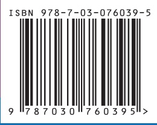

附表 16 均匀设计表

（1）

$U _ { 5 }$ $( 5 ^ { 4 } )$ 均匀设计表

<table><tr><td rowspan="2">试验号</td><td colspan="4">列号</td></tr><tr><td>1</td><td>2</td><td>3</td><td>4</td></tr><tr><td>1</td><td>1</td><td>2</td><td>3</td><td>4</td></tr><tr><td>2</td><td>2</td><td>4</td><td>1</td><td>3</td></tr><tr><td>3</td><td>3</td><td>1</td><td>4</td><td>2</td></tr><tr><td>4</td><td>4</td><td>3</td><td>2</td><td>1</td></tr><tr><td>5</td><td>5</td><td>5</td><td>5</td><td>5</td></tr></table>

（2）

$U _ { 7 }$ （74）均匀设计表

<table><tr><td rowspan="2">试验号</td><td colspan="4">列号</td></tr><tr><td>1</td><td>2</td><td>3</td><td>4</td></tr><tr><td>1</td><td>1</td><td>2</td><td>3</td><td>6</td></tr><tr><td>2</td><td>2</td><td>4</td><td>6</td><td>5</td></tr><tr><td>3</td><td>3</td><td>6</td><td>2</td><td>4</td></tr><tr><td>4</td><td>4</td><td>1</td><td>5</td><td>3</td></tr><tr><td>5</td><td>5</td><td>3</td><td>1</td><td>2</td></tr><tr><td>6</td><td>6</td><td>5</td><td>4</td><td>1</td></tr><tr><td>7</td><td>7</td><td>7</td><td>7</td><td>7</td></tr></table>

（3）

${ U _ { 7 } } ^ { * }$ $( 7 ^ { 4 } )$ 均匀设计表

<table><tr><td rowspan="2">试验号</td><td colspan="4">列号</td></tr><tr><td>1</td><td>2</td><td>3</td><td>4</td></tr><tr><td>1</td><td>1</td><td>3</td><td>5</td><td>7</td></tr><tr><td>2</td><td>2</td><td>6</td><td>2</td><td>6</td></tr><tr><td>3</td><td>3</td><td>1</td><td>7</td><td>5</td></tr><tr><td>4</td><td>4</td><td>4</td><td>4</td><td>4</td></tr><tr><td>5</td><td>5</td><td>7</td><td>1</td><td>3</td></tr><tr><td>6</td><td>6</td><td>2</td><td>6</td><td>2</td></tr><tr><td>7</td><td>7</td><td>5</td><td>3</td><td>1</td></tr></table>

（4）

$U _ { 9 } ~ ( 9 ^ { 5 } )$ 均匀设计表

<table><tr><td rowspan="2">试验号</td><td colspan="5">列号</td></tr><tr><td>1</td><td>2</td><td>3</td><td>4</td><td>5</td></tr><tr><td>1</td><td>1</td><td>2</td><td>4</td><td>7</td><td>8</td></tr><tr><td>2</td><td>2</td><td>4</td><td>8</td><td>5</td><td>7</td></tr><tr><td>3</td><td>3</td><td>6</td><td>3</td><td>3</td><td>6</td></tr><tr><td>4</td><td>4</td><td>8</td><td>7</td><td>1</td><td>5</td></tr><tr><td>5</td><td>5</td><td>1</td><td>2</td><td>8</td><td>4</td></tr><tr><td>6</td><td>6</td><td>3</td><td>6</td><td>6</td><td>3</td></tr><tr><td>7</td><td>7</td><td>5</td><td>1</td><td>4</td><td>2</td></tr><tr><td>8</td><td>8</td><td>7</td><td>5</td><td>2</td><td>1</td></tr><tr><td>9</td><td>9</td><td>9</td><td>9</td><td>9</td><td>9</td></tr></table>

$U _ { 5 }$ $( 5 ^ { 4 } )$ 使用表

<table><tr><td>因素数</td><td colspan="4">列号</td></tr><tr><td>2</td><td>1</td><td>2</td><td></td><td></td></tr><tr><td>3</td><td>1</td><td>2</td><td>4</td><td></td></tr><tr><td>4</td><td>1</td><td>2</td><td>3</td><td>4</td></tr></table>

U7（74）使用表

<table><tr><td>因素数</td><td colspan="4">列号</td><td>偏差D</td></tr><tr><td>2</td><td>1</td><td>3</td><td></td><td></td><td>0.2398</td></tr><tr><td>3</td><td>1</td><td>2</td><td>3</td><td></td><td>0.3721</td></tr><tr><td>4</td><td>1</td><td>2</td><td>3</td><td>4</td><td>0.4760</td></tr></table>

注:D 是刻画均匀度的偏差数值，偏差值 D 越小，表示均匀度越好

${U_{7}}^{*}$ $( 7 ^ { 4 } )$ 使用表

<table><tr><td>因素数</td><td colspan="3">列号</td><td>偏差D</td></tr><tr><td>2</td><td>1</td><td>3</td><td></td><td>0.1582</td></tr><tr><td>3</td><td>2</td><td>3</td><td>4</td><td>0.2132</td></tr></table>

${ U _ { 9 } } ^ { * } ( 9 ^ { 5 } )$ 使用表

<table><tr><td>因素数</td><td colspan="4">列号</td><td>D</td></tr><tr><td>2</td><td>1</td><td>3</td><td></td><td></td><td>0.1944</td></tr><tr><td>3</td><td>1</td><td>3</td><td>4</td><td></td><td>0.3102</td></tr><tr><td>4</td><td>1</td><td>2</td><td>3</td><td>5</td><td>0.4066</td></tr></table>

续表

（5）

${ U _ { 9 } } ^ { * } ~ ( 9 ^ { 4 } )$ 均匀设计表

<table><tr><td rowspan="2">试验号</td><td colspan="4">列号</td></tr><tr><td>1</td><td>2</td><td>3</td><td>4</td></tr><tr><td>1</td><td>1</td><td>3</td><td>7</td><td>9</td></tr><tr><td>2</td><td>2</td><td>6</td><td>4</td><td>8</td></tr><tr><td>3</td><td>3</td><td>9</td><td>1</td><td>7</td></tr><tr><td>4</td><td>4</td><td>2</td><td>8</td><td>6</td></tr><tr><td>5</td><td>5</td><td>5</td><td>5</td><td>5</td></tr><tr><td>6</td><td>6</td><td>8</td><td>2</td><td>4</td></tr><tr><td>7</td><td>7</td><td>1</td><td>9</td><td>3</td></tr><tr><td>8</td><td>8</td><td>4</td><td>6</td><td>2</td></tr><tr><td>9</td><td>9</td><td>7</td><td>3</td><td>1</td></tr></table>

${ U _ { 9 } } ^ { * } ~ ( 9 ^ { 4 } )$ 使用表

<table><tr><td>因素数</td><td colspan="3">列号</td><td>D</td></tr><tr><td>2</td><td>1</td><td>3</td><td></td><td>0.1574</td></tr><tr><td>3</td><td>2</td><td>3</td><td>4</td><td>0.1980</td></tr></table>

（6）

$U _ { 1 1 } ~ ( 1 1 ^ { 1 0 } )$ 均匀设计表

<table><tr><td rowspan="2">试验号</td><td colspan="10">列号</td></tr><tr><td>1</td><td>2</td><td>3</td><td>4</td><td>5</td><td>6</td><td>7</td><td>8</td><td>9</td><td>10</td></tr><tr><td>1</td><td>1</td><td>2</td><td>3</td><td>4</td><td>5</td><td>6</td><td>7</td><td>8</td><td>9</td><td>10</td></tr><tr><td>2</td><td>2</td><td>4</td><td>6</td><td>8</td><td>10</td><td>1</td><td>3</td><td>5</td><td>7</td><td>9</td></tr><tr><td>3</td><td>3</td><td>6</td><td>9</td><td>1</td><td>4</td><td>7</td><td>10</td><td>2</td><td>5</td><td>8</td></tr><tr><td>4</td><td>4</td><td>8</td><td>1</td><td>5</td><td>9</td><td>2</td><td>6</td><td>10</td><td>3</td><td>7</td></tr><tr><td>5</td><td>5</td><td>10</td><td>4</td><td>9</td><td>3</td><td>8</td><td>2</td><td>7</td><td>1</td><td>6</td></tr><tr><td>6</td><td>6</td><td>1</td><td>7</td><td>2</td><td>8</td><td>3</td><td>9</td><td>4</td><td>10</td><td>5</td></tr><tr><td>7</td><td>7</td><td>3</td><td>10</td><td>6</td><td>2</td><td>9</td><td>5</td><td>1</td><td>8</td><td>4</td></tr><tr><td>8</td><td>8</td><td>5</td><td>2</td><td>10</td><td>7</td><td>4</td><td>1</td><td>9</td><td>6</td><td>3</td></tr><tr><td>9</td><td>9</td><td>7</td><td>5</td><td>3</td><td>1</td><td>10</td><td>8</td><td>6</td><td>4</td><td>2</td></tr><tr><td>10</td><td>10</td><td>9</td><td>8</td><td>7</td><td>6</td><td>5</td><td>4</td><td>3</td><td>2</td><td>1</td></tr><tr><td>11</td><td>11</td><td>11</td><td>11</td><td>11</td><td>11</td><td>11</td><td>11</td><td>11</td><td>11</td><td>11</td></tr></table>

$U _ { 1 1 } ~ ( 1 1 ^ { 1 0 } )$ 使用表

| 因素数 |  |  |  |  | 列号 |  |  |  |  |  |
| --- | --- | --- | --- | --- | --- | --- | --- | --- | --- | --- |
| 2 | 1 | 7 |  |  |  |  |  |  |  |  |
| 3 | 1 | 5 | 7 |  |  |  |  |  |  |  |
| 4 | 1 | 2 | 5 | 7 |  |  |  |  |  |  |
| 5 | 1 | 2 | 3 | 5 | 7 |  |  |  |  |  |
| 6 | 1 | 2 | 3 | 5 | 7 | 10 |  |  |  |  |
| 7 | 1 | 2 | 3 | 4 | 5 | 7 | 10 |  |  |  |
| 8 | 1 | 2 | 3 | 4 | 5 | 6 | 7 | 10 |  |  |
| 9 | 1 | 2 | 3 | 4 | 5 | 6 | 7 | 9 | 10 |  |
| 10 | 1 | 2 | 3 | 4 | 5 | 6 | 7 | 8 | 9 | 10 |

续表

（7）

$U _ { 1 3 } ~ ( 1 3 ^ { 1 2 } )$ 均匀设计表

<table><tr><td rowspan="2">试验号</td><td colspan="12">列号</td></tr><tr><td>1</td><td>2</td><td>3</td><td>4</td><td>5</td><td>6</td><td>7</td><td>8</td><td>9</td><td>10</td><td>11</td><td>12</td></tr><tr><td>1</td><td>1</td><td>2</td><td>3</td><td>4</td><td>5</td><td>6</td><td>7</td><td>8</td><td>9</td><td>10</td><td>11</td><td>12</td></tr><tr><td>2</td><td>2</td><td>4</td><td>6</td><td>8</td><td>10</td><td>12</td><td>1</td><td>3</td><td>5</td><td>7</td><td>9</td><td>11</td></tr><tr><td>3</td><td>3</td><td>6</td><td>9</td><td>12</td><td>2</td><td>5</td><td>8</td><td>11</td><td>1</td><td>4</td><td>7</td><td>10</td></tr><tr><td>4</td><td>4</td><td>8</td><td>12</td><td>3</td><td>7</td><td>11</td><td>2</td><td>6</td><td>10</td><td>1</td><td>5</td><td>9</td></tr><tr><td>5</td><td>5</td><td>10</td><td>2</td><td>7</td><td>12</td><td>4</td><td>9</td><td>1</td><td>6</td><td>11</td><td>3</td><td>8</td></tr><tr><td>6</td><td>6</td><td>12</td><td>5</td><td>11</td><td>4</td><td>10</td><td>3</td><td>9</td><td>2</td><td>8</td><td>1</td><td>7</td></tr><tr><td>7</td><td>7</td><td>1</td><td>8</td><td>2</td><td>9</td><td>3</td><td>10</td><td>4</td><td>11</td><td>5</td><td>12</td><td>6</td></tr><tr><td>8</td><td>8</td><td>3</td><td>11</td><td>6</td><td>1</td><td>9</td><td>4</td><td>12</td><td>7</td><td>2</td><td>10</td><td>5</td></tr><tr><td>9</td><td>9</td><td>5</td><td>1</td><td>10</td><td>6</td><td>2</td><td>11</td><td>7</td><td>3</td><td>12</td><td>8</td><td>4</td></tr><tr><td>10</td><td>10</td><td>7</td><td>4</td><td>1</td><td>11</td><td>8</td><td>5</td><td>2</td><td>12</td><td>9</td><td>6</td><td>3</td></tr><tr><td>11</td><td>11</td><td>9</td><td>7</td><td>5</td><td>3</td><td>1</td><td>12</td><td>10</td><td>8</td><td>6</td><td>4</td><td>2</td></tr><tr><td>12</td><td>12</td><td>11</td><td>10</td><td>9</td><td>8</td><td>7</td><td>6</td><td>5</td><td>4</td><td>3</td><td>2</td><td>1</td></tr><tr><td>13</td><td>13</td><td>13</td><td>3</td><td>13</td><td>13</td><td>13</td><td>13</td><td>13</td><td>13</td><td>13</td><td>13</td><td>13</td></tr></table>

$U _ { 1 3 } ~ ( 1 3 ^ { 1 2 } )$ 使用表

<table><tr><td>因素数</td><td colspan="12">列号</td></tr><tr><td>2</td><td>1</td><td>5</td><td></td><td></td><td></td><td></td><td></td><td></td><td></td><td></td><td></td><td></td></tr><tr><td>3</td><td>1</td><td>3</td><td>4</td><td></td><td></td><td></td><td></td><td></td><td></td><td></td><td></td><td></td></tr><tr><td>4</td><td>1</td><td>6</td><td>8</td><td>10</td><td></td><td></td><td></td><td></td><td></td><td></td><td></td><td></td></tr><tr><td>5</td><td>1</td><td>6</td><td>8</td><td>9</td><td>10</td><td></td><td></td><td></td><td></td><td></td><td></td><td></td></tr><tr><td>6</td><td>1</td><td>2</td><td>6</td><td>8</td><td>9</td><td>10</td><td></td><td></td><td></td><td></td><td></td><td></td></tr><tr><td>7</td><td>1</td><td>2</td><td>6</td><td>8</td><td>9</td><td>10</td><td>12</td><td></td><td></td><td></td><td></td><td></td></tr><tr><td>8</td><td>1</td><td>2</td><td>6</td><td>7</td><td>8</td><td>9</td><td>10</td><td>12</td><td></td><td></td><td></td><td></td></tr><tr><td>9</td><td>1</td><td>2</td><td>3</td><td>6</td><td>7</td><td>8</td><td>9</td><td>10</td><td>12</td><td></td><td></td><td></td></tr><tr><td>10</td><td>1</td><td>2</td><td>3</td><td>5</td><td>6</td><td>7</td><td>8</td><td>9</td><td>10</td><td>12</td><td></td><td></td></tr><tr><td>11</td><td>1</td><td>2</td><td>3</td><td>4</td><td>5</td><td>6</td><td>7</td><td>8</td><td>9</td><td>10</td><td>12</td><td></td></tr><tr><td>12</td><td>1</td><td>2</td><td>3</td><td>4</td><td>5</td><td>6</td><td>7</td><td>8</td><td>9</td><td>10</td><td>11</td><td>12</td></tr></table>

（8）

$U _ { 1 5 } ~ ( 1 5 ^ { 8 } )$ 均匀设计表

<table><tr><td rowspan="2">试验号</td><td colspan="8">列号</td></tr><tr><td>1</td><td>2</td><td>3</td><td>4</td><td>5</td><td>6</td><td>7</td><td>8</td></tr><tr><td>1</td><td>1</td><td>2</td><td>4</td><td>7</td><td>8</td><td>11</td><td>13</td><td>14</td></tr><tr><td>2</td><td>2</td><td>4</td><td>8</td><td>14</td><td>1</td><td>7</td><td>11</td><td>13</td></tr><tr><td>3</td><td>3</td><td>6</td><td>12</td><td>6</td><td>9</td><td>3</td><td>9</td><td>12</td></tr><tr><td>4</td><td>4</td><td>8</td><td>1</td><td>13</td><td>2</td><td>14</td><td>7</td><td>11</td></tr><tr><td>5</td><td>5</td><td>10</td><td>5</td><td>5</td><td>10</td><td>10</td><td>5</td><td>10</td></tr><tr><td>6</td><td>6</td><td>12</td><td>9</td><td>12</td><td>3</td><td>6</td><td>3</td><td>9</td></tr><tr><td>7</td><td>7</td><td>14</td><td>13</td><td>4</td><td>11</td><td>2</td><td>1</td><td>8</td></tr><tr><td>8</td><td>8</td><td>1</td><td>2</td><td>11</td><td>4</td><td>13</td><td>14</td><td>7</td></tr><tr><td>9</td><td>9</td><td>3</td><td>6</td><td>3</td><td>12</td><td>9</td><td>12</td><td>6</td></tr><tr><td>10</td><td>10</td><td>5</td><td>10</td><td>10</td><td>5</td><td>5</td><td>10</td><td>5</td></tr><tr><td>11</td><td>11</td><td>7</td><td>14</td><td>2</td><td>13</td><td>1</td><td>8</td><td>4</td></tr><tr><td>12</td><td>12</td><td>9</td><td>3</td><td>9</td><td>6</td><td>12</td><td>6</td><td>3</td></tr><tr><td>13</td><td>13</td><td>11</td><td>7</td><td>1</td><td>14</td><td>8</td><td>4</td><td>2</td></tr><tr><td>14</td><td>14</td><td>13</td><td>11</td><td>8</td><td>7</td><td>4</td><td>2</td><td>1</td></tr><tr><td>15</td><td>15</td><td>15</td><td>15</td><td>15</td><td>15</td><td>15</td><td>15</td><td>15</td></tr><tr><td>因素数</td><td></td><td></td><td></td><td>列号</td><td></td><td></td><td></td><td></td></tr><tr><td>2</td><td>1</td><td>6</td><td></td><td></td><td></td><td></td><td></td><td></td></tr><tr><td>3</td><td>1</td><td>3</td><td>4</td><td></td><td></td><td></td><td></td><td></td></tr><tr><td>4</td><td>1</td><td>3</td><td>4</td><td>7</td><td></td><td></td><td></td><td></td></tr><tr><td>5</td><td>1</td><td>2</td><td>3</td><td>4</td><td>7</td><td></td><td></td><td></td></tr><tr><td>6</td><td>1</td><td>2</td><td>3</td><td>4</td><td>6</td><td>8</td><td></td><td></td></tr><tr><td>7</td><td>1</td><td>2</td><td>3</td><td>4</td><td>6</td><td>7</td><td>8</td><td></td></tr><tr><td>8</td><td>1</td><td>2</td><td>3</td><td>4</td><td>5</td><td>6</td><td>7</td><td>8</td></tr></table>

（9）

$U _ { 1 7 } ~ ( 1 7 ^ { 8 } )$ 均匀设计表

<table><tr><td rowspan="2">试验号</td><td colspan="8">列号</td></tr><tr><td>1</td><td>2</td><td>3</td><td>4</td><td>5</td><td>6</td><td>7</td><td>8</td></tr><tr><td>1</td><td>1</td><td>4</td><td>6</td><td>9</td><td>10</td><td>11</td><td>14</td><td>15</td></tr><tr><td>2</td><td>2</td><td>8</td><td>12</td><td>1</td><td>3</td><td>5</td><td>11</td><td>13</td></tr><tr><td>3</td><td>3</td><td>12</td><td>1</td><td>10</td><td>13</td><td>16</td><td>8</td><td>11</td></tr><tr><td>4</td><td>4</td><td>16</td><td>7</td><td>2</td><td>6</td><td>10</td><td>5</td><td>9</td></tr><tr><td>5</td><td>5</td><td>3</td><td>13</td><td>11</td><td>16</td><td>4</td><td>2</td><td>7</td></tr><tr><td>6</td><td>6</td><td>7</td><td>2</td><td>3</td><td>9</td><td>15</td><td>16</td><td>5</td></tr><tr><td>7</td><td>7</td><td>11</td><td>8</td><td>12</td><td>2</td><td>9</td><td>13</td><td>3</td></tr><tr><td>8</td><td>8</td><td>15</td><td>14</td><td>4</td><td>12</td><td>3</td><td>10</td><td>1</td></tr><tr><td>9</td><td>9</td><td>2</td><td>3</td><td>13</td><td>5</td><td>14</td><td>7</td><td>16</td></tr><tr><td>10</td><td>10</td><td>6</td><td>9</td><td>5</td><td>15</td><td>8</td><td>4</td><td>14</td></tr><tr><td>11</td><td>11</td><td>10</td><td>15</td><td>14</td><td>8</td><td>2</td><td>1</td><td>12</td></tr><tr><td>12</td><td>12</td><td>14</td><td>4</td><td>6</td><td>1</td><td>13</td><td>15</td><td>10</td></tr><tr><td>13</td><td>13</td><td>1</td><td>10</td><td>15</td><td>11</td><td>7</td><td>12</td><td>8</td></tr><tr><td>14</td><td>14</td><td>5</td><td>16</td><td>7</td><td>5</td><td>1</td><td>9</td><td>6</td></tr><tr><td>15</td><td>15</td><td>9</td><td>5</td><td>16</td><td>14</td><td>12</td><td>6</td><td>4</td></tr><tr><td>16</td><td>16</td><td>13</td><td>11</td><td>8</td><td>7</td><td>6</td><td>3</td><td>2</td></tr><tr><td>17</td><td>17</td><td>17</td><td>17</td><td>17</td><td>17</td><td>17</td><td>17</td><td>17</td></tr></table>

$U _ { 1 7 } ~ ( 1 7 ^ { 8 } )$ 使用表

| 因素数 |  |  |  | 列号 |  |  |  |
| --- | --- | --- | --- | --- | --- | --- | --- |
| 2 | 1 | 6 |  |  |  |  |  |
| 3 | 1 | 5 | 8 |  |  |  |  |
| 4 | 1 | 5 | 7 | 8 |  |  |  |
| 5 | 1 | 2 | 5 | 7 | 8 |  |  |
| 6 | 1 | 2 | 3 | 5 | 7 | 8 |  |
| 7 | 1 | 2 | 3 | 4 | 5 | 7 | 8 |

附表 17 正交多项式系数表

<table><tr><td>n</td><td>2</td><td colspan="2">3</td><td colspan="3">4</td><td colspan="4">5</td><td colspan="5">6</td></tr><tr><td> $c_j$ </td><td> $c_1$ </td><td> $c_1$ </td><td> $c_2$ </td><td> $c_1$ </td><td> $c_2$ </td><td> $c_3$ </td><td> $c_1$ </td><td> $c_2$ </td><td> $c_3$ </td><td> $c_4$ </td><td> $c_1$ </td><td> $c_2$ </td><td> $c_3$ </td><td> $c_4$ </td><td> $c_5$ </td></tr><tr><td rowspan="6"></td><td>-1</td><td>-1</td><td>+1</td><td>-3</td><td>+1</td><td>-1</td><td>-2</td><td>+2</td><td>-1</td><td>+1</td><td>-5</td><td>+5</td><td>-5</td><td>+1</td><td>-1</td></tr><tr><td>+1</td><td>0</td><td>-2</td><td>-1</td><td>-1</td><td>+3</td><td>-1</td><td>-1</td><td>+2</td><td>-4</td><td>-3</td><td>-1</td><td>+7</td><td>-3</td><td>+5</td></tr><tr><td></td><td>+1</td><td>+1</td><td>+1</td><td>-1</td><td>-3</td><td>0</td><td>-2</td><td>0</td><td>+6</td><td>-1</td><td>-4</td><td>+4</td><td>+2</td><td>-10</td></tr><tr><td></td><td></td><td></td><td>+3</td><td>+1</td><td>+1</td><td>+1</td><td>-1</td><td>-2</td><td>-4</td><td>+1</td><td>-4</td><td>-4</td><td>+2</td><td>+10</td></tr><tr><td></td><td></td><td></td><td></td><td></td><td></td><td>+2</td><td>+2</td><td>+1</td><td>+2</td><td>+3</td><td>-1</td><td>-7</td><td>-3</td><td>-5</td></tr><tr><td></td><td></td><td></td><td></td><td></td><td></td><td></td><td></td><td></td><td></td><td>+5</td><td>+5</td><td>+5</td><td>+1</td><td>+1</td></tr><tr><td> $\sum c_j$ </td><td>2</td><td>2</td><td>6</td><td>20</td><td>4</td><td>20</td><td>10</td><td>14</td><td>10</td><td>70</td><td>70</td><td>84</td><td>180</td><td>28</td><td>252</td></tr><tr><td> $λ_j$ </td><td>2</td><td>1</td><td>3</td><td>2</td><td>1</td><td> $\frac{10}{3}$ </td><td>1</td><td>1</td><td> $\frac{5}{6}$ </td><td> $\frac{35}{12}$ </td><td>2</td><td> $\frac{3}{2}$ </td><td> $\frac{5}{3}$ </td><td> $\frac{7}{12}$ </td><td> $\frac{21}{10}$ </td></tr><tr><td>n</td><td colspan="5">7</td><td colspan="5">8</td><td colspan="5">9</td></tr><tr><td> $c_j$ </td><td> $c_1$ </td><td> $c_2$ </td><td> $c_3$ </td><td> $c_4$ </td><td> $c_5$ </td><td> $c_1$ </td><td> $c_2$ </td><td> $c_3$ </td><td> $c_4$ </td><td> $c_5$ </td><td> $c_1$ </td><td> $c_2$ </td><td> $c_3$ </td><td> $c_4$ </td><td> $c_5$ </td></tr><tr><td rowspan="9"></td><td>-3</td><td>+5</td><td>-1</td><td>+3</td><td>-1</td><td>-7</td><td>+7</td><td>-7</td><td>+7</td><td>-7</td><td>-4</td><td>+28</td><td>-14</td><td>+14</td><td>-4</td></tr><tr><td>-2</td><td>0</td><td>+1</td><td>-7</td><td>+4</td><td>-5</td><td>+1</td><td>+5</td><td>-13</td><td>+23</td><td>-3</td><td>+7</td><td>+7</td><td>-21</td><td>+11</td></tr><tr><td>-1</td><td>-3</td><td>+1</td><td>+1</td><td>-5</td><td>-3</td><td>-3</td><td>+7</td><td>-3</td><td>-17</td><td>-2</td><td>-8</td><td>+13</td><td>-11</td><td>-4</td></tr><tr><td>0</td><td>-4</td><td>0</td><td>+6</td><td>0</td><td>-1</td><td>-5</td><td>+3</td><td>+9</td><td>-15</td><td>-1</td><td>-17</td><td>+9</td><td>+9</td><td>-9</td></tr><tr><td>+1</td><td>-3</td><td>-1</td><td>+1</td><td>+5</td><td>+1</td><td>-5</td><td>-3</td><td>+9</td><td>+15</td><td>0</td><td>-20</td><td>0</td><td>+18</td><td>0</td></tr><tr><td>+2</td><td>0</td><td>-1</td><td>-7</td><td>-4</td><td>+3</td><td>-3</td><td>-7</td><td>-3</td><td>+17</td><td>+1</td><td>-17</td><td>-9</td><td>+9</td><td>+9</td></tr><tr><td>+3</td><td>+5</td><td>+1</td><td>+3</td><td>+1</td><td>+5</td><td>+1</td><td>-5</td><td>-13</td><td>-23</td><td>+2</td><td>-8</td><td>-13</td><td>-11</td><td>+4</td></tr><tr><td></td><td></td><td></td><td></td><td></td><td>+7</td><td>+7</td><td>+7</td><td>+7</td><td>+7</td><td>+3</td><td>+7</td><td>-7</td><td>-21</td><td>-11</td></tr><tr><td></td><td></td><td></td><td></td><td></td><td></td><td></td><td></td><td></td><td></td><td>+4</td><td>+28</td><td>+14</td><td>+14</td><td>+4</td></tr><tr><td> $\sum c_j$ </td><td>28</td><td>84</td><td>6</td><td>154</td><td>84</td><td>168</td><td>168</td><td>264</td><td>616</td><td>2184</td><td>60</td><td>2772</td><td>990</td><td>2002</td><td>468</td></tr><tr><td> $λ_j$ </td><td>1</td><td>1</td><td> $\frac{1}{6}$ </td><td> $\frac{7}{12}$ </td><td> $\frac{7}{20}$ </td><td>2</td><td>1</td><td> $\frac{2}{3}$ </td><td> $\frac{7}{12}$ </td><td> $\frac{7}{10}$ </td><td>1</td><td>3</td><td> $\frac{5}{6}$ </td><td> $\frac{7}{12}$ </td><td> $\frac{3}{20}$ </td></tr><tr><td>n</td><td>10</td><td>11</td><td>12</td><td>n</td><td>10</td><td>11</td><td>12</td><td>n</td><td>10</td><td>11</td><td>12</td><td>n</td><td>10</td><td>11</td><td>12</td></tr><tr><td rowspan="13"> $c_j$ </td><td> $c_1$ </td><td> $c_2$ </td><td> $c_3$ </td><td> $c_j$ </td><td> $c_1$ </td><td> $c_2$ </td><td> $c_3$ </td><td> $c_j$ </td><td> $c_1$ </td><td> $c_2$ </td><td> $c_3$ </td><td> $c_j$ </td><td> $c_1$ </td><td> $c_2$ </td><td> $c_3$ </td></tr><tr><td>-9</td><td>+6</td><td>-42</td><td>+18</td><td>-6</td><td>-5</td><td>+15</td><td>-30</td><td>+6</td><td>-3</td><td>-11</td><td>+55</td><td>-33</td><td>+33</td><td>-33</td></tr><tr><td>-7</td><td>+2</td><td>+14</td><td>-22</td><td>+14</td><td>-4</td><td>+6</td><td>+6</td><td>-6</td><td>+6</td><td>-9</td><td>+25</td><td>+3</td><td>-27</td><td>+57</td></tr><tr><td>-5</td><td>-1</td><td>+35</td><td>-17</td><td>-1</td><td>-3</td><td>-1</td><td>+22</td><td>-6</td><td>+1</td><td>-7</td><td>+1</td><td>+21</td><td>-33</td><td>+21</td></tr><tr><td>-3</td><td>-3</td><td>+31</td><td>+3</td><td>-11</td><td>-2</td><td>-6</td><td>+23</td><td>-1</td><td>-4</td><td>-5</td><td>-17</td><td>+25</td><td>-13</td><td>-19</td></tr><tr><td>-1</td><td>-4</td><td>+12</td><td>+18</td><td>-6</td><td>-1</td><td>-9</td><td>+14</td><td>+4</td><td>-4</td><td>-3</td><td>-29</td><td>+19</td><td>+12</td><td>-44</td></tr><tr><td>+1</td><td>-4</td><td>-12</td><td>+18</td><td>+6</td><td>0</td><td>-10</td><td>0</td><td>+6</td><td>0</td><td>-1</td><td>-35</td><td>+7</td><td>+28</td><td>-20</td></tr><tr><td>+3</td><td>-3</td><td>-31</td><td>+3</td><td>+11</td><td>+1</td><td>-9</td><td>-14</td><td>+4</td><td>+4</td><td>+1</td><td>-35</td><td>-7</td><td>+28</td><td>+20</td></tr><tr><td>+5</td><td>-1</td><td>-35</td><td>-17</td><td>+1</td><td>+2</td><td>-6</td><td>-23</td><td>-1</td><td>+4</td><td>+3</td><td>-29</td><td>-19</td><td>+12</td><td>+44</td></tr><tr><td>+7</td><td>+2</td><td>-14</td><td>-22</td><td>-14</td><td>+3</td><td>-1</td><td>-22</td><td>-6</td><td>-1</td><td>+5</td><td>-17</td><td>-25</td><td>-13</td><td>+29</td></tr><tr><td>+9</td><td>+6</td><td>+42</td><td>+18</td><td>+6</td><td>+4</td><td>+6</td><td>-6</td><td>-6</td><td>-6</td><td>+7</td><td>+1</td><td>-21</td><td>-33</td><td>-21</td></tr><tr><td></td><td></td><td></td><td></td><td></td><td>+5</td><td>+15</td><td>+30</td><td>+6</td><td>+3</td><td>+9</td><td>+25</td><td>-3</td><td>-27</td><td>-57</td></tr><tr><td></td><td></td><td></td><td></td><td></td><td></td><td></td><td></td><td></td><td></td><td>+11</td><td>+55</td><td>+33</td><td>+33</td><td>+33</td></tr><tr><td> $\sum c_j$ </td><td>330</td><td>132</td><td>8580</td><td>2860</td><td>780</td><td>110</td><td>858</td><td>4290</td><td>286</td><td>156</td><td>572</td><td>12012</td><td>5148</td><td>8008</td><td>15912</td></tr><tr><td> $λ_j$ </td><td>2</td><td> $\frac{1}{2}$ </td><td> $\frac{5}{3}$ </td><td> $\frac{5}{12}$ </td><td> $\frac{1}{10}$ </td><td>1</td><td>1</td><td> $\frac{5}{6}$ </td><td> $\frac{1}{12}$ </td><td> $\frac{1}{40}$ </td><td>2</td><td>3</td><td> $\frac{2}{3}$ </td><td> $\frac{7}{24}$ </td><td> $\frac{3}{20}$ </td></tr></table>

续表

<table><tr><td>n</td><td colspan="5">13</td><td colspan="5">14</td></tr><tr><td> $c_j$ </td><td> $c_1$ </td><td> $c_2$ </td><td> $c_3$ </td><td> $c_4$ </td><td> $c_5$ </td><td> $c_1$ </td><td> $c_2$ </td><td> $c_3$ </td><td> $c_4$ </td><td> $c_5$ </td></tr><tr><td rowspan="14"></td><td>-6</td><td>+22</td><td>-11</td><td>+99</td><td>-22</td><td>-13</td><td>+13</td><td>-143</td><td>+143</td><td>-143</td></tr><tr><td>-5</td><td>+11</td><td>0</td><td>-66</td><td>+33</td><td>-11</td><td>+7</td><td>-11</td><td>-77</td><td>+187</td></tr><tr><td>-4</td><td>+2</td><td>+6</td><td>-96</td><td>+18</td><td>-9</td><td>+2</td><td>+66</td><td>-132</td><td>+132</td></tr><tr><td>-3</td><td>-5</td><td>+8</td><td>-54</td><td>-11</td><td>-7</td><td>-2</td><td>+98</td><td>-92</td><td>-28</td></tr><tr><td>-2</td><td>-10</td><td>+7</td><td>+11</td><td>-26</td><td>-5</td><td>-5</td><td>+95</td><td>-13</td><td>-139</td></tr><tr><td>-1</td><td>-13</td><td>+4</td><td>+64</td><td>-20</td><td>-3</td><td>-7</td><td>+67</td><td>+63</td><td>-145</td></tr><tr><td>0</td><td>-14</td><td>0</td><td>+84</td><td>0</td><td>-1</td><td>-8</td><td>+24</td><td>+108</td><td>-60</td></tr><tr><td>+1</td><td>-13</td><td>-4</td><td>+64</td><td>+20</td><td>+1</td><td>-8</td><td>-24</td><td>+108</td><td>+60</td></tr><tr><td>+2</td><td>-10</td><td>-7</td><td>+11</td><td>+26</td><td>+3</td><td>-7</td><td>-67</td><td>+63</td><td>+145</td></tr><tr><td>+3</td><td>-5</td><td>-8</td><td>-54</td><td>+11</td><td>+5</td><td>-5</td><td>-95</td><td>-13</td><td>+139</td></tr><tr><td>+4</td><td>+2</td><td>-6</td><td>-96</td><td>-18</td><td>+7</td><td>-2</td><td>-98</td><td>-92</td><td>+28</td></tr><tr><td>+5</td><td>+11</td><td>0</td><td>-66</td><td>-33</td><td>+9</td><td>+2</td><td>-66</td><td>-132</td><td>-132</td></tr><tr><td>+6</td><td>+22</td><td>+11</td><td>+99</td><td>+22</td><td>+11</td><td>+7</td><td>+11</td><td>-77</td><td>-187</td></tr><tr><td></td><td></td><td></td><td></td><td></td><td>+13</td><td>+13</td><td>+143</td><td>+143</td><td>+143</td></tr><tr><td> $\sum c_j$ </td><td>182</td><td>2002</td><td>572</td><td>68068</td><td>6188</td><td>910</td><td>728</td><td>97240</td><td>136136</td><td>235144</td></tr><tr><td> $λ_j$ </td><td>1</td><td>1</td><td> $\frac{1}{6}$ </td><td> $\frac{7}{12}$ </td><td> $\frac{7}{120}$ </td><td>2</td><td> $\frac{1}{2}$ </td><td> $\frac{5}{3}$ </td><td> $\frac{7}{12}$ </td><td> $\frac{7}{30}$ </td></tr><tr><td>n</td><td colspan="5">15</td><td colspan="5">16*</td></tr><tr><td> $c_j$ </td><td> $c_1$ </td><td> $c_2$ </td><td> $c_3$ </td><td> $c_4$ </td><td> $c_5$ </td><td> $c_1$ </td><td> $c_2$ </td><td> $c_3$ </td><td> $c_4$ </td><td> $c_5$ </td></tr><tr><td rowspan="15"></td><td>-7</td><td>+91</td><td>-91</td><td>+1001</td><td>-1001</td><td>-15</td><td>+35</td><td>-455</td><td>+273</td><td>-143</td></tr><tr><td>-6</td><td>+52</td><td>-13</td><td>-429</td><td>+1144</td><td>-13</td><td>+21</td><td>-91</td><td>-91</td><td>+143</td></tr><tr><td>-5</td><td>+19</td><td>+35</td><td>-869</td><td>+979</td><td>-11</td><td>+9</td><td>+143</td><td>-221</td><td>+143</td></tr><tr><td>-4</td><td>-8</td><td>+58</td><td>-704</td><td>+44</td><td>-9</td><td>-1</td><td>+267</td><td>-201</td><td>+33</td></tr><tr><td>-3</td><td>-29</td><td>+61</td><td>-249</td><td>-751</td><td>-7</td><td>-9</td><td>+301</td><td>-101</td><td>-77</td></tr><tr><td>-2</td><td>-44</td><td>+49</td><td>+251</td><td>-1000</td><td>-5</td><td>-15</td><td>+265</td><td>+23</td><td>-131</td></tr><tr><td>-1</td><td>-53</td><td>+27</td><td>+621</td><td>-675</td><td>-3</td><td>-19</td><td>+179</td><td>+129</td><td>-115</td></tr><tr><td>0</td><td>-56</td><td>0</td><td>+756</td><td>0</td><td>-1</td><td>-21</td><td>+63</td><td>+189</td><td>-45</td></tr><tr><td>+1</td><td>-53</td><td>-27</td><td>+621</td><td>+675</td><td></td><td></td><td></td><td></td><td></td></tr><tr><td>+2</td><td>-44</td><td>-49</td><td>+251</td><td>+1000</td><td></td><td></td><td></td><td></td><td></td></tr><tr><td>+3</td><td>-29</td><td>-61</td><td>-249</td><td>+751</td><td></td><td></td><td></td><td></td><td></td></tr><tr><td>+4</td><td>-8</td><td>-58</td><td>-704</td><td>-44</td><td></td><td></td><td></td><td></td><td></td></tr><tr><td>+5</td><td>+19</td><td>-35</td><td>-869</td><td>-979</td><td></td><td></td><td></td><td></td><td></td></tr><tr><td>+6</td><td>+52</td><td>+13</td><td>-429</td><td>-1144</td><td></td><td></td><td></td><td></td><td></td></tr><tr><td>+7</td><td>+91</td><td>+91</td><td>+1001</td><td>+1001</td><td></td><td></td><td></td><td></td><td></td></tr><tr><td> $\sum c_j$ </td><td>280</td><td>37128</td><td>39780</td><td>6466460</td><td>10581480</td><td>1360</td><td>5712</td><td>1007760</td><td>470288</td><td>201552</td></tr><tr><td> $λ_j$ </td><td>1</td><td>3</td><td> $\frac{5}{6}$ </td><td> $\frac{35}{12}$ </td><td> $\frac{21}{20}$ </td><td>2</td><td>1</td><td> $\frac{10}{3}$ </td><td> $\frac{7}{12}$ </td><td> $\frac{1}{10}$ </td></tr><tr><td>n</td><td colspan="5">17</td><td colspan="5">18</td></tr><tr><td> $c_j$ </td><td> $c_1$ </td><td> $c_2$ </td><td> $c_3$ </td><td> $c_4$ </td><td> $c_5$ </td><td> $c_1$ </td><td> $c_2$ </td><td> $c_3$ </td><td> $c_4$ </td><td> $c_5$ </td></tr><tr><td rowspan="9"></td><td>-8</td><td>+40</td><td>-28</td><td>+52</td><td>-104</td><td>-17</td><td>+68</td><td>-68</td><td>+68</td><td>-884</td></tr><tr><td>-7</td><td>+25</td><td>-7</td><td>-13</td><td>+91</td><td>-15</td><td>+44</td><td>-20</td><td>-12</td><td>+676</td></tr><tr><td>-6</td><td>+12</td><td>+7</td><td>-39</td><td>+104</td><td>-13</td><td>+23</td><td>+13</td><td>-47</td><td>+871</td></tr><tr><td>-5</td><td>+1</td><td>+15</td><td>-39</td><td>+39</td><td>-11</td><td>+5</td><td>+33</td><td>-51</td><td>+429</td></tr><tr><td>-4</td><td>-8</td><td>+18</td><td>-24</td><td>-36</td><td>-9</td><td>-10</td><td>+42</td><td>-36</td><td>-156</td></tr><tr><td>-3</td><td>-15</td><td>+17</td><td>-3</td><td>-83</td><td>-7</td><td>-22</td><td>+42</td><td>-12</td><td>-588</td></tr><tr><td>-2</td><td>-20</td><td>+13</td><td>+17</td><td>-88</td><td>-5</td><td>-31</td><td>+35</td><td>+13</td><td>-733</td></tr><tr><td>-1</td><td>-23</td><td>+7</td><td>+31</td><td>-55</td><td>-3</td><td>-37</td><td>+23</td><td>+33</td><td>-583</td></tr><tr><td>0</td><td>-24</td><td>0</td><td>+36</td><td>0</td><td>-1</td><td>-40</td><td>+8</td><td>+44</td><td>-220</td></tr><tr><td> $\sum c_j$ </td><td>408</td><td>7752</td><td>3876</td><td>16796</td><td>100776</td><td>1938</td><td>23256</td><td>23256</td><td>28424</td><td>6953544</td></tr><tr><td> $λ_j$ </td><td>1</td><td>1</td><td> $\frac{1}{6}$ </td><td> $\frac{1}{12}$ </td><td> $\frac{1}{20}$ </td><td>2</td><td> $\frac{3}{2}$ </td><td> $\frac{1}{3}$ </td><td> $\frac{1}{12}$ </td><td> $\frac{3}{10}$ </td></tr><tr><td>n</td><td colspan="5">19</td><td colspan="5">20</td></tr><tr><td> $c_j$ </td><td> $c_1$ </td><td> $c_2$ </td><td> $c_3$ </td><td> $c_4$ </td><td> $c_5$ </td><td> $c_1$ </td><td> $c_2$ </td><td> $c_3$ </td><td> $c_4$ </td><td> $c_5$ </td></tr><tr><td rowspan="10"></td><td>-9</td><td>+51</td><td>-204</td><td>+612</td><td>-102</td><td>-19</td><td>+57</td><td>-969</td><td>+1938</td><td>-1938</td></tr><tr><td>-8</td><td>+34</td><td>-68</td><td>-68</td><td>+68</td><td>-17</td><td>+39</td><td>-357</td><td>-102</td><td>+1122</td></tr><tr><td>-7</td><td>+19</td><td>+28</td><td>-388</td><td>+98</td><td>-15</td><td>+23</td><td>+85</td><td>-1122</td><td>+1802</td></tr><tr><td>-6</td><td>+6</td><td>+89</td><td>-453</td><td>+58</td><td>-13</td><td>+9</td><td>+377</td><td>-1402</td><td>+1222</td></tr><tr><td>-5</td><td>-5</td><td>+120</td><td>-354</td><td>-3</td><td>-11</td><td>-3</td><td>+539</td><td>-1187</td><td>+187</td></tr><tr><td>-4</td><td>-14</td><td>+126</td><td>-168</td><td>-54</td><td>-9</td><td>-13</td><td>+591</td><td>-687</td><td>-771</td></tr><tr><td>-3</td><td>-21</td><td>+112</td><td>+42</td><td>-79</td><td>-7</td><td>-21</td><td>+553</td><td>-77</td><td>-1351</td></tr><tr><td>-2</td><td>-26</td><td>+83</td><td>+227</td><td>-74</td><td>-5</td><td>-27</td><td>+445</td><td>+503</td><td>-1441</td></tr><tr><td>-1</td><td>-29</td><td>+44</td><td>+352</td><td>-44</td><td>-3</td><td>-31</td><td>+287</td><td>+948</td><td>-1076</td></tr><tr><td>0</td><td>-30</td><td>0</td><td>+396</td><td>0</td><td>-1</td><td>-33</td><td>+99</td><td>+1188</td><td>-396</td></tr><tr><td> $\sum c_j$ </td><td>570</td><td>13566</td><td>213180</td><td>2288132</td><td>89148</td><td>2660</td><td>17556</td><td>4903140</td><td>22881320</td><td>31201800</td></tr><tr><td> $λ_j$ </td><td>1</td><td>1</td><td> $\frac{5}{6}$ </td><td> $\frac{7}{12}$ </td><td> $\frac{1}{40}$ </td><td>2</td><td>1</td><td> $\frac{10}{3}$ </td><td> $\frac{35}{24}$ </td><td> $\frac{7}{20}$ </td></tr><tr><td>n</td><td colspan="5">21</td><td colspan="5">22</td></tr><tr><td> $c_j$ </td><td> $c_1$ </td><td> $c_2$ </td><td> $c_3$ </td><td> $c_4$ </td><td> $c_5$ </td><td> $c_1$ </td><td> $c_2$ </td><td> $c_3$ </td><td> $c_4$ </td><td> $c_5$ </td></tr><tr><td rowspan="11"></td><td>-10</td><td>+190</td><td>-285</td><td>+969</td><td>-3876</td><td>-21</td><td>+35</td><td>-133</td><td>+1197</td><td>-2261</td></tr><tr><td>-9</td><td>+133</td><td>-114</td><td>0</td><td>+1938</td><td>-19</td><td>+25</td><td>-57</td><td>+57</td><td>+969</td></tr><tr><td>-8</td><td>+82</td><td>+12</td><td>-510</td><td>+3468</td><td>-17</td><td>+16</td><td>0</td><td>-570</td><td>+1938</td></tr><tr><td>-7</td><td>+37</td><td>+98</td><td>-680</td><td>+2618</td><td>-15</td><td>+8</td><td>+40</td><td>-810</td><td>+1598</td></tr><tr><td>-6</td><td>-2</td><td>+149</td><td>-615</td><td>+788</td><td>-13</td><td>+1</td><td>+65</td><td>-775</td><td>+663</td></tr><tr><td>-5</td><td>-35</td><td>+170</td><td>-406</td><td>-1063</td><td>-11</td><td>-5</td><td>+77</td><td>-563</td><td>-363</td></tr><tr><td>-4</td><td>-62</td><td>+166</td><td>-130</td><td>-2354</td><td>-9</td><td>-10</td><td>+78</td><td>-258</td><td>-1158</td></tr><tr><td>-3</td><td>-83</td><td>+142</td><td>+150</td><td>-2819</td><td>-7</td><td>-14</td><td>+70</td><td>+70</td><td>-1554</td></tr><tr><td>-2</td><td>-98</td><td>+103</td><td>+385</td><td>-2444</td><td>-5</td><td>-17</td><td>+55</td><td>+365</td><td>-1509</td></tr><tr><td>-1</td><td>-107</td><td>+54</td><td>+540</td><td>-1404</td><td>-3</td><td>-19</td><td>+35</td><td>+585</td><td>-1079</td></tr><tr><td>0</td><td>-110</td><td>0</td><td>+594</td><td>0</td><td>-1</td><td>-20</td><td>+12</td><td>+702</td><td>-390</td></tr><tr><td> $\sum c_j$ </td><td>770</td><td>201894</td><td>432630</td><td>5720330</td><td>121687020</td><td>3542</td><td>7084</td><td>96140</td><td>8748740</td><td>40562340</td></tr><tr><td> $λ_j$ </td><td>1</td><td>3</td><td> $\frac{5}{6}$ </td><td> $\frac{7}{12}$ </td><td> $\frac{21}{40}$ </td><td>2</td><td> $\frac{1}{2}$ </td><td> $\frac{1}{3}$ </td><td> $\frac{7}{12}$ </td><td> $\frac{7}{30}$ </td></tr><tr><td>n</td><td colspan="5">23</td><td colspan="5">24</td></tr><tr><td> $c_j$ </td><td> $c_1$ </td><td> $c_2$ </td><td> $c_3$ </td><td> $c_4$ </td><td> $c_5$ </td><td> $c_1$ </td><td> $c_2$ </td><td> $c_3$ </td><td> $c_4$ </td><td> $c_5$ </td></tr><tr><td rowspan="12"></td><td>-11</td><td>+77</td><td>-77</td><td>+1463</td><td>-209</td><td>-23</td><td>+253</td><td>-1171</td><td>+253</td><td>-4807</td></tr><tr><td>-10</td><td>+56</td><td>-35</td><td>+133</td><td>+76</td><td>-21</td><td>+187</td><td>-847</td><td>+33</td><td>+1463</td></tr><tr><td>-9</td><td>+37</td><td>-3</td><td>-627</td><td>+171</td><td>-19</td><td>+127</td><td>-133</td><td>-97</td><td>+3743</td></tr><tr><td>-8</td><td>+20</td><td>+20</td><td>-950</td><td>+152</td><td>-17</td><td>+73</td><td>+391</td><td>-157</td><td>+3553</td></tr><tr><td>-7</td><td>+5</td><td>+35</td><td>-955</td><td>+77</td><td>-15</td><td>+25</td><td>+745</td><td>-165</td><td>+2071</td></tr><tr><td>-6</td><td>-8</td><td>+43</td><td>-747</td><td>-12</td><td>-13</td><td>-17</td><td>+949</td><td>-137</td><td>+169</td></tr><tr><td>-5</td><td>-19</td><td>+45</td><td>-417</td><td>-87</td><td>-11</td><td>-53</td><td>+1023</td><td>-87</td><td>-1551</td></tr><tr><td>-4</td><td>-28</td><td>+42</td><td>-42</td><td>-132</td><td>-9</td><td>-83</td><td>+987</td><td>-27</td><td>-2721</td></tr><tr><td>-3</td><td>-35</td><td>+35</td><td>+315</td><td>-141</td><td>-7</td><td>-107</td><td>+861</td><td>+33</td><td>-3171</td></tr><tr><td>-2</td><td>-40</td><td>+25</td><td>+605</td><td>-116</td><td>-5</td><td>-125</td><td>+665</td><td>+85</td><td>-2893</td></tr><tr><td>-1</td><td>-43</td><td>+13</td><td>+793</td><td>-65</td><td>-3</td><td>-137</td><td>+419</td><td>+123</td><td>-2005</td></tr><tr><td>0</td><td>-44</td><td>0</td><td>+858</td><td>0</td><td>-1</td><td>-143</td><td>+143</td><td>+143</td><td>-715</td></tr><tr><td> $\sum c_j$ </td><td>1012</td><td>35420</td><td>32890</td><td>13123110</td><td>340860</td><td>4600</td><td>394680</td><td>17760600</td><td>394680</td><td>177928920</td></tr><tr><td> $λ_j$ </td><td>1</td><td>1</td><td> $\frac{1}{6}$ </td><td> $\frac{7}{12}$ </td><td> $\frac{1}{60}$ </td><td>2</td><td>3</td><td> $\frac{10}{3}$ </td><td> $\frac{1}{12}$ </td><td> $\frac{3}{10}$ </td></tr><tr><td>n</td><td colspan="5">25</td><td colspan="5">26</td></tr><tr><td> $c_j$ </td><td> $c_1$ </td><td> $c_2$ </td><td> $c_3$ </td><td> $c_4$ </td><td> $c_5$ </td><td> $c_1$ </td><td> $c_2$ </td><td> $c_3$ </td><td> $c_4$ </td><td> $c_5$ </td></tr><tr><td rowspan="13"></td><td>-12</td><td>+92</td><td>-506</td><td>+1518</td><td>-1012</td><td>-25</td><td>+50</td><td>-1150</td><td>+2530</td><td>-2530</td></tr><tr><td>-11</td><td>+69</td><td>-253</td><td>+253</td><td>+253</td><td>-23</td><td>+38</td><td>-598</td><td>+506</td><td>+506</td></tr><tr><td>-10</td><td>+48</td><td>-55</td><td>-517</td><td>+748</td><td>-21</td><td>+27</td><td>-161</td><td>-759</td><td>+1771</td></tr><tr><td>-9</td><td>+29</td><td>+93</td><td>-897</td><td>+753</td><td>-19</td><td>+17</td><td>+171</td><td>-1419</td><td>+1881</td></tr><tr><td>-8</td><td>+12</td><td>+196</td><td>-982</td><td>+488</td><td>-17</td><td>+8</td><td>+408</td><td>-1614</td><td>+1326</td></tr><tr><td>-7</td><td>-3</td><td>+259</td><td>-857</td><td>+119</td><td>-15</td><td>0</td><td>+560</td><td>-1470</td><td>+482</td></tr><tr><td>-6</td><td>-16</td><td>+287</td><td>-597</td><td>-236</td><td>-13</td><td>-7</td><td>+637</td><td>-1099</td><td>-377</td></tr><tr><td>-5</td><td>-27</td><td>+285</td><td>-267</td><td>-501</td><td>-11</td><td>-13</td><td>+649</td><td>-599</td><td>-1067</td></tr><tr><td>-4</td><td>-36</td><td>+258</td><td>+78</td><td>-636</td><td>-9</td><td>-18</td><td>+606</td><td>-54</td><td>-1482</td></tr><tr><td>-3</td><td>-43</td><td>+211</td><td>+393</td><td>-631</td><td>-7</td><td>-22</td><td>+518</td><td>+466</td><td>-1582</td></tr><tr><td>-2</td><td>-48</td><td>+149</td><td>+643</td><td>-500</td><td>-5</td><td>-25</td><td>+395</td><td>+905</td><td>-1381</td></tr><tr><td>-1</td><td>-51</td><td>+77</td><td>+803</td><td>-275</td><td>-3</td><td>-27</td><td>+247</td><td>+1221</td><td>-935</td></tr><tr><td>0</td><td>-52</td><td>0</td><td>+858</td><td>0</td><td>-1</td><td>-28</td><td>+84</td><td>+1386</td><td>-330</td></tr><tr><td> $\sum c_j$ </td><td>1300</td><td>53820</td><td>1480050</td><td>14307150</td><td>7803900</td><td>5850</td><td>16380</td><td>7803900</td><td>40060020</td><td>48384180</td></tr><tr><td> $\lambda_j$ </td><td>1</td><td>1</td><td> $\frac{5}{6}$ </td><td> $\frac{5}{12}$ </td><td> $\frac{1}{20}$ </td><td>2</td><td> $\frac{1}{2}$ </td><td> $\frac{5}{3}$ </td><td> $\frac{7}{12}$ </td><td> $\frac{1}{10}$ </td></tr><tr><td>n</td><td colspan="5">27</td><td colspan="5">28</td></tr><tr><td> $c_j$ </td><td> $c_1$ </td><td> $c_2$ </td><td> $c_3$ </td><td> $c_4$ </td><td> $c_5$ </td><td> $c_1$ </td><td> $c_2$ </td><td> $c_3$ </td><td> $c_4$ </td><td> $c_5$ </td></tr><tr><td rowspan="14"></td><td>-13</td><td>+325</td><td>-130</td><td>+2990</td><td>-16445</td><td>-27</td><td>+117</td><td>-585</td><td>+1755</td><td>-13455</td></tr><tr><td>-12</td><td>+250</td><td>-70</td><td>+690</td><td>+2530</td><td>-25</td><td>+91</td><td>-325</td><td>+455</td><td>+1495</td></tr><tr><td>-11</td><td>+181</td><td>-22</td><td>-782</td><td>+10879</td><td>-23</td><td>+67</td><td>-115</td><td>-395</td><td>+8395</td></tr><tr><td>-10</td><td>+118</td><td>+15</td><td>-1587</td><td>+12144</td><td>-21</td><td>+45</td><td>+49</td><td>-879</td><td>+9821</td></tr><tr><td>-9</td><td>+61</td><td>+42</td><td>-1872</td><td>+9174</td><td>-19</td><td>+25</td><td>+171</td><td>-1074</td><td>+7866</td></tr><tr><td>-8</td><td>+10</td><td>+60</td><td>-1770</td><td>+4188</td><td>-17</td><td>+7</td><td>+255</td><td>-1050</td><td>+4182</td></tr><tr><td>-7</td><td>-35</td><td>+70</td><td>-1400</td><td>-1162</td><td>-15</td><td>-9</td><td>+305</td><td>-870</td><td>+22</td></tr><tr><td>-6</td><td>-74</td><td>+73</td><td>-867</td><td>-5728</td><td>-13</td><td>-23</td><td>+325</td><td>-590</td><td>-3718</td></tr><tr><td>-5</td><td>-107</td><td>+70</td><td>-262</td><td>-8803</td><td>-11</td><td>-35</td><td>+319</td><td>-259</td><td>-6457</td></tr><tr><td>-4</td><td>-134</td><td>+62</td><td>+338</td><td>-10058</td><td>-9</td><td>-45</td><td>+291</td><td>+81</td><td>-7887</td></tr><tr><td>-3</td><td>-155</td><td>+50</td><td>+870</td><td>-9479</td><td>-7</td><td>-53</td><td>+245</td><td>+395</td><td>-7931</td></tr><tr><td>-2</td><td>-170</td><td>+35</td><td>+1285</td><td>-7304</td><td>-5</td><td>-59</td><td>+185</td><td>+655</td><td>-6701</td></tr><tr><td>-1</td><td>-179</td><td>+18</td><td>+1548</td><td>-3960</td><td>-3</td><td>-63</td><td>+115</td><td>+840</td><td>-4456</td></tr><tr><td>0</td><td>-182</td><td>0</td><td>+1638</td><td>0</td><td>-1</td><td>-65</td><td>+39</td><td>+936</td><td>-1560</td></tr><tr><td> $\sum c_j$ </td><td>1638</td><td>712530</td><td>101790</td><td>56448210</td><td>2032135560</td><td>7308</td><td>95004</td><td>2103660</td><td>19634160</td><td>1354757040</td></tr><tr><td> $\lambda_j$ </td><td>1</td><td>3</td><td> $\frac{1}{6}$ </td><td> $\frac{7}{12}$ </td><td> $\frac{21}{40}$ </td><td>2</td><td>1</td><td> $\frac{2}{3}$ </td><td> $\frac{7}{24}$ </td><td> $\frac{7}{20}$ </td></tr><tr><td>n</td><td colspan="5">29</td><td colspan="5">30</td></tr><tr><td> $c_j$ </td><td> $c_1$ </td><td> $c_2$ </td><td> $c_3$ </td><td> $c_4$ </td><td> $c_5$ </td><td> $c_1$ </td><td> $c_2$ </td><td> $c_3$ </td><td> $c_4$ </td><td> $c_5$ </td></tr><tr><td rowspan="15"></td><td>-14</td><td>+126</td><td>-819</td><td>+4095</td><td>-8190</td><td>-29</td><td>+203</td><td>-1827</td><td>+23751</td><td>-16965</td></tr><tr><td>-13</td><td>+99</td><td>-468</td><td>+1170</td><td>+585</td><td>-27</td><td>+161</td><td>-1071</td><td>+7371</td><td>+585</td></tr><tr><td>-12</td><td>+74</td><td>-182</td><td>-780</td><td>+4810</td><td>-25</td><td>+122</td><td>-450</td><td>-3744</td><td>+9360</td></tr><tr><td>-11</td><td>+51</td><td>+44</td><td>-1930</td><td>+5885</td><td>-23</td><td>+86</td><td>+46</td><td>-10504</td><td>+11960</td></tr><tr><td>-10</td><td>+30</td><td>+215</td><td>-2441</td><td>+4958</td><td>-21</td><td>+53</td><td>+427</td><td>-13749</td><td>+10535</td></tr><tr><td>-9</td><td>+11</td><td>+336</td><td>-2460</td><td>+2946</td><td>-19</td><td>+23</td><td>+703</td><td>-14249</td><td>+6821</td></tr><tr><td>-8</td><td>-6</td><td>+412</td><td>-2120</td><td>+556</td><td>-17</td><td>-4</td><td>+884</td><td>-12704</td><td>+2176</td></tr><tr><td>-7</td><td>-21</td><td>+448</td><td>-1540</td><td>-1694</td><td>-15</td><td>-28</td><td>+980</td><td>-9744</td><td>-2384</td></tr><tr><td>-6</td><td>-34</td><td>+449</td><td>-825</td><td>-3454</td><td>-13</td><td>-49</td><td>+1001</td><td>-5929</td><td>-6149</td></tr><tr><td>-5</td><td>-45</td><td>+420</td><td>-66</td><td>-4521</td><td>-11</td><td>-67</td><td>+957</td><td>-1749</td><td>-8679</td></tr><tr><td>-4</td><td>-54</td><td>+366</td><td>+660</td><td>-4818</td><td>-9</td><td>-82</td><td>+858</td><td>+2376</td><td>-9768</td></tr><tr><td>-3</td><td>-61</td><td>+292</td><td>+1290</td><td>-4373</td><td>-7</td><td>-94</td><td>+714</td><td>+6096</td><td>-9408</td></tr><tr><td>-2</td><td>-66</td><td>+203</td><td>+1775</td><td>-3298</td><td>-5</td><td>-103</td><td>+535</td><td>+9131</td><td>-7753</td></tr><tr><td>-1</td><td>-69</td><td>+104</td><td>+2080</td><td>-1768</td><td>-3</td><td>-109</td><td>+331</td><td>+11271</td><td>-5083</td></tr><tr><td>0</td><td>-70</td><td>0</td><td>+2184</td><td>0</td><td>-1</td><td>-112</td><td>+112</td><td>+12376</td><td>-1768</td></tr><tr><td> $\sum c_j$ </td><td>2030</td><td>113274</td><td>4207320</td><td>107987880</td><td>500671080</td><td>8990</td><td>302064</td><td>21360240</td><td>3671587920</td><td>2145733200</td></tr><tr><td> $\lambda_j$ </td><td>1</td><td>1</td><td> $\frac{5}{6}$ </td><td> $\frac{7}{12}$ </td><td> $\frac{7}{40}$ </td><td>2</td><td> $\frac{2}{3}$ </td><td> $\frac{5}{3}$ </td><td> $\frac{35}{12}$ </td><td> $\frac{3}{10}$ </td></tr></table>

\*当 n≥16 时，只列出前一半的 cj 的数值及 n 为奇数时的中间数值。当 j 为偶数时，后一半与前一半对称；当 j 为奇数时，后一半与前一半反对称（即数值对称，但符号相反）

生命科学经典教材系列

# 生物统计学

（第六版）

本教材较为系统地介绍了生物统计学的基本原理和方法，在简要叙述了生物统计学的产生、发展及其研究对象与作用，数据的来源与整理，数据特征的描述统计，概率与概率分布、抽样分布的基础上，着重介绍了统计推断、非参数检验、列联分析、方差分析、直线回归与相关分析、可直线化的非线性回归分析、协方差分析、多元线性回归与相关分析、逐步回归与通径分析和多项式回归分析，同时对试验设计原理及对比设计、随机区组设计、拉丁方设计、裂区设计、交叉设计、正交设计、均匀设计等常用试验设计及其统计分析进行了详细叙述。

本教材重点介绍了生物统计学的基础知识，结合当今生物学的发展特点，引入相关的实例分析，通俗易懂，具有一定的深度和广度，可供综合性大学、师范院校生物类及其相关专业的本科生作为教材使用，也可作为从事生命科学、农业科学、林业科学、医药学、畜牧兽医、水产科学、食品科学等专业的科研工作者、教师和研究生的参考书。

www.sciencep.com

text_image

ISBN 978-7-03-076039-5
9 787030 760395 >

