# 第二章 遗传基础和基因组学

原始 PDF 第 36–92 页。

## 第二章

## 遗传基础和基因组学

遗传学的基础理论起源于19世纪中期孟德尔的研究。本章首先回顾遗传学发展历史上一系列经典的里程碑事件，展示确立DNA作为遗传物质的科学探索历程。随后，解析遗传信息在生命体中传递和表达的分子机制，包括遵循孟德尔定律的细胞核遗传和不服从孟德尔定律的细胞质遗传。最后介绍现代基因组学，简述其作为经典遗传学的扩展正在推动遗传学研究在分子水平上迈向全基因组规模。

本章第一节主要介绍遗传学的基础知识，内容包括染色体和基因的概念、遗传物质的确定、DNA的分子结构，以及描述遗传信息流动的“中心法则”（central dogma），这些理论是现代生命科学和医学研究的基石。

第二节聚焦于细胞质遗传，这一非孟德尔遗传方式强调了核外遗传物质的重要性，主要介绍线粒体和叶绿体中的单亲遗传机制。作为细胞核遗传的重要补充，细胞质遗传解释了许多母系遗传现象，在相关疾病的诊断和植物学研究中具有重要的价值。

最后一节介绍迅速发展的基因组学。现代基因组学建立在高通量测序技术之上，通过在全基因组水平多维度地描述遗传信息的时空表达和调控过程，极大地加深了人们对于基因组结构与功能的认识和理解。实例展示了基因组学在精准医学、人类起源研究以及动植物遗传改良等不同学科和领域中的应用。

通过本章的学习，读者将系统掌握从经典遗传学到现代基因组学的核心概念，为后续学习遗传分析策略与方法，以及理解遗传变异在生物体发育和进化过程中的作用奠定坚实的理论基础。

---

第一节 遗传基础

021

# 第一节 遗传基础

遗传学是现代生物学的重要分支，其基本概念可以追溯到 19 世纪末和 20 世纪初的一系列重要发现。本节将深入探讨遗传学的早期里程碑事件，以及遗传的基本原理。

## 一、染色体和基因的提出

## 1. 孟德尔遗传定律

我们已经在导论中介绍了孟德尔于1866年提出“遗传因子”的概念，将生物性状归因于这些遗传因子。它们被视为离散的、独立的遗传单位，负责传递和决定生物性状，并遵循分离定律和自由组合定律。尽管当时孟德尔并未解释遗传因子的实际结构和运作机制，但他的研究为基因概念的提出提供了理论基础。

## 2. 染色体的发现

得益于显微技术的进步，科学家们在19世纪80年代通过一种新发现的有机和无机染料的组合方式能够直接观察细胞核内长而明亮的物体，并称其为染色体（chromosome）。通过观察配子形成过程中的染色体行为，科学家们逐渐意识到染色体可能携带遗传物质。这一认识促进了1902年染色体学说的提出，即染色体是细胞核内的结构，由DNA、蛋白质和其他分子组成，它们携带了生物体的遗传信息。染色体学说将遗传物质的概念从抽象粒子转化为物理实体，将遗传物质与染色体联系起来。

## 3. 萨顿 - 博韦里假说

1903年，美国遗传学家沃尔特·萨顿（Walter Sutton，1877—1916）以及德国动物学家西奥多·博韦里（Theodor Boveri，1862—1915）同时在模式生物海胆中注意到胚胎的发育过程需要全部染色体的参与。之后，萨顿又以蝗虫（Brachystola magna）为研究对象，发现染色体在减数分裂（meiosis）过程中的分离现象与孟德尔提出的遗传定律吻合（图2-1），这表明染色体很可能就是遗传定律的物质基础。这两位科学家的一系列重大发现被后人命名为“萨顿-博韦里假说”，又被称为“遗传的染色体学说”（chromosome theory of inheritance）。这一学说提出染色体是遗传物质的载体。

## 4. 基因概念的提出

1909年，丹麦遗传学家约翰森在他的著作《精密遗传学原理》中首次提出了“基因”（gene）概念，以替代孟德尔所称的“遗传因子”。这一新术语进一步强调了遗传信息的离散性，并为基因的研究奠定了基础。

## 5. 三位一体基因概念的确立

随着基因概念的提出，科学家开始关注基因的物理性质。在1910年前后，美国遗传学家摩尔根及其学生通过研究遗传学领域经典的模式生物果蝇，为染


<details>
<summary>text_image</summary>

i x
k
j
</details>

图2-1 萨顿1902年发表的论文中描绘的蝗虫染色体

---

022

第二章 遗传基础和基因组学

色体是遗传物质载体这一假设提供了实验证据。摩尔根在其1926年的著作《基因论》中提出了三位一体基因概念——基因是遗传的功能单位、结构单位以及突变单位。这一理论的确立将基因从抽象概念转化为物理实体，证明了基因位于细胞核内的染色体上、并影响着生物的性状。摩尔根的发现为现代遗传学的研究奠定了重要基础，并因此获得了1933年的诺贝尔生理学或医学奖。

## 二、DNA 是遗传物质

## 1. 遗传物质的早期探索

尽管早期研究奠定了遗传学的基础，但直至20世纪初，科学家仍对遗传的分子本质缺乏认识。起初人们更倾向于认为蛋白质可能是遗传物质，因为蛋白质具有更加复杂的特性，能够解释遗传的多样性。然而，一系列实验逐渐揭示了核酸（nucleic acid）才是主要遗传物质。

## 2. 核酸的首次发现

1868年，瑞士医生弗雷德里希·米歇尔（Friedrich Miescher，1844—1895）首次在白细胞核中发现核酸，并将其命名为“核素”。他还观察到生殖细胞中细胞分裂前核酸含量显著增加，尽管当时他无法确认核酸的具体功能，但这一发现标志着对遗传物质的初步探索。

## 3. 肺炎双球菌转化实验

1928年，英国细菌学家弗雷德里克·格里菲斯（Frederick Griffith，1879—1941）进


<details>
<summary>flowchart</summary>

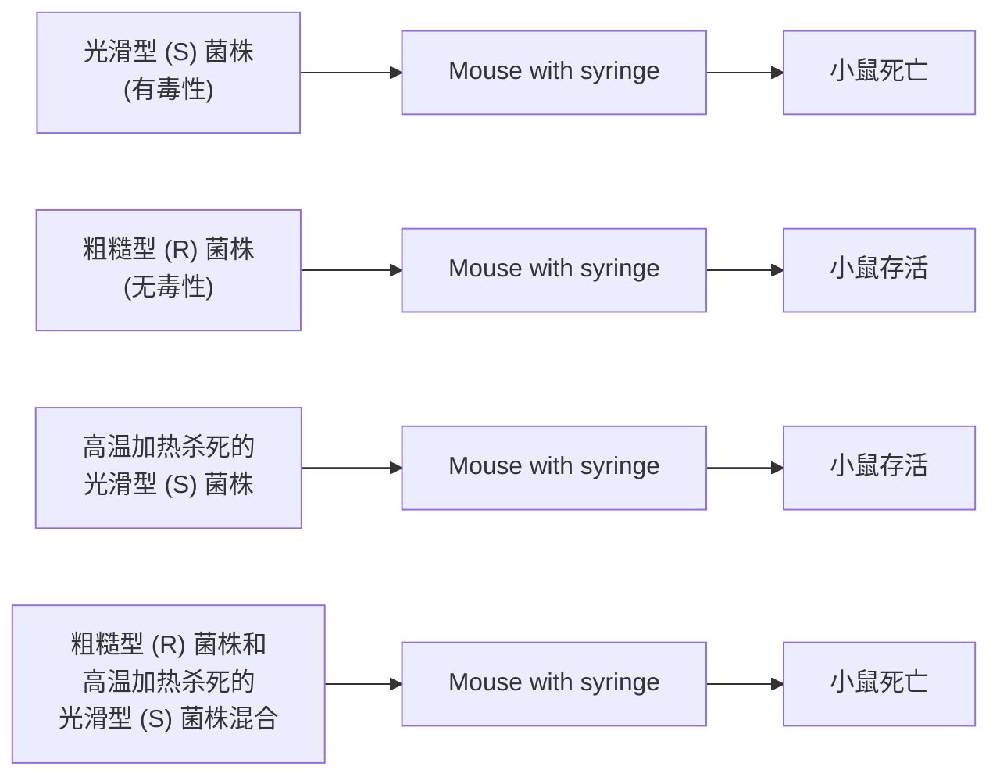
</details>

图2-2 格里菲斯的肺炎双球菌转化实验

行了关键性实验，发现了肺炎双球菌（pneumococcus）的“转化”能力，揭示了遗传物质的功能（图2-2）。他从肺炎双球菌中分离出两种不同的细菌类型——光滑型（smooth，S）和粗糙型（rough，R）。S型细菌是野生型，具有致病性，因能够在细胞外合成一层多糖荚膜而呈现光滑外表；而R型细菌是S型的突变体，没有致病能力，因无荚膜而呈现粗糙外表。格里菲斯发现，将活的R型菌和加热杀死的S型菌混合后注射到小鼠体内，会导致疾病，但单独注射这两种菌则没有致病效果。这一实验提出，经过高温杀死的S型菌内含有一种能够改变细菌遗传特性的物质，使R型菌转化为S型，并称之为“转化因子”。这一发现为遗传物质的存在提供了直接证据。

1944年，美国细菌学家奥斯瓦尔德·艾弗里（Oswald Avery，1877—1955）、科林·麦克劳德（Colin McLeod，1909—1972）和麦克林恩·麦卡蒂（Maclyn McCarty，1911—2005）从高温杀死的S型菌中提取无

---

第一节 遗传基础

023


<details>
<summary>flowchart</summary>

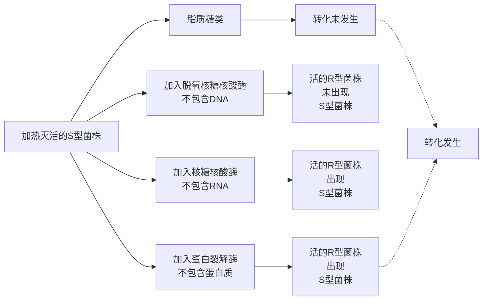
</details>

图2-3 艾弗里的肺炎双球菌转化实验

细胞液并纯化出了“转化因子”（图2-3）。他们的进一步实验发现，纯化的“转化因子”仍然具有转化活性，直到加入一种能够降解脱氧核糖核酸（deoxyribonucleic acid，DNA）的酶才完全破坏了这一活性。因此，科学家们得出结论:“DNA是Ⅲ型肺炎球菌转化因子的基本单位”。这一实验进一步验证了格里菲斯的发现，首次提出了DNA是遗传物质。艾弗里团队的这项革命性发现得益于洛克菲勒大学（Rockefeller University）跨学科的科研环境。尽管艾弗里的团队由生物学家构成，但他们与该校的化学家有着密切的合作与交流，这种跨学科的互动为识别DNA作为遗传物质的关键因素提供了新的视角和方法。他们的工作在理解DNA的化学性质和生物功能方面迈出了重要一步，为后来的DNA双螺旋（DNA double helix）结构的发现奠定了基础。

## 4. 噬菌体感染实验

1952 年，艾尔弗雷德·赫尔希（Alfred Hershey，1908—1997）和马莎·蔡斯（Martha Chase，1927—2003）利用 T2 噬菌体进行实验，最终确定了遗传物质是核酸而不是蛋白质（图 2-4、图 2-5）。他们使用了两种不同的同位素来标记两种大分子——硫（$^{35}$S）用于标记蛋白质，磷（$^{32}$P）用于标记 DNA。通过用这两种不同同位

素标记的噬菌体感染大肠杆菌，并测定同位素的位置，他们发现:当使用  ${}^{35}$ S 标记的噬菌体感染细菌时，放射性物质依然分布在噬菌体的外壳部分，而当使用  ${}^{32}$ P 标记的噬菌体感染细菌时，放射性物质则分布在大肠杆菌细胞内。这一实验清晰地表明，进入细胞的遗传物质是 DNA，而不是蛋白质。这一发现进一步巩固了 DNA 作为遗传物质的地位。

通过这些重要实验，科学家们逐渐确定了核酸是主要的遗传物质，并深入了解了其在遗传过程中的关键作用。这些发现为遗传学的发展奠定了坚实的基础，为我们理解生命的遗传机制提供了关键


<details>
<summary>text_image</summary>

DNA
蛋白质
头
颈
尾鞘
尾丝
基板
2D
3D
</details>

图 2-4 T2 噬菌体构造

---

024

第二章 遗传基础和基因组学

图2-5 T2噬菌体侵染大肠杆菌的实验


<details>
<summary>flowchart</summary>

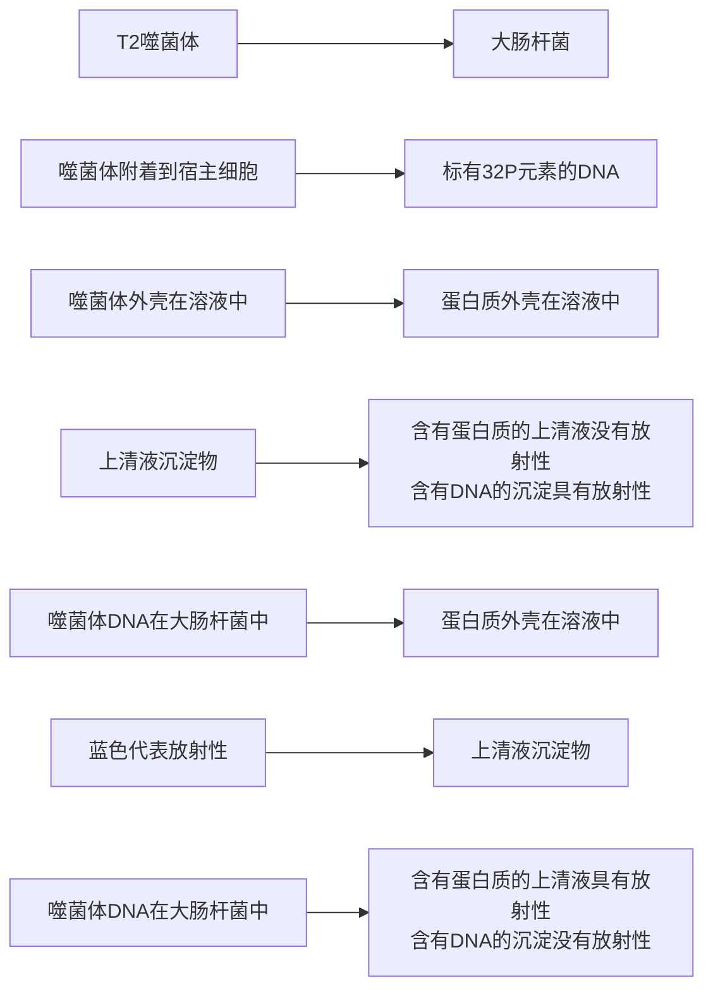
</details>

的见解。在本书的后续章节中，我们将更深入地探讨生物的主要遗传物质——DNA 的结构和功能。

## 三、DNA 的分子结构

## 1. DNA 的化学结构

20 世纪初期，科学家们在前人发现核酸的基础上，进一步纯化了 DNA 和核糖核酸（ribonucleic acid, RNA），并阐明了它们的组成和化学结构。核苷酸（nucleotide）是构成核酸的基本单元，研究人员发现，DNA 分子由 4 种相似但不同的脱氧核苷酸（deoxynucleotide）构成，每种核苷酸的化学结构由中心的脱氧核糖，与 5' 碳端连接的一个无机磷酸盐以及与 1' 碳端连接的一个含氮碱基组成（图 2-6）。碱基又可分为 4 种类型:腺嘌呤（adenine, A）、胸腺嘧啶（thymine, T）、胞嘧啶（cytosine, C）和鸟嘌呤（guanine, G）。与 DNA 分子不同，RNA 分子的中心五碳糖为核糖（即 2' 碳端未脱氧），并在 4 种碱基类型中以尿嘧啶（uracil, U）取代胸腺嘧啶。在 20 世纪 40 年代晚期，奥地利裔美国人埃尔文·查戈夫（Erwin Chargaff, 1905—2002）发现，在任何物种的 DNA 中，腺嘌呤和胸腺嘧啶的含量大致相同；同时，鸟嘌呤和胞嘧啶的含量也大致相同。这一发现后来被称为碱基互补配对原则（Chargaff law）（图 2-7），为理解 DNA 分子结构提供了重要线索。

## 2. DNA 的物理结构

从 20 世纪 30 年代起，科学家们开始用 X 射线晶体衍射技术对生物大分子进行成像。1952 年，英国化学家、X 射线晶体学家罗莎琳德·富兰克林（Rosalind Franklin，

---

第一节 遗传基础

025


图 2-6 核苷酸的结构

脱氧核糖核酸（DNA）

图2-7 碱基互补配对


1920—1958）和她的研究生雷蒙·葛斯林（Raymond Gosling，1926—2015）拍摄到了一张DNA的X射线衍射照片，即著名的“照片51号”。这张照片被誉为“有史以来最美的X射线照片之一”（图2-8）。这一照片证明了DNA分子的有序螺旋状结构。由于和导师及同事不合，富兰克林离开了她就职的伦敦国王学院。随后，葛斯林将“照片51号”分享给了他后来的导师、同在伦敦国王学院使用X射线晶体衍射技术研究DNA结构的莫里斯·威尔金斯（Maurice Wilkins，1916—2004）。1953年，威尔金斯将“照片51号”展示给了来国王学院访问的朋友、美国生物学家詹姆斯·沃森

---

026

第二章 遗传基础和基因组学


<details>
<summary>natural_image</summary>

Circular abstract texture with a central dark spot and faint curved patterns (no text or symbols)
</details>

图2-8 富兰克林拍摄的DNA晶体衍射图片（左）与沃森和克里克搭建的DNA双螺旋模型（右）


(James Watson)，并参与了对DNA模型的讨论与后续修正。沃森和同在剑桥大学卡文迪许实验室工作的英国物理学家弗朗西斯·克里克（Francis Crick，1916—2004），结合富兰克林的衍射图像、查戈夫的碱基互补配对原则、DNA分子的物理排列以及核苷酸的化学结构，提出了著名的DNA双螺旋模型（图2-8）。他们的研究成果发表在Nature杂志（1953）。根据他们的模型，DNA分子由两条平行但方向相反的链组成，这两条链以右手螺旋绕成一个圆柱体；两条链的外侧骨架由核糖和磷酸二酯键连接而成，而内侧则由氢键连接的AT或GC碱基对组成。

磷酸二酯键共价连接一个核苷酸分子的 $3^{\prime}$ 碳端以及下一个核苷

酸的 $5^{\prime}$ 碳端。这种连接方式赋予了DNA单链方向性，其中一个端点被称为 $5^{\prime}$ 端，另一个端点被称为 $3^{\prime}$ 端。两条链通过相反的方向平行连接，形成一个由强亲水性的磷酸基团排列在外侧的螺旋结构。DNA双链内侧配对的碱基通过氢键连接。腺嘌呤和胸腺嘧啶碱基之间有2个氢键连接，而鸟嘌呤和胞嘧啶碱基之间有3个氢键连接，因此双链内侧的化学结构非常稳定。研究表明，DNA双螺旋结构形成的圆柱体直径为 $20\AA$ （$1\AA$ 为 $10^{-10}\mathrm{m}$），每个螺旋周期的间距为 $34\AA$，而相邻碱基对之间的上、下间距为 $3.4\AA$，因此一次螺旋是由10对核苷酸缠绕而成的精密结构。

在沃森和克里克发表 DNA 双螺旋模型之前，因研究蛋白质的  $\alpha$  螺旋和  $\beta$  折叠二级结构而闻名的美国化学家莱纳斯·鲍林（Linus Pauling，1901—1994），也曾提出一个著名但错误的 DNA 模型。他认为 DNA 由三股螺旋缠绕而成，其中螺旋的磷酸骨架在内、碱基在外侧。鲍林假设骨架中间是中性不带电荷的磷酸基团，事实上核酸分子呈酸性，其磷酸基团带负电荷，而带负电荷的基团会相互排斥，不可能组成稳定的三螺旋核心。这是一个致命的矛盾，也催化了 DNA 正确模型的提出。在双螺旋模型发表后，鲍林曾公开发表导致他提出错误模型的几个重要原因，其中之一便是缺少高质量的 X 射线晶体衍射图像。

DNA 的双螺旋模型广泛存在于真核生物的细胞核染色体内，而在近年来的研究中，DNA 也被发现以其他形式的结构存在。例如，在一些细胞器和原核生物的染色体中可以找到环状的双链 DNA 结构，而一些 DNA 病毒则存在着体积较小的单链 DNA。此外，研究人员还发现自然界中不仅存在右手螺旋的 DNA 结构，还包括一些不规则的左手螺旋的 DNA 结构。

通过对 DNA 化学结构的理解，我们可以推断遗传信息是通过 4 种不同碱基的排列进行编码的，并且了解遗传信息是如何稳定存储的。DNA 双螺旋模型的提出为后续 DNA 高保真度的复制、转录和翻译等遗传信息传递过程的研究奠定了基础，推动了遗传学、分子生物学以及生物技术等领域的快速发展。沃森和克里克的 DNA 双螺旋模型代表着生物学领域的一次重大突破，他们与威尔金斯共同获得了 1962 年的诺贝尔生理学或医学奖。

---

第一节 遗传基础

027

## 四、DNA 的复制

## 1. 半保留复制假说

DNA 作为生物体内主要的遗传物质，其可能的复制机制早在科学家们研究 DNA 的分子结构时就已经引起了关注。由于 DNA 的骨架由稳定性较强的磷酸二酯键共价

连接，而骨架内部的碱基由稳定性较弱的氢键连接，这使得人们推测DNA的解旋是从内部氢键的断裂开始的。一旦DNA双螺旋解开，内部两条单链的碱基序列就会暴露出来，成为两条模板链（template strand）。依据严格的碱基互补配对原则，新的核苷酸分子可以与模板链上的碱基结合形成新的氢键，之后，新配对的核苷酸之间在某种酶的作用下共价连接成新链。经过这样的复制过程后，原始的DNA分子将产生两条新的DNA分子。每条新产生的DNA分子都包括一条原始的DNA链和一条新合成的DNA链，这样在每一代复制产物中都保留了上一代DNA分子的一半信息。这种复制假设被称为DNA的半保留复制（semiconservative replication），由沃森和克里克在1953年首次提出。当时对于DNA复制机制的假设存在许多不同的观点，除了半保留复制之外，还有原始链不变、仅形成新链的全保留复制假设，以及原始链和新链嵌合在一起的分散复制假设。直到1958年，美国遗传学、分子生物学家马修·梅瑟森（Matthew Meselson）和富兰克林·斯塔尔（Franklin Stahl）通过一项创新性的重氮实验，成功证明了DNA半保留复制假说的正确性（图2-9）。

梅瑟森和斯塔尔采用了同位素标记法来标记 DNA 中的氮原子，利用  ${}^{14}N$  和  ${}^{15}N$  之间的密度差异来区分原始 DNA 和


<details>
<summary>flowchart</summary>

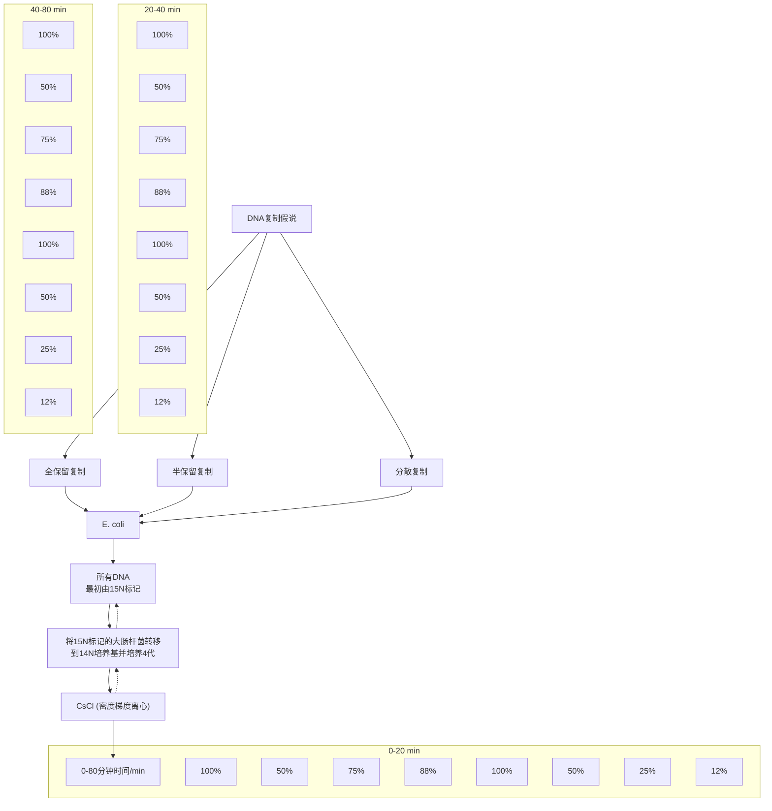
</details>

图2-9 梅瑟森和斯塔尔采用同位素标记法证明DNA半保留复制

---

028

第二章 遗传基础和基因组学

新合成的DNA。他们首先将大肠杆菌分别培养在仅含有 ${}^{14}\mathrm{N}$ 的培养基和仅含有 ${}^{15}\mathrm{N}$ 的培养基中，使细菌合成的DNA中含有对应的标记氮元素。为区分含 ${}^{14}\mathrm{N}$ 和含 ${}^{15}\mathrm{N}$ 的DNA，梅瑟森和斯塔尔将提取出的DNA样品放置在氯化铯溶液中进行密度梯度离心，这样不同密度的含 ${}^{14}\mathrm{N}$ 和含 ${}^{15}\mathrm{N}$ 样品就会在不同位置形成条带。他们观察到，在 ${}^{14}\mathrm{N}$ 培养基中生长的大肠杆菌DNA在接近离心管管口的位置形成了一条纯 ${}^{14}\mathrm{N}$ 条带，而在${}^{15}\mathrm{N}$ 培养基中生长的大肠杆菌DNA于接近离心管底部的位置形成一条纯 ${}^{15}\mathrm{N}$ 条带。接着、他们将在 ${}^{15}\mathrm{N}$ 中培养的大肠杆菌转移到 ${}^{14}\mathrm{N}$ 培养基中，经过大肠杆菌的一个复制周期后（约 $20\mathrm{min}$ ），取出了第一代子细胞DNA进行离心，并观察到离心管中出现了一条新的条带，位置介于纯 ${}^{14}\mathrm{N}$ 和纯 ${}^{15}\mathrm{N}$ 条带之间，这一结果表明新生成的DNA分子含有一条 ${}^{15}\mathrm{N}$ 标记的旧链和一条 ${}^{14}\mathrm{N}$ 标记的新链，与当时人们对半保留复制的假说是一致的。随后，梅瑟森和斯塔尔继续使用 ${}^{14}\mathrm{N}$ 培养基培养这批子细胞，再经过一个复制周期后，取出第二代子细胞的DNA进行离心，此时离心管中出现了两条条带，一条位于纯 ${}^{14}\mathrm{N}$ 条带的位置，另一条出现在纯 ${}^{14}\mathrm{N}$ 和纯 ${}^{15}\mathrm{N}$ 条带之间。这一结果进一步证实了半保留复制假说的正确性，即 ${}^{14}\mathrm{N}^{15}\mathrm{N}$ 混合的DNA双链再次分离，利用 ${}^{14}\mathrm{N}$ 培养基中的原料，形成了一条全新的 ${}^{14}\mathrm{N}$ 子链和一条 ${}^{15}\mathrm{N}^{14}\mathrm{N}$ 子链。这一实验不仅证明了DNA半保留复制机制的合理性，也推翻了全保留复制和分散复制的假设。

## 2. DNA 复制的分子机制

DNA 半保留复制机制的提出为科学家们研究遗传物质的复制与传递提供了坚实的基础。然而，DNA 复制的详细分子机制仍然不明。1956 年，美国生物化学家阿瑟·科恩伯格首次从正处于复制阶段的大肠杆菌中纯化出 DNA 聚合酶 I（DNA polymerase I，DNA Pol I），证明了 DNA 的合成与复制需要特定酶的介入，这种酶能够识别 DNA 复制的模板链，并催化游离核苷酸结合形成聚合物。科恩伯格还通过实验验证了体外的 DNA 复制过程是可再现的。这一重大发现揭示了 DNA 聚合酶在 DNA 复制过程中的核心作用，为人们理解遗传信息如何高效、准确地传递奠定了分子层面的基础，因此他于 1959 年获得了诺贝尔生理学或医学奖。1970 年，美国生物化学家托马斯·科恩伯格（Thomas Kornberg），即阿瑟·科恩伯格次子，发现了 DNA 聚合酶 II（DNA polymerase II，DNA Pol II）和 DNA 聚合酶 III（DNA polymerase III，DNA Pol III）。其中，DNA 聚合酶 III 和 DNA 聚合酶 I 是 DNA 复制过程中依赖的主要酶，而 DNA 聚合酶 II 则主要参与 DNA 修复。随着研究人员对 DNA 聚合酶结构解析和功能研究的深入，DNA 复制的分子机制得到了进一步的完善。

DNA 复制的分子机制包括 3 个核心步骤——起始、延伸和终止（图 2-10）。在 DNA 分子上存在特殊的短核苷酸序列，称为复制起始位点。首先，一些有特定功能的蛋白质与复制起始位点结合形成复合体，进而触发 DNA 解旋酶（helicase）打开双螺旋结构，形成两条 DNA 模板链与两个复制叉。单链结合蛋白与两条 DNA 单链结合，保持其稳定性。随后，携带碱基的游离脱氧核糖核苷酸根据碱基互补配对原则与模板链上的对应碱基形成氢键，再由 DNA 聚合酶Ⅲ在上游核苷酸链的 3' 碳末端与游离的脱氧核苷三磷酸（deoxyribonucleoside triphosphate，dNTP）的首个磷酸基团之间

---

第一节 遗传基础

029


<details>
<summary>flowchart</summary>

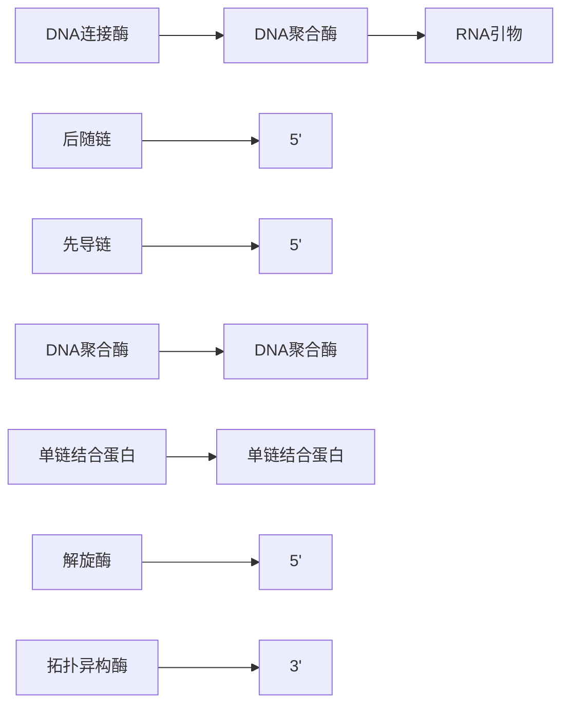
</details>

图2-10 DNA复制过程

形成磷酸二酯键，进而合成新的链。这一聚合过程的能量来源于DNA聚合酶切割上一个游离脱氧核苷三磷酸的高能磷酸键。由于DNA聚合酶Ⅲ只能从核苷酸链的3'碳端连接一个新核苷酸来形成新链，因此在模板链的3'端都需要一条引物来提供可连接的3'碳端。这些引物通常由一小段RNA组成，而连接RNA引物与模板链的酶则被称为引物酶（primase）。在延伸过程中，新链从模板链的3'端向5'端合成，也就是新链自身5'端至3'端的方向合成，并且复制叉也随着解旋酶的运动而前移。在这个过程中，随复制叉同向延伸的新链被称为先导链（leading strand），而与模板链反向互补，只能向复制叉相反方向延伸的新链被称为后随链（lagging strand）。先导链可以连续进行合成，而后随链只能以不连续的方式合成一系列片段。这些片段通常包含1000个左右的碱基对，被命名为冈崎片段（Okazaki fragment），以纪念最早发现这一现象的团队领导者——日本名古屋大学的冈崎令治（Okazaki Reiji，1930—1975）与冈崎恒子（Okazaki Tsuneko）夫妇。每当复制叉移动一段距离，引物酶就会在模板链上结合一段RNA引物，然后由DNA聚合酶将新核苷酸结合到引物片段的3'端，形成冈崎片段，一直延伸到前一段冈崎片段的RNA引物处。DNA聚合酶I介入两条相邻的端冈崎片段间，通过形成新的核苷酸片段来取代RNA引物。最后，DNA连接酶在片段间合成磷酸二酯键，得到一条完整的DNA新链。新链的延伸一直持续到整条DNA双链都被复制完毕才会终止。在真核生物中，DNA复制过程通常涉及多个复制起点的同时启动。

在上述DNA复制的过程中，不仅涉及已提及的一系列酶，还有其他更为复杂的酶系统参与，以确保复制过程的稳定性和准确性。例如，在DNA双链解旋的过程中，随着解旋酶的前进，前方未解旋的双链将会形成高度卷曲的复杂结构。此时，拓扑异构酶（topoisomerase）会与卷曲区域结合，切断DNA双链，使其恢复到松弛状态，然后再次修复双链。拓扑异构酶减少了复制过程中DNA链断裂的风险，同时维持了DNA分子的稳定性。此外，一些DNA聚合酶具有校对和修复错配碱基的作用。当新合成的碱基对发生错误配对时，DNA聚合酶会倒退一个碱基，利用核酸外切酶（exonuclease）删除错配碱基，然后重新形成正确的配对，从而保证了DNA复制过程的高保真性与遗传信息在传递过程中的准确性。

---

030

第二章 遗传基础和基因组学

## 3. DNA 复制原理的应用

DNA 的复制过程不仅是生命体遗传与发育的基础，还在生物技术的发展中发挥着重要的作用。基于 DNA 复制原理，科学家们发明了一代测序技术，也称为双脱氧终止法（dideoxy termination method），由费雷德里克·桑格（Frederick Sanger, 1918—2013）于 1977 年首次开发。这项技术利用双脱氧核苷酸（dideoxyribnucleoside triphosphate, ddNTP）随机终止 DNA 的复制过程，通过测定终止处的碱基，实现了 DNA 序列的确定。桑格的这一贡献使他在 1980 年第二次获得了诺贝尔化学奖。另一项革命性的技术是由凯利·穆利斯（Kary Mullis, 1944—2019）于 1983 年发明的聚合酶链式反应（polymerase chain reaction, PCR），这项技术通过交替使用 DNA 聚合酶和热循环来实现 DNA 的指数级扩增，使研究人员能够在短时间内大规模扩增特定 DNA 片段。凭借这一创新性成果，穆利斯于 1993 年获得了诺贝尔化学奖。这两项基于 DNA 复制机制的技术已成为遗传学、分子生物学和医学领域的关键工具，极大地推动了相关科学领域的研究和应用，为基因组学解析、新药研发、疾病诊断以及法医学等领域提供了重要支持。如今，它们仍然是生物学实验室中不可或缺的工具，并持续推动着现代生命科学和医学的发展。

## 五、中心法则

## 1. 中心法则的提出

DNA、RNA和蛋白质构成了生物体内的三大核心生物大分子，它们共同承载并传递着生物的遗传信息。在人们发现DNA作为主要的遗传物质并开始深入研究其分子结构的同时，另一些科学家已经开始致力于研究蛋白质的结构与功能。1951年，桑格成功地测定了第一个蛋白质——胰岛素的氨基酸序列，证明了蛋白质的一级结构由氨基酸序列所决定。桑格的这项开创性工作为后来中心法则与遗传信息流动的研究奠定了基础，也因此于1958年获得了他的第一个诺贝尔化学奖。随着DNA和蛋白质的分子结构逐渐被科学家们所揭示，一个关键性的问题浮现出来:核苷酸序列中的遗传信息是如何传递和体现在氨基酸序列中呢？

分子生物学的中心法则阐述了遗传信息在不同生物大分子之间的流动途径，这一理论最初由克里克于1957年提出。克里克认为遗传信息是由核酸编码，然后传递到氨基酸，形成蛋白质，而当信息一旦被转化为蛋白质后，就不会再流回DNA。这个理论强调了遗传信息流动的单向性。此外，克里克进一步预测，存在一种小分子适配器，这种小分子不仅能够准确识别核苷酸序列，还能合成相对应的氨基酸序列，这一假设中的小分子适配器后来被成功提取出来，并命名为转运RNA（transfer RNA，tRNA）。tRNA和核糖体RNA（ribosomal RNA，rRNA）的发现揭示了RNA作为中间介质在遗传信息传递过程中的关键作用，也为该过程中可能存在更多功能元件提供了线索，而后续信使RNA（messenger RNA，mRNA）的发现进一步印证了这一理论。1961年，两个实验室分别独立地发现了mRNA的存在，这一重要中间分子的

---

第一节 遗传基础

031


<details>
<summary>flowchart</summary>


</details>

图2-11 中心法则

作用是将存储于细胞核内的 DNA 信息传递到细胞质中，以便在细胞质中进行蛋白质的合成。至此、我们可以明确遗传信息从 DNA 到蛋白质的传递主要经历了两个阶段（图 2-11）、一是从 DNA 传递到 RNA，这一过程被称为转录（transcription）；二是从 RNA 传递到蛋白质，这一过程被称为翻译（translation）。

## 2. 转录的分子机制

转录是指根据碱基互补配对原则，将DNA链作为模板合成单链RNA序列的过程。与转录生成的RNA序列相同（除了RNA中的尿嘧啶替代了DNA中的胸腺嘧啶）的DNA链被称为编码链（coding strand），又叫有义链（sense strand）或非模板链（non-template strand），另一条DNA链被称为非编码链（non-coding strand）、反义链（antisense strand）或模板链。催化RNA合成的酶被称为RNA聚合酶（RNA polymerase）。与DNA聚合酶的功能相似，RNA聚合酶通过在核糖核苷酸分子的3'碳末端连接下一个核苷酸的磷酸基团来合成RNA。因此RNA合成的方向也是从自身的5'端往3'端延伸，而RNA聚合酶从DNA模板链的3'端向5'端移动。

转录过程主要包括起始、延伸和终止三个阶段（图2-12）。在转录起始阶段，RNA聚合酶识别启动子（promoter），即位于转录起始位点的特殊DNA序列，并与其结合以开启转录过程。由于DNA上存在许多个启动子，转录可以在多个不同位置同时进行。RNA聚合酶与启动子结合导致双链DNA解旋，暴露了内部的碱基序列，进而形成转录泡（transcription bubble）。酶复合物识别起始转录的核苷酸并依据碱基互补配对的原则在DNA模板链上结合对应的核糖核苷酸，其中A对应U，C对应G。随后，RNA聚合酶催化核糖核苷酸之间形成磷酸二酯键。随着新生成mRNA链的3'端不断结合新的核苷酸，RNA聚合酶逐渐释放启动子，并沿着模板向前移动，此时转录进入延伸阶段。

在延伸阶段，RNA聚合酶继续沿着模板链的 $3^{\prime}$ 端至 $5^{\prime}$ 端移动，通过破坏双链DNA间的碱基配对而使模板链暴露，同时催化新的核糖核苷酸与DNA模板结合形成DNA-RNA杂合链。与此同时，在转录泡后方，已经生成的RNA链从DNA模板上解离，形成 $5^{\prime}$ 端游离在双链外的一条单链RNA。而DNA模板链则重新与非模板链结合，恢复了双螺旋结构。之后，被释放的启动子便可能再次与新的酶复合物结合。转录过程的终止是由mRNA链上一段特殊序列——终止子（terminator）所触发的。终止子能与RNA单链结合形成一个稳定发夹结构的环，使RNA聚合酶无法继续在 $3^{\prime}$ 端添加新的核苷酸，从而导致酶复合物从DNA模板链上解离，并释放出mRNA。

---

032

第二章 遗传基础和基因组学


<details>
<summary>flowchart</summary>

This flowchart illustrates the process of RNA polymerization and editing, detailing steps from initial RNA binding to final mRNA cleavage and intracellular excretion.
</details>

图2-12 转录过程

## 3. 原核生物与真核生物在转录过程中的差异

转录过程在原核生物与真核生物之间存在许多差异。首先，转录所需的酶不同。在原核生物中，通常只有1种RNA聚合酶负责合成所有类型的RNA。然而，在真核生物中，核基因组中主要有3种不同类型的RNA聚合酶，各自负责合成不同类型的RNA。其中，RNA聚合酶Ⅱ负责合成全部的mRNA；RNA聚合酶I则是高度活跃的酶，主要负责合成rRNA——细胞中含量最多的RNA；RNA聚合酶Ⅲ则负责合成tRNA及其他小的非编码RNA（non-coding RNA，ncRNA）。2001年，DNA聚合酶发现者阿瑟·科恩伯格的长子，美国生物化学家、结构生物学家罗杰·科恩伯格（Roger Kornberg）团队发表了真核生物转录过程中RNA聚合酶Ⅱ的分子图像，首次从高分辨率解析了这个动态多蛋白复合体的结构。这一成果不仅是结构生物学领域的重大突破，还为深入理解真核生物的转录机制及基因表达的调控机制提供了关键的分

---

第一节 遗传基础

033

子基础。科恩伯格于2006年获得诺贝尔化学奖，与其父亲阿瑟·科恩伯格成为第六对获得诺贝尔奖的父子。真核生物与原核生物的转录过程除了RNA聚合酶不同之外，转录起始位点的启动子也有所不同。在原核生物中，启动子通常只需要结合RNA聚合酶和相应的 $\sigma$ 因子便可启动转录。而在真核生物中，启动子序列较为复杂，包括TATA框（TATA box）和多个转录因子（transcriptional factor）的结合位点，而RNA聚合酶需要与多个转录因子相互作用，形成一个完整的转录复合物，以启动转录。此外，真核生物的启动子功能还受到其他转录调控元件的影响，例如增强子（enhancer）与沉默子（silencer）等。增强子是位于启动子上游或下游的一段DNA序列，其距离不固定。它通过与转录因子结合以及DNA空间结构的折叠，与启动子相互作用，从而增强基因转录水平。另一差异在于，真核生物中的转录后mRNA需经过修饰或剪接。由于原核生物不具备细胞核，转录和翻译过程都发生在细胞质中。经过合成的mRNA可以直接参与蛋白质的翻译。然而在真核生物中，转录发生在细胞核，新合成的mRNA需要经过末端修饰来延长其存在的时间，直到被转运到细胞质中用于翻译。首先，在转录开始的前几个核糖核苷酸形成前体mRNA的 $5^{\prime}$ 端，通常会被添加一个或多个甲基基团，形成甲基化帽。这一过程有助于保护mRNA不被降解。在前体mRNA从DNA-RNA杂合物解离之后，$3^{\prime}$ 端形成，随后由polyA聚合酶在其末端添加200个左右的多腺嘌呤尾部，形成polyA尾。这一过程不仅可提高了mRNA的稳定性，还帮助核孔复合物识别成熟的mRNA并将其转运到细胞质。此外，在高等真核生物中，存在许多不连续的基因结构，这些基因被称为断裂基因（split gene）。它通常由外显子（exon）和内含子（intron）交替组成，外显子是在DNA与成熟mRNA中都存在的序列，而内含子是在DNA中存在但在成熟mRNA中不存在的序列。通过对比真核生物基因的DNA序列长度与相应mRNA序列长度，研究人员发现基因的DNA序列往往长于mRNA序列。这是因为在真核生物中，由DNA模板合成的前信使RNA（precursor mRNA）在成为成熟mRNA之前还会经历可变剪接，RNA分子会在不同内含子的下游与上游处被切割和重新连接，从而产生不同的mRNA变体。真核生物的基因序列普遍经历可变剪接过程，这丰富了蛋白质的结构多样性和功能多样性，解释了基因的表达特异性、功能特异性以及可调控性。这一系列复杂而精确的转录中调控和转录后修饰过程，使真核生物在基因表达和表型多样性上具有了远超原核生物的调控灵活性和多样性。

## 4. 遗传密码的破解

翻译是以RNA序列为模板合成氨基酸序列的过程，在此过程中，遗传信息真正从核酸传递至蛋白质。这两者在组成与结构方面存在显著差异:核酸序列的信息主要由4个不同的碱基编码，而蛋白质序列的信息则由20种常见氨基酸编码。那么遗传信息又是如何对应与传递的呢？正如解密战争年代的摩尔斯电码一样，科学家们相信必定存在一种遗传密码，能够将RNA序列与蛋白质序列联系起来，从而指导蛋白质的合成。这一套密码，现在被称为密码子（codon），终于在三组科学家的共同努力之下真相大白。

---

034

第二章 遗传基础和基因组学

1961年，美国生物化学及遗传学家马歇尔·尼伦伯格（Marshall Nirenberg, 1927—2010）与他的博士后海因里希·马特伊（Heinrich Matthaei）设计了一种精巧的体外蛋白质翻译系统，首次揭示了苯丙氨酸的密码子由多个尿嘧啶核苷酸组成。尼伦伯格和马特伊首先通过裂解大肠杆菌创造了一个无细胞的体外翻译系统，该系统中包含了所有必要的翻译元件（例如核糖体），并添加了DNA酶以防止其他RNA模板的产生。然后，他们往系统中加入了仅由尿嘧啶核苷酸单一组成的mRNA模板，以及20种常见氨基酸单体作为合成蛋白质的基础原料。在每次实验中，他们只用放射性同位素 $^{14}\mathrm{C}$ 标记了20种常见氨基酸中的一种，以检验系统内是否出现带有放射性标记的多肽。当他们加入放射性标记的苯丙氨酸时，系统内确实检测到了带有放射性的蛋白质产物；相反，当标记其余氨基酸时，均未检测到放射性产物的生成。这一结果表明、多聚的尿嘧啶核糖核苷酸只有可能是苯丙氨酸的密码子。随后的一系列实验陆续验证了多聚胞嘧啶、多聚腺嘌呤和多聚鸟嘌呤等密码子所编码的氨基酸类型。在此之后，美国生物化学家哈尔·科拉纳（Har Gobind Khorana, 1922—2011）根据不同规律合成了二联、三联和四联的寡聚核酸，并相继验证了它们编码的氨基酸序列，这为探究核酸密码的最小单位奠定了基础。1964年，美国生物化学家罗伯特·霍利（Robert Holly, 1922—1993）对tRNA进行了成功的分离、测序以及结构解析，揭示了tRNA是遗传信息从RNA向氨基酸传递的重要适配分子。tRNA具有复杂的三级结构，由单链内部部分序列的碱基配对，形成带有短互补区域的二级结构，然后在三维空间中发生折叠扭曲，形成了类似倒L型的三级结构（图2-13）。在倒L型结构的底端存在可以与mRNA密码子互补配对的区域，这一区域被称为反密码子（anticodon）。而在倒L型结构的另一端，则为氨基酸的附着位点。这些深入而系统的研究不断推进着遗传

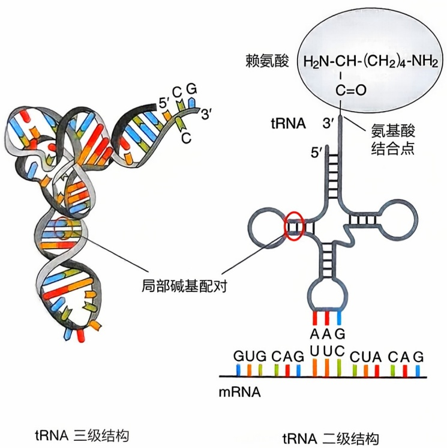

<details>
<summary>text_image</summary>

tRNA 三级结构
局部碱基配对
赖氨酸 H₂N-CH-(CH₂)₄-NH₂ C=O
tRNA 3'
氨基酸结合点
AAG
GUG CAG UUC
CUA CAG
mRNA
tRNA 二级结构
</details>

图 2-13 tRNA 结构

密码的破解工作。直到1965年，尼伦伯格与其同事菲利普·莱德尔（Philip Leder，1934—2020）再一次设计了巧妙的实验方法，进一步揭示了遗传密码以三联体形式存在，并且成功破解了大多数尚未解码的密码子。在这次实验中，尼伦伯格和莱德尔采用了长度极短的三聚核糖核苷酸序列和20种已与tRNA结合的氨基酸作为合成蛋白质的模板与原料，每次实验只有一种氨基酸被标记了放射性同位素 $^{14}$ C。接下来，他们将合成产物倒入特制的过滤器中，该过滤器的设计基于一个原理:只有与对应三核苷酸密码子结合的tRNA才会与核糖体结合形成翻译复合物，从而被捕获在过滤器中的硝化纤维素膜上，在过滤器中显示放射性。若tRNA未结合对应的密码子，它将不会与核糖体结合，因此不会被过滤器捕获，过滤器中不会显示放射性。通过这一改进的实验方法，尼伦伯格终于在1966年成功解出了全部20种氨基酸所对应的密码

---

第一节 遗传基础

035

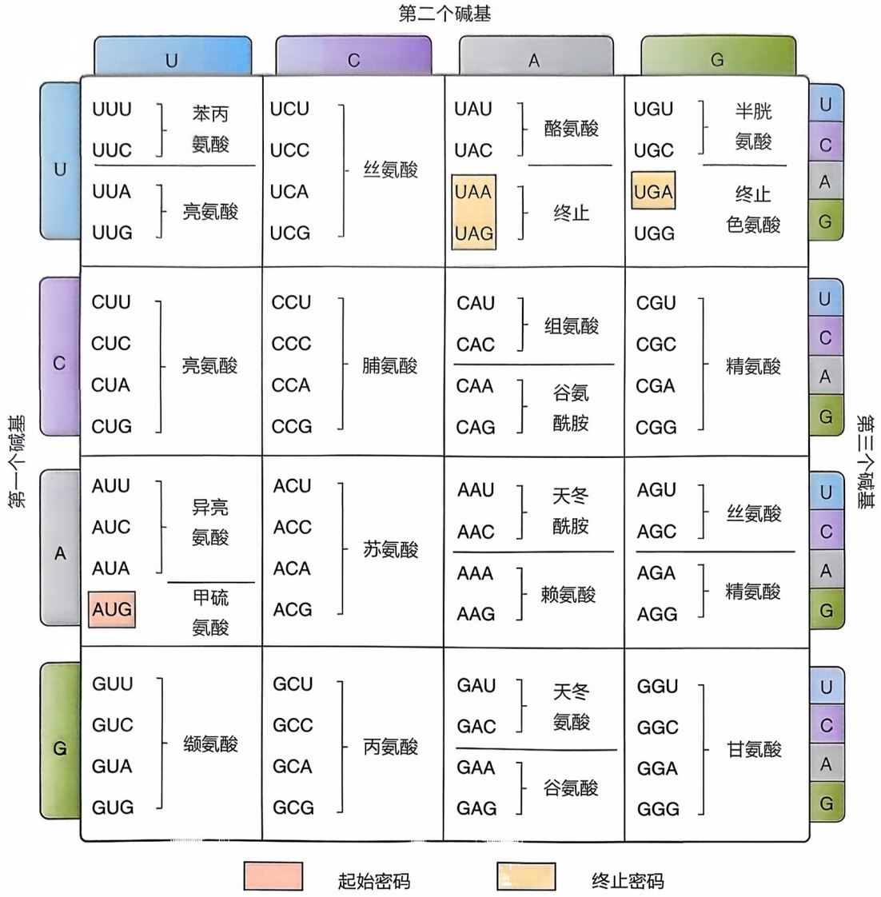

<details>
<summary>text_image</summary>

第二个碱基
U
UUU
UUC
苯丙氨酸
亮氨酸
CUU
UCU
UCC
丝氨酸
UCA
UCG
UAU
酪氨酸
UAC
终止
UAA
UGU
半胱氨酸
UGC
氨酸
UGA
终止色氨酸
UGG
U
C
A
G
C
C
亮氨酸
CCU
CCU
CCCA
CCG
脯氨酸
CAU
CAU
组氨酸
CAC
CAA
CAG
谷氨酰胺
CGU
CGC
CGA
CGG
精氨酸
A
AUU
AUU
异亮氨酸
AUA
AUA
甲硫氨酸
ACU
ACU
苏氨酸
AAU
AAU
天冬酰胺
AAA
AAA
赖氨酸
AGU
AGU
丝氨酸
AGA
AGG
精氨酸
G
GUU
GUU
缬氨酸
GCU
GCC
GCA
GCG
丙氨酸
GAU
GAU
天冬氨酸
GAC
GAA
GAG
谷氨酸
GGU
GGU
甘氨酸
GUG
GUG
</details>

图2-14 遗传密码表

子，解开了64种三联遗传密码中的54种（图2-14）。随后，科学家们进一步解码了终止密码子，并揭示了遗传密码的极性、简并性、通用性等特性。遗传密码的完整解码和对蛋白质合成的深入理解，给分子生物学、遗传学，以及生物工程领域带来了深远的影响。为表彰尼伦伯格、科拉纳和霍利三位科学家在遗传密码破解方面做出的卓越贡献，他们于1968年被授予了诺贝尔生理学或医学奖。

## 5. 翻译的分子机制

解开遗传密码后，遗传信息从 RNA 流向蛋白质的过程也就迎刃而解。翻译过程中所需的主要功能元件包括 mRNA、核糖体、tRNA，以及一系列重要的酶和蛋白质因子，如氨酰 tRNA 合成酶（催化氨基酸与 tRNA 结合）和肽酰转移酶（催化氨基酸链从 N 端向 C 端增长）。与 DNA 的复制和转录一样，翻译包括起始、延伸和终止三个阶段（图 2-15）。翻译过程在核糖体上完成，核糖体的结构可以分为一大一小两个亚基，共同组成了 tRNA 结合的三个位点——从右往左分别为 A、P、E 位点。在翻译起始阶段，核糖体小亚基首先与 mRNA 单链的 5' 端结合，在一些蛋白质因子的作用下与 tRNA 启动子（携带甲硫氨酸的 tRNA）结合，识别起始密码子，形成起始复合体。

---

036

第二章 遗传基础和基因组学

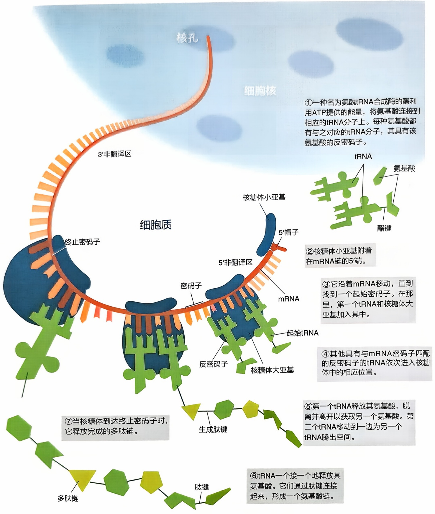

<details>
<summary>text_image</summary>

核孔
细胞核
①一种名为氨酰tRNA合成酶的酶利用ATP提供的能量，将氨基酸连接到相应的tRNA分子上。每种氨基酸都有与之对应的tRNA分子，其具有该氨基酸的反密码子。
3'非翻译区
终止密码子
核糖体小亚基
5'帽子
mRNA
起始tRNA
反密码子
核糖体大亚基
生成肽键
肽键
多肽链
②核糖体小亚基附着在mRNA链的5'端。
③它沿着mRNA移动，直到找到一个起始密码子。在那里，第一个tRNA和核糖体大亚基加入其中。
④其他具有与mRNA密码子匹配的反密码子的tRNA依次进入核糖体中的相应位置。
⑤第一个tRNA释放其氨基酸，脱离并离开以获取另一个氨基酸。第二个tRNA移动到一边为另一个tRNA腾出空间。
⑥tRNA一个接一个地释放其氨基酸。它们通过肽键连接起来，形成一个氨基酸链。
</details>

图2-15 翻译过程

然后核糖体大亚基与之结合，形成完整的核糖体。此时，tRNA 启动子直接位于核糖体的 P 位点中。在延伸过程中，新的携带氨基酸的 tRNA 进入核糖体的 A 位点，然后识别并结合位于 mRNA 上 3' 端方向的下一个密码子。肽酰转移酶催化 P 位点与 A 位

---

第一节 遗传基础

037

点之间的氨基酸形成肽键，将合成的肽链转移到A位点的tRNA上。然后，核糖体向mRNA的 $3^{\prime}$ 方向移动一个密码子的距离，空出A位点，使携带肽链的tRNA位于P位点、而空载的脱酰tRNA位于核糖体末端的E位点。随后，携带下一个密码子对应氨基酸的tRNA进入A位点，E位点的脱酰tRNA离开核糖体，完成一个翻译循环。随着mRNA不断从 $5^{\prime}$ 端向 $3^{\prime}$ 端相对位移经过核糖体，肽链也不断由N端向C端延伸。mRNA上的终止密码子与任何tRNA的反密码子都不配对，而是与被称为释放因子的蛋白质功能元件结合。因此当核糖体A位点移动到mRNA终止密码子对应位置时，蛋白质释放因子识别终止密码子，停止肽链的合成，并使tRNA释放合成的肽链。接着在其他释放因子的共同作用下，核糖体释放最后一个脱酰tRNA，并解聚成大、小亚基，完成翻译的终止过程。翻译完成的肽链并不会直接折叠成具有功能的蛋白质，而往往会经历一系列的翻译后修饰，如肽链的截断、磷酸化和甲基化，以成为成熟且具有功能的蛋白质。这些修饰过程调控蛋白质的活性和稳定性，影响蛋白质与其他分子的相互作用和定位，是细胞精准调控蛋白质合成与性状表达的重要机制。

## 6. 原核生物与真核生物在翻译过程中的差异

与转录过程相似，原核生物的翻译过程与真核生物有许多显著的差异。首先，这两类生物的核糖体在大小和 rRNA 含量上有着明显的不同，导致了它们在翻译起始阶段的一些差异。例如，起始 tRNA 携带的氨基酸，核糖体小亚基与 mRNA 的结合位点，以及翻译启动所需的蛋白质因子在原核生物和真核生物之间均有所不同。其次，原核生物 mRNA 不需要经过转录后修饰便可直接参与翻译，因此其 mRNA 上存在许多核糖体结合位点，可同时翻译几种不同的多肽。而真核生物的成熟 mRNA 在 5' 端修饰有甲基化帽，这使得核糖体小亚基首先与 5' 甲基化帽结合，导致一条 mRNA 在同一时间内只能被翻译成一种多肽。最后，原核生物在蛋白质翻译完成后不会经历大规模的修饰，这一点也与真核生物中常见的丰富多样的翻译后修饰过程形成鲜明对比。

## 7. 中心法则的拓展

在探讨遗传信息的流动时，我们通常遵循中心法则，即信息从DNA复制到DNA、从DNA转录到mRNA，以及从mRNA翻译到蛋白质。除此之外，科学家们还发现了一些特殊的信息传递途径（见图2-11）。其中，反转录酶（reverse transcriptase）的发现尤为重要。1970年，美国病毒学家霍华德·特明（Howard Temin，1934—1994）和戴维·巴尔的摩（David Baltimore）分别独立从两种肿瘤病毒中分离出反转录酶，他们发现这种酶能够以单链RNA为模板合成互补DNA（complementary DNA，cDNA）单链。这一发现挑战了传统的中心法则，并揭示了RNA病毒如何实现自我复制和繁衍:它们在宿主体内利用宿主原料复制自身基因，并将合成的cDNA整合到宿主基因组中。这一发现不仅有助于我们理解RNA病毒（如HIV病毒）的遗传和感染机制，而且对于病毒学和癌症研究都具有深远的影响。因此，这一发现使特明和巴尔的摩在1975年与研究肿瘤病毒的意大利裔美国病毒学家罗纳托·杜尔贝科（Renato Dulbecco，1914—2012）共同获得了诺贝尔生理学或医学奖。反转录酶的发现不仅拓展了中心法则的范畴，也推动了分子生物学技术的发展，为后来的科学研究打开了新

---

038

第二章 遗传基础和基因组学

的视野和可能性。此外、研究人员还发现了 RNA 可以以自身为模板进行复制的现象。这一过程涉及一种不同于转录过程中 DNA 依赖的 RNA 聚合酶，这种酶是以 RNA 为模板的 RNA 聚合酶，在 RNA 病毒的基因组中被发现。这些发现进一步丰富了我们对于生命现象的理解，并为未来的研究奠定了基础。

然而，正如克里克在20世纪50年代提出的观点一样，一旦遗传信息传递到蛋白质后、就不再反向传递。迄今为止，人们尚未发现以蛋白质为起点，向DNA、RNA甚至向蛋白质本身传递遗传信息的途径。遗传信息的流向被认为是单向的，从DNA到RNA再到蛋白质，但这个领域的研究仍在不断深入。我们期待在未来能有更多新的发现、以揭示生命科学中仍然未知的领域。

## 第二节 细胞质遗传

19 世纪晚期，科学家们已经认识到，遗传物质是以染色体的形式存在于真核生物的细胞核中，其遗传机制遵循了孟德尔提出的分离定律与自由组合定律。然而，在 1909 年，德国植物学与遗传学家卡尔·科伦斯（Carl Correns，1864—1933）却在紫茉莉中发现了一种截然不同的遗传规律（图 2-16）。紫茉莉拥有 3 种不同的叶色性状，分别是白色、绿色和杂色。科伦斯发现，当白叶的母本与任何叶色的父本进行杂交时，所有子代都表现出白叶的性状；当绿叶的母本与任何叶色的父本杂交时，所有子代均呈现绿叶的性状；而当杂色的母本与任何叶色的父本进行杂交时，子代表现出或白叶，或绿叶，或杂色叶的性状分布。紫茉莉子代叶色性状无法通过孟德尔定律进行预测，这一遗传学现象被称为非孟德尔遗传（non-Mendelian inheritance）。后来，人们把紫茉莉中由母本性状决定的这种遗传方式称为母系遗传（maternal inheritance）。在不同的模式生物，如玉米和酿酒酵母中，母系遗传现象也逐渐被发现；在藻类生物中，父系遗传（paternal inheritance）现象也被发现。母系和父系遗传也被统称为单亲遗传（uniparental inheritance）。直到 20 世纪 60 年代，科学家在细胞质中发现了位于线粒体和叶绿体中的 DNA，这些非孟德尔遗传现象才得到合理解释。由于控制这些非孟德尔遗传现象的遗传物质都位于细胞核外的细胞质中，具有诸如单亲遗传、随细胞分裂不均衡随机分配等非孟德尔遗传机制，它们被统称为细胞质遗传（cytoplasmic inheritance）（Nakamura et al., 2016; Camus et al., 2022）。细胞质遗传物质的发现和遗传机制的研究，帮助人们更全面地理解遗传物质和生物性状之间的关系。本节我们将一起探索细胞质遗传的现象和规律。

## 一、细胞质遗传的概念和类型

与细胞核内的 DNA 以单一染色体的存在形式不同，细胞质遗传物质的种类和载体更加多样化。根据细胞质遗传物质是否以细胞器为载体可大致分为两类:细胞

---

第二节 细胞质遗传

039

产生卵子的母本（♀）

图2-16 紫茉莉分枝和叶色遗传

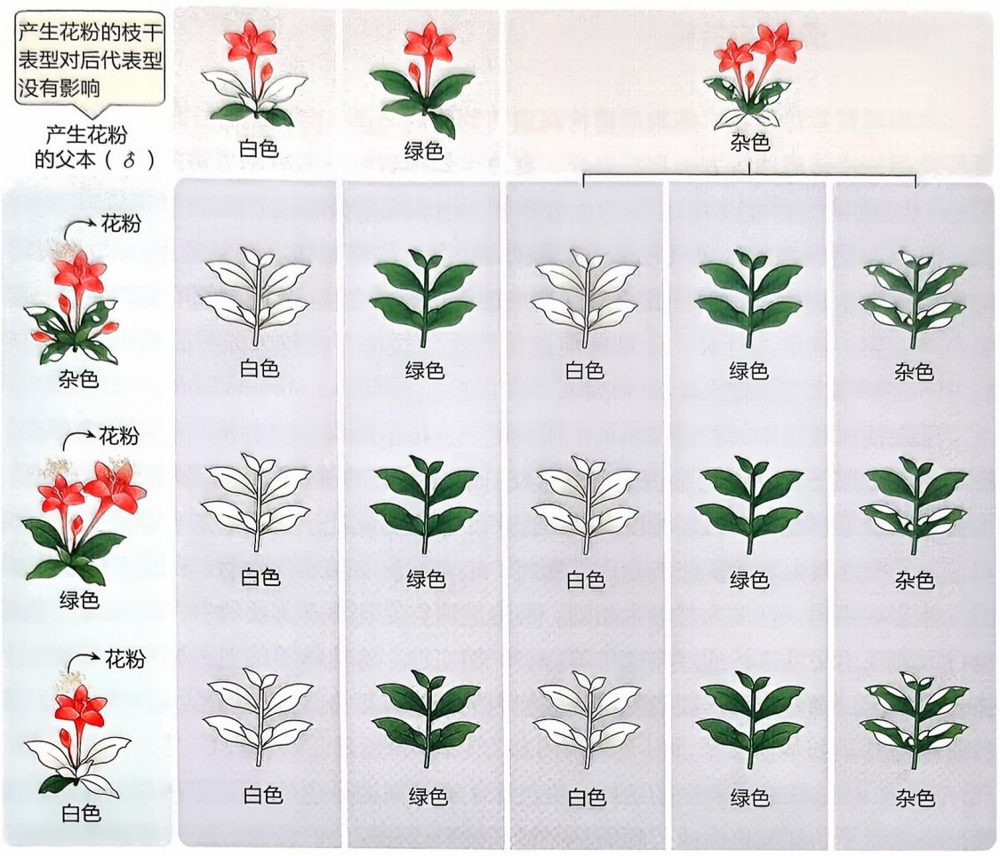

<details>
<summary>text_image</summary>

产生花粉的枝干
表型对后代表型
没有影响
产生花粉
的父本（♂）
白色
绿色
杂色
杂色
白色
绿色
白色
绿色
杂色
杂色
白色
绿色
白色
绿色
杂色
白色
绿色
白色
绿色
杂色
</details>

器基因组和非细胞器基因组。细胞器基因组主要包括线粒体基因组（mitochondrial genome）、叶绿体基因组（chloroplast genome）、中心粒基因组（centriole genome）、动粒基因组（kinetoplast genome）、膜体系基因组（plastid genome）；非细胞器基因组主要包括共生体基因组（symbiont DNA）、细菌质粒基因组（plasmid DNA）等（Hartwell et al., 2011; Pierce et al., 2013）。另外，本书将没有细胞结构的微生物的遗传物质，如病毒、噬菌体等，也归类为细胞质遗传物质。总的来说，生物界的遗传物质和载体可以概括如下:

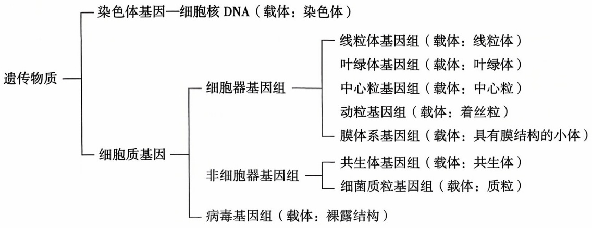

<details>
<summary>flowchart</summary>

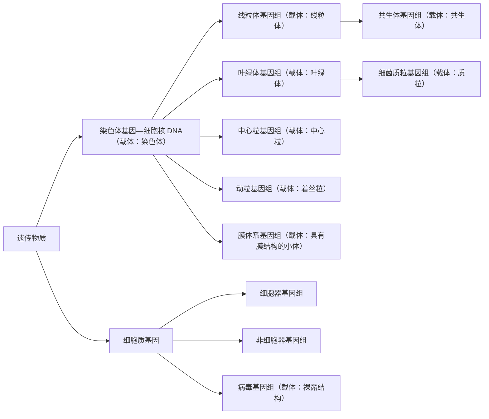
</details>

---

040

第二章 遗传基础和基因组学

## 二、细胞质遗传的特征

与细胞核遗传相比，细胞质遗传在遗传物质的种类、空间位置、结构和载体，以及所遵循的遗传规律等方面存在差异。真核生物细胞核与细胞质遗传的主要遗传物质是DNA，但某些病毒以RNA作为遗传物质。细胞质遗传物质存在的空间位置主要包括:真核生物细胞核外（线粒体、叶绿体等），细菌等原核生物的质粒，以及病毒、噬菌体等微生物的蛋白质外壳内等。真核生物的核内DNA紧密缠绕在组蛋白上，以染色体（质）的形式存在，而细胞质遗传物质的结构存在较大差异，多为裸露的环状、不规则环状、单链或者双链结构。

细胞核和细胞质的遗传物质都是通过配子遗传给后代。细胞核的遗传物质存在于雌配子和雄配子中，无论是正交还是反交，后代的表型都相同。而细胞质遗传物质，主要存在于单亲配子中，即雌配子或雄配子，通常为雌配子。由于这种单亲遗传的特点，当某个性状由细胞质遗传物质控制时，正交和反交的后代性状与细胞质遗传物质的供体亲本相同，且多为与母本相同。最近的研究发现，在某些物种中，细胞质遗传也可以表现出父系遗传或双亲遗传等特点。而病毒、噬菌体等的遗传物质多依赖宿主遗传给后代，例如病毒需要借助宿主细胞内的细胞机器合成后代DNA或RNA以及蛋白质外壳。

另外，细胞核遗传物质的载体（染色体）通过同源染色体的联会和自由分配机制保证雌雄配子的细胞核内遗传物质是完整且被平均分配的。然而，细胞质遗传物质的载体（例如具有DNA的细胞器）没有类似的均分机制。遗传物质伴随细胞分裂相对随机分配给后代，子代的表型取决于所携带的野生型和突变型遗传物质的相对数目。

## 三、细胞核遗传与细胞质遗传之间的关系

维持细胞及其细胞器正常功能所需的蛋白质和其他物质主要由细胞核内的遗传物质编码并合成。然而，某些与细胞器功能紧密相关的蛋白质可由细胞质中的遗传物质独立编码并合成。此外，某些生化过程可能需要细胞核和细胞质中的遗传物质共同作用。以细胞色素c氧化酶（cytochrome c oxidase）为例，该复合物是呼吸作用电子传递链的第四个中心酶复合物，位于线粒体内膜上。在哺乳动物细胞中，细胞色素c氧化酶由13个亚基构成，其中10个亚基由细胞核的mRNA编码并在细胞质中的核糖体上合成，而另外3个亚基则由线粒体mRNA编码并在线粒体中的核糖体上合成。随后，这13个蛋白质亚基在线粒体膜转运蛋白处完成组装。这种核质互作关系是在生命进化中逐渐发展起来的。根据共生体学说（endosymbiont theory），细胞器如线粒体和叶绿体，最初是独立的原核生物。在亿万年前，它们进入宿主细胞后逐渐失去了自主复制和独立生存的能力，但保留了其特有的遗传物质和代谢功能。它们为宿主细胞提供能量，而宿主细胞则为这些细胞器提供保护和营养，并从中受益。尽管共生体学说在

---

第二节 细胞质遗传

041

提出时遭到了一些质疑和争议，但随着科学技术的不断进步和新证据的积累，它逐渐得到了更多的支持和认可。

## 四、细胞质遗传的机制

细胞质遗传，特别是细胞器遗传，主要表现为单亲遗传，尤其以母系遗传为主。因此，后代的表型受到母系的影响。鉴于细胞质遗传载体和模式的多样性，我们选取线粒体、叶绿体和病毒作为典型例子，详细介绍细胞质遗传的机制。

## 1. 线粒体遗传

线粒体（mitochondrion）是真核细胞的能量供给中心。它通过氧化磷酸化产生三磷酸腺苷（adenosine triphosphate，ATP），为细胞提供能量。通常，每个细胞携带多个线粒体，并且不同细胞类型之间线粒体的数量存在差异。在细胞分裂过程中，线粒体会随机地分配到两个后代子细胞，并在细胞的不同阶段发生动态变化。线粒体基因组DNA存在于线粒体内部，一般包含多个拷贝，是裸露的双链DNA分子。它通常是一个环状结构，但在一些原核生物，如草履虫和四膜虫中，则呈线性结构。大部分生物体中线粒体基因组都不含有内含子区域，如人类线粒体基因组，基因紧密排列，少数相邻基因存在重叠，但在少数物种，如酵母菌、盘基网柄菌等的线粒体DNA，存在内含子区域，同时这些内含子在基因转录产物的加工翻译过程中具有一定功能。不同物种的线粒体基因组DNA长度也存在差异，动物的线粒体基因组DNA长度一般在 $11\sim 28\mathrm{kb}$ 之间，而植物和真菌的线粒体基因组DNA长度差异较大，一般在$1\sim 1000\mathrm{kb}$ 之间。

1981年，研究人员阐明了人类线粒体DNA的全序列（Anderson et al., 1981）（图2-17）。人类线粒体基因组DNA全长为 $16569\mathrm{bp}$，呈环状双链DNA结构。其中编码区共携带了37个基因，有13个基因编码参与氧化磷酸化过程的蛋白质亚基，其余基因则编码22种不同的转运RNA（tRNA），以及2个线粒体内的核糖体RNA（12S rRNA和16S rRNA）。

## (1) 线粒体遗传机制

线粒体遗传物质 DNA 会进行半保留复制，并通过配子传递给后代。遗传方式主要是母系遗传，少数物种为父系遗传。例如，大部分的被子植物通过母本遗传线粒体，而在针叶树中（如北美红杉 Sequoia sempervirens），线粒体 DNA 表现为父系遗传。

在真核细胞中，存在许多线粒体，其数量和大小会根据细胞的能量需求进行动态调整。在细胞减数分裂过程中，亲代线粒体会随机分配到子代细胞中。与

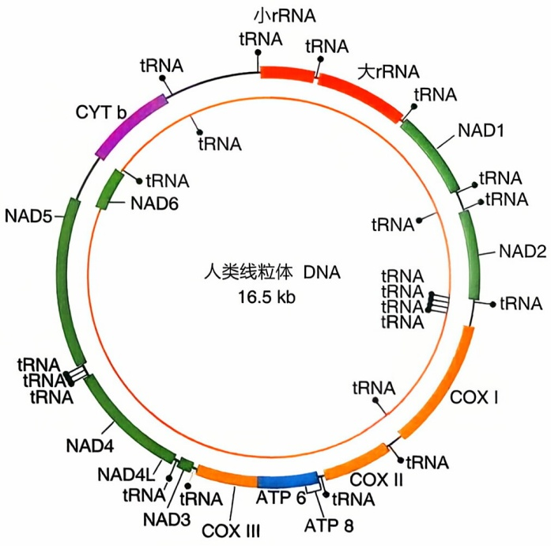

<details>
<summary>flowchart</summary>

This diagram illustrates the structure of human lineage RNA (DNA) with a 16.5 kb total length, showing its transcriptional domains and specific gene annotations.
</details>

图2-17 人类线粒体基因组DNA结构

---

042

第二章 遗传基础和基因组学

细胞核 DNA 的修复机制相比，线粒体 DNA 的修复能力较弱，因此导致线粒体 DNA 的突变频率高于核 DNA。子代细胞内可能同时存在突变型和野生型线粒体，即线粒体异质性（heteroplasmy）。因此，子代的线粒体功能相关表型会受到携带的野生型线粒体和突变型线粒体数量的影响，肌阵挛性癫痫伴随红纤维病（myoclonic epilepsy with ragged-red fibers，MERRF）就是一种由线粒体异质性引起的人类遗传病。线粒体 DNA 拷贝数量较多，并且突变频率较高，理论上线粒体异质性应该是一种常见现象。然而，实际观测发现，大多数细胞中的线粒体 DNA 是同质的（homoplasmy）。为了解释这一悖论，遗传学家提出了线粒体 DNA 经历了某种瓶颈效应（bottleneck effect）的假说。该假说认为，在配子形成或者合子早期发育的某个时间点，线粒体 DNA 经历了一个瓶颈阶段，只保留了少数线粒体和线粒体 DNA 拷贝，从而极大地降低了线粒体 DNA 的异质性程度。有人认为，线粒体瓶颈效应是一种净化选择（purifying selection）的过程，有利于细胞消除有害的线粒体变异（Pakendorf et al., 2005）。尽管有越来越多的证据支持线粒体 DNA 瓶颈效应假说，但目前还存在着争议。

线粒体 DNA 在遗传过程中不会发生遗传重组，可以保持相对保守，因此可以通过线粒体 DNA 追踪群体的起源和迁徙。例如，阿兰·威尔逊（Allan Wilson，1934—1991）等通过分析来自世界各地 147 个人的线粒体 DNA，提出现代人类的共同祖先来自于 200 000 年前的非洲。

另外，需要指出的是，线粒体是半自主细胞器，内含线粒体核糖体等。线粒体DNA上的基因可以翻译成内部所需的蛋白质，用于执行线粒体的功能，特别是与能量生产相关的蛋白质。线粒体DNA编码蛋白质所使用的遗传密码与通用遗传密码之间也存在一些差异。例如，人类线粒体的三联体密码子UGA是编码色氨酸的密码子，而不是通用遗传密码中的终止密码子。

## (2) 线粒体遗传相关疾病

关于由线粒体基因组遗传变异引起的遗传病，已经有许多报道。其中一些经典案例包括莱伯遗传性视神经病变（Leber hereditary optic neuropathy，LHON）和肌阵挛性癫痫伴随红纤维病（MERRF）。LHON是一种典型的线粒体疾病，通常表现为双眼无痛性（亚）急性视力下降。该疾病由线粒体DNA的变异引起，并通过母系遗传传递（图2-18）。大多数LHON患者的视神经细胞为同质性疾病突变，即所有线粒体均为

图2-18 LHON的母系遗传模式

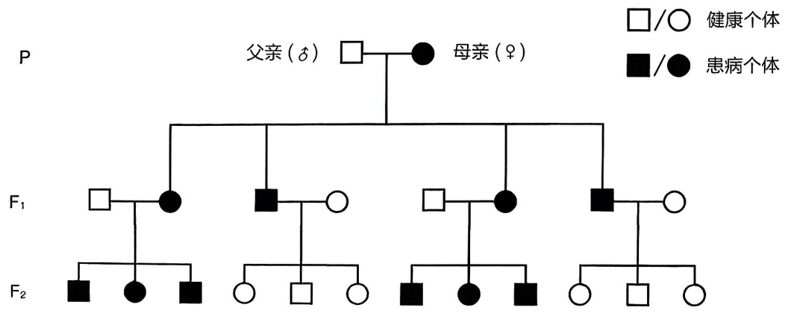

<details>
<summary>flowchart</summary>

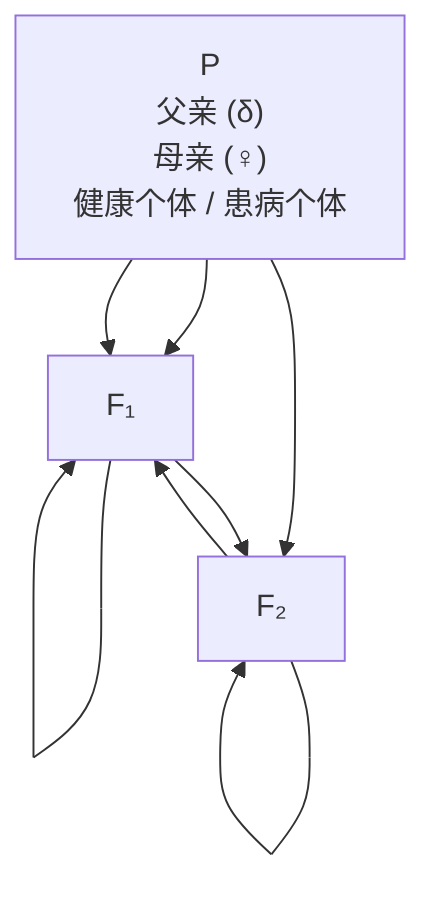
</details>

---

第二节 细胞质遗传

043

突变体。患者的线粒体基因组突变导致了线粒体呼吸链复合物Ⅰ功能的损害，从而降低了细胞内ATP的合成，并导致过量的活性氧自由基产生，最终引发视网膜神经节细胞的损伤。

MERRF综合征的主要症状包括肌阵挛性癫痫、小脑性共济失调和肌病。此外，肌细胞可能伴随有团块状的异常线粒体（能够被特异性染料染成红色），可能引发继发性痴呆、耳聋和视神经萎缩。MERRF综合征是由线粒体DNA突变引起的，最常见的是A8344G突变。该突变导致线粒体功能受损，进而影响能量产生和细胞正常功能。MERRF综合征通常是母系遗传的，属于线粒体异质性疾病。MERRF患者的细胞中同时携带致病突变线粒体与野生型线粒体，两种类型的线粒体比例决定了病症的严重程度。

此外，有研究指出线粒体上的突变可能会对人类的衰老过程造成影响。线粒体DNA上突变的积累会导致细胞氧化磷酸化水平下降，从而可能引起心脏、大脑等功能下降，损害器官的正常代谢活动。然而，具体的生物学机制仍不明确。

## 2. 叶绿体遗传

叶绿体（chloroplast）是进行光合作用的场所，它存在于植物的叶片和部分藻类细胞中。叶绿体中的类囊体内部结构嵌入了叶绿素和光吸收蛋白，在光反应阶段，光子的能量会被叶绿素和光吸收蛋白吸收，从而激发电子的能量水平。被激发的电子随后被传送到叶绿体电子传递系统，形成还原型烟酰胺腺嘌呤二核苷酸磷酸（nicotinamide adenine dinucleotide phosphate，NADPH）和ATP。在随后的暗反应阶段，相关酶以大气中的二氧化碳为原料，利用光反应产生的NADPH和ATP，反应生成糖类，将太阳能转化为化学能。

叶绿体DNA存在于叶绿体内部，最早于1959年透过生化实验发现，并于1962年透过电子显微镜实际观测确认，1986年烟草与地钱的叶绿体DNA被测序发表。截至目前，已有大量陆生植物与藻类的叶绿体DNA被测序发表。叶绿体DNA多为裸露的环状双链结构。大部分植物叶绿体环状DNA包括一个大的单拷贝区、一个小的单拷贝区和两个倒转重复区。与线粒体DNA相比，叶绿体DNA的长度相对一致，为$120\sim 160\mathrm{kb}$ 。每个叶绿体中通常包含多个叶绿体DNA拷贝，例如在高等植物叶肉细胞内，每个叶绿体通常包含 $15\sim 20$ 个叶绿体DNA拷贝。叶绿体基因组主要由编码区和非编码区组成。编码区占据叶绿体基因组总长度的 $70\%$ 以上，包含 $120\sim 130$ 个基因，这些基因包括编码蛋白质、rRNA和tRNA的基因，主要作用于光合作用、叶绿素合成和代谢途径；而剩余 $30\%$ 的非编码区主要起对叶绿体的转录、翻译和代谢功能的调控作用。叶绿体基因排列紧密，且包含内含子区域（图2-19）。目前认为，产氧光合生物主要含有5种类型的叶绿素——叶绿素a、b、c、d和f，其结构和合成路径各有不同。叶绿素的每一步合成都依赖酶的催化，而每种酶由一个或多个基因编码。得益于分子遗传学工具的发展，叶绿素生物合成的共同步骤或特异步骤所需的基因已经被逐步发现。例如，2023年西湖大学李小波团队发现了叶绿素c合成酶的编码基因（Jiang et al., 2023）。

---

044

第二章 遗传基础和基因组学

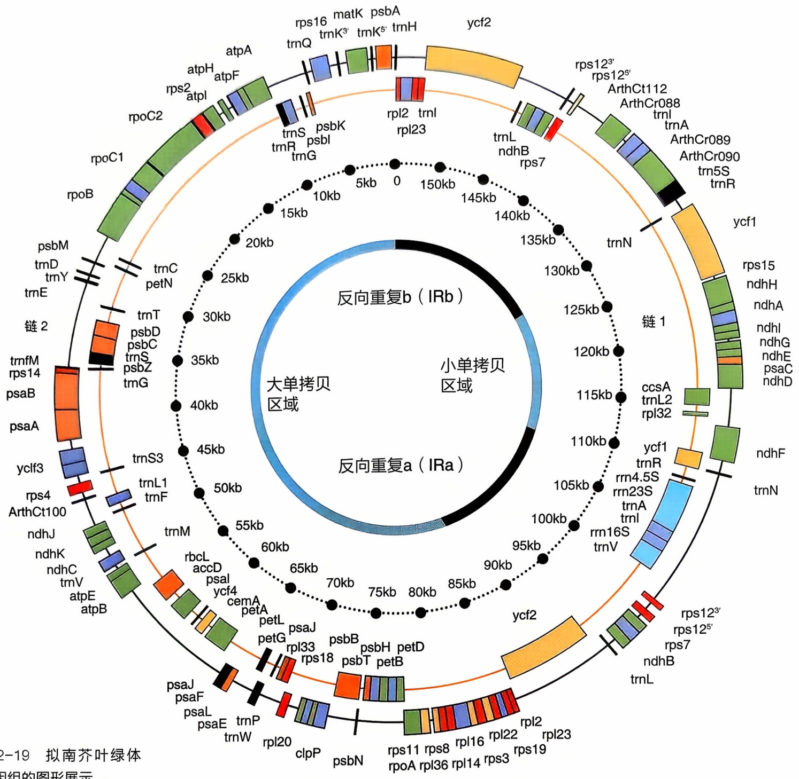

<details>
<summary>donut</summary>

| Region | Genomic Data Points |
| --- | --- |
| **IRa** | 0 kb to 150 kb |
| **IRa** | 150 kb to 145 kb |
| **IRa** | 145 kb to 135 kb |
| **IRa** | 135 kb to 125 kb |
| **IRa** | 125 kb to 120 kb |
| **IRa** | 120 kb to 115 kb |
| **IRa** | 115 kb to 110 kb |
| **IRa** | 110 kb to 105 kb |
| **IRa** | 105 kb to 100 kb |
| **IRa** | 100 kb to 95 kb |
| **IRa** | 95 kb to 90 kb |
| **IRa** | 90 kb to 85 kb |
| **IRa** | 85 kb to 75 kb |
| **IRa** | 75 kb to 70 kb |
| **IRa** | 70 kb to 65 kb |
| **IRa** | 65 kb to 60 kb |
| **IRa** | 60 kb to 55 kb |
| **IRa** | 55 kb to 50 kb |
| **IRa** | 50 kb to 45 kb |
| **IRa** | 45 kb to 40 kb |
| **IRa** | 40 kb to 35 kb |
| **IRa** | 35 kb to 30 kb |
| **IRa** | 30 kb to 25 kb |
| **IRa** | 25 kb to 20 kb |
| **IRa** | 20 kb to 15 kb |
| **IRa** | 15 kb to 10 kb |
| **IRa** | 10 kb to 5 kb |
| **IRa** | 5 kb to 0 kb |
| **IRa** | 0 kb to 150 kb |
| **IRa** | 150 kb to 145 kb |
| **IRa** | 145 kb to 135 kb |
| **IRa** | 135 kb to 125 kb |
| **IRa** | 125 kb to 120 kb |
| **IRa** | 120kb to 115kb |
| **IRa** | 115kb to 110kb |
| **IRa** | 110kb to 105kb |
| **IRa** | 105kb to 100kb |
| **IRa** | 100kb to 95kb |
| **IRa** | 95kb to 90kb |
| **IRa** | 90kb to 85kb |
| **IRa** | 85kb to 75kb |
| **IRa** | 75kb to 70kb |
| **IRa** | 70kb to 65kb |
| **IRa** | 65kb to 60kb |
| **IRa** | 60kb to 55kb |
| **IRa** | 55kb to 50kb |
| **IRa** | 50kb to 45kb |
| **IRa** | 45kb to 40kb |
| **IRa** | 40kb to 35kb |
| **IRa** | 35kb to 30kb |
| **IRa** | 30kb to 25kb |
| **IRa** | 25kb to 20kb |
| **IRa** | 20kb to 15kb |
| **IRa** | 15kb to 10kb |
| **IRa** | 10kb to 5kb |
| **IRa** | 5kb to 0 kb |
| **IRa** | 0 kb to -150 kb |
| **IRa** | -150 kb to -145 kb |
| **IRa** | -145 kb to -135 kb |
| **IRa** | -135 kb to -125 kb |
| **IRa** | -125 kb to -120 kb |
| **IRa** | -120kb to -115kb |
| **IRa** | -115kb to -110kb |
| **IRa** | -110kb to -105kb |
| **IRa** | -105kb to -95kb |
| **IRa** | -95kb to -90kb |
| **IRa** | -90kb to -85kb |
| **IRa** | -85kb to -80kb |
| **IRa** | -80kb to -75kb |
| **IRa** | -75kb to -70kb |
| **IRa** | -70kb to -65kb |
| **IRa** | -65kb to -60kb |
| **IRa** | -60kb to -55kb |
| **IRa** | -55kb to -50kb |
| **IRa** | -50kb to -45kb |
| **IRa** | -45kb to -40kb |
| **IRa** | -40kb to -35kb |
| **IRa** | -35kb to -30kb |
| **IRa** | -30kb to -25kb |
| **IRa** | -25kb to -20kb |
| **IRa** | -20kb to -15kb |
| **IRa** | -15kb to -10kb |
| **IRa** | -10kb to -5 kb |
| **IRa** | -5kb to -2 kb |
| **IRa** | -2kb to -1 kb |
| **IRa** | -1kb to -0.8 Mb |
| **IRa** | -0.8 Mb to -0.6 Mb |
| **IRa** | -0.6 Mb to -0.4 Mb |
| **IRa** | -0.4 Mb to -0.2 Mb |
| **IRa** | -0.2 Mb to -0.1 Mb |
| **IRa** | -0.1 Mb to +0.1 Mb |
| **IRa** | +0.1 Mb to +0.3 Mb |
| **IRa** | +0.3 Mb to +0.6 Mb |
| **IRa** | +0.6 Mb to +0.9 Mb |
| **IRa** | +0.9 Mb to +1.2 Mb |
| **IRa** | +1.2 Mb to +1.6 Mb |
| **IRa** | +1.6 Mb to +2 Mb |
| **IRa** | +2 Mb to +2.6 Mb |
| **IRa** | +2.6 Mb to +3 Mb |
| **IRa** | +3 Mb to +3.6 Mb |
| **IRa** | +3.6 Mb to +4 Mb |
| **IRa** | +4 Mb to +4.6 Mb |
| **IRa** | +4.6 Mb to +6 Mb |
| **IRa** | +6 Mb to +6.6 Mb |
| **IRa** | +6.6 Mb to +8 Mb |
| **IRa** | +8 Mb to +8.6 Mb |
| **IRa** | +8.6 Mb to +1 Mb |
| **IRa** | +1 Mb to +1.6 Mb |
| **IRa** | +1.6 Mb to +2 Mb |
| **IRa** | +2 Mb to +2.6 Mb |
| **IRa** | +2.6 Mb to +3 Mb |
| **IRa** | +3 Mb to +3.6 Mb |
| **IRa** | +3.6 Mb to +4 Mb |
| **IRa** | +4 Mb to +3.6 Mb |
| **IRa** | +3.6 Mb to +4.6 Mb |
| **IRa** | +4.6 Mb to +6 Mb |
| **IRa** | +6 Mb to +6.6 Mb |
| **IRa** | +6.6 Mb to +8 Mb |
| **IRa** | +8 Mb to +8.6 Mb |
| **IRa** | +8.6 Mb to +1 Mb |
| **IRa** | +1 Mb to +2 Mb |
| **IRa** | +2 Mb to +2.6 Mb |
| **IRa** | +2.6 Mb to +3 Mb |
| **IRa** | +3 Mb to +3.6 Mb |
| **IRa** | +3.6 Mb to +4 Mb |
| **IRa** | +4 Mb to +3Mb |
</details>

图2-19 拟南芥叶绿体基因组的图形展示

标注了两个反向重复序列（IRs）、一个大单拷贝区（LSC）和一个小单拷贝区（SSC）。小亚基核糖体蛋白（黄色）、大亚基核糖体蛋白（橙色）、潜在的叶绿体开放阅读框（柠檬色）、参与光合反应的蛋白质编码基因（绿色）或其他功能的蛋白质编码基因（红色）、rRNA（蓝色）、tRNA（黑色）。灰色表示内含子。

## 叶绿体遗传机制

叶绿体基因组表现出非孟德尔遗传模式，主要为母系遗传，但是大多数裸子植物叶绿体基因组则表现出父系遗传。下面我们以本节开篇描述的紫茉莉叶片颜色变异杂交实验为例，阐述叶绿体遗传机制。

控制紫茉莉分枝和叶片颜色的基因位于叶绿体DNA上，受叶绿体遗传机制的调控。由于紫茉莉花粉细胞几乎没有叶绿体DNA，故受精卵中的叶绿体DNA主要遗传自母本，即母系遗传，后代中由叶绿体DNA控制的性状与母本相同。具体而言，完全是绿色的紫茉莉分枝和叶片上的细胞含有野生型叶绿体DNA，完全是白色的紫茉莉

---

第二节 细胞质遗传

045

分枝和叶片上的细胞含有突变型叶绿体 DNA。特别地，如果细胞同时携带野生型和突变型叶绿体 DNA（异质叶绿体）则同样表现为绿色，因为即使少量的野生型叶绿体中的叶绿素含量也足以超过阈值，产生绿色表型（图 2-20）。

在产生配子时，由于叶绿体随细胞分裂而随机地分配到子代细胞，不同颜色分枝上形成的卵子所携带的叶绿体DNA存在差异。绿色枝条上产生的卵子携带野生型叶绿体DNA，杂交后代表现为绿色；白色枝条上产生的卵子携带突变型叶绿体DNA，杂交后代表现为白色。而在杂色分枝和叶片上，杂色区域中的绿色斑块包含异质细胞（即细胞内叶绿体DNA为野生型和突变型的混合）和同质细胞（即细胞内叶绿体DNA为野生型），白色斑块包含突变型细胞。在产生配子时，杂色枝条上产生的卵子可以携带同质的野生型叶绿体DNA，也可能携带同质的突变型叶绿体DNA，还可能是携带异质性叶绿体DNA，所以杂交后代的颜色是随机的，无法通过孟德尔定律进行预测。

## 3. 病毒遗传物质

病毒（virus）是一类将核酸作为遗传物质的非细胞结构。它由蛋白质外壳包裹并寄生在宿主细胞中，以完成自我复制。病毒的生命周期依赖于宿主细胞的酶、能量和代谢物质。病毒遗传物质和结构多样，可以是单链或双链、线性或环状、一个或多个DNA或RNA分子。相对于有细胞结构的生物，病毒的基因组通常较小，但不同种类病毒之间基因组大小差异巨大，长度范围大约从 $1.3\mathrm{kb}$ 到 $2.5\mathrm{Mb}$ 。大部分DNA病毒将细胞核作为主要的复制场所，而大部分RNA病毒将细胞质作为主要的复制场所，此外，单链RNA反转录病毒和双链DNA反转录病毒的基因组复制过程较为特殊。DNA转录形成RNA的过程发生在细胞核中，而RNA反转录形成DNA的过程发生在细胞质中。本小节将以新冠病毒作为RNA病毒的例子，以及乙肝病毒作为双链DNA反转录病毒的例子，介绍病毒遗传物质的构成和遗传过程。

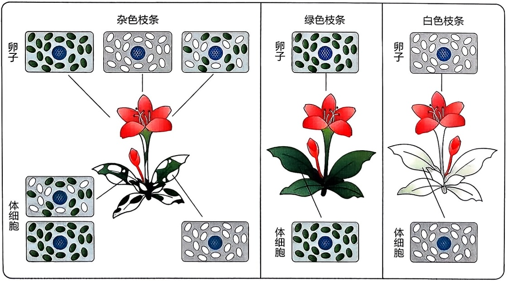

<details>
<summary>text_image</summary>

杂色枝条
绿色枝条
白色枝条
卵子
体细胞
卵子
体细胞
卵子
体细胞
</details>

图2-20 紫茉莉分枝和叶色的叶绿体遗传

---

046

第二章 遗传基础和基因组学

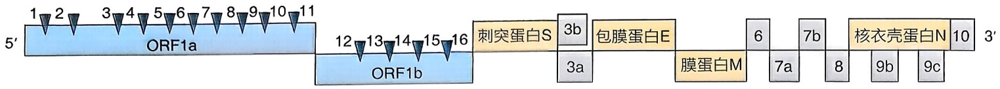

<details>
<summary>text_image</summary>

5' 1 2 3 4 5 6 7 8 9 10 11
ORF1a
12 13 14 15 16
ORF1b
刺突蛋白S 3b 包膜蛋白E
3a 膜蛋白M 6 7b 核衣壳蛋白N 10 3'
7a 8 9b 9c
</details>

图2-21 新冠病毒的基因组结构

## (1) 新冠病毒的基因组结构及遗传过程

新冠病毒（或新型冠状病毒），全称为严重急性呼吸综合征冠状病毒2（severe acute respiratory syndrome coronavirus 2, SARS-CoV-2），是一种单链RNA病毒，属于冠状病毒科。新冠病毒可导致呼吸道疾病COVID-19，2019末被首次发现，由于其高度的传染性，很快在全球范围内引发大流行。2020年1月，中国科学家成功分离出首株病原体毒株，并解析了其全基因组序列信息。SARS-CoV-2的遗传物质为一条长约30 kb的RNA单链，包含15个开放阅读框，编码29个蛋白质，其中包括16个非结构蛋白、4个结构蛋白以及9个辅助蛋白（图2-21）。新冠病毒的基因组复制过程发生在宿主细胞的细胞质中。新冠病毒首先通过刺突蛋白与宿主受体ACE2结合，进入宿主细胞。随后，病毒RNA基因组与核衣壳蛋白分离。RNA链作为转录的模板，在RNA依赖的RNA聚合酶催化下，产生反义链RNA。之后，反义链RNA又作为模板生产新的有义链RNA基因组。最终，新合成的基因组RNA与核衣壳蛋白结合，组装形成新的病毒颗粒，并从细胞中被释放。

## (2) 乙肝病毒的基因组结构及遗传过程

乙肝病毒，全称为乙型肝炎病毒（hepatitis B virus，HBV），是一种双链DNA反转录病毒。乙肝病毒主要感染人类肝脏，并可导致多种与肝脏相关的临床疾病，包括急性肝炎、慢性肝炎、肝硬化和肝癌等。据统计，全球约有3亿人感染乙肝病毒，每年约有82万人死于乙肝相关疾病，乙肝病毒造成全球重要的卫生挑战。乙肝病毒基因组长度约为 $3.2\mathrm{kb}$，包括4个开放阅读框，编码DNA聚合酶、衣壳蛋白、囊膜蛋白等多个蛋白质。乙肝病毒的基因组结构较为独特，由两条不完全互补的DNA链组成。DNA反义链较长，能够形成环状结构，其5'端序列能够与3'端互补，从而形成三条链的构象；DNA正义链较短，编码的遗传信息不完整，其5'端连接一个帽子结构的RNA分子。

乙肝病毒基因组复制涉及多个步骤，需要在细胞质和细胞核中分别完成（图2-22）。乙肝病毒在进入宿主细胞后，基因组DNA被释放到细胞核中，经过末端延伸合成和共价连接，形成完整的双链环状DNA分子，即共价闭合环状DNA（covalently closed circular DNA, cccDNA）。之后，cccDNA作为模板，参与病毒的转录过程，被用于合成多种不同的病毒mRNA。前基因组RNA（pregenomic RNA, pgRNA）是其中最长的转录产物，长约 $3.5\mathrm{kb}$，携带有乙肝病毒的全部遗传信息。pgRNA在合成后被释放到细胞质中，与衣壳蛋白相结合形成核衣壳。随后，在DNA聚合酶的反转录酶结构域作用下，pgRNA被反转录合成形成新的乙肝病毒基因组DNA。这些基因组DNA可以继续转运至细胞核以增加cccDNA的数量，或装配形成新的病毒颗粒，并随后从细胞中被释放。

---

第三节 基因组学

047

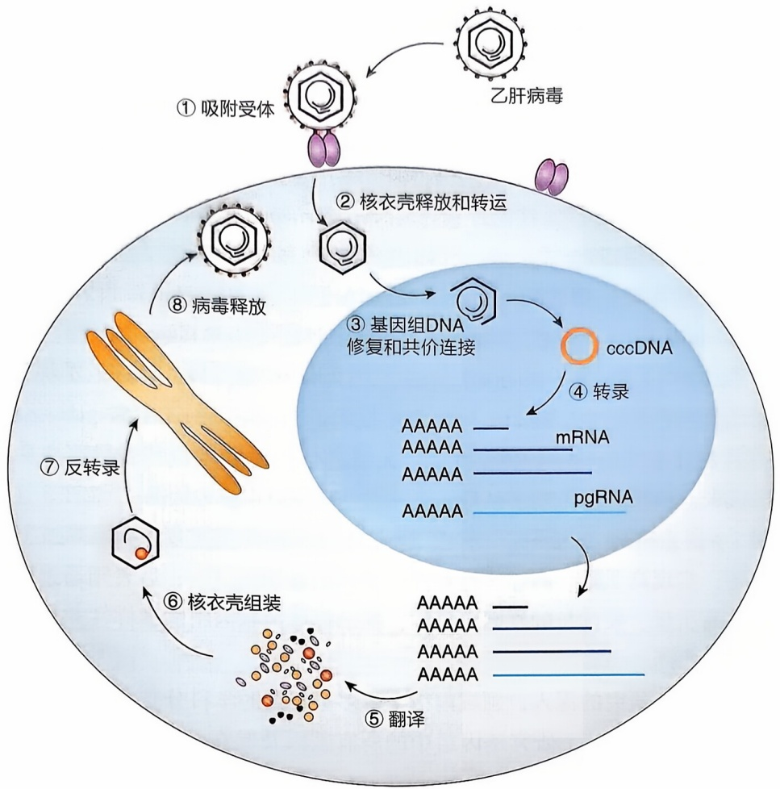

<details>
<summary>flowchart</summary>

This diagram illustrates the biological process of gene editing and replication, showing steps from antibody binding to bacterial infection, gene repair, gene assembly, translation, and final modification.
</details>

图2-22 乙肝病毒生命周期

## 第三节 基因组学

## 一、基因组学概述

基因组学（genomics）是研究生物体所有遗传信息的科学，包含了基因组的结构、功能、进化、定位和编辑。它是生物学的一个跨学科分支，涉及生物学、遗传学、生物信息学、计算生物学、生物化学等学科的内容。相较于经典遗传学关注特定基因及其遗传规律，基因组学则是研究特定生物体所有基因的定量、特征、相互作用及其对生物体的影响。同时，基因组研究也包含了基因组的测序和分析，尤其是利用高通量测序方法和生物信息学分析工具对基因组的结构与功能进行研究。

1926年，德国植物学家汉斯·温克勒（Hans Winkler，1877—1945）首次使用了德语单词“Genom”，用来描述某个有机体的全部遗传物质。而“基因组学”这个名词则是在1986由美国遗传学家汤姆·罗德里克（Tom Roderick，1930—2013）在一次会议上提出，用于概括基因组作图、测序与功能分析的遗传学学科分支。回顾基因组学

---

048

第二章 遗传基础和基因组学

的发展史，测序技术的更新迭代成为重要的推动力量。1977年，桑格使用双脱氧终止法成功测定了噬菌体的基因组序列，标志着第一代DNA测序技术的诞生。利用这项技术，1995年，流感嗜血杆菌基因组成为首个进行全基因组测序的细菌基因组。1996年，酿酒酵母成为首个完成全基因组测序的真核生物。2000年，首个模式植物拟南芥的全基因组测序完成。2001年，人类基因组计划（HGP）实现首个人类参考基因组图谱的测序。2005年前后，二代测序技术（Next-Generation Sequencing，NGS）基于并行测序和DNA聚合酶的合成扩增，大幅提高了测序效率并降低了测序成本。基于该项技术，单体型图谱计划（International HapMap Project，HapMap）、千人基因组计划（1000 Genomes Project，1KGP）、1000植物基因组计划（1000 Plants Project，1KP）、全球微生物组计划（Earth Microbiome Project，EMP）等相继开展，以深入了解各个物种的基因组结构与变异信息。同时，三代测序技术（Third-Generation Sequencing，TGS）则通过直接测序单个DNA或RNA分子，无需进行PCR扩增或片段分离，从而实现了更长的读长。该项技术推动了从端粒到端粒（telomere-to-telomere，T2T）基因组和泛基因组（pan-genome）的研究。前者旨在克服基因组中高重复序列区域或复杂结构的组装难题，实现高质量、高连续性和高完整性的基因组组装；后者则通过整合分析多个个体的高质量、长读长的基因组数据，揭示群体内基因组的多样性并构建更全面的参考基因组序列。

随着对基因组研究的深入，领域内衍生更多更复杂的学科分支。例如，功能基因组学（functional genomics）研究基因组中的所有基因及其在细胞和生物体中的表达、调控和相互作用；结构基因组学（structural genomics）通过实验和建模相结合来进行高通量的蛋白质结构解析，以揭示基因组中的蛋白质结构、功能和相互作用；基因组医学（genomic medicine）利用基因组信息来进行疾病的辅助诊断、风险预测、个体化治疗方案制定及预后评估，实现精准医疗；比较基因组学（comparative genomics）通过比较不同物种或物种内基因组的差异和相似性，来揭示基因组的功能以及物种的进化过程；宏基因组学（metagenomics）研究宏观环境中所有微生物群体的基因组组成和功能，探索微生物群体在生态系统中的相互作用；单细胞基因组学（single cell genomics）通过对单细胞水平的基因组、转录组、甲基化组、空间位置等信息分析，不仅对细胞进行功能鉴定和分类，还能揭示组织内的细胞异质性，以及细胞在发育、分化和疾病过程中的动态变化。综上，基因组学的发展推动了人们对基因功能、疾病机制、个体差异、进化关系和生物多样性等方面的理解，对于生物学、医学、农业以及环境科学等领域的研究和应用具有重要意义。

## 二、基因组的结构与功能

## 1. 基因组的结构

基因组的组成研究在现代生命科学中至关重要。本小节旨在为读者提供基因组生物学的简要概述和基本概念，重点关注基因组组成、特征以及三维结构等背景，涵

---

第三节 基因组学

049

盖的主题包括基因组大小，染色体组成（如中心粒、基因臂、端粒等），基因组区域（基因、调控元件等）以及基因组三维结构。由于基因组的组成和结构是所有生物体共同具有的特征，下文主要以人类或哺乳动物作为模式生物进行举例说明。

## (1) 基因组大小

基因组是由核酸组成的，包含了所有遗传信息和基因的集合。我们使用特定的单位来衡量基因组大小，例如 1 Gb（Gigabytes，千兆字节）等于 1 000 Mb（Megabytes，兆字节），又等于 1 000 000 个核苷酸对（base pairs，bp）的数量。不同物种的基因组大小存在较大差异（表 2-1、表 2-2）。迄今为止，已知最小的真核基因组属于寄生性微孢子虫（Encephalitozoon intestinalis），其基因组大小约为 2.3 Mb（Corradi et al., 2010）；而衣笠草（Paris japonica）拥有最大的已知基因组，大小约为 130 Gb（Pellicer et al., 2010）。相较之下，人类的基因组（知识窗 2-1）大小约为 3 Gb。

## (2) 基因组的组成

从结构来看，基因组可以根据其是否形成染色体形态分为两种——非染色体基因组和染色体基因组。非染色体基因组主要包括:病毒基因组、原核生物（如细菌）的

表 2-1 物种间的基因组大小

| 基因组 | 基因数目 | 碱基对数 /bp |
| --- | --- | --- |
| 有机体(organisms) |  |  |
| 植物(plants) | &lt;50 000 | &lt;1011 |
| 哺乳动物(mammals) | ~30 000 | ~3×10^9 |
| 蠕虫(worms) | ~14 000 | ~10^8 |
| 蝇类(files) | ~12 000 | ~1.6×10^8 |
| 真菌(fungi) | ~6 000 | ~1.3×10^7 |
| 细菌(bacteria) | 2 000~4 000 | &lt;10^7 |
| 支原体(mycoplasma) | ~500 | &lt;10^8 |
| 双链 DNA 病毒(dsDNA viruses) |  |  |
| 牛痘病毒(vaccinia) | &lt;300 | ~187 000 |
| SV40猕猴病毒(papova-SV40) | ~6 | 5 226 |
| T4噬菌体(phage T4) | ~200 | ~165 000 |
| 单链 DNA 病毒(ssDNA viruses) |  |  |
| 小颗粒病毒(phage fX174) | 11 | 5 387 |
| 双链 RNA 病毒(dsRNA viruses) |  |  |
| 利奥巴病毒(reovirus) | - | ~23 000 |
| 单链 RNA 病毒(ssRNA viruses) |  |  |
| 流感病毒(influenza) | 12 | ~13 500 |
| MS2噬菌体(phage MS2) | 4 | 3 569 |
| 类病毒(viroids) |  |  |
| PSTV RNA | 0 | 359 |

(参考书籍:LEWIN's GENES XII)

---

050

第二章 遗传基础和基因组学

表 2-2 人及常见模式生物的基因组大小

| 物种 | 拉丁学名 | 基因组大小 /Mb | 蛋白质编码基因数目 |
| --- | --- | --- | --- |
| 人 | Homo sapiens | ~3 000 | ~20 000 |
| 小鼠 | Mus musculus | ~2 600 | ~20 200 |
| 大鼠 | Rattus norvegicus | ~2 750 | ~22 000 |
| 斑马鱼 | Danio rerio | ~1 500 | ~32 000 |
| 果蝇 | Drosophila melanogaster | ~175 | ~13 000 |
| 秀丽隐杆线虫 | Caenorhabditis elegans | ~100.3 | ~19 000 |
| 拟南芥 | Arabidopsis thaliana | ~135 | ~25 500 |
| 原绿球藻 | Prochlorococcus | ~1.7 | ~1 800 |
| 酿酒酵母 | Saccharomyces cerevisiae | ~12.1 | ~6 000 |
| 大肠杆菌 | Escherichia coli | ~4.6 | ~4 000 |

质粒基因组，以及真核生物的线粒体基因组与叶绿体基因组（见上文）；染色体基因组一般指真核生物细胞核内的基因组，是真核生物体内负责存储和传递遗传信息的结构，在细胞分裂和遗传过程中起着重要的作用。从功能来看，基因组又可以分为基因区域和非基因区域。基因区域主要由蛋白质编码基因（protein-coding gene）、非编码RNA（non-coding RNA）和假基因（pseudogene）组成。其中，蛋白质编码基因负责生产具有特定功能的蛋白质，非编码RNA则在基因表达调控、染色质结构维持等生命活动中发挥关键作用。虽然假基因已失去原有功能，但它们仍可参与基因表达调控，影响其他基因的表达。此外，基因组还包括非基因区域的调控元件（regulatory

element）和重复序列（repetitive sequence），这些在维持基因组结构和调控基因表达中都起着重要作用。

染色体是由蛋白质和DNA构成的复合物，具有一些特殊的结构，包括着丝粒、基因臂和端粒等。着丝粒（centromere）是真核生物分裂过程中染色体正确分离和传递所必需的染色体区域，由两个中心粒（centrioles）和周围的蛋白质组成（图2-23）。中心粒在细胞分裂中发挥着重要的作用，它在有丝分裂过程中形成纺锤体，并参与染色体的分离。染色体臂（chromosome arms）:基因组的染色体通常由两条臂组成，即染色体长臂（q臂，由“queue”派生而来，意为尾部）和染色体短臂（p臂，由“petit”派生而来，意为小）。长臂和短臂由染色体上的中心体分割开来。端粒（telomere）是染色体末端的一段特殊的DNA序列，它在细胞的稳定性、基因组的完整性、衰老和疾病发生中起着重要的作用。端粒的主要功能是保护染色体末端免受损伤和降解。由于DNA聚合酶的限制性作用，

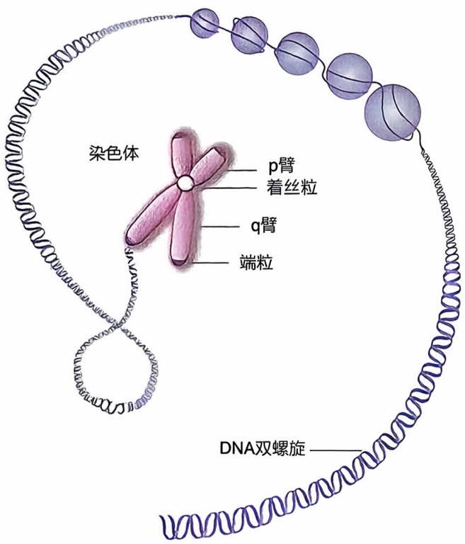

<details>
<summary>text_image</summary>

染色体
p臂
着丝粒
q臂
端粒
DNA双螺旋
</details>

图2-23 染色体和着丝粒、基因臂、端粒

---

第三节 基因组学

051

## 知识窗2-1

## 人类的染色体组成

人类的染色体共有46条（23对），包括44条常染色体（22对）和2条性染色体（XX或XY）（图2-24）。常染色体大致按照从长到短的顺序编号为1至22号染色体。当染色体数目异常或结构发生畸变导致疾病时，我们称之为染色体病（chromosome disorder）。三体综合征通常指13、18、21号染色体在体内出现了三条而非两条的染色体（三体现象）。其中，13三体综合征（Patau syndrome）的新生儿发病率为$1/6000\sim 1/5000$，女性患病率明显高于男性。18三体综合征（Edward syndrome）的新生儿发病率为$1/8000\sim 1/3500$。而21三体综合征被称为唐氏综合征（Down syndrome），其在新生儿中的发病率为$1/800\sim 1/600$。因此，对于高风险人群，尤其是年龄较大的孕妇，推广遗传咨询和产前筛查是降低我国新生儿三体综合征发病率的有效手段。这些措施能够提供重要的信息和支持，帮助家庭做出正确的决策，保障健康新生儿的诞生。

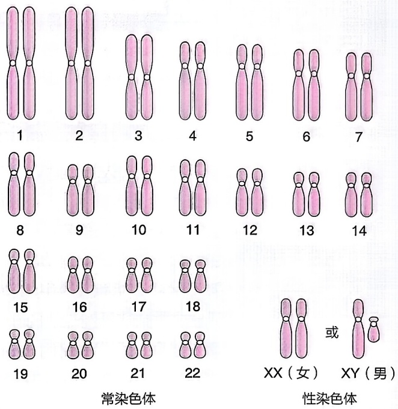

图2-24 人类染色体核型图

在染色体末端的 DNA 不能被完全复制，导致每次细胞分裂后端粒长度会略微缩短，称为“末端复制问题”。

蛋白质编码基因是指基因组中能够被转录成 mRNA，并通过翻译过程转化为蛋白质的基因。蛋白质编码基因通常包括多个外显子和内含子序列，外显子是蛋白质编码基因中直接参与编码蛋白质的序列段，而内含子则是位于外显子之间的非编码序列段。在转录过程中，位于编码区（coding sequence，CDS）两端的非编码片段，被称为非翻译区（untranslated region，UTR），包括 5'UTR 和 3'UTR 两部分，分别位于 mRNA 起点和终点的外显子之外（图 2-25）。

非编码 RNA 是指在基因组中存在的一类不编码蛋白质的基因，但有 RNA 转录产物，且在调控基因表达和细胞功能方面起着重要作用。常见的非编码 RNA 包括管家非编码和调节非编码 RNA（表 2-3）。管家非编码 RNA（housekeeping ncRNA）是一类细胞生存所必需的非编码 RNA，其含量相对稳定，呈现组成型表达，主要包括 tRNA、rRNA、核内小 RNA（small nuclear RNA，snRNA）、核仁小 RNA（small nucleolar RNA，snoRNA）以及端粒酶 RNA（telomerase RNA component，TERC）等。

---

052

第二章 遗传基础和基因组学

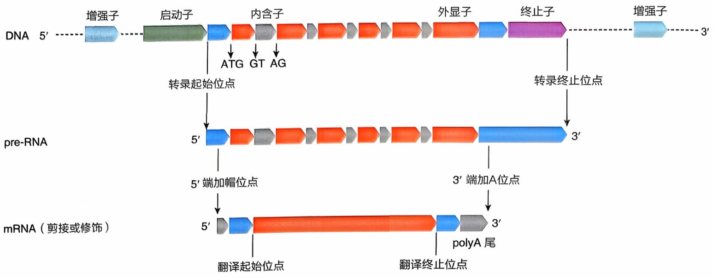

<details>
<summary>flowchart</summary>

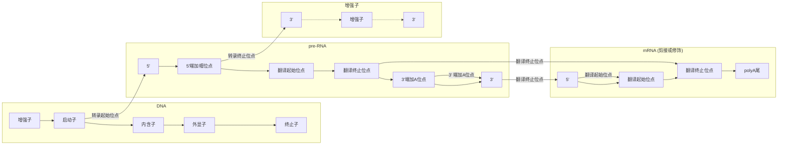
</details>

图2-25 蛋白质编码基因和调控元件

它们参与基本的细胞功能，如蛋白质合成、基因表达调控和 RNA 加工等，用于维持细胞正常功能和基因组的稳定性。调节非编码 RNA（regulatory ncRNA）是一类具有明显的时空特异性表达的 ncRNA。它们在转录、翻译和其他基因表达调控过程中发挥调节作用。调节非编码 RNA 包括长链非编码 RNA（long non-coding RNA, lncRNA）、微 RNA（microRNA, miRNA）、环状 RNA（circular RNA, circRNA）等。它们可以通过与 DNA、RNA 和蛋白质相互作用，调控基因的转录水平、转录后修饰、转运和翻译等过程。调节非编码 RNA 对于细胞分化、发育、免疫应答、疾病发生和进化等方面起着关键作用。

表 2-3 非编码 RNA

<table><tr><td>类型</td><td>全称</td><td>缩写</td><td>长度/nt</td></tr><tr><td rowspan="7">管家非编码 RNA</td><td>核糖体 RNA (ribosomal RNA)</td><td>rRNA</td><td>120~4500</td></tr><tr><td>转运 RNA (transfer RNA)</td><td>tRNA</td><td>76~90</td></tr><tr><td>核内小 RNA (small nuclear RNA)</td><td>snRNA</td><td>100~300</td></tr><tr><td>核仁小 RNA (small nucleolar RNA)</td><td>snoRNA</td><td>60~400</td></tr><tr><td>tRNA 半分子 (tRNA halves)</td><td>tiRNA</td><td>29~50</td></tr><tr><td>tRNA 来源的小片段 RNA (tRNA-derived fragments)</td><td>tRF</td><td>16~28</td></tr><tr><td>端粒酶 RNA (telomerase RNA)</td><td>TERC</td><td>/</td></tr><tr><td rowspan="6">调节非编码 RNA</td><td>微 RNA (microRNA)</td><td>miRNA</td><td>21~23</td></tr><tr><td>小干扰 RNA (small interfering RNA)</td><td>siRNA</td><td>20~25</td></tr><tr><td>piwi 相互作用 RNA (piwi-interacting RNA)</td><td>piRNA</td><td>26~32</td></tr><tr><td>长链非编码 RNA (long non-coding RNA)</td><td>lncRNA</td><td>&gt;200</td></tr><tr><td>增强子 RNA (enhancer RNA)</td><td>eRNA</td><td>50~200</td></tr><tr><td>环状 RNA (circular RNA)</td><td>circRNA</td><td>100~10000</td></tr></table>

---

第三节 基因组学

053

假基因是指在基因组中存在的与功能性基因序列非常相似的 DNA 序列，但它们通常不会被转录成 RNA 或翻译成蛋白质，并且缺乏明确的生理功能。虽然假基因本身不具备功能，但是它们在基因组的进化和多样性中发挥了重要的作用，也有可能对基因表达调控产生影响。近年来的研究表明，假基因可能通过产生内源性小干扰 RNA（endogenous siRNA）、反义 RNA（antisense RNA）或 miRNA 的诱饵等方式，调控基因发挥作用。

调控元件是指基因组中能够调节基因表达的时机、水平和组织特异性的 DNA 片段。常见的调控元件包括以下几种:启动子（promoter），位于基因的上游区域，是转录因子结合并启动基因转录的关键序列；增强子（enhancer），是一类位于基因上、下游或甚至远离基因的 DNA 序列，可以与转录因子结合形成调控复合物，从而增强基因的转录活性；沉默子（silencer），可以与转录因子结合并阻碍基因的转录活性，起到负调控作用，抑制基因的表达；边界元件（boundary element），可以将染色体分割成不同的染色质区域，起到隔离和保护基因的作用，确保不同基因或调控区域之间的相互独立性。

重复序列是指在真核生物基因组中重复出现的相同或相似的序列，每个重复出现的序列又称为重复单位（repeats unit），包括串联重复（tandem repeats）和散在重复（interspersed repeats）等。根据串联重复单元的长度，又可将其进行分类为长度较长的卫星DNA（satellite DNA）、相对较长的小卫星DNA（minisatellite DNA）和最短的微卫星DNA（microsatellite DNA）。散在重复序列的分类则不同，可以分为长散在核元件（long interspersed nuclear element, LINE）（重复单位>500 bp）和短散在核元件（short interspersed nuclear element, SINE）（重复单位<500 bp），以及长末端重复序列（long terminal repeat, LTR）（重复单位100\~5000 bp）。

## （3）基因组的三维结构

一个细胞内基因组 DNA 的线性长度远远超过其细胞核或原核生物细胞能容纳的尺寸，而 DNA 本身并不具备折叠到足够小体积的能力。为了在有限的空间里有效地存储并传递基因信息，DNA 需要与蛋白质以及少量 RNA 相结合，经过盘绕、折叠及压缩等形成质地紧密的复杂结构。该过程主要包含核小体（nucleosome）的形成和染色体高级结构的形成两方面。基因组的三维结构与基因的功能和表达调控有着密切联系。

## ① 核小体的形成

染色质（chromatin）是细胞分裂间期，细胞核内由DNA、组蛋白（histone）、非组蛋白及少量RNA组成的线性复合物。组蛋白主要有5种分子类型:H1、H2A、H2B、H3和H4。其中4种类型（H2A、H2B、H3和H4）的分子共8个蛋白质构成了核心组蛋白（core histone）。核小体是真核生物中由DNA与核心组蛋白组成的染色质基本单位。组蛋白是带强正电的碱性蛋白质，而DNA磷酸糖骨架上的磷酸基团使得DNA具有强负电。因此，长度约 $146\mathrm{bp}$ 的DNA双链能紧紧地在核心组蛋白上盘绕1.7圈，形成染色体最基本的DNA包装单元——核小体。同时，H1组蛋白结合在核

---

054

第二章 遗传基础和基因组学

小体上的 DNA 进出口处，起到稳定核小体结构的作用，从而形成 11 nm 直径的串珠状结构，也称为染色质小体（chromotosome）。在细胞分裂间期，每条染色质由成千上万个核小体组成，相邻核小体之间由平均长度约 20 bp 的 DNA 连接。在核小体的形成过程中，DNA 双链压缩了 7 倍。大多数原核生物没有组蛋白（除古菌域外），但具有类组蛋白参与基因组三维结构的构建。

## ② 染色体高级结构的形成

染色质按照左手螺旋的超螺旋方式进一步盘绕卷曲，形成 $30\mathrm{nm}$ 直径的染色质纤维（chromatin fiber）。H1组蛋白处在染色质纤维内侧，再次起到稳定染色质高级结构的作用。这一过程使得DNA压缩程度达到 $40\sim 60$ 倍。研究人员通过显微镜观察发现，每转螺旋包含6个核小体。在细胞分裂间期，染色质大多以染色质纤维的形式存在，但也存在其他的折叠方式。特定区域的折叠方式往往由核小体间连接DNA的长度和H1组蛋白的存在与否所控制。在染色质的各区域上，折叠方式往往是动态的，并非一成不变。随后，染色质纤维在黏连蛋白（cohesin）和CCCTC结合蛋白（CCCTC-binding factor，CTCF）的作用下进一步形成长度为 $300~\mathrm{nm}$ 的染色质环（chromatin loop）结构。在细胞分裂时期，染色质环压缩卷曲成 $250~\mathrm{nm}$ 宽的纤维，致密地盘绕，最终形成染色体。在染色体形成的过程中，相比于裸DNA，DNA被压缩了近万倍（图2-26）。

## ③ 真核细胞中的三维基因组

随着显微成像技术和三维构象技术的发展，研究人员对真核细胞中的三维基因组进行了更系统全面的研究，根据染色质的状态、位置以及相互作用提出了一系列基因

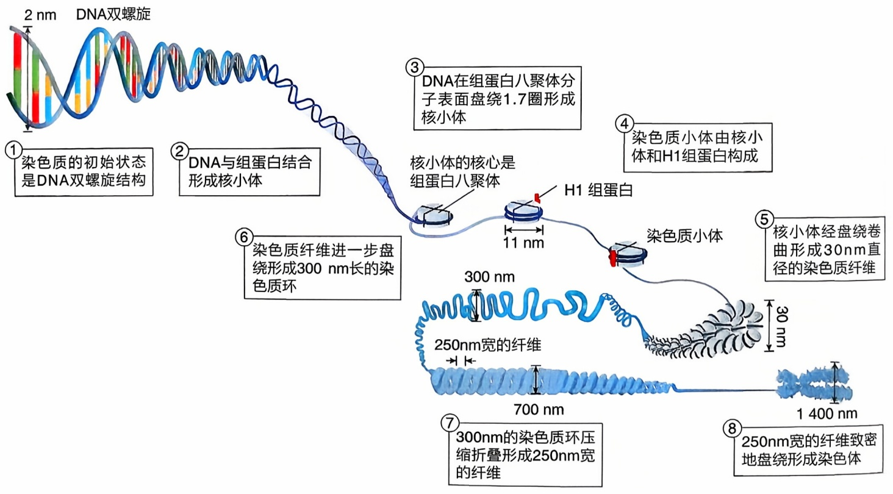

<details>
<summary>flowchart</summary>


</details>

---

第三节 基因组学

055

组三维结构的概念。

常染色质（euchromatin）是指处于伸展状态的染色质纤维，通常富集基因并具有转录活性；异染色质（heterochromatin）是指处于高度压缩状态下的染色体纤维，含有的基因数目较少且通常不具备转录活性。常染色质与异染色质的核小体组蛋白修饰是有区别的。组蛋白修饰（histone modification）是指组蛋白在相关酶的作用下以共价方式进行的蛋白质翻译后修饰，包括甲基化（methylation）、乙酰化（acetylation）、磷酸化（phosphorylation）、多聚腺苷酸化（polyadenylation）、泛素化（ubiquitination）和ADP核糖基化（ADP-ribosylation）等修饰。组蛋白修饰可以引起组蛋白与DNA之间的相互作用变化，或者招募非组蛋白分子来动态调整染色质的结构，从而改变转录状态。乙酰化修饰可以削弱组蛋白的正电性，进而降低组蛋白和DNA结合的能力。如H3K9ac和H3K27ac通常与活跃基因的增强子和启动子有关。甲基化修饰则不直接作用于组蛋白和DNA的结合，而是通过招募蛋白酶或蛋白质复合体介导染色质的开放与闭合。如H3K4me1标记基因增强子区域；H3K4me3标记基因启动子区域；H3K9me3则标记异染色质区域。

染色体疆域（chromosome territories）是指细胞分裂间期特定染色质占据细胞核内特定且不重合的区域（图2-27）；这个概念最早由卡尔·拉布尔（Carl Rabl，1853—1917）在1885年提出（Cremer et al., 2010）。染色体的相对位置在有丝分裂开始前通常保持相对稳定。例如，早期复制位点和活性基因倾向定位于细胞核内部，而晚期复制位点和抑制基因则倾向定位于核边缘。

染色体区室（chromosome compartment）分为 A 区室（A compartment）和 B 区室（B compartment），是埃雷兹·利伯曼-艾登（Erez Lieberman-Aiden）等研究人员在 2009 年使用高通量染色体构象捕获（high-throughput chromosome conformation capture，

图 2-27 三维基因组

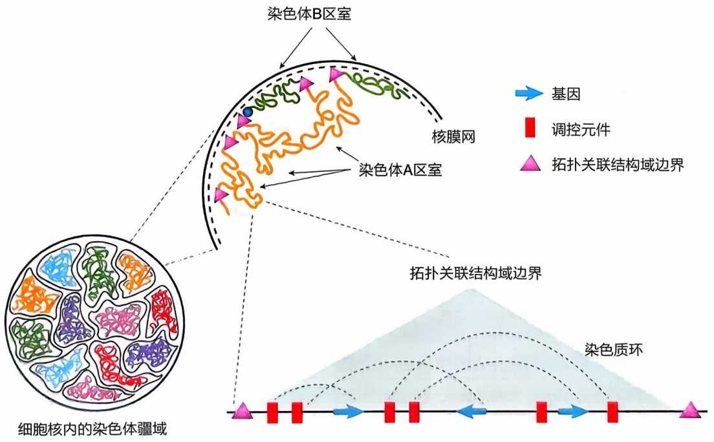

<details>
<summary>flowchart</summary>

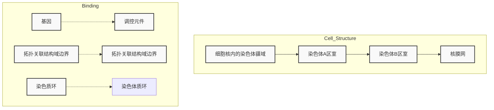
</details>

---

056

第二章 遗传基础和基因组学

Hi-C）技术（见下文）对三维结构进行研究时提出的概念（Lieberman-Aiden et al., 2009）。A 区域通常处于染色质开放状态，主要包含常染色质区域；B 区域通常处于染色质闭合状态，主要包含异染色质区域。

拓扑关联结构域（topologically associating domain，TAD）是指具有Mb级大小，高度自我相关的区域性染色体互作结构域。这种结构域是由艾尔菲吉·诺拉（Elphège Nora）和杰西·迪克森（Jesse Dixon）等研究人员在2012年，通过将Hi-C互作图谱的分辨率提高到40 kb及以上而发现的。在小鼠胚胎干细胞中，TAD的平均长度约为880 kb，约占基因组91%的区域。在非哺乳动物中，如果蝇、斑马鱼、线虫以及酵母等的基因组中均有相似的TAD结构。TAD的边界富集了结合蛋白CTCF、管家基因、tRNA和短散在重复序列等。随后，更高分辨率（1\~4 kb）的Hi-C互作图谱又使研究人员发现了更小的染色质结构域，被称为亚拓扑关联结构域（subTAD）。相比于TAD，subTAD更具有细胞类型特异性，具体功能尚未知。

染色质环是指染色质中两个远距离DNA序列相互之间通过空间折叠而形成的环状结构。这种环状结构将两个DNA序列紧密相连，缩短了它们在三维空间上的距离，促进了基因调控元件（增强子等）与靶基因之间的相互作用，使调控元件高效地调节基因的表达。染色质环的形成与黏连蛋白和结合蛋白CTCF有关。2014年，苏哈斯·拉奥（Suhas Rao）等利用原位Hi-C（in situ Hi-C）技术，同时将Hi-C互作图谱的分辨率提高到 $1\mathrm{kb}$，更准确地检测并描述了染色质环结构。

## 2. 基因组注释

基因组注释是对基因组序列进行解读，旨在研究基因的结构、功能、调控机制和相互作用。基因组注释涉及多种策略和工具，包括基于序列相似性的比对、基于基因家族的功能预测、通路分析等。基因组注释是生物信息学和分子生物学领域至关重要的一环，为后续的生物信息学分析、基因功能研究、药物开发和临床诊断等领域打下基础。

## (1) 基因组结构注释

基因组结构注释的目标是准确地标识和描述基因组中的各种结构特征，以提供有关基因组的组织结构和基因组学特征信息。通过基因组结构注释，研究人员可以了解基因组的组织和编码蛋白质的方式，以及与基因表达和功能相关的调控元件。目前经常被广泛研究的基因组结构注释包含基因的注释、基因编码序列的推断、基因调控元件的注释、非编码RNA的推测和重复序列的识别等。

基因的注释是指对基因组序列进行解读和标记，以确定其中的基因、非编码区域和其他功能元素。注释的目的是理解基因组的结构和功能，并推断基因的编码序列、调控元件和其他相关信息，包括从头注释、同源注释和基于转录组和蛋白质组的注释。从头注释是不利用参考基因组的注释信息，对新的基因组序列进行分析和预测，推断基因的位置、结构和功能的方法。从头注释的工具包括SNAP、TwinScan、FGENESH、Augustus、Genscan、GAZE等。同源注释是将同源物种基因的转录物序列或蛋白质序列映射到已经注释的基因组上。基于转录组和蛋白质组的注释是指将不

---

第三节 基因组学

057

同来源的转录物序列或蛋白质序列比对至基因组上，然后根据位置进行注释。同源注释和基于转录组和蛋白质组的注释工具包括 BLAST、BLAT、Splign、Spidey、sim4、Exonerate、gmap、Magic-BLAST 和 minimap2 等（表 2-4）。

基因编码序列的推断是通过分析基因组序列确定可能存在的蛋白质编码区域和序列的过程。蛋白质编码序列通常由一系列连续的核苷酸组成，被称为开放阅读框(open reading frame, ORF)。推断基因编码序列可采用统计模型、序列比对和机器学习等方法。统计模型分析基因组序列的核苷酸组合规律和编码蛋白质特征，构建模型预测可能的编码序列。序列比对将待推断的基因组序列与已知的编码蛋白质或已注释的基因组序列比对，识别可能的开放阅读框，常用的比对工具有BLAST、BLAT和HMMER。机器学习方法是利用已知蛋白质编码和非编码序列的特征，通过机器学习算法进行预测，如核苷酸组合、二级结构和保守性等特征。推断基因编码序列常用工具有Prokka和COG数据库。Prokka适用于细菌和古菌基因组注释，可自动预测基因的编码序列和注释功能；COG数据库提供基于同源关系的基因功能注释和分类信息。

基因调控元件的注释是指对基因组中的调控元件进行识别、定位和描述的过程。

表 2-4 常见的基因组注释数据库

| 缩写 | 全称 | 描述 |
| --- | --- | --- |
| NCBI | National Center for Biotechnology Information | 生物信息学资源和数据库中心，旨在收集、存储、管理和提供与生物技术和生物医学相关的信息，隶属于美国国家卫生研究院（NIH）。它为生命科学研究人员、医学专业人士和公众提供广泛的生物学数据库、工具和在线服务。NCBI的数据库包括GenBank、PubMed、Protein、Nucleotide、GEO、SRA、PubChem、ClinVar等。 |
| UCSC | University of California, Santa Cruz | 由加州大学圣克鲁兹分校创建和维护的生物数据库，提供多个物种的基因组信息和分析工具。 |
| Ensembl | Ensembl Genome Database Project | 欧洲生物信息研究所的科学项目，提供多种物种的基因组序列、注释和变异信息。 |
| ENCODE | Encyclopedia of DNA Elements | 国际合作项目，旨在识别和注释人类基因组中的功能元件，包括基因、转录因子结合位点、组蛋白修饰位点、长链非编码RNA、DNA甲基化等。 |
| GENCODE | Encyclopedia of Genes and Gene Variants | 提供准确、全面注释信息的基因注释体系。它包括蛋白质编码基因的不同转录物、非编码的基因位点和假基因的注释。GENCODE提供基因的位置、结构和功能等信息，主要有人类和小鼠两个物种的基因注释信息。研究人员可以通过访问GENCODE网站或使用相关工具和数据库获取和分析这些注释信息。 |
| FANTOM | Functional Annotation of the Mammalian Genome | 通过实验和计算方法研究哺乳动物基因组中的转录过程，并注释基因功能。它关注转录组学和功能基因组学，以揭示基因调控网络和转录调控机制。 |
| EPD | The Eukaryotic Promoter Database | 注释的真核生物Pol II启动子数据库，包含经实验证实的启动子序列和相关信息。每个条目包括启动子的起始位点映射数据、交叉引用和功能描述，提供指向核苷酸序列的指针，使用户可以访问启动子序列。 |
| JASPAR | Just Another Satisfiability Problem Solver | 转录因子结合位点信息的数据库。它是一个开源的数据库，记录了多个物种的转录因子（transcription factor，TF）的DNA结合偏好信息。 |

---

058

第二章 遗传基础和基因组学

调控元件指参与调控基因表达的DNA序列片段，包括启动子、增强子、抑制子、转录因子结合位点等。这些调控元件可以在特定的细胞类型或特定的发育阶段发挥作用，调节基因的转录水平和模式。实验方法包括用于检测转录因子与DNA相互作用的染色质免疫共沉淀测序（chromatin immunoprecipitation sequencing，ChIP-seq）、用于检测开放染色质区域的DNase I超敏感位点测序（DNase I hypersensitive sites sequencing，DNase-seq），以及用于检测可访问染色质区域的转座酶可及染色质测序（assay for transposase-accessible chromatin sequencing，ATAC-seq）。对ChIP-seq数据进行分析，可以利用各种可用的工具和算法，如MACS2、HOMER、MEME-ChIP等，来鉴定转录因子结合位点。对ChIP-seq或ATAC-seq数据进行分析，可以利用工具如MACS2、HMMRATAC、SICER等，来识别染色质状态的特定区域，如开放染色质区域、启动子、增强子等。对已识别的调控元件进行注释时，可以使用现有的数据库和软件工具，如Ensembl、GENCODE、UCSC Genome Browser等，来获取调控元件的基因关联、调控因子和调控通路等信息。

非编码 RNA 的预测是利用计算方法和生物信息学工具，根据基因组序列的特征和模式来确定 ncRNA 的存在和潜在功能。首先进行序列特征分析，包括序列长度、GC 含量、二级结构等特征，筛选潜在的 ncRNA 候选序列。然后将分析好的特征序列与已知的 ncRNA 数据库（如 NONCODE、miRBase）比对，或使用搜索算法寻找与候选序列相似的已知 ncRNA 序列。最后使用 RNA 二级结构预测算法（如 RNAfold、Mfold），预测 ncRNA 的二级结构和稳定性，确定非编码序列的类型和类别。

重复序列的识别是通过计算方法和生物信息学工具对基因组序列中的重复序列进行辨识和标记的过程。首先将基因组序列与已知重复序列数据库比对，如Smith-Waterman或BLAST，寻找与已知重复序列模式相似的序列片段。然后分析序列片段的结构特征，如GC含量、重复单元长度和间隔，推断是否为重复序列。最后对识别出的重复序列进行分类，如简单重复序列（如微卫星、转座子）和复杂重复序列（如LINE、SINE）。常用的重复序列识别工具有RepeatMasker、CENSOR和TRF等。

## (2) 基因组功能注释

为了理解基因的特定功能、参与的通路以及与其他基因的关联，研究人员使用各种工具和资源对基因进行解释和注解。基因根据相似的碱基或蛋白质序列归类为基因家族（gene family）。

基因家族是指源于同一个祖先，由一个基因通过基因重复而产生的一组相似基因，通常具有相似的结构和功能。根据基因的进化关系来分，基因家族分为旁系同源基因（paralogs）和直系同源基因（orthologs）。旁系同源基因是指在同一物种中的具有相似序列的基因；直系同源基因是指不同物种间的具有相似序列的基因。人类基因组组织基因命名委员会（HUGO Gene Nomenclature Committee，HGNC）利用基因家族成员的主干符号创建命名方案，并使用分层编号系统来区分各个成员。如HOX基因家族，HOX是根符号，家族成员有HOXA1、HOXB1、HOXC1、HOXD1等。基因家族中的家族成员具有相似的结构和生物学功能。因此，一方面，一些功能数据库基于

---

第三节 基因组学

059

序列相似性聚类形成；另一方面，研究人员可通过与功能数据库中的序列进行比对，对新基因或未知功能的基因所来自的基因家族进行分类，从而对其功能进行预测。

在基因功能注释过程中，研究人员依赖于各种功能注释数据库；这些数据库提供了丰富的注释信息和工具，帮助研究人员获取特定基因的详细注释信息，理解基因的功能和特征。主要的基因功能数据库有以下几个:

同源基因簇数据库（Database of Clusters of Orthologous Genes，COGs）是NCBI开发用于同源蛋白注释的数据库，通过比较完整基因组的蛋白质序列而产生。研究人员可通过将待鉴定蛋白质与该数据库序列进行比对，对蛋白质进行分类，从而预测其功能。

Pfam 数据库（protein families database）是由欧洲生物信息研究所（EMBL-EBI）维护和更新的数据库，通过鉴定目标蛋白质与数据库蛋白质序列的多重序列比对和隐马尔可夫模型（Hidden Markov Model，HMM），来对蛋白质进行注释和分类，帮助研究人员理解蛋白质的结构、功能和进化。

UniProt 数据库（Universal Protein resource）是包含蛋白质序列和大量功能注释信息的蛋白质数据库，共有 4 个核心数据库:UniProtKB（UniProt knowledgebase）、UniRef（UniProt reference clusters）、UniPac（UniProt archive）和 UniMES（UniProt Metagenomic and Environmental Sequences）。UniProtKB 又分为人工校正的 Swiss-Prot 和计算机自动注释的 TrEMBL 蛋白质序列数据库；UniRef 是基于序列相似性的聚类数据库；UniParc 包含来自主要公共数据库的所有蛋白质序列。

GeneCards 数据库是一个综合性的人类基因数据库，提供已注释和预测的人类基因的注释信息、基因互作关系、临床和功能等全面的信息，整合了超过 150 个网络资源的基因中心数据。

基因本体论（gene ontology，GO）是对基因及其产物特性进行统一化生物学描述的数据库。GO从三个方面描述生物学领域的知识:①分子功能（molecular function, MF），指单基因产物或多基因产物复合体在分子水平上的活动。分子功能的描述只表示活动本身，而不涉及执行功能的实体（分子或复合物），活动发生的地点、时间和背景，如广义的功能条目可以是“催化活性”或“转运活性”，具体的功能条目可以是“腺苷酸环化酶活性”或“类Toll受体结合”等。②细胞组分（cellular component, CC），指基因产物执行功能所处的细胞结构位置，可以是细胞区室（如线粒体）或包含产物的稳定大分子复合物（如核糖体）。③生物学过程（biological process, BP），指由多种分子活动协同完成的生物学过程，如广义生物学过程条目可以是“DNA修复”或“信号转导”，具体的条目可以是“嘧啶核苷酸生物合成过程”或“葡萄糖跨膜转运”。

KEGG（Kyoto Encyclopedia of Genes and Genomes）是帮助理解生物学系统的功能和作用的一个数据库资源。它涵盖了基因和蛋白质（代表基因组信息）、分子复合物及化学反应（代表化学物质信息）、各类元素的分类、功能单元和互作网络（代表系统信息）以及疾病和药物等（代表健康信息）四大方面的信息，用来帮助理解生物

---

060

第二章 遗传基础和基因组学

学系统以及指导生物学应用。KEGG 通路是 KEGG 的核心数据库，是一系列代谢通路的集合。其主要包含生物代谢、遗传信息处理、环境资料加工、细胞过程、生物体系统、人类疾病以及新药开发等方面的分子间相互作用和反应网络。

## (3) 遗传变异的功能影响注释

遗传变异的功能影响注释是计算和评估基因变异对基因功能影响程度的方法。通常基于多种算法和模型，利用大量基因功能和结构信息进行预测。通过功能影响评分、研究人员可以定量比较和排序不同基因变异的功能影响，有助于识别与疾病相关的致病突变，深化对基因功能和疾病机制的理解。然而，功能影响评分方法仍然是预测性的，准确性和可靠性可能受多种因素影响。因此，在实际研究中，应结合实验验证和其他生物信息学方法综合评估遗传变异的功能影响。根据注释的范围大小，可以将其分为蛋白质编码区域的功能影响注释，如SIFT、PolyPhen-2、GERP和全基因组范围的功能影响注释，如CADD、FATHMM-MKL、GWAVA（表2-5）。

表 2-5 遗传变异的功能影响注释

| 注释工具 | 预测模型 | 注释区域 | 发表年份 |
| --- | --- | --- | --- |
| phastCons | phylo-Hidden Markov Model | coding | 2005 |
| PhyloP | Dynamic Pogramming Algorithms | coding | 2006 |
| MutationAssessor | Scoring System | coding | 2007 |
| PolyPhen-2 | Naïve Bayes Classifier | coding | 2010 |
| GERP++ | Statistical Framework | coding | 2010 |
| SIFT | Probability Estimation | coding | 2012 |
| FunSeq2 | Scoring System | non-coding | 2012 |
| MISTIC | Ensemble Method | coding | 2013 |
| CADD | Support Vector Machine | whole genome | 2014 |
| GWAVA | Random Forest | whole genome | 2014 |
| DANN | Deep Learning | whole genome | 2015 |
| MetaLR | Logistic Regression | coding | 2015 |
| MeaSVM | Support Vector Machine | coding | 2015 |
| FATHMM-MKL | Support Vector Machine | whole genome | 2015 |
| eigen | Meta Scores | whole genome | 2016 |
| PredictSNP2 | Ensemble Method |  | 2016 |
| REVEL | Random Forest | coding | 2016 |
| M-CAP | Gradient Boosting Tree | coding | 2016 |
| LINSIGHT | Generalized Linear Model | whole genome | 2017 |
| CDTS | Probability Estimation | whole genome | 2018 |
| PrimateAI | Deep Learning | coding | 2018 |

---

第三节 基因组学

061

续表

| 注释工具 | 预测模型 | 注释区域 | 发表年份 |
| --- | --- | --- | --- |
| MVP | Deep Learning | coding | 2021 |
| MutationTastcr | Random Forest | coding | 2021 |
| EVE | Variantional Autoencoder | coding | 2021 |
| Depletion rank (DR) | / | whole genome | 2022 |
| MetaRNN | Deep Learning | coding | 2022 |
| gMVP | Graph Attention Meural Network | coding | 2022 |
| PrimateAI-3d | Deep Learning | coding | 2023 |
| AlphaMissense | Deep Learning | coding | 2023 |

随着医学和生物学的发展，对疾病的认识不断深化，对疾病相关信息和数据的需求也相应增加。为了方便获取和共享疾病相关数据，研究人员开发了各种疾病数据库。这些数据库满足了研究人员对疾病信息和数据的需求，促进了疾病研究的发展，并为疾病的治疗与预防提供支持和指导。下面详细介绍几个常见的疾病数据库，以便研究人员根据需要选择适合自己研究的数据库进行数据查询和分析。

HGMD（Human Gene Mutation Database）是一个收集已发表文献中致病突变和与人类疾病相关的功能多态的数据库，有助于研究人员查找和分析与疾病相关的基因突变。

ClinVar 是一个存储和分享遗传变异与人类健康相关信息的数据库，提供遗传变异的临床意义、相关疾病和遗传模式等信息，帮助研究人员了解遗传变异与疾病之间的关联。

OMIM（Online Mendelian Inheritance in Man）是一个提供人类遗传疾病详细信息的数据库，包括表型特征、基因突变和遗传模式等，有助于研究人员深入了解人类遗传疾病的基础知识。

DisGeNET 是一个研究人类疾病和基因之间关系的数据库，整合了多个公共资源的数据，包括 OMIM、PubMed、GWAS 目录等，提供疾病和基因之间的关联、共现性和功能相似性等信息。

Malacards 是一个综合性的人类疾病数据库，提供关于疾病的详细信息和注释，整合了基因、表型、药物、文献等多种数据源，有助于深入了解疾病的多个方面。

Orphanet 是一个罕见疾病的知识数据库，提供罕见疾病的诊断、孤儿药物、临床试验和专家网络等信息，有助于研究人员深入了解罕见疾病的特点和治疗方法。

PharmGKB（Pharmacogenomics Knowledgebase）是一个关于基因变异如何影响药物反应的数据库，集中于药物基因组学领域，提供药物代谢、作用机制和基因变异对药物反应的影响等信息，支持个体化药物治疗。

---

062

第二章 遗传基础和基因组学

## 三、基因组研究技术

基因组承载着生物体完整的遗传信息，可以通过测序进行解码，为生物多样性研究、疾病的诊断与治疗，以及个性化医疗等领域提供基础。1977年，科学家成功测序了噬菌体X174的基因组，这一事件标志着基因组学测序的开篇；而人类基因组计划的提出和完成则将基因组学研究推向了大规模测序的新纪元（知识窗2-2）。在本小节中，我们将系统地概括不同测序技术的原理、优势与限制，以及实际应用案例等方面的内容（图2-28）。

## 1. 测序技术的发展及原理

## (1) 一代测序技术

20世纪70年代，英国科学家桑格等人发明了双脱氧终止法测序技术，也称为

图2-28 测序技术的发展及其特点

图中的时间线展示了基因组测序技术随时间的发展；同时对从一代到三代测序的特点进行了比较和总结。

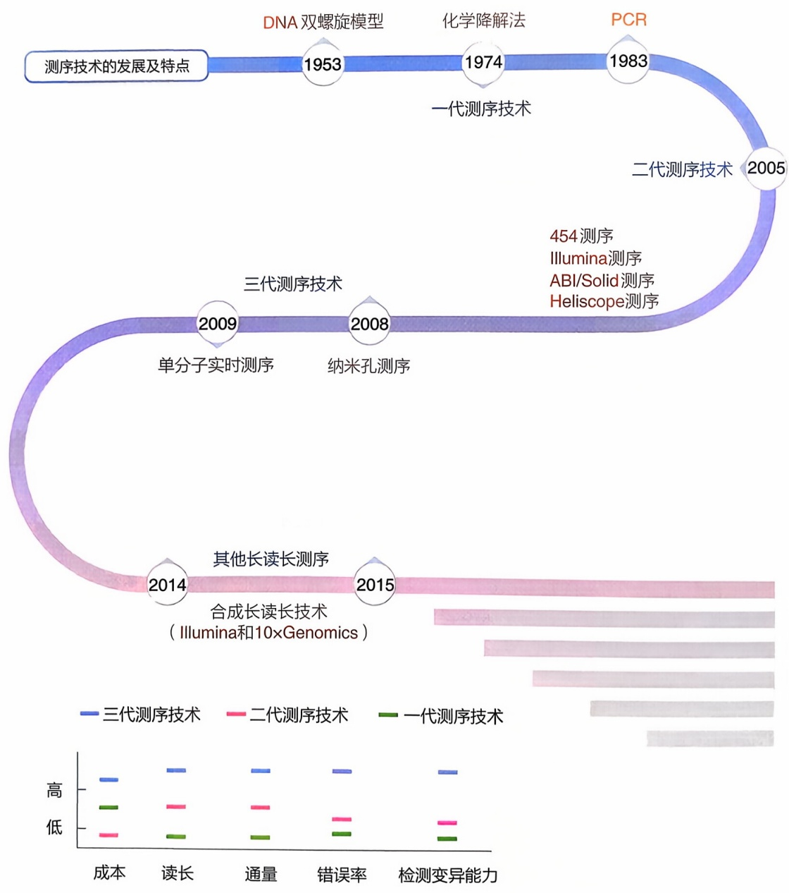

<details>
<summary>state_timeline</summary>

| Year | Technology / Technologies |
| --- | --- |
| 1953 | DNA双螺旋模型 |
| 1974 | 化学降解法 |
| 1983 | PCR |
| 2005 | 二代测序技术 |
| 2008 | 三代测序技术 |
| 2009 | 单分子实时测序 |
| 2014 | 其他长读长测序 (Illumina和10xGenomics) |
| 2015 | 合成长读长技术 (Illumina和10xGenomics) |
</details>

---

第三节 基因组学

063

Sanger 测序。同年，阿伦·马克萨姆（Allan Maxam）和沃尔特·吉尔伯特（Walter Gilbert）报道了化学降解法（chemical degradation method）的测序策略，又称为Maxam-Gilbert测序。双脱氧终止法、化学降解法以及在它们基础上发展的各种DNA测序技术统称为一代测序技术（图2-29）。

## ① 化学降解法

通过对 DNA 进行特定的化学修饰，然后进行切割和电泳分离，最后通过读取分离的 DNA 片段来确定 DNA 序列。首先，使用  ${}^{32}$ P-dATP 和多核苷酸激酶对待测序的双链 DNA 的 5' 端进行放射性标记，使用二甲基亚砜（DMSO）将 DNA 变性，得到单链 DNA（single strand DNA，ssDNA）分子，并通过电泳将其进行分离；然后，通过氮碱基特异性反应，修饰腺嘌呤（A）、胞嘧啶（C）、鸟嘌呤（G）和胸腺嘧啶（T）的残基，使 ssDNA 在这些位置的 5' 端发生化学切割；最后，通过聚丙烯酰胺凝胶电泳和自显影，将修饰后的 ssDNA 片段按大小分离，并在 X 射线胶片上检测放射性 DNA 条带的图谱。这些条带图谱代表了 DNA 序列，通过分析图谱可以确定 DNA 的确切序列。

化学降解法测序在早期的 DNA 分子测序中发挥了重要作用。然而，测序过程中涉及危险的化学物品，技术复杂，难以大规模使用。因此，逐渐被更为便捷的 Sanger 测序等方法所替代。

## ② 双脱氧终止法

该法包括三个主要步骤:DNA 模板制备、凝胶电泳分离和凝胶分析。在 DNA 模板制备中，待测序的 DNA 序列作为模板，与脱氧核苷酸三磷酸（dNTPs）一同引入链终止剂 ddNTPs。这些 ddNTPs 能在 DNA 聚合酶合成 DNA 链时终止延伸，产生随机长度的 DNA 片段。然后，通过凝胶电泳按大小分离这些链终止的 DNA 片段。凝胶电泳中 DNA 片段向正电极泳动，根据大小差异将其分离，较小片段泳动得更远更快。最后，在凝胶分析中，通过阅读凝胶带上的 DNA 片段来确定 DNA 序列。DNA 聚合酶合成 DNA 链时，终止的 ddNTPs 会对应原序列中的特定核苷酸。通常，从底部到顶部读取凝胶，根据每条带上 ddNTP 的标识来确定 DNA 序列。

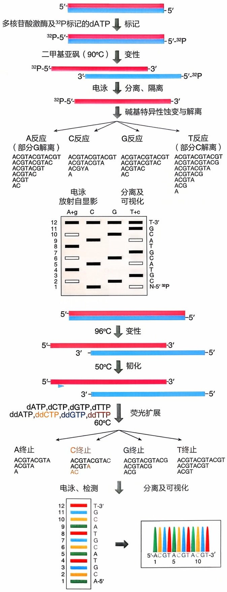

<details>
<summary>flowchart</summary>

```mermaid
graph TD
  A["多核苷酸激酶及32P标记的dATP"] --> B["标记"]
  B --> C["二甲基亚砜 (90°C)"]
  C --> D["变性"]
  D --> E["电泳"]
  E --> F["分离、隔离"]
  F --> G["碱基特异性蚀变与解离"]
  
  G --> H["A反应 (部分G解离)\nACGTACGTACGT\nACGTACGTAC\nACGTACGT\nACGTAC\nACGT\nACG"]
  G --> I["C反应"]
  I --> J["G反应"]
  J --> K["T反应 (部分C解离)\nACGTACGTACGT\nACGTACGTACG\nACGTACGT\nACGTACG\nACGTAG\nACGA"]
  
  subgraph Transcription
  L1["电泳放射自显影"] --> M["分离及可视化"]
  M --> N["A+g C G T+c"]
  N --> O["5' -5'"]
  O --> P["96°C 变性"]
  P --> Q["5' -3'"]
  Q --> R["50°C 韧化"]
  R --> S["dATP,dCTP,dGTP,dTTP\nddATP,ddCTP,ddGTP,ddTTP"]
  S --> T["荧光扩展"]
  T --> U["60°C"]
  U --> V["A终止"]
  U --> W["C终止"]
  U --> X["G终止"]
  U --> Y["T终止"]
    
  V --> Z["ACGTACGTA\nACGTA\nA"]
  W --> AA["ACGTACGTAC\nACGTA\nAC"]
  X --> AB["ACGTACGTACG\nACGTACG\nACG"]
  Y --> AC["ACGTACGTACGT\nACGTACGT\nACGT"]
    
  Z --> AD["电泳、检测"]
  AA --> AD
  AB --> AD
  AD --> AE["分离及可视化"]
  AE --> AF["5'-ACGT ACGT ACGT ACGT-3'"]
```
</details>

图2-29 一代测序技术:化学降解法（上）和双脱氧终止法（下）

---

064

第二章 遗传基础和基因组学

## 知识窗2-2

# 人类基因组计划及其对测序技术和基因组学研究的贡献

人类基因组计划的提出和完成对DNA测序技术的发展产生了深远的影响。该计划由国际人类基因组测序联盟（International Human Genome Sequencing Consortium，IHGSC）发起，历时10年，总花费约30亿美元。其主要目标是对人类基因组上的24条染色体（22条常染色体和2条性染色体）所包含的约30亿个碱基对进行测序和解析，绘制出人类基因组图谱，识别蛋白质编码基因及其序列组成，最终实现破解人类遗传信息的终极目标。

2001年2月，IHGSC和塞雷拉基因组公司（Celera Genomics）分别在Nature和Science杂志上发表了人类基因组草图的相关论文，标志着人类基因组计划的成功（International Human Genome Sequencing Consortium, 2001；Venter et al., 2001）。2003年4月14日，中、美、日、德、法、英6国科学家宣布成功绘制了完整的人类基因组序列图，开启了后基因组研究时代。2004年，国际人类基因组测序联盟报道了人类基因组的完成图（International Human Genome Sequencing Consortium, 2004），共有28.5亿个碱基位点，碱基正确率高达$99.999\%$ ，含 $20000\sim 25000$ 个蛋白质编码基因，这个基因组被定义为人类参考基因组（human reference genome）。

在人类基因组计划中，主要策略是将整个基因组切割成长度约为15万个碱基的小片段，并确保相邻片段有部分重叠的DNA。然后，将每条DNA片段插入到人工培育的细菌染色体中，通过细菌的繁殖来实现DNA片段的复制。随后，这些DNA片段被分割成约1000个碱基长度的短重叠片段，并进行测序分析，生成了许多测序结果序列，每个序列被称为一个“读长”（read）。最终，通过不同DNA片段之间的重叠部分，获得了连续的图谱。这种严格的图谱测序方法虽然操作复杂，但能够将测序错误降至最低，确保了最终产生的人类基因组序列具有极高的质量。

塞雷拉基因组公司提出了一种更加高效的方法，称为“全基因组鸟检测序法”（whole-genome shotgun sequencing）。该方法将整个基因组随机打断成多个短的重叠DNA片段，然后直接对这些DNA片段进行测序。最后，通过组装这些测序得到的读段数据，成功获得了完整的基因组序列。这一方法的主要优点在于速度较快，塞雷拉基因组公司仅耗时3年就完成了一个个体基因组的测序和组装。

这两种方法的竞争加速了人类基因组计划的完成并推动了DNA测序技术的不断进步，特别是全基因组鸟枪测序法为下一代测序技术提供了思路，形成高通量并行测序的技术，大大推进了基因组学的发展。

以Sanger测序为代表的一代测序技术，因其通量较低逐步退出主流测序领域。然而，由于其产生的序列准确性高，它仍然被视为序列测序的金标准（golden standard），用来评估新测序技术的准确性等。

## (2) 二代测序技术

以 Sanger 测序法为代表的一代测序技术曾经主导了几十年的基因组学研究。然而，Sanger 测序存在着诸多局限性，包括价格昂贵、通量较低和操作繁琐等，导致其在大规模测序中应用受限。为了克服这些限制，二代测序技术，又称大规模平行测序（massively parallel sequencing, MPS）（Rogers et al., 2005）应运而生。与 Sanger 测序

---

第三节 基因组学

065

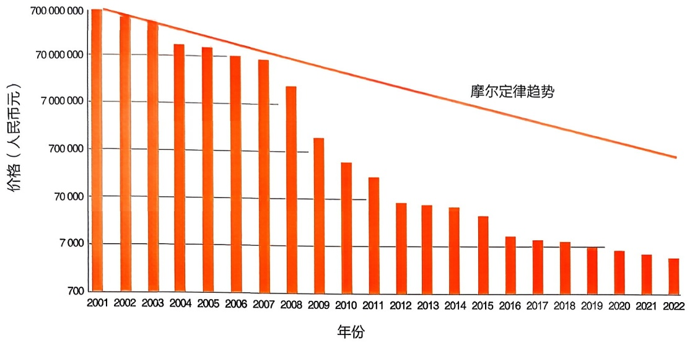

<details>
<summary>bar</summary>

| 年份 | 价格 (人民币元) |
| --- | --- |
| 2001 | ~700,000,000 |
| 2002 | ~695,000,000 |
| 2003 | ~690,000,000 |
| 2004 | ~685,000,000 |
| 2005 | ~682,000,000 |
| 2006 | ~678,000,000 |
| 2007 | ~675,000,000 |
| 2008 | ~672,000,000 |
| 2009 | ~665,000,000 |
| 2010 | ~655,000,000 |
| 2011 | ~648,000,000 |
| 2012 | ~642,000,000 |
| 2013 | ~641,000,000 |
| 2014 | ~641,000,000 |
| 2015 | ~638,000,000 |
| 2016 | ~632,000,000 |
| 2017 | ~631,000,000 |
| 2018 | ~631,000,000 |
| 2019 | ~631,587 |
| 2020 | ~631,587 |
| 2021 | ~631,587 |
| 2022 | ~631,587 |
</details>

图2-30 单个人类基因组的测序成本随时间变化

不同，二代测序技术利用高通量平台构建DNA文库并进行PCR，能够同时并行测序大量的DNA分子，从而极大地提高了测序效率。在成本方面，二代测序打破了“摩尔定律”（图2-30），使得单个基因组的测序价格从最开始的30亿美元逐年降低至1000美元以下（NHGRI，2022）。随着测序厂商不断推出新的二代测序平台，这一技术逐渐成为基因组学、转录组学和表观遗传学等领域的重要工具。二代测序技术催生了基因组大数据时代的到来，同时也推动着生命科学领域进入一个全新的阶段。根据测序策略的不同，二代测序主要可分为两大类，即连接法测序（sequencing by ligation, SBL）和边合成边测序（sequencing by synthesis, SBS）。

SBL 使用 DNA 连接酶（DNA ligase）以及核苷酸探针来测定 DNA 片段的序列（Shendure et al., 2005）。最具代表性的 SBL 测序平台是 ABI SOLiD，其在早期的二代测序技术中占据重要位置，但由于测序效率较差，逐渐被其他快速发展的 SBS 测序技术所取代。

SBS是目前最常用的二代测序策略，其核心原理是利用DNA聚合酶在合成DNA的同时进行序列测定。根据细节原理的不同，SBS又可进一步划分，其中最具代表性的方法包括焦磷酸测序（Margulies et al., 2005）、Illumina可逆终止测序（Ju et al., 2006）和Ion Torrent半导体测序（Rothberg et al., 2011）。

## ① 焦磷酸测序

焦磷酸测序（pyrosequencing）是一种通过酶级联化学发光反应实现 DNA 序列测定的 SBS 技术，最早由三位瑞典科学家帕尔·尼伦（Pål Nyrén）、马蒂亚斯·乌伦（Mathias Uhlén）和莫斯塔法·罗纳吉（Mostafa Ronaghi）于 1998 年提出。2005 年，454 Life Sciences 公司推出了 GS20 焦磷酸测序仪，这也是第一台商用二代测序仪。

焦磷酸测序使用乳液 PCR（emulsion PCR）对 DNA 文库进行扩增（图 2-31），即将包含 DNA 片段和 PCR 组分的水溶液与矿物油进行混合，形成众多相互隔离的“油包水”小液滴作为 PCR 的反应容器（Williams et al., 2009）。在测序过程中，当脱氧核苷酸三磷酸（dNTP）与模板结合时，会产生焦磷酸盐分子（pyrophosphate, PPi）。

---

066

第二章 遗传基础和基因组学

图2-31 焦磷酸测序

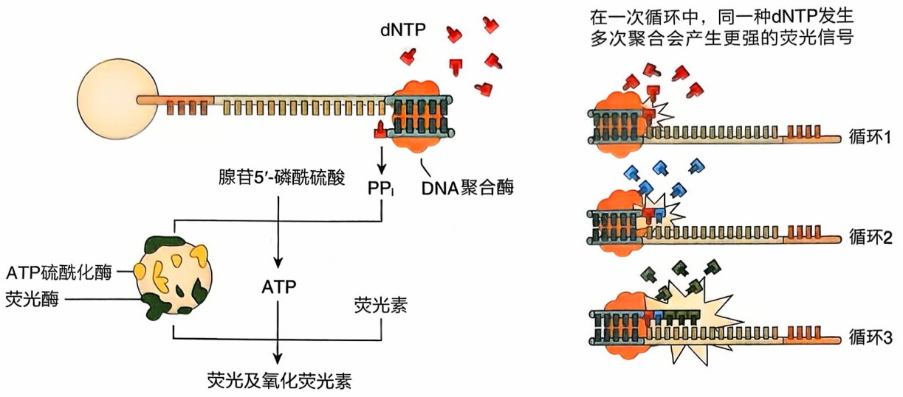

PPi 与三磷酸腺苷硫酰化酶（ATP sulfurylase）一同反应，将反应物腺苷 5'-磷酰硫酸（adenosine 5'-phosphosulfate，APS）转化为 ATP。随后，ATP 与荧光酶（luciferase）共同催化荧光素（fluorescein）底物，产生光信号，这些信号会被电荷耦合器件所记录。最后，利用三磷酸腺苷双磷酸酶（apyrase）降解反应物，重置整个测序过程。在一次循环内，只有一种 dNTP 被聚合，产生的荧光强度由发生聚合的 dNTP 的数量所决定，通过不断检测反应室中 4 种 dNTP 的荧光类型和强度，即可测得 DNA 片段的序列。

## ② Illumina 可逆终止测序

Illumina 可逆终止测序是目前市面上最常用的高通量测序技术。与其他 SBS 方法相比，Illumina 测序在原理上有着显著不同，其包括两个关键技术，即桥式 PCR（bridge PCR）（Bing et al., 1996）和循环可逆终止（cyclic reversible termination, CRT）（Bentley et al., 2008）。

Illumina 测序的 PCR 扩增和测序反应发生在特殊设计的玻璃流通槽（flowcell）中。首先，DNA 模板与附着在槽上的寡核苷酸引物（P5 和 P7）结合，并在 DNA 聚合酶的作用下生成反向链。接着，DNA 双链被解开，反向链与其他引物序列结合并继续扩增。最后，不断重复这个过程，直至形成一个个 DNA 簇。由于在扩增期间，DNA 序列会形成桥状结构，因此这种扩增方式被称为桥式 PCR（图 2-32）。

Illumina 测序所使用的每个 dNTP 都标记有一个可剪切的荧光基团，并且 dNTP 原本的 3'-OH 位置被修饰成一个叠氮甲基基团（azidomethyl group）。在测序过程中，由于该修饰基团的阻断作用，每次反应只能结合一个 dNTP。通过全反射内照射荧光显微镜对流通槽进行成像，可以识别当前结合的 dNTP 类型。每完成一轮反应后，dNTP 的荧光基团会被切除，3'-OH 由还原剂重新生成，继续下一轮测序的链延伸（图 2-33）。

## ③ Ion Torrent 半导体测序

Ion Torrent 半导体测序是首个商业化的不依赖复杂光学传感系统的测序技术，仪器小巧轻便。该技术能直接将 DNA 合成反应过程中的化学信息转化为序列信息，显

---

第三节 基因组学

067

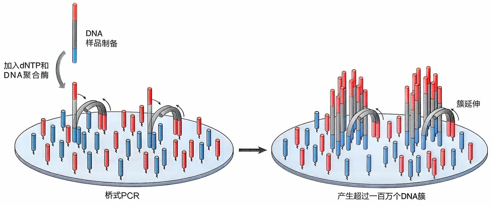

<details>
<summary>flowchart</summary>


</details>

著提升了测序效率。然而，其在检测连续重复碱基时的准确性较低。

## (3) 三代测序技术

图2-32 Illumina测序桥式PCR扩增

许多动植物的基因组中含有大量的结构变异（structural variation，SV），如重复元素和拷贝数变异等，表现出极高的复杂性。由于短序列测序技术的读长相对较短，因此难以正确解析这些基因组上的复杂区域。三代测序技术，如单分子实时测序和纳米孔测序，无需进行PCR扩增，可以对每个DNA分子单独测序，从而产生更长的测序片段（图2-34）。目前，长读长测序已广泛应用于动植物基因组的组装、结构变异的检测和转录组研究等方面（知识窗2-3）。

5': TCGA
3': AGCTAGCTAGCTACC…

图2-33 Illumina可逆终止测序

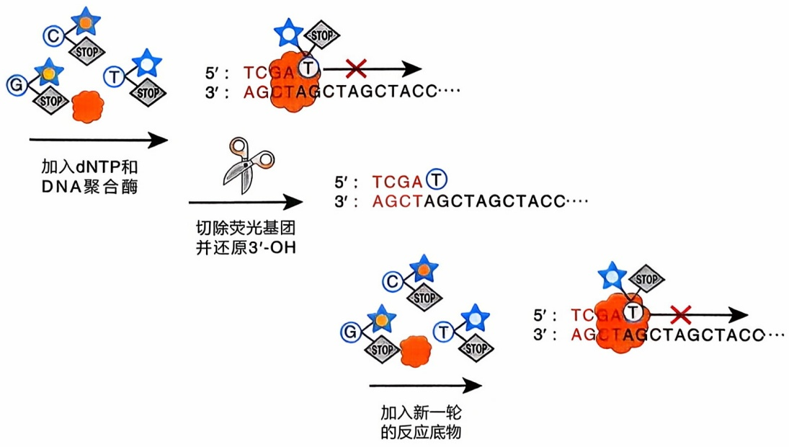

<details>
<summary>flowchart</summary>


</details>

---

068

第二章 遗传基础和基因组学

## ① 单分子实时测序

单分子实时测序（single molecule real-time sequencing，SMRT）技术是由太平洋生物技术公司（Pacific Biosciences，PacBio）开发的长读长测序方法。在 SMRT 测序中，待测序的 DNA 以单链环形分子形式存在，通常被称为 SMRTbell 模板。该模板由两端

图 2-34 长读长测序技术 A. 实时长读长测序

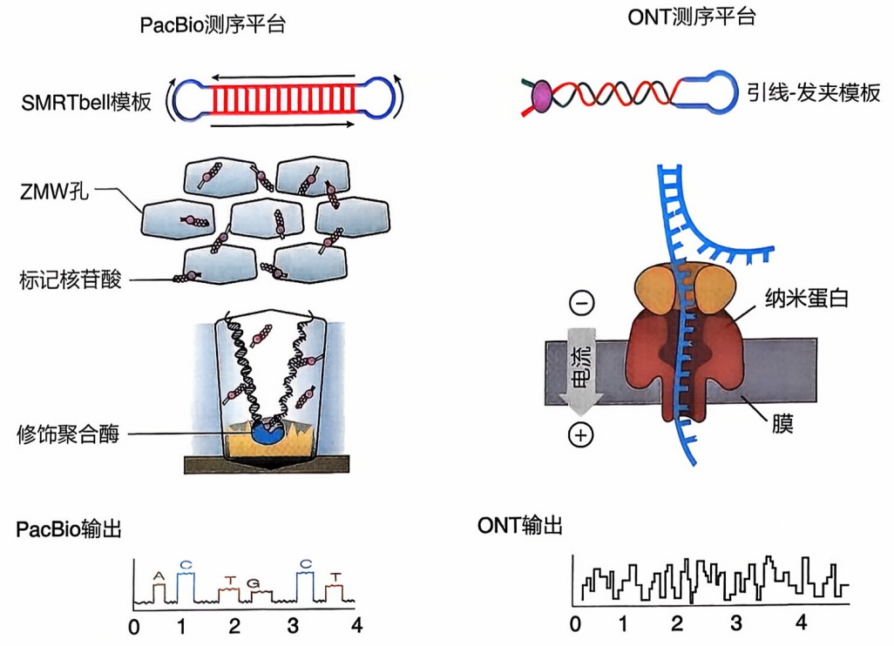

B. 合成长读长测序

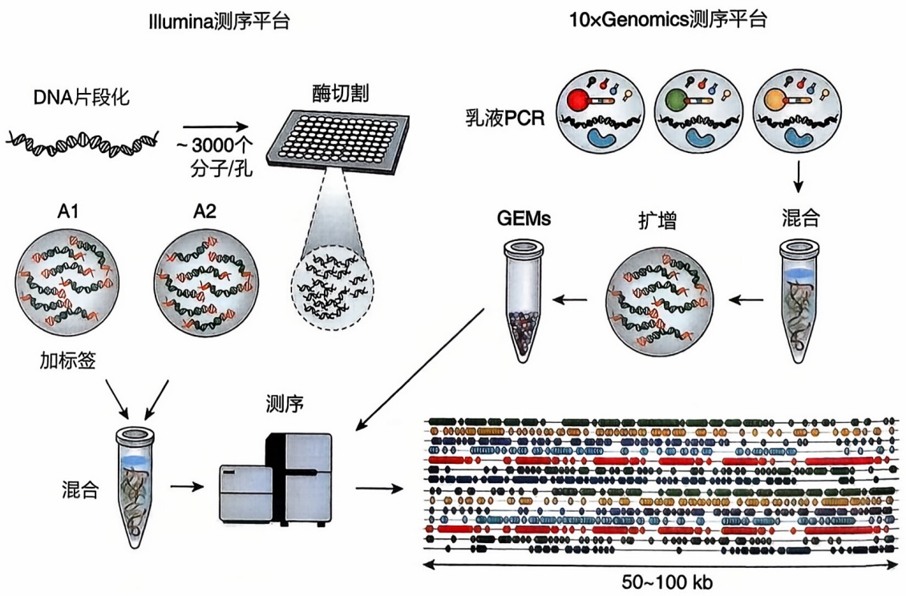

<details>
<summary>flowchart</summary>

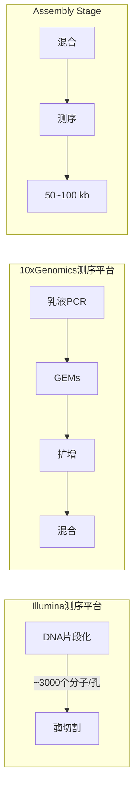
</details>

---

第三节 基因组学

069

## 知识窗2-3

## T2T 基因组和泛基因组

1. 端粒到端粒（telemere to telemere, T2T）基因组

传统的基因组测序方法和组装算法通常在染色体末端、着丝粒区域等具有高度重复序列的基因组区域，存在难以解决的挑战。随着三代测序技术的不断进步，特别是结合高精度的PacBio HiFi序列和ONT的超长读长，研究人员能够对这些复杂区域进行正确组装和矫正，从而得到完整的基因组序列。2022年，首个完整的人类基因组序列公布（Nurk et al., 2022）；2023年，两个独立的研究团队分别发布了中国人的完整基因组序列（Yang et al., 2023; He et al., 2023）。类似的研究也在植物基因组研究中得到了应用，例如拟南芥（Wang et al., 2022）和水稻（Shang et al., 2023）等，为深入研究生物多样性和基因功能提供了重要工具。

2. 泛基因组（pan-genome）

随着测序技术的不断发展，大量高质量的基因组序列被组装出来，从而形成了泛基因组学的研究方法。与传统的线性基因组学不同，泛基因组研究整合了多个个体的基因组变异信息，旨在全面了解和比较个体之间的基因组变异和功能多样性（Liao et al., 2023）。目前，泛基因组学已广泛应用于医学、农业、微生物学等多个领域。在医学方面，泛基因组学为个性化医疗和疾病研究提供了强大的工具，有助于理解疾病的遗传基础以及治疗方法的个体差异。在农业领域，它用于作物遗传改良，帮助培育更具抗性和高产性的作物品种，以满足全球食品需求。在微生物学领域，泛基因组学有助于研究微生物的功能和多样性，对环境保护和药物研发具有重要意义。泛基因组学的兴起进一步推动了基因组学的研究前沿。

带有单链发夹式接头的双链 DNA 序列组成。测序反应发生在 SMRT Cell 芯片中，该芯片包含许多微小的通道，被称为零模波导孔（zero-mode waveguide，ZMW）。在每个 ZMW 通道中，都固定了一个 DNA 聚合酶分子，从而实现对单个 SMRTbell 模板的测序。测序开始时，将 SMRTbell 文库加载到 SMRT 芯片，聚合酶与 SMRTbell 的适配体结合并复制。在复制过程中，4 种不同的荧光标记核苷酸（A、T、G 和 C）与聚合酶结合并产生具有特征光脉冲的信号。光脉冲信号随后被解读为核苷酸序列，生成被称为 CLR（continuous long read）的序列。由于 SMRTbell 模板成环状，聚合酶多次测序 DNA 模板，每次产生一个 subread。由于这种方法产生的测序错误是相对随机的，虽然单个 subread 中的测序错误率较高，但多个 subreads 的相互校正可以生成高质量的 CCS（circular consensus sequence）序列，也称为 HiFi reads。

## ② 纳米孔测序

纳米孔测序（nanopore sequence）技术是由牛津纳米孔（Oxford Nanopore Technology, ONT）公司开发的一种基于纳米孔电信号的直接测序方法。待测序的双链DNA分子首先在两端连接引导适配体（leader adapter）和发夹适配体（hairpin adapter）。然后，将这些DNA文库装载到包含数以千万计个纳米孔的流动池中。在测序过程中，引导序列的存在使DNA分子能够被引导到带有电流的孔道中。当DNA分子穿过孔道时，会引起孔道电流的变化，包括电流的大小和持续时间等。这些电流变化被记录下来，

---

070

第二章 遗传基础和基因组学

并根据它们的特征转化成DNA序列信息。这一过程是实时的，允许在测序过程中获得数据，从而实现高效的DNA测序。由于碱基空间结构的相似性、甲基化修饰等因素的影响，增加了从电信号转成DNA序列的难度，导致测序错误率较高。当DNA分子质量较高时，可以降低测序过程中的断裂和损伤风险，从而产生非常长的DNA序列（超过数万甚至1百万个碱基对），这种长序列被称为超长读长（ultra-long reads）。超长读长序列对于理解基因组复杂区域非常有帮助，因此在推动基因组学和生物学研究中具有重要作用。

## ③ 合成长序列测序

合成长序列测序技术（synthetic long reads，SLR）是利用低成本且测序准确度高的短读长测序平台生成长读长的测序数据。在测序前，将大的DNA片段分割到微型孔板或乳化液滴中，以确保每个孔板或者液滴中只存在少量的DNA分子。随后，对每个孔板或者液滴中的DNA分子进行切割，并添加条形码。然后，切割后的DNA分子在二代测序平台上进行测序。测序完成后，测序数据将按照条形码拆分，并在已知共享条形码的片段来自同一原始大片段的情况下对测序数据进行组装。类似于人类基因组计划中的BAC文库测序技术，带有条形码的测序数据使我们能够获取更大基因组片段的信息，并在不同的小片段之间建立关联。分隔这些片段，可以隔离重复或复杂的区域，使每个区域可以在局部进行组装。这可以防止在组装中出现无法解决的分支点，从而避免断点（间隙）和较短重叠群（contig）的产生。目前，有多种可用于合成长读长测序的技术，如Illumina平台的Moleculo和Infinity系统、 $10\times$ Genomics平台的GemCode和Chromium系统，以及华大智造基于DNBSEQ平台的单管长片段（single-tube Long Fragment Read，stLTFR）技术等（Wang et al., 2019）。

## (4) 其他基因组研究技术

① DNA 芯片技术是基于微阵列，利用芯片上固定的大量 DNA 探针与待测样品中的 DNA 分子特异性杂交，从而实现对 DNA 序列的高通量检测和分析。DNA 芯片通常由玻璃或硅片制成，上面固定着上千甚至数百万个 DNA 探针。这些 DNA 探针可以是寡核苷酸序列、基因片段或全长基因，覆盖基因组的特定区域或整个基因组。待测的 DNA 样品经过荧光标记或放射性标记后，与芯片上的 DNA 探针杂交。通过测量杂交信号的强度和位置，可以确定待测 DNA 的序列信息或基因表达水平。

DNA芯片可根据不同研究目的进行分类。如基因表达芯片用于测量基因的表达水平；基因组芯片检测单核苷酸多态性（single nucleotide polymorphism，SNP）、基因拷贝数变异、可变剪接、染色体重排等基因组水平的DNA变异；miRNA芯片用来检测小分子RNA的表达；DNA甲基化芯片用于检测DNA甲基化的程度；免疫共沉淀芯片用于检测蛋白质之间的相互作用等。总体上，DNA芯片技术具有高通量、高灵敏度、高特异性和快速分析速度，为大规模基因组学研究提供了强大的工具。

分子光学图谱（optical mapping）技术能够提供单个DNA分子上有序的全切酶酶切位点信息，从而揭示整个基因组的结构信息。其原理是将一并固定在载玻片上，然后利用特定酶切位点的限制性内切酶对

---

第三节 基因组学

071

DNA进行酶切、酶切后的DNA分子片段仍然附着在载玻片表面。这些酶切后的DNA分子片段通常会被标记上荧光标记物，以便在荧光显微镜下观察。通过检测这些荧光标记物的位置、可以确定DNA分子上酶切位点的位置。这些位点通常对应于基因组中的特定序列、因此酶切会在这些序列周围创建特定的DNA片段。这项技术主要应用于辅助基因组组装，通过生成大量的DNA片段酶切位点，可以协助组装复杂的基因组。此外，它还可应用于检测大尺度结构变异，如插入、缺失和倒位等。目前，单分子光学图谱技术主要是BioNano公司的Irys/Saphyr系统。

③ 蛋白质测序是生物医学研究领域的关键技术，涵盖了爱德曼降解法（Edman degradation）和质谱（mass spectrometry）等经典手段。通过分析氨基酸序列的具体排列，蛋白质测序不仅揭示了蛋白质的结构和功能，还在鉴定新型生物标志物、发掘潜在药物靶点、构建系统发育树以洞察生物之间的进化脉络，以及识别同源性蛋白质和进行同源性进化分析等方面发挥着至关重要的作用。此外，蛋白质测序在预测未知同源蛋白的功能、促进cDNA文库筛选以及支持蛋白质工程学研究等领域也扮演着不可替代的角色。

## 2. 测序技术的应用

多年来，测序技术被广泛应用于多个学科领域，包括基因组学、转录组学、表观遗传学、癌症基因组学以及群体遗传学等，极大地推动了生命科学和医学领域的发展。

## (1) 基因组测序

自HGP完成以来，测序技术已被广泛应用于其他物种的全基因组测序。2005年，第一份非人灵长类动物黑猩猩的基因组草图被发布（Chimpanzee Sequencing and Analysis Consortium，2005），为人们理解人类生物学和进化提供了宝贵的信息。同年，作为世界上最重要的粮食作物之一，水稻的全基因组序列被发布（International Rice Genome Sequencing Project et al., 2005）。2010年，科学家成功测定并组装了大熊猫（2008年北京奥运会吉祥物晶晶）的全基因组序列（Li et al., 2010），这为保护其遗传资源提供了重要的参考信息。2018年11月，地球生物基因组计划（Earth BioGenome Project, EBP）启动（Lewin et al., 2018），旨在对自然界中约150万种真核生物的基因组进行测序和注释。通过实施EBP项目，人们能更好地了解物种的进化历程、生物多样性的形成和维持机制，并为保护濒危物种及应对全球性生态问题提供科学依据。

## (2) 基因表达测定

转录组测序（RNA-seq）可以有效地对生物样本中的基因表达水平进行定量，包括组织样本转录组测序（bulk RNA-seq）（Mortazavi et al., 2008）、单细胞转录组测序（single cell RNA-seq, scRNA）（Picelli et al., 2017）以及空间转录组测序（spatial transcriptomics RNA-seq, stRNA）（Chen et al., 2015）。单细胞转录组测序可以识别不同类型的细胞，揭示细胞发育轨迹，并探索细胞亚群的功能差异。空间转录组测序可以帮助人们获取包含空间位置信息的基因表达数据，加深对各类生物过程的理解。高通量测序技术在转录组学领域的应用为人类鉴定差异表达基因、探索转录调控网络、研究细胞发育过程以及探索疾病分子机制等提供了强大的支持。

---

072

第二章 遗传基础和基因组学

## (3) 表观遗传学研究

2007年，高通量测序技术与ChIP结合，诞生了ChIP-seq技术（Barski et al., 2007）。ChIP-seq能够高效地鉴定基因组上的转录因子结合位点和组蛋白修饰区域。随后几年，一系列基于高通量测序的基因组研究方法如雨后春笋般出现，如用于鉴定染色质开放性区域的脱氧核糖核酸酶超敏位点的DNase-seq技术（Boyle et al., 2008）和用于发掘染色质互作的Hi-C技术（Lieberman et al., 2009）等。一些大型国际项目，如DNA元件百科全书计划（Encyclopedia of DNA Elements, ENCODE）（Sloan et al., 2016），利用高通量测序技术绘制了多个物种的基因组调控元件和表观修饰图谱，这些参考数据集对于研究基因组上的遗传调控元件和结构特征做出了巨大的贡献。

## (4) 癌症基因组学研究

癌症一直以来都是医学研究和临床实践中的重大挑战之一。由于其复杂的发病机制和多样的病理类型，癌症研究面临重重困难。2008年，第一例基于二代测序技术的肿瘤样本（急性髓系白血病）进行了全基因组测序（Ley et al., 2008），并取得了显著成果。该研究发现了一系列携带有获得性突变的基因，向公众展示了基因组测序在寻找癌症药物靶点方面的潜力。2009年，二代测序技术被应用于癌症基因组图谱计划（The Cancer Genome Atlas, TCGA）。在过去的十几年里，TCGA对33种不同类型的癌症进行了基因组测序，涉及超过2万个原发癌和正常样本。基于这些测序工作，人们成功识别出了一系列重要的癌症驱动基因、标志物和信号通路。截至2024年，TCGA已经产生并公开了超过 $2.5\mathrm{Pb}$ 的各类组学数据，为癌症研究提供了宝贵的数据资源。

## (5) 群体遗传学研究

在过去的十几年里，多个国际组织和国家应用测序技术在大规模人群中开展了全基因组测序，其中包括两个具有里程碑意义的大型基因组测序计划，即HapMap（The International HapMap Consortium，2004）和1KGP（The 1000 Genomes Project Consortium，2015）。HapMap和1KGP构建了多人群的单体型图谱，并提供了多个被广泛应用的参考数据集，例如高置信度遗传变异参考位点、基因组复杂度参考区域和用于基因型填补的单体型参考面板等，对基因组学和群体遗传学领域产生了深远影响。此外，一些大型数据库，如基因组整合数据库（Genome Aggregation Database, gnomAD）（Mailman et al., 2007）和外显子组整合联盟（Exome Aggregation Consortium, ExAC）（Lek et al., 2016），收录了数亿条来自二代测序的基因组变异数据，为世界各地的群体遗传学研究提供了重要的数据支持。

## 3. 基因组数据分析策略

在获得个体基因组的测序数据后，通常有两种分析策略:

基因组比对和变异检测。首先将个体的测序数据与已知的参考基因组进行比对，以确定与参考基因组的相似性和差异性，这一步骤通常被称为测序数据的比对（read alignment）。然后，在比对的结果中进行变异检测（variant calling），识别个体基因组的遗传变异，包括SNP、短插入缺失（short insertion and deletion，INDELs）和SV

这有助于确定个体的遗传特征及其与疾病或性状相关的遗传变异。

---

第三节 基因组学

073

基因组组装（genome assembly）。如果没有可用的参考基因组或者需要获得个体的高质量基因组时，可以使用基因组组装的方法将测序数据组装成一个连续的基因组序列。这种方法往往需要高深度的测序数据，因此成本较高。一旦完成了基因组组装，就可以进行下一步的分析，如预测基因结构、检测功能元件和识别重复序列等，以了解基因组的结构和功能。

这两种分析策略通常在基因组学研究中互补使用，取决于具体的研究目的和可用的数据。测序数据比对和变异分析通常用于将个体的测序数据与已知参考基因组进行比较，识别基因组的差异和变异；而基因组组装则通常适用于基因组的重建和比较基因组的研究、识别不同物种、个体或群体之间的基因组差异和相似之处。通过综合使用这两种方法，可以深入了解基因组的遗传特征、结构和功能，对医学、进化生物学、生态学等领域的研究具有广泛的应用价值。

## 四、基因组学的应用

随着对基因组的认识不断深入，人们开始积极探索基因组学在不同领域的应用。例如在食品工业中，对食品中的微生物进行检测和鉴定，以确保食品的安全性和质量；在作物育种领域，识别和标记与特定性状相关的基因，从而实现精准选育；在微生物学中通过对微生物基因组的分析，可以发现新的微生物物种，了解其与环境之间的关系，并应用于污染控制、环境保护、石油开采、生物燃料等；在医学领域中，基因组学可应用于无创产前诊断和癌症的靶向治疗，前者通过对孕妇血液样本中胎儿游离的DNA进行测序来评估胎儿的遗传病风险，避免了传统的侵入性检测方法（如羊水穿刺或绒毛活检），后者通过基因测序确定患者癌症细胞的治疗靶点，从而指导适合的靶向药物。由此，我们列举了以下三个实例来详细阐述基因组学的应用场景，期待未来更多更有意义的应用能被认识和发现。

## 应用实例一:基因组学在新型冠状病毒大流行期间的应用

2019年12月底，中国武汉地区报道了新型冠状病毒感染（COVID-19）的病例。2020年1月，中国科学家成功分离出首株病原体毒株，并初步确定其为新型冠状病毒（SARS-CoV-2），并公开了其全基因组序列信息。通过序列分析，科学家们首先确定该病毒属于冠状病毒 $\beta$ 属，为全长约 $29.9\mathrm{kb}$ 的正链单股RNA病毒。同时，根据序列信息，科学家们确定了4个重要的结构蛋白编码区域，包括刺突蛋白（S）、包膜蛋白（E）、膜蛋白（M）和核衣壳蛋白（N）。其中，刺突蛋白可以和宿主细胞表面的受体ACE2相结合，使病毒包膜与宿主细胞的细胞膜相融合，最终感染宿主细胞。其次，通过比对不同种属的序列和谱系分析，人们发现新冠病毒与来源于蝙蝠的冠状病毒BatCoV RaTG13的序列相似度为 $96\%$ ，由此推测蝙蝠可能是新冠病毒的主要宿主(Zhou et al., 2020)。同时，二代和三代测序技术被广泛应用于监测新冠病毒的突变情况，通过比对不同毒株的基因组序列，确定病毒突变的发生和传播。例如Alpha毒株通常包含N501Y、E484K的突变，其中N501Y通过增强与ACE2受体的亲和力而

---

074

第二章 遗传基础和基因组学

提高了传播力（Volz et al., 2021）。随后 Delta 毒株在此基础上增加了多个突变，其中 P681R 突变促进病毒复制，导致了更高的病毒载量和病死率（Johnson et al., 2020）。因此，基因组学在此次新冠病毒大流行期间对于病原体的确定、病毒宿主来源的查找和病毒变异的追踪都起到了重要作用。

## 应用实例二:古人类基因组学研究

尼安德特人（Homo neanderthalensis）是至今约12万年前活跃在欧洲及西亚的古人类，约于3万年前灭绝。在早年间，科学家们认为从尼安德特人的骨组织中提取DNA是几乎不可能的。1997年，科学家们逐步克服样本含量少、DNA污染等问题，从德国西部挖掘尼安德特人古化石中提取线粒体DNA并成功进行测序。与现代人类的基因组进行比较后，发现尼安德特人的线粒体DNA对现代人类基因组并无贡献（Krings et al., 1997）。2010年，通过对3个尼安德特人的人骨进行采样测序，首个尼安德特人的基因组草图正式发布，并发现欧亚人群中有 $1\% \sim 4\%$ 遗传信息来自于尼安德特人（Green et al., 2010）。2014年，科学家们对丹尼索瓦洞发现的古人类完成全基因组测序，揭示了丹尼索瓦人、尼安德特人与现代人之间存在的基因交流现象（Prüfer et al., 2014）。这一系列研究揭示了早期人类群体之间的基因流动和进化历史，为我们理解人类的起源和进化提供了重要线索。古人类基因组研究主要贡献者斯万特·帕博（Svante Pääbo）通过优化实验方案，克服了从古人类化石中提取DNA的技术难题，推动了古人类基因组学的发展，并因此获得了2022年诺贝尔生理学或医学奖。

## 应用实例三:利用基因组学进行奶牛育种

传统的奶牛育种需要经历公牛配种生育后代、雌性后代成长到繁殖年龄进行交配后，根据其泌乳数据进行种牛的选育，整个周期可长达7年之久。随着现代基因组学和群体遗传学的发展，可以通过基因组估算育种值（genomic estimated breeding value, GEBV）来对种牛进行早期预测筛选。首先收集奶牛的基因组数据和性状表型数据:基因组数据通常来自基因组测序或DNA芯片分析，而性状表型数据可以包括泌乳量、蛋白质含量、体型等。接着，建立一个包含大量奶牛样本的基因组选择参考群用于构建统计模型来预测GEBV的统计模型。最后，根据预测的GEBV来选择具有优良遗传潜力的奶牛作为种牛，用于后续的繁殖和育种，大大缩短了世代间隔，加速了奶牛群体的选择进展。该方法具备加速育种进程的能力，能够避免传统育种中的环境误差，并能预测多个性状的遗传价值，使得育种目标更加全面和多样化。因此，该技术在奶牛育种领域得到了广泛的应用，推动了国内外奶牛种业的发展。

## ※ 复习思考题

1. 三位一体基因学说的内容是什么？
2. DNA 被证明是遗传物质的过程是怎样的？
3. DNA 是如何复制的？

---

推荐阅读

075

4. 描述遗传密码破译的历史过程，列举关键的科学家及其贡献。
5. 为什么遗传密码的破译对于理解基因表达和遗传信息传递如此重要？
6. 解释真核生物中 mRNA 的加工过程，包括 5' 端加帽、3' 端加尾和可变剪接，它们是如何影响基因表达的调控和多样性的？
7. 描述分子生物学的中心法则及其主要内容，解释至少一种中心法则的已知例外情况。
8. DNA 复制的总错误率约为 $1 \times 10^{-10}$, RNA 聚合酶也有一定的校对能力, 但转录的整体错误率明显更高 ($1 \times 10^{-4}$)。为什么生物体能够忍受比 DNA 复制更高的转录错误率呢?
9. 细胞质基因组相比核基因组，在结构、功能、突变与损伤修复，以及遗传模式上有何异同？
10. 叶绿体基因组的结构特点是什么？
11. 为什么病毒基因组如此精简，却能编码产生复杂的生理功能？
12. 如何基于对病毒遗传过程的理解，研发抗病毒药物？
13. 染色体的三维结构对基因表达调控有什么样的影响？
14. 如果有一系列基因，你可以利用哪些数据库对基因的功能进行注释？
15. 什么是基因家族？举一个除课本外的基因家族例子。
16. 简述一代测序、二代测序及三代测序各自的优缺点。
17. 人类基因组计划对遗传学和生物医学有什么应用和意义？
18. 测序技术对其他学科有哪些积极影响？
19. 基因组学在其他领域还有哪些应用？如社会科学、法医、生物进化等。

## ※ 推荐阅读

1. WATSON J D, CRICK F H. Molecular structure of nucleic acids: a structure for deoxyribose nucleic acid[J]. Nature, 1953, 171: 737–738.
2. MESELSON M, STAHL F W. The replication of DNA in Escherichia coli[J]. Proceedings of the National Academy of Sciences, 1958, 44: 671–682.
3. BALTIMORE D. RNA-dependent DNA polymerase in virions of RNA tumour viruses[J]. Nature, 1970, 226: 1209–1211.
4. GORMAN G S, MEYER J, KRISHNA S, et al. Mitochondrial diseases[J]. Nature Reviews Disease Primers, 2016, 2 (1): 1–22.
5. DOBROGOJSKI J, ADAMIEC M, LUCIŃSKI R. The chloroplast genome: a review[J]. Acta Physiologiae Plantarum, 2020, 42 (6): 98.
6. WU F, ZHAO S, YU B, et al. A new coronavirus associated with human respiratory disease in China[J]. Nature, 2020, 579: 265–269.
7. SHENDURE J, BALASUBRAMANIAN S, CHURCH G, et al. DNA sequencing at 40:

---

076

第二章 遗传基础和基因组学

past, present and future[J]. Nature, 2017, 550: 345–353.
8. INTERNATIONAL HUMAN GENOME SEQUENCING CONSORTIUM. Finishing the euchromatic sequence of the human genome[J]. Nature, 2004, 431: 931–945.
9. 1000 GENOMES PROJECT CONSORTIUM, AUTON A, BROOKS L D, et al. A global reference for human genetic variation[J]. Nature, 2015, 526 (7571): 68–74.
10. NURK S, KOREN S, RHIE A, et al. The complete sequence of a human genome[J]. Science, 2022, 376 (6588): 44–53.

（编写:杨剑；审读:黄涛生）
