# 第五章 群体遗传、选择和进化

原始 PDF 第 166–203 页。

## 第五章

## 群体遗传、选择和进化

在生命科学的广袤领域中，群体遗传与进化研究始终聚焦于一个核心问题:物种多样性是如何产生、维持和随时间变化的？追根溯源，遗传多样性的驱动力源自多个关键要素，包括突变、重组、遗传漂变、混合、自然选择以及环境因素等。突变如同生命密码的“随机改写者”，不经意间为核酸序列注入全新的可能；重组则似一位独具匠心的“裁缝”，拼接出千变万化的基因组合；遗传漂变像是命运的“骰子”，在小群体中左右着等位基因的频率起伏；混合好似“调酒师”，让不同群体的基因相互交融；自然选择仿若一位严苛的“生存裁判”，甄别出最适应环境的基因特质；而环境，无疑是这场生命博弈的宏大背景，为物种的进化之路铺就多样的底色。它们携手共进，奏响了物种多样性这首波澜壮阔的交响曲，推动着地球上的生命从最初的简单质朴，一步步迈向如今的繁复多元，书写了一部震撼人心的生命进化史诗。群体遗传、选择与进化研究正是这史诗背后的“解读者”，不断挖掘其中隐藏的奥秘，为人类认识生命和多样性提供源源不断的智慧。

当我们把目光聚焦于人类自身时，会发现人类遗传多样性的呈现形式丰富多样:从外貌特征上的肤色差异，到生理机能层面的高海拔适应、乳糖耐受等，再到人群进化历程中涉及的起源、迁徙、分歧、融合等具体事件，每一个阶段都镌刻着人类遗传多样性的深刻印记。本章中，我们将以群体遗传结构和连锁不平衡的概念为切入点，全方位展示全球人群的遗传架构全景图，并依托翔实的研究案例深入剖析遗传漂变、基因交流与自然选择是如何塑造人群遗传多样性格局及特定表型的进化，探寻基因背后的生命故事。

---

第一节 群体遗传结构

151

## 第一节 群体遗传结构

## 一、群体遗传结构的概念

群体遗传结构（population genetic structure）是指遗传变异在群体内部和群体之间的数量和分布，及其在时间和空间尺度上的进化特征和规律。具体来说，群体遗传结构直接反映在等位基因频率和基因型频率上（知识窗5-1），体现群体的遗传多样性特征，是研究群体遗传与进化的重要内容。在随机交配的群体中，等位基因频率和基因型频率符合哈迪-温伯格平衡（知识窗5-2），由不同个体组成的亚群理论上应具有相似的等位基因频率。然而，在现实群体中，人群扩张或收缩、分歧与融合、环境适应等事件的发生使得群体遗传结构产生差异。

## 二、群体遗传结构的分析方法

解析群体遗传结构的最直接方法是计算不同群体间的遗传距离。 $F_{ST}$ 是群体遗传学中使用最广泛的统计量，用于衡量群体内部亚群的遗传多样性与整个群体遗传多样性的比例关系（知识窗5-3）。当我们审视人类基因组中那些频率超过5%的常见等位基因时，会发现5%\~13%的频率差异源于不同大洲人群间的遗传分化。然而，基因组局部区域可能在自然选择等作用下表现出偏离全基因组水平的人群遗传分化。为了评估这种遗传分化的显著性，我们通常对全基因组变异的人群遗传差异值分布进行正

## 知识窗5-1

## 等位基因与等位基因型

基因座（locus）是指染色体上包含一个基因或遗传标记的特定位置。我们将位于同一基因座上的不同变体称为等位基因（allele），其代表了同一基因座上可能存在的不同遗传信息。例如，决定人类血型的基因座上可能存在 $A$ 、 $B$ 、 $O$ 等不同的等位基因。等位基因的遗传模式分为显性、隐性、共显性等。显性等位基因在杂合子（heterozygote）条件下就能表现出相应的表型，而隐性等位基因只有在纯合子（homozygote）条件下才能表现出来。

等位基因型（genotype）是指一个个体在某个基因座上的两个等位基因的组合，其表示方式有以下几种:

- 纯合显性（homozygous dominant）:两个等位基因都是显性的，如 $AA$；
- 纯合隐性（homozygous recessive）:两个等位基因都是隐性的，如 $aa$；
- 杂合（heterozygous）:一个显性等位基因和一个隐性等位基因的组合，如 $Aa$。

在遗传学研究中，了解等位基因和等位基因型对于理解疾病的遗传模式、个体对特定环境的适应性以及群体的遗传结构和进化历史等都非常重要。通过分析等位基因型，我们可以推测遗传特征的传递方式和预测遗传疾病的风险。

---

152

第五章 群体遗传、选择和进化

## 知识窗5-2

## 随机交配与哈迪 - 温伯格平衡

随机交配（random mating）是指在一个有性繁殖的群体中，任一个体都可以与任一不同性别个体以相同概率交配。我们将这样的群体称为孟德尔群体（Mendellan population）（Hartl et al., 1997）。在孟德尔群体中，全部个体共享同一个基因库，没有自然选择、近亲繁殖、人群迁移或其他因素影响个体间的交配模式，因此，基因频率和基因型频率会保持恒定的状态。这种遗传平衡状态通常可以用哈迪-温伯格平衡（Hardy-Weinberg equilibrium）来描述，即在随机交配的理想条件下，一个基因座的不同等位基因频率和基因型频率在世代间是恒定的，其公式表述如下:

$$
p ^ {2} + 2 p q + q ^ {2} = 1
$$

式中 $p$ 和 $q$ 分别代表两个等位基因的频率，即该等位基因座上的两个等位基因在群体中出现的比例 $(p + q = 1)$；$p^2$、$2pq$ 和 $q^2$ 分别代表显性纯合子、杂合子和隐性纯合子的预期频率，即该等位基因座上3种基因型在群体中出现的比例。在自然界中，随机交配的理想状态很少存在，因为大多数群体都会受到某种形式的交配偏好、空间分布、社会结构或其他生态因素的影响。尽管如此，随机交配仍然是群体遗传学的基本理论模型，可以帮助我们理解和预测基因频率的变化。

## 知识窗 5-3

## $F_{ST}$ 统计量

$F_{ST}$ 是由美国遗传学家休厄尔·赖特（Sewall G. Wright，1889—1988）和法国数学家古斯塔夫·马莱科（Gustave Malécot，1911—1998）在20世纪中期分别提出的统计量（Wright 1949；Malécot 1948）。它是固定指数（fixation index）统计量之一，通过比较某人群内部亚群之间的遗传多样性与人群总体遗传多样性的大小关系，来衡量亚群之间的遗传差异。 $F_{ST}$ 也可以理解为由人群间等位基因频率差异导致的遗传多样性。

$F_{ST}$ 最常用的计算方法有以下两种:

- $F_{ST} = \frac{H_T - H_S}{H_T}$, 式中 $H_T$ 是人群总体的期望杂合度, $H_S$ 是亚群的平均期望杂合度;
- $F_{ST} = \frac{V_p}{p(1 - p)}$，式中 $p$ 和 $V_p$ 分别代表亚群等位基因频率的均值和方差。

$F_{ST}$  的取值范围在 0 至 1 之间。 $F_{ST}=0$  表示不存在群体遗传结构，即亚群之间的遗传差异完全由遗传漂变引起； $F_{ST}=1$  表示完全的群体分化，即两个亚群的等位基因完全不同。

态化转换，或者采用蒙特卡罗（Monte-Carlo）方法对经验数据进行随机抽样和排列。通过将特定位点的实际观测值与背景分布进行比较，我们可以判断该位点的遗传分化是否在统计学上显著高于或低于全基因组一般水平。

以多维尺度分析（multi-dimensional scaling，MDS）和主成分分析（principal component analysis，PCA）为代表的数据降维方法帮助我们从高维的遗传数据中提取

---

第一节 群体遗传结构

153

重要特征，在尽可能减少信息损失的前提下简化数据结构，最终在低维度空间中呈现群体分布特征。如果有 $n$ 个群体，那么对于群体间成对遗传距离的展示只能在 $n$ 维空间中才能实现，这无疑是非常困难的。数据降维方法为解决这一问题提供了有效策略。MDS的目标是找到一个低维空间中的点阵，使得这个点阵中各点之间的距离与原始数据中的距离尽可能接近；而PCA不依赖于原始数据中的遗传距离，通过正交变换将一组可能相关的变量转换为一组线性不相关的变量，依次找到数据中方差最大的方向，并将数据投影到这些方向上，以最大程度地解释原始数据中的变异。实际分析中，我们通常将遗传数据降维后呈现出来的人群分化与人群地理、祖源等信息相关联，以确定导致人群遗传结构的可能因素（图5-1）。

另一类方法的核心是聚类分析（cluster analysis），根据遗传相似性将众多个体划分为 $K$ 个不同的簇（cluster），确保簇内个体之间的相似度高于与簇外个体的相似度，以此揭示群体的遗传结构。$K$ 值的选取可以参考已知的人群地理分布和祖先起源等信息。例如，在探索欧亚大陆人群的遗传结构时，可以选取 $K = 2$ 来观察大洲水平的人群遗传差异。如果对簇数量没有明确的先验假设，也可以通过设置不同 $K$ 值并多次运行聚类算法，得出一系列似然值，从而反映聚类模型对观测数据的支持程度。随着 $K$ 值的增加，我们有机会观察到欧亚人群更精细的遗传结构，但具有统计学意义的 $K$ 值并不能代表特定的生物学意义。用于人群遗传聚类分析的常用工具包括STRUCTURE、ADMIXTURE和CLUMPP等。这些工具不仅能够揭示人群遗传结构，还能解析个体或群体的祖先成分，甚至能够推断出可能的基因交流事件（图5-1；详见

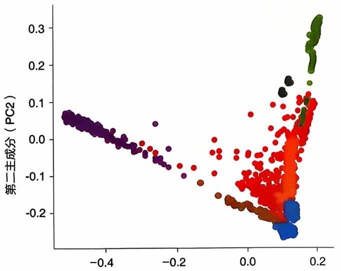

scatter

| Series | PC1 (range) | PC2 (range) |
| --- | --- | --- |
| Purple | -0.5~-0.1 | -0.1~0.07 |
| Brown | -0.1~0.1 | -0.2~0.0 |
| Red | 0.0~0.2 | -0.2~0.15 |
| Blue | 0.1~0.2 | -0.3~-0.15 |
| Green | 0.1~0.2 | 0.1~0.35 |
| Black | 0.1~0.15 | 0.1~0.18 |

第一主成分（PC1）

## 大型国际研究计划

千人基因组计划
The 1000 Genomes Project
▲ 人类基因组多样性计划
Human Genome Diversity Project

## 人群样本地理来源

非洲
美洲
欧洲
- 东亚
● 中东
- 大洋洲
中亚与南亚

图5-1 世界主要人群遗传结构

上图呈现了千人基因组计划和人类基因组多样性计划纳入的全球人群样本的主成分分析结果，体现人群遗传聚类与地理分布的一致性；下图展示了上述人群的ADMIXTURE分析结果，即在6个预设祖先遗传成分的情况下不同地域人群在遗传构成上的特征与异同，不同的遗传成分以不同颜色表示。图改自:Koenig et al., Genome Research, 2024, 34: 796-809。

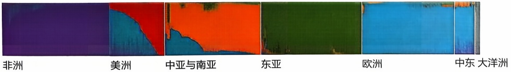

text_image

非洲
美洲
中亚与南亚
东亚
欧洲
中东 大洋洲

---

154

第五章 群体遗传、选择和进化

本章第四节）。

## 三、大规模人群基因组研究揭示世界人群遗传结构多样性

自 2000 年人类基因组计划草图完成后，全球众多研究团队分别启动了针对不同人群的基因组研究，包括人类基因组多样性计划、千人基因组计划、泛亚 SNP 计划等在内的大型人群基因组项目紧锣密鼓地开展（表 5-1）。这些研究通过对基因组遗传变异的分布模式和规律进行大规模人群调查和分析，比较不同地域人群遗传结构的差异，为我们理解人类的遗传与进化历史提供了基础和条件。

## 1. 人类基因组多样性计划

人类基因组多样性计划于1991年由美国率先发起，并由全球科学家合作研究。这一计划最初收集了来自全球51个人群的1064个个体的细胞系，尤其覆盖了人口较少的土著人群。通过对377个常染色体微卫星多态位点（microsatellite polymorphism）和65万个单核苷酸多态性（single nucleotide polymorphism，SNP；知识窗5-4）位点的分型分析，该研究首次揭示了全球人群的遗传结构，指出人类基因组的遗传差异主要来自人群内部的个体之间，占总体变异的 $93\% \sim 95\%$ ，而主要人群间差异仅为$3\% \sim 5\%$ （Rosenberg et al., 2002)；人群的遗传聚类与其地理分布密切相关，这表明人群的地理起源和迁徙历史可能对遗传多样性有重要影响（Li et al., 2008）。在此基础上，该计划进一步对54个人群的929个个体全基因组进行测序分析，鉴定出6730万个SNP，880万个插入（insertion）或缺失（deletion）变异，以及40736个拷贝数变异（copy number variation, CNV）。这其中包括了大量的变异，它们在一个或多个群体中非常常见，但在之前的研究中未曾被报道。例如，非洲中部和南部、美洲和大洋洲的人群分别都有数万至数十万个特有的常见遗传变异。这些变异大多数是新生突

表 5-1 世界主要大规模人群基因组研究项目

| 项目名称 | 启动时间 | 研究人群 | 样本量 | 数据类型 | 参考文献 |
| --- | --- | --- | --- | --- | --- |
| 人类基因组多样性计划（Human Genome Diversity Project, HGDP） | 1991 | 51，全球人群 | 1064 | 全基因组测序 | Cann et al., 2002; Rosenberg et al., 2002; Bergström et al., 2020 |
| 千人基因组计划（The 1000 Genome Project） | 2008 | 26，全球人群 | 2504 | 全基因组测序 | The 1000 Genomes Project Consortium, 2010, 2012, 2015 |
| 泛亚SNP计划（Pan-Asian SNP Project） | 2005 | 73，亚洲人群 | 1928 | SNP芯片分型 | The HUGO Pan-Asian SNP Consortium, 2009 |
| 西蒙斯基因组多样性计划（Simons Genome Diversity Project, SGDP） | 2012 | 142，全球人群 | 300 | 全基因组测序 | Mallick et al., 2016 |
| 爱沙尼亚基因组多样性计划（Estonian Genome Diversity Project, EGDP） | 2016 | 148，全球人群 | 483 | 全基因组测序 | Pagani et al., 2016 |

---

第一节 群体遗传结构

155

## 知识窗 5-4

## 单核苷酸多态性

单核苷酸多态性是指在基因组 DNA 序列中，由于单个核苷酸（A、T、C 或 G）的变异所导致的遗传多态性。SNP 有以下几种常见分类:

- 根据核苷酸变异的类型，可分为转换（transition）和颠换（transversion）。转换是指嘌呤（A 或 G）被另一个嘌呤替换，或者嘧啶（C 或 T）被另一个嘧啶替换（例如，A↔G 或 C↔T）；颠换是指嘌呤被嘧啶替换，或者嘧啶被嘌呤替换（例如，A↔C 或 G↔T 等）。
- 根据 SNP 的等位基因数量，可分为双等位基因型、三等位基因型、四等位基因型等。基因组中绝大多数

SNP 是双等位基因型，多等位基因型的情况较为罕见。

\- 根据SNP在基因组中的位置，可分为编码区SNP和非编码区SNP。编码区SNP又分为同义（synonymous）SNP和非同义（non-synonymous）SNP。其中，同义SNP不改变氨基酸序列，而非同义SNP改变氨基酸序列。

SNP 是人类基因组中最常见的遗传变异形式，约占所有已知遗传变异的 90% 以上。SNP 可能通过影响蛋白质的氨基酸序列和功能，或是通过影响基因的表达调控等方式间接影响生物体的性状。

变，除了大洋洲人群的特有变异有较多来自丹尼索瓦古人（Denisovan）的基因渗入（gene introgression），以及美洲人群中发现来自尼安德特古人（Homo neanderthalensis 或 Neanderthal）的高频缺失变异（详见本章第四节）。研究人员估计当今世界人群的遗传分化主要发生在过去25万年内，是在人群迁徙、分离与融合的共同作用下渐进发生的。

## 2. 千人基因组计划

千人基因组计划启动于2008年，由中、英、美、德等国科学家共同承担研究任务，旨在通过使用高通量测序技术绘制一个详尽的人类基因组遗传多态性图谱，以帮助理解遗传对疾病的贡献。2012年，该计划首期发布了来自全球14个人群1092个个体的基因组数据，包含3800万个SNP，140万个短序列插入/缺失，以及超过1.4万个大片段缺失等，捕获到了人类基因组中 $98\%$ 的频率达到 $1\%$ 以上的SNP（The 1000 Genomes Project Consortium，2012）。2015年，千人基因组计划进一步发布了基于26个人群2504个个体基因组的遗传变异检测与分析结果，报告了8470万SNP、360万个短插入/缺失、6万个结构变异（structural variation）等总共超过8800万个遗传变异，并且构建了高质量单体型图谱（详见本章第二节），发现的人类基因组中频率超过 $1\%$ 的SNP占比也从前期的 $98\%$ 提升至 $99\%$ （The 1000 Genomes Project Consortium，2015）。这些成果和数据资源将极大地促进人类进化和疾病研究。

## 3. 泛亚 SNP 计划

亚洲共有46亿人口、1000多个民族，是世界人口的重要组成部分，也是多种语言、文化和宗教的大熔炉。这种复杂的民族构成以及各个人群的起源和发展过程，对于阐明现代人的进化历史以及表型背后的遗传机制具有重要意义。然而，前期开展的

---

156

第五章 群体遗传、选择和进化

大规模群体基因组研究主要关注在非洲人群、欧洲人群、非裔美国人等几个主要大洲人群中，亚洲人群的样本数据和研究成果都相对匮乏。在这一背景下，中国、印度、日本、韩国等11个国家和地区于2005年联合发起了“泛亚SNP计划”，旨在揭示亚洲人群（特别是东亚和东南亚人群）的遗传结构及其祖先人群的迁徙路线。

该计划的第一期成果在2009年发布于Science期刊，共收集了覆盖东亚、南亚及东南亚各区域的70多个亚洲代表人群的1700多例样本，主要采用SNP微阵列技术，在每例均检测约6万个基因位点，以确保能够全面、准确地获取亚洲人群的遗传信息（The HUGO Pan-Asian SNP Consortium，2009）。一方面，研究揭示了亚洲人群的遗传结构与语言结构具有较好的对应关系，其相关性甚至高于遗传结构与人群地理分布的关系，说明现代人群的流动性很大，但文化语言的凝聚力依然很强。另一方面，研究发现大多数通常意义上的人群都包含多个遗传组分，说明亚洲人群之间的基因交流相当频繁。这种基因交流不仅促进了人群的融合和文化的传播，也对亚洲人群的遗传多样性产生了深远影响。东亚人群的典型南北分布以及遗传多样性从南到北的梯度递减模式揭示了东亚人群的南方起源和史前北迁历史。此外，不同亚洲人群之间存在着一定的遗传关联，其中包括那些先前根据语言学、文化和人种学的证据认为没有通婚关

系的人群。该研究从全基因组水平揭示了亚洲人群的精细遗传结构，系统阐明了亚洲人群遗传结构与地理分布及语言结构之间的关系，深入探讨了亚洲人群起源、迁徙历史、人群融合模式以及人群遗传结构形成的机制。

## 第二节 连锁不平衡

## 一、连锁不平衡的概念和计算方法

连锁不平衡（linkage disequilibrium，LD）是指在某一群体中，分属两个或两个以上基因座的等位基因同时出现在一条染色体上的概率高于随机出现的频率的情形（图5-2）。假设现有两个基因座，每个基因座各有两个等位基因，分别用 $A / a$ ， $B / b$ 表示。对于某个人群，则有 $AB$ 、 $Ab$ 、 $aB$ 和 $ab$ 四种基因型的组合方式，其基因型频率分别为 $P_{AB}$ 、 $P_{Ab}$ 、 $P_{aB}$ 和 $P_{ab}$ 。那么，各等位基因在该人群中的频率为 $P_A = P_{AB} + P_{Ab}$，$P_a = P_{aB} + P_{ab}$，$P_B = P_{AB} + P_{aB}$ 和 $P_b = P_{Ab} + P_{ab}$ 。如果这两个基因座之间相互独立，在连锁平衡（linkage equilibrium）的状态下，各个基因型的频率就可以直接算出:$P_{AB} = P_A P_B$，$P_{Ab} = P_A P_b$，$P_{aB} = P_a P_B$，$P_{ab} = P_a P_b$ 。而在实际情况中，由于连锁不平衡效应的存在，基因型频率的理论值和实际值会产生偏离。这个偏离的程度通常记为 $D$ ，称为连锁不平衡系数，

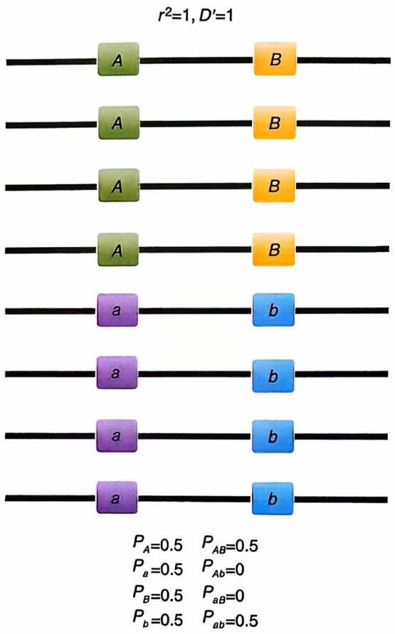

text_image

r²=1, D'=1
A	B
A	B
A	B
A	B
a	b
a	b
a	b
a	b
P_A=0.5 P_AB=0.5
P_a=0.5 P_Ab=0
P_B=0.5 P_ab=0
P_b=0.5 P_ab=0.5

图5-2 等位基因完全连锁不平衡示意图在两个等位基因座上的四个等位基因间仅观察到 $AB$ 和 $ab$ 两种组合，即等位基因 $A$ 和 $B$ 、 $a$ 和 $b$ 完全连锁。

---

第二节 连锁不平衡

157

即  $D = P_{AB} - P_{A}P_{B}$ 。如果两个基因座是完全连锁的，即一个基因座上的等位基因总是与另一个基因座上的特定等位基因一起遗传，那么 D 的值会接近于 1 或 -1。如果两个基因座是完全独立的，那么 D 的值将接近于 0。

由于 $D$ 值会受到等位基因频率的影响，使得不同频率等位基因对之间无法进行连锁不平衡程度大小的比较。为了解决这一局限性，找到更适合衡量连锁不平衡程度的量。有学者提出对 $D$ 值进行一些改进，有以下两种常用方法:

（1）$D'$:美国著名遗传学家理查德·陆文顿（Richard C. Lewontin，1929—2021）提出，通过标准化 $D$ 值得到 $D'$。$D'$ 反映了群体的重组历史，适用于研究群体的连锁不平衡程度，其取值范围是 -1 到 1。

$$
D ^ {\prime} = \frac {D}{D _ {m a x}}
$$

其中:

$$
D _ {m a x} = \left\{ \begin{array}{l l} \min \left[ P _ {A} P _ {B}, P _ {a} P _ {b} \right], D <   0 \\ \min \left[ P _ {A} P _ {b}, P _ {a} P _ {B} \right], D > 0 \end{array} \right.
$$

当 $D' = 0$ 时，处于完全连锁平衡状态；当 $D' = 1$ 时，处于完全连锁不平衡状态。

（2） $r^{2}$ （相关系数）:这是目前更常用的衡量连锁不平衡程度的统计量，反映不同等位基因之间的相关程度，其取值范围是0到1。

$$
r ^ {2} = \frac {D ^ {2}}{P _ {A} P _ {a} P _ {B} P _ {b}}
$$

当 $r^2 = 0$ 时，处于完全连锁平衡状态；当 $r^2 = 1$ 时，处于完全连锁不平衡状态。

## 二、遗传重组与单体型多样性

等位基因之间的连锁不平衡在全基因组的分布并不是均匀的。通常情况下，物理距离较近的基因座之间更可能发生连锁不平衡，而物理距离较远的基因座可能由于遗传重组（genetic recombination）而相互独立。遗传重组是指有性生殖的减数分裂过程中，来自不同亲本的染色体之间发生遗传物质交换的过程。重组可以破坏连锁不平衡，产生新的等位基因组合（图5-3）。同一染色体上两个基因座之间发生配对交换的概率通常以重组率（recombination rate）来衡量。重组率越高，反映连锁不平衡被破坏的可能性越大，即连锁不平衡的衰减速度越快，反之亦然。同一染色体上共同遗传的多个基因座上等位基因的组合形成单体型。单体型多样性是指从一个群体中随机抽

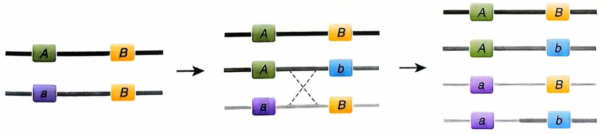

flowchart

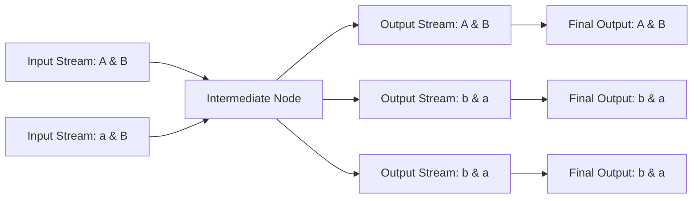

图5-3 突变、遗传重组与单体型多样性

群体中原有 $AB$ 和 $aB$ 两种单体型，等位基因 $B$ 突变为 $b$ 产生新单体型 $Ab$；单体型 $Ab$ 与 $aB$ 进一步重组产生新单体型 $ab$。因此，当前群体中共有四种单体型，突变和遗传重组均对单体型多样性增加产生了贡献。

---

158

第五章 群体遗传、选择和进化

取到两条不同单体型的概率，它是衡量群体遗传多样性的重要指标之一。遗传重组通过产生新的等位基因组合，即产生新的单体型，增加群体的单体型多样性，这对于群体的适应性和进化具有重要意义。

## 三、国际单体型图谱计划

国际单体型图谱计划（The International HapMap Project，HapMap 计划）是在人类基因组计划完成之后的又一重大国际合作项目。随着人类基因组测序的完成，科学家们意识到需要进一步了解基因组中的遗传变异，尤其是 SNP 以及它们之间的连锁不平衡关系，从而更好地理解人类疾病的遗传基础。HapMap 计划在 2002 年启动，标志着群体基因组学时代的开端。HapMap 计划在人类基因组计划发布的人类基因组序列草图基础上，旨在通过对海量 SNP 的人群检测及计算分析，建立人类基因组的单体型图谱，描绘人群全基因组的 SNP 分布规律、频率特征和连锁不平衡模式等。2005 年，首个人类基因组单体型图谱在国际顶尖学术期刊 Nature 发布，其中中国科学家做出了 10% 的贡献。2007 年，HapMap 计划在 Nature 上发表了二期研究成果，发现了超过一千万的人类基因组 SNP，完成了约 310 万个频率达到 5% 以上的常见 SNP（≥5%）在 270 个全球样本中的分型检测。第二代 HapMap 图谱的分辨率达到平均不到 1 000 个碱基对（即 1 kb）检测到 1 个 SNP，准确度达到 99.8%。在此基础上，HapMap 三期研究扩充了人群样本以发现低频 SNP。2010 年在 Nature 上发表的成果报道了 160 万个常见 SNP 在来自全球 11 个人群的 1 184 个体中的分型结果，以及对其中 692 个体中进行 100 万碱基对（即 1 Mb）区域重测序新发现的低频 SNP。随着越来越多的数据产生，HapMap 图谱逐渐具备更广泛的人群代表性和更精细的基因组序列分辨率。

HapMap 计划的研究结果显示，人类基因组中存在广泛的连锁不平衡。这些连锁不平衡区域（LD block，又称单体型区块）大小不一，包含从几千到几十万个碱基对不等（图 5-4）。遗传图谱（genetic map）正是以连锁不平衡与遗传重组率来确定染色体上遗传标记相对位置的图谱。遗传图谱的距离单位通常采用厘摩（centi-Morgen, cM）表示，以 1 cM 代表 1% 的重组率，大约对应染色体上 100 万个碱基对（即 1 000 kb）的物理距离。HapMap 发布的遗传图谱为揭示复杂疾病的遗传因素奠定了基础。复杂疾病属于常见疾病。不同于单基因疾病，复杂疾病的遗传因素涉及多个基因和分子通路，因此这类疾病的易感性隐匿于多个 SNP 和单体型及其组合中，存在较大个体差异。揭示复杂疾病的遗传模式依赖于大量的群体样本与大量的 SNP 分型，这在 HapMap 构建之前几乎是不可能的。此外，我们可以遗传图谱作为参考依据，选择具有代表性的标签 SNP（tag SNP），从而进行疾病或表型关联遗传变异的定位分析。HapMap 计划为全面揭示复杂疾病易感基因和遗传机制提供了新的研究思路，推动基因组学研究进入新的阶段。

---

第三节 遗传漂变

159

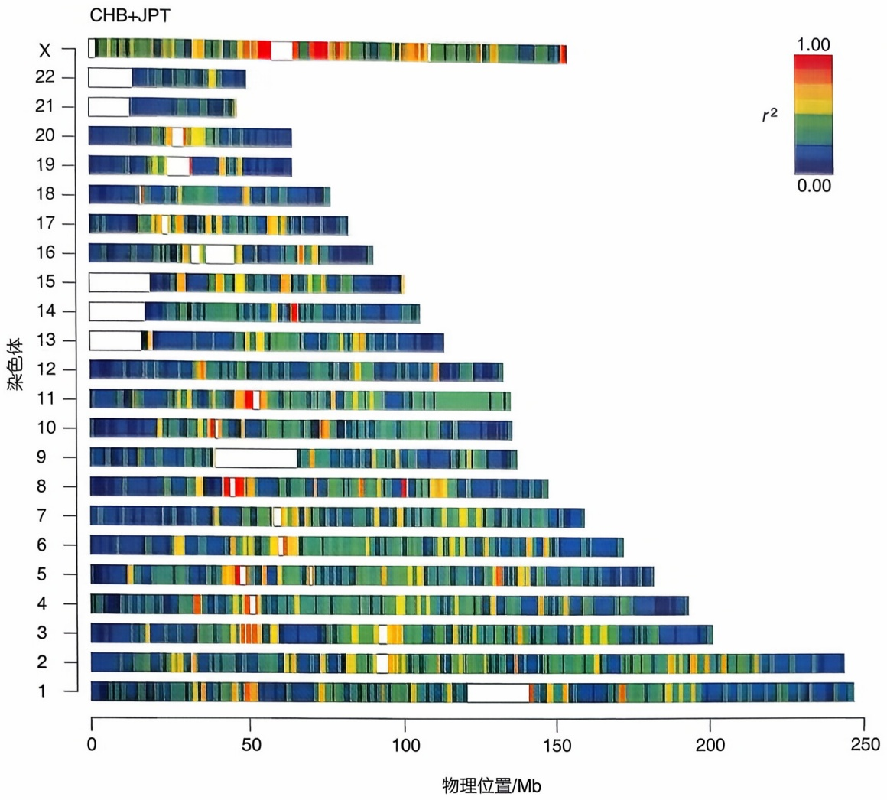

heatmap

| 染色体 | 物理位置/Mb (range) | \(r^{2}\) (range) |
| --- | --- | --- |
| X | 0~150 | 0.00~1.00 |
| 22 | 0~50 | 0.00~0.50 |
| 21 | 0~45 | 0.00~0.50 |
| 20 | 0~65 | 0.00~0.50 |
| 19 | 0~65 | 0.00~0.50 |
| 18 | 0~75 | 0.00~0.50 |
| 17 | 0~80 | 0.00~0.50 |
| 16 | 0~90 | 0.00~0.50 |
| 15 | 0~100 | 0.00~0.50 |
| 14 | 0~110 | 0.00~1.00 |
| 13 | 0~115 | 0.00~1.00 |
| 12 | 0~135 | 0.00~1.00 |
| 11 | 0~135 | 0.00~1.00 |
| 10 | 0~135 | 0.00~1.00 |
| 9 | 0~135 | 0.00~1.00 |
| 8 | 0~145 | 0.00~1.00 |
| 7 | 0~160 | 0.00~1.00 |
| 6 | 0~175 | 0.00~1.00 |
| 5 | 0~185 | 0.00~1.00 |
| 4 | 0~195 | 0.00~1.00 |
| 3 | 0~205 | 0.00~1.00 |
| 2 | 0~245 | 0.00~1.00 |
| 1 | 0~245 | 0.00~1.00 |

图5-4 HapMap计划发布的东亚人群全基因组连锁不平衡片段长度分布图中所示东亚人群包括北京汉族（Han Chinese in Beijing，简称CHB）和东京日本人群（Japanese in Tokyo，简称JPT）。图改自:The International HapMap Consortium, Nature, 2007, 449: 851-861。

## 第三节 遗传漂变

## 一、遗传漂变与有效群体大小

遗传漂变（genetic drift）是指在有限群体中由于不同基因型个体生育的子代个体数不同而导致基因频率产生随机波动的现象。等位基因频率在代际之间的变化本质上是由于抽样的随机误差导致的。遗传漂变是一个随机过程，可使等位基因频率升高或者降低，也可能产生较为极端的情形，即某个等位基因在群体中固定下来或完全丢失，导致该基因座失去遗传多样性。例如，某基因座上有 $A$ 和 $B$ 两个等位基因，假设 $A$ 等位基因频率占优而 $B$ 等位基因罕见，若携带 $B$ 等位基因的个体无子女，则 $B$ 在子代中便会消失；而相应地，$A$ 在子代中的频率将达到 $100\%$。

赖特-费舍尔模型（Wright-Fisher model）是群体遗传学中描述有限群体中遗传漂变的经典数学模型（知识窗5-5）。根据这一模型，群体大小是影响遗传漂变的重要因素之一。群体越小，由于繁殖个体的数量有限，等位基因频率的变化更可能受到

---

160

第五章 群体遗传、选择和进化

## 知识窗 5- 5

## 赖特 - 费舍尔模型

赖特-费舍尔模型是群体遗传学中描述有限群体中遗传漂变的经典数学模型。它是由美国遗传学家休厄尔·赖特（Sewall G. Wright，1889—1988）和英国统计学家罗纳德·费舍尔（Ronald A. Fisher，1890—1962）在20世纪中早期分别独立提出的，因此得名。这一模型假设群体具有以下特征:

- 二倍体群体，群体大小恒定；
- 随机交配，每个个体都有相等的机会贡献基因给下一代（见知识窗5-2）；
- 代际之间不重叠；
- 没有突变，不考虑新的遗传变异产生；

- 没有自然选择，所有等位基因在生存和繁殖上都是中性的，即它们的适应度相同；
- 不与外部群体发生基因交流。

假设群体中的每个个体都有机会产生一定数量的配子，这些配子随机结合形成下一代个体。尽管不同个体产生的配子数量可能不同，但平均来说，每个个体对下一代的遗传贡献是相同的。在此基础上，我们可以预测等位基因频率在有限群体中随时间的变化。赖特-费舍尔模型是群体遗传学的基础模型，是理解遗传漂变对群体遗传结构影响的重要工具，赖特和费舍尔因此也被称为群体遗传学的奠基人。

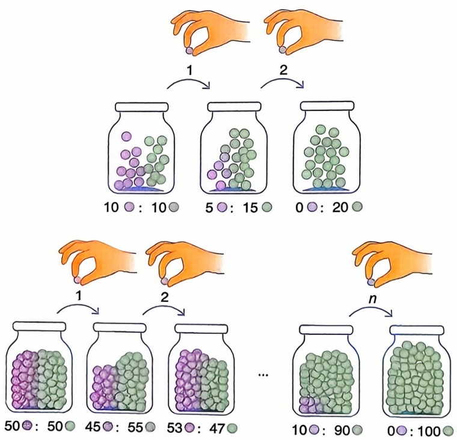

图5-5 不同有效群体大小下的人群遗传漂变

分别对20个球（上）与100个球（下）进行多次有放回随机抽样，初始状态下紫球与绿球比例均为 $1:1$ ，每次随机抽取的样本量均等于初始样本量，以模拟有效群体大小不同的两个群体，满足有效群体大小不随时间改变，且二者初始等位基因频率相同情况下的遗传漂变。

随机抽样误差的影响。我们将一个理想遗传学群体中繁育群体的大小称为有效群体大小（effective population size， $N_{e}$ ）。有效群体大小通常小于实际群体大小，这是由于实际群体中通常无法满足所有个体对下一代有同等遗传贡献。在赖特-费舍尔模型的假设下，群体中每个个体产生的子代数目符合泊松分布（Poisson distribution），而现实群体中并非如此。在生理、社会等多方面因素影响下，个体之间的繁殖力必然有区别。个体繁殖力的差异越大，有效群体大小越小。

有效群体大小可以从以下两个方面来理解:其一为随机抽样导致的等位基因频率代际变化，即遗传漂变的程度，有效群体大小越大，遗传漂变的影响越小（图5-5）；其二为同一个体中两个等位基因来自共同祖先的概率，即群体内部近亲婚配的程度，有效群体大小越大，反映近亲婚配的程度越低。奠基者效应（founder effect）和瓶颈效应（bottleneck effect）是导致群体大小减少的两个重要的群体进化事件（图5-6）。奠基者效应是指一个群体内的少数个体从群体中分离出来形成

---

第三节 遗传漂变

161

一个新的群体，新群体的基因频率与原群体不同且遗传多样性小于原群体的现象。瓶颈效应是指由于战争、灾难等事件造成群体中的个体数量急剧减少，这同样导致群体内基因频率的改变及遗传多样性的丧失。此外，群体地理隔离引发遗传隔离，即群体内产生近亲婚配，也是导致群体遗传多样性变小、遗传漂变效应增强的原因。

## 二、东亚人群的遗传分化

东亚地区是全球人口数量最多的区域之一，总人口约18.9亿，占亚洲总人口的 $38\%$ 以及全球人口的$22\%$ 。该地区主要由三大民族构成:汉族，主要分布在中国，占总人口约 $92\%$ ；大和民族，占日本总人口 $98\%$ 以上；韩民族，占朝鲜半岛总人口约 $96\%$ 。这些民族在语言和文化体系上存在一些共性，例如汉字（或其衍生文字）的使用以及受到儒家文化的影响，在外貌特征上也拥有相似的黄皮肤、黑眼睛和黑头发等特征。然

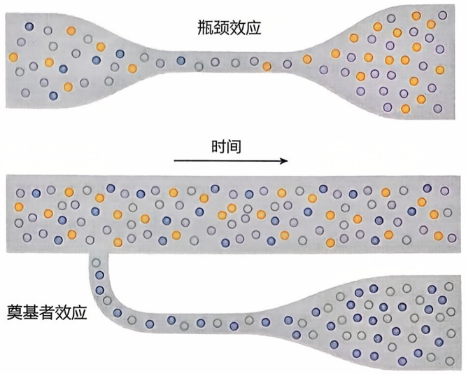

flowchart

图5-6 瓶颈效应和奠基者效应导致有效群体大小减小不同颜色的圆点代表群体基因库中的不同等位基因。在群体经历瓶颈效应事件后，仅有少数类型的等位基因保留下来并产生后代；或是携带有限类型等位基因的个体从原群体中分离出来，作为新群体中的奠基者并产生后代。这两种情况均导致有效群体大小的减小。

而，每个民族都有其独特的遗传学属性。一项针对汉族、日本人群和韩国人群的全基因组分析表明，三者的最近共同祖先可以追溯到距今3000至3600年前，但其各自具有独特的遗传构成（Wang et al., 2018）。总体上看，这三个人群之间的遗传差异 $(F_{ST}=0.0026\sim0.0090)$ 远小于欧亚人群之间的遗传差异 $(F_{ST}=0.1)$ ，但超出南方汉族与北方汉族之间的遗传差异 $(F_{ST}=0.0014)$ 。其中，北方汉族和韩国人群的遗传关系最近 $(F_{ST}=0.0026)$ ，其次是韩国人群与日本人群 $(F_{ST}=0.0033)$ ，南方汉族与日本人群的遗传关系最远 $(F_{ST}=0.0090)$ 。这一结果反映了三个人群的遗传结构与地理分布相对应，表明地理隔离在推动东亚人口分化中起了关键作用（图5-7）。随着汉族十万基因组计划（Han100K）、韩国千人基因组计划（Korean1K）和日本生物银行（Biobank Japan）等东亚各人群专属大规模基因组研究计划的开展，东亚人群的遗传多

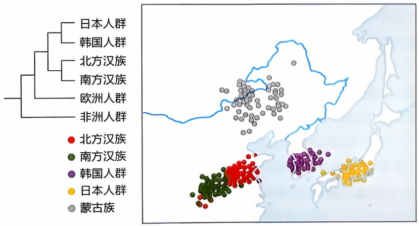

text_image

日本人群
韩国人群
北方汉族
南方汉族
欧洲人群
非洲人群
北方汉族
南方汉族
韩国人群
日本人群
蒙古族

图5-7 中、日、韩人群的谱系关系与遗传结构以非洲及欧洲人群为参照，汉族人群、日本人群和韩国人群共同形成了东亚人群聚类分支。主成分分析显示，三者的遗传关系与人群地理分布相一致。图改自:Wang et al., Hereditas, 2018, 55: 19。

---

162

第五章 群体遗传、选择和进化

样性格局有望被全面揭示。这不仅为理解人类进化历史提供重要信息，也对遗传性疾病的研究和治疗做出贡献。

日本列岛是研究东亚人群遗传漂变的经典“岛屿模型”（island model）。该模型假设一个群体被分成多个岛屿上的亚群，每个岛屿（亚群）内部的基因频率可能会因为遗传漂变而发生变化，而岛屿之间的基因交流则通过迁移来实现。遗传漂变和迁移之间的平衡决定了亚群基因频率的分化程度。如果迁移率足够高，它可以平衡遗传漂变的效果，减少亚种群之间的遗传分化。相反，如果迁移率很低，遗传漂变将导致亚种群之间的遗传分化加剧。一项研究通过对7000多名日本人全基因组SNP分析发现，大多数日本人可以分为两个主要的亚群，即本州亚群（包括来自日本主要岛屿的大多数个体）和琉球亚群（包括来自冲绳的大多数个体）（Yamaguchi-Kabata et al., 2008）。此外，尽管在过去大约100年左右的时间里日本国内的人口迁移已经变得相当频繁，但本州岛（日本最大的岛屿）的局部地区人群在遗传上仍然存在差异。例如，日本近畿和九州的人群与中国汉族的遗传关系较近；关东部分地区人群与北海道人群在主成分分析结果中呈现较为广泛的个体遗传分布，可能是由于近期日本人群向东京、横滨等关东大城市迁徙和聚集，而北海道虽然位于日本最北端，但绝大多数居民是来自本州的移民后代（图5-8）。另一项研究进一步将本州之外的岛屿人群解析为8个亚群（Sakaue et al., 2020）。其中1个亚群主要由最北部的北海道阿伊努人群组成，剩下的7个则是来自日本西南琉球地区（九州和冲绳）的亚群——这些西南岛屿彼此相邻，最近距离仅 $50\mathrm{km}$。“双重起源假说”认为，绳文人（约1.6万至3000年前的狩猎采集人群）与弥生人（约公元前900年至公元300年的农业人群）是现代日本人的遗传起源基础。近年来提出的“三系起源假说”在此基础上进行了补充，提出现代日本人的祖先群体除了绳文人和弥生人之外，还有一个与古坟时代（公元3世纪末至7世纪初）相关的东亚祖先。居住于日本北部的阿伊努人和南端的琉球人可能是绳文人的后裔，而这种古老的遗传亲缘关系可能被本州岛与其周边岛屿之间的基因流动所掩盖，或者被二者之间的地理隔离所逐渐稀释。

## 三、遗传漂变影响隔离人群的表型特征与疾病风险

在隔离人群中，由于基因交流受到限制，随机的基因频率变化更为明显，从而容易发生遗传漂变。截至2014年统计，亚洲共有约3.7亿土著人口，占世界土著总人口的2/3。其中有不少为生活在相对隔离的特殊（甚至极端）环境中的部落人群，与外界较少接触，生活方式较为传统。这些人群通常由于族内通婚或经历了瓶颈效应事件等导致群体规模变小，从而容易发生遗传漂变。例如，根据马来西亚2010年的人口普查结果，马来半岛各个土著人群（通常统称为Orang Asli）的人口普遍在几百至几千人，更有甚者，人口仅200余。基因组数据分析显示这些人群经历了近期的有效群体缩减（Deng et al., 2014）。在隔离人群中，遗传漂变可能引起外貌特征相关等位基因频率的显著变化，从而导致人群产生特殊的外貌表型。例如，在某些偏远岛屿的

---

第三节 遗传漂变

163

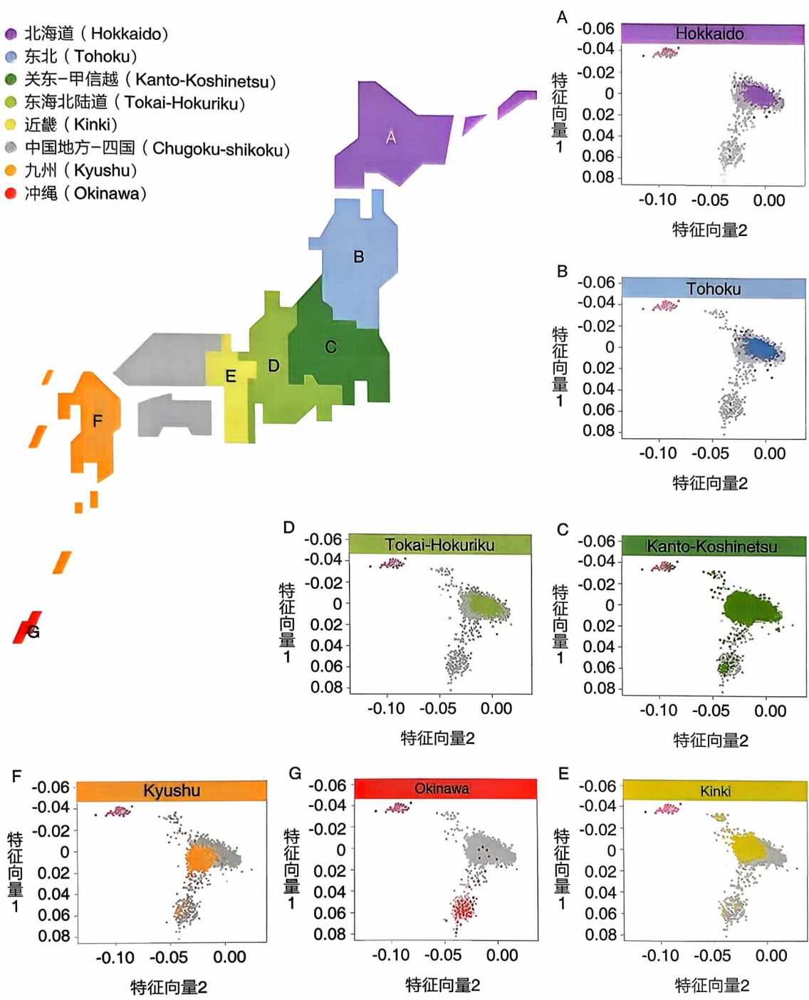

图5-8 日本列岛人群的遗传结构

主成分分析揭示了日本列岛7个地区人群地理分布与遗传特征之间的关系。图A至图G分别对应地图上不同颜色标注的地区，以相应颜色散点突显该地区个体的遗传分布。图中灰色散点表示其他6个地区个体；粉色散点表示HapMap计划发布的日本东京人群（JPT）个体，作为参考群体。图改自:Yamaguchi-Kabata et al., American Journal of Human Genetics, 2008, 83: 445-456。

人群中，由于长期的隔离和遗传漂变，可能出现独特的面部特征、身材比例或肤色变化。一个典型的例子是生活在马来半岛、菲律宾群岛以及安达曼岛丛林地区的狩猎族群（称为Negrito），他们通常身材矮小、皮肤黝黑且毛发卷曲（见本章第六节）。遗传漂变会使小隔离群体中某些有害的隐性基因频率增加。在大群体中，隐性有害基因通常会被稀释，因为有大量正常基因与之混合。但在隔离人群中，由于个体数量有限，经过几代的遗传漂变，这些隐性基因可能会在群体中变得相对集中。例如，中国台湾地区葡萄糖-6-磷酸脱氢酶（G6PD）缺乏症的发病率高于东亚和东南亚其他地区，且台湾人群中存在一些特有高频致病突变，包括 $487\mathrm{G} > \mathrm{A}$ 、 $1388\mathrm{G} > \mathrm{A}$ 、 $1376\mathrm{G} > \mathrm{T}$ 和

---

164

第五章 群体遗传、选择和进化

95A > G 等（Tang et al., 1992）；在魁北克某人群中，I 型酪氨酸血症（tyrosinemia I，一种氨基酸代谢障碍）的携带者频率仅用 12 个世代就从 1/5 000 增加到 1/22。由于隔离人群的基因库相对较小，基因与环境因素（如特定的饮食习惯或生活方式）相互作用的模式也可能发生改变，进一步影响疾病的发生和发展。也有人认为，仅通过遗传漂变似乎不足以完全解释导致某些特殊表型或疾病的基因如何经历较短时间在人群中积累到较高频率，或是在地理相距甚远的不同隔离人群中为何产生相似的表型，因此，可能还存在定向选择的作用（详见本章第五节）。

## 第四节 基因交流

## 一、遗传混合的基本概念与统计推断

基因交流（gene flow）又称遗传混合（genetic admixture），是指不同遗传背景人群之间的婚配和繁殖，导致基因库的混合（图 5-9）。它可以发生在地理上相邻的群体之间，也可以通过迁移、征服或其他社会事件导致不同地理区域的人群之间的混合。遗传混合的结果是一个群体获得了来自其他群体的遗传物质，即可能有新的等位基因被引入群体，或是群体原有的等位基因频率发生变化，杂合等位基因增加，从而提高了群体内部个体基因型和等位基因的多样性，即遗传多样性。遗传混合是人类进化的重要驱动力之一。

图5-9 人群混合过程及可用于推断混合模型的遗传信息特征示意目前人类基因组中用于推断人群混合历史的遗传特征主要分为以下三种:等位基因频谱、混合连锁不平衡以及祖源片段信息。图改自:张瑞等，科学，2023年第75卷第1期，P18-P22。

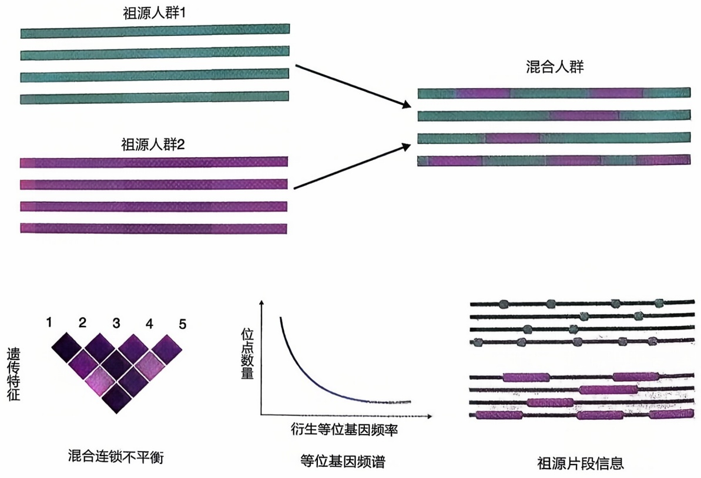

---

第四节 基因交流

165

解析混合人群的祖源构成并重构混合历史模型是遗传混合研究的关键问题。全局祖源推断（global ancestry inference）是指在混合个体的全基因组水平上，估计各祖源人群对于混合人群的贡献比例。我们可以采用主成分分析等非参数方法将人群聚类，从而大致判断人群或个体的遗传关系，进一步采用STRUCTURE、ADMIXTURE等基于模型的方法估计混合比例等参数（见图5-1）。局部祖源推断（local ancestry inference）能帮助我们进一步了解混合人群基因组局部区域的遗传结构，即从混合人群的单体型水平上，解析其基因组中每个位点或者每个片段最有可能来自的祖源人群，这也可以理解成一个给混合个体基因组进行标注的过程。相比于全局祖源推断，局部祖源推断对于祖源成分的解析会更加精细和具体化。目前较常见的局部祖源推断方法主要基于隐马尔可夫模型（hidden Markov model，HMM）。此外，条件随机场（conditional random field，CRF）模型、支持向量机（support vector machine，SVM）、随机森林（random forest，RF）模型等也被应用于局部祖源推断方法的开发中。

基于局部祖源推断得到的来自不同祖先的基因片段信息，我们可以进一步构建人群的混合历史，即推断人群混合的模式及计算混合时间与混合比例（知识窗5-6）。祖源片段信息包括祖先间跳转速率（ancestral switches probability）和祖源片段长度分布（ancestral tracts length distribution）。前者描述了混合人群基因组中，不同祖先来源的片段之间发生转换的概率；后者描述的是混合人群基因组中，来自某一祖源人群的片段长度分布情况。在群体遗传学中，重组事件的发生可以用泊松过程来刻画，因此，在混合过程中由于重组被打碎的祖源片段长度服从指数分布。随着混合时间的增加，重组事件积累的次数变多，祖源片段也会越来越碎。来自某一祖源片段的总长度

## 知识窗5-6

## 人群遗传混合模型

人群遗传混合模型是用于描述和分析不同遗传背景人群之间婚配和繁殖导致的基因库混合的数学和统计模型。常用的遗传混合模型有以下几种（图5-10）:

- 基本混合模型，又称混合隔离模型（hybrid isolation 模型，简称 HI 模型）:HI 模型是最简单的模型，假设两个或多个群体在某个时间点混合，即混合事件瞬时发生，形成一个新的混合群体。
- 连续混合模型（gradual admixture 模型，简称 GA 模型）:相比 HI 模型，GA 模型假设混合不是一次性事件，而是随着时间推移而持续发生的过程。
- 持续基因流模型（continuous gene flow 模型，简称 CGF 模型): 混合事件在某个时间点发生之后, 其中的一个祖源人群对混合群体产生持续的遗传贡献。

- 多波次混合模型（multiple-wave 模型，简称 MW 模型）:假设混合不是单一事件，而是在不同时间点发生了多次。每次混合事件都可能有不同的祖源贡献群体和贡献比例。因此，MW 模型可以更好地描述那些经历了长期、复杂混合历史的人群。
- 性别偏向性混合模型:在某些群体中，男性和女性可能对混合过程的贡献不同。例如，一个群体的男性倾向性地与另一个群体的女性交配，导致混合后代群体在遗传构成上的偏向性。

---

166

第五章 群体遗传、选择和进化

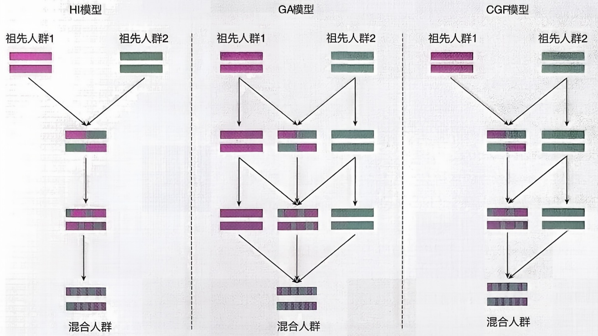

图5-10 基因交流的基本模型

从左至右依次展示了基本混合模型（HI 模型）、连续混合模型（GA 模型）和持续基因流模型（CGF 模型）的示意图。图

改自:Ni et al., European Journal of Human Genetics, 2019, 27: 133-139。

也可以反映该祖源人群的遗传物质在混合群体中所占的比例。此外，混合事件发生初期，祖源人群内部的特异性位点在混合人群基因组中更倾向于连锁在一起，而随着时间的推移，混合人群的这种连锁不平衡延伸的现象会以一定的速率指数衰减。因此，结合混合事件发生时的连锁不平衡以及当前混合人群中的连锁不平衡信息，可以推断混合历史。此外，混合人群的连锁不平衡结构及其随世代衰减规律，在实现致病突变基因高解析度定位研究中具有重要理论意义与应用前景（图5-11）。

在人类社会漫长而又错综复杂的历史发展进程中，帝国的兴起与衰败、奴隶贸易与战争、宗教传播与人口扩张，都对人类多样性的构成产生过深远的影响。反复发生的人群分化、隔离、再接触、再融合，最终导致当今复杂的人群遗传结构。现代人类基因组中依旧保留着其祖先迁徙与进化的印迹，数学、统计学与遗传学等多学科的交叉融合，为解析这些历史事件提供了新的研究手段。事实上，世界上大部分人群都是混合人群，并且其混合过程随着时间的推移越来越复杂，其中最典型的混合人群有非裔美国人（African American）、拉丁裔美国人（Latino American），以及我国西北地区的维吾尔族和哈萨克族人群等。下文首先以两类混合人群为例介绍世界范围内不同现代人类之间的基因交流历史，分别为北美混合人群和中亚混合人群。此外，我们将视角置于更遥远的时间尺度内，对现代人类祖先即早期智人与其他已灭绝远古人类之间的基因交流历史进行介绍。

---

第四节 基因交流

167

## 二、现代人群的基因交流

## 1. 北美人群混合

北美地区人群历史受到长期的人口迁徙、隔离以及不同大洲之间的人群混合的影响，形成了复杂且多元的群体结构。北美混合历史是一个复杂的过程，涉及原住民（包括美洲印第安人、因纽特人等）、欧洲殖民者、非洲人群以及不同文化之间的相互作用和进化。非裔美国人和拉丁裔美国人是两种较为典型的北美混合人群，其形成历程主要受到航海大发现以及奴隶贸易的影响。15世纪末至17世纪初期，欧洲国家通过开辟新航线、发现新大陆以及建立殖民地来拓展贸易疆域。在此期间，欧洲殖民者将数百万非洲人运往美洲，充当种植园、矿山和农场的劳工。目前学界认为非裔美国人的祖先主要为欧洲人群和非洲人群，其混合历史符合连续混合模型。具体来说，欧洲祖先与非洲祖先最初于距今约12个世代即距今300年前（1世代可约等于25年）发生遗传混合，并在此后的每一代对混合人群持续产生基因贡献。我们在现今非裔美国人基因组中观察到的非洲祖源和欧洲祖源占比分别约为 $75\%$ 和 $25\%$ （图5-12）（Ni et al., 2019）。拉丁裔美国人的形成历史主要由欧洲祖先、美洲原住民祖先和非洲祖先经历离散的人群混合事件形成，即符合离散混合模型。欧洲祖先和非洲祖先在距今约18代前（即距今450年前）发生基因交流；美洲原住民在距今约12代前（即距今300年前）与已经形成的欧非混血群体进一步融合，从而形成拉丁裔美国人。现今拉丁裔美国人基因组的祖源构成比例约为非洲祖先 $5\%$ ，欧洲祖先 $51\%$ ，以及美洲原住民祖先 $44\%$ 。

此外，混合也会导致基因频率的改变。在北美人群的混合历程中，有诸多基因座的等位基因频率因人群混合而

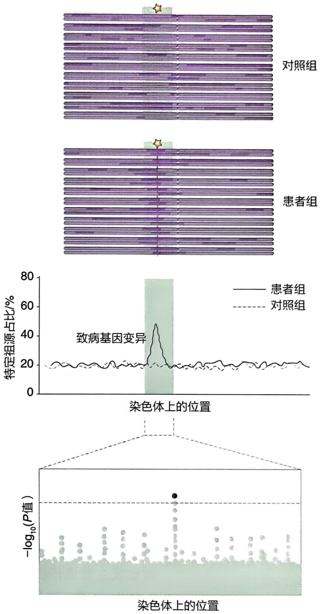

图5-11 利用连锁不平衡定位混合人群中的疾病基因图中所示基因组中深紫色和浅紫色分别表示两种祖先来源片段。其中，患者组中疾病基因与深紫色祖先片段显著关联，而来自同一人群的对照组在相同基因区域的祖先构成比例与全基因组水平一致。利用混入人群中祖先关联的连锁不平衡信息，能有效定位两个祖先人群中频率差异较大的疾病基因。

产生显著改变。例如，在决定肤色的基因座方面，欧洲人群大多携带与较浅肤色相关的等位基因，非洲人群则以深肤色相关等位基因为主，当这两大人群与印第安人人群混合后，混血后裔的肤色相关基因座上的等位基因频率呈现出介于欧洲人群与非洲人群之间或新的组合分布。又如在血型基因座上，不同人群有着不同的血型等位基因频率分布。欧洲人群中A型血和O型血等位基因占有一定比例，非洲人群中B型血等位基因相对更为常见，经过混合后，北美混血人群中各种血型等位基因频率发生变化，A、B、O血型的比例不再与原住民族群相同，出现了更为多样化和均衡化的趋

---

168

第五章 群体遗传、选择和进化

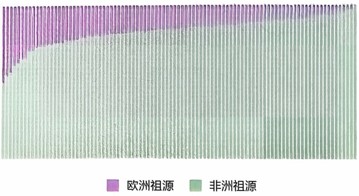

bar_stacked

| Category | Value |
| --- | --- |
| 欧洲祖源 | ~10% |
| 非洲祖源 | ~90% |

图5-12 非裔美国人的遗传祖源构成

在设定两个祖先群体（即 $K = 2$）的情况下，非裔美国人个体基因组主要包含欧洲祖源和非洲祖源两种遗传成分。遗传背景、家族历史、地理位置和性别等多种因素均可能导致不同个体的祖源构成比例发生显著差异。图改自:Zakharia et al., Genome Biology, 2009, 10: R141。

势。不同来源基因在新群体中的融合与重新分布，对群体的遗传特征产生了深远影响，在医学、人类学等多领域研究中都有着重要意义，为探究人群遗传多样性和适应性提供了丰富的素材与线索。

## 2. 中亚人群混合（丝绸之路）

中亚地区位于欧亚大陆中心，涉及多种文化、民族和宗教，其对于促进欧亚大陆经济、文化以及遗传交流起着十分重要的作用。中亚地区的人群长期受到迁移、隔离以及不同祖源人群的混合事件的影响，从而形成了丰富的遗传地貌。丝绸之路是古代时期一个重要的贸易和文化交流网络，连接了东亚、中亚、南亚、中东以及欧洲等地区，同时也促进了东西方的交流。我国西北地区分布着众多少数民族，其基因组呈

现显著的东西方混合特征（图 5-13）。

中国新疆维吾尔族人群是一个典型的混合人群。研究表明，维吾尔族基因组中融合了来自东西方祖先的遗传成分，总体比例约为1:1。具体来说，西方祖源包括西欧祖先（25%\~37%）和南亚祖先（12%\~20%），东方祖源包括东亚祖先（29%\~47%）和西伯利亚祖先（15%\~17%）。维吾尔族人群的混合历史呈现出较为复杂的“混合再混合”模式，可分为两个阶段（图5-14）（Feng et al., 2017）。第一阶段是维吾尔族祖源人群的形成。早在5500\~5000年前，遗传成分类似于现代东亚人和西伯利亚人的古人群在欧亚大陆东部发生了一次大规模的混合。与此同时或稍晚的时间（5000\~3750年前），在欧亚大陆西部，遗传成分类似于现代西欧人和南亚人的古人群也发生着遗传混合。第二阶段是维吾尔族祖先人群的初步形成。当欧亚大陆东西方分别形成了遗传学上混合的人群，进一步的东西方人群接触，使分别携带两种遗传成分的东西方古人群之间再次发生了持续的大规模混合，就此4种谱系全部融合在一起，形成早期的维吾尔族祖先人群。后续的人群接触可能是比较连续的，但也可能发生较长时间的中断。从数据中可以识别的有两次显著的群体融合事件，分别发生在约3750年前和约750年前。

回族是中国境内人口较多的少数民族之一。从历史地理视角来看，宁夏回族自治区自唐代起便是丝绸之路的重要枢纽，银川、固原等城市不仅承载着古代粟特商队的贸易

图5-13 我国西北少数民族基因组中的西方遗传祖源比例

数据来源:Chen et al., 2024; Wen et al., 2024; Cheng et al., 2024a; Cheng et al., 2024b; Lei et al., 2024; Ning et al., 2023; Pan et al., 2023; Ma et al., 2022; Pan et al., 2022。

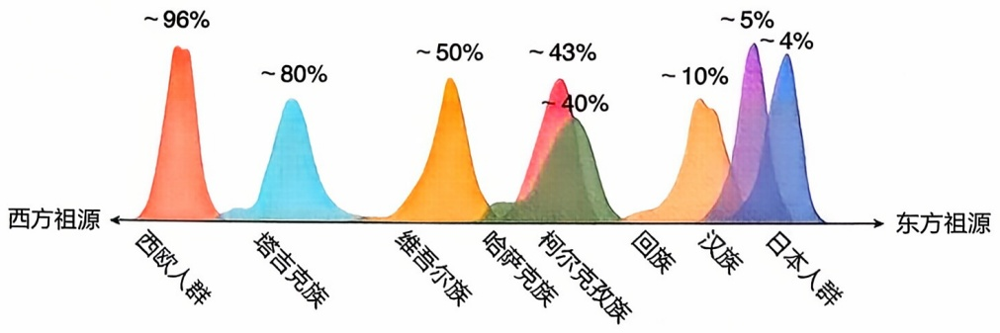

violin

| Group | Percentage (%) |
| --- | --- |
| 西欧人群 | ~96% |
| 暨吉克族 | ~80% |
| 维吾尔族 | ~50% |
| 哈萨克族 | ~43% |
| 柯尔克孜族 | ~40% |
| 回族 | ~10% |
| 汉族 | ~5% |
| 日本人群 | ~4% |

---

第四节 基因交流

169

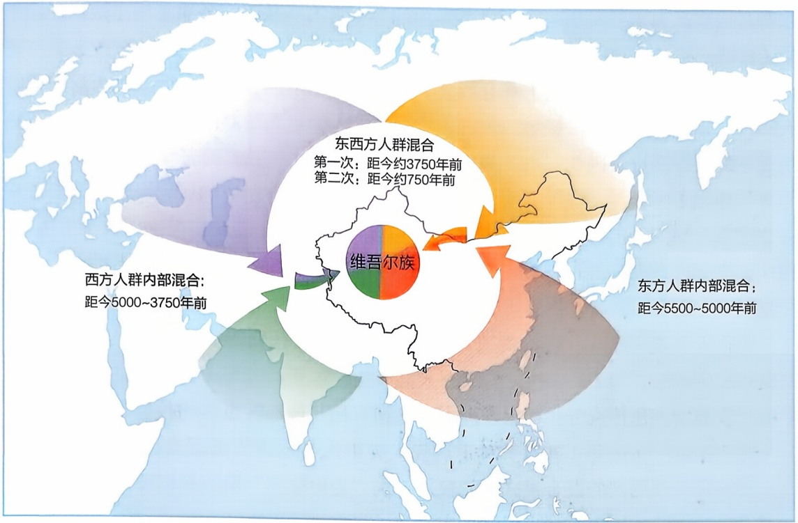

text_image

东西方人群混合
第一次：距今约3750年前
第二次：距今约750年前
维吾尔族
西方人群内部混合：
距今5000~3750年前
东方人群内部混合；
距今5500~5000年前

图5-14 欧亚大陆人群基因交流模型及中国新疆维吾尔族基因组的祖源构成

维吾尔族的形成经历东西方祖先的“混合再混合”（上），其基因组中显著体现出这种复杂的祖源融合特性（下）。图改自:Feng et al., Molecular Biology and Evolution, 2017, 34: 2572-2582。

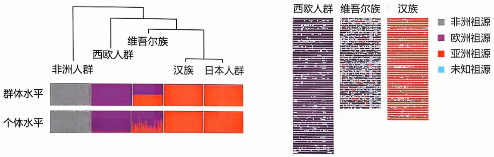

记忆，更在元代发展成为“西域亲军”屯驻的核心区域，直接促进了回族与其他民族的贸易网络在西北地区的形成。与维吾尔族相比，宁夏回族人群基因组中的东方祖源更为显著，东西方祖先的比例约为9:1。具体来看，宁夏回族人群基因组中东亚祖先约占82.8%，西伯利亚祖先约占7.8%，西欧祖先约占7%，南亚祖先约占2.4%。宁夏回族人群的祖先混合模式与维吾尔族略有不同，在早期，西欧、南亚与西伯利亚祖先群体之间发生了混合，同时东亚与西伯利亚祖先群体之间也发生了混合。随后，这两个早期形成的混合祖先群体进一步融合，形成了宁夏回族人群。这一融合过程同样可以描述为两次主要的遗传混合事件，分别发生在距今约1025年前和距今约500年前（Ma et al., 2021）。

## 3. 远古人类与现代智人祖先混合

除了早期智人（Homo sapiens）之外，地球上也曾存在过其他远古人类。目前考古学与遗传学中研究较为深入的是尼安德特人和丹尼索瓦人，他们在4万至3万年前逐渐灭绝。随着高通量测序技术的飞速发展，古DNA研究领域迎来了繁荣，包括阿尔泰尼安德特人（Altai Neanderthal）、凡迪亚尼安德特人（Vindija Neanderthal）和阿

---

170

第五章 群体遗传、选择和进化

尔泰丹尼索瓦人（Altai Denisovan）等在内的多个古人全基因组高通量测序数据已经产生（Prüfer et al., 2014; Prüfer et al., 2017; Meyer et al., 2012）。这些远古人类与现代人类的祖先在时间和空间上都有所交集，研究表明早期智人在历史上确与尼安德特人和丹尼索瓦人有过多次接触。远古人类对现代人类祖先的基因渗人可视为一种特殊情况下的人群混合，因此，用于重构现代人类混合历史的遗传特征信息，如等位基因频率与连锁不平衡等，同样适用于古人类与现代人类混合历史的研究。然而，由于不完全谱系分离问题的存在（知识窗5-7），以及混合时间久远和留存比例较小等因素，现代人类基因组中远古人类渗入序列片段的精确定位和远古人类与现代人类祖先基因交流历史的重构面临巨大挑战。

现代人类基因组中，古人类遗传渗入的DNA片段往往因负向选择等因素的影响而留存比例较小，为 $1\% \sim 4\%$ 。与欧洲人群相比，东亚和美洲人群基因组中包含了更多的尼安德特人遗传成分；而大洋洲人群则拥有比其他地区更多的丹尼索瓦人遗传成分（图5-16）。Yuan等（2021）对于现代人类祖先与远古人类混合的过程进行了解析，发现目前观测到的混合模式不能仅用单次“走出非洲”模型来解释，而需采用两次“走出非洲”的历史模型来解释。在这个过程中，尼安德特人与丹尼索瓦人分别与

## 知识窗 5-7

## 不完全谱系分离

不完全谱系分离（incomplete lineage sorting, ILS）是指物种分化过程中，祖先的基因多态性在不同后代中随机保留，从而导致基因变异并不完全按照物种分化的历史进行分离的现象（图5-15）。这种现象在构建基因树和物种树时尤为常见，可能导致基因树与物种树之间出现不一致的情况。在研究远古人类与现代人基因交流时，不完全谱系分离是一个重要的干扰因素。

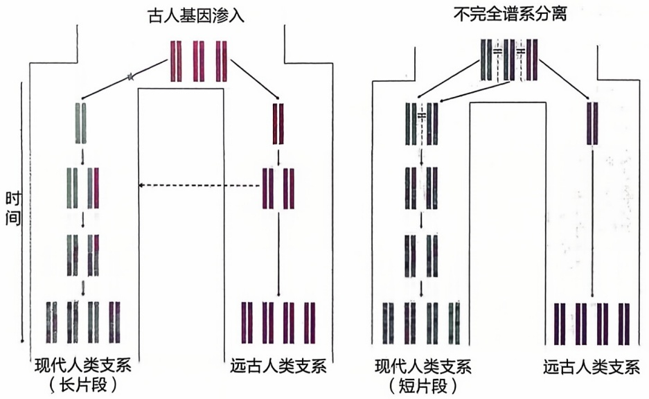

图 5-15 古人基因渗入与不完全谱系分离示意图

图中展示了古人基因渗入（左图）和不完全谱系分离（右图）场景下的疑似古人基因片段长度。从祖先人群中继承而来的基因片段通常在较长时期内经历了多次遗传重组，片段长度较短；而近期古人基因渗入引入的基因片段经历了有限的遗传重组事件，片段长度较长。

---

第四节 基因交流

171

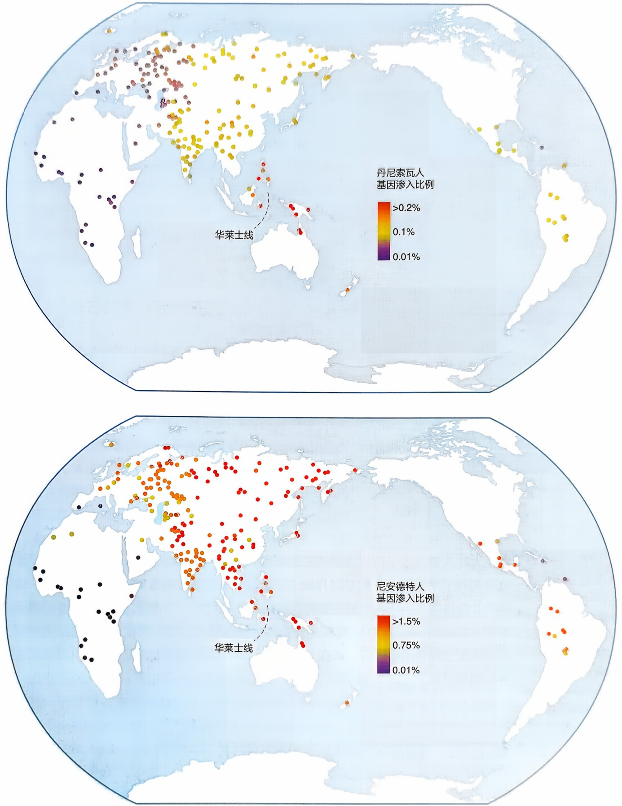

图5-16 现代人基因组中的古人类基因渗入比例

上图和下图分别展示了采用 ArchaicSeeker 2.0 检测到的现代人群中的

丹尼索瓦人和尼安德特人基因渗入比例。图改自:Yuan et al., Nature

Communications, 2021, 12: 6232。

---

172

第五章 群体遗传、选择和进化

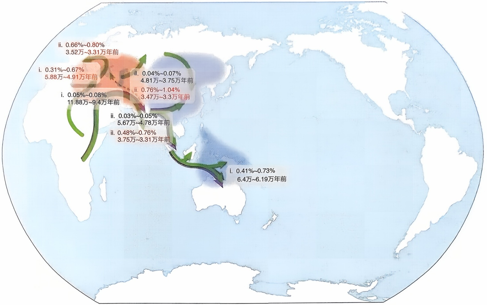

geo

| Category | Percentage Range | Time Period (万年前) |
| --- | --- | --- |
| i. | 0.31%~0.67% | 5.88~4.91 |
| ii. | 0.66%~0.80% | 3.52~3.31 |
| iii. | 0.04%~0.07% | 4.81~3.75 |
| ii. | 0.76%~1.04% | 3.47~3.3 |
| i. | 0.05%~0.08% | 11.88~9.4 |
| ii. | 0.03%~0.05% | 5.67~4.78 |
| ii. | 0.48%~0.76% | 3.75~3.31 |
| i. | 0.41%~0.73% | 6.4~6.19 |

现代人类迁徙路线

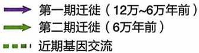

古人基因渗入事件

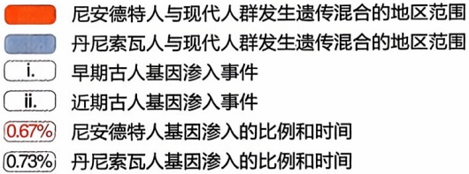

text_image

尼安德特人与现代人群发生遗传混合的地区范围
丹尼索瓦人与现代人群发生遗传混合的地区范围
i. 早期古人基因渗入事件
ii. 近期古人基因渗入事件
0.67% 尼安德特人基因渗入的比例和时间
0.73% 丹尼索瓦人基因渗入的比例和时间

图 5-17 欧亚现代人群与远古人类的基因交流模型

图中所示为采用 ArchaicSeeker 2.0 构建的丹尼索瓦人和尼安德特人与欧亚大陆现代人群发生的两次遗传混合模型。图改自:Yuan et al., Nature Communications, 2021, 12: 6232。

欧亚大陆人群发生了两次主要的基因交流（图 5-17）。此外，研究人员在非洲人群中也检测到了尼安德特人的基因片段（平均每个个体基因组为 17.4～18.0 Mb），并推测这些片段可能是由于携带尼安德特人基因片段的欧洲人祖先回迁至非洲而引入非洲人群中（Chen et al., 2020）。尼安德特人基因渗入可能促进了现代人的肤色、免疫等功能对欧亚大陆环境的适应，而在与认知功能等相关的基因上，尼安德特人来源的基因片段则相对较少（图 5-18）。

## 第五节 自然选择与适应性进化

## 一、自然选择的概念

英国著名生物学家达尔文提出的自然选择（natural selection）理论是现代生物学

---

第五节 自然选择与适应性进化

173

的基石。达尔文在1859年出版的《物种起源》(On the Origin of Species)一书中提出，自然环境中的个体之间存在遗传上的差异，那些对环境具有更强适应性的个体更有可能生存下来并繁衍后代，从而将有利特征传递给下一代。进化是一个渐进且连续的过程，通过长期的自然选择作用，群体的遗传结构和特征逐渐发生变化，以更好地适应环境变迁，从而增强了其生存和繁殖的能力。这一过程被称为适应性进化（adaptive evolution）。适应性进化是生物多样性形成的主要驱动力之一，它赋予生物体在不断变化的环境中生存和繁衍的能力。通过适应性进化，物种得以开拓新的生态位，抵御外来物种的入侵，并应对环境变化带来的挑战。

## 二、自然选择的类型和检测方法

我们通常将个体或群体在特定环境中生存和繁殖成功的概率称为适合度（fitness），它是衡量个体或群体遗传特征与环境适应性的重要指标。具有更高适合度的个体更有可能将其基因传递给下一代，从而影响群体的遗传结构。适合度也可以理解为群体中某种等位基因或等位基因型对下一代的贡献度，计算为第二代群体与第一代群体中等位基因频率或等位基因型频率的相对大小。例如，第一代群体中等位基因 $A$ 与 $a$ 的频率分别为 $50\%$ ，三种等位基因型$AA$ 、 $Aa$ 和 $aa$ 的频率分别为 $25\%$ 、 $50\%$ 和 $25\%$ ；第二代群体中等位基因 $A$ 与 $a$ 的频率分别为 $60\%$ 和 $40\%$ ，等位基因型 $AA$ 、 $Aa$ 和 $aa$ 的频率分别为 $36\%$ 、 $46\%$ 和 $16\%$ 。那么，等位基因 $A$ 的适合度计算为 $60\% /50\% = 1.2$ ，等位基因型 $AA$ 的适合度计算为 $36\% /25\% = 1.44$ ，同理可求得其他等位基因和等位基因型的适合度。

根据等位基因和等位基因型频率在人群中的变化规律，我们通常将自然选择分为正选择（positive selection）、负选择（negative selection）、平衡选择（balancing selection）和多基因选择（polygenic selection）等类型（图5-19）。基

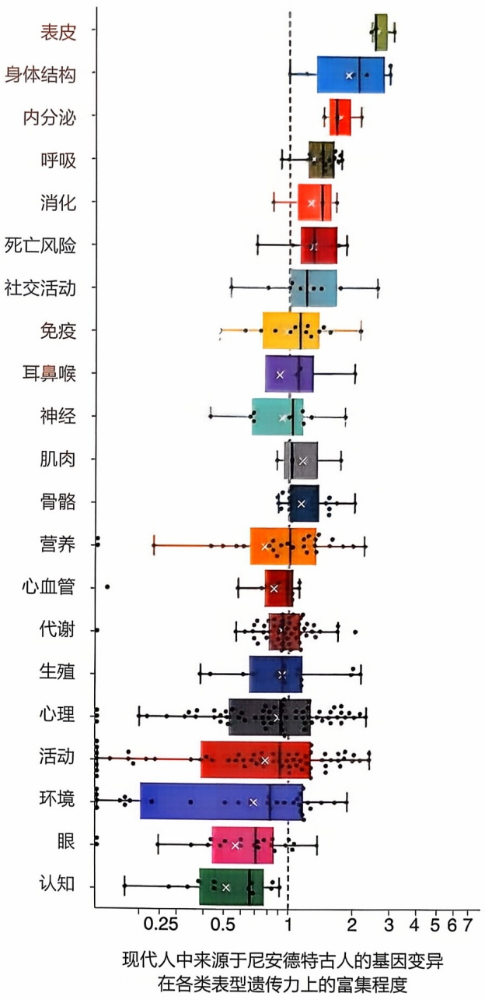

boxplot

| Category | Q1 | Q2 (Median) | Q3 |
| --- | --- | --- | --- |
| 表皮 | ~2.5 | ~2.8 | ~3.0 |
| 身体结构 | ~1.5 | ~2.0 | ~2.8 |
| 内分泌 | ~1.5 | ~1.8 | ~2.0 |
| 呼吸 | ~1.0 | ~1.2 | ~1.4 |
| 消化 | ~1.0 | ~1.2 | ~1.4 |
| 死亡风险 | ~1.0 | ~1.2 | ~1.4 |
| 社交活动 | ~1.0 | ~1.2 | ~1.6 |
| 免疫 | ~0.8 | ~1.0 | ~1.2 |
| 耳鼻喉 | ~0.8 | ~1.0 | ~1.2 |
| 神经 | ~0.7 | ~0.9 | ~1.1 |
| 肌肉 | ~0.9 | ~1.0 | ~1.2 |
| 骨骼 | ~0.9 | ~1.0 | ~1.2 |
| 营养 | ~0.7 | ~0.9 | ~1.1 |
| 心血管 | ~0.8 | ~0.9 | ~1.0 |
| 代谢 | ~0.8 | ~0.9 | ~1.0 |
| 生殖 | ~0.7 | ~0.9 | ~1.1 |
| 心理 | ~0.6 | ~0.8 | ~1.0 |
| 活动 | ~0.5 | ~0.8 | ~1.2 |
| 环境 | ~0.3 | ~0.6 | ~1.2 |
| 眼 | ~0.5 | ~0.7 | ~0.9 |
| 认知 | ~0.4 | ~0.6 | ~0.8 |

图5-18 尼安德特古人基因渗入对现代人表型的影响基因变异在表型遗传力上的富集程度指的是一组特定基因变异对表型遗传力的解释度占全基因组对表型遗传力解释度的比例。图中展示的是以欧洲人群为代表的现代人基因组中，尼安德特古人来源的遗传变异对各类表型的解释度的贡献。各点表示每一大类表型下的细分表型。遗传力解释度越大表示尼安德特古人基因渗入对相应表型贡献越大。图改自:McArthur et al., Nature Communications, 2021, 12: 4481。

因组正选择信号的检测可以直接通过计算人群间等位基因频率差异，频率差异越大反映适合度越高。正选择倾向于增加有益等位基因的频率，并减少其他等位基因的频率。与有益等位基因紧密连锁的其他等位基因也会随之在人群中的频率增加，这种由于连锁不平衡产生的等位基因频率受周围正选择位点牵连而发生改变的现象称为搭车

---

174

第五章 群体遗传、选择和进化

图5-19 基因组中常见自然选择类型及相应等位基因频率变化

图中圆点表示等位基因，其中红色、黄色和蓝色圆点所示等位基因为各场景下受自然选择的等位基因。图中从左至右依次展示了正选择、负选择、平衡选择和多基因选择发生之前（上）和发生之后（下）的等位基因频率变化。

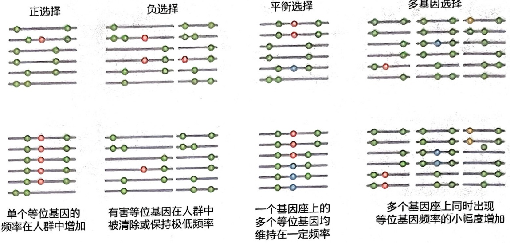

效应（hitch-hiking effect）。搭车效应可能导致受选择基因或位点附近的遗传多样性降低，同时产生单体型延伸的现象。此外，正选择意味着群体中个体的繁殖力存在差异，即受选择基因型的个体可能产生更多后代，使得子代中受选择的单体型更容易追溯至同一祖先个体。因此，我们也可以根据基因谱系树的树形结构加以判断，压缩的枝长可能意味着正选择事件的发生（图 5-20）。每种方法有其侧重的遗传特征和适用场景，实际研究中需要根据分析目的和数据特征加以选择，或需结合使用多种方法，并根据所采用方法的原理对分析结果给予适当解读。

负选择信号检测方法参考的基因组信息主要是区域的遗传多样性，或在此基础上

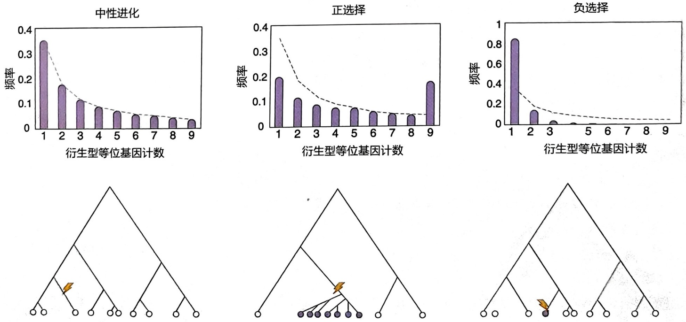

图5-20 自然选择对等位基因频谱和基因谱系树的影响

图中从左至右依次展示中性进化、正选择和负选择情况下的等位基因频谱（上）和基因谱系树（下）特征。与中性进化相比，正

选择产生较多的中高频衍生型等位基因，而负选择保留了更多低频或罕见等位基因。图改自:Ezawa et al., BMC Genetics, 2013, 14: 37。

---

第五节 自然选择与适应性进化

175

进一步有效区分同义突变和非同义突变。假设非同义突变由于不改变编码的氨基酸序列而不足以成为负选择的目标，某特定基因组区域内非同义突变和同义突变的相对大小即可以反映负选择的程度。平衡选择保留了群体中的多种等位基因多样性，理论上可以通过检测基因组中高于预期的遗传多样性来得到候选信号。前期开展的全基因组测序研究证实了人群中受平衡选择的主要组织相容性复合体（major histocompatibility complex，MHC）区域表现出较高的遗传多样性。然而，在平衡选择不足够强的区域，则很难区分多样性的增加是由于平衡选择还是中性进化。此外，作用在某个位点上的平衡选择也可能会产生延伸的单体型，但这种特征与近期发生的正选择难以区分。

## 三、人类适应性进化的驱动因素

适应性进化的外部驱动力主要涉及地理气候条件、人类社会活动以及病原微生物与人类的相互作用等。现代人类约在30万至20万年前起源于非洲，并在大约7.5万年前开始走出非洲向外扩散，足迹遍布全球。我们的非洲祖先从赤道附近的热带地区迁徙至较高纬度的亚热带、温带乃至寒带地区，面临了多种环境变化，例如紫外辐射的减弱及冬季气候的变冷等。这些地理和气候的变化对人类基因组施加了新的选择压力，促使人类祖先产生新的生理和表型适应，增强了应对栖息地变化的能力，而非仅适应单一类型的环境。温度是影响人类适应性进化的关键气候因素之一。自旧石器时代以来，全球气温的周期性波动对人类迁徙和进化产生了深远影响。近200万年以来，地球经历了30多次冰期（glacial）与间冰期（inter-glacial）交替，温度变化的幅度快速增加，从早期的2\~3℃的变化，到中更新世革命（mid-Pleistocene revolution，距今约90万年前）以后，增大至8\~10℃以上。其中，对人类影响最大的是距今2.2万年至1.8万年间的末次盛冰期（last glacial maximum，LGM），全球海平面下降了120\~130 m，广泛暴露的海岸带可能促进了人类向东南亚和大洋洲地区迁移。从末次冰消期到全新世转暖过程中，人类社会经历了从渔猎采集、作物驯化到农业社会的重大转变。

根据已知的人类进化历史，在过去一万年中最重要的人类活动是农业扩张（agricultural expansion）。这里讨论的农业是指农作物栽培和动物驯养等广泛意义层面的农业。与人类相关植物和动物的驯养最早发生于12000年前的中东地区和新月沃地（fertile crescent），并随后在世界其他各地兴起——在中国、中美洲、安第斯山脉、新几内亚等地于约10000年前兴起；在撒哈拉以南的非洲于约8000年前兴起；在北美洲东部于约6000年前兴起。在全世界2000多个族群中，仅有少于100个群体保持着原始的狩猎与采集的生业模式，而且越来越多的基于原始生活的族群正在向农业文明转变。农业文明的兴起和发展对人类社会发展进程影响广泛而深刻，驱动了人群的扩张，也促进了人类迁移和更多族群的分化，以及在此过程中不同族群经历了不同环境下的适应性进化。人类在农业文明发展中经历的最典型适应性进化是对饮食的适应。农业革命带来人类饮食结构的直接转变。捕猎采集者主要以捕食猎物、昆虫，采

---

176

第五章 群体遗传、选择和进化

集野果充饥；受到农业扩张影响的人群则逐渐转为以驯养农作物和家畜等为食。两者的饮食结构或者食物中营养成分有显著差异。首先，肉类的食用占捕猎采集者的20%\~50%，非捕食采猎者则仅有10%的肉类食源，且前者的肉类食材中有更少的脂肪和更多的不饱和脂肪酸。其次，捕猎采集者食用更多的纤维和复杂多糖。他们的植物食物甚是广泛，从根、块茎、豆类到各式水果等。农耕文明的族群饮食则局限并深深依赖于他们驯养的小谷粒（以淀粉为主要能量来源），而这些谷物的蛋白质与淀粉含量比要低于野生型植物。另外，捕猎采集者和非捕猎采集者的饮食结构在钙离子、盐类等微量元素上也有差别。简言以蔽之，从农耕文明走来的现代族群相比于捕猎采集者而言，食用更多的简单糖类、饱和脂肪酸、盐类，而更少的纤维、复杂糖类、钙离子、不饱和脂肪酸等。牛奶和酒精的饮用则是在驯养家畜和农耕文明之后才进入人群饮食结构中。近期工业文明的兴起，加工食品则进一步增加了这种差异。饮食的转变给人类带来新的选择压力，也因此在一定程度上塑造了当今人类的基因组多样性。

人类迁徙和文明的发展增加了人群对来自自然环境和驯养动物的病原微生物的暴露，这直接影响了人群的出生率和死亡率。病原微生物对于人类适应性的影响具有双重性。一方面，有害病原体可能对人类健康构成威胁，降低生殖潜力，使得宿主人群通过积累抵抗病原体或减弱其影响的遗传变异而提高适应性。例如，疟疾、天花、霍乱、结核病和麻风病等疾病的病原体与人类共存了相当长的时间，而人类在进化过程中也会接触到新的病原体，如艾滋病病毒、冠状病毒等。另一方面，某些病原体（例如肠道微生物）虽然偶尔会引起机体病理反应，但在多数情况下对人体是有益的，推动宿主基因向更倾向于招募有益微生物的方向进化。

## 四、人类中经典的适应性进化案例

现代人类自迁出非洲以来，随着不断迁徙扩散，在世界各地生态气候各异的环境中开始了定居。步入农业社会，人类生活发生巨变。稳定的农业产出加速了人群繁衍，人口不断扩张。此时，自然环境之外，饮食、文化与病原体等因素，对人群的表型与健康影响渐深。由于生存在不同地区的人群面临着不同种类的气候、海拔和病原体，且有着不同类型的饮食习惯和文化习俗，导致世界各地的人群的定居环境存在显著差异。随着人群在定居环境下的长期繁衍生息，对环境的适应使该地的人群通过遗传和非遗传的机制积累了局部适应性特征，并导致了遗传和表型上产生分化。这些局部适应性特征相关的等位基因可能在一种环境中比其他环境更有益，也可能在一种环境中有益而在其他环境中保持中性。现代人类在外部环境因素和内部遗传因素的共同作用下发生适应性进化，形成了今天的人类遗传多样性和表型多样性格局（图5-21）。

## 1. 乳糖耐受

人类文明进程中，饮食习惯的变革驱动了人群适应性进化，乳糖耐受性（乳糖酶持久性，lactase persistence）是其中一个典型案例。人类乳糖酶的活性在断奶后普遍

---

第五节 自然选择与适应性进化

177

图5-21 人类适应性进化的经典案例

下降，导致全球约 65% 的成年人存在乳糖不耐受，但部分人群在成年后仍保留乳糖酶活性。这一性状呈现显著族群地理差异:欧洲北部人群耐受率高达 90%，而东亚人群不耐受率达 70%\~90%，非洲则存在区域分化。

乳糖耐受性是一种显性遗传特征，由乳糖酶基因 $LCT$ 调控。该基因在不同人群独立进化出多种适应性突变，使其在成年时期仍然保持着较高乳糖酶水平。欧洲人群 $LCT$ 基因上游约 $14\mathrm{kb}$ 处的一个顺式作用元件SNP（-13910\*T，rs4988235）调控了$LCT$ 基因的持续表达（Enattah et al., 2002）；非洲人群则携带-14010\*C，-13915\*G

图中标注了全球各地不同环境下的选择压力或表型，以及相应的适应性基因。

---

178

第五章 群体遗传、选择和进化

和 -13907\*G 等与其乳糖耐受性显著关联的遗传变异（Tishkoff et al., 2007），这说明不同人群乳糖耐受存在趋同进化的现象（图 5-22）。乳糖耐受性的适应性进化与人类开始饲养家畜和消费乳制品的历史紧密相关。距今约 1 万年前的新石器时代，动物的驯化带来乳制品消费的兴起。乳糖吸收不仅提供能量，还可能通过促进钙和维生素 D 吸收增强高纬度人群生存优势，或在流行病中减少腹泻风险。

尽管乳制品消费被认为是主要选择压力，最新研究揭示了乳糖耐受背后更复杂的遗传进化机制（Ma et al., 2025）。该研究首先基于全球现生人群的全基因组测序数据，在东亚人群2q21.3区域发现一种高频（约 $25\%$）单体型，并且发现这种单体型与LCT基因的表达以及LCT启动子区域cg20242066位点的甲基化水平有关，与此前报道的影响欧洲人群乳糖耐受性的遗传变异-13910\*T（rs4988235）有相似的效应，提示该单体型可能影响东亚人群的乳糖耐受性。然而这种东亚人常见的单体型在非洲和欧洲人群中完全缺失，进一步表明东亚人群乳糖耐受与欧洲非洲人群存在不同的遗传基础（Ma et al., 2025）。

图 5-22 乳糖耐受的世界分布及不同人群中的趋同进化

图改自:Leonardi et al., 2012; Ingram et al., 2008; Liebert et al., 2017。

为追溯单体型起源，研究团队整合尼安德特人和丹尼索瓦人等远古人类的全基因组测序数据，发现该东亚特异单体型可能通过远古时期尼安德特人遗传渗入现代人基因组，并经历长期正向选择。古代人群的基因组数据显示这种单体型在约1万年前已经普遍存在，对选择时间的估计也显示，该区域的自然选择约始于1万年前，早于东亚人群开始驯养动物及消费奶制品的时间，暗示牛奶消费引起的乳糖摄入并非东亚人

geo

| Region | Value Range |
| --- | --- |
| North America | 10%~90% |
| South America | 10%~90% |
| Europe | 10%~90% |
| Africa | 10%~90% |
| Australia | 10%~90% |

成年人中乳糖耐受者的比例

area

| 年龄 | 乳糖不耐受 (相对比例) | 乳糖耐受 (相对比例) |
| --- | --- | --- |
| 起始阶段 | 高 | 低 |
| 中期阶段 | 中 | 中 |
| 结束阶段 | 低 | 高 |

乳糖水平与年龄的关系

flowchart

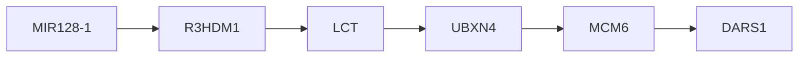

人类2号染色体上与乳糖耐受相关的基因区域

---

第五节 自然选择与适应性进化

179

群 2q21.3 区域适应性进化的初始驱动力。该单体型可以影响 2q21.3 区域基因（如 UBXN4、DARSI）在免疫细胞中的表达，并与白细胞和中性粒细胞计数变化显著相关，研究推测免疫相关的环境因素更可能是潜在的自然选择驱动力。

此外，近期一项迄今为止规模最大的关于欧洲人群乳糖耐受性进化的研究表明，欧洲人群牛奶消费的时间比欧洲人群获得乳糖代谢能力早了几千年，引发人们对2q21.3区域的自然选择是否仅与乳糖耐受相关的争论。该研究对这一争论提出了新的猜想，2q21.3区域的正向自然选择可能存在人群特异性进化驱动因素，该基因区域的全球适应性进化历史比既往认知更为复杂。乳糖耐受性的进化史揭示人类对环境挑战的多样化适应策略。传统“饮食驱动基因选择”模型已不足以解释全球人群差异，需结合群体特异性历史、免疫生态等多维度因素来考量。东亚人群乳糖耐受性的成因可能另有隐情，挑战了乳糖摄入是乳糖酶基因进化原初驱动力的传统认知，为理解基因-文化共进化提供了新视角，强调自然选择机制的复杂性和区域独特性（Ma et al., 2025）。

## 2. 高淀粉饮食

在人类的适应性进化历程中，饮食习惯与文化习俗的变革扮演着至关重要的角色，其影响力远不止于乳糖耐受这一现象。就拿长期食用高淀粉食物的人群来说，为了更高效地分解、利用淀粉，淀粉酶基因悄然发生适应性变化。这清晰地表明，从长远的时间跨度来看，人类生活方式的转变亦是驱动人群适应性进化的关键力量。

淀粉酶基因座（amylase locus，AMY）作为人类基因组中拷贝数变异最为频繁的功能区域之一，其拷贝数变异被认为是人类适应性进化的一个经典案例。AMY基因家族在人类1号染色体上串联分布，其转录翻译产物参与淀粉的消化过程（Perry et al., 2007）。该基因家族包括AMY1、AMY2A和AMY2B三个亚型，AMY1在唾液腺中特异性表达，而AMY2A和AMY2B则在胰腺中特异性表达（Bolognini et al., 2024）。淀粉酶基因座内部由高度相似的片段重复序列构成（León-Mimila et al., 2018），不同淀粉酶基因亚型之间高度同源，因此难以被精确解析。得益于长读长测序（long-read sequencing）技术的应用，科学家们得以实现淀粉酶基因座局部区域的高质量组装，并开始对全球不同人群中淀粉酶基因座的复杂结构进行精细解析。淀粉酶基因座在人群中具有高度多态性，其长度变化范围为 $100\sim 400\mathrm{kb}$，高可信度单体型种类多达30余种。其中，H1a和H3r单体型占据主导地位，可以涵盖 $60\% \sim 70\%$ 的人类基因组淀粉酶单体型。AMY基因的拷贝数在非人灵长类中较为保守，在丹尼索瓦人和尼安德特人中出现了一定程度的扩增。随着人类走出非洲，以东亚为代表的水稻种植范围逐渐扩大，现代人类基因组中AMY1基因的拷贝数经历了快速变异时期，整体呈现拷贝数扩增趋势（Yilmaz et al., 2024）。编码唾液淀粉酶的基因AMY1的拷贝数变异在农业社会人群与热带雨林狩猎采集人群间存在明显分化，表明了经历了农业文明的人群因饮食习惯的改变而在该基因上受到了选择。通过比较农业人群与狩猎采集人群基因组发现，农业人群中AMY1基因拷贝数显著更多。这些现象提示AMY1基因拷贝数可能

---

180

第五章 群体遗传、选择和进化

与人类历史上农业转型以及淀粉摄入量增加的饮食变革有着密切关联。这些研究揭示了AMY基因在人类进化中的作用，并且指出了基因拷贝数变异在人类适应环境变化中的重要性。以此为代表的基因组单体型解析和基因拷贝数研究在深入探究人类基因组复杂性与多样性的同时，也为探索人类适应性进化提供了新的视角。

## 3. 维生素 $\mathrm{B}_{1}$

维生素 $\mathrm{B}_{1}$ （又称硫胺素）是一种人体必需的微量营养物质，在糖类代谢、免疫系统中发挥重要功能。全麦谷物、豆类、坚果和肉类等食物是人体维生素 $\mathrm{B}_{1}$ 的唯一来源。体内游离的硫胺素通过硫胺素转运体被肠上皮吸收，其中SLC19A2和SLC19A3分别编码硫胺素转运蛋白1和硫胺素转运蛋白2，SLC19A2在东亚人群中受到人群特异性正选择（Sabeti et al., 2007）。另一项研究证实了这一分析结果，并且进一步发现SLC35F3和SLC35F4基因在东亚人群中也存在特异性的适应性选择信号（Ma et al., 2022）。其中，SLC35F4的适应性单体型和尼安德特人的单体型有极高的相似性（>90%的碱基匹配率），提示这种单体型可能源自现代人祖先和尼安德特人及其类似古人的基因交流（图5-23）。SLC35F4的适应性单体型频率在1万年前达到了最大值，而在近1万年内未发生较大改变，表明适应性进化在1万年前已经完成，这可能提示东亚地区农业发展后人群饮食结构的改变并非自然选择的原初驱动力。

## 4. 新冠病毒

全球性的新冠病毒（SARS-CoV-2）感染在不同地域、国家、人群间呈现出有差异的感染风险以及重症率和死亡率。过去3年多以来，国内外开展的多项大规模人群研究鉴定出一些潜在的新冠病毒易感因子，其中包括在欧美人群中鉴定出的ACE2、OAS1、ABO等重要易感基因，以及在中国人群中发现的与新冠病毒感染重症化风险相关的人类白细胞抗原区域（human leukocyte antigen，HLA）、11q23.3和11q14.2等区域，这表明遗传因素可能在疾病进展中起着一定作用。其中，位于3号染色体上与欧洲人群重症肺炎风险相关的基因可能来源于尼安德特人（Zeberg et al., 2020）。尼安德特人来源的重症新冠病毒感染基因单体型在南亚地区人群出现频率高达 $30\%$ ，在欧洲人群中频率为 $8\%$ ，在混血美国人中频率为 $4\%$ ，而中国所在的东亚地区人群的频率更低。然而，中国研究团队通过系统性解析新冠病毒入侵人体细胞的关键受体——血管紧张素转化酶2的编码基因ACE2的群体多样性特征，鉴别出在地理人群间差异性分布的ACE2基因谱系，发现了在东亚人群中尤为显著的谱系特异性自然选择印迹，并进一步揭示了ACE2基因谱系与新冠病毒感染病症轻重程度的统计学关联（图5-24）（Pan et al., 2022）。这一东亚人群特有适应性谱系在史前经历了适应性进化，最初自然选择可能起始于约10万年前，但在距今5000\~3000年前达到峰值，早在新冠病毒感染之前的病毒感染和大流行可能是其中潜在的驱动力。人类基因多样性的形成与人类生活环境中的病毒密不可分，是一个相互作用不可分割的共进化过程，揭示人群和个体遗传易感性差异并阐明其分子机制，有助于产生具有实践意义的预测和作为卫生防疫政策制定和实施的重要参考依据。

---

第五节 自然选择与适应性进化

181

图 5-23 维生素 B$_{1}$代谢基因在东亚人群中受到特异性正选择

参与维生素 $B_{1}$ 代谢通路的SLC19A2、SLC35F3和SLC35F4基因在东亚人群与其他大洲人群中表现出极为显著的差异。上图展示了这三个基因上代表性遗传变异的衍生型等位基因频率的历史动态变化。其中，实线及阴影部分表示由现生东亚人群基因组估算得到的不同历史时间对应等位基因频率及其95%置信区间；虚线表示由对应年代的古人基因组计算所得等位基因频率随时间变化趋势。下图则以SLC35F3的代表性遗传变异为例，展示了其在全球人群中的频率分布，其中在具有东亚血统的人群中频率较高。图改自:Ma et al., iScience, 2022, 25: 105614。

## 5. 高原人群低氧环境适应

高原自然环境以高寒、缺氧、强辐射等为主要特征，是人类居住的最极端环境之一。世界“第三极”青藏高原的平均海拔为4 000 m以上，含氧量为平原的60%。生活在平原上的人进入青藏高原后，血氧饱和度降低，引起各组织器官供氧不足，进而易引发高原肺水肿、高原脑水肿、高原心脏病等高原疾病。然而，世居于青藏高原、安第斯山、埃塞俄比亚高原等高海拔地区的人群患高原疾病的风险比平原人群低很多。高原世居人群的低氧环境适应，是指高原世居者为了能够在高原生存所产生的非可逆、可遗传的形态结构、生理和生化特性改变过程，涉及多种组织、器官的生理变化（图5-25）。经过国内外近十余年的密集研究，人们对藏族高原适应的遗传

---

182

第五章 群体遗传、选择和进化

flowchart

pie

| Region | 单体型1 (%) | 单体型2 (%) | 单体型3 (%) | 单体型4 (%) | 单体型5 (%) |
| :--- | :--- | :--- | :--- | :--- | :--- |
| 非洲 | ~40 | ~10 | ~10 | ~10 | ~30 |
| 西欧 | ~75 | ~25 | ~5 | ~10 | ~5 |
| 南亚 | ~50 | ~40 | ~5 | ~10 | ~5 |
| 东亚 | ~80 | ~20 | ~5 | ~5 | ~5 |
| 东南亚 | ~60 | ~40 | ~5 | ~5 | ~5 |
| 西伯利亚 | ~90 | ~10 | ~5 | ~5 | ~5 |
| 美洲 | ~90 | ~10 | ~5 | ~10 | ~5 |

图 5-24 SARS-CoV-2 受体基因 ACE2 在东亚人群中特异的单体型谱系上图展示了 SARS-CoV-2 感染人的途径，通过与宿主的 ACE2 受体结合引发呼吸道感染。下图展示了受体基因 ACE2 在世界不同地域人群中的单体型构成。其中，饼图示意某大洲或地区整体水平的 ACE2 单体型组成占比；直方图表示该地区不同人群的单体型组成占比。图改自:Yuwen Pan et al., National Science Review, 2022, 9: nwac118。

学基础有了一些初步的认识。低氧诱导因子信号通路（hypoxia-induced factor signaling pathway），简称 HIF 通路，是绝大多数动物中氧水平感知和适应的最重要生物学通路（图 5-26）。

早在 2010—2011 年间开展的多项研究均报道 EPAS1 和 EGLN1 在高海拔和低海拔人群间存在显著的遗传分化（Beall et al., 2010; Xu et al., 2011）。EGLN1 基因上的两个错义突变 rs12097901（c.12C > G, Cys127Ser）和 rs186996510（c.380G > C, Asp4Glu）被认为是在藏族人群中特异性富集的关键适应性突变（Lorenzo et al., 2014; Xiang et al., 2013），其在藏族人群中的频率达到 80%。这两个关键适应性变异与藏族血红蛋白水平显著关联，并在小鼠实验中得到证实。EPAS1 基因上未能定位到功能突变，但其下游跨膜蛋白编码基因 TMEM247 上的藏族特异性错义突变 rs116983452（c.248C > T; p.Ala83Val）可能具有比 EPAS1 更显著的表型后果，且二者之间可能存在一定的相互作用（Deng et al., 2019）。这一错义突变也是迄今发现的汉藏频率差异最大的功能变异——在藏族人群中的携带率达到 90% 以上，而在世界其他人群中非

---

第五节 自然选择与适应性进化

183

## 心脏

↓静息心率♀
↑收缩压
↓舒张压♂
↑舒张期右心室面积♂
↑三尖瓣环平面收缩期位移♀
↓三尖瓣反流射流的最大速度
↓肺动脉压

## 皮肤

↑臀部皮肤颜色的红度♂
↑腋下皮肤颜色的黄度♂
↑手、臀部和腋下皮肤颜色的深浅

## 肾脏

↓肌酐
↓尿酸
↓尿素氮♂

## 甲状腺

↓游离甲状腺素♂
↓促甲状腺激素 ♀
↓甲状旁腺激素
↓游离三碘甲状腺原氨酸♂

## 身体

↑体重♀
↓身高♀
↑体脂指数 ♀
↑胸围
↑腰围 ♀

natural_image

Human body diagram showing internal organs including lungs, intestines, and kidneys (no text or labels)

## 脾脏

↓脾脏厚度

## 新陈代谢

↓同型半胱氨酸
↓血清钠♀、↓铝♀、↓铁♀
↓同型半胱氨酸
↓糖化血红蛋白
↓一氧化氮、↑葡萄糖
↓叶酸、↑维生素B$_{12}$

## 脂质

↓甘油三酯
↑高密度脂蛋白♀

## 胆囊

↑胆囊壁厚度

## 眼睛

↓眼睛中央角膜厚度♀
↓眼睛晶状体厚度♀
↓眼睛的球镜等效

## 血液

↓血红蛋白
↓红细胞压积
↓红细胞
↓外周氧饱和度
↓平均红细胞体积 ♀
↓平均红细胞血红蛋白
↑平均红细胞血红蛋白浓度♂
↑血小板计数 ♀
↓平均血小板体积
↑血小板压积
↓淋巴细胞百分比和计数
↑中性粒细胞百分比和计数♂

↑平均红细胞体积的标准差♂和变异系数

## 肝脏

↑碱性磷酸酶
↑谷氨酰转肽酶
↑γ-谷氨酰转肽酶
↑谷氨酸丙酮酸转氨酶♀
↓间接、直接♀和总胆红素
↑直接胆红素/总胆红素比值
↓天冬氨酸转氨酶/丙氨酸转氨酶比值 ♀图5-25 藏族高原适应涉及的生理表型

与高海拔地区的汉族移民相比，高原世居的藏族人群在图中所示的12个器官系统中展现出显著的生理学特征差异。图中的上箭头代表藏族人群中这些特征的数值较高，而下箭头则指示相反的情况。此外，藏族男性和女性各自特有的适应性表型分别用特定的符号（男性:♂；女性:♀）进行了标注，以便于区分。图改自:He et al., iScience, 2023, 26: 107677。

常罕见，频率小于 $3\%$ 。此外，EPAS1下游也存在一个长度 $3.4\mathrm{kb}$ 的藏族人群富集型缺失（Tibetan-enriched deletion，TED）（Lou et al., 2015）。

事实上，人类征服青藏高原的历程悠久而曲折。研究表明，青藏高原人群的遗传起源可追溯至距今6万至4万年前的旧石器时代中晚期，早期进入青藏高原的人类族群间发生广泛的基因交流，并与后期进入青藏高原的族群发生进一步遗传混合，最终形成了一个包含现代智人和早期智人多个谱系（包括考古学已经发现的尼安德特人和丹尼索瓦人等，以及其他未知古人类）的遗传构成极其复杂的混合人群（Lu

---

184

第五章 群体遗传、选择和进化

flowchart

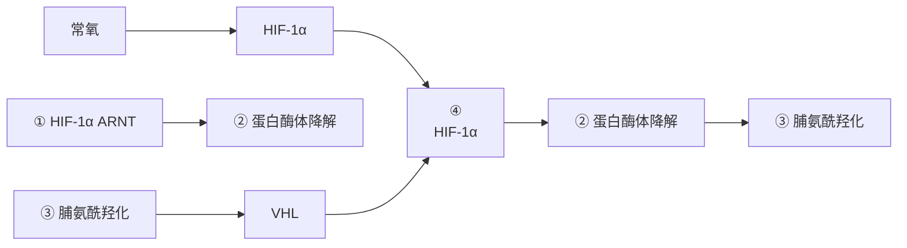

图 5-26 低氧诱导因子信号通路（HIF 通路）是低氧感知和适应的重要生物学通路

① 在缺氧条件下，HIF-1α蛋白免受降解，因而在细胞核内积聚。在此，它与ARNT蛋白结合，共同识别并结合到缺氧响应基因（HRE）的特异DNA序列上，从而调控这些基因的表达。② 正常氧水平下，HIF-1α会被蛋白酶体快速降解，以维持细胞内HIF-1α水平的平衡。③ 氧水平的高低通过在HIF-1α蛋白上添加羟基（OH）来调控其稳定性，这一过程是HIF-1α降解的关键调节机制。④ VHL蛋白在氧充足时能够识别HIF-1α，并与之结合形成复合体，这一复合体的形成是HIF-1α降解的前提，且该过程依赖于氧的存在。

et al., 2016)。这个过程中，一些曾经帮助人类适应高原环境的古人类基因片段得以保留下来，因高原极端环境的自然选择作用，在现今高原人群中积累到较高的频率，这一现象被称为适应性渗入（adaptive introgression）。除藏族之外，研究人员在其他高原世居人群中也发现了EPAS1和EGLN1适应性进化的现象，但也在僬人、夏尔巴人中鉴定出族群特异性的高原适应性基因（Zhang et al., 2019; Ge et al., 2023）。以上的结果都提示了不同高原人群经历了不同的进化历史和自然选择历程，同时也意味着人类的高原适应机制可能极其复杂，而基因组中大量的变异似乎可以组成不同的方案使得生物体具备应对环境改变的能力，即人类对高原环境的适应可能存在趋同进化的机制并且有可能是普遍存在的现象。

## 6. 人类肤色的适应性进化

肤色是人类适应性进化的重要表型之

一，它在不同地域和人群中展现出丰富的多样性。肤色的深浅主要由黑色素的含量决定。纬度和紫外线强度是影响肤色的直接环境因素。生活在赤道附近的人们通常拥有较深的肤色，这有助于保护皮肤免受强烈紫外线的伤害，降低皮肤损伤和皮肤癌的风险。相比之下，生活在高纬度地区的人们则倾向于拥有较浅的肤色，这有助于他们更有效地吸收紫外线，从而促进体内维生素D的合成（图5-27）。前期研究表明，欧洲和东亚人群的浅肤色特征可能是通过趋同进化形成的。例如，在东亚人群中，OCA2基因经历了正选择；而在欧洲人群中，SLC24A5和SLC45A2等基因也受到了类似的选择压力。近期研究揭示了在藏族人群中，色素合成相关基因GNPAT受到了强烈的正选择（Yang et al., 2022）。该基因第二内含子中的一个增强子调控元件rs75356281发生了点突变，这一突变的衍生等位基因在藏族人群中的频率高达 $58\%$ ，而在世界其他人群中则不到 $18\%$ 。这一突变与藏族人群中的原始肤色（如臀部肤色）和继发性肤色（如手背肤色）均存在显著的相关性。通过体外细胞功能实验，研究者们证实了这一突变导致了转录因子结合模式和增强子活性的变化。在自然选择的推动下，GNPAT基因在藏族人群中经历了适应性突变的积累。这些突变增强了藏族人群的黑色素合成能力，使得他们肤色变深，从而更好地适应高原地区强烈的紫外线辐射环境。

另一项研究深入探讨了全球赤道附近深肤色人群的遗传学特征。研究团队收集了全球热带地区近1000例原住民的基因型数据，对色素基因在全球人群中的遗传变异模式进行了分析，并据此提出了几种关于赤道附近人群深肤色进化的模型（图5-28）

---

第五节 自然选择与适应性进化

185

geo

| Color Category | Description |
| --- | --- |
| Light (Grey) | 浅肤色 |
| Medium-Light (Light Green) | N/A |
| Medium (Yellow) | N/A |
| Medium-Dark (Orange) | N/A |
| Dark (Red-Orange) | N/A |
| Dark Purple (Dark Purple) | N/A |
| Blue (Blue) | N/A |
| Black (Black) | 深肤色 |
| White (White) | 数据缺失 |

图5-27 世界人群肤色分布

(Deng et al., 2022)。首先，研究指出，与肤色相关的遗传变异可能源自共同祖先，并在不同人群分化后经历了平行进化。通过分析发现，许多在非洲人群中已报道的深肤色关联遗传变异，在亚洲热带原住民中也以一定频率存在。这些携带古老单体型的变异，暗示了亚洲早期祖先可能为当地原住民深肤色表型提供了部分遗传基础。其次，研究提出了趋同进化的可能性，即不同人群在各自的进化过程中独立获得了相同的肤色相关遗传变异。一种情况是古人基因渗入事件，古人与亚洲热带原住民的遗传混合可能重新引入了在“走出非洲”过程中丢失的深肤色相关遗传变异。另一种可能是独立发生的新发突变，例如在STK11基因上，多个亚洲热带原住民人群携带了同一新发突变，该基因参与紫外线诱导的DNA损伤修复。尽管不同人群独立发生相同新发突变的概率较低，但目前的分析尚不能完全排除这种可能性。

现今，我们的科学研究正从第四范式——数据密集型科学研究时代，向着尚未形成共识的第五范式——人工智能时代迈进，人类群体遗传学研究近年来取得了突破性进展，人类基因组的密码不断被破解。在泛基因组技术、大数据与人工智能技术的推动下，一方面，我们终将有望揭示人类遗传多样性格局，精准还原人类在漫长进化历程中基因流动、分化与融合的壮丽史诗，让人类起源、迁徙与发展的历史脉络清晰浮现；另一方面，长期困扰医学界、错综复杂的复杂疾病背后隐藏的遗传机制，也将逐步明朗清晰。无论我们的科学技术如何发展，始终有一根主线，就是遗传与进化。最终，我们必须回到基因，回到遗传学，从进化的视角重新审视这个世界以及人类自身。

---

186

第五章 群体遗传、选择和进化

图5-28 赤道附近人群深肤色进化模型

图中从上至下依次展示了人类深肤色适应性进化的三种不同模型及相应基因变异在全球人群中的等位基因频率分布。饼图中的颜色与左侧谱系树中各人群名称的颜色相匹配。

## ※ 复习思考题

1. 请使用千人基因组浏览器查询PRNP基因上SNP位点rs1799990的等位基因和基因型频率，并检验该位点在英国人群（GBR）、非洲卢旺达人群（LWK）、中国北京汉族人群（CHB）和哥伦比亚人群（CLM）中是否处于哈迪-温伯格平衡（HWE）。
2. 为什么人群的有效群体大小与实际人口大小有差异？如果有效群体大小在大幅减少后经历迅速扩张，对中性等位基因和受正选择的等位基因频率变化分别有什么影响？是否能促进两种等位基因在人群中迅速固定下来？
3. 使用来自某个人群的 100 个个体基因序列，如何验证某个基因经历过长期平衡选

---

推荐阅读

187

择？如果同时提供100个黑猩猩个体的基因序列，是否会对上述验证分析有帮助？

4. 研究人员发现来自丹尼索瓦人的 EPAS1 等位基因可能促进了青藏高原世居人群的高原环境适应，由此我们推断丹尼索瓦人也具备高原低氧环境的适应能力。请问这一推断是否合理？另外还有哪些线索或者证据可以用于验证这一推断？
5. 连锁不平衡现象在复杂疾病全基因组关联研究（GWAS）中起到了关键作用，请详细说明其如何助力研究人员从海量基因数据中精准定位疾病相关基因位点的？并且深入思考，随着基因测序技术的不断进步，连锁不平衡的研究模式可能会面临哪些新的机遇与挑战？
6. 遗传漂变和自然选择是生物进化的两大重要驱动力，但在某些特殊生态环境下，它们之间的界限似乎变得模糊。请举例详细阐述一种这样的特殊生态环境，并深入分析在该环境中遗传漂变和自然选择是如何相互作用，共同塑造生物种群进化轨迹的？
7. 乳糖不耐受现象在不同地区人群中的分布存在显著差异，除了文中提到的畜牧文化因素外，请深入剖析还有哪些地理、历史、社会经济等因素可能影响乳糖耐受基因的频率变化？并且思考随着全球饮食文化交流日益频繁，这种基因频率变化趋势可能会发生怎样的改变？

## ※ 推荐阅读

1. BERGSTRÖM A, MCCARTHY S A, HUI R, et al. Insights into human genetic variation and population history from 929 diverse genomes[J]. Science, 2020, 367: eaay5012.
2. THE HUGO PAN-ASIAN SNP CONSORTIUM, ABDULLA M A, AHMED I, et al. Mapping human genetic diversity in Asia[J]. Science, 2009, 326: 1541–1545.
3. SABETI P C, VARILLY P, FRY B, et al. Genome-wide detection and characterization of positive selection in human populations[J]. Nature, 2007, 449: 913–918.
4. LU D, LOU H, YUAN K, et al. Ancestral origins and genetic history of Tibetan highlanders[J]. American Journal of Human Genetics, 2016, 99: 580–594.
5. FENG Q, LU Y, NI X, et al. Genetic history of Xinjiang's Uyghurs suggests Bronze age multiple-way contacts in Eurasia[J]. Molecular Biology and Evolution, 2017, 34: 2572–2582.
6. TISHKOFF S A, REED F A, RANCIARO A, et al. Convergent adaptation of human lactase persistence in Africa and Europe[J]. Nature Genetics, 2007, 39: 31–40.
7. GAO Y, YANG X, CHEN H, et al. A pangenome reference of 36 Chinese populations[J]. Nature, 2023, 619: 112–121.

（编写:金力、徐书华、陆艳、邓恋；审读:卢大儒）
