# 第六章 人类遗传学与疾病

原始 PDF 第 204–254 页。

## 第六章

# 人类遗传学与疾病

人类遗传学研究的核心目标之一是揭示基因变异与疾病之间的关联，为疾病的预防、诊断和治疗提供科学依据。本章系统探讨了遗传学与疾病的关联，涵盖遗传模式、致病基因鉴定、遗传检测及治疗方法等多个方面。本章首先介绍人类性状的遗传模式，包括单基因病、寡基因病和多基因病的遗传特点。通过系谱分析，详细阐述了5种常见的遗传模式各自的遗传规律，并讨论了外显率、表现度、遗传印记等复杂遗传现象对常见孟德尔式系谱的影响。后进一步系统阐述功能克隆、定位克隆和二代测序技术在鉴定单基因遗传病致病基因方面的具体应用。全外显子组和全基因组测序目前已经成为鉴定致病突变的主流方法，但其数据解读仍然存在很大的挑战。全基因组关联研究已经广泛应用于复杂疾病易感基因的筛查，本章也对其取得的成就、仍然存在的问题和未来的发展方向进行了深入探讨。遗传检测可以更早地识别高风险个体，并制定个性化的健康管理策略。检测技术的进步使得产前筛查、新生儿筛查和携带者筛查成为可能，显著降低了严重遗传病的发生率，提升了人口健康水平。在治疗领域，基因治疗和基因组编辑技术为遗传病的治愈带来了希望。通过修复或替换缺陷基因，这些方法有望从根本上解决传统疗法无法应对的遗传性疾病。同时，药物遗传学研究为个性化用药提供了依据，优化了药物疗效并减少了不良反应。

人类遗传学的发展不仅推动了医学进步，也对社会伦理和法律提出了新的挑战。如何在技术创新与伦理规范之间取得平衡，是未来需要持续探讨的重要议题。总而言之，遗传学研究为人类健康事业开辟了新途径，其意义已超越科学领域，深刻影响着医疗实践和社会福祉。

---

第一节 人类性状的遗传模式

189

## 第一节 人类性状的遗传模式

最简单的遗传模式表现为由单一基因座上的基因型决定的遗传性状在家系中的传递方式，但这并不意味着该性状本身只由这一对基因决定。因为任何一个人类性状的产生实际上都是大量遗传和环境因素共同作用的结果。在正常的人类遗传和环境背景下，有时候某一个基因座位上的特定基因型对于性状的出现是充分而必要的。那么这类单基因性状称为孟德尔性状（Mendelian character）。如果该性状表现为某种疾病，我们将它称为单基因病（monogenic disease）或者孟德尔病（Mendelian disease），例如:编码凝血因子Ⅷ或Ⅸ的基因如果发生突变导致功能丧失，可以分别引起甲型或乙型血友病。孟德尔性状可以用特征性的系谱来进行识别。获得人类病理性或非病理性状相关信息的最佳来源之一是OMIM数据库（the Online Mendelian Inheritance in Man）。OMIM数据库目前收录有分子基础已知的人类性状7551种，包含引起表型突变的基因4930个，其中单基因突变引起的疾病和性状有3451种，相关基因4569个（截至2024年10月11日）。

现在我们已经知道，孟德尔性状的背后也是由多个基因组成的通路或网络，其中孟德尔性状对应的基因座往往是这些通路或网络中的关键节点。更多时候，关键节点的作用没有那么明显，导致多数人类性状的遗传变化并不呈现为简单的孟德尔式遗传。如果疾病或者其他性状变化是由2个、3个或更多基因座的变异结果一起决定的，换句话说，如果疾病主要的遗传决定因素仅包含少数几个基因座，那么我们将其称为寡基因病（oligogenic disease），例如:先天性巨结肠与RET、EDNRB、EDN3、GDNF等若干基因的突变相关。如果疾病的遗传决定因素由许多个具有微小效应的基因座组成，我们称之为多基因病（polygenic disease）。传统观点认为高血压、糖尿病等常见病大多属于多基因病。实际上，人类性状从完美的孟德尔式遗传到真正的多基因遗传会形成一个连续的谱系（图6-1A）。而且在此基础上会叠加或多或少的环境因素的影响，最终性状的总体病因学会落在图6-1B所示三角形的某个点上。

孟德尔性状是非此即彼的，例如囊性纤维化或者多指，要么表现出症状，要么没有症状。但是绝大多数人类性状在某种程度上是连续的或者可以量化的，例如身高和体重。这些性状是非孟德尔式的，但是并不意味着基因对其没有决定作用，对这类性状起作用的基因通常被称为数量性状基因座（quantitative trait loci，QTLs）。有些表现为非此即彼的性状也有可能是非孟德尔式的，例如常见的出生缺陷（包括神经管畸

图6-1 表型的决定因素（A）ABO血型取决于染色体9q34上的ABO基因座上的基因型（除极少数例外）。新生儿的Rh溶血症取决于母亲和婴儿在染色体1p36上RHD基因座的基因型，但也会受到母亲和婴儿的ABO血型相容性的影响。先天性巨结肠取决于几个基因座的相互作用。成人身高是由许多基因座累积的微小影响决定的。（B）一个性状的整体决定因素可以表示为三角形中的某个点。

---

190

第六章 人类遗传学与疾病

形、唇腭裂、先天性心脏病等）。但是它们部分或全部是由遗传决定的:它们倾向于在家族中传递，但是可能并不符合标准的孟德尔式系谱。这些遗传因素被称为易感基因（susceptible gene）。数量性状基因座和易感基因在分子水平上与决定孟德尔式性状的基因并无区别，只是它们的性状决定是通过一种更为复杂的方式罢了。更为复杂的情况是常见的一些人类疾病，在其具体的致病原因上可能具有高度的异质性。例如糖尿病，有些是简单的孟德尔式，有些则完全是环境因素的结果，当然大多数是多种因素共同作用的结果。因此这些疾病我们称之为复杂疾病（complex disease）。

除了这些 DNA 水平的变异之外，有时候我们发现染色体的部分区段甚至整条染色体会出现缺失、重复甚至重排，这种大范围的染色体结构性变异导致的疾病我们称之为染色体病（chromosome disease），例如:21 号染色体三体引起的唐氏综合征等。此外，在人类细胞的线粒体中也含有遗传物质 DNA，当发生突变的线粒体 DNA 占到一定比例时会严重影响细胞的能量供应，从而引起疾病，并且以母系方式遗传，我们称之为线粒体遗传病（mitochondrial genetic disease），例如:Leber 遗传性视神经病、Leigh 综合征等。

## 一、孟德尔式系谱

一个孟德尔性状如果能够在家族中传递意味着该性状不会明显影响个体生育后代，那么它会呈现特征性的孟德尔式系谱。系谱是从家系中第一个被医生或研究者发现罹患某种遗传病或者带有某种性状的先证者（proband）入手，详细调查其所有家族成员的亲属关系以及遗传病或性状的分布情况，并用特定的系谱符号按照一定的格式绘制而成的图谱（系谱中的常用图标见图6-2）。

text_image

□ 男性
○ 女性
◇ 性别不确定
■ 先证者
□ ○ 未受累
■ ● 受累
□ ⊙ 携带者
∅ 死亡

flowchart

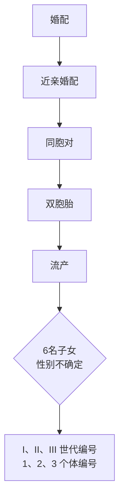

图 6-2 系谱中的常用图标

由确定的染色体位置上的 DNA 或染色质决定的可遗传性状都符合这种系谱的特征。尽管绝大多数孟德尔性状的决定因子是影响蛋白质编码序列的各种变异，但事实上孟德尔性状的决定因子也可以不是基因或者传统意义上的蛋白质编码序列，而是某个特定染色体区域的结构变异，例如脆性 X 染色体。

根据决定孟德尔性状的基因座所在的染色体位置是常染色体还是X染色体以及该性状的显隐性，可以分为五种基本的遗传方式:常染色体显性（autosomal dominant, AD）、常染色体隐性（autosomal recessive, AR）、X连锁显性（X-linked dominant inheritance, XD）、X连锁隐性（X-linked recessive, XR）、Y连锁遗传（Y-linked inheritance）（知识窗6-1）。如果疾病或性状的决定基因位于第1\~22号常染色体上，而且该性状呈显性，那么这种遗传方式称为常染色体显性遗传（图6-3A）。人类有许多性状都是常染色

---

第一节 人类性状的遗传模式

191

体显性遗传的，比如有耳垂就是显性性状。人类的许多疾病也呈现为常染色体显性遗传，例如成骨发育不全、亨廷顿舞蹈症等。如果疾病或性状的决定基因位于第1\~22号常染色体上，而且该性状呈隐性，那么这种遗传方式称为常染色体隐性遗传（图6-3B）。苯丙酮尿症、白化病、囊性纤维化等都是人类常见的常染色体隐性遗传病。如果疾病或性状的决定基因在X染色体上，而且该性状呈显性，那么这种遗传方式称为X连锁显性遗传（图6-3C），人类常见的X连锁显性遗传病有色素失调症、抗维生素D性佝偻病等。如果疾病或性状的决定基因位于X染色体上，而且该性状呈隐性。那么这种遗传方式称为X连锁隐性遗传（图6-3D），人类X连锁隐性遗传病包括红绿色盲、血友病等。Y连锁遗传的性状组成了第五种系谱，但是Y染色体上携带的基因很少而且其变异的病理效应往往会引起男性不育。因为决定成为男性的SRY（sex-determining region of Y-chromosome）基因就位于Y染色体上，所以真正符合Y连锁遗传的系谱并不多。其他性状，例如多毛耳等，其实很难完全确定是真正以Y连锁方式遗传的。

图6-3 孟德尔式系谱

---

192

第六章 人类遗传学与疾病

## 知识窗6-1

## 基本孟德尔式系谱的遗传规律

常染色体显性遗传:受累者通常至少有一个受累的父母（但有例外情况，例如新发突变或不外显）。两性皆可受累，且两性均可传递致病基因。父母一方受累，另一方未受累，那么他们的孩子有50%的概率受累（假设受累者都是杂合子的情况）。

常染色体隐性遗传:受累者通常是由未受累的父母所生，受累者的父母通常是无症状的携带者。两性皆可受累。如已有受累子女出生，那么后续每个孩子都有25%的机会受累（假设父母双方都是杂合子携带者）。

X连锁显性遗传:父母双方通常至少有一方受累。女性受累者通常比男性受累者的症状变异更大或更轻微（因为X染色体随机失活）。受累女性的孩子，无论其性别如何，都有 50% 的概率受累。受累男性的所有女儿都会受累，但儿子无一受累。

X连锁隐性遗传:主要累及男性。受累男性通常由未受累的父母所生，通常母亲是无症状携带者，但母方可能有受累的男性亲属。如果父亲受累且母亲是携带者，或者偶发的X染色体随机失活，也会导致女性受累的情况出现。该谱系中通常不会出现男性到男性的传递（但受累男性和携带者女性婚配会出现男性到男性传递的假象）。

Y 连锁遗传:只有男性受累。受累男性总是有一个受累的父亲（除非是新发突变）。受累男性的所有儿子皆受累。

## 二、基本孟德尔式系谱中的复杂情况

各种孟德尔性状或疾病在群体和家系中的分布具有各自的规律，通过对多个家系的调查和系谱分析，可以对疾病的遗传模式做出初步判断并且预测后代的发病风险。然而在现实生活中出现的各种复杂情况往往会掩盖基本的孟德尔式系谱关系，这里列举一些常见的复杂情况。

## 1. 可变表现度

表现度（expressivity）是指个体间基因表达的变化程度，即在不同的遗传背景和环境因素影响下，相同的基因变异在不同个体中表现出的性状和疾病的特征和严重程度可能存在显著差异。显性疾病常常具有可变表现度的特征，图6-4显示了一个常染色体显性遗传成骨不全家系的例子。

通常在人类身上观察到的可变表现度（variable expressivity）现象比在模式生物身上观察到的更为明显，这是因为模式生物在遗传背景上要比人类一致得多，而且生活在更为稳定的环境中。这也是研究人类疾病的动物模型时需要考虑的一个重要因素。

## 2. 不外显和拟表型

基因表达的另一种变异方式是不同的外显率。外显成骨不全患者可以表现出多发性骨折、蓝色巩膜和耳聋这三种性状中的一种或多种。

flowchart

This image displays a hierarchical classification tree (a type of flowchart) showing the relationships between three categories: Multi-ferential骨折, Blue巩膜, and Ear聋.

图6-4 可变表现度

---

第一节 人类性状的遗传模式

193

率（penetrance）是指某一基因型个体显示出预期表型的比例，常用百分数（%）来表示。外显率为100%时称为完全外显（complete penetrance），外显率低于100%时称为不完全外显（incomplete penetrance）。人类颅面骨发育不全是常染色体显性遗传，根据其遗传方式应该在代与代之间连续遗传，但是偶尔会出现代间不连续的现象。如图6-5中Ⅱ-2既有受累的父母，也有受累的孩子，几乎可以肯定其携带显性致病基因，但他却表刑正常，这就是出现了不外显的情况。

flowchart

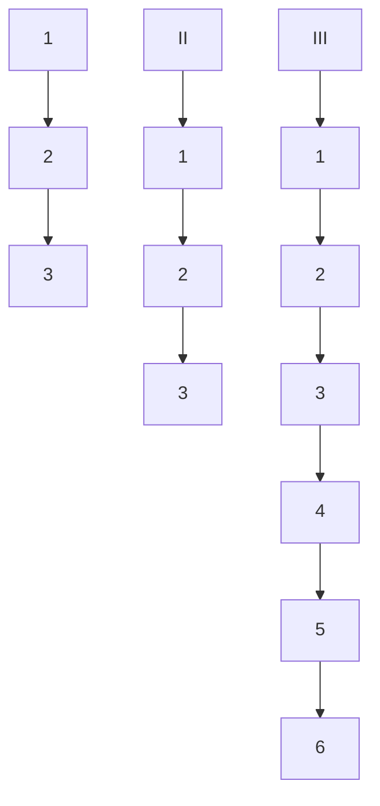

图6-5 不外显

在正常情况下，孟德尔性状的存在与否主要取决于基因座上的基因型。但是不寻常的遗传背景、特定的生活方式，或者可能只是偶然的机会，都会使得个体无法表现出该性状。

与不外显正好相反的一种情况是拟表型（phenocopy）。拟表型又称为表型模拟，是指环境改变所引起的表型改变，有时与基因变异引起的表型变化很相似。拟表型是由环境因素引起的，所以不会遗传给后代。例如:缺乏维生素D会导致佝偻病，患者与常染色体显性遗传的抗维生素D佝偻病具有相似的表型。这种由于维生素D缺乏引起的佝偻病就是一种拟表型。

## 3. 延迟显性和遗传早现

外显率降低的另一种情形常见于晚发性疾病。遗传病不一定是出生时就发病。基因型虽然在受孕时就固定了，但表型可能要到成年后才能表现出来。在这种情况下，外显率与年龄相关。例如常染色体显性多囊肾病（OMIM#173900）临床表现为双肾囊肿、血尿、高血压、腹痛和进行性肾衰竭，患者在20岁左右能够通过B超检测到肾囊肿，直到40多岁或者更晚时才会出现临床症状。这种杂合子在生命早期显性致病基因的效应并不表现出来，达到一定年龄以后，其作用才表现出来的现象就称为延迟显性（delayed dominance）。延迟显性可能是由于有害物质的缓慢积累、组织死亡的增加或无法修复某种形式的环境破坏所引起的。根据疾病的不同，如果一个人活得足够长，发病率可能会达到 $100\%$ 。或者也可能有人携带该基因，但无论他们活多久，都不会出现症状。类似于图6-6中的亨廷顿舞蹈症的发病年龄曲线是遗传咨询的重要工具，因为它们使遗传学家能够估计有风险但无症状的人随后发展为疾病的可能性。

遗传早现（genetic anticipation）是指某些遗传病的起病年龄一代早于一代，症状逐代加重的现象。这种现象在三核苷酸异常重复，即动态突变引起的疾病中较为常见。例如亨廷顿舞蹈症，是由 HTT 基因 1 号外显子中（CAG） $_{n}$  三核苷酸重复序列异常扩延导致的。（CAG） $_{n}$  重复拷贝数的多少与起病年龄和疾病进展密切相关，（CAG） $_{n}$  重复数目越多，起病年龄越早，病情发展越快越重。（CAG） $_{n}$  低于 35 一般不会发病，（CAG） $_{n}$  为 36～39 呈不完全外显，（CAG） $_{n} \geqslant 40$  为完全外显，一般在中年时发病，在儿童期或者青春期发病的患者（CAG） $_{n}$  重复序列通常超过 60。

## 4. 从性遗传和限性遗传

从性遗传（sex-influenced inheritance）是指在常染色体显性遗传中表现出表型受

line

| 年龄 (岁) | A (患病率) | B (患病率) |
| --- | --- | --- |
| 20 | ~0.01 | — |
| 30 | ~0.10 | ~0.50 |
| 40 | ~0.30 | ~0.45 |
| 50 | ~0.60 | ~0.30 |
| 60 | ~0.80 | ~0.15 |
| 70 | ~0.95 | ~0.05 |

图6-6 亨廷顿舞蹈症发病曲线

曲线A显示了携带致病等位基因的个体在特定年龄出现症状的概率。曲线B显示了在特定年龄无症状但父母中有患者的人携带致病等位基因的风险。

---

194

第六章 人类遗传学与疾病

性别影响的现象，即杂合子显示出男女比例上的差异或表现程度上的差异。例如:常染色体显性遗传的雄激素性秃顶（OMIM#109200），男性患者数目明显多于女性，般于35岁左右开始出现秃顶。这是由于男性杂合子表现为秃顶，而女性杂合子仅表现为头发稀疏，只有女性纯合子才会出现秃顶的症状。这种性别差异与两性体内的雄激素水平差异有关。

限性遗传（sex-limited inheritance）是指虽然基因位于常染色体上，但是基因的表达明显受到性别的限制，导致某一特定表型只限于在一种性别中出现的遗传现象。限性遗传主要是由于男女在解剖学结构上的差异造成的，例如:女性子宫阴道积水症和男性家族性睾丸中毒症。

## 5. 遗传印记

遗传印记（genetic imprinting）是控制某一性状的一对等位基因由于亲代来源不同而呈现出差异性表达的现象。某些常染色体显性遗传的人类性状，两性均可受累，而且基因可由父母任何一方传递给子代，但是只有由特定性别的某一方遗传时才会表现出该性状。如图6-7所示，常染色体显性遗传的胶质瘤家系中，致病基因只有从父方遗传给子女才会发病（图6-7A）。而Beckwith-Wiedemann综合征只有在致病基因由母方遗传而来的情况下，子女才会发病（图6-7B）。遗传印记持续存在于一个个体中，但它并不是永久性改变的突变，在配子形成时，旧的印记会被抹除，下一代会根据性别产生新的印记。DNA甲基化是遗传印记产生的主要原因。

## 6. 遗传异质性

遗传异质性（genetic heterogeneity）是指同一种性状或者疾病由不同的基因变异所控制，可以分为基因座异质性（locus heterogeneity）、等位基因异质性（allelic heterogeneity）和临床异质性（clinical heterogeneity）。基因座异质性是指同一种性状或疾病是由多个不同基因座的突变所引起的现象。例如:耳聋、失明、智力低下等可以由不同染色体上的不同基因突变引起，表现为不同的遗传方式。等位基因异质性是指携带同一种性状或者疾病的不同患者是由某一个既定基因上发生的许多不同突变导致的。临床上很多疾病既表现为基因座异质性也表现为等位基因异质性。临床异质性则是用于描述同一基因的不同突变可以产生两种或更多不同疾病的情况。例如:雄激素受体基因失活突变引起雄激素不敏感，但是同一个基因中的（CAG） $_{n}$ 动态突变则引起

图 6-7 遗传印记

（A）常染色体显性遗传的胶质瘤家系，致病基因只有从父方遗传给子女时才会发病。（B）Beckwith-Wiedemann综合征只有在致病基因由母方遗传给子女时才会发病。

A

flowchart

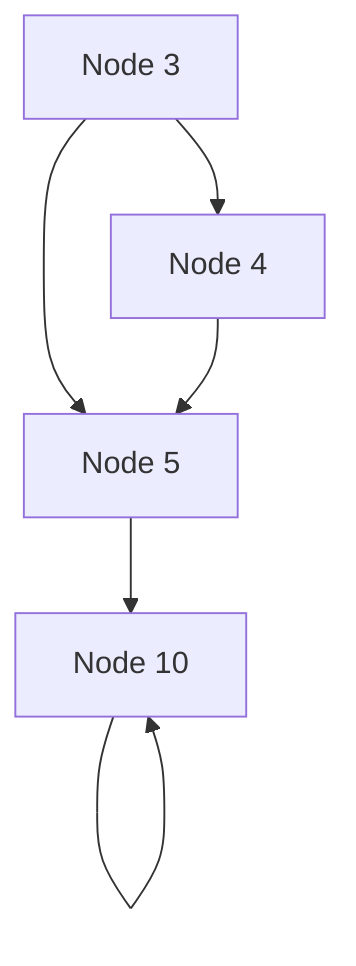

B

flowchart

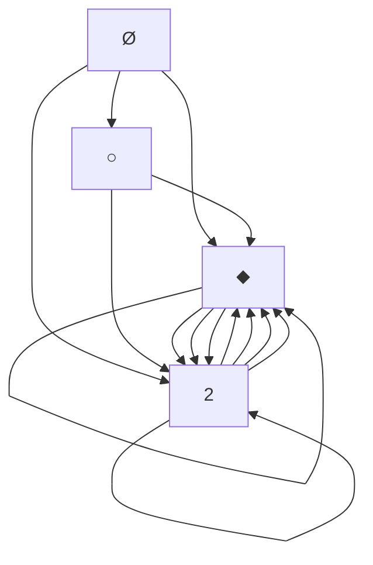

---

第一节 人类性状的遗传模式

195

症状显著不同的另一种疾病——脊髓延髓肌营养不良。

## 7. 新生突变

新生突变（de novo mutation）是指父母的体细胞中不携带，但子女携带的突变。一般来说可以分为两种情况:一种是父母其中一方的生殖腺中出现的新生突变，往往会造成不止一个子代携带有相同的新生突变；另一种是合子形成之后发生的新生突变，通常只是在某一个子代中偶然出现新生突变。

新生突变本身很罕见，然而在严重的显性疾病或X连锁疾病的背景下，新生突变会显得很常见，因为它们可能是所有病例中大部分个体的致病原因。如果严重的显性疾病或X连锁疾病能够在人群的多个世代中持续出现，那么必须由新生突变产生新的疾病等位基因来补偿因为受到选择而被去除掉的疾病等位基因。具体情况如下:

（1）一种完全外显的致死性显性疾病必然总是由新生突变引起的，因为致病突变无法在世代中传递下去，例如致死性发育不全（thanatophoric dysplasia, OMIM#187600）。
（2）对于非致死性但非常严重的显性疾病也会存在同样的问题，只是程度可能会轻一些，例如软骨发育不全侏儒症（achondroplastic dwarfism，OMIM#100800）。
（3）严重的X连锁隐性疾病也有相当数量的新生突变，这是因为当致病等位基因出现在男性中时会受到自然选择的影响。
（4）与上述情况相反，常染色体隐性遗传家系往往不会受到新生突变的显著影响。虽然毫无疑问会发生新生突变，但是由于突变等位基因本身可以通过无症状携带者在世代中传递，所以可以合理推测患病孩子的父母通常都是携带者。

以上这些基本孟德尔式系谱中的复杂情况强调了一个事实:即在所有变异中只有非常小的一部分可以直接决定表型且具有很高的外显率。典型的孟德尔式系谱实际上只常见于罕见病中。基因本身总是符合孟德尔式遗传的，但表型不是。外显率降低和可变表现度显示了其他座位上的基因型（所谓的“修饰基因”）、非遗传因素，甚至简单的巧合都会影响表型。随着这些其他因素的增加会达到一个临界点，这时甚至无法用孟德尔式遗传来描述一种性状或疾病。就像图6-1中展示的一样，所有的遗传决定因素组成了一个谱系，从完全外显的单基因性状，到由很多基因座共同作用决定的多基因性状。

## 三、多基因性状与阈值理论

人群之间普遍存在差异的遗传性状，例如身高、体重等，也包括与健康相关的各种疾病，例如糖尿病、肥胖、心脏病和精神健康问题等，这些差异绝大多数从未表现得类似于孟德尔性状。1918年，罗纳德·费希尔（Ronald A. Fisher，1890—1962）发表论文指出由大量孟德尔式因子控制的性状，也就是多基因性状，正如生物统计学家所描述的那样呈现出连续性、数量差异和家族相关性。后来，道格拉斯·福尔克纳（Douglas S. Falconer）将这一模型拓展到覆盖表现为非此即彼的非孟德尔性状，例如出生缺陷。费希尔和福尔克纳的工作为人类遗传学奠定了一个统一的理论基础。

---

196

第六章 人类遗传学与疾病

图 6-8 随着基因座的增加，性状的分布逐渐近似正态分布

bar

| Category | Value |
| --- | --- |
| aa | ~10 |
| Aa | ~35 |
| AA | ~10 |

bar

| Category | Relative Frequency |
| --- | --- |
| aabb | ~10% |
| Aabb aaBb | ~45% |
| AAbb AaBb aaBB | ~65% |
| AABb AaBB | ~45% |
| AABB | ~10% |

bar

| Category | Value |
| --- | --- |
| aabbcc (Dark Blue) | ~10 |
| Aabbcc aaBbcc aabbCC (Light Blue) | ~35 |
| AAbbcc AaBbcc AabbCc aaBbCC (Medium Blue) | ~65 |
| AAbbcc AaBbcc CaaBBCC (Light Green) | ~95 |
| AABBcc AaBBCC aaBbCC (Green) | ~85 |
| AABBCC AaBbcc CaaBBCC (Dark Green) | ~40 |
| AABBCC AaBbcc CaaBBCC (Light Green) | ~20 |
| AABBCC (Dark Green) | ~10 |

text_image

D.很多基因座

任何依赖于大量微小因素（无论它们是否是遗传因素）共同作用的可变数量性状都会在人群中呈现出正态分布（高斯曲线）。图6-8给出了一个遗传性状的高度简化模型。图中我们先假设某个性状由1个基因座上的等位基因决定，然后2个，3个……最后很多个。随着越来越多基因座的加入，我们可以看到两个结果:

（1）基因型和表型之间简单的一一对应关系消失了。除了极端表型之外，无法直接从表型推断出基因型了。
（2）随着基因座的增加，性状的分布越来越像高斯曲线。加入微小的环境变异就可以将3个基因座的分布抚平成高斯曲线。

即使考虑到更为复杂的情况，包括显性效应的存在和等位基因频率的变化，仍然可以得出相同的结论。

## 1. 遗传率

图6-8D中的正态分布曲线（高斯曲线）仅有两个参数是特异的——均值和方差。表型的总方差 $V_{\mathrm{P}}$ 是由于各种原因引起的方差之和，包括环境方差 $V_{\mathrm{E}}$ 和遗传方差 $V_{\mathrm{G}}$ 其中遗传方差 $V_{\mathrm{G}}$ 又可以分为由于单纯加性效应引起的方差 $V_{\mathrm{A}}$ 和显性效应方差 $V_{\mathrm{D}}$ 。遗传率（heritability，$h^2$）是指在整个表型方差中遗传方差所占的比例，即 $V_{\mathrm{G}} / V_{\mathrm{P}}$ 。严格说来，$V_{\mathrm{C}} / V_{\mathrm{P}}$ 称为广义遗传率（broad heritability），而 $V_{\mathrm{A}} / V_{\mathrm{P}}$ 称为狭义遗传率（narrow heritability）。即:

表型方差 $(V_{\mathrm{P}})=$ 遗传方差 $(V_{\mathrm{G}})+$ 环境方差 $(V_{\mathrm{E}})$

遗传率（广义）= $V_{G}/V_{P}$

遗传方差（ $V_{\mathrm{G}}$ ） $=$ 加性效应方差（ $V_{\mathrm{A}}$ ） $+$ 显性效应方差（ $V_{\mathrm{D}}$ ）

遗传率（狭义）= $V_{A}/V_{P}$

多基因遗传性状或疾病是遗传因素和环境因素共同作用的结果，其中遗传因素作

---

第一节 人类性状的遗传模式

197

用的大小可以用遗传率来衡量，常用百分数（%）表示。遗传率越大，表明遗传因素对疾病发生的作用越大。有些疾病的遗传率可以高达70%\~80%，表明遗传因素在其中起重要作用，环境因素的作用相对较小。反之，如果疾病完全由环境因素所决定时，遗传率为0，不会出现明显的家族聚集现象。表6-1列出了一些常见的多基因遗传病的患病率和遗传率。

表 6-1 常见多基因遗传病的群体患病率、先证者一级亲属患病率、性别比和遗传率

<table><tr><td>疾病</td><td>群体患病率/%</td><td>先证者一级亲属患病率/%</td><td>性别比(男:女)</td><td>遗传率/%</td></tr><tr><td>唇裂±腭裂</td><td>0.17</td><td>4</td><td>1.6</td><td>76</td></tr><tr><td>腭裂</td><td>0.04</td><td>2</td><td>0.7</td><td>76</td></tr><tr><td>脊柱裂</td><td>0.3</td><td>4</td><td>0.8</td><td>60</td></tr><tr><td>无脑儿</td><td>0.5</td><td>2.8</td><td>-</td><td>35</td></tr><tr><td rowspan="2">先天性心脏病</td><td rowspan="2">0.1~0.2</td><td>男性先证者4</td><td>0.2</td><td>70</td></tr><tr><td>女性先证者1</td><td></td><td></td></tr><tr><td rowspan="2">先天性幽门狭窄</td><td rowspan="2">0.3</td><td>男性先证者2</td><td>5.0</td><td>75</td></tr><tr><td>女性先证者10</td><td></td><td></td></tr><tr><td rowspan="2">先天性巨结肠</td><td rowspan="2">0.02</td><td>男性先证者2</td><td>4.0</td><td>80</td></tr><tr><td>女性先证者8</td><td></td><td></td></tr><tr><td>先天性畸形足</td><td>0.1</td><td>3</td><td>2.0</td><td>68</td></tr><tr><td>精神分裂症</td><td>0.5~1.0</td><td>10~15</td><td>1</td><td>80</td></tr><tr><td>原发性癫痫</td><td>0.36</td><td>3~9</td><td>0.8</td><td>55</td></tr><tr><td>原发性高血压</td><td>4~10</td><td>15~30</td><td>1</td><td>62</td></tr><tr><td>冠心病</td><td>2.5</td><td>7</td><td>1.5</td><td>65</td></tr><tr><td>青少年型糖尿病</td><td>0.2</td><td>2~5</td><td>1</td><td>75</td></tr><tr><td>哮喘</td><td>1~2</td><td>12</td><td>0.8</td><td>80</td></tr><tr><td>消化性溃疡</td><td>4</td><td>8</td><td>1</td><td>37</td></tr><tr><td rowspan="2">强直性脊椎炎</td><td rowspan="2">0.2</td><td>男性先证者7</td><td>0.2</td><td>70</td></tr><tr><td>女性先证者2</td><td></td><td></td></tr><tr><td>原发性肝癌</td><td>0.05</td><td>5.45</td><td>3.5</td><td>52</td></tr></table>

值得指出的是:

（1）遗传率与遗传方式完全不同。遗传方式（例如:常染色体显性遗传、多基因遗传等）是一个性状的固有特点，但遗传率不是。
（2）疾病的遗传率是根据特定环境中特定人群的患病率估算出来的，在不同的环境和人群中遗传率会有所不同。
（3）遗传率是一个群体统计量，不能应用到具体的个体。例如某种疾病的遗传率为 $50\%$ ，仅说明在该病的总变异中，遗传因素占 $50\%$ 的作用，而不能说明某个患者

---

198

第六章 人类遗传学与疾病

violin

| Category | 一般人群中的易感性分布 (Peak) | 受累者同胞中的易感性分布 (Peak) |
| --- | --- | --- |
| 低易感性 | ~0.1 | ~0.05 |
| 高易感性 | ~0.9 | ~0.8 |

图6-9 多基因病易感性具有阈值效应

患病率的 50% 是由遗传因素决定。

## 2. 易感性和阈值

虽然一些连续可变的性状，例如血压、体重指数等对于公共健康很重要，但是大家更加关注那些非此即彼性状，如各种疾病和出生缺陷。它们虽然倾向于在家族中传递，但是又不符合孟德尔式系谱的遗传方式。福尔克纳为非孟德尔性状的遗传提供了一个重要的概念工具，将多基因理论拓展到非此即彼的不连续性状中，其中关键的思想是哪怕对于一个非此即彼的性状也存在连续可变的易感性（susceptibility）。一个胎儿可以患或者不患唇腭裂，但是每个胚胎都对唇腭裂有

一定的易感性。易感性可高可低，它是由多基因决定的并且在人群中呈现出正态分布（高斯曲线）。伴随多基因易感性还存在一个阈值（threshold；图6-9）。当胚胎的易感性超过一个关键的阈值时，就会发展成唇腭裂，而易感性低于阈值，哪怕只是低一点点，都会长出正常的颚板。

阈值模型帮助解释了非孟德尔病的再发风险为何会在不同家族中存在差异。受累者必定是很不幸地具备了一些高易感性等位基因的组合。与他们共享基因的亲属一般来说易感性也会增加，反映为易感性曲线的偏移程度（图6-9中粉色曲线相对于黑色曲线向右偏移）。但是其亲属与人群易感性均值的差异取决于共享基因所占的比例。因此多基因阈值性状倾向于在家族中传递。此外，与孟德尔性状完全不同的是，多基因病的再发风险依赖于家族史。育有多个受累子女的父母一般来说比只生育了一个受累子女的父母携带有更多的高风险等位基因。阈值本身是固定的，但是平均易感性和再发风险会随着之前生育患儿数量的增加而增加。

阈值可能具有性别特异性。先天性幽门狭窄在男孩中的发病率比女孩高5倍。对于生育了患病女孩的父母，他们的子女再发风险比生育了患病男孩的父母要高得多。我们可以通过阈值模型来理解这一现象（图6-10）。女孩的发病阈值肯定比男孩要高得多，所以才会出现发病率显著低于男孩。那么女孩如果患病，一般来说易感性曲线要比男孩产生更严重的偏移，因此患病女孩的亲属比患病男孩的亲属的平均偏移也要高一些，与之相应的再发风险也会提高。虽然在每个案例中男孩的患病概率仍然是女孩的5倍，但这是因为男孩的发病阈值本来就低于女孩。

## 3. 多基因病再发风险预测

遗传咨询师在预测多基因病的再发风险时是基于由群体调查获得的经验风险。出于这个目的，使用最近的数据和来源于问询者同一个群体的数据是非常重要的。不同的群体会有不同的易感因素谱系，而且在不同时期不同群体的环境因素差别也很大。这里我们讨论的模型并不是为了提供实际的风险预测，而是提供一个理论框架来理解

---

第一节 人类性状的遗传模式

199

violin

| Category | Description |
| --- | --- |
| 一般人群中的易感性分布 | 黑色曲线 |
| 受累男孩的同胞中的易感性分布 | 蓝色曲线 |
| 受累女孩的同胞中的易感性分布 | 红色曲线 |

图6-10 具有性别特异性阈值的易感性曲线

不同的家族史和家庭结构将如何影响多基因病的再发风险。

## （1）受累者亲属的再发风险与遗传率和群体患病率密切相关

多基因病的再发风险与遗传率有关，遗传率越高，说明在疾病表型差异中遗传因素所占比例越大，因而亲属的再发风险越高。如图6-14中蓝色系列点所示。当群体患病率为 $0.4\%$ 时，遗传率为0，一级亲属患病率和群体患病率接近，也是 $0.4\%$ 左右；遗传率为 $50\%$ 时，一级亲属患病率约为 $3\%$ ，是群体患病率的7.5倍；遗传率为 $100\%$ 时，一级亲属患病率约为 $15\%$ ，是群体患病率的37.5倍。

在遗传率相同的情况下，多基因病的群体患病率不同，患者亲属的发病风险也不同。如果某种多基因病在一般群体中的患病率越低，说明其阈值越高，患者超过阈值而发病，说明其携带有更多的易感基因，因而患者亲属的再发风险相对增高。反之，在一般群体中的发病率越高，则阈值越低，患者携带有较少的易感基因，亲属再发风险也相对降低。如图6-11中红色系列点所示，对于遗传率为50%的多基因病，当群体患病率为0.1%时，患者一级亲属患病率约

scatter

| 群体患病率/% | 患者一级亲属患病率/% | 遗传率/% |
| --- | --- | --- |
| 0.1 | 1.2 | 40 |
| 0.4 | 0.4 | — |
| 0.4 | 3 | — |
| 0.4 | 12 | 100 |
| 1.0 | 5.5 | 80 |
| 10 | 20 | 100 |

图6-11 再发风险与遗传率和群体患病率之间的关系

---

200

第六章 人类遗传学与疾病

为 $1.2\%$ ，是群体患病率的12倍；当群体患病率为 $1\%$ 时，患者一级亲属患病率约为$5\%$ 、是群体患病率的5倍；当群体患病率为 $10\%$ 时，患者一级亲属的患病率为 $25\%$ 只是群体患病率的2.5倍。

## (2) 受累者亲属的再发风险与亲属级别有关

多基因病有明显的家族聚集倾向，患者亲属的患病率必定高于群体患病率，然而随着亲属级别的降低，两者共享的遗传因素的比例下降，再发风险也相应地迅速降低，向群体患病率靠拢。例如:畸形足的群体患病率为0.1%，同卵双生患病率为30%（300×），一级亲属患病率为2.5%（25×），二级亲属患病率为0.5%（5×），三级亲属患病率为0.2%（2×）。

## (3) 受累者亲属的再发风险与亲属中患病人数有关

对于多基因病，一个家庭中的患病人数越多，则亲属的再发风险越高。例如，唇腭裂的群体患病率为 $0.17\%$ ，遗传率 $76\%$ ，一对表型正常的夫妇第一胎生育了一个唇腭裂患儿，则再次生育唇腭裂患儿的风险为 $4\%$ ；如果他们第二胎又生了一个唇腭裂患儿，则第三胎生育唇腭裂患者的风险上升到 $10\%$ 。更多患儿的出生并没有改变患病风险本身，只是提示这对夫妇携带更多唇腭裂的易感基因或暴露于更强的环境因素之中。他们虽未发病，但易感性更接近阈值，因此使得一级亲属的再发风险增高。这一点与单基因病截然不同，例如常染色体隐性遗传病，无论一个家庭已生育了多少个患儿，再发风险理论上都仍然是 $25\%$ ，不会因为患儿数目的增多而增加。

## (4) 受累者亲属的再发风险与疾病的严重程度有关

多基因病的遗传基础是微效基因的累加效应。如果患者病情严重，说明其易感性远远高于阈值，可能携带有更多的易感基因，那么其父母所带有的易感基因也多，易感性也更接近于阈值，再生育时其后代的患病风险就相应地增高了。例如，单侧唇裂患者的同胞再发风险为 $2.46\%$ ，单侧唇裂合并腭裂的患者同胞再发风险为 $4.21\%$ ，双侧唇裂加腭裂的患者同胞再发风险为 $5.74\%$ ，这说明缺陷越严重，潜在的易感性因素越多，这也与单基因病有所不同。在常染色体隐性遗传病中，无论病情轻重程度如何，患者同胞的再发风险仍为 $25\%$ 。

## 第二节 鉴定单基因病的致病基因

基因组序列本身无法给出变异是如何引起表型或者哪个变异可以致病这样的信息，因此研究人员需要建立起基因型与表型之间的联系。目前最为常用的方法是对患者的外显子组（所有蛋白质编码基因的外显子）或者全基因组进行测序。通常在外显子组中可以获得约20 000个变异，在全基因组中可以获得约4 000 000个变异。这些变异需要通过一些方法进行筛选直到鉴定出那个真正的致病突变。

二代测序技术出现之前，在庞大的基因组中寻找致病变异的工作要艰难得多。于是采用的策略是尽可能接近未知致病变异所在的染色体位置以最小化鉴定变异的测序

---

第二节 鉴定单基因病的致病基因

201

工作量——这一过程就是所谓的定位克隆（positional cloning）。常见的定位克隆方法是通过对包含多个患者的家系进行连锁分析以确定染色体区域。

在本节中我们将会详细阐述鉴定单基因病致病突变的各种方法的原理，包括最早的不依赖于定位的功能克隆策略，后来的定位克隆，以及现在常用的全外显子或全基因组测序。我们会着重于连锁分析和定位克隆的原理，因为连锁分析对于培养遗传学思维至关重要。而且连锁分析在目前的全基因组测序研究中仍然会占据一席之地，因为它是挑选适合测序的个体和减少需要过滤的变异量的强有力工具。

## 一、功能克隆

历史上第一个致病基因是通过不依赖定位的方法鉴定出来的。因为在那时没有遗传作图信息及相关技术，所以必须依赖于对基因产物本身的认识找到候选基因，例如镰形贫血病中突变的 $\beta$ 珠蛋白和苯丙酮尿症代谢过程中的苯丙氨酸羟化酶等。

1978年，研究人员利用DNA探针进行体细胞杂交将β珠蛋白基因定位于人类第11号染色体。DNA探针的制备是由蛋白质测序得到的氨基酸序列反推出cDNA序列，但是由于密码子的简并性，使用的探针也是简并寡核苷酸，即所有可能序列的混合物。由于在混合物中只有一条寡核苷酸符合真正的序列，所以可以采用简并核苷酸筛选文库以钓取正确的cDNA序列，以减少不同探针的数量，提高鉴定出正确靶序列的概率。1983年研究人员合成了两条包含19个核苷酸的探针，其中一个与正常β珠蛋白基因的5'端互补，另一个与镰形细胞中的β珠蛋白基因互补。来自正常纯合子的DNA仅可与第一种探针杂交，镰形贫血病患者的DNA仅能与第二种探针杂交，镰形贫血病携带者，也就是杂合子DNA可以显示出与两者杂交的条带（图6-12）。

除了简并探针，另一条途径是利用能够获得的微量蛋白质制造该蛋白质的抗体，

然后利用抗体通过免疫沉淀获取编码基因的 mRNA 序列。1982 年编码苯丙氨酸羟化酶的 mRNA 就是通过免疫沉淀从多聚核糖体中发现的。通过克隆 cDNA 到表达载体中构建出 cDNA 表达文库，利用宿主细胞表达出蛋白质，然后采用适当的抗体进行文库筛选鉴定。但前提是该蛋白质不会对宿主细胞产生毒性，而且抗体具有足够高的特异性。

动物模型也曾为鉴定致病基因提供了帮助。如果小鼠突变体和表型相似的人类疾病定位在染色体上相应的位点，那么一旦克隆了小鼠基因，则其人类同源基因就自然成了候选基因。或者从小鼠中鉴定了致病基因，然后分离出相应的人类同源基因并且通过荧光原位杂交进行染色体定位，那么它就会成为定位于该位点的相关疾病的候选基因。2型Waardenburg综合征（OMIM#193510）的致病基因MITF就是这样被鉴定出来的。但是这种方法需要依赖于染色体定位信息，在没有任何

text_image

A
Hβ19A'
B
Hβ19S
—HβGI — βAβA — βAβS — βSβS —
— βAβA — βAβS — βSβS
→
L-34586 L-34587

图 6-12 β 珠蛋白基因探针杂交结果

数据来源于 Proc Natl Acad Sci U S A., 1983, 80 (1278-282。

---

202

第六章 人类遗传学与疾病

定位信息的情况下，把动物模型中鉴定的基因直接在人类患者中进行检测是比较冒险的方法，但也不乏有成功的案例。例如:Dom小鼠是显性遗传巨结肠模型，与人类Waardenburg IV型综合征的表型非常相似，都表现为先天性巨结肠合并色素异常和听力丧失。由于该病非常罕见，因此家系太小无法进行定位克隆，于是直接在一组Waardenburg IV型综合征患者中检测SOX10基因上是否存在突变。尽管不是所有患者中都发生了该基因的突变，但SOX10基因突变的确是Waardenburg IV型综合征的致病基因之一。

不依赖定位的候选基因也可以通过表达差异来进行筛选，对比患者与对照组的mRNA得到在疾病中差异表达的基因列表，再从中寻找致病基因。此外，不依赖定位的DNA序列信息还可以用于克隆携带三核苷酸重复扩延的动态突变基因。动态突变可以引起遗传性神经疾病，通常这些疾病表现为早现遗传——后代在较早的年龄发病，并且严重性在世代中不断加强。如果所研究的疾病具有这些特征，则有必要从患者的DNA中直接筛查三核苷酸重复。该方法曾经成功应用于脊髓小脑共济失调综合征（SCA8，OMIM#608768）中的新扩延重复基因的鉴定。

## 二、连锁分析和定位克隆

在20世纪80—90年代，大多数常见单基因病的致病基因都是通过定位克隆鉴定出来的。图6-13展示了定位克隆的实验流程，其中最为关键的一步就是通过连锁分析确定精确的染色体位置。在连锁分析中，对一系列分散在基因组中的遗传标记进行检测，以发现在一系列家系中传递的未知致病变异。如果减数分裂重组很少或者从未将两个遗传标记分开，那么肯定它们相互之间离得很近或者位于染色体的同一位置。

每一次减数分裂中都会发生重组。在减数分裂I前期，同源染色体联会，染色单体通过交叉交换部分片段。虽然在分子水平上人类同源染色体之间的交叉集中于3000多个重组热点，但粗略来说，可以认为交叉是随机分布于染色体上的。

理论上，人类基因的遗传定位和果蝇或者其他任何有性繁殖的二倍体生物的遗传定位是一样的。然而实际上存在两个明显的差异:第一，我们必须依赖于所能够获得的人类家系，它们与可以直接进行的动物杂交实验不同，往往并不是理想的结构，常常会给解读带来困难；第二，在果蝇中我们可以通过一种表型或疾病来定位另一种表型或疾病，例如通过翅膀形状变异来定位眼睛颜色变异，但在人类中单基因病非常罕见，所以同时具有两种表型/疾病且能够共分离的家系就更加罕见了。即使我们能够发现符合上述条件的家系，它也可能因为规模太小而不能给出有效的数据量。

所以为了定位人类疾病或者确定任何其他不常见表型的遗传座位，我们需要收集

图6-13 通过定位克隆鉴定单基因病的致病基因

flowchart

---

第二节 鉴定单基因病的致病基因

203

## 知识窗6-2

## 适合进行连锁分析的遗传标记需要满足的条件

- 它需要符合孟德尔式遗传，而且最好是共显性的，因为这样就可以直接从表型推断出基因型。
- 它可以方便而且便宜地从容易得到的材料中获取，例如:从漱口水中获取就比从脑部穿刺样本中获取可行性更高。

- 决定性状的基因座具备较高的多态性，这样任何一个随机选取的个体都很有可能是杂合的。
- 它最好是由成千上万均匀分布于整个基因组上的这种标记组成的合集。

包含感兴趣的性状的家系，然后找到其他同样在这些家系中传递的某种孟德尔性状，或者说遗传标记（知识窗6-2），这样才可以在个体中找到重组体和非重组体。

早期尝试使用的遗传标记是蛋白质多态性，例如血型和组织相容性抗原。在1980年发表的具有里程碑意义的论文中指出DNA变异对于人类基因定位的巨大应用潜力。最初使用的DNA变异检测方法是限制性片段长度多态性（restriction fragment length polymorphism，RFLP）:因为特定位点的DNA变异会产生或者消除限制性内切酶的识别位点，所以可以通过用限制性内切酶消化基因组DNA，检测片段长度的变化来显示出相应的DNA变异。从20世纪90年代中期开始，人类连锁分析主要采用多重荧光标记的引物扩增微卫星区域，这样可以直接在毛细电泳仪上对扩增产物进行基因分型。21世纪初，SNP芯片开始应用于基因分型，对每个家系成员进行基因分型可以检测到500000个SNPs。在二代测序技术得以广泛应用之后，全基因组测序数据也可以应用于基因分型。

## 1. 连锁分析

当我们收集到某个单基因病的家系，并采用合适的遗传标记对家庭成员进行基因分型之后，我们如何知道是否能够发现连锁呢？实际上这一问题包含了2个方面:

(1) 我们如何计算出重组值?
（2）我们应该采用哪些统计检测方法来确定重组值是否显著偏离0.5这个不发生连锁的无效假设预期值呢？

我们可以根据推测基因座是连锁（重组率 $= \theta$ ）或者不连锁（重组率 $= 0.5$ ）来计算这个家系的总体似然性。这两种似然性的比值是连锁比，它的对数就是Lod值（logarithm of odds），标记为 $Z$ 。1955年研究人员指出Lod值是估算家系连锁最有效的统计方法，并且推导出针对不同标准家系结构的Lod值计算公式。在2015年的一篇文章中描述了可以使用不同的连锁计算程序来计算Lod值，并且给出了这些计算程序的网址。

$$
\mathrm{Lod} = \lg \frac {\text {两基因座连锁且相距} \theta \text {值的似然性}}{\text {两基因座不连锁但相距} \theta \text {值的似然性}}
$$

---

204

第六章 人类遗传学与疾病

line

| \(\theta\) | Lod值 |
| --- | --- |
| 0.1 | ~-0.5 |
| 0.25 | ~3.8 |
| 0.5 | 0 |

图6-14 Lod值曲线

①无重组个体（$\theta = 0$）时存在连锁（$Z > 3$）；

② 当 $\theta = 0.23$ 时存在连锁（ $Z > 3$ ）；

③ $\theta < 0.12$ 时排除连锁（ $Z < -2$ ， $\theta > 0.12$

时无法确定是否存在连锁；④在 $\theta$ 为任何值时都无法确定是否存在连锁，需要补充数据。

作为重组率的函数，Lod值可以从一系列的 $\theta$ 值中计算出。结果可以用相对于重组率的Lod值曲线来表示。最有可能的重组率是Lod值最高的时候。如果没有重组，那么Lod值在 $\theta = 0$ 时达到最大。如果有重组，$Z$ 会在最有可能的重组率的地方达到峰值（图6-14）。

第二个问题是统计显著性的阈值。对于很多统计学家来说，通常使用 $P < 0.05$ 作为显著性阈值，但在这里 $Z = 3.0$ 是接受连锁的阈值，它有$5\%$ 的概率产生1类错误（错误地拒绝了零假设，即假阳性）。之所以选择这么严格的阈值，是因为可选的位点来源于22对常染色体，这两个遗传座位几乎不可能正好来源于同一条染色体，更不用说是离得很近的连锁位点。如果某件事情基本不可能发生，那么我们需要有更强的证据来说服我们它是对的。经过贝叶斯量化之后的结果表明 $Z = 3.0$ ，也就是$1000:1$ ，实际上相当于传统的 $P = 0.05$ 的统计阈值，因此 $Z = 3.0$ 被设定为接受连锁的阈值。如果 $Z < -2$ ，可以认为否定连锁。对于孟德尔性状， $Z$ 值在-2和 $+3$ 之间是无法得出明确结论的。但是在全基因组测序时代，小家系中Lod值即使远低于3.0也是有用的，它可以在分析外显子测序数据时指出应该优先考虑的基因组区域。

## 2. 定位克隆

在 1985—2000 年期间，绝大多数常见的常染色体显性和 X 连锁疾病都通过上述的家系连锁研究成功定位了致病基因。同样的，对于一些常见的常染色体隐性疾病，例如囊性纤维化，只要有可能找到足够多的不止一个受累者的家系，也可以通过同样的流程定位致病基因。一旦确定了足够小的候选染色体区域，就可以依据与表型的相关性对这一区域的基因进行测序。在候选区域发现序列变异之后，研究者还需要一些额外的信息去确认它的确会导致在家系中传递的疾病。部分证据来自于确定该变异位于与表型连锁的基因座，而且该变异的确影响了这个基因的表达和功能。家系中所有患者都携带该变异实际上并不增加可靠性——它仅仅是再次确认了连锁分析的结果。强有力的证据来源于在完全无亲属关系的其他患者中对靶基因进行测序，结果无亲属关系的其他患者中也都在该基因携带变异而健康对照中完全没有变异。

这一验证过程对于功能丧失型（loss-of-function）变异导致的疾病非常有用，这些疾病通常具有广泛的等位基因异质性，无亲属关系的患者往往在同一个基因中携带不同类型的功能丧失型变异。比较理想的情况是这其中包括一些确定无疑的基因功能丧失型变异，例如:缺失、剪接位点突变、无义突变或者移码突变。与之相对应的是很多该基因中的错义突变往往可能只是良性的多态位点。

因为功能获得型（gain-of-function）变异导致的疾病往往很少或者完全没有等位基因异质性。这就需要在很大一群患者和对照中展示出非常强的变异与疾病之间的相关性。功能研究实验可以提供额外的证据。

无论如何，早期的突变检查常常是不够严格的。现在在GnomAD数据库中保存有

---

第二节 鉴定单基因病的致病基因

205

## 知识窗6-3

## 根据变异对于基因功能的影响可以分为两大类

1. 功能丧失型:基因产物或活性减少或消失，包括:

\- 无效等位基因（Null allele or amorph）:无产物

\- 亚效等位基因（hypomorph）:产物数量减少或活性降低

\- 负效等位基因（antimorph）:产物可拮抗正常产

物功能

2. 功能获得型:基因产物具有明显的异常功能，包括:

\- 超效等位基因（hypermorph）:产物数量或活性增加

\- 新效等位基因（neomorph）:新产物或新功能

极大数量的健康对照外显子测序数据，这些数据证实很多早期研究中标记为致病性变异其实与健康对照中出现的频率是一样的。有可能在大多数案例中鉴定出了正确的基因座，但是有部分变异被错误地认为是致病性的了——实际的致病性变异可能在该基因的其他地方或者甚至在另一个基因上。

寻找反复出现的祖先单倍型为罕见的单基因隐性遗传疾病的定位提供了新的方法。最早在1994年提出利用同合子（autozygosity）进行疾病的定位。同合子是指来源于共同祖先的序列完全相同的纯合子。在一个隔绝的荷兰渔村中，3个人都患有同一种罕见的隐性疾病——良性复发性肝内胆汁淤积症（OMIM#243300）。这3位患者并不知道互相之间是否存在亲属关系，但是根据村子的历史和隔绝程度，他们很可能在大约6代之前共有一位祖先。对这3位患者及其父母的256个微卫星标记进行基因分型。在分散于基因组中的14个染色体区域中2个相邻的标记都是纯合的，但是对这些片段中的更多标记进行分型后发现只有一个区域里全部的精细单倍型都是共享的；其他13个区域虽然初始的2个微卫星标记显示出一致性，但是所有新增加的遗传标记都不具有一致性。唯一具有完全一致性的区域是位于染色体18q21的一个$19\mathrm{cM}$ 的片段（图6-15）。研究者计算了在这么长的距离中6个遗传标记中的5个随机出现且分型一致，但不是因为他们也都携带了同一个疾病等位基因的可能性只有$5\times 10^{-7}$ 。随后，对世界上其他地方患有同样疾病的家系进行了研究。在每个家系中

都发现了共享的18q21单倍型，但是不同家系中各自的单倍型是不同的。不同家系共享单车倍型的交集只有 $1\mathrm{cM}$ 的区域，从而最终鉴定出了该疾病的致病基因。

现在我们可以使用 SNP 芯片或者全基因组测序数据来进行同合子定位。经常碰到的问题是不同的近亲婚配家系产生的同一种隐性疾病患者是否共享一段完全纯合的区域，而不是他们是否共

bar_stacked

| Category | 共享等位基因 | 无关等位基因 |
| --- | --- | --- |
| 个体1 | 13 | — |
| 个体2 | 13 | — |
| 个体3 | ~8.5 | ~2.5 |

图6-15 同合子定位

数据来源于Nat Genet，1994，8:380-386。

---

206

第六章 人类遗传学与疾病

text_image

家系
个体
1 2 3 4
1 1 2 1 1 2
1 2 3 4
1 1 2 1 1 2

图 6-16 采用 SNP 芯片绘制的同合子图谱

其中杂合子用黄色表示，纯合子用黑色表示，灰色部分不包含 SNP。数据来源于 Am J Hum Genet，2010，87:354-364。

享某一种特定的单倍型。无亲缘关系的个体可能在不同的等位基因上纯合，但是纯合发生的区域应该是相同的。即使存在患有同一种疾病的不同家系的突变落在不同基因上的风险，研究无亲缘关系个体的分辨率也是最高的。图6-16中展示了一个典型案例。对来源于4个无亲缘关系的近亲婚配家系中的6个个体进行研究，在同一个家系内，患者共享相似的大片段纯合。图中第2、3列和第5、6列分别是来源于同一个家系中的两个人，但是在家系之间只有很小的重合（比较第1、2、4、6列），这提供了致病基因的精确定位，可以方便地进行鉴定。

## 3. 基于二代测序的致病基因鉴定策略

随着测序成本的不断下降，全基因组测序开始应用于常规的基因鉴定，但是截至目前大部分还是采用更为便宜的全外显子组测序而不是全基因组测序。2009年研究人员报道了他们是如何通过对12个人的全外显子组测序来找到之前鉴定出的致病变异。这从理论上证实了全外显子组测序可以用于鉴定疾病基因。不久之后，该研究组又使用全外显子组测序鉴定了Miller综合征（OMIM#263750）中的突变基因。随后的几年中涌现了大量的单基因遗传病致病基因鉴定成果，特别是罕见的隐性疾病和散发的显性疾病这些之前的基因鉴定方法无从下手的类型（图6-17）。

实际上，通过外显子捕获获得的测序数据库中所有的外显子并不是均匀覆盖、平等呈现的。有些外显子的捕获和/或扩增的效率会显著高于其他外显子。含有过高或过低GC含量的外显子通常呈现不足。对于临床外显子筛查，通常推荐总体测序深度为 $80\times$ 。目前已经发展出各种技术来降低这种外显子覆盖不平衡现象，但即使这样仍然可能会有一些序列在分析时无法通过质量检测。

一个可以解决外显子覆盖不平衡的方法是舍弃外显子捕获而直接进行全基因组测

图6-17 通过定位克隆和二代测序发现的单基因遗传病致病基因

数据来源于 Bamshad et al., Am J Hum Genet, 2019。

---

第二节 鉴定单基因病的致病基因

207

序，但在进行生物信息学分析时局限于外显子区域，不去看大量无法解读的非编码序列变异。这是因为寻找外显子变异的效率显然要高得多。2014年的一项研究表明了这一方法的价值。在大量严重智力缺陷的患者中有很多可以归为Nijmegen群。通过检测拷贝数变异找到了一些病例的致病原因，外显子测序找到了另外一些人的病因，但是仍然还有一些人的致病原因不明。对50个这类原因不明的智力缺陷患者和他们的健康父母进行全基因组测序，测序深度为 $80\times$ ，这是常规临床全基因组筛查测序深度的两倍。该研究共计鉴定出了84个编码区的新生突变，其中的65个在之前的外显子测序中由于覆盖率太低而未被检测出来。50名患者中的21人给予了阳性诊断:13人有新生显性点突变，7人有新生拷贝数变异，1人是隐性疾病的复合纯合子。所有这些变异在理论上都应该可以经由之前的SNP芯片和外显子组测序检测出来，但是即使研究人员具有丰富的经验，它们还是被错过了。这项研究彰显了采用全基因组测序检测外显子变异的巨大效力。如果全基因组测序越来越便宜，它有可能成为更为常用的基因检测方法。

## 4. 确定候选基因是致病基因

如果患者患有某种孟德尔病，那么检测出的这些变异中应该只有1个是该病的致病原因。我们如何从长长的变异列表中筛选出致病变异呢？经验告诉我们绝大多数孟德尔病是由蛋白质编码基因中的错义突变、无义突变、移码突变或剪接突变引起的。虽然常常会出现例外，特别是引起错误剪接的变异，它们经常出现在意料之外的地方，但是最初的搜寻仍然会聚焦于改变蛋白质氨基酸序列的变异。因此，一旦通过各项质检从原始数据中过滤出真实的变异列表，进一步的筛选一般包括知识窗6-4中的步骤，但不一定严格按照这个顺序。

在临床上，对单个患者的外显子序列应用这些方法进行过滤，如果在少量留下

## 知识窗6-4

## 对二代测序获得的变异进行过滤筛选的一般步骤

1. 挑选出蛋白质编码区的变异，排除非编码区和内含子上的变异，除非它们正好位于剪接位点附近。
2. 只挑选错义突变、无义突变、剪接位点突变或者小的插入缺失（indel）。
3. 能够引起罕见疾病的变异本身也应该是罕见的，因此对于显性疾病，去除那些在外显子数据库中正常人也携带的变异。这些数据库包括dbSNP、千人基因组、ExAC或者GnomAD数据库、中国人群华表数据库，以及实验室自己的内部数据库。对于隐性疾病，去除那些

在已有数据库中虽然稀有但是频率过高以至于不太可能引起疾病的变异。
4. 去除那些由 Polyphen-2 或者 SIFT 等程序预测属于非致病性的变异。
5. 对于隐性疾病，挑选其中同时含有 2 个可能的致病变异的基因；对于显性疾病，挑选含有至少 1 个可能致病变异的基因。
6. 对于可能表现为显性的散发疾病，如果有父母的DNA样本，挑选新生突变。

---

208

第六章 人类遗传学与疾病

图6-18 使用二代测序确定致病基因的策略

（A）在一个大家系中通过纯合子作图鉴定隐性疾病的候选基因。（B）寻找具有相同隐性疾病但无亲缘关系的患者都具有的纯合或复合纯合突变基因。（C）寻找具有相同显性疾病的无亲缘关系的患者都具有的杂合突变基因。（D）寻找新发显性疾病患者中的新生突变基因。

A

text_image

M-/ M-/ 
-/- M-/ MM MM M-/ M-/ MM ● M-/ -/- M-/ MM

B

C

D

的候选基因中有一个已知会引起相关疾病，那么基本足以确诊。但如果是鉴定新的致病基因，单一的外显子组不可能给出确定答案。这就需要联合分析不止一位患者的数据。根据疾病和遗传模式可以采用不同的策略来筛选合适的测序靶标个体（图6-18）。

对于临床上非常典型的综合征，展示一组该综合征的患者都在同一个基因上携带突变可以作为鉴定出正确基因的强有力证据。但是这一方法对于某些极其罕见的疾病或者像智力障碍这种高度异质性的疾病并不适用。在这些疾病中，功能实验证据显得至关重要。要想定义一个可能的候选基因，必须加上生化、功能和表型证据来展示为什么该基因上的突变会导致相应的表型。不管候选基因具体是通过哪种方法鉴定出来的，验证阶段都是非常重要的。可以采纳的证据主要分为两类:使用已有的数据库和通过功能实验产生的新数据。

目前有很多数据库可以获得信息来帮助判断一个基因是否能成为所研究疾病的候选基因（知识窗6-5）。先例、序列的罕见性和保守性是3个最有用的初始指针，可以指向该变异是孟德尔病的致病原因。

除了使用已有的数据库，有目的的功能实验对于探索变异产生的实际效应也是必不可少的。研究者可以采用瞬时转染实验检查启动子区变异的效应，以及采用迷你基因剪接实验测试变异对于剪接的影响。如果该蛋白质在细胞中具有明确的生化功能，那么可以在培养细胞中比较野生型和突变蛋白的功能。CRISPR/Cas9或其他基因编辑系统可以在细胞中引入该变异，或者从携带变异的患者中获取诱导多功能干细胞，然后根据需要分化成合适的细胞类型。

如果基于细胞的实验无法获得明确的答案，那么有必要在模式生物中引入致病变异并且观察其效应。在众多广泛使用的模式生物中，小鼠是最有可能展示出与对应的人类突变直接相关的表型。但是即使小鼠和人类之间具有众多相似之处，研究者也不要期待总是能够看到在这两个物种的同源基因突变体间存在完美的对应关系。很多时候将人类的致病突变引入小鼠中后要么没有明显的表型效应，要么是致死性的。例如在小鼠中敲除37个OMIM中报道的会引起人类隐性表型的基因，其中17个纯合敲除小鼠是致死的。我们需要充分理解的一点是表型的出现依赖于个体的遗传背景。一个给定的变异在不同实验小鼠品系中的表达都常常是有差异的。人和小鼠之间遗传背景的巨大差异会产生更大的效应。即使在人类自身，遗传背景的差异效应也会以不同程度的外显率和表现度的形式体现出来。

---

第三节 复杂疾病易感基因的鉴定与风险评估

209

## 知识窗6-5

## 从各类数据库中希望获得的信息

1. 该基因是否已经被报道过与某种疾病或表型相关？
2. 是否报道过包含该基因的染色体结构变异，如果有，是在正常人中还是在某些疾病人群中？
3. 有报道过该基因上存在哪些变异，是以什么样的频率出现？
4. 该基因在发育的什么时间在机体的哪些部位表达？
5. 该基因有哪些不同的剪接体？
6. 基因产物可能的生化功能是什么？

7. 与基因产物能够互作的蛋白质有哪些？它们有什么功能？
8. 该基因的表达是如何被调控的？
9. 该基因有哪些已知的种内或种间同源基因？
10. 该基因的种内和种间同源基因的序列保守性如何，特别是候选致病变异影响的特定氨基酸的保守性如何？
11. 在其他物种中是否存在敲除或者过表达该基因同源基因的相关结果？

## 第三节 复杂疾病易感基因的鉴定与风险评估

连锁分析在孟德尔病的致病基因鉴定中取得了巨大的成功，但是在鉴定复杂疾病的易感基因时绝大多数都不成功。迄今为止研究复杂或多因素疾病最大的成就还是来自于全基因组关联研究（GWAS）。随着二代测序价格的持续下跌，它在鉴定易感因素中的作用将会越来越大。但是在投入到鉴定复杂疾病易感因素的尝试之前，我们需要先通过疾病的流行病学检查其中是否有证据证明有遗传因素的参与。

## 一、确定复杂疾病的病因中是否存在遗传因素

要确定遗传是否在疾病的病因中发挥作用，一个显而易见的判断方法是证明该性状能够在家族中传递，也就是它具有家族聚集性（图6-19）。疾病的家族聚集程度可以用风险比（$\lambda_{\mathrm{R}}$）表示，$\lambda_{\mathrm{R}}$ 为受累者亲属的患病风险相对于群体患病风险的比值。$\lambda_{\mathrm{R}}$ 为1，意味着受累者亲属并没有高于一般群体的额外风险。不同级别亲属的数值可以单独计算出来，例如 $\lambda_{\mathrm{s}}$ 是指同胞对的风险比。表6-2显示了来源于多个精神分裂症研究的汇总数据，升高的 $\lambda$ 值证实了家族聚集性。例如:当父母都是精神分裂症患者时，风险增加了7倍。正如预期的一样，在远亲（例如:侄儿、侄女、表兄弟姐妹）中 $\lambda$ 值将向1回落。

但是我们必须记住父母给予子女的不仅仅是基因，还有环境，因此必须考虑到是否共同的环境才是性状出现家族聚集性的原因。这一点对于行为特征，比如智商或者精神分裂症尤为重要。因为对这类疾病来说，养育的影响可以非常显著。即使对于生

---

210

第六章 人类遗传学与疾病

表 6-2 精神分裂症患者亲属的患病风险

| 受累亲属 | 风险人数 | λ值 |
| --- | --- | --- |
| 父母中一方 | 8020 | 7 |
| 同胞兄弟姐妹之一 | 9920.7 | 12.6 |
| 父母中一方+同胞兄弟姐妹之一 | 623.5 | 20.8 |
| 同父异母或同母异父的兄弟姐妹 | 499.5 | 5.2 |
| 姑姨舅叔或甥侄 | 6386.5 | 3.5 |
| 孙子女或外孙子女 | 739.5 | 4.6 |
| 堂兄弟姐妹或表兄弟姐妹 | 1600.5 | 3 |

注:考虑到一些有风险的亲属低于或仅在精神分裂症风险年龄（例如15\~35岁）以内，因此对有风险的数字进行了校正，从而得出了非整数值。 $\lambda$ 值的计算假设人口发病率为0.8%。数据来源于McGuffin P, Shanks MF, Hodgson RJ. The Scientific Principles of Psychopathology. Grune & Stratton, 1984。

理特征或者出生缺陷，也不能够完全忽略环境的影响，因为共同的家庭生活方式可能包括非比寻常的饮食习惯或者一些传统药物，它们都会引起发育缺陷。所以除了家族聚集性之外必须有其他证据来证实遗传易感性。双生子研究和领养研究是常见的解决方法（图6-19）。

同卵双生子（monozygotic twins，MZ）被认为是遗传上完全等同的克隆，在任何由遗传决定的性状上都必然是一模一样的，不管遗传方式如何或者有多少个基因参与都应该是如此。唯一的例外是由形成合子之后发生的遗传变异所决定的性状，比如女性中的X染色体随机失活、功能性免疫球蛋白和T细胞受体基因库、引起嵌合现象的合子后随机体细胞突变等。异卵双生子（dizygotic twins，DZ）平均共享一半的基因，他们本质上相当于同胞对。理论上，遗传性状应该在同卵双生子中显示出比异卵双生子更高的一致性。当然很多性状实际上也的确是这样的。在对覆盖了17804个性状，包含14558903对部分重合双生子的2748项研究进行荟萃分析之后得出的结论是:

图6-19 确定疾病受到遗传因素影响的方法红色文字为每种方法中可能存在的问题。

---

第三节 复杂疾病易感基因的鉴定与风险评估

211

对于大多数性状来说，同卵双生子中的一致性的确是高于异卵双生子。

如果将同卵双生子在出生时分开，然后放在截然不同的环境中抚养，看上去是区分遗传因素和家庭环境因素的理想方案。然而在操作上这一方案是不切实际的，而且双生子毕竟是比较特殊的人群。因此领养研究成为检测性状多大程度上是由遗传决定的金标准。领养研究有两种研究方案:

（1）找到被特定疾病所困扰的被领养人，询问该疾病是在其生物学家庭中传递还是在领养家庭中传递。
（2）寻找孩子是从家庭之外收养的受累者父母，询问收养是否使孩子免于罹患在家族中传递的疾病。

采用第一种设计进行了一项关于精神分裂症遗传因子检测的研究，结果显示是基因而非家庭环境增加了子女患精神分裂症的风险。领养研究主要的障碍是缺乏生物学家庭的信息，因为只有少数国家实行了有效的领养登记。其次是选择性安置问题，领养机构出于孩子的利益往往会选择与其生物学家庭比较类似的家庭进行安置。因为这些困难，所以领养研究主要用于解决生育-养育之争尤为激烈的精神类疾病。

## 二、采用连锁分析研究复杂疾病

家系、双生子和领养研究证实了遗传因素与复杂疾病的相关性，但是它们并不能鉴定出这些遗传因素。受到连锁分析在鉴别孟德尔病致病基因中取得巨大成功的鼓舞，20世纪90年代的研究者试图将连锁分析应用到复杂疾病中。用于从家系数据中计算Lod值的标准程序要求明确候选疾病基因座上每个等位基因的频率和外显率。对于孟德尔性状可以对这些参数进行合理猜测，但是显然并不适用于复杂疾病。因此，复杂疾病的连锁分析必须是不设模型的，也就是非参数分析。非参数分析是比较亲属通过传递一致性（identical by descent，IBD）共享等位基因/单倍型的程度和他们共享表型的程度。如果在患病亲属中共享传递一致性的等位基因/单倍型的概率比孟德尔定律估计的要大，那么这就是连锁的证据（图6-20）。

受累同胞对是非参数分析的主要研究对象。收集受累同胞对和他们父母的DNA，对覆盖他们基因组的遗传标记进行分型。寻找通过传递一致性共享2个、1个或0个单倍型超过随机的 $1:2:1$ 比例的染色体区域（图6-21）。即使在20世纪90年代付出了大量努力，研究人员也只鉴定出了少量候选区域，而且针对同一疾病的不同研究往往产生相互矛盾的结果。少数几个明确的阳性结果之一是在1991年通过无模型连锁的标准Lod值分析发现了晚发型阿尔茨海默病和19号染色体连锁，后来证实该区域与编码载脂蛋白ApoE的基因座连锁。

受累同胞对分析是非常强有力的手段，它本身并不图中两个同胞对都共享等位基因 $A_{1}$，但左边同胞对中的 $A_{1}$ 是两个独立拷贝，所以是状态一致性，而非传递一致性。右边同胞对共享同一个亲代的 $A_{1}$ 等位基因拷贝，所以是传递一致性。因此IBS和IBD只有在亲代基因型已知的情况下才能区分开。

图 6-20 状态一致性（IBS）和传递一致性（IBD）

---

212

第六章 人类遗传学与疾病

text_image

A
概率
AB
CD
AC
AC
1/4
AD
1/2
BC
1/4
BD

flowchart

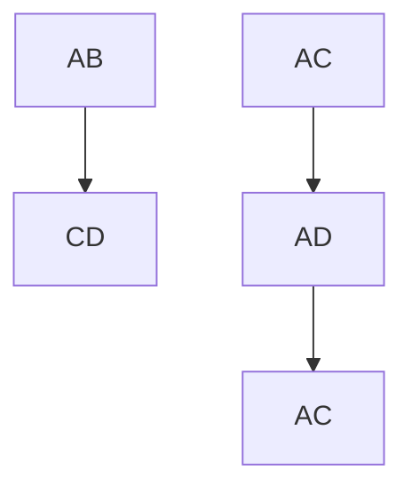

flowchart

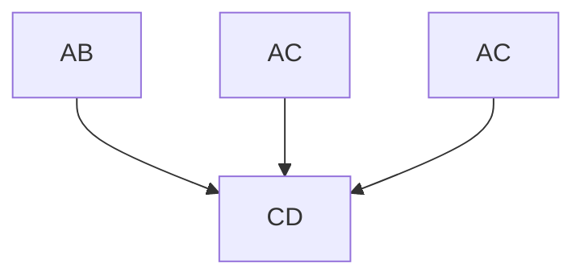

text_image

D
概率
AB
CD
AC
AC
>1/4
>1/2
BC
BD
<1/4

图 6-21 受累同胞对分析

（A）通过随机分离，同胞对共享2个（均为AC）、1个（AC与AD或BC）或0个（AC和BD）亲本单倍型的概率分别为 $1 / 4$ 、 $1 / 2$ 和 $1 / 4$ 。  
（B）都患有孟德尔显性疾病的同胞对必须共享携带疾病的等位基因片段，他们可能共享也可能不共享（$50\% : 50\%$ 的机会）未受影响的那

个父母单倍型。（C）都患有孟德尔隐性疾病的同胞对必然在相关染色体片段上共享相同的两个亲本单倍型。（D）对于复杂的情况，单倍型共享如果高于预期偶然发生的单倍型（如图A所示），就可以识别出含有易感基因的染色体片段。

存在方法学问题或者理论漏洞，主要问题在于它的统计学效力低下，所以需要大量同胞对才能够找到效应极强的位点。1996年发表的论文计算了具有 $80\%$ 统计效力能够检测到显著连锁所需要的同胞对数量（表6-3）。这一数字依赖于易感等位基因的频率和它赋予额外风险的程度，但是总的来说，只有能够提供4倍以上相对风险的罕见等位基因才有可能在合理数目的同胞对中被检测出来。除了证实采用无模型连锁分析来鉴定效应微弱的易感基因是不切实际的之外，这篇文章也指出在基于特定假设的情况下，关联研究具有高得多的统计效力，因此使得对于复杂疾病的研究在后续几年之内从连锁分析转向了关联研究。

## 三、关联研究

关联（association）与连锁不同，它并不是一种特殊的遗传学现象，而是等位基因与表型共同出现的一种统计学表述。如果某些人同时具有疾病D和等位基因 $A$ 的频率显著高于或低于群体中D和 $A$ 各自的频率，那么我们就认为等位基因 $A$ 和疾病D相关联。例如:英国普通群体中HLA-DR4的比例是 $36\%$ ，但是类风湿性关节炎的群体中HLA-DR4的比例为 $78\%$ ，那么HLA-DR4与类风湿性关节炎就是相关联的。产生关联的可能性很多，并不一定都是由于遗传的原因。例如:

表 6-3 具有 $80\%$ 效力检测到显著连锁所需要的同胞对数量

<table><tr><td>相对风险</td><td></td><td colspan="4">4</td><td colspan="4">2</td><td colspan="3">1.5</td></tr><tr><td>等位基因频率</td><td>0.01</td><td>0.1</td><td>0.5</td><td>0.8</td><td>0.01</td><td>0.1</td><td>0.5</td><td>0.8</td><td>0.01</td><td>0.1</td><td>0.5</td><td>0.8</td></tr><tr><td>所需同胞对数量</td><td>4 260</td><td>185</td><td>297</td><td>2 013</td><td>296 710</td><td>5 382</td><td>2 498</td><td>11 917</td><td>4 620 807</td><td>67 816</td><td>17 997</td><td>67 816</td></tr></table>

---

第三节 复杂疾病易感基因的鉴定与风险评估

213

知识窗6-6

## 连锁与关联的区别与联系

连锁是基因座之间的关系，关联是等位基因与表型间的关系。连锁是一种特殊的遗传学关系，关联单纯是对各种因素的统计学观察。连锁在家系中可以产生关联，但在一般群体中不产生任何关联。

（1）直接原因:携带等位基因 $A$ 使人对疾病D更加易感。具有 $A$ 可能对于发展出疾病D既不充分也不必要，但是会增加其可能性。
(2) 自然选择: 患有疾病 D 的人如果携带等位基因 A 会更有可能存活并生育子女。
(3) 群体分层: 群体包含了好几个遗传背景不同的亚群, 疾病恰好和等位基因一起特别频繁地出现在某一个亚群中。例如: 在 HLA 基因座携带 $A_{1}$ 等位基因和用筷子吃饭相关联, 实际上是因为 $\mathrm{HLA}^{*}A_{1}$ 在华裔中的频率远高于白种人。
（4）连锁不平衡（linkage disequilibrium，LD）:疾病相关联等位基因 A 对于易感性没有任何直接作用，但是它标记了含有易感性变异的一个古老的染色体片段。实际上，我们目前鉴定出来证据确凿的关联，其中绝大多数都是由于连锁不平衡而找到的，随后要做的步骤就是鉴定出真正的致病性序列变异。

其实在 1980 年适合连锁分析的 DNA 标记出现之前，关联研究就已经广泛应用于遗传学研究。人类白细胞抗原（human leucocyte antigen，HLA）与各种疾病的关联研究在 20 世纪 60 和 70 年代是遗传学研究的主要组成部分。早期通过关联研究找到了 HLA-DR4 与风湿性关节炎、HLA-DR3 和 DR4 与 1 型糖尿病以及 HLA-B27 与强直性脊柱炎之间的相关性。后期采用非 HLA 标记也取得了一些成功。但是早期关联研究都存在一个共同的问题，那就是低可重复性，其主要原因是缺乏数量足够的相匹配的对照、没有对多重检验进行充分校正、统计效力不足等。

## 四、全基因组关联研究（GWAS）

很多早期的关联研究由于病例-对照数量小，从而导致统计效力不足，所以即使是真实的关联也可能在独立样本中无法得到重复验证。在经历了很多年挫败和不可重复的结果之后，2007年全基因组关联研究（GWAS）在Wellcome trust病例-对照联盟（the Wellcome Trust Case-Control Consortium，WTCCC）的领导下横空出世，开启了GWAS研究浪潮。

## 1. 全基因组关联研究的代表性案例

在 WTCCC 中，英国研究者收集了 7 种疾病的各 2000 例病例，这 7 种疾病分别是:双相障碍（躁郁症）、冠心病、克罗恩病（Crohn disease）、高血压、风湿性关节炎、1 型糖尿病和 2 型糖尿病。此外还收集了 3000 例健康对照。然后在所有的样

---

214

第六章 人类遗传学与疾病

本中都对超过 500 000 个 SNP 进行了分型。项目预计如果最小等位基因频率（minor allele frequency，MAF）至少为 0.05 的情况下，相对风险为 1.3 时检测效力是 43%，1.5 时检测效力是 80%。WTCCC 发表的第一篇文章非常值得仔细阅读，因为它非常详尽地讨论了目前已经认为理所当然的质量控制问题。在这 7 大类患者群体中，25 个疾病相关的信号因为 P 值超过显著性阈值而被鉴定出来（图 6-22）。

在这一研究中显著性阈值设定为 $P < 5 \times 10^{-7}$，而不是目前绝大多数研究常用的 $P < 5 \times 10^{-8}$。作为新一代大规模GWAS的实验平台，一个关键的问题是这25个位点中有哪些可以重复？不管是后续的验证还是和此前研究的一致性比对，结果都非常令人欣慰。这7种疾病在之前研究中已经鉴定出的15个位点有强有力的可重复证据证实，与一种或更多疾病关联。这15个位点中有13个都在WTCCC研究中被明确地鉴定出来了，虽然其中只有7个超过了显著性阈值。

WTCCC 的 GWAS 研究价值主要是开创了一个如何进行合理的可重复的关联研究范例，而不是鉴定出特定的候选基因。随后 GWAS 迅速地应用于形形色色的常见疾病中。从 2010 年开始报道了很多其他的 GWAS 研究。截至 2022 年 7 月，GWAS 数据库中收录了 5848 项研究，398342 个特定的 SNP-性状之间的关联。

## 2. 后 GWAS 阶段的研究方法:分相、数据填补和荟萃分析

基于 SNP 芯片基础上的传统 GWAS 研究给出的原始数据是由很多 tagSNP 的基因型组成的，将基因型转换为单倍型就是分相（phasing）。如果我们用共享祖先染色体

图6-22 WTOCC的GWAS结果

（A）寻找疾病相关SNP位点的原理；（B）在7种疾病中找到的显著相关SNP位点示意图。

A

text_image

3 4
1 2

包含500000个SNP的芯片平台，每个SNP有两个等位基因

bar

| 类别 | 等位基因 | 频率 |
| --- | --- | --- |
| 健康对照 | 1 | ~0.6 |
| 健康对照 | 2 | ~0.7 |
| 疾病患者 | 3 | ~0.5 |
| 疾病患者 | 4 | ~0.5 |
| 疾病患者 | 1 | ~0.6 |
| 疾病患者 | 2 | ~0.8 |
| 疾病患者 | 3 | ~1.0 |
| 疾病患者 | 4 | ~0.2 |

B

manhattan

| Category | Sample ID | -log10(p) |
| --- | --- | --- |
| 双相障碍 | 1 | ~3 |
| 双相障碍 | 2 | ~3 |
| 双相障碍 | 3 | ~3 |
| 双相障碍 | 4 | ~3 |
| 双相障碍 | 5 | ~3 |
| 双相障碍 | 6 | ~3 |
| 双相障碍 | 7 | ~3 |
| 双相障碍 | 8 | ~3 |
| 双相障碍 | 9 | ~3 |
| 双相障碍 | 10 | ~3 |
| 双相障碍 | 11 | ~3 |
| 双相障碍 | 12 | ~3 |
| 双相障碍 | 13 | ~3 |
| 双相障碍 | 14 | ~3 |
| 双相障碍 | 15 | ~3 |
| 双相障碍 | 16 | ~3 |
| 双相障碍 | 17 | ~3 |
| 双相障碍 | 18 | ~3 |
| 双相障碍 | 19 | ~3 |
| 双相障碍 | 20 | ~3 |
| 双相障碍 | X | ~3 |
| 冠心病 | 1 | ~3 |
| 冠心病 | 2 | ~3 |
| 冠心病 | 3 | ~3 |
| 冠心病 | 4 | ~3 |
| 冠心病 | 5 | ~3 |
| 冠心病 | 6 | ~3 |
| 冠心病 | 7 | ~3 |
| 冠心病 | 8 | ~3 |
| 冠心病 | 9 | ~15 |
| 冠心病 | 10 | ~3 |
| 冠心病 | 11 | ~3 |
| 冠心病 | 12 | ~3 |
| 冠心病 | 13 | ~3 |
| 冠心病 | 14 | ~3 |
| 冠心病 | 15 | ~3 |
| 冠心病 | 16 | ~3 |
| 冠心病 | 17 | ~3 |
| 冠心病 | 18 | ~3 |
| 冠心病 | 19 | ~3 |
| 冠心病 | X | ~3 |
| 克罗恩病 | 1 | ~3 |
| 克罗恩病 | 2 | ~3 |
| 克罗恩病 | 3 | ~3 |
| 克罗恩病 | 4 | ~3 |
| 克罗恩病 | 5 | ~3 |
| 克罗恩病 | 6 | ~3 |
| 克罗恩病 | 7 | ~3 |
| 克罗恩病 | 8 | ~3 |
| 克罗恩病 | 9 | ~15 |
| 克罗恩病 | 10 | ~3 |
| 克罗恩病 | 11 | ~3 |
| 克罗恩病 | 12 | ~3 |
| 克罗恩病 | 13 | ~3 |
| 克罗恩病 | 14 | ~3 |
| 克罗恩病 | 15 | ~3 |
| 克罗恩病 | 16 | ~3 |
| 克罗恩病 | 17 | ~3 |
| 克罗恩病 | 18 | ~3 |
| 克罗恩病 | X | ~3 |
| 高血压 (Red Triangles) | 1-24 (Sample) | N/A |
| 风湿性关节炎 (Red Triangles) | 1-24 (Sample) | N/A |
| 风湿性关节炎 (Sample) | X-24 (Sample) | N/A |
| 风湿性关节炎 (Sample) | X-25 (Sample) | N/A |
| 风湿性关节炎 (Sample) | X-26 (Sample) | N/A |
| 风湿性关节炎 (Sample) | X-27 (Sample) | N/A |
| 风湿性关节炎 (Sample) | X-28 (Sample) | N/A |
| 风湿性关节炎 (Sample) | X-29 (Sample) | N/A |
| 风湿性关节炎 (Sample) | X-30 (Sample) | N/A |
| 风湿性关节炎 (Sample) | X-31 (Sample) | N/A |
| 风湿性关节炎 (Sample) | X-32 (Sample) | N/A |
| 风湿性关节炎 (Sample) | X-33 (Sample) | N/A |
| 风湿性关节炎 (Sample) | X-34 (Sample) | N/A |
| 风湿性关节炎 (Sample) | X-35 (Sample) | N/A |
| 风湿性关节炎 (Sample) | X-36 (Sample) | N/A |
| 风湿性关节炎 (Sample) | X-37 (Sample) | N/A |
| 风湿性关节炎 (Sample) | X-38 (Sample) | N/A |
| 风湿性关节炎 (Sample) | X-39 (Sample) | N/A |
| 风湿性关节炎 (Sample) | X-40 (Sample) | N/A |
| 风湿性关节炎 (Sample) | X-41 (Sample) | N/A |
| 风湿性关节炎 (Sample) | X-42 (Sample) | N/A |
| 风湿性关节炎 (Sample) | X-43 (Sample) | N/A |
| 风湿性关节炎 (Sample) | X-44 (Sample) | N/A |
| 风湿性关节炎 (Sample) | X-45 (Sample) | N/A |
| 风湿性关节炎 (Sample) | X-46 (Sample) | N/A |
| 风湿性关节炎 (Sample) | X-47 (Sample) | N/A |
| 风湿性关节炎 (Sample) | X-48 (Sample) | N/A |
| 风湿性关节炎 (Sample) | X-49 (Sample) | N/A |
| 风湿性关节炎 (Sample) | X-50 (Sample) | N/A |
| 风湿性关节炎 (Sample) | X-51 (Sample) | N/A |
| 风湿性关节炎 (Sample) | X-52 (Sample) | N/A |
| 风湿性关节炎 (Sample) | X-53 (Sample) | N/A |
| 风湿性关节炎 (Sample) | X-54 (Sample) | N/A |
| 风湿性关节炎 (Sample) | X-55 (Sample) | N/A |
| 风湿性关节炎 (Sample) | X-56 (Sample) | N/A |
| 风湿性关节炎 (Sample) | X-57 (Sample) | N/A |
| 风湿性关节炎 (Sample) | X-58 (Sample) | N/A |
| 风湿性关节炎 (Sample) | X-59 (Sample) | N/A |
| 风湿性关节炎 (Sample) | X-60 (Sample) | N/A |
| 风湿性关节炎 (Sample) | X-61 (Sample) | N/A |
| 风湿性关节炎 (Sample) | X-62 (Sample) | N/A |
| 风湿性关节炎 (Sample) | X-63 (Sample) | N/A |
| 风湿性关节炎 (Sample) | X-64 (Sample) | N/A |
| 风湿性关节炎 (Sample) | X-65 (Sample) | N/A |
| 风湿性关节炎 (Sample) | X-66 (Sample) | N/A |
| 风湿性关节炎 (Sample) | X-67 (Sample) | N/A |
| 风湿性关节炎 (Sample) | X-68 (Sample) | N/A |
| 风湿性关节炎 (Sample) | X-69 (Sample) | N/A |
| 风湿性关节炎 (Sample) | X-70 (Sample) | N/A |
| 风湿性关节炎 (Sample) | X-71 (Sample) | N/A |
| 风湿性关节炎 (Sample) | X-72 (Sample) | N/A |
| 风湿性关节炎 (Sample) | X-73 (Sample) | N/A |
| 风湿性关节炎 (Sample) | X-74 (Sample) | N/A |
| 风湿性关节炎 (Sample) | X-75 (Sample) | N/A |
| 风湿性关节炎 (Sample) | X-76 (Sample) | N/A |
| 风湿性关节炎 (Sample) | X-77 (Sample) | N/A |
| 风湿性关节炎 (Sample) | X-78 (Sample) | N/A |
| 风湿性关节炎 (Sample) | X-79 (Sample) | N/A |
| 风湿性关节炎 (Sample) | X-80 (Sample) | N/A |
| 风湿性关节炎 (Sample) | X-81 (Sample) | N/A |
| 风湿性关节炎 (Sample) | X-82 (Sample) | N/A |
| 风湿性关节炎 (Sample) | X-83 (Sample) | N/A |
| 风湿性关节炎 (Sample) | X-84 (Sample) | N/A |
| 风湿性关节炎 (Sample) | X-85 (Sample) | N/A |
| 风湿性关节炎 (Sample) | X-86 (Sample) | N/A |
| 风湿性关节炎 (Sample) | X-87 (Sample) | N/A |
| 风湿性关节炎 (Sample) | X-88 (Sample) | N/A |
| 风湿性关节炎 (Sample) | X-89 (Sample) | N/A |
| 风湿性关节炎 (Sample) | X-90 (Sample) | N/A |

---

第三节 复杂疾病易感基因的鉴定与风险评估

215

片段来解释关联，那么疾病风险实际上是由单倍型决定的而不是由基因型决定的。换句话说、单倍型-疾病相关性比等位基因-疾病相关性更加接近现实。

进行分相所需要的初始单倍型频率表可以通过不同的方法产生:

（1）如果有亲属的基因型数据可用，那么单倍型可以通过鉴定IBD片段推导出来。最简单的情况是:如果我们有父母孩子组成的三口之家的数据，除了那些3个人都是同样杂合基因型的基因座，其他单倍型都可以直接读出来。
（2）直接测序可以提供同一读长上基因座的分相数据。目前大多数实验室使用的二代测序仪给出的短读长测序数据的价值有限，但是像PacBio这种单分子测序仪获得的长读长测序数据可以对几十kb范围内的基因型进行分相，而整条染色体可以采用互相重叠的读长来进行分相。
（3）很多方法，包括显微切割、流式细胞分选或者制备单倍体细胞可以在实验室里分离出染色体单体进行测序。
（4）微流体可以允许随机产生长的DNA分子分散到液滴中，在这里它们会被分解成小片段，每一个都用液滴特异性的条形码标记。来自于很多液滴的片段会汇总进行常规的短读长测序，然后可以用条形码将短读长数据重新装配成最初的长分子。每个液滴里长分子的数目可以进行计算，基本不可能出现来源于同一基因组区域的两个长分子正好都存在于同一个液滴中的情况。

这些方法都可以用于构建出相对小尺度的单倍型参考数据。然后一个典型的GWAS中数以千计的病例和对照都可以通过计算来进行分相，其准确率依赖于片段大小和单倍型参考数据的质量。千人基因组的数据经常被当作单倍型参考数据来使用。很多其他人群中也陆续建立起了合适的单倍型参考数据。

数据填补（imputation）是利用连锁不平衡和分相的结果将初始实验中没有直接获得那些基因座的基因型填补进去。经过填补的基因型可以像从实验中确定的基因型那样进行关联检测。单个的SNP可以在不同单倍型中出现，因此会弱化其他单倍型与特定疾病的关联。填补后的SNP可能碰巧只呈现在疾病相关的单倍型上，然后显示出更强的关联性，甚至它本身可能就是致病性变异。正确的数据填补依赖于分相的准确性，而且对于罕见变异来说要困难得多。据估计在典型的SNP基因分型研究中，根据千人基因组的数据进行的数据填补可以鉴定出 $97\%$ 的常见变异，但是只能鉴定出$72\%$ 的罕见变异（MAF<0.01）。在数据越来越多的情况下，罕见变异的数据填补能力也会提高。

数据填补的主要价值就在于进行荟萃分析（Meta-analysis）。在 WTCCC 研究中，每种疾病 2000 个病例和 3000 个对照也只能提供 43% 的效力，检测出 OR 值为 1.3 的变异。然而绝大多数易感因素甚至效应比这还要微弱，鉴定它们需要更大规模的研究、更多的病例和对照。在荟萃分析中可以将研究同一疾病的好几个独立研究合并在一起，组成更大的队列。一个典型的荟萃分析可以包括上万个研究对象，例如:对于成人身高的 GWAS 荟萃分析包含了来自 79 项不同研究的 253288 个欧洲祖先的个体。由于不同的研究常常使用不同基因分型平台对一个单倍型域中的不同 SNP 进行基

---

216

第六章 人类遗传学与疾病

因分型、所以通过数据填补产生一套通用的SNP对于合并不同的数据集是非常必要的。此外，非常大型的研究可以检测疾病与罕见变异之间的关联。WTCCC研究和绝大多数第一代GWAS研究一样局限于MAF>0.05的变异，而且绝大多数鉴定出来的变异都具有相对较弱的效力。从自然选择的角度来看，任何具有较强致病效力的变异都有可能是罕见的。因此疾病的致病变异很有可能隐藏于不常见的变异（MAF介于0.01\~0.05之间）或者罕见变异（MAF<0.01）之中。但是为了获得足够多携带这两类变异的人，就需要极大数量的病例和对照。

## 3. 复杂性状遗传的启示与展望

首先我们需要用平衡的观点来理解遗传在非孟德尔病中的作用:基本没有什么性状是可以完全归因于遗传或者环境因素的。几乎所有性状都是同时包括遗传和环境因素的。在任何一个人类特征中完全没有哪怕一定程度的遗传原因是非常难以理解的。但同样，我们有责任不要过度夸大遗传因素在人类变异中的作用，继而我们应该避免夸大遗传测试的用途。遗传测试检测的是基因型，不是表型。那些对预测表型有用的基因型当然极具价值，但是遗传检测并不是必然可以用于预测一个个体的风险。那些公司在网络上提供的“生活方式”遗传检测可以当作是参考，但不要与临床诊断相混淆。基因决定不能成为对一种疾病的宿命论借口。高遗传率仅仅意味着在现有的环境中没有什么常见变量具有很大的影响，但它并不会影响环境干预手段的潜力。苯丙酮尿症的例子应该足以说明这个观点:在这种完全遗传的孟德尔病中出现的智力障碍是可以采用特定饮食来预防的。

看上去 GWAS 研究过的每种性状都存在 “丢失的遗传率” 问题，提示绝大多数非孟德尔性状很大程度上都是多基因决定的。与之相关的另一个问题是:复杂疾病多大程度上是孟德尔病或亚孟德尔病的集合？这个需要针对具体问题来具体分析。比如癌症方面已经取得了有价值的进展，目前可以把常见癌症分为由不同功能异常通路驱动的亚型，并且对应不同的治疗方法。先天性心脏病常常可以归因于特定的基因突变，这一信息对于家族检测和再发风险咨询很有用，但是它对于治疗没什么影响。大部分病例都是通过手术来纠正婴儿特定的心脏异常。对于成年期发病的心脏病，生活方式则更为重要。

另一方面，作为GWAS研究的主要对象之一的2型糖尿病，除了占比很低的青少年成人型糖尿病（maturity-onset diabetes in young，MODY）之外，无法通过基因分型区分成适用于不同临床治疗方法的不同亚型。后者是由于7个基因中的某一个突变造成的孟德尔病。不同的药物对不同的突变基因有用，所以MODY的诊断和基因分型是有临床价值的。但是对于占 $95\%$ 的非MODY的2型糖尿病只有微弱的遗传亚型线索可能会对不同的治疗有益。

精神疾病具有固有的复杂性。如果诊断标签能够从广泛的行为分类到特定的遗传分类，会是一个巨大的进步，而且毫无疑问会引起治疗的极大改善。理解精神分裂症和孤独症的遗传学有所进展，但是主要来自于鉴定由拷贝数变异或者新发突变引起的很小的亚型。每种疾病的核心仍然极为复杂。有趣的是，有些确定的遗传易感因子是

---

第三节 复杂疾病易感基因的鉴定与风险评估

217

几种疾病共有的，例如精神分裂症、孤独症和智力障碍。这说明可能存在某种受遗传影响的通用的神经发育中的脆弱性，它显示为不同的疾病依赖于某些特定的诱发因素。

其次、孟德尔病和复杂疾病的一个显著差异在于相关遗传因子在基因组中所处的位置。虽然有相当多的例外，但是决定孟德尔病的变异通常位于蛋白质编码序列。对单基因的外显子和剪接位点或者全外显子组进行测序可以鉴定出绝大多数孟德尔病中超过 $80\%$ 病例中的致病突变。但是绝大多数GWAS鉴定出来的易感变异并不位于蛋白质编码序列中。这一点很符合直观感受。对于孟德尔病，一个DNA序列改变就必然导致疾病，它与基因组中约400万个其他变异无关，也与环境、生活方式和家族史无关。如果那些其他因素中的任何一个对疾病的发生产生显著影响，那么它就不会是孟德尔病了。只有蛋白质上的明显改变才有可能具有如此强烈的效应。在另一方面，参与复杂疾病的变异必然具有微弱得多的效应，这样他们只有联合很多其他变异一起才能够影响表型。他们可能影响调控序列，轻微地增加或降低基因的表达。实际上，很多GWAS鉴定出来的变异定位于eQTLs，也就是影响基因表达水平的基因座。

这一差异也意味着鉴定GWAS中隐藏的易感性变异会比较困难。对于孟德尔病，一般可以在编码区寻找致病突变。他们可能是缺失、移码、无义突变或者剪接位点突变。只有错义突变或者不那么明显的改变剪接的位点会不太容易确定。但GWAS的数据要难解释得多。GWAS数据可能会将效应定位于某个单倍型区块，但是在该区块中可能会有50个或更多的变异，其中任何一个都有可能是该效应的实际原因，但是由于连锁不平衡，它们都会与疾病相关联。在一个区块内，可以通过数据填补出所有变异然后检查其中哪个具有最强的效应，但是这在某种程度上依赖于在这一位点不同单倍型共享等位基因方式的随机效应。然后，因为任何易感变异都有可能是在一个已有的常见区块中出现的一个新突变，所以只有其中部分区块才包含有真正的功能变异。对于只在一个给定区块中的部分样本中出现的可能易感变异，数据填补并不能很好地运转。

此外，由于易感变异常常落在非编码区，经常很难评估增强子序列中的一个核苷酸改变的具体效应。我们可以检测该变异对转录因子结合情况的影响，但是真正的功能结合位点常常并不总是具有体外研究中评出的最优序列，因为比较弱的结合可以进行更为灵活的控制。当然基因编辑技术打开了构建任何变异的可能性，理论上我们可以在一个固定的背景下一个接一个地分别检测它们的效应。但是与检查编码序列的改变相比它们要费力得多，而且有数以百计的候选变异等待检测。因此从关联变异到易感变异的推进会很缓慢。

除了帮助我们理解疾病的机制之外，鉴定易感因素对于预防和治疗复杂疾病有什么实际好处吗？我们希望的是对于这些易感因素的了解可以揭示疾病的致病机制并且给出预防或治疗的方法。对个体一系列的变异进行基因分型也许可以预测个体的风险。但是实际进展是令人失望的。我们所期待的由“诊断和治疗”到“预测和预防”的医疗模式转换还在非常缓慢地到来。可能是因为“丢失的遗传率”问题限制了我们

---

218

第六章 人类遗传学与疾病

现在的预测能力。一旦我们找到了这些丢失的遗传率，那么这些限制是不是就消失了呢？研究人员建立了一种方法，利用同卵双生子的一致性数据估计复杂疾病遗传学的所有知识在多大程度上能够做出临床上的有用预测，选取24种覆盖各种类型的疾病，想要回答的问题是:如果知道每一个易感因素并且理解它们之间的所有互作，那么能否使用一个人的全基因组序列去进行“临床有用”的预测？他们把“临床有用”定义为风险提高 $10\%$ 或者是群体风险的2倍，这两者中更大的那一个。最好的场景下$90\%$ 的个体会获得一个临床有用的预测，也就是24种疾病中至少一种风险增加。对于绝大多数疾病绝大多数人会得到一个阴性预测，即没有明显增加的风险。该研究得出的结论是对于绝大多数患者来说遗传检测不能够替代常规检查和基于家族史、身体状况和生活方式的风险管理，这些仍然是主要的医学预防策略。

当然如果知道所有的情况，我们就能够精确预测每一个人的每一个遗传风险。可问题是绝大多数常见复杂疾病都具有很多独立微弱的遗传易感因素。只有在很少一部分个体中，所有或者绝大部分风险因素都指向同一方向——增加或者降低易感性。对于绝大多数人，会是增加和降低风险的因素混合在一起，使得个体风险总体上略高或略低于群体风险。因此，的确最好的知识会得到最好的个体风险预测，但是只有极少数人的风险足以和群体风险区分，以达到临床上有用的预测。要注意的是以上结论只适用于常见复杂疾病而不是孟德尔病，后者的序列变异信息常常是至关重要的。

如果个体化的风险预测没有那么值得期待，那么我们能够从日益增加的对复杂疾病的理解中获得哪些实际的益处呢？一个主要方面是更有效的药物研发。在2016年，从最初的潜在药物到市场准入平均直接费用估计是14亿美元而且耗时长达10年以上，其中绝大部分是由于有效性不足或者副作用导致的临床试验失败。有些罕见但是严重的副作用只有在市场化后的监管中才变得很明显，在这一阶段撤回药物对于制药公司会产生严重的经济后果，导致长时间的诉讼，甚至名誉损失，比如罗非昔布（Rofecoxib，$\mathrm{Vioxx}^{\mathrm{TM}}$）的例子。鉴定疾病的易感因素可以提示新的药物研发方向，但是基因组知识的主要好处可能是选择最有希望的临床试验患者，并且预测那些具有副作用风险的人。阿斯利康制药公司计划与人类寿命公司、桑格研究院、赫尔辛基大学、蒙特利尔心脏研究所和英格兰基因组合作对两百万人基因组进行测序，也许能够证实这一点。

虽然医学的未来看上去并不在于个性化的风险预测，但是分层药物或者精准药物，即采用基因组数据通知管理者或治疗患者，可能会是一个主要的发展领域。肿瘤学是这一方法目前的主要受益者，但是我们的愿景是将其扩展到医学的所有领域。2015年美国宣布投入2.15亿美元用于精准医疗计划。2016年，美国宣布投入几十亿美金开展为期15年的精准医学计划。在英国，2014年启动了一项花费3亿英镑的100000基因组计划。随着各国精准医疗计划的实施与完成，也许会开启一个新的纪元。

---

第四节 遗传检测与遗传咨询

219

## 第四节 遗传检测与遗传咨询

之前的各节已经覆盖了遗传检测的很多原则和它在研究中的应用，例如探索人类基因组的自然变异度和理解疾病中遗传变异的作用。在本节中我们主要考虑如何将遗传检测应用于人类疾病诊断、群体筛查和个体鉴定中。其中利用遗传检测进行临床诊断的具体内容将在本书第一部分进行阐述。当我们能够对一种疾病未来是否会发生进行预测诊断时，人们就会期望对整个人群进行检测，以期能够提前预防疾病的发生或尽早进行干预。然而事情没有这么简单。第二部分阐述了在群体筛查项目中存在的各种问题。对于个性化或者精准医疗最有前景的进展是遗传信息不仅可以用于诊断疾病，而且还可以用于管理患者的疾病。医生在临床上经常会观察到不同患者对很多药物的反应不同。基因型虽然只是众多引起不同药物反应的因素之一，但是对于鉴定出那些具有严重副作用风险的人员来说尤为重要。第三部分将对这一内容展开讨论。此外，当警察和律师需要确定个人身份或者两人关系时也要用到遗传检测。这样的问题需要由第四部分中描述的DNA指纹图谱来解决。

## 一、临床诊断性检测

有时候，遗传检测希望确定一个或更多事先已知的特定变异，典型的案例包括:

（1）在家族中进行诊断。一开始可能需要通过测序来确定家族中传递的致病突变，但一旦鉴定出致病突变，其他的家族成员通常只需要检测这个特定的突变即可；

（2）诊断和筛查在一个特定人群中由于强烈的奠基者效应引起的疾病；

(3) 检测由患者表型提示的特定微缺失或者微重复;

(4) 检测肿瘤活检标本, 寻找对靶向药产生反应的突变;

（5）检测对照样本，看看患者中的变异是否实际上只是一个低频的群体多态；

(6) 扩增特定的微卫星以检测重复次数;

(7) 进行 SNP 分型。

实际上测序本身可以解决以上所有问题，但是当靶标变异已知的时候，我们可以采用各种更便宜更简单的方法来进行基因分型。但更为常见的遗传检测往往需要通过对一个基因的所有外显子、一组基因、全外显子组或全基因组进行检测。二代测序使这些任务变得更加容易。关于二代测序确定的变异是否需要通过一代测序进行确认，仍存在持续的争论。毫无疑问，总体趋势是越来越少地使用一代测序，越来越依赖二代测序。一旦价格大幅下降，全基因组测序很可能会取代外显子组测序，其主要优点并不是能够识别 $98\%$ 的基因组中的非编码变异，而是避免了进行外显子捕获。有许多编码序列变异在外显子组测序中会被遗漏，但在对相同样本进行全基因组测序时则可以被检测到。全基因组测序的另一个好处是能够检测出基因组中的结构变异，这在外显子组测序中是无法实现的。

一旦拿到经过验证的变异列表，就必须对其进行过滤，以确定任何可能解释患者

---

220

第六章 人类遗传学与疾病

病情的变异。解释变异时要考虑的三个要点是先例、保守性和稀有性。

（1）可以通过ClinVar数据库来评估是否存在先例。它包含了基因中已报道致病性变异以及其表型的细节。
（2）使用多序列比对来评估错义突变中改变的氨基酸的保守性，例如:通过 POLYPHEN 和 SIFT 等工具进行预测。高度保守氨基酸的变化被预测为具有破坏性，而非保守的氨基酸改变预计是良性的。这些评估的准确率通常在 80% 左右。不同工具可能给出不同答案，因此需要同时使用几个工具进行预测并寻求一致性。同时需要注意的是，这类比对并不涉及序列变化是否会影响剪接，也无法预测对蛋白质的破坏性影响是否会真的给整个人体带来任何问题。

（3）变异具有致病性的证据主要来自于比较其在患者和对照中的频率。最理想的情况下，它只会在患者中出现，在对照组中完全没有。如果它仍然会在某些健康对照中出现，那么频率是非常重要的。如果它在疾病中占主导地位，那么对照组中变异的频率必须显著低于疾病组的频率（因此允许外显率降低）。对于隐性疾病，对照中候选变异的频率必须不高于携带者的预期频率。GnomAD数据库包括126 216个外显子组和15 136个基因组，是非常宝贵和强大的工具。如果一个变异在健康对照中过于频繁地出现，可以证明它实际上并没有致病性。许多先前被报道为致病性的变异均未能通过该数据库的检测。

根据上述的过滤原则，人们将变异分为五类:致病性的、可能致病的、意义不确定的、可能是良性的和良性的。美国医学遗传学联合会（American College of Medical Genetics and Genomics，ACMG）的工作组对此提供了广泛的指导意见。其中对每一条可能证据线的注意事项和问题进行了相当详细的说明。如果所涉及的变异位于以前与患者病情无关的基因中，那么所有这些判断都将更加谨慎。

虽然二代测序的稳步发展使许多以前使用的基因检测方法都过时了，然而，并不是诊断实验室碰到的每个问题都能通过当前的二代测序方法来解决。因此临床上仍然采用一些非测序方法来回答某些特定的问题。例如:比较基因组杂交（array-based comparative genomic hybridization，aCGH）是检测结构变异、拷贝数变异等的常用手段；依赖连接的多重探针扩增（multiplex ligation dependent probe amplification，MLPA）广泛用于检测整个外显子的缺失或重复；RNA分析用于检测异常的基因表达或者剪接效应；甲基化分析可以用于鉴定肿瘤和印记基因等。

实际上，任何遗传检测在应用于临床服务之前都必须对其进行严格评估。不仅要评估实验方法本身的有效性，还要评估引入检测的总体效果，包括:

（1）检测本身的有效性:检测方法对其检测内容的实际效果如何？其灵敏度和特异性是否足够？
（2）临床有效性:该项检测对预后的预测效果如何？这主要取决于基因型-表型相关性的强度。
（3）临床实用性:检测结果具有哪些实际的临床用途？它会导致疾病管理或疾病治疗手段的任何变化吗？

---

第四节 遗传检测与遗传咨询

221

（4）伦理、法律和社会方面:检测是否符合法律和伦理标准，能否为社会所接受？

任何一项检测结果都将与其他所有相关信息放在一起进行考量，例如:患者的年龄和性别、总体健康和社会状况，以及任何其他检测的结果。有用的检测应该是对推动人们跨越行动门槛的过程中做出重大贡献的检测。在这方面，绝对风险往往比相对风险要重要得多。例如:检测结果表明某人的患病风险提高了十倍，但其风险只是从万分之一变为千分之一，那么可能不会产生任何实际的差异。另一方面，BRCA1突变检测呈阳性的相对风险仅为7左右（携带者风险为 $80\%$ ，普通人群风险为 $12\%$ ），但这一检测结果很重要，因为携带者的绝对风险非常高。

## 一、群体筛查

群体筛查是由公共权力机构向整个人群（或者特定的大型群体）提供的大规模检测服务，其目的并不是解决参与其中的某个个体的个人健康问题，而是改善公共卫生状况。因此群体筛查是自上而下的。它与由个人或他们的医生发起的基因检测不同，那是一个

flowchart

图6-23 筛查和诊断的检测目的不同

自下而上的过程，主要用来回答由他们的症状或家族史所引发的特定问题。

筛查检测不是诊断检测，尽管有时两者的区别会变得模糊。通常情况下，筛查的目的是确定高危人群，然后为他们提供明确的诊断检测（图6-23），针对的是个人检测不会碰到的一些特殊问题。

由于群体筛查都是比较集中的大型项目，运营机构必须仔细评估是否需要花钱实施任何筛查计划。筛查项目是正式的官方政策问题，而不是个人的突发奇想。个人在决定是否进行基因检测时可能会不切实际，但中央权力机构，无论是政府机构还是保险公司，都必须对筛查提案进行正式评估。表6-4总结了群体筛查项目的一些基本要求。

遗传筛查可能涉及其中任何一项:①产前筛查；②新生儿筛查；③孕前携带者状态筛查；④筛查成年人对晚发性疾病的易感性。后续将一一举例说明。

表 6-4 群体筛查项目的基本要求

| 要求 | 示例及说明 |
| --- | --- |
| 阳性结果必须能促成一些有用的行动 | 例如，苯丙酮尿症可采取特殊饮食的预防性治疗；在囊性纤维化携带者筛查中对生育选择进行审查和抉择。 |
| 检测必须具有高灵敏度和特异性 | 如果产生很多假阴性结果的检测会破坏人们对该计划的信心；如果产生很多假阳性结果的检测，即使随后可以通过明确的诊断测试将其剔除，也会造成令人无法接受的焦虑。 |
| 整个项目在社会和伦理上必须是可接受的 | 受试者必须在知情同意的情况下选择加入该项目；不得对父母可接受后果的受累妊娠施加压力使其终止妊娠；筛查不得具有歧视性。 |
| 该项目的收益必须大于成本 | 以低效的方式使用原本有限的医疗保健预算是不道德的。 |

---

222

第六章 人类遗传学与疾病

## 1. 产前筛查:以唐氏综合征（Down syndrome）为例

对于染色体异常检测来说，传统的诊断检测需要获得胎儿细胞样本。在妊娠10～14周时进行绒毛膜活检或者16～20周时进行羊水穿刺都可以获得胎儿细胞样本。但这两种手术都是侵入性的，有大约 $1\%$ 的流产风险，而且费用不菲。对于有可能生育染色体异常胎儿的高危女性来说，这些缺点可以忽略不计，但如何识别出这类高危女性呢？

除了染色体平衡易位携带者及其配偶之外，对于大多数女性来说，年龄是主要的风险因素。随着母亲年龄的增长，生下患有唐氏综合征或其他染色体数目异常婴儿的概率急剧上升（表6-5）。虽然年龄较大的母亲生育患儿的风险要高得多，但对于年轻女性来说，这一风险也不容忽视。

表 6-5 母亲年龄与胎儿唐氏综合征风险

| 母亲年龄 | 20 | 30 | 34 | 36 | 38 | 40 | 42 | 45 |
| --- | --- | --- | --- | --- | --- | --- | --- | --- |
| 胎儿风险 | 1/1 500 | 1/900 | 1/500 | 1/300 | 1/200 | 1/100 | 1/60 | 1/30 |

从母体血清中已经鉴定出几种生物标志物，包括甲胎蛋白、非偶联雌三醇、人绒毛膜促性腺激素、抑制素-A和PAPP-A（妊娠相关血浆蛋白A）。这些生物标志物在胎儿患或不患唐氏综合征的妊娠中显示出不同分布。此外，通过非侵入性的超声检查测量胎儿颈部半透明带的厚度，也可以提示唐氏综合征风险。虽然这些检测单独使用的可信度都不高，但是它们结合在一起，再加上产妇年龄就可以提供有价值的风险预测。美国国立卫生研究院的FASTER研究比较了几种可能的方案。在许多项目中，提供侵入性诊断检测的阈值是唐氏综合征的复合风险为1/300或更高。FASTER研究中各种选择的检出率为90%\~95%，假阳性率为5%。

无创产前检测（non-invasive prenatal testing，NIPT）为产前筛查提供了新的选择。在孕妇血液中通常含有无细胞 DNA，其中 5%\~10% 来自胎盘，即胎儿组织。如果胎儿有一条额外的染色体，当 DNA 测序达到足够的深度时，在无细胞 DNA 中该染色体序列与正常二倍体的染色体序列相比数量会略大一些（图 6-24）。

bar

| Category | Value (Reads Depth) |
| --- | --- |
| 第21号染色体序列 | ~0.85 |
| 其他染色体序列 | ~0.65 |

图6-24 唐氏综合征的无创产前检测

NIPT 从妊娠 9 周左右开始就具有非常高的灵敏度。原则上，它还可以揭示更多关于胎儿的信息，例如:胎儿性别鉴定；Rh 分型以预测新生儿溶血问题；检查特定突变（但不包括母体中已存在的变异）。但是 NIPT 仍然被视为筛查手段，而不是确诊手段。NIPT 检测呈阳性的女性会被建议通过绒毛膜活检或羊膜穿刺术进行侵入性检测。但与以往相比，需要进行这些侵入性检测的女性人数已经大大减少。

---

第四节 遗传检测与遗传咨询

223

## 2. 新生儿筛查项目是为了筛出可以进行干预的疾病

各个国家和地区都有一个进行新生儿筛查的疾病清单。挑选的原则是有可用的治疗方法，并且早期诊断可以明显改善预后。美国医学遗传学联合会（ACMG）认为:新生儿筛查不仅仅在于检测本身，它包含协调、管理和项目评估。ACMG建议筛查29种疾病，主要是先天性代谢疾病。英国国家卫生服务局更为谨慎地选择筛查9种遗传疾病（镰状细胞病、CF、先天性甲状腺功能减退和6种先天性代谢疾病）。

苯丙酮尿症在所有发达国家的新生儿筛查中都榜上有名，可通过刺破婴儿的脚后跟来测量血点中的苯丙氨酸水平。注意，苯丙酮尿症筛查不是基于DNA水平的，因为许多不同基因的功能丧失型突变都会导致苯丙酮尿症。检测结果呈阳性的婴儿可能患有良性的高苯丙氨酸血症，无需进一步治疗；但也有可能会由于四氢生物蝶呤缺乏而出现苯丙酮尿症，这是一种罕见但非常严重的疾病。未经治疗的苯丙酮尿症会导致严重的智力残疾，通常还伴有癫痫和行为异常，因此需要特定的膳食补充剂来限制苯丙氨酸的摄入。苯丙氨酸是一种必需氨基酸，婴儿需要足够的苯丙氨酸来支持正常生长，但不能过量累积以至于损害其发育中的大脑。在严密监控下，苯丙酮尿症患儿可以正常完成神经发育，避免出现智力残疾。

## 3. 育龄人群可以进行隐性疾病携带者筛查

我们每个人都可能是一种或多种严重隐性疾病的携带者。对育龄人群进行携带者情况筛查，在双方都是携带者的情况下，可以通过产前诊断或者试管婴儿来避免生育患有严重隐性疾病的婴儿。由于携带者通常表型正常，与非携带者相比往往没有明显的生化差异，因此携带者筛查必须通过基因分型来完成。

隐性疾病几乎总是由功能丧失型突变引起的，因此通常表现出广泛的等位基因异质性。如果某种隐性疾病在特定人群中很常见，那么很可能会有一个或几个奠基者突变，可以通过特定的DNA检测进行确认。然而，这种针对特定变异的检测往往会漏掉一些携带不同变异的人。因此只有在能够进行外显子组测序的情况下，才能进行全面的携带者筛查。

## 三、药物遗传学和个性化用药

某些对大多数人有效的药物会对某些人无效或会引起不良反应。即使药物有效的情况下，不同个体往往需要不同的剂量才能达到相同的治疗效果。其中有些差异效应是由于环境原因造成的:一个人吸收或代谢药物的能力可能会因其疾病状态或生活方式（例如:饮酒、吸烟、锻炼等）而改变，但也有许多差异效应是由于人与人之间的遗传差异造成的。

药物遗传学和药物基因组学就是探索遗传差异对药物效应的影响。图6-25总结了可能受到遗传变异影响的药物效应。

实际上，药物遗传学效应可分为两类。

(1) 药物代谢动力学: 涵盖涉及药物吸收、分配、代谢和消除的遗传变异、换句

---

224

第六章 人类遗传学与疾病

flowchart

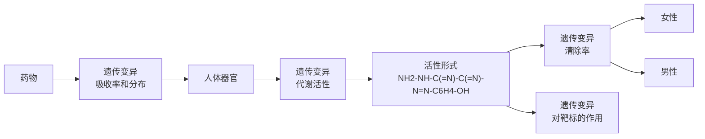

图6-25 药物遗传变异可以影响药物作用的多个方面

话说，就是人对药物的作用；

（2）药效学:涵盖药物靶点对给定药物产生反应的遗传变异，换句话说，就是药物对人的作用。

## 1. 遗传差异影响药物代谢水平

药物代谢可以分为两阶段。第一阶段，药物通过氧化、羟基化或水解产生生物活性分子，有时第一阶段产物也可能是药物失活和降解的中间体。第二阶段，药物通过结合反应，如乙酰化、葡萄糖醛酸化或硫酸化等产生更容易排泄的水溶性化合物。参与这两个阶段的酶通常存在影响其活性的多态性差异，这会影响个体对许多药物的反应。这些酶原本的功能是处理外源性物质，尤其是可能存在于饮食中的植物生物碱（图6-26）。

细胞色素 P450 是一个大的酶家族，它们都具有铁硫活性位点和 450nm 处的光吸收峰，负责药物代谢的第一阶段。它们的作用是将分子氧衍生的单个氧原子插入到非常广泛的有机化合物中。最终产物通常是底物的极性羟基化衍生物。人类有大约 60 个 P450 基因编码酶，它们负责大约 60% 处方药的 1 期代谢，其中至少有 10 种不同的 P450 酶在 1 期药物代谢中具有重要作用。

CYP3A4是肝脏中含量最丰富的P450细胞色素，参与了大约 $40\%$ 的药物代谢。它的活性在个体之间的差异高达30倍。该酶被许多不同物质高度诱导，其变异性主要来源于控制诱导性的上游调控序列变异，尽管也存在一些编码序列变异。CYP2D6参与了大约 $25\%$ 的药物代谢。低代谢者CYP2D6基因有功能丧失型突变，而超快速代谢者的基因拷贝数增加（高达13个拷贝），其活性的变化对一些用于治疗高血压和心脏病的 $\beta$ 受体阻滞剂，以及包括三环类抗抑郁药在内的几种精神药物的反应有显著影响。代谢不良的人有服用这些药物过量的风险。图6-27显示了CYP2D6活性如何

图6-26 药物代谢的阶段第一阶段，药物分子通过氧化、羟基化或水解以产生极性化合物，结果通常是产生活性化合物或降解产物。第二阶段，药物分子可与乙酰基、葡萄糖醛基或谷胱甘肽基偶联，形成可排泄的水溶性分子。

flowchart

---

第四节 遗传检测与遗传咨询

225

控制抗抑郁药物去甲替林的有效剂量。

此外，CYP2D6能将可待因转化为其活性形式吗啡。可待因对代谢不良者的疼痛缓解无效，而超快代谢者则有镇静和呼吸受损等不良反应的风险。CYP2C9可以对药物进行羟基化，靶标包括非甾体抗炎药、磺酰脲类药物、血管紧张素转化酶抑制剂和口服低血糖药物。例如，罕见的代谢不良者对用于治疗2型糖尿病的降血糖剂甲苯丁酰胺反应过度。CYP2C9变异也会影响华法林敏感性。CYP2CI9可以激活某些药物，包括抗惊厥药物（如美芬妥因）、胃动力抑制剂（如奥美拉唑，用于治疗胃溃疡）、孕激素（一种抗疟药）和某些抗抑郁药。高加索人和非裔美国人代谢不良的频率为 $3\% \sim 5\%$ ，但在东方人中更高，在波利尼西亚人中非常高。对于代谢不良者，由于CYP2C19的缓慢去甲基化，标准剂量的地西泮镇静时间延长。相反，丙胍是一种前药，需要CYP2C19激活才能形成活性分子环胍，因此代谢不良者显示出该药物的效果降低。

histogram

| 代谢率 (mg/天) | 患者数量 |
| --- | --- |
| 0.1~0.2 | ~50 |
| 0.2~0.3 | ~68 |
| 0.3~0.4 | ~80 |
| 0.4~0.5 | ~72 |
| 0.5~0.6 | ~86 |
| 0.6~0.7 | ~88 |
| 0.7~0.8 | ~50 |
| 0.8~0.9 | ~30 |
| 0.9~1.0 | ~16 |
| 1.0~2.0 | ~17 |
| 2.0~3.0 | ~12 |
| 3.0~4.0 | ~12 |
| 4.0~5.0 | ~16 |
| 5.0~6.0 | ~10 |
| 6.0~7.0 | ~8 |
| 7.0~8.0 | ~2 |
| 8.0~9.0 | ~1 |
| 9.0~10.0 | ~1 |
| 10.0~20.0 | ~7 |
| 20.0~30.0 | ~7 |
| 30.0~40.0 | ~5 |
| 40.0~50.0 | ~5 |
| 50.0~60.0 | ~2 |
| 60.0~70.0 | ~2 |
| 70.0~80.0 | ~1 |
| 80.0~90.0 | ~1 |
| 90.0~100.0 | ~1 |

图6-27 去甲替林的药物遗传学

药物代谢的第二阶段可能涉及药物的乙酰化、葡萄糖醛酸化、硫酸化或甲基化。N-乙酰转移酶、谷胱甘肽-S-转移酶（GST）和UDP葡萄糖醛酸转移酶的遗传变异是导致许多药物二期活性变化的基础。药物二期活性不足者灭活和排泄相关药物的速度异常缓慢。

人类有两种芳基-N-乙酰转移酶，它们由高度同源的NATI和NAT2基因编码，这两个基因紧密连锁，位于人类染色体8p22上。NATI酶活性相对稳定，但所有人群都表现出具有不同酶活性的NAT2高频多态性。快速乙酰化者和野生型，相比缓慢乙酰化者占主导地位。缓慢乙酰化清除药物和其他外源性物质的速度较慢，因此药物对其敏感性增强。抗结核药物异烟肼的可变乙酰化是药物遗传学中最早观察到的结果之一。在接受标准剂量的药物后，个体血浆药物浓度变化很大，这具有重要的临床意义。缓慢乙酰化者发生周围神经病变的风险增加，这是该药物广为人知的不良反应。乙酰化速率变化在临床上可能具有重要意义，它涉及的其他药物包括普鲁卡因酰胺（一种抗心律失常药物）、肼嗪（一种降压药物）、氨苯砜（抗麻风病药物）和几种磺胺类药物。

GST参与多种外源性物质和致癌物的解毒过程。根据特定GST的不同活性水平，可以将人们分为非偶联者、低偶联者和高偶联者。GST活性低的人可能无法应对高剂量的药物，因为这些药物的第二阶段反应涉及与谷胱甘肽的结合。

许多药物会以葡萄糖醛酸结合物的形式排泄。这些是由 UDP 葡萄糖醛酸基转移酶催化形成的。染色体 2q37 上的 UGTIA 基因座具有特殊结构，它含有 13 个可选的第一外显子，这些外显子剪接到稳定不变的外显子 2\~5 上。外显子 1 可以决定酶

---

226

第六章 人类遗传学与疾病

的底物特异性，而外显子2\~5编码活性位点。其中一种剪接变体UGTIA1负责胆红素（红细胞血红素的正常分解产物）和抗癌药物伊立替康的分解代谢。酶活性降低的UGTIA1变异携带者，与高胆红素血症有关，而且在接受伊立替康治疗时也会出现严重的副作用。

硫嘌呤 -S- 甲基转移酶（TPMT）将甲基从 S- 腺苷甲硫氨酸转移到免疫抑制剂硫唑嘌呤和 6- 硫基嘌呤上，导致其失活。大约 10% 的欧洲人是杂合子，0.3% 是纯合子。这些个体需要较低剂量的药物。当给予标准剂量的任一药物时，纯合子可能遭受危及生命的骨髓毒性。三种相对常见的变异约占低活性等位基因的 90%。

## 2. 药物靶点的遗传变异能够影响药效

遗传差异影响药物反应的另一种方式是通过药效学，即药物靶点对给定药物的特异性反应。药物靶点包括受体、酶和信号转导系统。药物靶点的基因变异会影响药物的疗效。

药效学的许多最重要的应用是在抗癌药物中，这些药物被设计为针对细胞表面受体或其他关键分子的特定突变类型发挥作用。其他药物靶点中的一些自然发生的变异与显著不同的临床反应有关。

血管紧张素转换酶（ACE）是一种将血管紧张素I转化为血管紧张素Ⅱ的肽酶，后者是一种重要的血压调节器，并具有许多其他生理功能。ACE基因内含子中Alu序列的插入/缺失多态性与酶活性的变化有关。缺失纯合子的循环ACE水平大约是插入纯合子的两倍。ACE抑制剂如依那普利和卡托普利广泛应用于治疗心力衰竭。一些报告表明ACE抑制剂对缺失纯合子患者比插入纯合子患者更加有效。插入/缺失多态性也被广泛应用于研究与疾病的相关性。缺失纯合子患心肌梗死和冠状动脉疾病的风险增加，并且更有可能患2型糖尿病并发症，但患晚发型阿尔茨海默病的风险略有降低。

β2 肾上腺素能受体有两种常见的变体——p.Arg16Gly 和 p.Gln27Glu，在许多群体中的频率为 0.4～0.6，并且彼此之间处于强连锁不平衡状态。β 激动剂是最为广泛使用的哮喘治疗药物。Arg16 纯合子和杂合子个体对单剂量平喘药物沙丁胺醇的响应效果分别是 Gly16 纯合子个体的 5.3 倍和 2.3 倍。

位于染色体10q24-26上的β1肾上腺受体基因ADRBI的常见多态性位点p.Arg389Gly与多种药物作用效果相关。Gly389等位基因与β受体阻滞剂的心血管反应降低有关。例如，Arg389纯合子对β受体阻滞剂丁香酚的反应比Gly389等位基因杂合子或纯合子效果要好得多。

尽管上面描述的这些药物遗传学和药物基因组学的研究成果已经为人所知几十年了，但它们对开具处方几乎没有影响，因为它们只解释了影响药物处理效果的许多因素中的一部分。临床医生更多时候会通过反复试验来进行判断。另外还存在时效问题，患者和医生都希望在会诊结束时患者能够拿到处方，而不是等实验室报告了相关基因型后再回来取药。

在癌症病例中，癌症靶向药物往往与配套的基因检测一起上市以确定适用的患者，这是由极高的药物成本驱动的。对于价格较低的药物，在风险只是药物无效的情

---

第四节 遗传检测与遗传咨询

227

况下进行基因检测的动机较小。但是如果存在严重药物不良反应风险，还是需要首先确定患者的基因型。因此，处方前的基因分型被广泛接受用于阿巴卡韦等药物，阿巴卡韦是大多数HIV患者的首选治疗方法，但具有某些特定基因型的人可能会遭受严重的不良反应。

药物遗传学的应用目前还没有被广泛接受，是因为它的目的只是为个体患者提供最有效的剂量，而基因型只是实现这一目标的其中一个因素。如果我们能够有一种像智能手机这样的手持设备，在床边采集一滴血或唾液，并在几分钟内报告相关基因型，或者未来大多数人的全基因组序列可以成为他们标准医疗记录的一部分。那么我们也许会进入承诺已久的个性化医学时代，那时就可以通过基因型确定处方，当然这也取决于基因型对特定临床状况的预测能力。

## 四、DNA检测在法医学中的应用:个体身份识别和关系鉴定

利用 DNA 变异识别个体始于英国科学家亚历克·杰弗里斯（Alex Jeffreys）的开创性工作。1984 年，他从人肌红蛋白基因的内含子 1 中鉴定出一个 33 bp 的串联重复序列。当用这个序列作为人类 DNA Southern 印迹的探针时，检测到了几个不同的杂交带。基于这一结果，开发出了一系列包含相关但较短串联重复序列的探针。这些探针与分布在基因组中的许多不同的高度变异微卫星序列杂交，即可在 Hinf1 消化的人类 DNA Southern 印迹上产生个体特异性的“指纹”。指纹中的单个条带是可重复的，在家系研究中表现为单一等位基因。其中两种新探针 33-6 和 33-15 构成了法医 DNA 指纹的基础（图 6-28）。当仅使用探针 33-15 时，两个随机无关的欧洲人具有相同指纹的概率为 $3 \times 10^{-11}$，两个探针都相同的概率是 $5 \times 10^{-19}$。

自此，DNA 指纹技术彻底改变了法医学，并迅速显示出其在刑事调查和家庭纠纷中的价值。STR 标记的等位基因可以通过精确的重复数来明确定义，报告和记录为 DNA 指纹图谱。如果相关群体中每个等位基因的频率是已知的，那么就可以准确计算出 DNA 样本的来源是嫌疑人，而不是该群体中的无关成员。除了高度多态性外，合适的标记物应该在基因组中分散开，并且能进行尽可能可靠的扩增——它们不应该因为引物结合位点中存在的 SNPs 而有扩增失败的风险。选择引物，从不同的标记中得到长度大小不重叠的扩增产物，以便它们可以进行多重 PCR 扩增。如有必要，可以将填充序列

图 6-28 DNA 指纹的应用

（A）解决有争议的亲子关系。从一位母亲（M）、她的孩子（C）和两位可能的父亲（F1 和 F2）身上获得了 DNA 指纹。箭头表示在孩子身上有而在母亲身上没有。它们可能来自 F1，但不是 F2，因此排除了 F2 是父亲的可能性。（B）刑事调查。从一名强奸受害者的阴道拭子上提取的 DNA 指纹，以及三名嫌疑人的 DNA 指纹。因为棉签可能含有受害者的 DNA（即使经过选择性分离精子头的程序），她自己的 DNA 指纹也会显示出来。嫌疑人 1 号的指纹与样本吻合。数据来源于 Nature，1985，316（6023）:76-79。

---

228

第六章 人类遗传学与疾病

加入引物的 5' 端，以产生合适大小的产物。四核苷酸重复序列通常比二核苷酸更受欢迎，因为它们给出的重复带更少，而且不同的等位基因很容易分离开。

## 1. Y 染色体分子标记

Y 染色体单倍型可以使用 STR 和 SNP 的组合来定义。因为，除非产生罕见的突变，否则男性的 Y 单倍型与所有男性直系亲属（包括非常遥远的亲属）都是共享的。因此，Y 单倍型匹配几乎没有能力将嫌疑人定罪，但不匹配是强有力的排除性证据。Y-STR 的结果可以从含有绝大多数女性 DNA 的样本中获得，例如在性侵犯之后，当常染色体标记物给出令人绝望的混乱模式时，Y 染色体分型可能会在一批嫌疑人中识别出个别犯罪者。除了犯罪调查之外，Y 标记还可以识别遥远的雄性亲缘关系。

## 2. 线粒体 DNA 变异

母亲的线粒体 DNA 在没有重组的情况下可以完整地传递给她的所有孩子，因此，就像 Y 单倍型一样，可以用来追踪远房亲戚关系。常见变异主要出现在 D 环的 HV1 和 HV2 高变区。变异通常通过 PCR 扩增，然后对 HV1 和 HV2 区域测序（通常分别为 342 bp 和 268 bp 的扩增子）来分型。异质性并不罕见，并可能使解释复杂化。由于细胞含有许多线粒体，其 DNA 序列的拷贝数远高于核序列。因此，线粒体 DNA 分型可用于量太少或降解太厉害而无法可靠分型核标记的样品。

## 3. DNA 画像

由于同卵双生子通常在外表上极其相似，他们的面部特征在很大程度上被编码在他们的 DNA 中，那么通过分析犯罪现场样本，可能会产生离开犯罪现场的人的照片特征。图 6-29 展示了通过 DNA 的分析检测进行模拟画像和实际人脸之间的相似程度。

图6-29 DNA样本预测长相

数据来源于 Proc Natl Acad Sci U S A., 117(6): 3053-3062。

真实的人脸（左）和预测的人脸（右）

---

第五节 遗传治疗方法

229

## 4. 父亲身份和亲缘关系检测

与以前基于血型等的方法相比，DNA图谱提供了一种更优越的鉴别亲子关系或其他关系的方法，可以使用经过充分验证的法医标记试剂盒，或任何其他合适的DNA标记。Y染色体和线粒体标记也有许多应用。亲子鉴定可以很容易地排除所谓的父亲，但永远不能绝对证明一个男人是孩子的父亲。其目的是得出一个父权指数，即嫌疑人而不是来自同一人群的任何一个随机男性是父亲的相对可能性。这将基于相关群体中父系等位基因的频率。对于更遥远的关系，计算可能会变得相当复杂。

与法医匹配不同，在亲子鉴定中必须考虑突变的可能性。STR 标记的突变率远高于 SNPs，并且具有非常高的多态性标记，例如可以非常频繁地观察到 SE33 或 DI8S51 突变。每个标记的每个等位基因的特定突变率都有记录，可以纳入计算（较长的等位基因比较短的等位基因突变率更高）。一般规则是，单一的不匹配，特别是如果不匹配只有一个重复单位，并不排除亲子关系。

## 第五节 遗传治疗方法

在我们目前的医疗体系中，了解疾病的致病原因，无论它主要是由遗传引起的，还是主要由环境因素引起的，有时候和它的治疗方法毫无关联。标准的治疗总是直接针对症状的。例如:针对严重的耳聋，无论它是由于遗传变异引起的，还是由于误用氨基糖苷类抗生素引起的，最有效的手段都是佩戴助听器或者移植人工耳蜗。但是对于绝大部分的遗传病，特别是单基因病，往往缺乏有效的治疗手段或者现有治疗方法的效果无法令人满意，这就需要依赖于技术的发展，在充分了解致病分子机制的基础上，建立起遗传治疗手段，以期有效缓解症状甚至获得治愈的希望。

对于某些复杂疾病，例如糖尿病，已经有相当令人满意的治疗方法。但是对于许多其他复杂疾病，治疗方法还不太令人满意或者没有效果。根据定义，复杂疾病在遗传上是复杂的。直到最近，我们对潜在的遗传因素还知之甚少，但遗传学研究已经揭示了很多重要的疾病相关因素，特别是自身免疫性疾病，以及越来越多的肿瘤相关因素。遗传学研究能够将复杂疾病区分为不同的亚型，采用针对不同疾病亚型的治疗方法来分别进行治疗。目前层出不穷的新技术和新知识将使我们能够更好地开发出新的更加有效的治疗方法。

本节主要关注如何采用基因治疗等遗传方法来治疗疾病。这些方法大部分应用于治疗遗传疾病（主要是单基因病，但也有一些方法可以用于治疗某些类型的复杂疾病），但它也可以通过赋予宿主抵抗病原体进入的方式治疗某些类型的感染性疾病。在本节中我们首先将治疗分为3个大的类别，分别探索各自适用的遗传治疗方法（图6-30）。然后介绍基因治疗的原理和一般方法，这些方法涉及对患者细胞进行基因修饰或移植经过基因修饰的细胞。之后我们将探讨使用可编程核酸酶进行治疗性基因组编辑的潜在应用前景和存在的风险。最后介绍一些采用遗传手段治疗或预防疾病

---

230

第六章 人类遗传学与疾病

flowchart

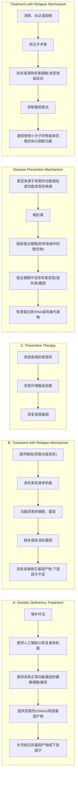

图6-30 遗传疾病的不 的其他方法，例如治疗性RNA干扰和线粒体替换等。同主要治疗策略

## 一、遗传治疗方法概述

## 1. 增补疗法

如果遗传疾病是由于基因缺陷引起的基因产物缺乏或者功能丧失，那么可以进行补充治疗，即向患者提供严重耗竭或者缺乏的物质，从而克服缺陷并恢复功能。这种补充强化可以在不同水平上恢复不同级别的功能。

在个体水平上，可以采用常规治疗手段，例如提供人工耳蜗植入或助听器来治疗遗传性耳聋。在细胞和器官水平上，可以将健康的细胞或器官移植到患者体内来产生患者所缺乏的产物，例如骨髓或器官移植。

在分子水平上，可以通过提供纯化的基因产物来恢复表型，比如在许多先天性代谢缺陷中缺少某种用于催化代谢反应的酶。或者当基因产物是在合成一些重要的下游因子（如脂质激素）所需的生物途径中发挥作用时，基因缺陷可能会导致其所合成的下游因子的缺乏。在这种情况下，也可以直接提供纯化的下游因子（如上面提到的脂质激素）。在更加基础的分子水平上，许多基因补充疗法是直接将编码缺失产物的cDNA转移到患者的受累组织中，在那里它可以通过转录表达出缺失的蛋白质。此外，

---

第五节 遗传治疗方法

231

也可以对患者的细胞进行基因修饰，使它能够表达出所需的基因产物。

通常隐性疾病（患者的两个等位基因都失去了功能）比显性疾病更加适合分子水平的补充治疗。因为隐性疾病的受累个体通常无法制造出任何有功能的正常基因产物。对受累个体进行中等效力的递送（包括健康细胞、基因或蛋白质）就可以达到有效的治疗。然而，对某些隐性遗传病患者来说补充疗法并不适用，要么是因为很难获得所需分子，要么是难以对它们进行有效的递送。在由于单倍剂量不足引起的显性遗传病中，即使所有的二倍体细胞中都存在一份正常等位基因也会发病，因此需要非常高效的递送手段和高水平表达缺失的基因产物，所以目前的补充疗法还不能够应用于治疗单倍剂量不足引起的单基因病。此外，补充疗法也可以应用于某些复杂的疾病，例如采用纯化的胰岛素和胰岛细胞移植来治疗糖尿病。

## 2. 抑制疗法

如果是由于功能获得型突变造成的显性有害效应而不是基因缺乏导致的疾病，那么就不能够采用补充疗法。因为这类疾病中出现的问题是无法通过简单地给患者补充正常基因、正常基因产物或正常细胞来纠正的。需要采用与前面所述完全不同的抑制疗法。这种有害效应也可以在个体表型水平上进行治疗，例如对于各种发育畸形，像先天性心脏缺陷、唇腭裂和幽门狭窄这类复杂疾病，直接进行矫正手术会非常有效。

在分子水平上，也可以在不同阶段进行治疗。许多先天性代谢异常中，有害代谢产物水平的升高可以通过各种不同的方式来解决。更常见的问题是由突变基因产生的显性有害基因产物，例如突变的朊病毒蛋白和 $\beta$ 淀粉样蛋白产生的对细胞有害的蛋白质聚集体，以及短寡核苷酸重复序列不稳定扩增后形成的有害蛋白质或RNA。这种情况可以通过使用小分子药物或治疗性单克隆抗体选择性地与突变分子结合并抑制其活性来拮抗有害的突变基因产物。在某些情况下，也可以通过使用RNA干扰策略在mRNA水平上选择性地抑制有害基因的表达。除了靶向有害突变RNA外，RNA干扰也可以靶向感染性疾病中位于细胞内的病原体基因。此外，还可以采用治疗性基因编辑在基因水平上逆转突变并恢复原始序列。

在细胞水平上，疾病可能表现为产生了有害的细胞。有些突变导致细胞行为异常，例如细胞过度增殖导致癌症，可以采用已经长期使用的常规方法（例如:手术切除、放疗和化疗）、靶向性的化学和生物药物，以及肿瘤基因治疗来清除癌细胞从而治疗癌症。在一些遗传疾病中，某些免疫细胞不适当地攻击宿主细胞，引起过度的免疫反应，例如:自身免疫性风湿病或炎症性克罗恩病。在这种情况下，可以采用下调免疫反应的治疗方法。但是在某些癌症的基因治疗中，有时候会反其道而行之，通过上调免疫反应以试图杀死癌症细胞。

## 3. 改变疾病易感性

第三种治疗疾病的方法试图以某种方式通过降低对疾病的易感性来治疗某些单基因病和一些复杂疾病。在先天性代谢异常中，阻断代谢途径中的某一个步骤可以激活替代途径，导致毒性代谢产物的积累。但这种情况有时可以通过降低疾病易感性来克服，比如消除环境触发因素。例如苯丙酮尿症患者可以通过控制苯丙氨酸的摄入来避

---

232

第六章 人类遗传学与疾病

免有害产物造成的神经损伤。在某些疾病中，可以通过操纵关键的易感因素，以减少疾病复发的机会或降低进行性疾病的影响。

## 二、基因治疗

基因治疗是遗传学方法治疗疾病的终极应用。它依赖于对患者的细胞进行基因修饰，包括将基因修饰的细胞移植到患者体内，或者将遗传物质直接原位输送到患者体内。基因修饰包括向细胞内转入人工构建的基因，通常是DNA分子。但从广义上来讲，人工构建物也可以是RNA或者寡核苷酸。如果人工构建物是专门针对RNA转录物的，通常称作RNA治疗。不同基因治疗策略中使用的基因类型见图6-31。

基因增补可以应用于功能丧失型疾病，但目前仅限于治疗由于缺乏或几乎完全没有某些基因产物造成的隐性疾病。其目的仅仅是将克隆的有功能基因拷贝转移到患者细胞中，以制造出缺乏的基因产物。基因沉默应用于由显性有害基因产物引起的疾病。如果功能获得型突变除了产生正常基因产物外，还产生有害的突变基因产物，则可以尝试通过靶向突变RNA转录物来选择性地抑制突变等位基因的表达。同样的方法也可以应用于治疗自身免疫性疾病和传染病。其他方法寻求通过使用基因组编辑将突变等位基因序列转化为正常等位基因序列，来修复DNA损伤或最小化致病突变的影响。癌症基因治疗策略通常依赖于杀死癌细胞。其目的是直接杀死细胞（通过插入和表达克隆基因来产生一些细胞毒性产物和细胞死亡）或间接杀死细胞，通过将基因转移到健康的免疫系统细胞中，以刺激针对肿瘤的增强免疫反应。

图6-31 不同基因治疗策略中的基因类型

---

第五节 遗传治疗方法

233

根据转基因细胞能否将人工构建物传给后代，可以将潜在的基因治疗分为两大类:

（1）体细胞基因治疗:该疗法针对患者的体细胞或组织，基因改造的任何后果都仅限于该患者本身。这种类型的基因治疗可以用于修饰体细胞的细胞核 DNA。
（2）生殖细胞基因治疗:在体外受精的过程中对配子或早期胚胎的DNA进行基因修饰。基于伦理原因，旨在修饰核DNA的生殖细胞基因治疗在人类中被广泛禁止（因为这种基因修饰可以传递给后代并对后代产生影响）。然而，旨在修饰线粒体DNA以阻断严重线粒体疾病传递的生殖细胞基因治疗则是另一回事，该治疗目前已经在英国合法化了。

基本上目前所有的人类基因治疗试验和方案都是围绕修改体细胞基因组来开展的。然而，随着基因治疗成功案例的积累，以及技术变得越来越精细和安全，将该技术拓展到生殖系细胞中修饰核DNA的诉求会越来越多。基因优化和“设计婴儿”的可能性会不可避免地引发伦理问题。

## 三、基因组编辑疗法

基因治疗的早期成功使用了基于同源重组的基因组编辑技术，但目前越来越多地采用可编程核酸酶的基因组编辑技术。它使用人工设计的核酸内切酶在所需的靶位点制造出双链断裂，从而对细胞基因组内的特定序列进行精确改变。不同治疗性基因组编辑的策略见图6-32。使用基因组编辑治疗遗传疾病的一般策略是用等效的正常序列（基因校正）取代致病基因中的突变序列。大部分治疗性基因组编辑最终可能会出现在这一领域。更为复杂的基因组编辑是上调基因的表达以减轻因功能丧失而引起的疾病，例如:通过上调一种产生功能相关蛋白质的基因来补偿肌营养不良蛋白质的丧

flowchart

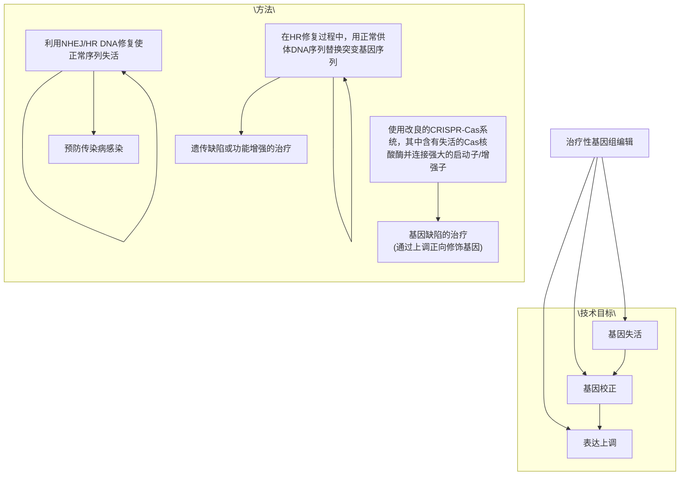

图6-32 治疗性基因组编辑的不同策略

---

234

第六章 人类遗传学与疾病

失。基因失活可以应用于特定的传染性疾病，因为病原体需要识别特定的人类细胞表面蛋白质才能感染细胞，所以失活该细胞表面蛋白质可以预防感染。

目前主要使用的基因编辑手段是CRISPR-Cas系统，它是通过转入产生核酸内切酶的基因和可以结合核酸内切酶的相关RNA引导序列来发挥作用的。RNA引导序列通常与靶序列互补，在结合核酸酶后引导RNA寻找基因组中的互补序列，将核酸内切酶定位到靶序列，并在那里造成DNA双链断裂。

在这些方法中，最终目的都是在细胞内特定靶位点造成DNA双链断裂，然后依赖不同的DNA损伤修复途径来修复DNA双链断裂。在非同源末端连接（non-homologous end joining，NHEJ）途径中，DNA修复过程中经常会发生随机错误，因此修复片段的序列可能因细胞而异，之后可以在其中筛选出含有所需序列变化的细胞。或者人为引导DNA采用同源重组（homologous recombination，HR）途径进行修复，这样就可以通过复制转入的基因序列以产生所需的序列变化。

治疗性基因组编辑的步骤包括:修改取自患者细胞中的特定基因序列、筛选具有所需序列的细胞、将这些细胞重新输入患者体内。最为通用的治疗性基因组编辑是用正常序列来替换突变的基因序列，这一方法可以应用于任何遗传疾病，包括功能获得型突变导致的遗传病。治疗性基因组编辑的另一个潜在的应用是通过使宿主细胞对病毒感染具有抗性来治疗传染病，例如HIV治疗的例子。

由于CRISPR-Cas技术特别容易实施，而且非常有效，逐渐成为了可编程核酸酶的主流技术手段，并且得到了更为广泛的应用。但是该方法的缺点是核酸酶Cas切割的特异性高度依赖于所使用的CRISPR RNA，并且很可能发生脱靶效应。也就是说，Cas核酸酶有时可能会在基因组的其他地方切割与靶标类似的序列。这是基因治疗应用中需要特别关注的问题，例如:某个脱靶效应可能会激活原癌基因。目前人们仍在积极探索提高Cas核酸酶特异性的各种方法，例如:将结构刚性修饰的寡核苷酸（也称为桥接核酸）掺入CRISPR RNA中。

## 四、其他治疗或预防疾病的遗传方法

## 1. 利用 RNA 干扰的基因沉默疗法

如果遗传病是由于功能获得型突变或显性负效应引起的，那就必须选择性地抑制突变基因的表达，并将其对正常等位基因的影响降到最低。通常的策略是使用各种技术来实现基因沉默。最初的尝试是使用基因特异性反义RNA与突变基因的转录产物结合，选择性阻断其表达或者设计特异性的核酶（RNA酶）来切割特定的RNA转录物。然而在体内，长的单链RNA非常容易降解。因此最常用的治疗性基因沉默方法是利用RNA干扰（RNAi）。这是一种先天防御机制，可保护细胞免受入侵病毒的侵袭，也可以保护细胞不受转座元件过度活跃的影响。

治疗性 RNAi 是将含有与感兴趣基因的正常 RNA 转录物的一部分序列相对应的短双链 RNA 递送到靶细胞内。这些短双链 RNA 会诱导沉默复合物（RISC）启动下游信

---

第五节 遗传治疗方法

235

号途径，导致任何含有与引入的 RNA 序列相同的 RNA 转录物被降解，从而丧失功能。在这一过程中，递送到细胞内的既可以是各种不同类型的短链 RNA，也可以使用能够转录加工出双链 RNA 的质粒 DNA（图 6-33）。

长期以来，治疗性基因沉默一直受到各种问题的困扰。最初，人们主要担忧的是脱靶效应引起的细胞毒性（除了预期转录物外，其他基因的RNA转录物也会受到影响）和引入RNA导致的免疫原性。此外，如何将短链RNA有效递送到靶细胞中也是一个巨大的挑战。目前在递送方面已经取得了重要进展:阳离子脂质转移系统是现在应用最广泛的RNA递送系统。此外，也可以使用不同的偶合物将RNA特异性地靶向到某些特定的细胞类型，例如:siRNA可以与N-乙酰氨基半乳糖结合从而靶向递送到肝细胞，因为N-乙酰氨基半乳糖可以与肝细胞上存在的去唾液酸糖蛋白受体相互作用，促进肝细胞的内吞作用。

flowchart

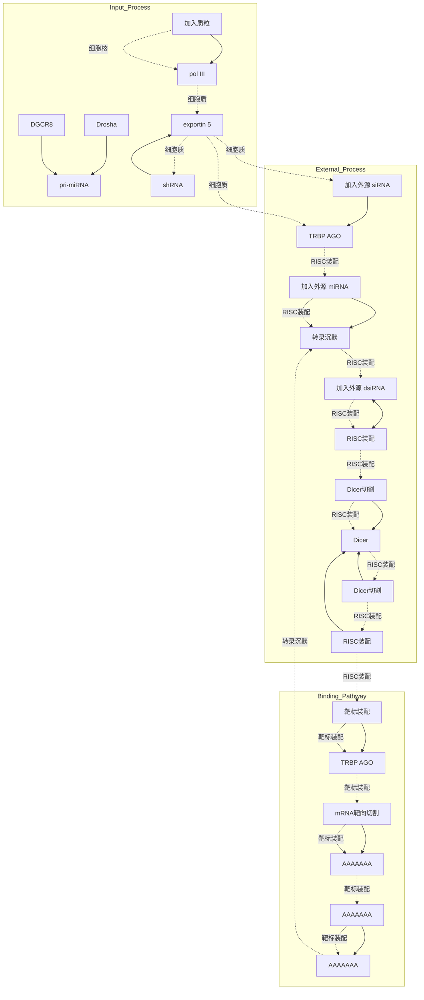

图 6-33 RNAi 疗法

很多组织可以作为合适的 RNA 治疗靶点，特别是眼。Macugen 是第一个被批准的 RNA 治疗药物。它通过抑制眼中血管内皮生长因子的表达来治疗黄斑变性（黄斑变性是成人失明的主要原因）。基因递送手段的发展也使肝脏成为静脉注射或皮下注射的合适靶点。截至 2018 年，使用 RNA 疗法的 40 多项不同临床试验正在进行中，其中几项已经进入临床试验Ⅲ期。

## 2. 控制剪接

不太常用的一种治疗疾病的方法是迫使疾病基因改变其剪接模式，从而显著减少致病突变的有害影响。因此，可以将反义寡核苷酸设计成与pre-mRNA转录物中的特定剪接区域结合。阻断剪接区域与剪接体复合体的相互作用会导致外显子跳跃。诱导外显子跳跃可能适用于外显子中包含有害突变并且其核苷酸数量正好可以被三整除（这样可以保持开放阅读框不变）的情况。或者它可以用于纠正导致移码的缺失突变，但前提是缺失一个外显子不会产生灾难性的后果。

一个典型的例子是杜氏肌营养不良症。这种非常长的肌营养不良蛋白利用N端和C端的重要功能序列作为“钩子”，将肌肉细胞的收缩单元连接到质膜上，因此相当大一部分的中央区域蛋白片段在功能上就不那么重要了。如果它被突变删除，就会产生一个更短的蛋白质，可以继续发挥作用，但效率相对较低。因此，跨越X连锁肌营养不良蛋白基因的多个中间外显子的大段非移码缺失与轻度表型相关，而中间外显子中的无义突变、移码突变，以及移码缺失反而会导致严重表型。如果诱导外显子跳

---

236

第六章 人类遗传学与疾病

跃，就可以恢复具有移码缺失或有害点突变的突变基因的开放阅读框，使得肌营养不良蛋白的功能显著恢复。

## 3. 线粒体替代疗法:通过种系改造预防遗传疾病传播

成功的体细胞基因治疗之路肯定不是一帆风顺的（实际上曾经导致数人死亡），但至少影响仅限于接受治疗的人。人类生殖细胞的基因改造是一个完全不同的命题:在这里，其后果可能延伸到后代。生殖细胞基因疗法的支持者认为，随着基因改造技术的不断完善，生殖细胞基因改造可以用来根除各种严重的遗传疾病，如亨廷顿舞蹈症。相反的观点是没有必要进行生殖细胞的基因治疗，哪怕胚胎的基因修饰是 $100\%$ 准确可靠的。直接对有携带严重致病性突变的潜在父母采用体外受精并使用基因筛查来选择不携带突变的胚胎，不是更简单吗？目前，对人类生殖细胞的核DNA进行改造的基因治疗方法被各国广泛禁止，但对人类生殖细胞中线粒体DNA（mtDNA）的修饰则是另一回事。

mtDNA 的突变是一部分疾病的重要原因，它们沿着母系传播。但在许多女性中，

线粒体异质性（野生型和突变型mtDNA分子共存的现象）使得情况复杂化。对于携带特定的致病性突变导致的线粒体遗传病，其严重程度由线粒体突变程度、突变与野生型mtDNA的比例来决定。

flowchart

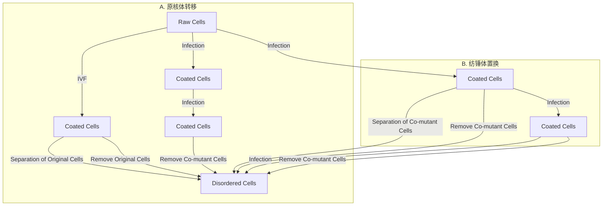

图 6-34 线粒体替代疗法

线粒体遗传病目前没有足够有效的治疗方法，其中一些疾病很严重，有时是致命的，会导致流产或夭折。因此临床工作的重点是预防。然而，在早期卵子发生过程中，mtDNA拷贝数显著减少，来自同一母亲的不同卵母细胞的突变mtDNA可能会出现显著差异（瓶颈效应）。因此准确预测儿童未来的疾病风险是不可能的。植入前基因诊断无法适用于卵母细胞始终含有高突变负荷的女性。相反，在这种情况下，可以采用线粒体替代疗法。采用来自健康女性捐赠者的去核卵母细胞作为正常线粒体的来源，核基因组由未来的父母提供，共同形成用于试管婴儿的杂交胚胎。核基因组可以以核体的形式提供，核体可以在受累的母体卵母细胞与父系精子体外受精后通过原核体转移或受精前通过纺锤体转移（图6-34）来获得。

由于受精卵是用健康的供体 mtDNA 代替异常的母体 mtDNA 形成的，因此可以视为一种生殖细胞基因疗法，所以在许多国家是被禁

---

推荐阅读

237

止的。然而2015年英国修改了法律，允许通过原核转移进行线粒体替代疗法。2016年末，该项目获得了英国监管机构人类胚胎和受精管理局的批准。2016年，在墨西哥首次使用人类线粒体替代疗法产生了第一个由线粒体捐赠产生的三亲婴儿。该治疗旨在预防一种会导致早期流产或幼儿死亡（通常在2\~3年内）的严重神经系统疾病——Leigh综合征。这对来自约旦的父母之前曾4次流产，两个侥幸出生的孩子也在很小的时候死于这种疾病。令人鼓舞的是，三亲婴儿的线粒体突变量很少，但仍需要仔细监测。

## ※ 复习思考题

1. X 染色体随机失活会导致伴 X 遗传病在女性中的表型发生怎样的变化？
2. 比较连锁分析和二代测序在鉴定单基因病致病基因方面各自的优点和缺点。
3. 目前认为在复杂疾病中存在“丢失的遗传率”问题，即哪怕是通过全基因组关联研究找到的易感位点全部加起来也无法解释该复杂疾病的遗传率，那么发生“丢失的遗传率”可能的原因是什么？
4. 你认为适用于个体诊断的遗传检测是否也一样适用于群体筛查？
5. 你认为哪些疾病类型可以采用遗传方法来进行治疗？遗传治疗方法与传统的治疗方法相比，具有哪些优势？

## ※ 推荐阅读

1. WILKIE A O. The molecular basis of genetic dominance[J]. J Med Genet, 1994, 31: 89–98.
2. FALCONER D S, MACKAY T F C. Introduction to Quantitative Genetics[M]. 4th ed. New York: Longmans Green, 1996.
3. HARPER P S. Practical Genetic Counselling[M]. 7th ed. Boca Raton: CRC Press, 2010.
4. OTTJ, WANG J, LEAL S M. Genetic linkage analysis in the age of whole genome sequencing[J]. Nat Rev Genet, 2015, 16: 275–284.
5. LELIEVELD S H, SPIELMANN M, MUNDLOS S, et al. Comparison of exome and genome sequencing technologies for the complete capture of protein coding regions[J]. Hum Mutat, 2015, 36: 815–822.
6. KIRCHER M, WITTEN D M, JAIN P, et al. A general framework for estimating the relative pathogenicity of human genetic variants[J]. Nat Genet, 2014, 46: 310–315.
7. The WELLCOME TRUST CASE CONTROL CONSORTIUM. Genome-wide association study of 14,000 cases of seven common diseases and 3,000 shared controls[J]. Nature, 2007, 447: 661–678.

---

238

第六章 人类遗传学与疾病

8. LAPPALAINEN T, LI Y I, RAMACHANDRAN S, et al. Genetic and molecular architecture of complex traits[J]. Cell, 2024, 187: 1059–1075.
9. RICHARDS S, AZIZ N, BALE S, et al. Standards and guidelines for the interpretation of sequence variants: a joint consensus recommendation of the American College of Medical Genetics and Genomics and the Association for Molecular Pathology[J]. Genetics in Medicine, 2015, 17: 405–424.
10. EL C G V, CORNEL M C, BORRY P, et al. Whole-genome sequencing in health care. Recommendations of the European Society of Human Genetics[J]. Eur J Hum Genet, 2013, 21: 580–584.
11. WANG L, MCLEOD H L, WEINSHILBOUM R M. Genomics and drug response[J]. New Engl J Med, 2011, 364: 1144–1153.
12. NALDINI L. Gene therapy returns to centre stage[J]. Nature, 2015, 526: 351–360.
13. COX D B, PLATT R J, ZHANG F. Therapeutic genome editing: prospects and challenges[J]. Nat Med, 2015, 21: 121–131.

（编写:卢大儒、杨雪艳；审读:黄涛生）
