# 第十三章 神经系统发育

原始 PDF 第 392–425 页。

# 第十三章

## 神经系统发育

神经系统是生物体感知、传递和响应刺激的复杂结构网络，主要分为中枢神经系统（包括脑和脊髓）和周围神经系统（包括所有的神经和神经节）。中枢神经系统负责处理和整合来自身体各部分的信息，并生成适当的响应。周围神经系统负责将信息从感觉器官传递到中枢神经系统，并将中枢神经系统发出的指令传递到身体的各个部分。

神经发育是指神经系统从胚胎发育到系统功能成熟的过程。成熟的神经系统由神经元和胶质细胞两类细胞组成，两者之间相互作用紧密。神经元利用轴突（axon）传送电信号，通过突触（synapse）与其他细胞通信。树突（dendrite）是神经元的一部分，主要负责接收来自其他神经元的信号和信息。神经元类型众多，各有特殊的形态和功能，其胞体（soma）直径从几微米到一百多微米不等，轴突最长能达到一米多，最短的只有几微米。胶质细胞同样具有多种不同类型。神经元和胶质细胞之间的相互作用非常精确，使神经系统有效运作。

早期胚胎细胞数量很少。随着胚胎发育，细胞数量越来越多，新的细胞与先前存在的细胞相互作用，以特定的方式分化，从而增加生物体的复杂性。在细胞分化过程中，神经元和胶质细胞同样有组织地获得其分子、结构和功能的多样性。神经系统具有丰富的细胞多样性和高度有序的组织结构，在生物体中发挥着重要的生理功能。在本章中，我们将对神经系统发育的过程进行阐述，包括:①神经干细胞和早期神经系统结构如何产生；②神经系统的区域性结构如何形成；③神经元和胶质细胞如何产生、迁移和成熟；④神经元之间如何形成神经网络。

本章阐述的重点是神经系统从发育成熟到行使功能的具体过程，尤其是控制神经细胞以正确的类型、数目和连接出现在正确的位置并发挥其正确功能的细胞和分子机制。

---

第一节 神经系统的解剖结构和神经发育研究的模式生物

377

## 第一节 神经系统的解剖结构和神经发育研究的模式生物

神经系统的组织结构通常是基于三个轴来描述的。首先是背腹轴（dorsal-ventral axis），它从动物的背部到腹部延伸。然后是A/P轴（anterior-posterior axis），它描述了从动物的头部到尾部的位置。最后是内外轴（medial-lateral axis），它用于描述结构相对于主体的位置。这些轴将用于详细描述不同神经系统结构的位置和功能，从而为神经发育的深入研究提供基础。理解这些轴对于描述神经系统不同解剖结构的位置和定位至关重要（图13-1）。

神经系统的发育在各种生物中都有共通之处，学术界常用线虫、果蝇等非脊椎动物和爪蛙、斑马鱼、鸡、小鼠等脊椎动物为模型研究神经发育。这些动物在神经发育研究中各具独特优势。

线虫是一种小型透明生物，仅有约1000个细胞，其中包括302个神经元和56个胶质细胞。这些神经元组成了神经索（nerve cord），分布在动物的背部、腹部以及一些侧面。线虫因其迅速的发育、简单的结构和可重复的细胞分裂模式而成为理想的神经发育研究对象。科学家容易追踪神经元的发育和功能，从而深入研究神经环路的形成和神经信号传导的机制。此外，线虫的基因组已被完全解析，使得研究特定基因对神经发育的影响变得更加容易。

果蝇在昆虫研究中具有代表性，它的神经系统主要来自细胞在胚胎表皮的腹侧部分。神经发育始于成神经细胞（neuroblast）的分化和细胞迁移，最终形成完整的神经系统。果蝇的遗传工具和遗传多样性使得科学家能够研究特定基因对神经发育的影响，同时其相对简单的神经系统结构有助于解析神经环路的功能。

爪蛙和斑马鱼卵大型、外部受精以及胚胎透明等特点，使得实验操作和神经发育过程中对神经元迁移、突触形成等细胞行为的观察变得非常便捷。

鸡的卵非常易于获得和储存，孵化周期短，并且神经系统可在短时间内发育完善，还可以通过在蛋壳上开窗口相对容易地观察和操作。

小鼠与人类在神经结构和DNA层面存在高度相似性，为研究人员提供了一个理想的模型，以了解人类神经结构的发育。

通过比较不同物种的神经发育过程，我们能够识别出共同的分子机制和关键信号

图13-1 神经系统不同解剖结构的位置和定位（A）成年小鼠中枢神经系统基本结构；（B）成年人神经系统基本结构；（C）成年人脑冠状切片及脊髓冠状切片。

---

378

第十一章 神经系统发育

通路，这有助于揭示神经系统如何在不同生物中形成和发育。这些模式动物在神经科学领域的研究中起到了关键作用，为我们揭示了神经系统发育的奥秘，并为神经疾病治疗提供了有力的依据。

## 第二节 神经诱导

神经系统高度有序地存在于生物体中。关于生物体如何系统构建神经系统一直以来都是十分重要的问题。尽管不同物种间的神经系统结构和功能存在多样性，但所遵循的基本发育规律是保守的。神经系统发育的第一步就是囊胚中某些细胞如何确定其神经发育走向。这一过程被称为神经诱导（neural induction）。囊胚发育中处于特定位

flowchart

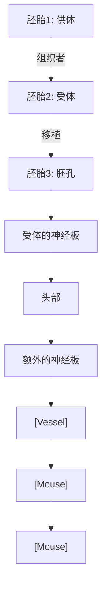

图13-2 移植实验表明两栖动物的胚孔背唇能够诱导神经组织的形成

施佩曼和曼戈尔德将有色素的 dorsal blastopore lip 细胞（红色）移植到无色素宿主胚胎的胚孔（A）。第二个身体轴在发育中产生，包括眼、脑、脊柱等（B～D）。

置的部分干细胞会在特定的时间段获得神经干细胞特性，开始神经系统发育。那么，神经干细胞是如何产生的？早期神经系统的结构是怎样的？调控此过程的分子机制是什么？不同物种神经系统发育的过程差异是如何的？我们将主要对脊椎动物的神经诱导过程提供一个简明的、有内在联系的阐述，与此同时，也有选择地对其他物种的神经诱导进行扼要介绍。

## 一、神经诱导的发现

德国科学家施佩曼和曼戈尔德最早发现囊胚中存在特定的细胞负责神经系统的发育。他们将蝾螈囊胚中某一特定细胞群移植到另一个囊胚上，胚胎随后就会发育出两套神经系统，重要的是，第二套神经系统中存在由受试胚胎发育出来的组织，这就表明这些特定细胞群可以诱导受试胚胎本来不具备神经发育特性的细胞具备神经发育特性。由于此细胞群在早期神经系统发育起重要的塑造作用，因此被称为“组织者”（organizer）。科学家们进一步将脊椎动物囊胚中的“组织者”称为施佩曼组织者（Spemann organizer），其他动物如鸟类、鱼类和哺乳类囊胚中也发现了类似的细胞群并被统称为原结或亨氏结（Hensen's node）（图13-2）。

## 二、神经诱导的具体过程

胚胎初期呈平圆盘状，由3层截然不同的细胞层

---

第二节 神经诱导

379

组成，分别为内胚层、中胚层和外胚层。内胚层主要发育为内脏组织器官，中胚层发育为骨骼和肌肉，神经系统和表皮全部由外胚层发育而来。胚胎早期外胚层还只有一层薄薄的细胞。在外胚层特定位置具备神经系统初始发育特性的一群细胞被称神经干细胞（neural stem cell），它们组成的结构为神经板（neural plate），将发育成神经系统。神经板边缘增厚，形成神经褶（neural fold）。神经褶在中线融合、形成中空的神经管（neural tube）。神经管将发育为中枢神经系统（central nervous system），神经管唇的融合失败会在脊椎动物中导致脊柱裂和无脑畸形。神经褶唇部的部分细胞平行迁移到神经管和表皮外胚层的下方之间形成神经嵴（neural crest），以后将发育为周围神经系统（peripheral nervous system）（图13-3）。

## 三、BMP 分子调控神经诱导

骨形态发生蛋白（bone morphogenetic protein，BMP）在神经诱导中起着重要作用。正常的外胚层细胞具有BMP受体，这些受体对BMP做出反应并引导细胞发育成表皮。如果降低外胚层细胞的BMP受体数量或活性，或者通过将外胚层进行解离培养进而人为降低细胞周围的BMP浓度，外胚层细胞将发育成神经元而不是表皮。外胚层中的组织者会产生抑制BMP信号的分子来促进神经诱导，从而阻止其细胞命运向着表皮发育。那么，组织者的产生的诱导神经组织发育的分子是什么呢？noggin是最早发现的可以诱导神经发生的活性分子。

图13-3 神经管的形成神经板在神经嵴（浅红色）处闭合卷成一根神经管。与此同时，神经嵴细胞（亮红色）迁移融合到神经管下方，开始周围神经系统发育。

此后，chordin、follistatin和cerberus等组织者特有的神经发生诱导分子被相继发现。实验表明它们都能和BMP受体结合并抑制其活性，在非洲爪蛙胚胎中降低这些蛋白质的表达会使动物出现严重的神经板缺失（图13-4）。

## 四、调控神经诱导的信号通路及转录因子

除上文介绍的经典 BMP 分子可以调控神经诱导，还有其他信号分子参与了神经诱导。例如，在脊椎动物中，大量的证据表明，成纤维细胞生长因子（fibroblast growth factor，FGF）和 Wnt 信号通路可以调控神经诱导。有实验证实抑制 Wnt 信号或激活 FGF 信号可以在外胚层中产生神经诱导分子。另外，神经诱导分子 cerberus 不仅能拮抗 BMP，也可以拮抗 Wnt。有证据表明，FGF 不是直接的神经诱导因子，但是 BMP 拮抗剂产生的神经诱导需要 FGF 表达，通过调控 FGF 的表达可以改变细胞内 BMP 的水平而产生与 BMP 自身拮抗剂相似的效果。

转录因子在神经诱导的过程中起着重要的调控作用。例如，在进化上高度保守的转录因子Zic和Sox家族对脊椎动物和无脊椎动物胚胎的神经外胚层发育尤其重要。

---

380

第十三章 神经系统发育

flowchart

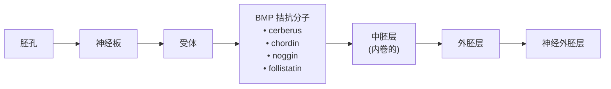

图13-4 基于两栖动物研究产生的神经诱导结论胚孔背部中胚层分泌的分子抑制部分外胚层中的BMP浓度，低浓度位置的外胚层细胞转化为神经干细胞。

我们可以观察到Zic和Sox基因在早期神经外胚层中高表达，而且能发育为神经细胞的外胚层细胞表达了许多Sox基因家族成员。Zic基因也在神经诱导早期激活表达。阻断BMP信号，就会诱导Zic基因的表达，显示Zic基因对神经诱导的促进作用。如果将Zic基因的功能阻断，将会抑制神经板中Sox2基因的表达，进而造成神经板发育的巨大缺陷。转录因子Churchill对鸡的神经诱导十分重要，它是神经板特化所必需的。研究发现对FGF产生应答的神经组织会表达Churchill，Churchill对于合成一些抑制中胚层基因表达的因子是必需的。

## 五、神经诱导过程的物种间保守性

在脊椎动物和无脊椎动物之间，神经诱导过程及相关因子可能都通过一种相似的机制起作用。BMP拮抗因子chordin在黑腹果蝇中的同源基因Sog（short gastrulation）表达在果蝇胚胎腹侧，将Sog显微注射到胚胎的非神经发生区域会导致该区域转变为神经发生，Sog的敲除则会导致成虫表皮扩张和神经来源性组织减少。之后的研究进一步发现，Sog可以直接拮抗果蝇具有BMP相似功能的转化生长因子β样蛋白质Dpp（decapentaplegic）。Dpp的功能缺失突变与Sog功能缺失结果相反，会导致果蝇神经源性组织的扩张和表皮系统的减少（图13-5）。这些证据表明无脊椎动物神经诱导的分子调控过程与脊椎动物调控机制类似。

脊椎动物神经系统的发育开始于早期胚胎背侧外胚层中神经板的形成。神经板通过卷曲形成神经管和神经嵴。随后，神经管发育成中枢神经系统，神经嵴发育成周围神经系统。神经板是外胚层特定区域细胞受到胞外因子影响产生，胞内信号通路与转录因子亦作用于此过程。BMP信号对神经板产生的抑制作用是最经典的神经诱导分

---

第三节 神经外胚层的模式化

381

text_image

背侧的梯度
腹侧
Sog
Dpp Snail
Sog

A

text_image

外胚层
神经外胚层
背侧
后部
腹侧
神经外胚层
Dpp
Sog
内胚层
Dpp
外胚层
神经外胚层
内胚层
侧边外胚层
Sog

B

C

图13-5 果蝇中的神经诱导

Dpp 表达在果蝇胚胎的外胚层背侧，Sog 表达在果蝇胚胎的外胚层腹侧，神经外胚层的 Sog 会拮抗 Dpp 的表达从而保证该区域顺利发育为果蝇神经系统。

子过程，FGF、Wnt信号通路和Zic、Sox等转录因子也共同参与了神经诱导的具体过程。脊椎动物与非脊椎动物的神经诱导遵循相似的分子调控机制。

## 第三节 神经外胚层的模式化

成熟的神经系统由不同的结构和功能组成。其中最显著的区别是它们沿着前后轴的分布，即大脑位于前端，而脊髓（脊椎动物）或神经索（无脊椎动物）位于后端。这些结构的胚胎起源可以追溯到神经外胚层的前后轴分化过程。这种分化始于早期的神经外胚层（脊椎动物中为神经板），并在随后的发育阶段中进一步细化。最初，分化的区域在外观上非常相似，只能通过基因表达差异来区分。随着时间推移和神经系统的发育，每个区域的细胞行为和形态差异逐渐显现和细化。总之，一旦神经外胚层建立起来，下一步就是将其分割成多个区域，为成熟神经系统结构的区域专门化奠定基础。这一过程被称为神经外胚层模式化。许多信号分子已被发现参与调控脊椎动物神经管沿其前后轴的闭合。这些信号分子相互作用，以确保只有在适当的发育时期特定区域的信号才是活跃的。

## 一、神经系统的区域性结构

随着细胞在神经管形成过程中的持续增殖，神经管不断向后延伸，并在特定区域收缩、扩张和弯曲，为未来的中枢神经系统建立早期的解剖结构和细胞边界。这些形态变化在神经管闭合后不久就会出现，并很快被确定为前脑、中脑和后脑。随着发育

---

382

第十三章 神经系统发育

text_image

神经盘
未来的前脑
未来的中脑
未来的后脑
未来的脊髓
底板

图13-6 神经管分节成脑泡

的进行，这三个主要脑区域进一步分化为五个次级脑区域。前脑分为端脑和间脑，后脑分为后脑和末脑。与脑发育中观察到的情况相比，脊髓区域在发育过程中的外观变化相对保持一致（图13-6）。脊髓水平上的差异更容易在背腹轴上观察到。

脊椎动物神经系统的前后轴信号中心位于相邻的节段区域。例如，前神经脊（anterior neural ridge，ANR）位于最前部的信号中心，对前脑部分的发育产生影响。更靠后的是位于前脊索区和脊索区交界处的丘脑极性组织者（zone limitans intrathalamica，ZLI），被认为是调节前脑、间脑部分发育的信号中心。中脑-后脑边界（midbrain-hindbrain boundary，MHB）或峡部位于中脑和后脑之间，是一个称为峡部组织者（isthmic organizer, IsO）的信号中心位置，影响未来中脑、桥脑和小脑的发育。此外，脊索（notochord）沿着神经轴延伸，并在后脑和脊髓区域中提供模式信号的重要来源。脊索向中脑前方延伸，但被前脊索板（prechordal plate）所阻止，前脊索板是外胚层和中胚层紧密相连的区域（图13-7）。这些信号中心可以通过使用特定分子标记来进行识别，这些分子在不同的信号中心中具有特定的表达模式，从而帮助研究人员了解神经系统的发育和功能。

## 二、A/P 轴模式的建立需要依赖形态发生素

对 A/P 轴模式的研究表明，建立前脑、中脑和后脑区域所必需的激活、转化和拮抗信号之间存在复杂而精细的平衡。在很大程度上，模式的形成向细胞提供关于其在神经上皮内位置的长距离信号，即位置信息，涉及具有非常特殊性质的信号分子。据

图13-7 沿前后轴的早期边界形成

（A）沿前后（A/P）轴形成的扩张区域称为神经板；（B）提供局部发育线索的信号中心（箭头）位于A/P轴沿线。

---

第三节 神经外胚层的模式化

383

现有观察，神经诱导因子首先促进神经板中主要前组织样结构的形成，随后产生区域特异性信号，通过神经管的A/P轴对每个区域进行精细调节。某些信号能够将之前诱导的区域转变为新的区域，而其他信号则通过抑制（拮抗）这些信号来阻止转变。这些信号通常通过形态发生素建立的浓度梯度进行重叠和相互作用。形态发生素（morphogen）是一种可扩散的分子，其作用范围限定在一定距离内的细胞上。A/P轴上不同区域内的细胞对特定浓度的信号表现出最佳反应。正是这些信号与其他区域特异性线索的相互作用，使沿着神经系统的A/P轴建立了解剖结构上的特殊化。

20世纪60年代，刘易斯·沃尔珀特（Lewis Wolpert）用法国国旗类比了形态发生素在形态发生（morphogenesis）中的作用方式（图13-8）。在一群假定的上皮细胞中，形态发生素信号由细胞群体一侧的一组细胞（组织者）产生，扩散形成浓度梯度。细胞对这一信号水平做出反应，成为“蓝、

area

| Category | Value (Relative) |
| --- | --- |
| Signal Concentration Trend | Decreasing from High to Low |
| Distribution Center | Distributed across the range of values |

图13-8 形态发生素和位置信息的国旗模型

浅蓝或白”细胞类型。靠近信号源，细胞接收到高于最高阈值（黄线）的信号，并做出反应，成为“蓝色”细胞。除此之外，细胞对低剂量做出反应，变成“浅蓝色”细胞。此外，细胞没有接收到足够的信号来响应，默认变成了“白色”细胞。在没有任何信号的情况下（例如在突变体中），所有的细胞都会变成默认的“白色”细胞。

细胞对形态发生素的反应并不直接决定细胞命运。直接的反应是上皮内特定转录因子的表达。这些转录因子的表达作为形态发生梯度的一种解读，随后它们通过影响其他基因的表达来影响细胞的行为或命运。

接收形态发生素信号的细胞会根据各自此前的发育历史，对形态发生素梯度做出适当反应。因此，在发育中胚胎的另一部分，细胞可能会通过激活另一组基因响应同一形态发生的梯度。细胞对信号反应的环境依赖性是解释微小的信号变化是如何在神经发育过程中被反复使用并产生各种各样结果的关键。

## 三、A/P 轴模式中的基因和信号转导通路

A/P轴模式涉及许多基因和信号转导通路，这些通路在不同的动物中大体保守。尽管已经观察到一些信号机制的差异，这可能部分反映了大脑解剖结构的差异。此外，同一基因家族的不同成员可能在不同物种的特定A/P区域控制模式中发挥作用。以下，我们将重点讨论与脊椎动物神经轴特定区域模式相关的基因家族，而不是特定某个物种的家族成员。

前脑的发育是一个高度分区化过程，从毗邻中脑的前体1（p1）开始，向前延伸到端脑的前体6（p6）。这些前脑段的边界内已经确定了区域基因表达，其中包括Otx（颅侧同源框）、Pax（配对同源框）和Six（正弦同源框）家族的成员（图13-9）。这

---

384

第十三章 神经系统发育

text_image

Otx2
Pax6
Six3
Irx3
中脑
p1 p2
p3
p4
p5
p6
ZLI
r1
r2
峡部/中脑后脑边界

图 13-9 基因表达的限制模式调控着前脑区域的发育

些分子在前脑模式中扮演直接作用的角色，是果蝇基因的同源物，果蝇同源基因通常在果蝇的发育过程中具有相似的模式功能。

Pax 家族的基因在发育过程中在神经管中广泛表达，其中 Pax6 对前脑发育至关重要。Pax6 在间脑区域表达，这对于正常的眼和耳形成至关重要。Pax 基因缺失，会导致小鼠和人类胚胎眼球缩小或缺失。

从神经板阶段开始，ZLI 表达区域前部与 Six3 区域紧密相邻，而后部与 Irx3 区域相邻，Irx3 是 Iroquois 同源框基因家族的成员。与 Pax6 类似，Six3 也在指导前脑区域的发育中发挥作用（图 13-9）。Six3 和 Pax6 的作用受到限制，部分原因是受到来自中脑的抑制信号，如 Irx3 和 Wnt 的调控。

在许多 Wnt 信号通路中，已经鉴定出了一些 Wnt

抑制分子，包括 Cerberus、可溶性 Frizzled 家族成员和 Dickkopf。这些分子最初在组织者中表达，后来在 AVE 中被发现，这两个信号中心对神经轴前部区域的模式形成非常重要。

限制神经管前部区域 Wnt 活动的重要信号分子还包括在发育中的前脑中表达的同源异形框转录因子家族的成员。在正常胚胎中，平衡 Six3 在间脑后部和中脑中表达的 Irx 转录因子家族起着关键作用（图 13-9）。Six 和 Irx 家族成员的表达域受到彼此之间相互抑制的调控。此外，Irx3 的表达受到 Wnt 信号的调节。当 Wnt 信号缺失时，Irx3 的表达也会受到影响；而当 Wnt 水平增加时，Irx3 的表达会扩展到更多的前部区域。因此，Wnt 和 Irx 需要协调表达，以标记间脑后部区域，并将其与前脑中更多表达 Six3 的区域区分开来。

总之，从神经发育的早期阶段开始，神经管的前后轴就可以被观察到。从前脑到后脑区域，存在许多明显的结构标志。沿着神经管，有几个突起和收缩的区域，它们建立了早期的边界，限制了细胞的迁移，并提供局部信号，诱导特定区域的神经系统形成。通过多个信号通路的作用，首先诱导轴的形成，然后勾勒出各个区域，最终形成每个区域的特化。前脑、中脑和后脑区域产生了信号梯度，并且这些信号分子及其拮抗剂相互作用，沿着前后轴形成了特定的结构，称之为A/P轴模式化。关于A/P轴模式的形成，仍有许多有待发现的地方，揭示其复杂机制仍然是一个活跃的研究领域。

## 四、神经管背腹轴的形成

在发育的早期阶段，神经管背腹轴看起来相当均匀，但在成熟的脑和脊髓中，不同类型的神经元都处于特定的位置。例如，在脊髓中，运动神经元聚集在腹角，而感

---

第三节 神经外胚层的模式化

385

图13-10 界沟是发育中神经系统感觉神经元和运动神经元的分界线

（A）在胚胎神经系统的后部（尾部），沿神经管内表面很容易观察到一条纵沟，即界沟。（B）在成年的脊髓中，感觉和运动神经元之间的分界仍然存在，感觉中间神经元位于背角，运动神经元和相关中间神经元位于腹角。

觉神经元则集中在背角。那么，在发育过程中，神经管的背腹差异是如何产生的呢？

在神经管的早期发育阶段，我们可以观察到一系列关键事件决定了神经管的整体组织和背腹分化。这些事件包括神经管的背腹极性的形成，标志性事件是神经顶板（roofplate）、底板（floor plate）和界沟（sulcus limitans）的形成。首先，神经管的最腹部逐渐扁平化，形成了位于神经管腹部表面的底板。底板的形成是一个高度有序的过程，与后续的神经元分化密切相关。与此同时，神经管的最背部逐渐发育成为神经顶板。顶板在整个神经管背腹分化中起着关键作用，对不同类型的神经元分布和特化起到调节作用。此外，界沟沿着神经管的大部分长度分隔了背部和腹部。界沟的形成进一步加强了神经管的背腹极性，有助于将不同的神经元类型分隔开来（图13-10）。

总的来说，这些早期事件共同促使了神经管背腹极性的形成，为后续的神经元分化和整体神经管结构的形成奠定了基础。其中，神经顶板和底板在神经管的发育过程中扮演关键角色，通过释放信号分子来调控基因表达模式，从而诱导不同区域祖细胞分化出不同类型的神经细胞。

首先，让我们聚焦于神经管腹部模式化建成的过程。底板受到来自脊索的信号的影响。脊索最终会在大多数脊椎动物中融入脊柱中，但在此之前，它在胚胎发育中具有多重重要功能，包括产生诱导底板形成所需的蛋白质。同时底板也会释放信号分子，调控腹侧神经管中细胞的特化。几十年来，通过使用各种实验方法，人们已经证明了脊索对于底板和随后的运动神经元诱导的重要性。例如，1939年，两栖动物领域的经典研究由Johannes Holtfreter进行，他演示了手术切除脊索导致腹部结构（包括底板）的缺失。随后的研究表明，手术抑制或破坏脊索的形成导致腹侧神经管的细胞表达背侧神经管相关的基因。接下来，让我们聚焦于神经顶板的作用。神经顶板位于神经管的背部，并与表皮外胚层（epidermal ectoderm）之间建立联系。在胚胎发育的早期阶段，神经顶板的细胞会伸展并与表皮外胚层相互接触。随后，表皮外胚层会分离出神经管，同时神经嵴细胞（neural crest cell）也会从神经褶皱中分离出来。这些神经嵴细胞会按照特定的迁移路线分布到发育中的胚胎中，形成特定的外周神经元，其中包括位于脊髓背侧的感觉神经元。这些感觉神经元负责接收和处理来自身体的感觉信息，并与其他神经系统中的运动神经元相连接（图13-11）。

---

386

第十三章 神经系统发育

图13-11 神经管的形成导致沿背腹轴的特化（A）在神经板阶段，外侧边缘标志着与神经管背侧表面相关的结构将在此处出现。（B）神经板的侧缘开始向上弯曲，形成神经褶皱。（C，D）随着神经管开始成形，侧缘继续向上弯曲并相互靠近，从而形成明显的神经管背侧和腹侧区域。（E）当神经管的边缘向背侧靠拢时，一个特化细胞带——顶板清晰形成。

A

text_image

未来表皮外胚层
神经板
未来神经顶峰
脊索
未来腹神经管
未来背神经管
侧面 中间 侧面

B

text_image

神经沟
神经皱褶

C

text_image

神经皱褶
未来背神经管
神经皱褶
未来腹神经管

D

text_image

背侧
未来表皮外胚层
背神经管
脊索
腹神经管
腹侧

E

text_image

背侧
表皮外胚层
神经鞘细胞
神经管
底板
顶板
脑室区
脊索
腹侧

虽然神经顶板和底板等早期神经管结构相对容易识别，但是神经管背腹轴上各神经元的形态非常相似，难以区分不同细胞类型。20世纪末以来，研究人员通过识别和定位mRNA和蛋白质等分子标志物，在体内和体外有效区分了背部和腹部前体细胞的各种类型。例如，表达在背部神经管前体细胞中的分子标志物有Lxm1a、Gdf7、Pax3和Pax7等，而在腹部前体细胞中表达的分子标志物有Olig2、Nkx2.2、Nkx6.1、Nkx6.2和HNF3β/FoxA2等。此外，还有一些分子标志物位于中间区域，跨越腹背侧段，如Pax6、Dbx1、Dbx2和Irx3，它们标记了部分腹背侧段的细胞。对成熟神经元而言，背部区域的分子标志物包括Lbx1、Lhx1、Lhx2和Lhx9，而Isl-1和Isl-2则作为腹部区域的成熟神经元分子标志物（图13-12）。需要强调的是，这些不同神经元标志物的表达对于确定细胞的最终功能至关重要。神经管的背部和腹部信号中心通过调控每种细胞类型中特定转录因子的表达来影响基因的表达或抑制，进而有助于神经管背腹轴上神经细胞命运的特化。

## 五、神经管模式化的分子机制

脊索通过 Shh（sonic hedgehog）信号通路诱导不同类型神经元的形成。Shh 是一种信号分子，最早在脊索中表达，然后在底板中继续表达。为了确保不同类型的神经

---

第三节 神经外胚层的模式化

387

A

text_image

表皮外胚层
顶板
Lmx1a,Gdf7,
Pax3,Pax7,
Lhx1,Lhx2,Lhx9,Lbx1
Olig2,Isl-1,Isl-2,
Nkx2.2,Nkx6.1,Nkx6.2,
HNF3 β /FoxA2
Pax6
Dbx1
Dbx2
Irx3
底板
脊索

B

text_image

Pax7
Pax6
Olig2
Nkx6.1

图13-12 神经管背侧和腹侧部分分子标志物的分布

（A）背侧祖细胞和成熟中间神经元的标志性转录因子包括Lmx1a、Gdf7、Pax3、Pax7、Lbx1、Lhx1、Lhx2和Lhx9。腹侧分子标志物包括Olig2、Isl-1、Isl-2、Nkx2.2、Nkx6.1、Nkx6.2和HNF3β/FoxA2。一些转录因子（如Pax6、Dbx1、Dbx2和Irx3）横跨背侧和腹侧区域。（B）小鼠神经管中特定细胞标志物的表达提供了一个例证，说明不同的祖细胞群沿着背腹轴产生。

元在神经管内的正确分化和定位，Shh信号通过浓度梯度调控基因表达。Shh的浓度会激活或抑制在神经管腹侧部分运动神经元和中间神经元前体细胞内表达的基因。其中，包括编码ClassI和ClassII转录因子的基因，包括Dbx、Nkx、Irx和Pax家族的同源异形域蛋白质以及碱性螺旋-环-螺旋（bHLH）蛋白Olig2。ClassI转录因子，如Dbx1、Dbx2、Irx3和Pax6，在脊索的部分腹侧段表达，但会受到Shh信号的梯度依赖性抑制。例如，在V1和V0中间神经元区域，即最腹侧的中间神经元区域，低水平的Shh足以抑制这些基因。相反，在接近底板腹侧区域，需要更高浓度的Shh来抑制ClassI转录因子。与ClassI转录因子不同，ClassII转录因子是由神经管腹侧区域中更高浓度的Shh激活的。比如，Nkx2.2、Nkx6.1、Nkx6.2和Olig2是受到靠近底板处更高Shh浓度激活的ClassII转录因子（图13-13）。

Shh 信号的浓度梯度是通过 Shh 蛋白的特殊加工来实现的。Shh 蛋白分解成两个片段，其中 Shh-N 片段负责调控底板的形成。这个 Shh-N 片段通过附着在脊索细胞表面的胆固醇分子，提供了高浓度的 Shh 信号。剩余的 Shh-N 片段可以扩散到远离产生地的地方，提供较低浓度的 Shh 信号，用于诱导不同类型的脊索神经元的形成。

在背侧模式化的过程中，BMP 家族成员发挥着关键作用。早期研究发现，在神经诱导过程中，BMP 家族成员通过抑制神经组织的形成来促进非神经的表皮外胚层的形成。然而，随着发育的进行，BMP 家族成员被用于表征不同类型的神经细胞，包括神经嵴细胞、背侧神经管的顶板细胞以及六个亚型的背侧中间神经元。

实验证明，在神经管上方的表皮外胚层中表达BMP-4和BMP-7会诱导顶板的形成，这些表皮BMP家族成员诱导了LIM同源异形域转录因子Lmx1a在顶板细胞中的表达，因此Lmx1a被用作顶板的标志物。

---

388

第十三章 神经系统发育

图13-13 Shh水平对ClassI和ClassII转录因子有不同的调节作用

flowchart

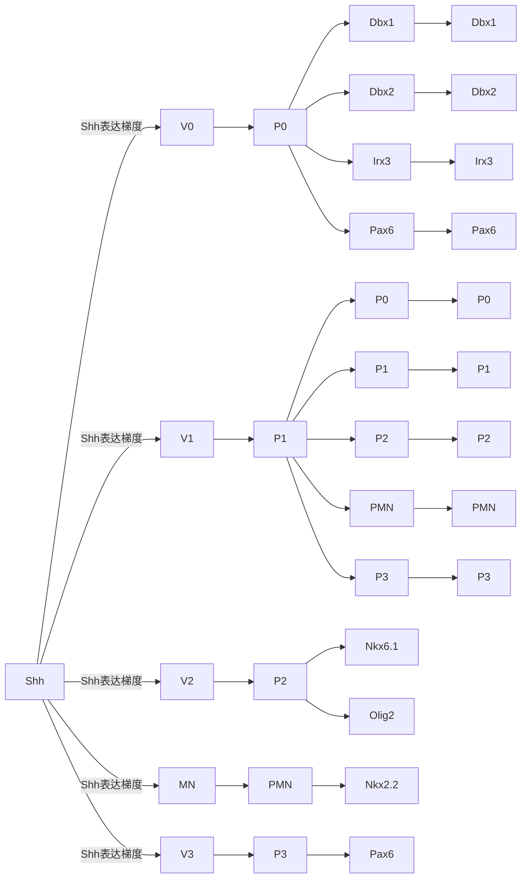

## 知识窗 13-1

## 眼发育

脊椎动物的眼发育起始于原肠胚形成（gastrulation）时期的胚胎眼区（eye field）。该区域位于前神经板（anterior neural plate）的间脑（diencephalon）边缘（图13-14A）。随后该区域两侧突出生成左、右两个视泡（optic vesicle）（图13-14B）。与此同时，体表外胚层在视泡的诱导下增厚，形成晶状体板（lens placode）。

视泡远端膨大，贴近体表外胚层，慢慢凹陷形成双层杯状结构，称视杯（optic cup）（图 13-15）。视泡近端变细，称视柄（optic stalk），与前脑中的间脑相连。随后晶状体板凹陷入视杯内，它逐渐开始与体表外胚层分离，发育成晶状体泡（lens vesicle）。间充质填充在视杯与晶状体泡之间，视杯周围及其与体表外胚层之间。眼的各部分就是由视杯与视柄、晶状体泡及它们周围的间充质进一步发育形成的。突出的视泡沿其近远（proximal-distal，P/D）轴进一步分化。与表面外胚层接触的视泡远端区域分化为神经视网膜（neural retina，NR），而近端区域分化为视网膜色素上皮（retinal pigment epithelium，RPE），两者之间的近端区域将形成视柄的背侧和腹侧部分。神经视网膜和视网膜色素上皮之间的边界称为睫状边缘区（ciliary marginal zone，

---

第三节 神经外胚层的模式化

389

图 13-14 脊椎动物视泡示意图

(A) 胚胎眼区位于前脑的间脑边缘区域。

(B) 视泡从间脑的胚胎眼区起始发育, 向两侧突出形成。

CMZ)，该区域表达 Meis1、Meis2、Msx1 等转录因子，被认为是视网膜细胞终生更新的来源。

## 1. 视泡的近端-远端分化

在视泡发育过程中，近端细胞发育为视柄，而远端细胞则分化为神经视网膜和视网膜色素上皮。视柄的腹侧细胞受到来自腹侧中线 Shh 信号分子的影响（图 13-16）。Shh 基因突变会导致严重的眼发育缺陷，包括形成单一中线眼，或者缺乏视柄等。Shh 可以调控 Pax6 和 Pax2 的空间表达来决定视泡的远-近轴发育。Pax2 和 Pax6 在转录水平上相互抑制，Shh 的过表达导致Pax2（视柄分子标志物）表达区域增大，Pax6（视网膜分子标志物）阳性细胞数量减少，而没有Shh的情况则相反。Pax6基因对于形成远端晶状体组织也是必要的。Pax6基因的突变会影响晶状体和视泡的形成，最终导致无眼症。

## 2. 视杯的背腹分化

背侧的 BMP 信号和腹侧 Shh 的信号梯度共同决定视杯的背腹分化。在视杯的腹侧部分过度表达 BMP4 会抑制 Pax2 和 Vax1 的表达，并激活 Tbx5 的表达，Tbx5 是一种 T-box 类转录因子，通常只在视杯的背侧部分表

图13-15 脊椎动物眼发育示意图

（A）视泡的形成。（B）视泡远端凹陷成为视杯，近端变细成为视柄。（C）视杯分为内、外两层，其中外层分化为视网膜色素上皮（RPE），内层则增厚分化为视网膜。

---

390

第十三章 神经系统发育

图 13-16 调控脊椎动物眼发育的信号通路（A）和重要转录因子（B）

达。视杯的背腹极化的转录调控在很大程度上依赖于位于视杯背侧的Tbx5的活性和位于视杯腹侧的Vax基因的活性。Tbx5的过度表达会导致视杯的背腹化，而Vax的过度表达会导致其腹侧化。ventroptin是一种BMP信号拮抗因子，主要在视杯腹侧中表达。在视杯的背侧强制表达ventroptin会降低BMP4的表达并扩展Vax基因的表达。

一些典型的属于视杯腹侧的结构，如视裂（optic fissure）、玻璃体动脉和鸟类中的视网膜盘也依赖于BMP信号。在BMP7缺失的小鼠中，视裂不会形成。视黄酸（retinoic acid，RA）也参与建立视杯腹侧特性。RA处理可以上调斑马鱼胚胎眼中Pax2的表达，而在胚胎发育期间缺乏维生素A、RA受体失活或抑制RA合成都会导致胚胎腹侧视网膜缺陷。但是缺乏编码RA合成酶的Raldh1、Raldh2和Raldh3基因的胚胎仍然会形成具有正常背腹分化的视杯。

## 3. 神经视网膜和视网膜色素上皮质的形成

神经视网膜（NR）和视网膜色素上皮（RPE）的形成是由多种信号分子协同调控的。如果分离眼的表面外胚层，未来的NR细胞将获得RPE细胞的特性。这是因为外胚层分泌了FGF家族中的信号分子FGF1和FGF2，而未来视网膜表达FGFR1。相反，将未来的RPE暴露于FGF会赋予细胞NR特性。因此，FGF信号通常激活NR的形成，抑制RPE的形成。未来视网膜本身也表达其他FGF，如FGF3、FGF8、FGF9和FGF15，这些可能有助于维持视网膜的特性。

BMP4和BMP7在周围的眼周间充质和未来的RPE中表达。干扰这些分子的表达将阻止RPE的发展并诱导NR特异基因的表达，而它们的添加会激活整个视泡的RPE特性。因此，BMP和FGF信号在RPE和NR前体中起着拮抗作用。这两种信号的活性似乎会影响特定转录调节因子，如Vsx2、Otx2和Mitf的表达。FGF信号可激活视网膜中Vsx2的表达，但抑制RPE中Otx2和Mitf的表达，而对BMP信号的干扰则观察到相反的效应。

Six 家族的两个基因 Six3 和 Six6，最初在整个视泡中表达，但也很快只在未来的 NR 中表达。在鱼类胚胎

---

第四节 神经发生

391

中，这两个因子的过度表达会导致视网膜增大和视网膜样组织的异常形成。在小鼠中，Six3基因的缺失会导致前脑的完全丧失，而Six6基因缺失会影响视网膜的增殖和分化。将它们中的任何一个过度表达于RPE细胞会导致获得NR的表型。与Six3类似，Lhx2基本表达在未来的神经视网膜。Lhx2缺失的小鼠表现为无眼，类似于Pax6基因突变小鼠。

RPE 的形成至少与 4 种转录因子紧密相关，它们是 Otx1、Otx2、Mitf 和 Pax6，这些因子构成了建立 RPE特性的转录网络核心。Mitf、Otx1和Otx2基因失活会阻碍RPE的分化。相反，将这些基因转染到视网膜细胞中会使它们获得RPE表型并积累色素颗粒。尽管Pax6在未来RPE中的表达是短暂的，但它的功能（可能与Pax2的功能一起）似乎对于启动Mitf的表达至关重要。事实上，Pax6能够直接结合到Mitf启动子上，而在同时缺乏Pax2和Pax6的胚胎中，视泡变得较小，由Mitf阴性细胞组成，这些细胞反而共表达Otx2和NR标记Vax2。

## 第四节 神经发生

随着神经系统的发育，大量的神经元和胶质细胞必须由神经上皮细胞转化成的神经祖细胞（neural progenitor cell）产生。上述产生神经元的过程被称为神经发生。从胚胎的神经外胚层初始形成一直到胚胎出生之后，神经发生可以持续相当长的一段时间。一般来说，神经祖细胞会经历反复的细胞分裂（增殖）。这个过程中，一些子代细胞仍然保持着祖细胞的身份，可以继续进行分裂；而另一些则获得神经元或胶质细胞的身份。后者也被称为神经前体细胞，它们不再分裂并且最终分化为成熟的神经元或胶质细胞。

## 一、果蝇中的神经发生

在果蝇中，中枢神经系统和周围神经系统分别由成神经细胞和感觉器官前体细胞发育而来。外胚层细胞具有发育为神经细胞的潜力，但只有一小部分会成为成神经细胞或感觉器官前体细胞。前神经基因（proneuralgene）在已经具有神经特性的细胞中表达，这是启动神经发生的充分必要条件。

外胚层中表达前神经基因的细胞团被称为神经前簇。随着发育进程，前神经基因的表达只保留在神经前簇中的单个细胞内，该细胞会发育为成神经细胞或感觉器官前体细胞。一旦这个细胞获得了成神经细胞或感觉器官前体细胞的身份，便会通过抑制性的细胞内信号通路阻止其周围的细胞发育为成神经细胞或感觉器官前体细胞。具体而言，该细胞会在膜表面表达Notch信号通路的配体Delta，随后通过Delta结合神经前簇中存在于其他细胞表面的受体Notch。受体Notch的激活导致下游转录因子HES蛋白的升高表达，进而抑制了前神经基因的表达，使细胞丧失了成为神经细胞的潜力转而获得表皮细胞的命运。这种细胞命运决定的机制被称为侧向抑制（lateral

---

392

第十三章 神经系统发育

图13-17 相互抑制转变为侧向抑制

最初、神经前簇中所有细胞之间的 Notoh 信号通路导致相互抑制，前神经基因和抑制它的 HES 基因在这一阶段共同表达，使得所有细胞均保持神经特性。随后，侧向抑制发生。单个细胞逃离相互抑制，持续表达前神经基因成为 SOP、同时激活周围细胞 Notch 信号通路，抑制周围细胞表达前神经基因。

flowchart

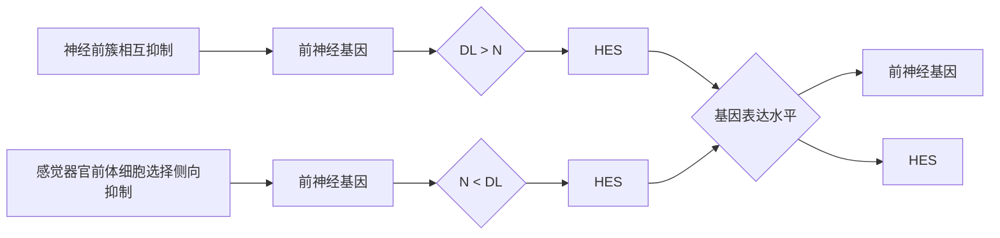

inhibition）。在神经前簇中，单一细胞确定成为神经祖细胞之前，所有细胞都会表达Delta，同时也被周围的细胞抑制。这种互相抑制（mutual inhibition）使得每个细胞都保持着成为神经细胞的潜力。随后，某个细胞率先逃脱该抑制状态，神经前簇中的互相抑制即转变为前述的侧向抑制（图13-17）。

## 二、脊椎动物中的神经发生

脊椎动物中枢神经系统的神经元发生过程与果蝇差异较大，可能更有利于其产生更多的神经元。脊椎动物的神经管由单层神经上皮细胞构成。神经上皮细胞发育形成的神经祖细胞也被称为放射状胶质细胞（radial neuroglia cell）。放射状胶质细胞位于神经管上皮的管腔内表面，一般被称为脑室区（ventricular zone）。放射状胶质细胞是神经干细胞，具有两个特征:①多能性。它们产生的子代细胞可以分化成一系列神经元和胶质细胞；②自我更新能力。尽管一些子代会退出细胞周期进行分化，但一部分子代细胞会保持神经干性，通过大量自我更新扩增神经祖细胞的数量。

在脊椎动物中，前神经基因通过调节 Notch 介导的侧向抑制和启动下游分化基因的表达来控制神经发生。但和果蝇不同之处在于，脊椎动物神经管中的 Notch 抑制并不会导致被抑制的细胞呈现出不同的非神经命运。相反，它们只是暂时被抑制，并保留了它们作为神经祖细胞的能力。因此，通过 Notch 抑制，维持了祖细胞的数量，以

---

第四节 神经发生

393

促进进一步的神经发生。

放射状胶质细胞中前神经基因和 Notch 相互作用的机制会导致基因表达的振荡，这由相互抑制的循环往复导致（图 13-18）。在脊椎动物的神经发生中，前神经基因随时间的动态表达对于协调祖细胞激活 Notch 信号极为重要。在确定神经前体细胞的命运后，前神经基因会触发细胞退出细胞周期，促进细胞分化和细胞迁移过程。

## 三、神经祖细胞的增殖及分裂方式

为了产生足够数量的神经元，神经祖细胞细胞周期的进入和退出过程受到了严格调控。这种调控的一个关键方面则是细胞分裂。在神经祖细胞增殖过程中，一个细胞通过对称分裂产生两个相同的子代细胞，或是通过不对称分裂产生

flowchart

图13-18 放射状胶质细胞转变为神经前体细胞放射状胶质细胞振荡表达前神经基因或HES，处于相互抑制状态。随着发育进程，一些细胞停止振荡，并持续性高表达前神经基因，从而成为神经前体细胞，退出细胞周期。

## 知识窗 13-2

## Notch 信号通路

受体 Notch 在所有的胚胎细胞中表达。Notch 是根据它的一种表型命名的，即编码该受体的基因突变时，果蝇会出现锯齿状翅膀。与其他信号通路不同，Notch 配体不是扩散性信号分子，而是信号细胞表面的跨膜蛋白质。因此，Notch 信号通路是一个通过细胞接触介导的信号通路。在定型的神经细胞中（信号细胞，如图 13-19），前神经基因的表达触发了 Notch 配体 Delta 的表达。Delta 出现在细胞膜表面与相邻细胞的 Notch 结合，通过早老素触发 Notch 分解。随后 Notch 的细胞内结构域移动到细胞核与称为 $SU(H)$（无毛抑制基因）的转录因子结合成复合体，该复合体激活 split 基因（HES 家族成员）的增强子，这个基因编码 bHLH 转录抑制因子，抑制前神经基因在感受细胞中表达，使该细胞丧失发育为神经组织的潜力。

flowchart

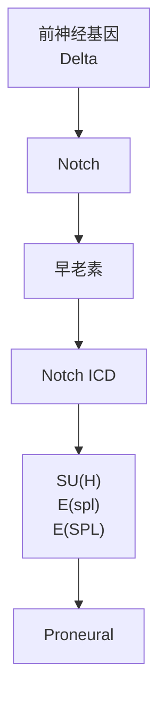

图13-19 Notch信号通路

---

394

第十三章 神经系统发育

图13-20 神经元的产生速率与神经祖细胞随时间变化的分裂方式有关

在神经管中，神经元的产生速率与神经祖细胞随时间变化的分裂方式有关。首先是通过对称的增殖分裂来扩张神经祖细胞数量；其次，多数祖细胞进行不对称分裂，使得神经元稳定产生；最后，对称分裂的方式导致所有子代细胞成为神经元或胶质细胞，从而消耗祖细胞数量。

两个发育潜能不同的子代细胞。不对称分裂存在两种不同的形式。第一种形式里，两个子代细胞不具有增殖能力，朝着不同方向分化。例如，果蝇的感觉器官前体细胞经过不对称分裂产生感觉神经元和三种不同的支持细胞。而第二种形式里，一个子代细胞会分化为神经元，另一个子代细胞则保留了亲代细胞的增殖能力。

在脊椎动物大脑皮质中，神经祖细胞形成初期会以对称分裂的方式扩充祖细胞群体的数量，随后越来越多的神经祖细胞转而进行多轮不对称分裂来产生神经前体细胞。在神经发生晚期，神经祖细胞被认为会进一步转为对称分裂，产生两个有丝分裂后的神经前体细胞。这种对称分裂会消耗部分神经祖细胞（图13-20）。

处于分裂的放射状胶质细胞中，包括PAR和Numb在内的蛋白质复合物会定位于细胞顶端室侧的一个小的膜位点。该顶端复合物一定程度决定了细胞分裂的方向。大多数对称增殖分裂的神经祖细胞，其分裂面垂直于脑室表面，使得顶端复合物一分为二地被两个子代细胞继承。相反，进行不对称增殖分裂的神经祖细胞具有非垂直的分裂面，仅使得其中一个子代细胞继承顶端复合物。

## 四、神经发生的时序调控

神经发生的整个阶段中，神经管不同区域的神经祖细胞产生不同类型的神经元。例如，位于背侧端脑的祖细胞产生端脑的兴奋性神经元，而腹侧端脑的中间和后端神经隆起则产生皮质所有的抑制性神经元。同时，神经祖细胞所产生的神经细胞类型也随着时间推移而变

化。例如，在脊椎动物中枢神经系统发育阶段中，神经元逐渐停止产生之时，胶质细胞随之开始产生。神经发生的时序调控是神经祖细胞的内在机制，同时可以被外部环境所调节。

不同类型的神经细胞按照时间顺序产生会使得这些细胞具有特定的空间分布模式。成熟的哺乳动物大脑皮质具有6层结构，每层神经元具备特有的神经元形态和投射方式。例如，在处理感觉信息的皮质区域，第4层神经元接收来自丘脑的感觉信息输入并在局部投射轴突，而第5层和第6层的神经元将轴突投射至大脑其他区域。放射状胶质细胞通过不对称分裂产生神经前体细胞，这些细胞通过径向迁移远离脑室区。早期产生的神经元分布于皮质最深处，而随后产生的神经元迁移经过早期产生的

---

第五节 神经元的迁移

395

神经元，形成新的、更浅的神经元层。因此，皮质的神经元随着时间推移以“由内而外”的方式分布（图13-21）。

## 第五节 神经元的迁移

神经发生会产生大量神经元，不同类型的神经元产生于神经系统的不同区域。许多神经元需要从出生地迁移到特定的区域行使功能。神经功能环路的正确组装依赖神经元在正确的时间迁移到正确的位置。我们可以通过观察活体胚胎中神经元的迁移和组织培养中神经元的迁移等方法直接或间接地记录、追踪神经元的迁移轨迹。一般来说，迁移是脊椎动物比无脊椎动物神经发育更显著的特征，主要涉及大量细胞的远距离迁移。但是，一些神经元迁移也是无脊椎动物中必不可少的。总之，为确保适当数目的细胞在适当的时间到达神经系统适当的区域，神经元的迁移受到严格的调控，即必须全方位地控制迁移的时间、方向、迁移距离和终点。

## 一、主要迁移模式

神经元迁移主要有三种模式。一些细胞在其他细胞提供的支架（scaffold）上迁移，大脑皮质中的许多放射状迁移神经元在放射状胶质细胞介导下移向软脑膜（pial），由于大脑皮质近似于一个半球，这种迁移方式被称为放射状迁移（radial migration）。另外一些细胞在被称为链迁移（chain migration）的过程中集体迁移，以这种方式迁移的神经元中，研究最多的是在嗅球中发现的嗅觉中间神经元（olfactory interneuron），嗅觉中间神经元来自腹侧端脑中的祖细胞，这些神经元从那里迁移到嗅球，在那里分化成神经元，并在功能上融入神经环路。第三类细胞明显独立于与其他细胞紧密接触的单独迁移，通常被称为个体迁移（individual migration），即细胞单独迁

移或协同迁移细胞来帮助其迁移，神经嵴细胞采用这种方式进行迁移。神经嵴细胞产生于神经管的背侧，这些神经嵴细胞从那里开始各自迁移到胚胎的各个不同区域。

flowchart

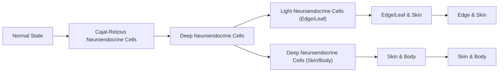

图13-21 端脑的神经发生形成了大脑皮质的神经元在大脑皮质神经发生过程中，形成的第一层细胞（Cajal-Retzius神经元）从其他位置迁移而来。VZ区的神经祖细胞分裂产生一系列神经前体细胞，这些细胞向外迁移，形成连续的神经元层。迁移的细胞首先分布在深层。在后期阶段，迁移的细胞分布形成浅层。

---

396

第十三章 神经系统发育

## 二、细胞迁移过程

神经元的迁移主要包括四个步骤。首先，细胞必须开始移动；其次，细胞必须受到适当的导向；再次，细胞通过局部移动来迁移；最后，细胞到达目的地后

## 知识窗 13-3

## 细胞骨架的组成分子

由蛋白质纤维构成的亚细胞网状结构组成细胞骨架，并在所有细胞形态的维持中起重要作用。细胞骨架在轴突和树突的形成和功能行使中也同样重要。细胞骨架纤维是蛋白质亚基的线型聚合物。微管由 $\alpha-$ 微管蛋白和 $\beta-$ 微管蛋白亚基组成。微丝（F-肌动蛋白）由肌动蛋白亚基聚合形成。这些聚合物的一个重要特征是它们具有极性。在某些条件下，微管和微丝能通过组装额外亚基来延长。在微管中，$\alpha-$ 微管蛋白和 $\beta-$ 微管蛋白异二聚体在“正”端组装。微丝可以通过在任一末端组装球状肌动蛋白亚基来延长，但优先结合到所谓的“倒钩”端。不论是微管还是微丝，游离的亚基和聚合状态的亚基都处于动态平衡中，而聚合状态稳定与否是控制神经突向外生长或回缩的主要机制（图 13-22）。

脊椎动物大脑皮质最为显著的特性是高度有序的六层板层结构，要形成如此特异的层状结构，大脑发育过程中神经元的正确迁移至关重要。神经元通过“由内到外”（inside-out）的模式进行迁移。早期产生的神经元形成大脑皮质的内层，晚期产生的神经元跨过早期的神经元迁移到大脑皮质的外层。由于不断地产生神经元以及新生神经元迁移至外皮质，最终形成大脑皮质。兴奋性神经元主要沿着放射状胶质细胞进行放射状迁移，而抑制性的中间神经元主要进行切向迁移（tangential migration）。

肌动蛋白亚基

text_image

微丝
倒勾端
尖头端

$\alpha$ -微管蛋白 $+\beta$ -微管蛋白二聚体

微管

chemical

Diagram showing molecular structure transformation from two molecules to a complex with alternating brown and white spheres, labeled with + and - signs.

图 13-22 微丝和微管的组成分子

---

第五节 神经元的迁移

397

终止迁移。到目前为止，已经揭示的引导神经元迁移方向的机制主要有两种，即趋化性（chemotaxis）和胶质支架引导。在趋化作用中，细胞的运动由化学信号引导。细胞向信号移动，称为化学吸引（chemoattraction），或远离信号，称为化学排斥（chemorepulsion）。细胞运动或移动对于理解神经细胞迁移过程至关重要。在控制迁移神经元运动的细胞生物学过程方面，由放射状胶质细胞引导的皮质神经元的运动了解得最为清楚。细胞运动在很大程度上是由细胞骨架（cytoskeleton）的变化驱动的，细胞骨架是一种灵活且高度动态的细胞内网络结构，它控制细胞的形状和运动。微管（microtubule）组分是神经元迁移过程中细胞骨架最重要的部分。微管产生的一种称为中心体（centrosome）或微管组织中心的特殊结构，是控制细胞运动的关键因素。细胞运动过程可以分解为一系列的重复步骤。首先，前导突起（leading process）向迁移方向延伸；然后中心体向前移动，进入前导突起；之后，细胞核在被称为核运动（nucleokinesis）的过程中由连接微管向前牵引并向中心体移动；最后，尾突起重构，使其更接近细胞体。前导突起再次延伸，重新开始循环。神经元在到达目的地后需要终止迁移。尽管放射状迁移对发育中的大脑皮质有很大贡献，但是并非所有的皮质细胞都遵循这一路径。

## 三、放射迁移和切向迁移

放射状迁移是指神经元的胞体自室管膜区向脑膜方向自内而外的运动，这也是皮质神经元层状结构形成的主要方式。以这种方式迁移的神经细胞通常为简单的双极细胞，它们中大多数由放射状胶质细胞引导迁移至其目的地。放射状胶质细胞有着特殊的长突起，它们的胞体位于近脑室处，其长突起则向外延伸附着于脑膜，放射胶质细胞最后成为星状胶质细胞。根据具体的迁移特点，神经元的放射状迁移可以分为两种模式:胞体易位（somal translocation）和胶质细胞引导的迁移（glia-guided locomotion）。对于单个神经细胞来说，迁移模式并不是固定不变的，有些神经细胞以整体运动方式迁移至邻近大脑表层后会转换成胞体位移的方式进行迁移。

切线迁移是指神经元胞体沿脑膜切线方向进行迁移，这种迁移模式可以使大部分GABA（γ-氨基丁酸）源性的抑制性中间神经元穿越大脑皮质不同的区域进行长距离迁移。切线迁移的细胞主要有两条经典途径:①从内侧神经节隆起（MGE）分裂生成的中间神经元，平行于大脑皮质的表面进行切线迁移，最终迁入到大脑皮质和海马；②从外侧神经节隆起（LGE）产生的中间神经元通过切线迁移侵入嗅球，并持续到成年，这条通路被称为喙侧迁移流（rostral migratory stream）（图13-23）。

放射迁移和切线迁移对于单个神经元来说并不是绝对的，某些神经元可以通过这两种迁移方式到达目的地。例如，有 $40\%$ 的抑制性神经元先从MGE或LGE迁入脑室周围后再通过放射迁移迁入大脑皮质。在细胞迁移领域仍有许多悬而未决的问题。目前，在该领域，研究人员面临的一个主要挑战是使用培养的细胞和组织获得的分子机制有多大程度上适用于在体条件。

---

398

第十三章 神经系统发育

A

text_image

软脑膜表面
Cajal-Retztus细胞
边缘区
皮质板
亚板
放射状胶质细胞
胞体易位细胞
核动态迁移细胞
脑室区
S	G₂	M	G₁

图13-23 大脑皮质神经元的迁移

（A）投射神经元由脑室区（VZ）的放射状胶质细胞产生，并沿着放射状胶质细胞的引导纤维迁移到软脑膜，VZ产生的第一批迁移神经元组成前板层（preplate），随后陆续迁出的神经元将前板层分为两层:靠近软脑膜的边缘区（marginal zone）和深层的亚板层（subplate），边缘区主要由Cajal-Retzius细胞组成。投射神经元以

B

text_image

大脑皮质
海马区
外侧神经节隆起
LGE
b
纹状体
MGE
AEP
去往嗅球

胞体位移和细胞整体运动两种方式迁移到它们在皮质的最终位置。（B）主要的切线迁移路线。投射神经元从室管膜区放射状迁移到大脑皮质（a）；表达GABA源性的中间神经元从LGE、MGE和前脚内核区（AEP）切线状迁移到嗅球（b）和大脑皮质（c和d），神经元到达大脑皮质后一部分直接到达VZ，然后再以放射状方式迁移到皮质板。

## 第六节 神经元分化与轴突导向

当神经元迁移到目的地后，它们的细胞形态会进一步分化:轴突会从胞体伸展出去，在细胞和细胞外基质间穿行，最终与目标神经元分化出的树突连接在一起，由此神经信号便可顺着轴突投射的方向在神经元间传播、汇集。

当千万个神经元的轴突和树突以如此简单、精细的原理相互连接，它们就形成了神经环路，而神经环路在脑区间彼此交织又产生了神经网络，从此生命可以感知、运动、记忆。神经元和神经元的连接有时跨越脑区，外观上层峦叠嶂，但在发育过程中，神经元向远方投射的轴突却总能相对精准地从“迷宫”中走到目标神经元上，这意味着轴突可以像迁移中的胞体一样感知周围的环境。在本节中，你将了解到发育中的轴突和树突在脑内导向的机制。

## 一、神经元的极化

在成熟的神经元中，信号在树突中被接收并传输到胞体，然后在轴丘（axon

---

第六节 神经元分化与轴突导向

399

hillock）进行整合。经过处理的信息以动作电位（action potential）的形式沿着轴突流向下一个神经元。神经元的整个分子结构，都反映了这种信息流向，这就是神经元的极性。神经元在开始分化时却既没有轴突也没有树突，而轴突和树突的形成即是神经元的极化。在发育过程中，极化诱因可以是内部产生的。在没有暴露在任何不对称外部环境的情况下，神经元仍能基于内部的不对称性——如中心体相对于细胞核的不对称或黏附受体分布的不对称而定向，并成功极化。一种常见的假设是，在极化过程中，微管会在细胞中肌动蛋白丝（actin filament）最薄弱分布的地方穿透到神经突（neurite）的远端区域，导致该神经突生长得更快、更稳定，最后那个神经突就变成了轴突。

而极化诱因也可以来自环境。在神经上皮基底的表面，有一层厚厚的细胞外基质，称为基底层（basal lamina）。基底层由几种互锁的分子组成，其中一个称为层粘连蛋白（laminin），是促进轴突生长的因子。例如，在视网膜神经节细胞的极化中，即使中心体在细胞的另一侧，轴突也会从细胞的基底面出现，生长方向朝向层粘连蛋白分子。这表明来自外部的诱因可以覆盖细胞内部的诱因。在皮质中，基底层与发育中的神经元相距甚远，层粘连蛋白分子不足以在长距离上提供极化诱因，所以如TGF-β和BDNF在顶基方向上的梯度促进了锥体神经元的顶侧有方向的轴突出现（图13-24）。

## 二、导航工具（上）:生长锥

在轴突和树突出现之后，轴突中的先行者——先锋轴突（pioneer axon）率先在大脑中爬行并开辟出道路，随行轴突（follower axon）则顺着先锋轴突铺设的道路朝着它们的目标前进，所以先锋轴突需要一个兼具移动和感知能力的头部，即生长锥（growth cone）。

生长锥是拉蒙·伊·卡哈尔（Ramón Y Cajal）最激动人心的发现之一。它的边缘突起具长而薄的丝状伪足（filopodia），上面布有大量的受体，用以接收来自环境的导航诱因。这些结构都是动态的，比如在当生长锥带领轴突来到这些关键的岔路口，它

图13-24 离体斑马鱼视网膜神经节细胞

上图显示的是一个离体斑马鱼视网膜神经节细胞在几个小时内的连续图像，它接触到一个层膜包裹的bead，其中有一个新出现的神经突，然后成为轴突并发育出一个大的生长锥体；下图显示视网膜内层粘连蛋白被敲除的视网膜神经节细胞。在这些动物中，视网膜神经节细胞不能有效地极化。在这种情况下，层粘连蛋白包覆的珠状物帮助细胞长出轴突，然后轴突发育成生长锥。白色箭头指向轴突。

---

400

第十三章 神经系统发育

会变得更复杂，反之亦然；同样的诱因分子在不同的时间背景下，也会因为生长锥的动态产生截然不同的导向效果。跟随在先锋轴突后的轴突生长锥也会变得简单。先锋轴突的生长锥有几个活跃的丝状伪足和板状伪足（lamellipodia）。而跟随轴突的生长锥则倾向于呈子弹形，上面只有少量的突丝。

此外，生长锥向前爬行时，新材料被不断地装载到生长的轴突中以提供支撑。那些新材料是在头部——靠近生长锥处装配的——而非尾部的胞体。细胞骨架成分（如肌动蛋白丝和微管）的添加也发生在生长中的轴突的头部。在生长锥中，微管沿着轴突延伸到生长锥的中心区域，肌动蛋白丝则主要存在于生长锥的外围区域。在移动时，丝状伪足中的肌动蛋白丝束被蛋白质向后推动，同时它的末端会有新的肌动蛋白单位被加进来，从而驱动丝状伪足向远处延伸。生长锥在基质上的快速前进依赖于可以与黏附分子交互的跨膜受体。当受体抓住基质时，其下的运动信号通路会影响丝状伪足底部的肌球蛋白向后拖动生长中的肌动蛋白束。借此，单只丝状伪足能够通过缩短自身结构来引导整个生长锥。

除了微管和肌动蛋白丝之外，在生长锥中还存在许多与细胞骨架相关的蛋白质，它们执行各种任务，如将肌动蛋白和微管锚定到细胞膜或彼此之上，帮助组装或解组肌动蛋白和微管、或通过分子马达产生推力等（图13-25）。

图13-25 生长锥的结构

text_image

丝状伪足
C-区域
动态微管
探测丝状伪足
P-区域
丝状伪足背侧
微管
丝状伪足收回
微管
板状伪足
受体
配体
肌动蛋白单体
肌动蛋白丝
肌动蛋白
微管
肌球蛋白
微管
骨架相关蛋白质
微管蛋白
肌动蛋白网络
马达蛋白
货物
微管

---

第六节 神经元分化与轴突导向

401

## 三、导航工具（下）:外部诱因

轴突的生长环境在机械上的异质性（heterogeneity）会影响生长锥的导航。比如宏观上，生长锥无法穿过的神经鞘（nerve sheath）和可以穿过的胼胝体，就构成了一座布满高墙的迷宫，轴突只能在高墙间穿行。而轴突在迷宫中的道路选择和目标定位，则需要借助众多分子机制——比如促使轴突生长的黏附分子和细胞外基质分子（如netrin），以及一些抑制或排斥轴突的因子（如semaphorin和Slit）。

## 知识窗 13-4

## 细胞外基质

细胞外基质（extracellular matrix，ECM）在许多组织和器官中提供细胞间的结构支撑。细胞外基质由细胞分泌的纤维蛋白和多糖（polysaccharide）组成。重要的细胞外基质蛋白质包括胶原蛋白（collagen）、纤连蛋白（fibronectin）和层粘连蛋白。胶原蛋白形成了结构框架。层粘连蛋白是一种由3条单链组成的大型多聚糖蛋白。层粘连蛋白和纤连蛋白同时与胶原蛋白和细胞膜受体结合，这种细胞膜受体称为整联蛋白（integrin），从而使生长锥黏附并通过ECM。蛋白聚糖（proteoglycan）是被附着的多糖链修饰的蛋白质，它们使ECM呈凝胶状，并通过与多种细胞膜蛋白质结合而影响细胞。参与神经元发育的有两大类分子，包括硫酸乙酰肝素蛋白聚糖（heparan sulphate proteoglycan，HSPG）和硫酸软骨素蛋白聚糖（chondroitin sulfate proteoglycan，CSPG）。

这些分子往往作为一种扩散性诱因（diffusible cue）驱使生长锥通过趋化性和负趋化性的方式沿着扩散性诱因的浓度梯度前进或折返。扩散性诱因往往不会在长距离上引导轴突，他们并不依赖长距离扩散的诱因进行导向。相反，轴突倾向于在前往遥远目的地的过程中使用中间目标（intermediate target）和局部诱因（local

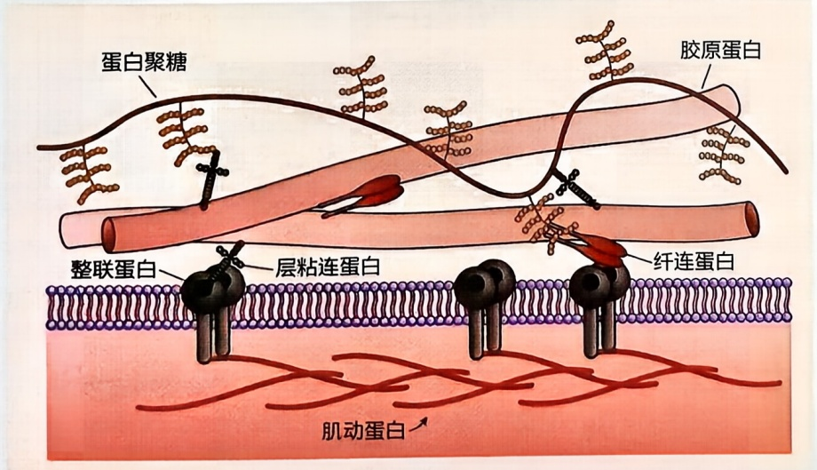

text_image

蛋白聚糖
胶原蛋白
整联蛋白
层粘连蛋白
纤连蛋白
肌动蛋白

图13-26 细胞外基质

---

402

第十三章 神经系统发育

cue）。下文将会提到的中线基板层（midline floorplate）是中间目标的代表。局部诱因则是一些吸引先锋轴突的细胞，先锋轴突可以沿着他们爬行。甚至当轴突和树突需要彼此连接时，也会有一个共同的局部诱因来同时引导它们来到未来突触形成的位置上。

吸引轴突生长的黏附是由基质黏附分子（SAM）和细胞黏附分子（CAM）调控的。层粘连蛋白就是SAM之一。它的多个结构域可以结合ECM中的组分和生长锥上的受体，再借助细胞内分子机制，将ECM连接到细胞内的肌动蛋白上，从而为生长锥细胞骨架推动生长锥前提供一个施力点。而随着时间推移，越来越多的神经元完成分化并将它们的轴突投射进神经系统。在越发复杂的大脑中，神经元胞体、轴突和胶质细胞表面上的多种CAM不仅为生长锥提供了生长基质，也是后续神经元的引导诱因。许多 CAM 都有的一个属性是同源结合（bind homophilically）。这使目标相同的轴突会因为相同的 CAM 互相黏附，这样就捆绑成了神经根（nerve root）。而之前提到的随行轴突的生长锥在先锋轴突上攀爬、导航的能力，也是 CAM 赋予的。为了在蜿蜒曲折的脑迷宫中前进，轴突需要变向能力，所以在旅途的不同阶段，相同的诱因必须起到不同的作用。这是轴突通过改变其表面的 CAM 来达成的。

而排斥轴突生长的排斥性引导（repulsive guidance）也需要受体和排斥性分子（repellent molecule）结合后生长锥才能转向。在排斥性分子激活细胞内的分子机制后，生长锥和细胞外蛋白质会通过将受体-配体的复合物进行胞吞（endocytosis）等方式断开生长锥和排斥性分子等的连接，从而使生长锥得以转向。

# 知识窗 13-5

## 细胞黏附分子

多细胞生物体中的绝大多数细胞与其邻近细胞相互作用。这种细胞间的相互作用有助于组织形成和维持生物体内结构的完整性，并且在细胞通信过程中起重要作用。当细胞迁移时，必须经常改变与邻近细胞相互作用的方式。许多细胞间的相互作用是由一类被称为细胞黏附分子介导的。

钙黏蛋白（cadherin）是一类跨膜蛋白质家族，能跨越细胞质膜并通过细胞外结构域中的结合位点彼此结合。钙黏蛋白与邻近细胞表面上的钙黏蛋白分子形成同亲型（homophilic）结合。钙黏蛋白分子的细胞质结构域通过一定数目的细胞内衔接蛋白与肌动蛋白细胞骨架相互作用。通过这种方式，一个细胞的肌动蛋白细胞骨架与其邻近的肌动蛋白细胞骨架相连。钙黏蛋白是黏着连接（adhering junction）的黏附部分，细胞之间的连接对上皮结构（包括神经外胚层）的完整性具有重要作用。

神经细胞黏附分子（neural cell adhesion molecule, N-CAM）在神经系统中广泛表达。基于结构相似性，N-CAM是细胞表面蛋白质中免疫球蛋白超家族的成员。与钙黏蛋白一样，细胞黏附分子大家族的成员通常形成同亲型结合。但与钙黏蛋白不同的是，这类分子间的结合不需要钙离子来介导。

第三类细胞黏附分子，即整联蛋白，主要形成细胞和细胞外基质之间的连接，细胞外基质是分泌蛋白质和多糖构成的一种复杂网络结构，位于大多数真核细胞之间。整联蛋白类似异二聚体（heterodimer）的作用，由一个 $\alpha$ 亚基和一个 $\beta$ 亚基组成。许多整联蛋白与细胞质肌动蛋白连接，而其他整联蛋白与细胞骨架的不同组分相连。整联蛋白还可以介导来自细胞外基质的信号传递，影响细胞运动和形状。

---

第六节 神经元分化与轴突导向

403

钙黏蛋白

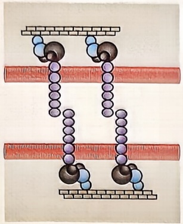

chemical

Molecular structure diagram showing two parallel chains of atoms with blue and gray spheres representing different elements, connected by purple bonds.

同种分子之间的同亲型结合

N-CAM

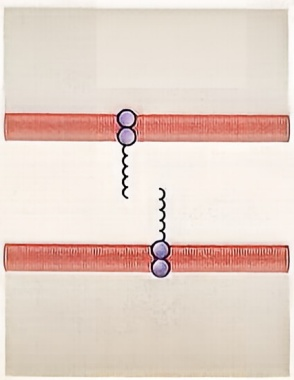

natural_image

Diagram of two parallel red bars with purple dots and wavy black lines, no text or symbols present

异二聚体:由两种不同的蛋白质组成的蛋白质复合物

整联蛋白

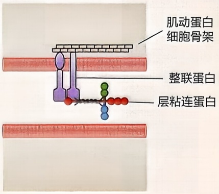

text_image

肌动蛋白
细胞骨架
整联蛋白
层粘连蛋白

## 四、导航图的建立

为生长锥提供位置信息的诱因分子是如何确立自己的空间位置的呢？为胚胎模式形成提供区域身份（regional identity）的同源异形基因（homeobox gene）也指导了各种轴突导向诱因在大脑不同区域的表达。而许多参与脑形态发生的可扩散性形态发生素也会被用作导航诱因。例如，我们已经看到 Shh 在背腹轴上帮助塑造神经管，以及吸引交叉神经元的生长锥。

## 知识窗 13-6

## Hedgehog（HH）信号通路

HH的受体是跨膜蛋白质Patched。缺乏HH时，Patched抑制另一个跨膜蛋白质Smoothened接触细胞表面。结合HH后，Patched受体被下调，从而使Smoothened可以运动到细胞表面。在这里，它抑制分解GL1转录因子的蛋白酶复合体功能（图13-28）。GL1蛋白被分解后是一个转录抑制因子，然而它在未被切割状态下是一个转录激活因子。因此，HH结合到细胞的受体后，GL1从一个抑制因子转变为激活因子，从而激活靶基因的表达。

HH 的发现是由于其突变时胚胎表面覆盖着多刺的髓石，表皮形成遭到破坏。之后在几种脊椎动物中又发现了 HH 的同源基因，其中一个基因是 Sonic hedgehog (Shh)，它在脊椎动物神经形成中十分重要。HH 信号通路相当保守，唯一的区别是在脊椎动物中，Smoothened 蛋白对 Shh 信号产生应答而到达细胞表面时，便进入细胞内的初级纤毛中行使功能。

---

404

第十三章 神经系统发育

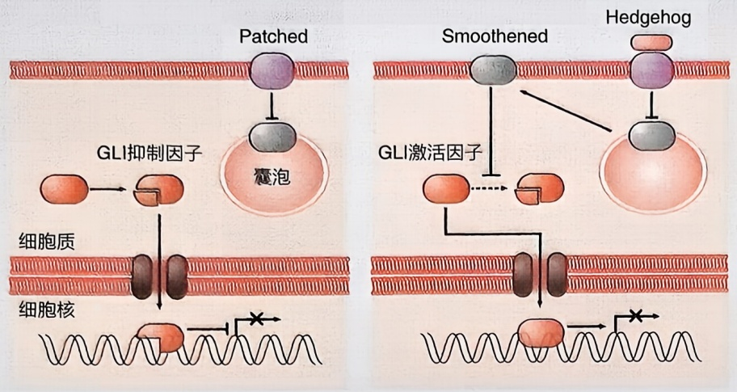

图13-28 Hedgehog（HH）信号通路

## 五、同样的诱因，不同的受体

如之前提到的，轴突在抵达最终目标前会穿过许多中间目标。但是，轴突既然被中间目标吸引前来，那它们又为什么会离开中间目标，向着下一个目标前进呢？

例如，在跨越中线前被吸引连合轴突（commissural axon）的诱因，在轴突跨越后可能产生排斥作用。比如，像 netrin 这样的“吸引性诱因”并不总是具有吸引力，而排斥性诱因也不总是排斥的。这些生长锥对诱因反应的改变是由细胞内第二信使（如 cAMP 或钙离子）介导的。在中线跨越的例子中，当生长锥内的 cAMP 水平较高时，对 netrin 的反应是吸引。但是生长锥内 cAMP 水平会被基板层中的一种成型素 Shh 降低，而在 cAMP 降低时，同样的轴突则对 netrin 产生了排斥。

## 知识窗 13-7

## netrin 的功能

马克·泰西耶-拉维涅（Marc Tessier-Lavigne）实验室通过一系列生化实验，对脊椎动物引导连合轴突到脊髓底板的化学诱导分子进行了纯化，该实验使用了数千个小鸡胚胎大脑。这种新型蛋白质被命名为netrin，源自梵语中的“向导”。脊椎动物中有两个netrin家族成员，即netrin-1和netrin-2。在缺乏netrin-1的突变小鼠中，连合投射完全缺失（图13-29）。netrin是进化上高度保守的分子，在鉴定参与协调线虫运动的基因筛选中发现了该基因的同源物。线虫 netrin 蛋白由 Unc-6 基因编码，其中 “unc” 是 “uncoordinated” 的缩写。在线虫 Unc-6 突变体中，运动失调是轴突导向缺陷的结果，这证明 netrin 的轴突导向作用在进化过程中是保守的。线虫中的遗传筛选还鉴定出了两种类型的 netrin 受体分子，分别由 Unc-40 和 Unc-5 基因编码，这两者

---

第六节 神经元分化与轴突导向

405

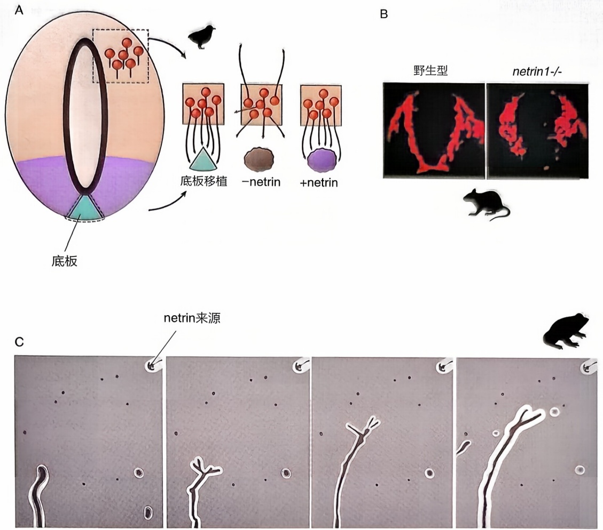

图13-29 netrin的功能

（A）神经干细胞的胞体位于神经管的背侧区域。在 netrin-1 的吸引下，它们的轴突向腹侧延伸，朝向底板。当把它们放在一起培养时，轴突会从背侧神经管的外植体向底板的外植体生长。背神经管轴突不会被不表达 netrin-1 的非神经细胞吸引，但如果对这类细胞进行基因改造，使其产生高水平的 netrin-1，轴突就会被

强烈吸引。（B）在野生型小鼠的脊髓中，可以看到神经轴突向底板延伸并穿过底板到达另一侧。然而，在缺乏netrin-1的突变小鼠中，轴突不会向底板投射，也不会在底板处交叉。（C）在培养基中生长的孤立轴突被吸引向内切蛋白源。四幅图显示的是在涂有细胞黏附分子的玻璃载玻片上生长的异种视网膜轴突的延时研究帧。

都是进化上保守的跨膜蛋白质。果蝇中Unc-40的同源基因被命名为Frazzled。哺乳动物中有两种Unc-40同源蛋白质，名为DCC（deleted in colon cancer）和neogenin，以及4种Unc-5同源物，名为Unc5h1-4。人们认为，Unc-40/DCC介导对netrin的化学吸引，而Unc-5介导netrin的排斥反应。因此，尽管最初将netrin描述为化学引诱剂，但netrin实际上既可以吸引轴突也能够排斥轴突，这依赖于它们表达的受体类型。

具体来说，从吸引到排斥的转变来自生长锥上此诱因受体的安装和卸载。得益于生长锥可以根据需求在本地制造新蛋白质，许多吸引性和排斥性的诱因分子都会在结合受体后的几分钟内激活生长锥的本地蛋白质合成，或是激活蛋白质降解通路（protein degradation pathway）这赋予了生长锥在移动过程中较为快速地改变其表面受体的能力（图 13-30）。

当下，我们对轴突导向的了解仍然是极为基础的，甚至未能了解任何一种神经元轴突导向的全貌。但对这些问题的进一步理解将使我们更接近于知晓怎样使成年神经元恢复活力，以达到我们的最终目标——使轴突能够再生。

---

406

第十三章 神经系统发育

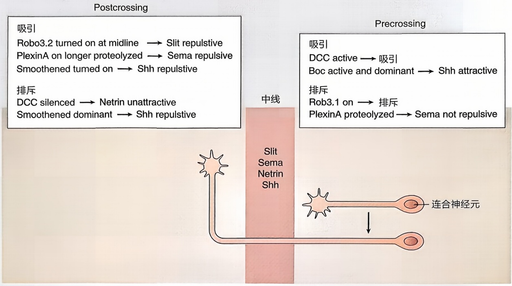

flowchart

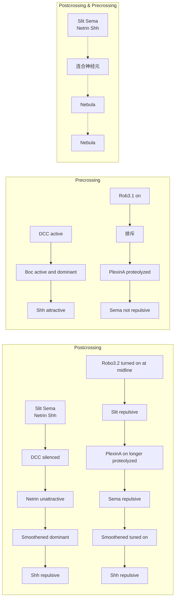

图 13-30 脊椎动物神经元穿过腹中线前后的示意图

神经元表达 Slit、semaphorin（Sema）、Netrin 和 Shh。轴

突穿过前，其生长锥会被 netrin 和 Shh 吸引，而不会被 Slit 和 Sema 排斥。交叉后，同样的生长锥被 Slit、Sema 和 Shh 排斥，而不再被 netrin 吸引。

## 第七节 神经突触的结构

神经系统是脊椎动物中至关重要的系统之一，它由两个主要部分组成:中枢神经系统（central nervous system，CNS）和周围神经系统（peripheral nervous system，PNS）。CNS包括脑和脊髓，而PNS包括位于CNS之外的神经元集合体，被称为神经节（ganglion）。

在神经系统中，两个核心细胞类型是神经元和胶质细胞。神经元是神经系统的信息传递单元，通常由胞体、轴突和树突组成。每个神经元通常只有一个轴突，但可以有多个树突。轴突通常比其他神经突起更长，具有均匀的直径，然后在特殊区域称为轴突末端（axon terminal）结束。神经元之间的主要通信是通过电信号（动作电位）进行的，这些信号沿着轴突传导，以促使从突触囊泡（synaptic vesicle）中释放的神经递质（neurotransmitter）在突触间隙（synaptic cleft）中传播，然后结合到突触后细胞（postsynaptic cell）上的受体。这个过程定义了神经元之间的通信（图13-31）。

胶质细胞在神经系统中也发挥着重要作用。在脊椎动物的 CNS 中，有四种主要类型的胶质细胞，分别是少突胶质细胞（oligodendrocyte）、星形胶质细胞（astrocyte）、

---

第七节 神经突触的结构

407

A

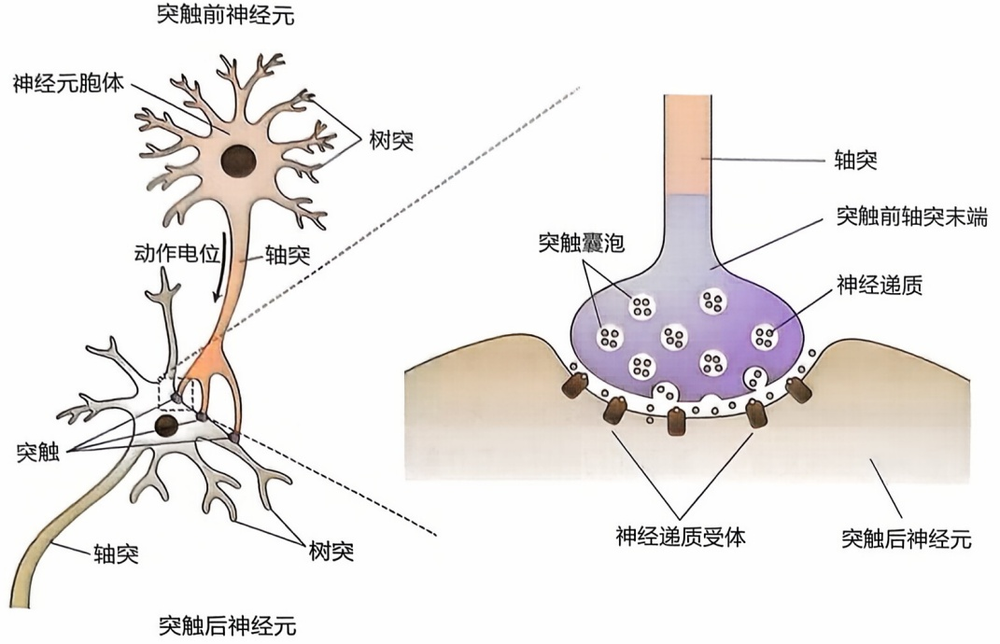

text_image

突触前神经元
神经元胞体
树突
动作电位
轴突
突触
轴突
突触后神经元
轴突
突触囊泡
轴突
突触前轴突末端
神经递质
神经递质受体
突触后神经元

图 13-31 神经元释放神经递质与其他细胞交流（A）脊椎动物的神经元由胞体、轴突和树突组成。（B）神经递质从突触囊泡中释放，然后扩散穿过突触间隙，与突触后细胞上的特定受体结合。

小胶质细胞（microglia）和室管膜细胞（ependymal cell）。少突胶质细胞负责在CNS中包裹轴突，形成髓鞘（myelin），提供一种绝缘层，以加速动作电位的传播速度。星形胶质细胞呈星形，在CNS中执行多种功能，包括维持神经元周围细胞外液中离子的平衡，与构成血-脑屏障（blood-brain barrier）的细胞互动，以及与神经元进行通信。小胶质细胞是CNS中最小的胶质细胞类型，通常充当大脑的免疫细胞，清除CNS中的碎片和病原体。室管膜细胞则覆盖在CNS的脑室（ventricle）中，产生脑脊液（cerebrospinal fluid）。在脊椎动物的PNS中，胶质细胞主要包括施旺细胞（Schwann cell）和卫星细胞（satellite cell）。大多数施旺细胞功能类似于少突胶质细胞，但每个施旺细胞包裹在一个轴突上，不会向附近的轴突延伸细胞过程。卫星细胞则包围神经元的胞体，类似于星形胶质细胞的功能（图13-32）。

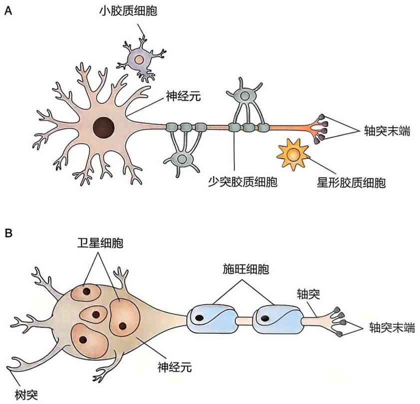

图13-32 脊椎动物的神经系统由神经元和神经胶质细胞组成

（A）中枢神经系统（CNS）中的神经元被大量胶质细胞包围，包括星形胶质细胞、小胶质细胞和包裹轴突的髓鞘化少突胶质细胞。（B）在周围神经系统（PNS）中，神经元的胞体被卫星细胞包围，而轴突则被髓鞘化的施旺细胞包裹。

---

408

第十三章 神经系统发育

近年来，人们还发现脊椎动物 CNS 和 PNS 中的胶质细胞可以释放信号，以调节神经发育的各个方面，并且开始确定无脊椎动物特定类型的胶质功能。这些细胞之间的复杂相互作用让人们更深入地理解神经系统的发育和功能。

## ※ 复习思考题

1. 神经元在发育过程中是如何受到外部环境影响的？举例说明环境因素如何影响神经元的分化过程。
2. 在哺乳动物的神经系统发育中，哪些关键的发育阶段对最终的神经功能至关重要？分析这些阶段的生物学机制及其潜在的临床意义。
3. 在神经系统发育中，基因如何与环境互作影响行为表现？举例说明特定基因或基因组的变异如何与发育障碍相关联。

## ※ 推荐阅读

1. BAKER J C, BEDDINGTON R S P, HARLAND R M. Wnt signaling in Xenopus embryos inhibits BMP4 expression and activates neural development [J]. Genes & Development, 1999, 13: 3149–3159.
2. BALEMANS W, VAN HUL W. Extracellular regulation of BMP signaling in vertebrates: a cocktail of modulators [J]. Developmental Biology, 2002, 250(2): 231-250.
3. BOUWMEESTER T, KIM S, SASAI Y, et al. Cerberus is a head inducing secreted factor expressed in the anterior endoderm of Spemann's organizer [J]. Nature, 1996, 382: 595–601.
4. FOSSAT N, JONES V, GARCIA-GARCIA M J, TAM P P L. Modulation of WNT signaling activity is key to the formation of the embryonic head [J]. Cell Cycle, 2012, 11(1): 26-32.
5. BRAY S J. Notch signalling: a simple pathway becomes complex [J]. Nature Reviews Molecular Cell Biology, 2006, 7(9): 678–689.
6. HARTENSTEIN V, WODARZ A. Initial neurogenesis in Drosophila [J]. Wiley Interdisciplinary Reviews: Developmental Biology, 2013, 2(5): 701–721.
7. AYALA R, SHU T, TSAI L H. Trekking across the brain: the journey of neuronal migration [J]. Cell, 2007, 128: 29-43.
8. FORESTI M L, ARISI G M, SHAPIRO L A. Role of glia in epilepsy-associated neuropathology, neuroinflammation and neurogenesis [J]. Brain Research Reviews, 2011, 66: 115–122.
9. AUGSBURGER A, SCHUCHARDT A, HOSKINS S, et al. BMPs as mediators of

---

推荐阅读

409

- roof plate repulsion of commissural neurons [J]. Neuron, 1999, 24: 127–141.
- 10. BAK M, FRASER S E. Axon fasciculation and differences in midline kinetics between pioneer and follower axons within commissural fascicles [J]. Development, 2003, 130: 4999–5008.

(编写: 米达、薛天; 审读: 马秋富)
