# 第十四章 生殖细胞与性发育

原始 PDF 第 426–452 页。

## 第十四章

## 生殖细胞与性发育

物种是如何通过生殖细胞的发育来保证染色体数量的稳定呢？“一母生九子，九子各不同”，物种又是如何在保持染色体数量稳定的前提下，增加配子的遗传多样性，从而保证群体的多样性呢？此外，物种的性别分化又是由什么遗传基础决定的呢？减数分裂是有性生殖过程中产生具有功能性配子的特殊细胞分裂方式，产生染色体数量减半的精子和卵子。通过受精，精子与卵子结合形成受精卵，染色体数量恢复为二倍体状态，从而维持受精后物种的染色体整倍性。此外，减数分裂过程中会发生基因重组、非同源染色体之间自由组合以及非姐妹染色单体自由组合，这些都增加配子遗传物质多样性，使得后代对环境的适应性增强，这也是物种适应环境变化不断进化的机制。性别是伴随有性生殖的出现而在生物界同种个体之间普遍存在的一种形态和生理上的差异现象，生物的性别是生物通过长期的进化所获得的最重要的表型之一。正常的性别分化发育分为性别确定和性别分化，是一个复杂而有序的过程。决定性别的根本因素是性染色体，随后的性腺分化过程及表型受到各种遗传调控和环境因素的影响。本章将介绍“生殖细胞与性发育”的概念和过程，解释减数分裂、精子和卵子发生、性腺发育与性别决定以及性发育异常的相关疾病与遗传的关系。

---

第一节 生殖细胞发育与遗传

411

## 第一节 生殖细胞发育与遗传

## 一、生殖细胞的减数分裂

减数分裂（meiosis）是有性生殖过程中产生功能性配子的特殊细胞分裂方式。与有丝分裂不同，减数分裂过程中DNA只复制一次，而细胞连续分裂两次，因此产生染色体数量比亲代细胞减少一半的单倍体配子，即精子和卵子。通过受精，精子和卵子细胞核融合，受精卵中染色体数量恢复为二倍体状态，从而保证亲代与子代之间染色体数量的恒定。此外，减数分裂过程中会发生基因的重组，导致配子遗传物质多样化，增强了后代对环境的适应性。

## (一) 减数分裂间期

减数分裂周期分为两个阶段，间期和减数分裂期。减数分裂间期可以细分为3个阶段，分别为 $G_{1}$ 期、合成期（S期）、 $G_{2}$ 期。 $G_{1}$ 期是DNA复制的准备期，细胞体积显著增大，进行着活跃的RNA及蛋白质合成，并伴随着多种蛋白质的磷酸化。此外，细胞膜对物质的转运能力增强。S期主要进行大量的DNA复制，在多种酶的参与下完成。S期也是组蛋白合成的主要时期，组蛋白合成与DNA复制同步进行且相互依存。新合成的组蛋白与复制后的DNA结合并组装成核小体，最后完成染色体的复制。复制后的每条染色体由两条姐妹染色单体构成，由黏连蛋白（cohesin）复合体构成的环状结构将姐妹染色单体固定在一起，此时染色体呈丝状。 $G_{2}$ 期主要进行RNA、ATP、蛋白质的大量合成，储存物质和能量，为分裂期做准备。纺锤体组装所需的微管蛋白、减数分裂所需成熟促进因子等都是在 $G_{2}$ 期合成。

## （二）减数分裂期

## 1. 减数分裂Ⅰ

## (1) 前期 I

减数分裂期由两个连续分裂的过程组成，分别为减数分裂 I（meiosis I，MI）和减数分裂 II（meiosis II，MII）。减数分裂 I 分为四个时期，分别为前期 I（prophase I）、中期 I（metaphase I）、后期 I（anaphase I）和末期 I（telophase I）。根据染色体的形态变化特点，前期 I 可细分为五个时期（图 14-1），

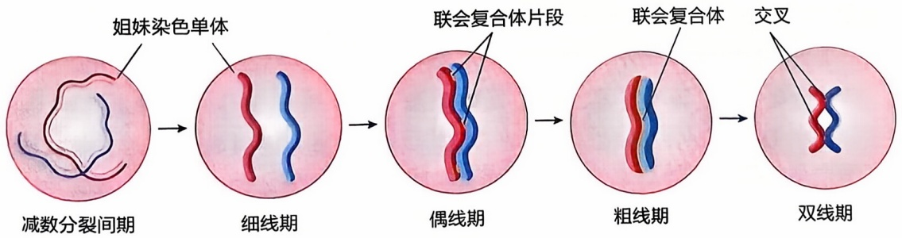

flowchart

图14-1 减数分裂间期和前期I进程

---

412

第十四章 生殖细胞与性发育

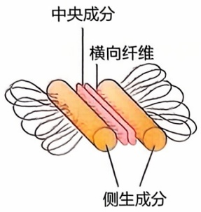

text_image

中央成分
横向纤维
侧生成分

图14-2 联会复合体的结构

分别为细线期（leptotene stage）、偶线期（zygotene stage）、粗线期（pachytene stage）、双线期（diplotene stage）和终变期（diakinesis stage）。

在细线期，细胞核及核仁体积增大，丝状染色体开始凝集，同源染色体开始配对。

在偶线期，染色质进一步凝集，分别来自父母的、形态及大小相同的同源染色体相互靠近、配对，称为联会（synapsis）。同源染色体完全配对后形成的复合结构即为二价体，由于配对后的同源染色体含有四条姐妹染色单体，因此也称作四分体（tetrad）。在联会的同源染色体之间，沿纵轴方向形成了一种特殊的结构，称为联会复合体（synaptonemal complex, SC）。联会复合体由三个平行的纵向部分组成，分别是两侧的侧生成分和中间的中央成分，由横向纤维相连（图14-2）。联会复合体组装开始于细线期，在同源染色体尚未配对之前，在姐妹染色单体之间形成一条侧生成分的轴心，沿染色体全长分布。在偶线期，随着同源染色体配对，两条侧生成分的轴心相互靠近，并各自向其垂直方向产生横向纤维，横向纤维构成了联会复合体的中央成分，联会复合体形成。联会复合体的形成使两条同源染色体的连接变得紧密，促进配对。

在粗线期，染色体进一步凝聚、缩短、变粗，同源染色体非姐妹染色单体之间出现染色体片段的互换及重组。重组是由高度保守的核酸内切酶（SPO11）激活启动的。SPO11在减数分裂前期I开始时在基因组中诱导数百个DNA双链断裂（double-strand breakage，DSB）来启动减数分裂重组。随后这些DSB招募相关修复蛋白，形成重组位点，并招募一系列因子，进行交叉或非交叉互换。联会复合体为DSB修复提供了所需的稳定性，是非姐妹染色单体之间交叉重组的先决条件。交叉重组导致同源染色体非姐妹染色单体之间DNA片段交换，产生基因重组，增加了物种的遗传多样性。

在双线期，联会复合体发生去组装，紧密连接的同源染色体相互分离，只有在非姐妹染色单体之间发生交叉重组的位置还存在一些接触点，称为交叉（chiasma）。黏连蛋白形成稳定交叉的结构。交叉提供将同源染色体保持在一起的物理连接，对于染色体的正确分离非常重要，因为它们允许在纺锤体相对两极建立起对染色体的张力附着。每对同源染色体之间的重组至少形成一个交叉，才能保证同源染色体在中期I均等分离。如果没有交叉，两条同源染色体会随机分离，或者姐妹染色单体过早分离。随着双线期的进行，交叉向染色体臂的末端推移，数量也由此减少，该过程称为交叉端化（chiasma terminalization）。此时，四分体常呈现出V、X、O、8等形态，因此可作为双线期的判断标志。在某些生物中，双线期会持续很长的一段时间。例如，在小鼠卵母细胞中可持续数月，在人卵母细胞中可持续数十年。

在终变期，染色体高度凝集并向核的周围靠近，核膜、核仁消失，开始组装纺锤体，退出减数分裂前期Ⅰ。

## (2) 中期 I

纺锤体（spindle）是由微管构成的“桶状”结构，在中期Ⅰ组装完成，是减数分裂过程中负责染色体排列和分离的主要细胞器。与有丝分裂纺锤体组装类似，精子减数分裂纺锤体的组装依赖于微管成核机制，而中心体是介导微管成核的主要结构，

---

第一节 生殖细胞发育与遗传

413

每个中心体由一对正交的中心粒和周围的云状物质组成。中心体在减数分裂间期复制后分离，分布到细胞核两侧，在核膜破裂后，中心体微管成核活性增强，发出微管，启动纺锤体组装。从中心体发出的微管不断生长和收缩，并与染色体着丝粒两侧的动粒（kinetochore）随机相互作用，最终形成独特的“桶状”纺锤体结构，两侧的中心体分别成为纺锤体两极的极点。与精子减数分裂纺锤体组装不同，大多数动物卵母细胞缺乏典型的中心体，以不依赖中心体的方式组装纺锤体。例如，小鼠卵母细胞纺锤体由无中心粒的微管组织中

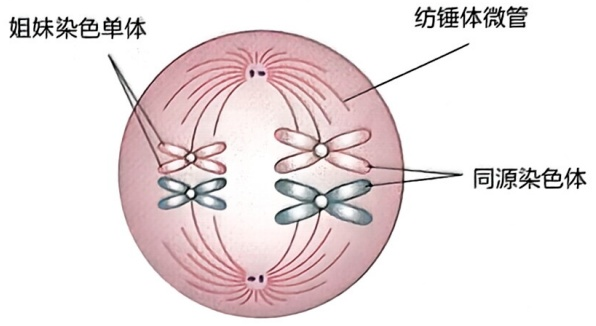

text_image

姐妹染色单体
纺锤体微管
同源染色体

图14-3 减数分裂|中期示意图

心（acentriolar microtubule organizing center, aMTOC）介导形成。人卵母细胞减数分裂时则缺乏显著的aMTOC，而是由被命名为人类卵母细胞微管组织中心（human oocyte microtubule organizing center, huoMTOC）负责纺锤体组装。huoMTOC形成于卵母细胞皮质区下方，并迁移到核膜附近。核膜破裂后，huoMTOC开始片段化并逐渐定位于动粒，以启动微管成核和纺锤体组装。卵母细胞中心体的退化在平衡中心体数量中起着重要作用，以保证受精卵拥有正确数量的中心体。在中期I，染色体与纺锤体微管相互作用，逐渐形成动粒-微管连接（kinetochore-microtubule attachment, K-MT），转移并整齐排列在纺锤体中央，同源染色体分别与相反纺锤体极发出的微管连接，姐妹染色单体上的两个动粒附着在同一纺锤体极发出的微管上（图14-3）。K-MT的建立是一个随机的过程，容易发生错误。错误的K-MT稳定性降低，会经历不断解聚并重新建立的过程，只有当所有染色体都与纺锤体微管形成正确连接时，同源染色体才会分离。

## (3) 后期 I

纺锤体组装检验点（spindle assembly checkpoint，SAC）是一种细胞周期监视机制，核心成分包括MAD1、MAD2、Bub1、BubR1、Bub3、CDC20等蛋白，负责监视动粒与微管是否正确连接，并通过延迟进入后期I，直到动粒和微管建立稳定连接来防止染色体错误分离。后期促进复合物（anaphase promoting complex，APC）在减数分裂染色体的分离中发挥重要作用，其活性取决于CDC20。为了阻止中期I向后期I的转变，纺锤体组装检验点通过CDC20抑制APC靶向两种关键蛋白:分离酶抑制蛋白（securin）和细胞周期蛋白B（cyclin B）。分离酶（separase）是切割黏连蛋白复合体所必需的蛋白酶，而分离酶抑制蛋白能够抑制分离酶活性。当所有染色体都与微管形成正确附着时，纺锤体组装检验失去活性，抑制作用消失，后期促进复合物激活引起分离酶抑制蛋白降解，进而激活分离酶。激活的分离酶裂解黏连蛋白复合物成分，破坏黏连蛋白结构，使同源染色体分开。cyclin B是细胞周期依赖性蛋白激酶1（cyclin dependent kinase，Cdk1）的激活剂，激活的后期促进复合物靶向降解cyclin B，使Cdk1活性丧失，进而降低成熟促进因子活性，允许细胞进入后期I。在纺锤体微管的作用下，同源染色体彼此分裂，非同源染色体随机组合，移向细胞的两极（图14-4）。此时，每极含有染色体的数量为细胞原有染色体数的一半。

---

414

第十四章 生殖细胞与性发育

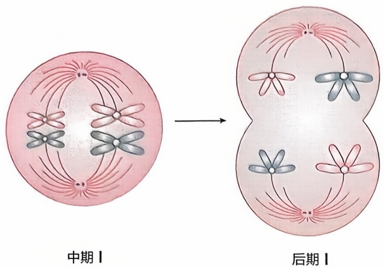

text_image

中期Ⅰ
后期Ⅰ

图14-4 减数分裂后期I示意图

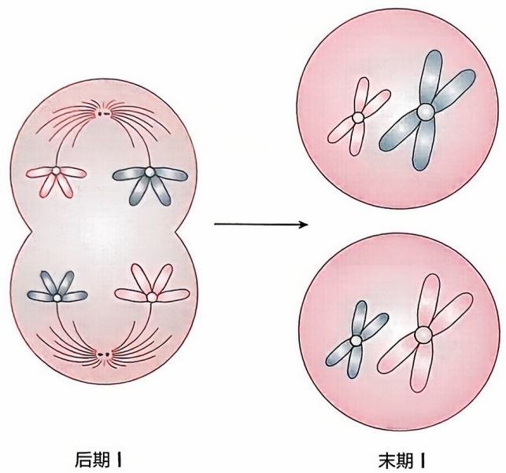

text_image

后期Ⅰ
末期Ⅰ

图 14-5 减数分裂末期 | 示意图

## (4) 末期 I

在末期Ⅰ，到达纺锤体两极附近的染色体解聚，逐渐成为细长的染色质纤维，核仁和核膜重新形成，核孔在核膜上重新组装，核分裂完成，形成两个子代细胞的核。收缩环是由肌动蛋白和肌球蛋白形成的环状结构，在末期Ⅰ负责胞质分裂，形成两个子代细胞（图14-5）。值得注意的是，某些生物的染色体在此阶段不发生解聚，仍然保持高度凝集的状态。

## 2. 减数分裂 | 后的间期

减数分裂Ⅰ和减数分裂Ⅱ之间通常没有间期，或者间期的持续时间很短，不再进行DNA合成和染色体复制，也没有中心体复制。

## 3. 减数分裂Ⅱ

减数分裂Ⅱ与有丝分裂过程类似，分为四个时期，分别为前期Ⅱ、中期Ⅱ、后期Ⅱ和末期Ⅱ。在前期Ⅱ，丝状染色体再次高度凝集，每条染色体由两条姐妹染色单体构成。随着核仁、核膜的消失，纺锤体开始组装，两条姐妹染色单体上的两个动粒分别与相反纺锤体极发出的微管连接，并逐渐移向纺锤体内部。在中期Ⅱ，染色体动粒与纺锤体微管建立稳定连接，并整齐排列在纺锤体中央。大多数哺乳动物卵母细胞减数分裂会在此时期停滞，直到与精子结合受精后，才会继续进行减数分裂。在后期Ⅱ，染色体着丝粒分裂，姐妹染色单体分离，非姐妹染色单体自由组合并移向细胞的两极。在末期Ⅱ，到达两极附近的姐妹染色单体解聚，成为细长的染色质纤维，核仁和核膜重新形成，胞质分裂，形成两个子代

细胞。此时，子细胞是染色体数量减半的单倍体细胞（图 14-6）。

减数分裂的目标是产生染色体数量减半的单倍体配子。尽管雌雄配子的产生都经历减数分裂过程，但大多数哺乳动物中两个过程最终形成成熟配子的数量有所不同。精子发生的减数分裂中，纺锤体位于细胞中央，是一个均等分裂的过程，产生四个相同的精细胞，精细胞经过复杂的变形后，成为精子。然而卵子发生的减数分裂是一种独特的不对称细胞分裂，纺锤体位于细胞的一侧，初级卵母细胞内大部分母源成分被保留在次级卵母细胞内，最终只产生一枚高度极化的成熟卵子（图14-7）。

## 4. 减数分裂染色体的逐级分离

黏连蛋白复合体在染色体臂和着丝粒周围形成环状结构，将同源染色体或姐妹染色单体连接在一起。减数分裂Ⅰ中同源染色体和减数分裂Ⅱ中姐妹染色单体的逐步分离取决于黏连蛋白复合体的逐步去除。黏连蛋白复合体由两种结构维持蛋白（SMC）、

---

第一节 生殖细胞发育与遗传

415

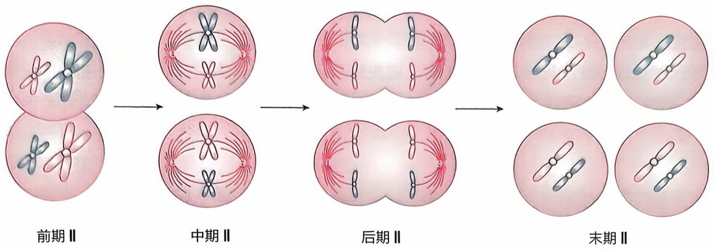

flowchart

图14-6 减数分裂Ⅱ进程

kleisin 等亚基组成，并通过分离酶从减数分裂 I 的染色体臂和减数分裂 II 的着丝粒周围去除。Rec8 是减数分裂黏连蛋白复合体的亚基之一，分离酶可以通过裂解 Rec8 去除黏连蛋白复合体。为了实现黏连蛋白复合体的逐步去除，Rec8 裂解在空间和时间上的精确调节对于两次减数分裂中遗传物质的正确分离至关重要。在减数分裂中，分离酶必须被激活两次:第一次是减数分裂 I 被激活，以去除染色体臂上的黏连蛋白复合体；第二次是在减数分裂 II 被激活，去除姐妹染色单体着丝粒周围的黏连蛋白复合体。如何防止分离酶在减数分裂 I 着丝粒区域裂解这一小部分 Rec8，在高等真核生物中仍不清楚。目前已知的是，着丝粒处的 Sgo2 是保护 Rec8 免受分离酶裂解所必需的，它通过将 PP2A-B56 定位到着丝粒区域，使着丝粒区域中的部分 Rec8 去磷酸化，因此在减数分裂 I 中不能被分离酶切割。减数分裂 I 阶段，着丝粒处的黏连蛋白复合体被保护，不被分离酶切割，而染色体臂上的黏连蛋白复合体被解离，允许同源染色体向纺锤体的相对两极分离，但不能分离姐妹染色单体，染色体数量减少一半。减数

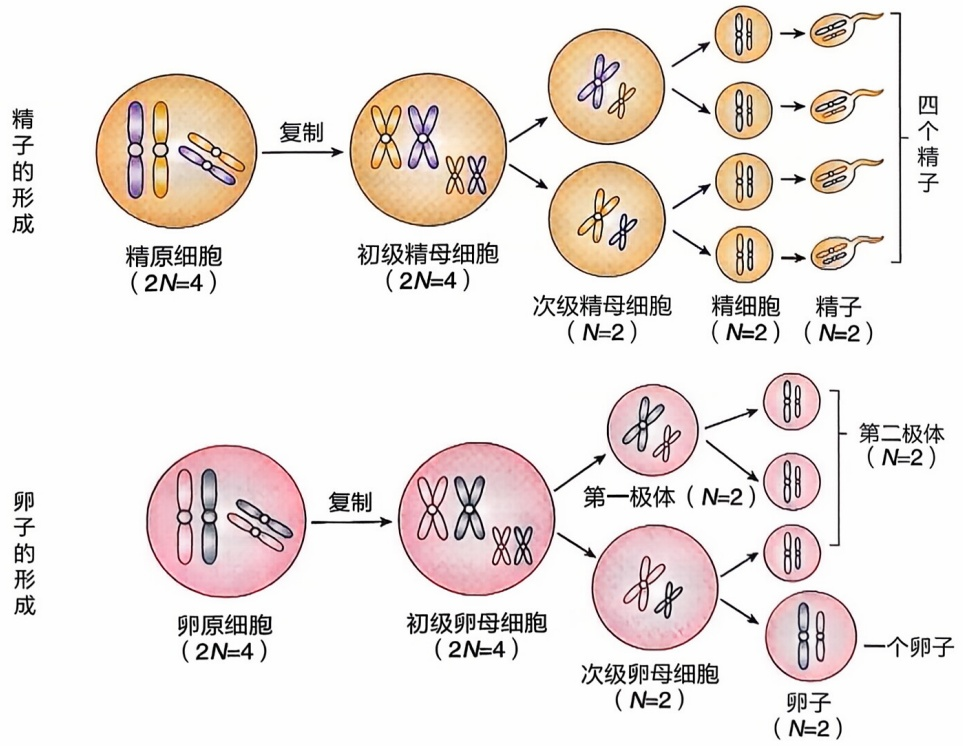

图14-7 雄性和雌性减数分裂的异同

---

416

第十四章 生殖细胞与性发育

分裂Ⅱ阶段，分离酶才会对着丝粒周围的 Rec8 进行切割，破坏黏连蛋白复合体，完成姐妹染色单体的分离。错误的染色体分离会诱导配子以及胚胎染色体数量异常，进而导致不孕不育、出生缺陷等疾病。唐氏综合征（21 三体综合征）、X 三体综合征等遗传疾病就是染色体数量异常所导致的。因此，正确的染色体分离对于生殖健康十分重要。

## 二、精子发生

在青春期，紧贴在曲细精管基膜上的精原细胞依次经历初级精母细胞、次级精母细胞、精子细胞各个不同发育阶段，最终发育为成熟精子，这一过程称为精子发生（spermatogenesis）。

## 1. 揭示精子发生的漫长研究历史

中国古代最早出现有关“精子”内容的医学史料是2000多年前春秋战国时期的医学著作《黄帝内经》:“男子二八，肾气盛，天癸至，精气溢泻，阴阳合，故能有子，天癸竭，精少，肾气衰，形体皆极”。《黄帝内经·素问·上古天真论》中明确提到“两精相合，构成胎孕”的论断。公元前2世纪开始，古希腊的相关著作中对男性生殖器官的解剖结构和生理功能进行了初步描述，这是人类对自身生育繁衍机制的初步探索。

17—18世纪，科学家们利用当时最先进的显微镜展开了对精子的研究。但早期研究精子的科学家所面临的最基本问题是:精子是活的动物么？它们是一种寄生虫么？每个精子里是否都有未成型的微型成年人蜷缩在里面呢？荷兰学者安东尼·范·列文虎克（Antonie van Leeuwenhoek，1632—1723）很可能是第一位观察并研究精子的科学家。1677年，列文虎克在显微镜下观察自己的精液，立刻被其中扭在一起的“微生物”震惊了，他看到“数以千计沙粒般大小的活体‘微型动物’正在游动，长着比自己身体长五六倍的细尾巴，它们蜿蜒前行，靠尾巴的摆动来推进”。列文虎克最终给伦敦皇家学会写了一封踌躇不决的信，信中所描述的关于精子的微观发现发表在了1678年的《自然科学会报》上。从此，精子的研究从宏观进入了微观，进入了一个崭新的历史阶段。

然而，当时的科学技术并不能支持各国的生物学家对精子的深入研究，科学界认为精细胞是一些与性或生殖毫无关系的微型动物。1830年，权威医学期刊《柳叶刀》（The Lancet）仍将精子归类为肠道蠕虫“精液中常能发现微型生物，显然，这里是它们天然的寄居地”。此后的数百年间，生物学家对精子的发生以及受精过程的认识逐渐有了质的提升，从最初“精子头部自带着新生儿”的荒诞想法，到后来确定“精子携带了一半遗传物质并且会与卵子结合”，再到如今确定“动力蛋白能够给精子尾巴提供动力，激素能影响精子活动性等”各种分子机制。随着技术手段的不断提升，人类逐步探索到越来越多关于精子发生和成熟的秘密。

---

第一节 生殖细胞发育与遗传

417

## 2. 精子发生的功能结构

男性的主性器官是睾丸，附属性器官包括附睾、输精管、精囊腺、前列腺和尿道球腺等。睾丸由被膜和实质两部分组成，睾丸实质主要由100～200个睾丸小叶组成，睾丸小叶内有生精小管与间质细胞，前者是生成精子的部位，后者则具有内分泌功能，可分泌雄性激素。

## (1) 生精小管

精子在睾丸的生精小管（seminiferous tubule）中产生。生精小管共占睾丸总体积的60%\~80%，包括生精细胞（spermatogenic cell）及管周细胞和支持细胞（sertoli cell）。生精小管被特殊的固有层包绕，其中包括胶原层构成的基底膜和管周细胞。支持细胞是位于生精上皮的壁细胞。该细胞位于管壁基底膜并延伸至生精小管管腔。从广义而言，它可被认为是生精上皮的支持结构。支持细胞延伸到生精上皮的全层，沿着支持细胞胞体，精原细胞发育至成熟精子的所有形态、生理变化过程都在此发生。支持细胞影响精子发生的过程，可以决定睾丸的最终体积和成人的精子生成数量。

## (2) 睾丸间质

睾丸间质组织中最重要的体细胞是间质细胞（leydig cell），其在下丘脑-垂体的调节下合成雄性激素——睾酮（testosterone）。人类睾丸每天合成6\~7 mg睾酮，占血浆睾酮的95%。除此之外，睾丸间质中还有免疫细胞、血管、淋巴管、神经、纤维组织和疏松连接组织。睾丸间质还包含巨噬细胞和淋巴细胞等重要免疫细胞。巨噬细胞可能通过分泌某些细胞因子而影响间质细胞的功能，尤其是间质细胞的增殖、分化和类固醇合成过程。巨噬细胞分泌还影响类固醇合成的刺激因子和抑制因子。

精子发生过程起始于生精干细胞的分化，终止于成熟的精子形成。不同的生精细胞在生精小管中按照特殊的细胞联系排列，形成所谓的精子发生过程（图 14-8）。

## (3) 血 - 睾屏障

血 - 睾屏障（blood-testis barrier）是位于间质毛细血管腔和生精小管腔之间的一层屏障结构，包括有毛细血管、淋巴管的内皮细胞和基底膜、肌样细胞、生精小管基

底膜和支持细胞间的紧密连接。血-睾屏障可能具有两个重要的功能:隔离精子使其避免免疫系统的识别；提供减数分裂和精子发生的特殊环境。

## 3. 精子发生的过程

精子发生过程可以被分为精原细胞的更新分化、精母细胞的成熟分裂和精子细胞变态3个过程，如图14-9所示。

## (1) 精原细胞的更新分化

精原细胞位于生精上皮的基底部，分为A、B两种类型。A型精原细胞进一步分为Ad型和Ap型。在正常情况下，Ad型精原细胞不发生任何有丝分裂，被视为精子发生的精原干细胞；Ap型精原细胞则通常分化增殖为两个B型精原细胞。B型精原

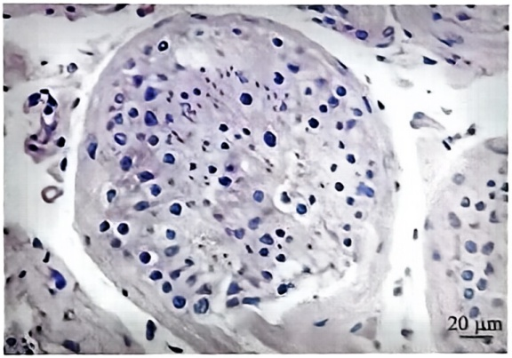

natural_image

Microscopic tissue section showing cellular structures with blue nuclei and a 20 μm scale bar (no text or symbols beyond scale indicator)

图14-8 人类睾丸组织学切片示生精小管与成熟精子（苏木精-伊红染色，李关键供图）

---

418

第十四章 生殖细胞与性发育

细胞经过数次增殖，体积增大并分化为初级精母细胞，随后，初级精母细胞开始减数分裂进程。

## (2) 精母细胞的成熟分裂

精母细胞经历了减数分裂的不同阶段，最终产生单倍体生精细胞，又称精子细胞。在精子发生过程中，减数分裂非常关键，在这个阶段，遗传物质相互重组且只复制一次，细胞连续分裂两次，最终形成染色体数量减少一半的精子细胞。次级精母细胞产生于第一次减数分裂后，含有双份单倍体染色体。在第二次减数分裂中，精母细胞演变为单倍体的精子细胞。第一次减数分裂前期大概持续1\~3星期，而除此之外

图14-9 人类精子发生的过程

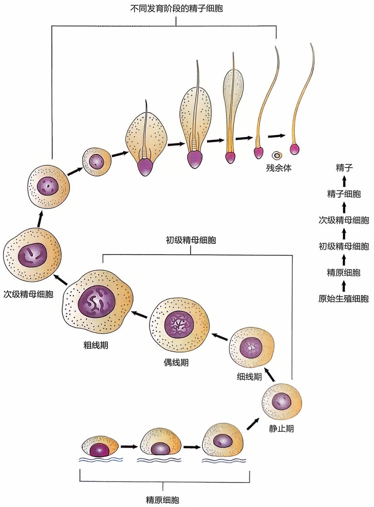

flowchart

This flowchart illustrates the developmental stages of sperm cells, showing the progression from mature to early and late stages through differentiation, growth, and survival.

---

第一节 生殖细胞发育与遗传

419

的第一次减数分裂的其他阶段和第二次减数分裂在 1\~2 天之内完成。

## (3) 精子细胞变态

第二次减数分裂后形成的精子细胞是没有分裂活性的圆形细胞。圆形的精子细胞经过复杂的形态变化转变为不同长度的精子细胞和精子。在第二次减数分裂中，细胞核发生聚缩和塑性，同时鞭毛形成，胞质明显扩张，丢失了大部分细胞器，如核糖体、粗面内质网及高尔基体。全部精子细胞变形的过程称为精子形成。在显微镜下精子形如蝌蚪，全长 $60\mu \mathrm{m}$，分头、尾两部分，头部主要由核、顶体及后顶体鞘组成，尾部又称鞭毛。

## 4. 精子发生的动力学及精子释放

精子生成过程在时间和空间上有严格的顺序性（图14-9）。曲细精管中不同成熟阶段的生精细胞在管腔中连续、依次排列，提示精子生成过程按照顺序依次从第一阶段一直到第四阶段。在人类以及某些猴的部分睾丸组织中，生精小管的同一转化部位也可以同时存在多个精子成熟阶段。生精小管同一局部的精子生成过程呈螺旋样相互联系。生精细胞的增殖和分化过程都遵循一个严格的模式，所有生精细胞的发育和分化都经过几个独立而又紧密联系的过程。生精上皮按照程序成功完成每一个发育阶段称为生精上皮周期，每个周期需要16天，人类的精子发育到成熟必须经过四个周期，可以推测最少需要64天。从青春期到老年期，睾丸都有生精能力，但在45岁以后，随着生精小管的萎缩，其生精能力将逐渐减弱。精子发育成熟释放到生精小管管腔的过程称为精子释放，此过程受到多种因素的影响，包括血纤维蛋白溶酶原、激素、温度、毒性物质等。未释放的精子将被支持细胞吞噬。新生成的精子自身没有运动能力，需被输送至附睾进一步成熟。

## 5. 精子发生的激素调控及睾丸局部调节

睾丸的生精作用和内分泌功能均受到下丘脑-腺垂体的调节，下丘脑、腺垂体、睾丸在功能上联系紧密，构成下丘脑-腺垂体-睾丸轴（hypothalamic-adenohypophysial-testicular axis）。睾丸分泌的激素又对下丘脑-腺垂体进行反馈调节，从而维持生精过程和各种激素水平的稳态。此外，在睾丸内生精细胞、支持细胞和间质细胞之间还存在复杂的局部调节机制。

## 三、卵子发生

卵子发生（oogenesis）开始于胎儿卵巢中的原始生殖细胞分化为卵原细胞。卵原细胞通过有丝分裂迅速增殖，且卵原细胞体积不断增大，进一步发育成为初级卵母细胞，开始进行第一次减数分裂。在间期，DNA进行复制，形成两个姐妹染色单体，并通过黏连蛋白复合体保持在一起。进入第一次减数分裂前期I的细线期后，卵母细胞通过诱导DNA双链断裂来启动减数分裂重组，招募相关修复蛋白形成重组位点，在偶线期诱导同源染色体配对和联会。在偶线期和粗线期，重组位点不断发展，并招募一系列的因子，进行交叉或非交叉互换，DSB也被交叉或非交叉途径修复。此

---

420

第十四章 生殖细胞与性发育

后，卵母细胞停留在第一次减数分裂的双线期，并被一层体细胞包裹形成原始卵泡（primordial follicle）。

## 1. 卵泡发育过程

原始卵泡由初级卵母细胞和周围单层扁平状的卵泡细胞组成，位于卵巢浅层皮质、体积小、数量多。原始卵泡的数量在出生后不再增加，构成了卵巢的原始储备池，并在整个生殖寿命中不断被消耗。当雌性性成熟时，在促卵泡激素（follicle stimulating hormone, FSH）和促黄体生成素（luteinizing hormone, LH）的作用下，小部分原始卵泡被激活并开始逐渐生长，成为初级卵泡（primary follicle）。此时的初级卵母细胞体积增大，卵泡细胞由单层扁平状变为立方体状或柱状，卵泡细胞和卵母细胞之间出现透明带。初级卵泡继续生长，体积增大，由单层变为多层，成为次级卵泡（secondary follicle）。次级卵泡继续发育，出现卵泡腔，腔内充满卵泡液，含有卵子发生所需要的营养成分和微环境。随着卵泡液的增多及卵泡腔的扩大，卵母细胞偏向卵泡一侧，并与周围的卵泡细胞一起向卵泡腔突起，形成卵丘（cumulus oophorus）。当卵泡继续增大并向卵巢表面突出，即成为窦状卵泡（antral follicle）。卵泡发育的过程中，伴随着卵母细胞自身体积的不断增加和胞内蛋白质、mRNA、脂质等的积累，当卵泡发育到排卵前的成熟卵泡以及卵母细胞自身体积增加到一定程度时，“生长”的初级卵母细胞才被赋予恢复减数分裂的资格，成为“成熟”的初级卵母细胞（图14-10）。性成熟时，在激素的刺激下，初级卵母细胞恢复减数分裂。

## 2. 减数分裂 | 双线期阻滞

在卵泡发育早期阶段，虽然卵母细胞体积不断增大，mRNA、蛋白质等物质不断积累，但卵泡发育不会引起卵母细胞减数分裂状态的任何变化，发育中的卵母细胞仍然处于双线期停滞阶段，标志为有一个较大的生发泡（germinal vesicle, GV），在动物中这种阻滞可持续数月，在人类中可长达数十年。环磷酸腺苷（cAMP）和颗粒细胞中的C利钠肽前体（NPPC）/利钠肽受体2（NPR2）途径在长时间维持卵母细胞双线期停滞方面发挥着关键作用。卵母细胞拥有所有必要的蛋白质，包括腺苷酸环化酶（AC）、Gs蛋白和G蛋白偶联受体3（GPR3），用于自身产生cAMP，只有当生成的cAMP达到一定浓度时，这种阻滞才能够维持。然而，仅由卵母细胞产生的内在cAMP不足以维持阻滞状态，它需要与卵巢颗粒细胞协调来维持细胞内高水平的cAMP。卵巢颗粒细胞主要分为壁颗粒细胞（MGC）和卵丘颗粒细胞（CGC），MGC分泌的NPPC激活其位于CGC上的受体NPR2，进而促进CGC中cGMP的产生，并转运到卵母细胞中。卵母细胞中的磷酸二酯酶3A（PDE3A）负责cAMP的降解，颗粒细胞产生的cGMP能够抑制PDE3A的活性来保持高水平的cAMP，维持双线期阻滞。

## 3. 减数分裂恢复

LH 激素通过正反馈调节卵母细胞减数分裂恢复。性成熟时，LH 激素激增，并激活位于 MGC 上的 LH 受体（LHR）。激活的 LHR 抑制 NPPC/NPR2 途径，破坏 CGC 和卵母细胞之间的间隙连接，导致卵母细胞中的 cGMP 含量降低，PDE3A 解除抑制状

---

第一节 生殖细胞发育与遗传

421

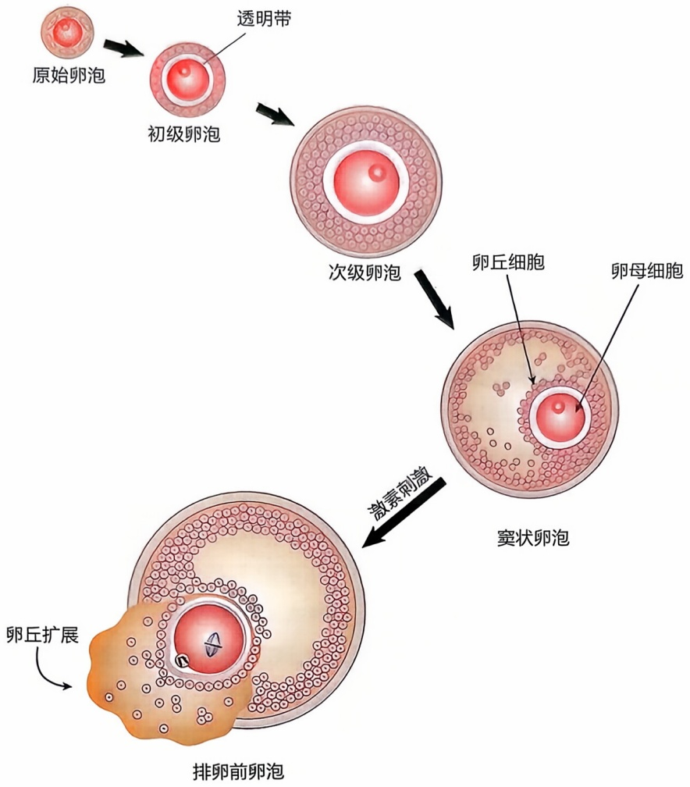

flowchart

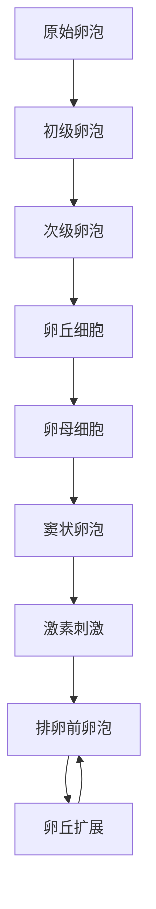

图14-10 哺乳动物卵泡发育过程

态，导致 cAMP 降解，促成熟因子（maturation promoting factor，MPF）被激活。MPF 是由细胞周期蛋白依赖性激酶 1（cyclin dependent kinase，Cdk1）和细胞周期蛋白 B（cyclin B）组成的复合物，对于卵母细胞减数分裂成熟至关重要。Cdk1 在特定丝氨酸和苏氨酸残基上磷酸化靶蛋白的能力取决于其活性以及其与 cyclin B 的结合，这也是 MPF 被激活的先决条件。在恢复减数分裂前，cyclin B 需要从细胞质易位到细胞核。启动卵母细胞减数分裂恢复的关键点之一在于 Cdk1 何时被激活。在双线期阻滞的卵母细胞中，持续高水平的 cAMP 激活 PKA，PKA 进而激活 WEE1。cAMP 降低后，WEE1 失活，诱导 Cdc25 分别通过 Cdk1 Thr14 残基的磷酸化或 Tyr15 残基的去磷酸化来激活 Cdk1。此外，表皮生长因子、钙信号等也参与了卵母细胞双线期的阻滞与恢复。减数分裂恢复的标志是生发泡破裂（germinal vesicle breakdown，GVBD）。

## 4. 减数分裂Ⅱ中期阻滞

生发泡破裂后，微管在原核位置组织形成纺锤体，纺锤体大致沿其长轴向皮质移动，在前期Ⅰ结束时到达卵母细胞皮质。纺锤体从细胞中央迁移、定位到卵母细胞皮质，对于不均等分裂十分重要。微丝在纺锤体迁移过程中，扮演着非常重要的角色。随着减数分裂纺锤体在细胞中央附近形成，微丝聚集到纺锤体外围并形成肌动蛋

---

422

第十四章 生殖细胞与性发育

白流，将纺锤体从卵母细胞的中心转移到皮质。肌动蛋白丝原本均匀分布在卵母细胞皮质，在纺锤体迁移过程中，卵母细胞皮质变得极化，在靠近纺锤体的区域形成肌动蛋白帽，覆盖在纺锤体上方。纺锤体定位到皮质后，当染色体与纺锤体微管稳定附着并整齐排列在赤道板上，纺锤体组装检验点沉默，后期促进复合物被激活，同源染色体发生分离，离开中期进入减数分裂Ⅰ后期和末期。在收缩环的帮助下，细胞质进行不对称分裂，产生一个小的极体（即第一极体）和一个大的次级卵母细胞（图14-11）。此时，次级卵母细胞的染色体数量减半，并且每个染色体仍然由两个姐妹单体构成。在大多数哺乳动物中，第一次减数分裂后没有间期或间期很短，次级卵母细胞在没有重新形成细胞核、染色体也没有去紧密的情况下，紧接着进入第二次减数分裂，并阻滞在中期。促成熟因子在卵母细胞MⅡ中期阻滞中发挥着重要作用。在LH激素的刺激下，Cdk1被激活，阻滞在双线期的卵母细胞恢复减数分裂。在MⅠ中期，Cdk1活性减弱，减数分裂从中期进入后期。与有丝分裂不同的是，Cdk1的活性只是部分减弱，在胞质分裂后其活性又升高。在一类被称为细胞静止因子（cytostatic factor，CSF）的蛋白作用下，Cdk1/cyclin B在MⅡ中期保持着高活性，从而维持MⅡ中期阻滞。

## 5. 减数分裂完成

随着排卵过程的发生，成熟卵泡发生破裂，卵丘卵母细胞复合体排出，进入输卵管并与精子结合。受精后，次级卵母细胞恢复减数分裂。后期促进复合物被 $\mathrm{Ca^{2+}}$ 依赖的磷酸化作用和抑制蛋白的降解激活，cyclin B降解，姐妹染色单体分离，并通过不对称的胞质分裂排出一个小的第二极体，完成减数分裂过程。因为卵子发生过程中，两次胞质分裂均为不对称分裂，使卵母细胞保持了较大体积，因此最终只能形成一个具有功能性的卵子和三个退化的极体。

图14-11 卵母细胞减数分裂过程

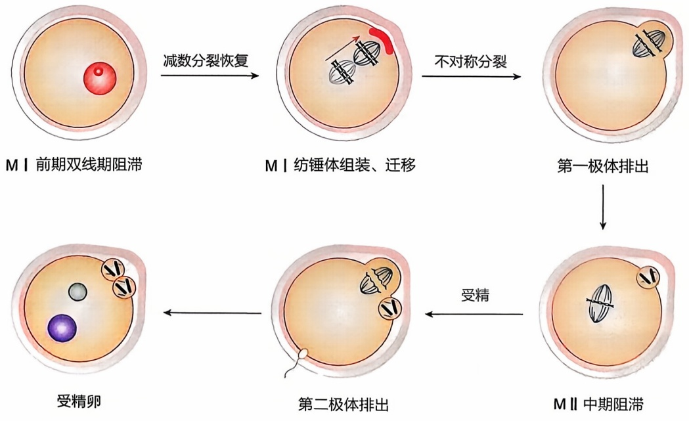

flowchart

---

第一节 生殖细胞发育与遗传

423

## 四、精子、卵子发生的遗传学意义

染色体数量异常与人类疾病的发生密切相关。在配子发生或早期胚胎发育过程中出现的染色体异常，能够影响全部或大部分体细胞的染色体整倍性，导致严重的健康问题。减数分裂发生的各种错误，如姐妹染色单体未发生交叉重组、纺锤体组装失败，会导致染色体不能分离，减数分裂阻滞，无法获得功能性配子。临床上，男性无精子症的一个重要原因就是减数分裂异常无法获得圆形精子。然而，并不是所有减数分裂异常都会导致减数分裂阻滞，部分异常的减数分裂会导致染色体错误分离，产生染色体数量错误的非整倍性配子。减数分裂过程中染色体错误分离产生于两步过程，包括具有错误分离倾向染色体的出现和随后的纺锤体组装检验点未能对这种情况作出反应。相对于雄性配子的产生过程，雌性减数分裂过程更容易出现配子非整倍性。卵子非整倍性导致广泛的临床不孕表型，包括原发性卵巢功能不全、卵子受精失败、胚胎发育停滞、复发性流产等。此外，配子非整倍性会导致严重的出生缺陷。帕套综合征（13三体）、爱德华兹综合征（18三体）、唐氏综合征（21三体），就是因为多了1条常染色体。X三体综合征是由母亲在减数分裂形成配子过程中发生异常引起X染色体数量异常所致，而XYY综合征则是父亲精子形成过程中减数第二次分裂时Y染色体姐妹染色单体不分离的结果。其他疾病，如克兰费尔特综合征（47，XXY）、特纳综合征（45，XO）等，也与配子形成过程中性染色体分配异常有关。因此，减数分裂对于染色体的精准分离十分重要，异常的减数分裂将导致严重的生殖健康问题。

减数分裂是配子形成的必经过程。减数分裂时DNA只复制一次，细胞连续分裂两次，产生染色体数量减半的单倍体配子（精子和卵子）。通过受精，精子与卵子结合形成受精卵，随着雄原核与雌原核融合，从精子来的染色体与从卵子来的染色体又会合在一起，染色体数量恢复为二倍体状态，从而维持受精后物种的染色体整倍性。因此，减数分裂是维护染色体数量世代稳定的重要机制。

“一母生九子，九子各不同”，虽然单倍体配子拥有同源染色体的一个拷贝，但配子之间遗传物质存在差异，导致后代具有丰富的遗传表型。减数分裂I时，同源染色体分离，非同源染色体之间自由组合，随机分配到两个子代细胞。此外，在减数分裂II时，姐妹染色单体分离，非姐妹染色单体自由组合，随机分配到配子中。正常的人类染色体组由46条染色体构成，包括22对同源常染色体和一对性染色体，这意味着非同源染色体之间和非姐妹染色单体之间的自由组合存在着多种可能性。在减数分裂I前期，同源染色体联会时，非姐妹染色单体会通过交叉重组的方式交换相应的染色体片段，导致父源和母源染色体之间发生遗传物质的交换，但每条染色单体上仍都具有完全相同的基因，进一步增加了配子的遗传多样性。配子的遗传基础多样化，增加了群体的遗传多样性，使后代群体对环境条件的变化有更强的适应性。因此，减数分裂不仅是保证物种染色体数量世代恒定、维持遗传稳定性的重要机制，也是物种适应环境变化不断进化的机制。

---

424

第十四章 生殖细胞与性发育

## 五、生殖细胞发育的表观遗传调控

生殖细胞是维持生命延续的一类高度特化的细胞群体，其种系传递特性一直是遗传学、胚胎学、细胞生物学和发育生物学的重点研究对象之一。大量研究表明，表观遗传学在正常生殖细胞的发育分化过程中发挥重要作用。

## 1. 表观遗传学的定义

经典遗传学认为，基因是遗传信息的基本单位，一个基因对应着生命活动所需要的一种蛋白质。但是，随着研究的深入，科学界发现同一基因可以编码多种蛋白质，而且还发现大量隐藏在 DNA 序列之中或之外其他层次的遗传信息，包括了许多经典遗传学无法解释的遗传现象。例如，1930 年著名的果蝇遗传学家穆勒通过 X 射线诱变发现一种花斑眼表型的果蝇，即果蝇眼的局部区域呈红色，其余区域呈白色。这种表型不是因为 DNA 序列改变，而是染色体倒位或重排，造成活跃表达的基因在部分细胞中沉默，沉默是由报告基因凝聚成异染色质引起的。

目前对表观遗传学的通行定义为:“研究在有丝分裂及减数分裂过程中无法用DNA序列改变来解释的基因功能的可继承性改变的科学”。从分子角度，表观遗传学的定义则为:“在同一基因组上建立，并将不同基因表达模式和基因沉默传递下去的染色质模板变化的总和”。总体来说，表观遗传有三个特点，即可遗传性、可逆性的基因表达调节、不涉及DNA序列的变化。

## 2. 表观遗传调控的主要类型

表观遗传学是指除 DNA 序列改变以外的其他机制引导的细胞表型的变化。表观遗传过程主要包括:①基因启动子 CpG 岛的脱氧胞嘧啶残基的甲基化；②组蛋白的修饰，如氨基酸末端的特异性氨基酸残基的甲基化、乙酰化、磷酸化和泛素化等；③非编码 RNA 介导的基因沉默现象。广义上讲，DNA 甲基化、基因沉默、基因组印记、染色质重塑、RNA 剪接、RNA 编辑、RNA 干扰、X 染色体失活、组蛋白乙酰化等都可以归入表观遗传学范畴，而其中任何一个过程的异常都将影响基因的结构以及表达，从而导致某些疾病的发生。

生殖细胞发育的产物，即卵母细胞和精子通过受精过程融合，形成具有全能性的受精卵，其可以发育成一个全新的生物体，而受精卵只有经过大量的表观遗传重编程才能获得这种全能性。

## 3. 生殖细胞发育中的 DNA 甲基化

DNA 甲基化（DNA methylation）是指在 DNA 分子的 CpG 位点上添加甲基基团，阻止 DNA 结构调控蛋白的结合，从而导致某些区域的基因沉默。生殖细胞特异性基因的甲基化异常，通常与不育症的发生密切相关。

对生殖细胞发育分化过程中甲基化修饰的研究显示，该过程包括两个主要阶段:第一阶段的表观遗传修饰出现在原始生殖细胞中，其内在的印记基因被清除，主要表现为甲基化的缺失及组蛋白的替代。第二阶段发生在受精之后，主要是印记基因重新

---

第一节 生殖细胞发育与遗传

425

获得甲基化，而其他非印记基因则会逐渐去除甲基化。胚胎到达囊胚期后，随着卵裂的进行，内细胞团和滋养层细胞的 DNA 甲基化程度逐渐降低，这种降低依赖于 DNA 的复制，同时会导致姐妹染色单体具有不同的甲基化水平。但是在这一时期，印记基因具有特异性功能识别区，而导致其甲基化水平不会有明显变化。这一时期组蛋白的特殊印记（如磷酸化和精氨酸的甲基化）似乎与基因的重编程关系不密切，而更可能与 DNA 的复制有关，其确切关系尚需进一步研究。

## 4. 生殖细胞发育中的组蛋白修饰

组蛋白修饰是指在染色质上相关区域的蛋白质上附着不同的化学基团（如乙酰基、甲基、泛素等），以及不同的酶对这些基团的结构进行调整，从而影响基因的启动和沉默。组蛋白修饰的重要作用主要源自以下两类酶:一类是组蛋白修饰酶（histone modification enzyme，HME），能够添加、删除和识别组蛋白上的化学修饰基团，从而改变核小体的三维构型和染色质的可及性。染色质的可及性是指染色质在复制和转录时需要暴露出DNA序列，致密的核小体结构被破坏后，启动子、增强子、绝缘子、沉默子等顺式作用元件和反式作用因子可以接近的特性；另一类是染色质重塑酶（chromatin-remodeling enzyme，CRE），能够解构并重构核小体，增强某些基因的可及性，或者降低某些基因的可及性。

组蛋白通过乙酰化、甲基化、磷酸化和泛素化修饰及各种修饰方式的相互作用，共同调控减数分裂并维持这种调控的精确性。组蛋白的去乙酰化有利于减数分裂过程中着丝粒异染色质区与染色体修饰蛋白的结合，同时乙酰化的组蛋白对于配子细胞的分化和染色体的分离过程是必需的。

## 5. 生殖细胞发育与印记基因

基因印记是指通过 DNA 甲基化、组蛋白修饰等方式使不同亲本来源的等位基因带上亲本特异的标志，其中带有印记的等位基因失活，而非印记等位基因表达，具有这种特征的基因被称为印记基因。

印记基因对生殖细胞发育分化有重要影响，在哺乳动物中，印记建立于配子形成期，并持续到出生后。在子代自身配子发生时，亲代的印记会被清除，重新形成自身的印记标记，其中任何一个环节出现错误都可能导致胚胎发育异常。当生殖细胞经历减数分裂和受精之后，原有的基因印记必须被移除或重设，从而使带有性别特征的基因能正确地传递给下一代。目前，对由早期生殖细胞供核发育来的胚胎的研究发现，印记的“擦除”开始于受精后的第10.5～11.5天。如果印记基因没有被正确地移除或重设，子代将会获得错误的亲本印记，导致子代发育异常。

## 6. 生殖细胞发育与非编码 RNA

非编码 RNA 包括 lncRNA、miRNA 和 siRNA 等。非编码 RNA 能够作为信号分子或调控因子，集中或分散某些基因群的表达。非编码 RNA 曾一度被认为是与基因表达无关的“垃圾”。然而，后续研究逐渐发现，人类基因组中的大部分实际上都转录成了各种非编码 RNA。这些非编码 RNA 通过与蛋白质或其他分子相结合来开启或关闭基因，从而在控制基因表达中发挥关键作用。

---

426

第十四章 生殖细胞与性发育

非编码 RNA 调控着某些基因在生殖细胞中的表达和沉默。研究显示，如果敲除小鼠的核酸内切酶——Dicer 酶，会使卵母细胞的减数分裂停留在 I 期，出现染色体分离紊乱以及多个纺锤体的形成，而且会使卵母细胞大量表达转座子基因，同时会使精原细胞的增殖能力明显降低。对小鼠着床前胚胎 miRNA 表达的研究显示，小鼠卵母细胞、2 细胞胚胎、4\~8 细胞胚胎和囊胚中分别表达 55、53、62 和 72 种 miRNA，可能对卵母细胞及早期胚胎发育具有重要的调控作用。

## 7. 各种表观遗传修饰的协调作用

在调控生殖细胞发育分化过程中，各种表观遗传修饰过程既相互独立，又互相作用、相互协调，从而保证了生殖细胞的正常发育分化。DNA 的甲基化既可以激活组蛋白的乙酰化过程，又在一定程度上受乙酰化的抑制。在生殖细胞发育过程中，小分子 RNA 通过一种高效的动态调控过程来调节基因表达的分子网络。实际上，印记基因的活化与抑制正是通过甲基化、乙酰化及小分子 RNA 的共同作用来完成的。

总之，表观遗传修饰对基因表达具有至关重要的调控作用，尤其是在对配子发生和受精以及受精卵的发育等过程中的基因表达调控方面，如果错误的表观遗传修饰发生在配子发生和胚胎植入前阶段，会导致早期胚胎流产及胚胎发育和出生后遗传表型异常等。因此，生殖细胞发育分化的表观遗传学研究对于遗传疾病的预防和治疗具有重要意义。

## 第二节 性发育与遗传

## 一、性别决定

## 1. 性别与性别决定

性别是伴随有性生殖的出现而在生物界同种个体之间普遍出现的一种形态和生理上的差异现象。在人类历史文化长河中，性别这一主题占据了核心的地位，生物的性别是生物通过长期的进化所获得的最重要的表型之一，男性和女性，雌性和雄性之间的区别通常是人类认识生物世界的最主要的视角之一。性别决定是指其在有性繁殖过程中形成了性别分化，并在其种群内形成了有差异的雌、雄个体。

性别决定机制大致分为遗传决定性别和环境决定性别。前者一般指位于性染色体上的性别决定基因参与启动的一系列的分子信号通路，从而诱导性腺发育成不同性别生殖腺过程的机制。而后者则是指温度、光照和营养等因素对性别决定相关影响的机制。

## 2. 性别决定的研究历史

人类不断地对性别进行了探讨，从远古哲学启蒙到清楚地认识到决定性别基因的过程共经历约2500年。

公元前530年，古希腊哲学家毕达格拉斯（Pythagoras，约公元前580—前500

---

第二节 性发育与遗传

427

年）提出精源论，认为人类的性别与精子有关，17世纪荷兰数学家和物理学家尼古拉斯·哈特索克（Nicolaas Hartsoeker，1656—1725）首次在显微镜下观察到精子，并画出“精子内的侏儒”图，都强调了精子是触发生命的关键以及精子在胎儿性别决定中的核心作用。到19世纪的欧洲，人们广泛相信营养决定性别，营养差的父母生男孩，营养好的生女孩。近代细胞生物学的发展使得性别决定机制的研究逐渐深入，遗传学说奠基人孟德尔于1856—1864年间提出并初步验证著名的孟德尔遗传定律:决定生物遗传性状的一对等位基因在配子形成时彼此分开，随即进入一个配子中。孟德尔遗传定律揭示了等位基因的遗传规律，成为遗传学史和生命科学史上划时代的一页，为后续的遗传因子理论奠定了框架基础。

1891年，德国细胞生物学家亨金（Hermann Henking，1858—1942）在雄性红蝽生殖细胞第一次减数分裂过程中观察到一条没有与其配对的单条染色体，称之为“X染色体”。这是人类首次发现性染色体的存在。

1905年，内蒂·史蒂文斯（Nettie Maria Stevens，1861—1912）在研究黄粉虫减数分裂过程时发现了两种完全不同的染色体组合，一种为20条大小相近的染色体，另一种为19条正常大小的染色体和一条较小的染色体。她还发现携带前者的黄粉虫全都是雌性，携带后者的黄粉虫全为雄性，因此她认为携带较小染色体的精子进入卵细胞发育来的后代必然会发育为雄性。这条小染色体就是现在人们已知的Y染色体。这向世人宣告了性染色体的存在，并认定性染色体是性别的决定性因素，揭示了2000多年来的性别决定之谜。

## 3. 性别存在的原因

性别的出现离不开有性生殖，自然界中之所以存在有性生殖，是自然选择的结果。有性生殖通过染色体重组，将有益基因重组到同一个体的基因组中，提供了基因层面的多态性，摆脱了“希尔-罗伯特森干扰效应”，即在有限的种群中连锁的基因位点之间相互影响，使得自然选择过程无法有效地进行无性生殖。无性生殖不存在染色体重组的现象，虽然增殖速度快，但是无法将有益突变结合到子代的基因序列中，无法产生对环境更为适应的个体。正是由于有性生殖和性别的存在，生物的表型才具有如此的多样性，地球上的生物才进化得如此丰富。

## 4. 性别决定机制

性别受遗传和环境等多方面的影响。人类对性别决定机制的理解最早开始于20世纪40年代，科学家在早期胚胎发育时期，通过移除兔胚胎的生殖嵴，再将胚胎放回母体中发育，发现雌性表型的发育不需要性腺的存在，而雄性表型需要。因此提出了性腺在哺乳动物中是决定雄性表型的关键器官，而哺乳动物的默认性别为雌性。此后SRY基因的发现似乎也证实了这一观点，含有SRY基因的个体能够发育为雄性，看似改写了默认的雌性性别的决定通路。然而，后续发现X染色体上的WNT4、FOXL2等基因的缺失可使雌性反转为雄性，说明性别决定不仅仅依赖SRY基因，而是多基因、多信号通路共同作用的结果。

总的来说，性别决定的机制主要分为遗传决定性别和环境决定性别。前者主要由

---

428

第十四章 生殖细胞与性发育

染色体上的遗传物质决定，后者没有性别特异染色体的存在，其主要由各种不同的环境因素所决定。

## (1) 遗传决定性别

目前公认的性别决定机制就是遗传决定性别，染色体是细胞内具有遗传性质的物质、人类染色体有23对，其中22对常染色体，1对决定性别的性染色体，女性通常由两条相同的染色体组成性染色体，称为XX，男性性染色体由一条X染色体和一条Y染色体组成，称为XY。通常女性提供一条X染色体，而男性随机提供X或者Y染色体来决定后代的性别。性别决定机制不是简单的XY染色体配对，而是一个连续且复杂的生理过程，涉及多种基因和转录因子，涉及的基因主要有SRY基因、SOX9基因、WTI基因和DMRT基因等。

SRY基因是位于Y染色体短臂上的特异性性别决定基因。人的SRY基因位于Yp11.3，只含有一个外显子，不含内含子，编码一种长204个氨基酸的蛋白质，这种蛋白是目前公认的睾丸决定因子，是哺乳动物性别决定的总开关。

SRY基因表达的蛋白质中有一个典型的结构域，即高泳动类非组蛋白盒基序（high mobility group，HMG），它是SRY基因的主要功能区，能启动性腺发育成睾丸。有研究发现，SRY基因仅在生殖嵴中一小部分细胞中表达并影响性腺发育，在SRY基因的调控下，体细胞分化为睾丸支持细胞，缺乏SRY基因则会分化为前颗粒细胞。

研究发现，将 SRY 基因导入小鼠基因组内，染色体为 XX 的小鼠会出现雄性表型，与 WT 雌鼠相比，其体重、大小、毛发以及交配方式没有明显差异，然而小鼠丧失生育能力，无法产生后代。将小鼠基因组中的 Sry 基因敲除后，基因型为 XY 的小鼠就会性反转为雌性，同样，小鼠丧失生育能力。这表明 SRY 基因在性别决定过程中具有重要作用，基因的敲入和敲除可以实现性别的转换，然而个体的生殖力会受到影响，无法产生后代。

SOX9基因位于Y染色体17q24.3\~25.1区段内，长约3934bp，含有两个内含子，其编码产物有509个氨基酸多肽，SOX9基因与SRY基因都属于SOX家族，同样含有高保守序列，是继SRY基因之后发现的又一个重要的性别决定基因。

SOX9基因在哺乳动物胚胎发育时期的性别分化过程中起着重要作用，如睾丸的发育、雄性支持细胞和间质细胞的分化、抑制胚胎向雌性分化等多个过程。研究证明，SOX9基因是SRY基因的主要靶向目标，SRY基因主要在性腺未分化阶段短暂表达，一旦性腺开始发育就停止表达，然而下游被激活的SOX9基因却可以持续表达，进一步激活相关信号通路来调控性腺的发育。另外，在上游SRY基因缺失的情况下，SOX9基因仍然可以诱导小鼠的睾丸发育，也说明体内存在其他信号通路调节SOX9基因的表达。近年来，随着对性别决定基因的深入研究，发现SOX9基因作为一个重要的转录调控因子，除了参与胚胎分化、精子发生等一系列生殖活动外，还调控如软骨细胞分化、胰腺发育等生理或病理过程。

DMRT 基因是一类具有 DM 结构域的基因家族，是 SRY 基因和 SOX9 基因之后发现的又一个重要的性别决定相关基因，是控制性腺分化的必需基因之一。在小鼠早期

---

第二节 性发育与遗传

429

胚胎发育过程中，DMRT基因在雌雄个体中均有表达，随着性腺的发育，DMRT基因在睾丸中表达量逐渐增加，卵巢中表达量逐渐减少。与SOX9基因类似，DMRT基因主要参与性别决定与分化的相关过程和组织器官的发育，在性别决定、分化以及早期胚胎发育中具有重要作用，在哺乳动物精原干细胞的维持过程也具有重要作用。

WT1基因，即威尔氏瘤抑制基因1，位于人类染色体11p13，编码含4个锌指结构域的DNA结合蛋白。可以抑制细胞的分裂分化，在哺乳动物早期性腺发育过程起重要作用。WT1基因在雄性小鼠的睾丸内表达，在雌性小鼠的卵巢颗粒细胞中表达。在性别未分化之前，WT1基因就已经表达，研究表明在性别分化之前敲除小鼠的WT1基因，小鼠性别分化不能完成，睾丸支持细胞和卵巢颗粒细胞都不能正常形成，前体细胞大多发育为激素合成细胞。相关机制研究表明WT1基因通过直接与SF1启动子区域结合抑制其转录，抑制WT1基因后，SF1表达增加，因此才使前体细胞分化为激素合成细胞。WT1基因缺失会导致体细胞分化成为甾体类激素合成细胞，无法合成支持细胞和颗粒细胞，影响性腺的分化和性别形成。

除了上述所提到的性别决定基因外，还有很多基因参与性别调控，如SF1、GATA4、AMH基因等。性别决定由多个基因相互协作的过程，其中任何一个性别决定基因的突变或者缺失都将对性别分化造成很大影响，最终导致性别决定出现障碍。尽管目前的研究对性别决定的分子机制和相关信号通路有一定的认识，但是得到的研究结果都是不全面的。相信随着科学研究的不断深入，借助新的分子生物学技术，在不久的将来，性别决定机制这个谜题终将完全解开。

## (2) 环境决定性别

生物界部分植物和动物的主要性别决定方式是温度、光照、营养和 $\mathrm{pH}$ 等环境因素，其中最典型的当属温度因素。某些动物如红耳龟、美洲鳄胚胎的性别在发育过程中受到温度的影响，而影响温度范围狭窄，被称为温度敏感时期。动物们会在此时期的不同温度下分化出不同性别。然而，当环境温度和气候剧烈变化时，种群的性别比例会大幅度地偏离 $1:1$ ，影响种群的繁殖率，甚至很可能导致种群灭绝。

除温度外还有很多其他因素与性别决定有关，如锦龟巢穴的湿度可能影响性腺的发育方向，日照会影响扬子鳄的性别分化。不同物种的性别决定机制不同，目前人们对生物性别决定的分子机制尚不完全清楚，对相关基因的研究有待深入。

性别决定是一个复杂而又精密的时序性调控过程，它涉及多个基因、不同信号通路的参与。科学家在不断地探索性别的具体调控机制，所取得成果也丰富着人们对新的性别决定系统的认识。

## 二、性腺发育的遗传学特征

## 1. 性腺及其发育

个体的遗传物质通过性腺中的生殖细胞传递给后代，生殖系统的发育与遗传适应性直接相关。生殖器官由性腺、内管系统和外生殖器组成，起源于相同的原始性腺。

---

430

第十四章 生殖细胞与性发育

原始性腺由上皮细胞、中肾嵴下层间充质和原始生殖细胞组成。性腺包括雄性的睾丸和雌性的卵巢。睾丸实质由支持细胞和各级生精细胞形成的生精小管和结缔组织间质组成，生精小管上皮可生成精子，间质可合成和分泌雌激素。卵巢的基本结构是卵泡，可产生卵子并且具有内分泌功能。睾丸产生精子和卵巢生成卵子是人类生殖的基本过程之一。

## (1) 性别分化发育

性别分化发育主要包括两个过程，一是性别决定，二是性别分化。性别决定是指将未分化的胚胎引导成两性异形个体的发育决定，表现为具有两性潜能的未分化性腺发育成睾丸或卵巢。性别分化是由性腺产生的因素决定表型性别的发展，即是发育中的性腺发挥正常功能、产生激素的过程。

## (2) 性腺发育与成熟

人类胚胎发育早期，两性生殖系统发生相同，生殖腺、生殖管道和外生殖器均经历早期性未分化阶段和后期性分化阶段。两性未分化性腺在形态上没有区别，主要由增殖的纤维细胞上皮和位于泌尿生殖嵴的间充质细胞团组成，其中包含中肾成分和原始生殖细胞。

## (3) 生殖腺发育

原始性腺在胚胎中发育，中肾内侧上皮增厚并与相连的间充质增生形成生殖腺嵴，原始生殖细胞起源于泌尿生殖嵴外的卵黄囊背侧内胚层，经背侧系膜向生殖腺嵴迁移，生殖细胞在迁移过程中通过有丝分裂进行增殖，生殖嵴表面上皮细胞向下方间充质增生形成上皮细胞索，即初级性索。在Y染色体上有性别决定区SRY，SRY编码的蛋白质称为睾丸决定因子（testis-determining factor，TDF），当未分化性腺合成TDF时，男性生殖系统发育启动，若SRY和TDF缺失，则向女性表型方向发生。睾丸分化包括生殖索的形成以及睾丸网的合并，卵巢发生包括初级性索退化消失、皮质索形成以及原始生殖细胞进入皮质索。

## (4) 生殖管道的发育

未分化期，男性和女性胚胎均有两套生殖管道，即中肾管（也称沃尔夫管，Wolffian tumor）和中肾旁管（paramsonephric duct，也称米勒管，Müllerian duct）。XY性染色体胚胎的中肾旁管在抗中肾旁管作用下发生退化。在雄激素刺激下，中肾逐渐退化，部分靠近睾丸的中肾小管发育为输出小管，中肾管头段发育为附睾管上部，中段发育为附睾管和输精管，尾段发育为射精管和精囊。XX性染色体胚胎因缺乏睾丸合成的雄激素和抗中肾旁管激素，中肾管发生退化，中肾旁管发育为大部分女性生殖管道，中肾管上段和中段未融合部分发育为输卵管，尾段子宫阴道原基，进而形成子宫和阴道穹隆部（图14-12）。

## (5) 外生殖器的发育

未分化期的外生殖器无法分辨性别，包括生殖结节、尿生殖褶和尿道沟。在无雄激素存在的情况下，外生殖器向女性发育，生殖结节形成阴蒂，尿生殖褶形成大、小阴唇，上端汇合成阴阜，下端汇合成阴唇后联合，尿道沟与尿生殖窦共同形成阴道前

---

第二节 性发育与遗传

431

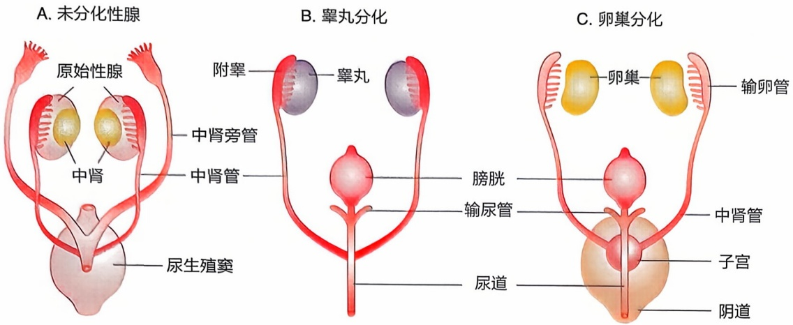

text_image

A. 未分化性腺
原始性腺
中肾旁管
中肾
中肾管
尿生殖窦
B. 睾丸分化
附睾
睾丸
膀胱
输尿管
尿道
C. 卵巢分化
卵巢
输卵管
中肾管
子宫
阴道

图14-12 生殖腺及内生殖管道早期发育

庭。睾丸分泌的雄激素促使外生殖器向男性发育，生殖结节伸长形成阴茎，两侧尿生殖褶在阴茎腹侧合并形成尿道海绵体部，两侧阴囊向尾侧合拢，于中线处愈合形成阴囊（图14-13）。

## 2. 性腺发育的决定和影响因素

大多数情况下可以通过外生殖器判断个体的性别。但在某些个体性别发育障碍的情况下，比如，XY性染色体患者睾丸发育不全，外生殖器表现为女性，又或者XX性染色体患者由于分泌过多雄激素，外生殖器表现男性化，导致遗传物质与外在表现并不一致，这就不能单独凭借外生殖器的表现来区分性别。

正常的性别分化发育分为性别决定和性别分化，是一个复杂而有序的过程。内外生殖器的分化与发育由多种因素决定。决定性别的根本因素是性染色体，正常情况下，胚胎性染色体为XX则决定性腺分化为卵巢，性染色体为XY的分化为睾丸。卵巢分化比睾丸晚，若缺失Y染色体，如45，X个体未分化性腺将分化为卵巢。在人类中，生物性别由性染色体决定，性染色体给未分化胚胎的性腺发育提供指导，早期仅能通过染色体核型来区分性别。随后的性腺分化过程及表型受到各种遗传调控和环境因素的影响，且性别决定后特异性性细胞系分化并非不可逆，早有案例发现在老年大鼠卵巢中含有类似睾丸索的结构，而年轻大鼠中并不存在，在这之后也有发现减数分裂生殖细胞丧失后卵巢出现睾丸样结构。在人类中也有报道性腺癌病例中性腺细胞转分化，但不能排除这种细胞转分化只是肿瘤细胞遗传程序发生巨大改变产生的次要结果。关于性腺细胞命运可塑性研究主要是基于转基因小鼠。性别分化中诱发XX和

图14-13 外生殖器发育

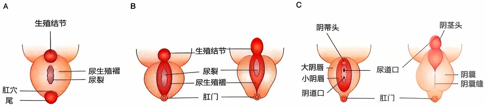

---

432

第十四章 生殖细胞与性发育

XY 性别逆转的病例与许多性别特异性基因和途径相关，这表明性别支持也受到特异性基因调控。

## 3. 性腺性别决定与性别分化遗传机制

## (1) 遗传的分子机制

自 1990 年在人和小鼠中发现了 SRY 基因后，科学家们对性腺发育过程进行更加深入的研究，并不断完善性腺发育遗传机制方面的理论知识。

在既往研究的基础上，研究者们认为 SRY 转录因子在性腺中表达最早触发睾丸或卵巢形成。中肾细胞进入雄性性腺后会被 SRY 表达的支持细胞包围发育成睾丸，而 WNT4 基因也会影响睾丸或卵巢的发育。成纤维细胞生长因子 9（fibroblast growth factor 9, FGF9）和 WNT4 两种拮抗基因在性腺最初发育时期处于相对平衡状态，若平衡倾向于 WNT4 可致性腺分化为卵巢，平衡倾向于 FGF9 或 WNT4 基因缺陷会使性腺分化为睾丸。SOX9 可活化 FGF9 基因，二者之间能彼此加强信号，共同抑制 WNT4 基因的表达并维持雄性性腺发育，在缺失 SRY 的情况下，一定剂量的 SOX9 可替代 SRY 的功能。SOX9 在早期未分化性腺中以低阈值水平表达，随后在 SRY 基因影响下快速上调，并在 SRY 停止后维持自身表达。

此外，R脊椎蛋白1（R-spondin1，RSPO1）和叉头蛋白盒l2（forkhead box l2, FOXL2）参与女性卵巢发育的起始阶段，RSPO1在未分化性腺中表达可拮抗SOX9在女性卵巢发育中的作用，抑制雄性性别决定通路，而FOXL2与SOX9可在性别决定中相互抑制对方的表达。

在XX性腺中，卵巢发育主要由WNT4/RSPO1/β连环蛋白通路调节，抑制SOX9/FGF9反馈通路，主导关闭睾丸发育路径，打开雌性发育路径。若WNT4缺失，SOX9与FGF9相对上调，可在SRY基因缺失的状况下激活雄性发育路径。在XY性腺中，睾丸发育主要靠SRY基因激活SOX9基因来参与调控通路，SRY触发SOX9基因表达，使SOX9与FGF9之间各自信号加强，抑制WNT4基因表达，平衡偏向FGF9，阻止卵巢发育路径，促使性腺向睾丸发育，FGF9缺失可激活卵巢基因，可致XY雄性性腺向卵巢分化，但是如果只是缺乏活性SRY基因并不能导致卵巢分化，而是出现不同程度的性腺发育不全。

在性别维持方面，研究发现参与维持雌性细胞命运的因子主要有转化生长因子β家族（transforming growth factor β，TGFβ）、激活素、FOXL2、WNT4、FOXOL/FOXO3和DMRT1等，而这些调控过程的具体机制尚未被确定。在维持睾丸支持细胞方面，SOX9/SOX8-DMRT1轴发挥着重要作用，且SOX9/SOX8-DMRT1轴的激活对于维持FOXL2抑制有重要意义。卵巢发育是同时抑制男性特异性基因表达和促进女性特异性基因表达的结果，且卵巢和睾丸的发育并不随出生而终止，从性别决定到性腺分化、发育和维持，都需要多种基因协调发挥作用（图14-14）。

## (2) 内、外生殖器官的发育

性腺分化为卵巢或睾丸是性别决定的重要组成部分，因为性腺的功能及其产生的激素影响着个体内生殖器、外生殖器和第二性征的发育和分化。睾丸确定后可分泌副

---

第二节 性发育与遗传

433

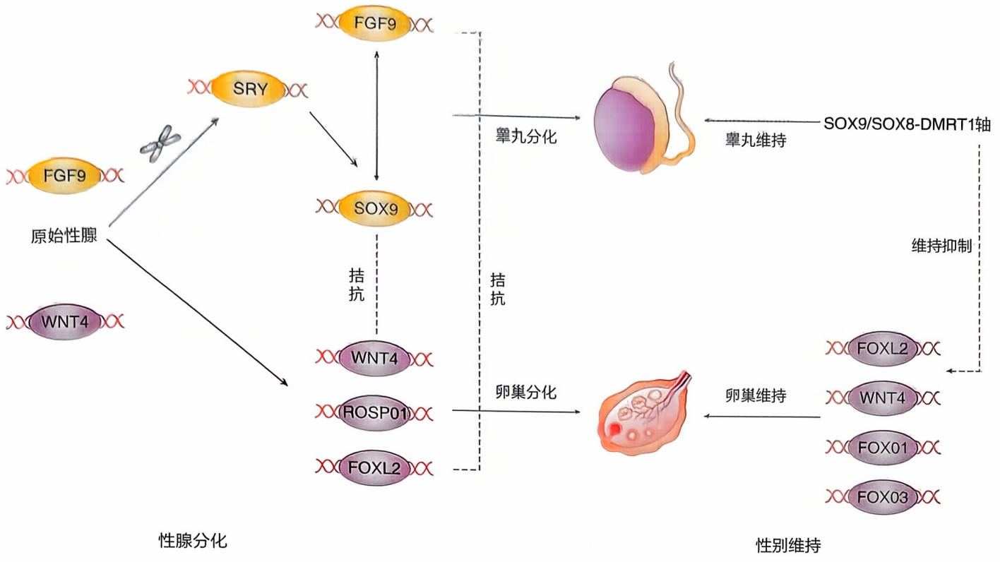

flowchart

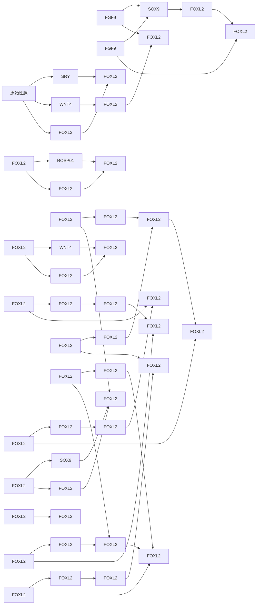

中肾管抑制因子和睾酮来决定内生殖器官的分化。此外，睾丸在控制胚胎的内生殖器性别确立方面起作用，而女性生殖器官发育却并不需要性腺或其他激素决定，因为即使在没有性腺的情况下，生殖器官也将发育表现为女性。

男性外生殖器分化在约妊娠70天开始，至18～20周时分化已完成，而男性外生殖和前列腺的分化发育主要依赖于局部的双氢睾酮（dihydrotestosterone，DHT）的作用。女性没有DHT，外生殖器将发育为女性，妊娠20周后完成分化。青春期后第二性征由性激素所决定，在青春期，性激素可影响体型发育，最终可呈现不同的表型，且性激素或外源性药物均可使表型发生改变。

性腺发育受各种遗传和环境因素调节，是一个复杂的动态变化过程。性别决定和早期性腺分化的分子机制均有广泛研究，我们对于这些基因的作用也有了更深入的认识。然而在性别维持方面，尽管对参与维持两性细胞命运的相关基因已有许多研究成果，但在控制这些性别促进基因之间的功能关系方面，大多分子机制仍有很大的探索空间。

## 三、性发育异常

## 1. 概念

性发育异常（disorder of sex development，DSD）又称为两性畸形，是指先天性染色体核型、性腺表型和性腺解剖结构不一致的一类遗传异质性疾病。

20世纪50年代超声波技术还未出现时，人们无法根据生殖器外观来辨别新生

图14-14 性别分化与性别维持的基因调节

---

434

第十四章 生殖细胞与性发育

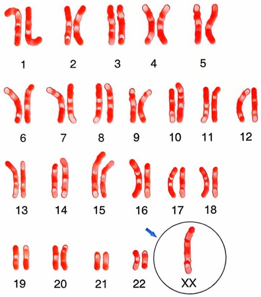

text_image

1
2
3
4
5
6
7
8
9
10
11
12
13
14
15
16
17
18
19
20
21
22
XX

图14-15 特纳综合征常见染色体核型图除特纳综合征以外，还有典型的克兰费尔特综合征（47，XXY）、45，X/46，XY嵌合体（又称混合性性腺发育不全）和46，XX/46，XY嵌合体。其中，45，X/46，XY嵌合体临床表现与特纳综合征大多相似，而46，XX/46，XY嵌合体则同时具有两性的性腺特征，内外生殖器也可两性兼有。

儿 DSD 的发生，著名的性学家约翰·曼尼（John Money，1921—2006）认为婴儿出生时性别是中立的，性别认同主要由从幼儿时期的社会学习中产生，并且可以通过适当的干预来改变，后被实验证实是错误的。直到 2006 年 “芝加哥共识” 的出现才将两性畸形用 DSD 替代，并将其做出新的分类。

## 2. 分型

性发育异常的临床表现形式多样，不同类型的性发育异常表现各异。目前国际公认的分类方法是从遗传学和分子生物学方面将性发育异常分为三大类，分别为染色体异常型 DSD、46，XX 型 DSD 和 46，XY 型 DSD。

## (1) 染色体异常型 DSD

特纳综合征（图14-15）是较常见的一类染色体异常型DSD，它是由于全部或部分体细胞中的一条X染色体完全或部分缺失或结构异常引起的一类综合征，又称为先天性卵巢发育不全。1938年，内分泌学家亨利·特纳（Henry Turner，1867—1923）首次描述了特纳综合征。特纳综合征的典型表现为身材矮小、生殖器和第二性征不发育及躯体发育异常，患者通常身高低于 $150~\mathrm{cm}$，且外阴发育幼稚，子宫小或缺如，常伴有躯体的异常:多痣、眼睑下垂、耳大位低、后发际线低、颈短而宽、有颈蹼，肾发育畸形，主

动脉弓狭窄等。患者的智力发育程度不一，寿命与正常人相同，而其骨密度显著低于正常同龄女性。

## (2) 46, XX 型 DSD

芝加哥共识中将46，XX型DSD分为三类。第一类是与雄激素分泌过多有关的疾病，如最常见的先天性肾上腺增生，这类患者常表现为男性化和失盐表现，如低血钠、高血钾。第二类是较为罕见的其他原因的疾病，如米勒管发育不全综合征，这类患者女性第二性征发育正常，但常因米勒管发育不全导致子宫的缺失或闭锁而表现为原发性闭经，常合并泌尿或骨骼系统的畸形。第三类是卵巢发育障碍，又可分为单睾丸型、卵睾丸型和卵巢发育不良型。46，XX睾丸DSD大多表现为46，XX核型，男性外生殖器，此类性发育不良患者大多在青春期后出现睾丸小、男性乳房发育和无精子症，由于缺乏Y染色体，该类患者常常表现为不育。46，XX卵睾型DSD患者同时存在睾丸和卵巢结构，这种患者通常卵泡生长和雌二醇分泌正常，有排卵，有些患者会因雌二醇的分泌抑制精原细胞的发育，从而使睾丸部分逐渐退化，但性腺活检常可见睾丸间质细胞的增生。46，XX卵巢发育不良患者为女性表型，但会出现青春期延迟，从而出现原发性或继发性闭经。

## (3) 46, XY 型 DSD

根据发病原因可以将 46，XY 型 DSD 分为睾丸发育不良、雄激素合成障碍和雄激素作用异常三种。睾丸发育不良型患者常表现为女性表型或外生殖器模糊，缺乏第二

---

第二节 性发育与遗传

435

性征，伴有颈蹼，或为卵巢与睾丸并存的卵睾型。雄激素合成障碍型则表现多样，重者表现为完全的性发育不良。雄激素作用异常型可分为完全性和部分性作用异常，如完全型雄激素不敏感综合征（complete androgen insensitivity syndrome, CAIS），这类患者通常有女性的外生殖器和男性的内生殖器，常常表现为原发性闭经，毛发稀疏甚至缺如。

## 3. 从基因的角度解读性发育异常

性发育异常的本质是基因异常，在此，重点探讨基因与性发育异常的关系。

## (1) SRY 基因

SRY基因作为性别决定基因在妊娠第7周时首次表达并持续至成年，这使得雄性特异性性腺形成。当SRY基因发生突变，如HMG结构域发生突变时，则会出现睾丸的发育异常，例如46，XX型DSD患者是由于SRY基因的易位使女性向男性表型转化，表现为女性伴有模糊的生殖器或男性生殖器。

## (2) SOX9 基因

SOX9基因具有与SRY基因相似的HMG结构域，可在人类的许多组织器官中表达，如软骨、睾丸、结肠、小肠、颅面部、肾等。在男性中，SOX9的表达与睾丸发育有关，而在女性中，SOX9的表达被抑制，当SOX9基因发生突变时，可使女性向男性转化，表现为男性的外生殖器，也可使XY性逆转，从而出现女性表型。

## (3) $NR5A1$ 基因

NR5A1基因是一类下丘脑-垂体-类固醇轴的调节因子，可编码核受体、调节与睾丸发育和功能的基因，从而影响睾丸的发育和功能。NR5A1基因最早在妊娠第32\~33天的胚胎中表达，它可以协同SRY基因激活SOX9基因的表达，从而促进睾丸发育。妊娠第7周时，NR5A1基因可以促进抗米勒管因子的表达，促进米勒管的退化，也可以促进雄激素的合成，从而促进男性外生殖器的发育。在双向分化潜能性腺向卵巢分化时，NR5A1基因处于低水平表达状态。NR5A1基因的突变会导致46，XY型DSD表型的出现，即出现睾丸发育不良，阴茎阴囊尿道下裂，NR5A1的突变也可能导致女性卵巢功能的异常。

## (4) DMRT1 基因

DMRT1基因与SOX9基因协同作用，它的表达可以维持睾丸的发育及雄激素合成与功能，在哺乳动物的分化中有着重要作用。DMRT1蛋白在哺乳动物性腺的生殖细胞和体细胞中表达。在成年精子生成过程中，DMRT1基因在有丝分裂细胞中表达，而妊娠20周前在卵原细胞和卵母细胞中的表达会在减数分裂后下降。DMRT1基因突变的患者会表现为外生殖器的模糊、性腺发育不全等。

此外，与性发育异常有关的基因，如AMH基因和WNT4基因的突变均会影响性别分化的过程，从而导致性发育异常。

## 4. 性发育异常患者的治疗

## (1) 性别选择

性发育异常患者的治疗首选手术治疗，但在治疗之前首先需要面对性别选择的问题。患儿的最终性别是在病因诊断、生殖器外观、生育能力、家庭宗教和原来的社会

---

436

第十四章 生殖细胞与性发育

性别等综合因素的考量下共同决定的，但少数患者在成年后会出现性别选择反转的情况，因此也有人呼吁等待患者有自我选择的权利及意识后再共同决定。总之，性别选择应该是一个多方面综合考虑后的结果。

## (2) 性发育异常患者生育力的保存

某些 DSD 患者不仅面临不孕不育问题，还面临着遗传物质突变带来的肿瘤发生率提高的风险，辅助生殖技术在保存这类患者的生育力中具有举足轻重的作用。例如女性 DSD 患者生育力的保存主要有两种技术:卵子冷冻和卵巢组织冷冻。但由于大多数女性 DSD 患者性腺发育不全，生育力的保存目前只在核型为 46，XX 的先天性肾上腺增生患者及卵巢功能存在的特纳综合征患者有实现的可能。此外，由于部分 DSD 患者卵巢功能衰老过早，对于未成年人生育力的保存是否符合伦理也是需要关注和探讨的。

## ※ 复习思考题

1. 生殖细胞的减数分裂分为哪几个时期？
2. 精子、卵子发生有哪些遗传学意义？
3. 性别发育的决定因素有哪些？

## ※ 推荐阅读

1. SUN S, KIM N. Spindle assembly checkpoint and its regulators in meiosis [J]. Hum Reprod Update, 2012, 18(1): 60–72.
2. HANDEL M A, SCHIMENTI J C. Genetics of mammalian meiosis: regulation, dynamics and impact on fertility [J]. Nat Rev Genet, 2010, 11(2): 124–136.
3. COTICCHIO G, CANTO M D, RENZINI M M. Oocyte maturation: gamete-somatic cells interactions, meiotic resumption, cytoskeletal dynamics and cytoplasmic reorganization [J]. Hum Reprod Update, 2015, 21(4): 427–454.
4. NETO F T, BACH P V, NAJARI B B, et al. Spermatogenesis in humans and its affecting factors [J]. Semin Cell Dev Biol, 2016, 59: 10–26.
5. MIYASO H, OGAWA Y, ITOH M. Microenvironment for spermatogenesis and sperm maturation [J]. Histochem Cell Biol, 2022, 157(3): 273-285.
6. RAJENDER S, AVERY K, AGARWAL A. Epigenetics, spermatogenesis and male infertility [J]. Mutat Res, 2011, 727(3): 62–71.
7. CARRELL D T, HAMMOUD S S. The human sperm epigenome and its potential role in embryonic development [J]. Mol Hum Reprod, 2010, 16(1): 37–47.
8. DU L, CHEN W, CHENG Z, et al. Novel gene regulation in normal and abnormal spermatogenesis [J]. Cell, 2021, 10(3): 666.

（编写:曹云霞、向卉芬、丁志明、李关键、陈大蔚、邹薇薇；审读:张锋）
