# 第十五章 植物发育

原始 PDF 第 453–491 页。

# 第十五章

## 植物发育

作为最具代表性的植物，被子植物固着生长，通过包含独立遗传物质的叶绿体完成光合自养，通过双受精过程产生具有二倍体胚和三倍体胚乳的种子。这些特点使植物具有丰富的遗传方式，为遗传学研究提供了优良体系，推动了多个遗传学定律的发现。植物发育与动物有显著不同。动物在胚胎期形成所有器官，而植物在胚后发育中不断形成新的器官。因而，我们能够看到秋叶凋落后，春天又会萌发新叶，也能看到枝条不断抽发。植物器官发生的源头是茎尖和根尖的分生组织。理解分生组织的维持和有序分化的机制，是理解植物发育的核心。器官如何获得三维形态是发育生物学的核心问题之一，但目前仍是认知的空白领域。以叶片为例，不同物种的叶片形态有相似之处；不同物种的叶片却又各具特色。器官形态如何稳定建立？又如何在物种间产生丰富的变化？回答这些问题是了解植物形态建成的基础。通过突变体筛选和图位克隆等分子遗传学技术，我们已经鉴定出一批调控基因。这些基因如何决定器官形态将成为未来研究的前沿。固着生长的植物只能通过及时准确地感受周围生活环境的变化，并及时调整生物学过程来增强适应性。在多变的环境中，植物体内特定的生物大分子作为环境信号的受体，会发生特异性的活性变化，从而将外部环境信号转变为植物内源信号。植物受体通过由蛋白质或其他生物分子组成的一系列信号通路最终将这种变化转导至细胞核，调控植物基因表达，提高植物在新环境中的适应性。通过探索植物感知与应答环境的信号通路，可以改造其中的信号组分，从而提高植物在特定生境中的适应性。

本章将介绍植物遗传的特点和植物复杂的胚后发育，并以光照、温度和机械压力为例，介绍植物生长发育的环境可塑性，还将讨论这些过程对农业生产的影响和意义。

---

438

第十五章 植物发育

## 第一节 植物遗传发育体系的特点

陆地上绝大多数植物是固着生长，且光合自养的被子植物，其通过双受精（double fertilization）过程产生具有二倍体胚和三倍体胚乳（endosperm）的多数种子。双受精指的是花粉粒中的两个精细胞，一个精细胞与胚囊中的卵细胞融合形成受精卵；另一个精细胞与中央细胞的极核融合形成三倍体的初生胚乳核。除了被子植物，少数裸子植物也具有这一独特的受精过程。这种遗传特点使植物成为研究遗传学的优良体系，极大地推动了遗传学定律的发现。而植物复杂的胚后发育和极强的生长发育环境可塑性，又使得遗传学成为研究植物生命进程的有力工具。同时，植物遗传学理论的发展与其在农业中的实践相辅相成，推动了作物品种选育和农业发展。

## 一、被子植物的世代交替

## 1. 被子植物世代交替的一般过程

被子植物的生活史经历两个阶段或世代，即孢子体阶段（无性世代）和配子体阶段（有性世代）。孢子体（sporophyte）是常见的二倍体植物，具有根、茎、叶等器官分化，在生活史中占绝大部分时间。配子体（gametophyte）是植物在世代交替过程中，产生的具有单倍体配子、用于完成有性生殖的结构。配子体阶段从孢子母细胞分裂开始，最终形成花粉粒（雄配体子）或胚囊（雌配子体）。孢子体阶段从胚囊中的卵细胞受精形成合子开始，直到合子发育为成熟植株，再次完成世代交替（图15-1）。

## 2. 受精作用

雄配子体和雌配子体分别发育成熟后，必须融合到一起才能产生下一轮孢子体世代，这就是受精作用。在被子植物中，受精需要花粉和雌性组织之间的信号交流，包括花粉粒与雌蕊柱头相互识别与萌发、花粉管穿过引导组织的极性生长、花粉管的珠孔导向、花粉管中精细胞的释放，以及被雌配子体接受等过程。在这一系列过程中，花粉管与雌方组织之间存在复杂的物质和信号交流。

肽信号与细胞膜定位的类受体激酶（receptor-like kinase）对花粉管的完整生长至关重要。遗传分析发现，花粉管质膜上的类受体激酶 ANXUR1/2 参与调控花粉管完整性和精细胞释放，缺失这两个受体的花粉管萌发后提前发生细胞质爆炸，使精细胞无法正常送至胚囊。后续研究发现花粉管质膜上另两个受体 BUPS1/2，以及花粉管分泌的两个小肽 RALF4 和 RALF19 的基因突变也导致相似后果。BUPS1/2 与 ANXUR1/2 形成一个大的异源受体复合物，而 BUPS1/2 以及 ANXUR1/2 均可特异结合 RALF4/19。因此，花粉管分泌的小肽信号 RALF4/19 被花粉管质膜上的受体复合物感受，构成一个花粉管在生长过程中保持自身完整性的信号识别机制。那么，维持花粉管完整性的机制又是如何被解除、使花粉管在正确的时间和地点发生破裂而释放精细胞呢？研

---

第一节 植物遗传发育体系的特点

439

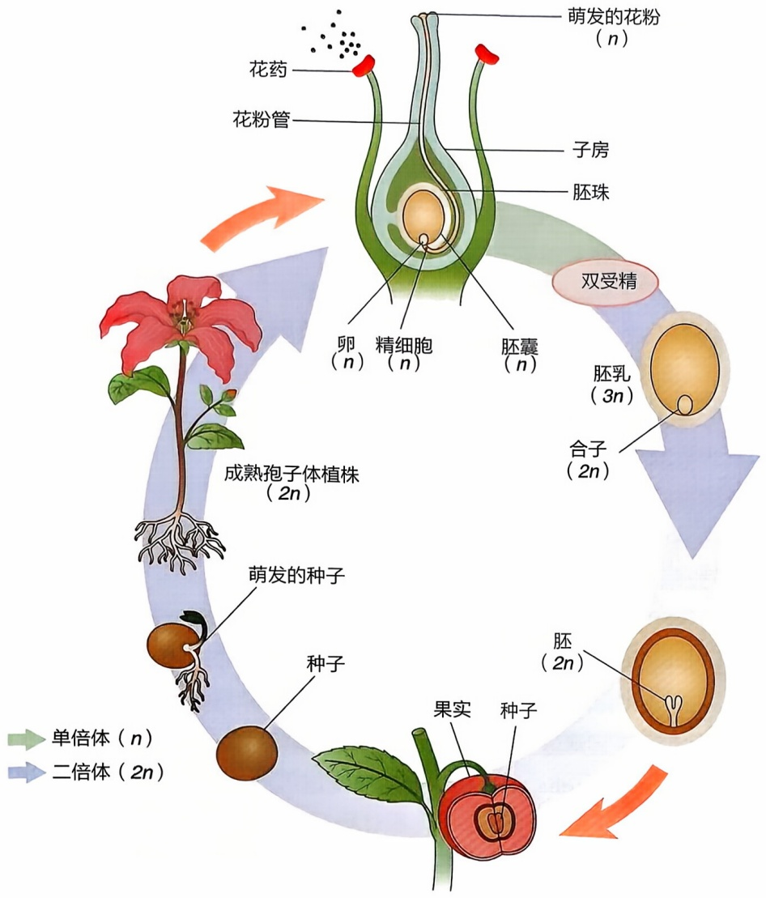

flowchart

This diagram illustrates the life cycle of a plant, showing the progression from seedling to fertilization and growth through stages such as germination, breeding, fertilization, fertilization, fertilization, fertilization, fertilization, fertilization, fertilization, fertilization, fertilization, fertilization, fertilization, fertilization, fertilization, fertilization, fertilization, fertilization, fertilization, fertilization, fertilization, fertilization, fertilization, fertilization, fertilization, fertilization, fertilization, fertilization, fertilization, fertilization, fertilization, fertilization, fertilization, fertilization, fertilization, fertilization (2n), fertilization (2n), fertilization (2n), fertilization (2n), fertilization (2n), fertilization (2n), fertilization (2n), fertilization (2n), fertilization (2n), fertilization (2n), fertilization (2n), fertilization (2n), fertilization (2n), fertilization (2n), fertilization (2n), fertilization (2n), fertilization (2n), fertilization (3n), fertilization (3n), fertilization (3n), fertilization (3n), fertilization (3n), fertilization (3n), fertilization (3n), fertilization (3n), fertilization (3n), fertilization (3n), fertilization (3n), fertilization (3n), fertilization (3n), fertilization (3n), fertilization (3n), fertilization (3n), fertilization (3n), fertilization (2n), fertilization (2n), fertilization (2n), fertilization (2n), fertilization (2n), fertilization (2n), fertilization (2n), fertilization (2n), fertilization (2n), fertilization (2n), fertilization (2n), fertilization (2n), fertilization (2n), fertilization (2n), fertilization (2n), fertilization (2n), fertilization (2n).

图15-1 被子植物生活史

究人员鉴定出只在胚囊中表达的小肽信号分子RALF34，在体外将RALF34施加到花粉管上，花粉管会迅速破裂。RALF34可以竞争性取代RALF4/19，与BUPS1/2以及ANXUR1/2受体互作。这些发现表明在花粉管抵达胚囊后，雌方分泌的RALF34取代原先结合在受体复合物上的RALF4/19，促使花粉管发生破裂、释放出精细胞，为受精做好准备。

## 3. 早期胚胎发生

起源于受精卵（合子）的胚胎发生（embryogenesis）是植物个体发育的起点，经历合子激活和极性建立、顶-基轴模式建成、表皮原形成和辐射对称模式建成、茎顶端分生组织和胚根原的分化，以及维管束原和基本组织原的分化等重要生物学事件。以双子叶模式植物拟南芥为例，其卵细胞与精细胞融合形成二倍体合子后，进行一次不对称分裂，形成一个较小的顶细胞和一个较大的基细胞（图15-2）。基细胞经数次横向分裂形成由几个细胞组成的胚柄，其最上层的一个细胞参与胚根的发育，其他细胞随胚胎成熟而逐渐退化。与此同时，顶细胞先进行两次纵向分裂，形成四个相等

---

440

第十五章 植物发育

图15-2 拟南芥早期胚发育中的细胞分裂示意图

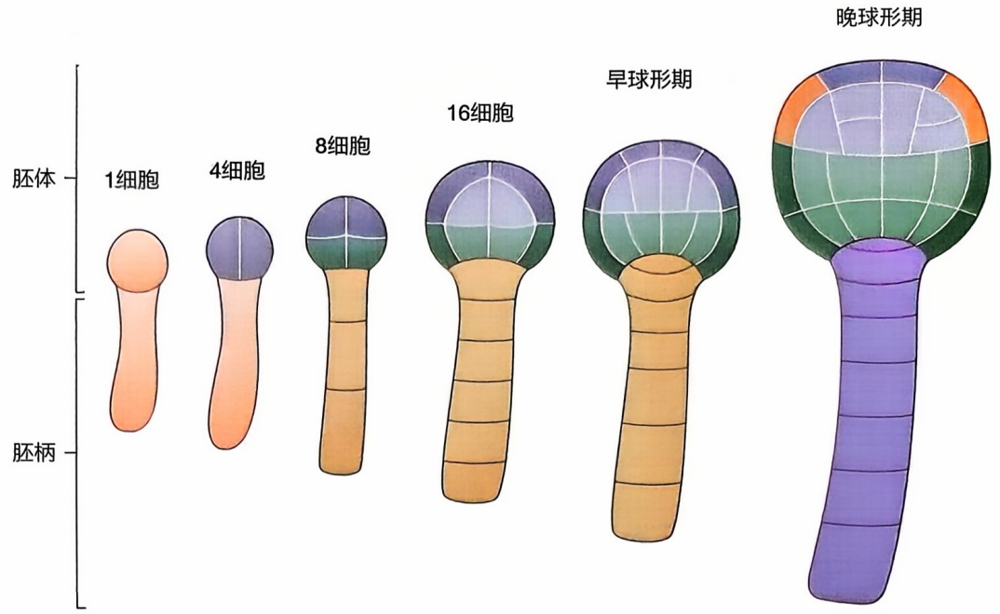

text_image

胚体
1细胞
4细胞
8细胞
16细胞
早球形期
晚球形期
胚柄

大小的细胞，然后进行一次横向分裂而发育为八细胞原胚。之后所有细胞以辐射对称的模式进行一次切向分裂，产生八个外层细胞和八个内层细胞，分别称作表皮原（protoderm）和内部组织。进入早球形期，表皮原细胞进行垂周分裂使外层进一步扩大，而内层细胞则进行纵向分裂形成维管束原（vascular primordia）和基本组织原（ground tissue primordia）。在早球形期向晚球形期转化过程中，胚柄最上层细胞分化为胚根原（hypophysis），通过一次不对称分裂形成一个较小的棱镜状细胞和一个较大的基部细胞。这两个细胞随后分别发育为静止中心（quiescent center）和中柱干细胞（stele stem cell）。在晚球形期结束时，胚胎产生子叶原基和茎顶端分生组织（shoot apical meristem），其形态从辐射对称转变为两侧对称。随后胚胎发育依次经历心形期、鱼雷期和弯曲子叶期，最终发育为成熟胚胎。胚胎发育过程中的细胞命运决定和模式建成决定了组织和器官的形成，从而奠定了胚后发育及植株产生的基础。

## 4. 胚乳发育

与动物不同的是，被子植物具有独特的双受精过程。花粉中的两个精子，除了一个与卵细胞融合形成合子外，另一个与中央细胞的极核融合，形成三倍体的初生胚乳核。多数植物具有核型胚乳发育，即胚乳受精后最初的核分裂发生在合胞体（coenocyte）中。在核型胚乳发育中，受精的中央细胞核在没有胞质分离的情况下进行分裂。中央细胞核的分裂优先于合子的第一次分裂，并随后快速分裂形成多核的合胞体胚乳。胚乳细胞核分裂最初是同步的，以后的分裂速率随细胞核在胚乳中的位置不同而出现差异，形成相应的珠孔端、合点端及外周等区域。游离核分裂完成后开始胚乳的细胞化。双子叶植物如拟南芥中，合胞体胚乳开始从近珠孔端向外周细胞化。用活细胞成像系统可以看到拟南芥合胞体胚乳发育时，所有核分裂在受精后持续约5

---

第一节 植物遗传发育体系的特点

441

天。在这期间，肌动蛋白微丝形成特殊的星形结构，在分裂后并不立即拉动子核，而是限制子核进一步的运动，并控制了它们在外周胚乳中的等距定位。如果在胚乳中过表达微丝，使各核上肌动蛋白束数量明显增加，就会显著扩大核间距离。在有丝分裂期间，合胞体胚乳微管群从每个核向外辐射，这样的母丝可能是星形肌动蛋白微丝形成的基础。因此，在胚乳发育过程中，依靠微管形成的星形肌动蛋白微丝限制核运动并控制核等距，最终影响胚乳和种子的大小。

拟南芥中，胚乳细胞化发生在胚发育的心形期，起始于珠孔端，朝着合点端推进。在单子叶的禾本科植物（如玉米）中，合胞体细胞化从外围开始朝着种子的中央进行，直到胚乳腔被填满。在细胞化过程中，胚乳逐渐分化出比双子叶植物更为复杂的组织，包括胚胎周围区域（embryo surrounding region）、中央的淀粉质胚乳、包围胚乳的糊粉层（aleurone），以及基底胚乳转移层（basal endosperm transfer layer）（图15-3）。淀粉质胚乳和糊粉层主要用于积累营养物质，淀粉质胚乳中合成和储存大量淀粉，而糊粉层则积累种子萌发所需要的蛋白质和脂类物质。胚胎周围区域和基底胚乳转移层则分别在胚与胚乳互作和糖分装载（sugar loading）中发挥作用。

在拟南芥和豆类等很多双子叶植物中，胚乳只在种子形成的早期进行增殖分化，随后在种子生长过程中因细胞凋亡而被吸收，为发育中的胚胎提供营养。但在单子叶植物中，尤其是水稻、小麦和玉米等禾本科植物中，胚乳一直存在到种子成熟。禾本科植物胚乳对种子质量的贡献高达 $80\%$ ，不仅为幼苗形成之前的种子萌发和生存提供所需的糖类和蛋白质，也在工农业生产中成为食物、饲料、生物能源的主要能量来源。

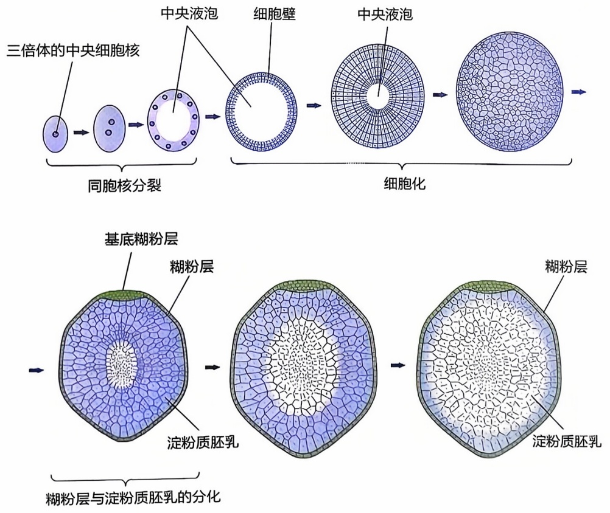

图15-3 禾本科植物胚乳发育进程示意图

---

442

第十五章 植物发育

## 二、玉米胚乳是研究遗传规律的有力工具

## 1. 玉米胚乳颜色的遗传基础

发育成熟的玉米籽粒主要由果皮（含种皮）、胚乳和胚三部分组成。一般情况下，玉米籽粒的果皮是无色透明的，而胚的体积只占种子体积的15%，因此籽粒颜色主要由胚乳决定。胚乳中央的淀粉质胚乳细胞主要合成类胡萝卜素，在没有其他色素干扰时胚乳呈橙黄色。常见的黄色或白色玉米粒主要由胚乳中类胡萝卜素的差异导致。中、南美洲起源的一些玉米品种里，胚乳外周的糊粉层能够合成花青素而部分遮蔽胚乳类胡萝卜素的颜色，导致籽粒呈现红色和紫色等不同颜色。

胚乳的产生是一个能量大量转移的过程，并与胚发育高度协调。因此，胚乳发育受到多种遗传机制的严格调控。除了雌雄异花之外，玉米种子聚集在果实中，一个玉米穗上含有一次杂交产生的上百颗籽粒，可以非常直观地观察到杂交后代的性状分离。此外，玉米籽粒颜色性状直观，染色体易于观察，增加了遗传学研究的便利性。在早期的植物遗传学研究中，玉米是最重要的遗传研究体系之一。

植物学家从20世纪初就对玉米籽粒颜色的遗传基础产生了浓厚兴趣，陆续发现了4个调控颜色的经典基因，包括Y1、Pr1、C1和R1。利用这些基因的等位基因开展的遗传试验，在其杂交种的果穗上就可能会产生籽粒颜色分离，在一个果穗上面呈现出不同籽粒具有不同颜色的所谓彩色玉米，很快就证实了孟德尔遗传规律。需要注意的是，由于胚乳是三倍体，相同母本与父本的组合杂交后会产生两种不同基因型的胚乳:如果母本提供了显性等位基因，子代胚乳就具备两个显性等位基因；而如果母本提供了隐性等位基因，子代胚乳就具备两个隐性等位基因。这个独特的现象帮助遗传学家发现了新的遗传规律。例如，在用Y1和y1等位基因杂交时，胚乳中可能出现Y1Y1Y1、Y1Y1y1、y1y1Y1、y1y1y14种基因型，其Y1等位基因的拷贝数依次降低。有趣的是，淀粉质胚乳的黄色也依次变浅，遗传学家由此发现了基因的剂量效应（gene dosage effect）。

## 2. 转座子的发现与应用

玉米籽粒颜色变化的遗传基础，也吸引了美国遗传学家麦克林托克从事细胞遗传学的研究，为她成功发现转座子（transposon）的遗传规律奠定了坚实基础。在20世纪30年代，麦克林托克开发了利用胭脂红染色显微观察玉米染色体的技术，首次清晰观察到玉米的10对染色体。她还将玉米的特定性状与染色体位置相关联，极大推动了细胞遗传学的研究，也对玉米遗传育种产生了重要影响。她借助X射线对玉米的诱变，不仅发现了基因突变现象，还发现了染色体断裂现象，观察到有些断裂染色体两端相连形成环状染色体。基于这些发现，她提出假说:正常情况下染色体之所以保持线性而避免成环是源于染色体末端存在帽子样的特殊结构，这种结构后来被更深入研究后发现是染色体端粒（telomere）。

在一些玉米突变中存在“嵌合体”，即单个玉米籽粒里面呈现出不同的颜色，如

---

第一节 植物遗传发育体系的特点

443

黄色背景里散布着紫色的色线或斑点。麦克林托克敏锐地意识到这些与众不同的玉米粒颜色变化可以用来探寻基因活动的秘密，而后进行的一系列研究最终提出了具有里程碑意义的“转座子”概念（见第十章）。在20世纪80年代初，科学家先后克隆了第一个 $Ds$ 转座子和第一个 $Ac$ 转座子，证实了这个转座子系统在调控玉米籽粒色斑不稳定遗传中的作用。随后在玉米中又发现了不同于 $Ac / Ds$ 的另一类转座子——反转录转座子。通过把来自玉米的 $Ac / Ds$ 通过转基因方法整合到烟草基因组中并观察到转座活性，将转座子的研究拓展到了异源宿主中。在90年代，发现水稻中通常不表达的反转录转座子Tos17在组织培养过程中能够被激活，从而插入到水稻基因组的其他位点，使得插入位点的基因失效。以上在植物中取得的研究成果，为转座子的理论和应用研究奠定了坚实基础。

植物转座子的发现，对于遗传学的发展有着深远意义。除了研究内源转座子的发掘、结构和转座机制，利用基因的转座原理还可以研究基因的调控模式，为细胞的分化和发育提供遗传依据。例如，在孟德尔经典实验中用到的豌豆圆粒与皱粒表型，就是由于在一个编码淀粉分支酶（starch-branching enzyme）的基因前插入了一个转座子而导致了该基因表达多态性的出现。因此，转座子在理论上可以用作基因标记，通过关联转座子影响到的基因和转座导致的表型，以发现特定基因的功能。20世纪80年代，就用转座子标签法在植物中分离了玉米花青素合成相关的bronze基因。目前在植物遗传学研究中常用的转座子标签主要有玉米的Ac、Ds、Mutator，水稻的Tos17等。利用转座子标签可以在不了解基因功能的情况下，将一段特定的转座子DNA序列插入到基因组中目的基因的内部或相邻位点，便可能诱发该基因发生改变，例如编码区突变或表达模式异常。如果一个插入事件最终导致了表型变化，形成了突变体植株，就可以据此分析目的基因的功能。这种方法不要求了解目的基因的序列或基因组位置，因为转座子的插入序列是已知的，那么它便可用作DNA分子探针，通过PCR扩增、筛选突变体植株的基因组DNA文库，或者基因组测序等方法，克隆突变基因。因此，插入的转座子DNA序列相当于在植物基因上贴了一张“标签”，从而实现了从基因到表型的反向遗传学操作（详见第十章）。

## 3. 遗传印记

在20世纪60年代开展的 $r1$ 和 $R1$ 基因型杂交试验中，遗传学家注意到籽粒颜色分离打破了常规现象。根据母本提供了 $R1$ 或 $r1$ ，子代胚乳具有 $r1r1R1$ 和 $R1R1r1$ 两种基因型。然而 $r1r1R1$ 胚乳表现出不规则的紫色斑点，而 $R1R1r1$ 胚乳却是均匀的紫色。后续试验表明，只有当 $r1$ 等位基因来自母本时才出现紫色斑点的胚乳。这是因为来自母本的等位基因在所有糊粉层细胞中均可表达，而来自父本的等位基因在大部分糊粉层细胞中被沉默，因而糊粉层色素沉积不完整而出现斑点。这种由于亲本起源而导致一个亲本间没有序列差异、而且存在于一个细胞核中的等位基因差异表达的现象，后来被称作遗传印记（genetic imprinting）。目前，印记基因仅在哺乳动物和被子植物中被发现。基于控制玉米糊粉层花青素沉积的 $R1$ 位点的研究，首次证明了单个植物基因而非整条染色体的亲本依赖行为。在分子机制方面，当受到印记机制调控的

---

444

第十五章 植物发育

等位基因分离时，需要根据亲本来源建立不同的标记。在植物中，这必须发生在雌雄生殖器官谱系分离之后和受精之前。

植物遗传印记机制与哺乳动物有一些相似之处，尤其是在DNA甲基化和基于PRC2（polycomb repression complex 2）的表达抑制方面。胚乳基因组最显著的特征，就是与胚和营养组织相比的低甲基化，而且低甲基化主要发生在母源基因组上。DNA甲基化水平是甲基化和去甲基化的平衡作用，目前的证据表明胚乳DNA的低甲基化主要由DNA去甲基化驱动。在拟南芥中，DNA去甲基酶DEMETER主要在雌配子体的中央细胞表达，去除母源基因组特定区域的DNA甲基化，使之低甲基化。玉米胚乳中，父源基因组相对于胚胎或营养组织而言呈现高甲基化，而母源基因组低甲基化，这也是由DEMETER介导的中央细胞DNA去甲基化形成的。这些发现表明DNA甲基化调控印记基因的潜在作用，可能是导致一些胚乳基因表达具有亲本起源效应的原因。此外，对拟南芥和玉米的基因组分析显示，父源印记基因的表达与PRC2介导的组蛋白修饰相关。PRC2介导的组蛋白修饰倾向于发生在DEMETER靶向的区域，表明DNA甲基化和组蛋白修饰在调控胚乳印记基因表达中共同发挥重要作用。

在几种模式植物中，通过全基因组分析已经鉴定出数百个胚乳印记基因，其中大部分是母源表达基因，只有一些是父源表达基因。但迄今仅有极少数印记基因的功能得到了确认，而绝大部分印记基因似乎在植物发育中没有明显功能。有些遗传学研究显示，印记基因可能与不依赖受精作用的自发胚乳形成有关。也有观点认为，母源基因在进化过程中的出现，有助于确保营养平均分配到母本产生的所有种子间。例如，玉米中母源表达的印记基因MEG1编码一个富含半胱氨酸的小肽，参与基底胚乳转移层的建立和分化。然而，许多母源基因并不涉及营养分配，因此这一假设的证据还很有限。另有观点提出，印记基因表达是胚乳中DNA去甲基化的副产品，旨在建立营养积累相关基因的高效表达。因此，植物中印记基因的功能与作用，还需要更多的研究来解答。

## 三、植物的反向遗传学与水平基因转移

## 1. 植物反向遗传学

进入后基因组学时代，数以百计的植物基因组测序完成，加上遗传转化技术的不断提高，使得反向遗传学在植物中的大规模应用成为可能。将转座子（如 $Ac/Ds$ 和 $Tos17$ 等）或者来自农杆菌的T-DNA（transfer DNA）等已知序列的片段，通过遗传转化导入受体基因组，使其高效插入在基因附近，导致插入位点基因功能缺失或获得从而造成突变。如果插入事件足够随机并足够丰富，就可能覆盖到基因组中绝大多数的基因。而且插入片段还可作为克隆内源基因的标签，从而高通量地分离和鉴定突变体相关的基因。反向遗传学在模式植物拟南芥、水稻中的高效应用，为解析基因功能和阐明发育进程提供了有力工具，极大促进了对植物基因功能的研究。

转座子在体细胞中的活动也可能导致基因组突变。这种突变被称作体细胞突变

---

第一节 植物遗传发育体系的特点

445

(somatic mutation)，由于不会通过有性生殖传递到下一代而只能影响到一个世代中数目有限的细胞，在多数情况下并不重要（详见第十一章）。然而，在高度依赖无性繁殖的园艺作物和一些水果蔬菜中，体细胞突变就有更加重要的意义。例如，在依靠扦插和嫁接扩繁的葡萄中，由于转座子插入导致一个控制花序分枝的基因表达改变，从而产生了葡萄株型的体细胞突变。需要注意的是，植物细胞的全能性决定了体细胞突变向有性突变转化的可能性。如果一个体细胞突变影响到的植物部分产生了分枝，随着植物枝条的生长和无性繁殖，变异细胞可能最终影响一个腋芽，然后影响一朵花及其有性生殖细胞。所以植物中的体细胞突变，是可能转变为可遗传的有性突变的。

## 2. 植物中的水平基因转移

遗传物质除了由亲代到子代的垂直传递，在具有生殖隔离的不同物种之间，或单细胞内部的细胞器之间，以及细胞器和细胞核之间，也可以进行流动。这种遗传物质的传递方式称作水平基因转移（horizontal gene transfer or lateral gene transfer），也是生物进化的主要动力之一。虽然植物间的基因交换现象早在1970年就在蓝藻中有所发现、不过植物中关于水平基因转移的机制尚未完全阐明。目前关于基因转移主要有以下三种假说:错位授粉、载体介导及植物间相互接触介导。错位授粉假说认为，在亲缘关系较近的物种间，作为基因供体的花粉粒在生殖隔离的另一种物种的柱头萌发、授粉后，一些外源基因可能通过同源重组整合到另一套染色体中，然后通过种内杂交和自然选择而在该种群中得以保留。载体介导转移假说认为供体可以通过其他载体媒介将外源DNA转移到受体中。介导植物与其他基因组基因转移的可能载体有病毒、细菌、共生真菌、昆虫、植物寄生物以及转座元件等。有植物学家研究了291个甘薯品种，在其中都发现了来自农杆菌的T-DNA序列，而且甘薯中有4个基因与农杆菌的基因同源。这个研究结果表明，在农杆菌和甘薯祖先之间发生了T-DNA介导的水平基因转移，而且这些基因在后续的自然选择中得到保留。基因供体与受体之间的物理接触理论上可促进基因转移的发生，有嫁接或寄生关系的植物间都发现过水平基因转移事件，而且这些植物相互之间都既可以是供体也可是受体。

与动物细胞一样，高等植物的一些细胞器也起源于内共生。完成内共生的需氧细菌逐渐转变成为线粒体，而具有光合作用功能的蓝细菌则转变成为叶绿体。在植物细胞中，存在3种不同的基因组——细胞核基因组、叶绿体基因组和线粒体基因组。叶绿体基因组和线粒体基因组相较于细菌基因组显著缩小，而核基因组中则包含了许多线粒体和叶绿体起源的序列。因此，叶绿体和线粒体基因组虽然还保留着原核生物的特点，但来自藻类的古老水平转移已经普遍存在于植物基因组中。有些研究发现，细胞器基因转移到细胞核中可能增强了对这些基因表达的调控能力。例如，拟南芥和水稻叶绿体的基因转移到核基因组后，增强了植物对胁迫信号的应答。相比叶绿体向核基因组的转移，植物线粒体基因组和核基因组间的水平转移更加频繁。大多数转移的核苷酸片段都没有功能，有些序列转移后则成为假基因，但也有一些研究表明有些基因转移后可能仍具有功能。此外，叶绿体基因也能转移到线粒体基因组中，而且可能仍具有功能。

---

446

第十五章 植物发育

## 四、植物遗传发育与作物育种

## 1. 细胞质雄性不育

除了遗传物质的直接交流，植物细胞中细胞核与叶绿体和线粒体的互相作用，深刻影响了植物的遗传和发育，如叶绿体或线粒体的缺陷导致植物雄性败育。在大多数被子植物中，叶绿体和线粒体通过卵细胞的细胞质遗传。因此，这类突变会导致细胞质雄性不育（cytoplasmic male sterility，CMS），表现出完全的母性遗传，不遵循孟德尔分离定律。细胞质雄性不育在野生植物类群中较为普遍，在包括玉米、水稻和菜豆等150多种植物中都已有过对这种现象的报道。从细胞质雄性不育现象发现以来，就和杂种优势（heterosis）联系起来。杂种优势是生物界中普遍存在的一种遗传现象，指种内或种间遗传背景具有差异的亲本杂交产生的子一代，可能在生长势、生物量、产量以及对环境的适应性等方面优于亲本。该现象被广泛应用于农业生产中，对于各种农作物产量的提高和品质的改良发挥了重要推动作用。由于绝大多数农作物是雌雄同花或雌雄同株，如果用来生产子一代杂交种的母本是天然雄性不育的，就可以免去人工去雄的繁重劳动。这使得细胞质雄性不育的植物在杂交种生产中具有很重要的商业价值。

因为其独特的遗传特性，细胞质雄性不育母本的后代也都是雄性不育的，需要在子一代杂交种中抑制雄性不育。巧妙的是，在特殊的父本材料中存在核基因组编码的育性恢复基因。几乎所有自然发生的细胞质雄性不育现象都可归因于线粒体中异常蛋白质的产生。当然，不同物种中具体起作用的变异蛋白质有所不同。尽管植物所有细胞中携带基因型相同的线粒体，但是细胞质雄性不育往往仅在花药或花粉发育过程中造成缺陷。而育性恢复基因恰恰降低了异常线粒体蛋白质的产生，因此能够恢复育性。

细胞质雄性不育和育性恢复基因的配套，首先在玉米中完成。细胞质雄性不育的植株 CMS-T，其线粒体产生特异的异常蛋白 URF13 由线粒体基因组重排而产生的一个嵌合基因所编码。CMS-T 的育性恢复需要两个基因——Rf1 和 Rf2。Rf1 可以显著减少 URF13 编码基因的转录物，Rf2 编码的乙醛脱氢酶可发挥降低 URF13 引发的细胞毒性作用。两者配合，即可恢复 CMS-T 植株的育性。基于 CMS-T 的杂交玉米从 1950 年开始用于生产，很快取得巨大的商业成功。到了 1970 年，美国 85% 的玉米杂交种都采用了 CMS-T。然而，能够引发玉米叶枯病的真菌，在大规模单一种植 CMS-T 玉米的情况下进化出了 T 小种，专门识别 URF13 并导致极为严重的叶枯病。该病害在 20 世纪 70 年代初大规模爆发，导致玉米大幅度减产，此后 CMS-T 不再用于杂交种的生产。这一事件说明了农业中依赖少数种类基因型的潜在危害，也提醒我们农业遗传技术的应用需持续创新和调整。

## 2. 作物育种的发展

事实上，遗传学的理论发展和农业实践是相辅相成的。可以说一部世界农业发展

---

第一节 植物遗传发育体系的特点

447

历史，就是一部利用遗传学改变农作物遗传组成、从而选育良种的历史。育种是通过创造和选择遗传变异、改良遗传特性，以培育适合农业生产的优良动植物新品种的技术。随着自然物种的进化与人类科技的进步，农业育种先后经历了驯化育种、杂交育种、分子育种等阶段，如今正在迈入分子设计育种的新阶段。

从文明出现以来，人类就对种子进行了有目的的培育，这个阶段叫做驯化（domestication）。现今的农作物，其祖先都是自然生长的野生植物。为了获得更好的品质和更高的产量，人类开始有意识地改造和驯化农作物的祖先，最终一步一步将这些野生植物变成了可以为人类稳定生产食物的栽培作物，而且具备了更多适应人类生产力的优良性状，例如，更短的生长周期、更大的果实或种子、更丰富的营养等。对不同作物的原始驯化选育可以追溯到数千年乃至上万年前。约1万年前，中国的先民就已经开始种植水稻了，为水稻驯化作出了巨大贡献。根据栽培水稻的需要，反复选择在自然界中偶然巧合地发生并造成了性状改变的不同突变，将倾向于匍匐生长、穗型松散、具有易脱粒、长芒褐色谷粒的普通野生稻，驯化和培育成为直立生长、穗型紧凑、具有不易脱粒、短或无芒浅色谷粒的栽培水稻，从而提高了产量，并便于水稻种子的收获、贮藏和加工（图15-4）。起源于北美洲墨西哥的玉米，也经过了类似的遗传驯化。祖先玉米和现代玉米的性状差异与6个主要基因有关。例如，控制分蘖的主要基因Tb1因为突变而活性上调，少分蘖是玉米区别于其野生种的重要性状之一。另外，祖先玉米籽粒外有个很硬的壳，由硬壳到无壳的演变是由一个基因tgal的变化导致的。

真正意义上的科学育种并由此发展起来的农业产业，始于孟德尔遗传定律的发现。这种育种技术主要是由遗传学理论指导，通过选择不同亲本，利用杂交而获得性状更好的子代。以杂交育种和诱变育种为代表的第二代育种技术，也被称作常规

育种，在过去近百年对农业发展起到了巨大的推动作用。最早关于常规育种的研究，可以追溯到1904年诞生的生产用春小麦杂交品种“马奎斯”。在20世纪30年代，在玉米中率先系统发展了常规育种工作，第一个商业杂交种玉米双交种在1943年获得极大成功，带动了商业制种产业的发展。到了50年代，农作物育种的进步带来了影响深远的“绿色革命”。在这场农业科技革命中，美国著名育种家诺曼·布劳格（Norman Borlaug，1914—2009）起到了关键作用。他在1953年培育出了耐肥、抗倒伏与高产的半矮秆小麦品种。相比于当时高茎秆的小麦，这种新品种可以使植株把更多营养用在结籽上，茎秆高度降低也不易发生倒伏，从而大大提高了产量，成为常规育种的里程碑。随后，国际

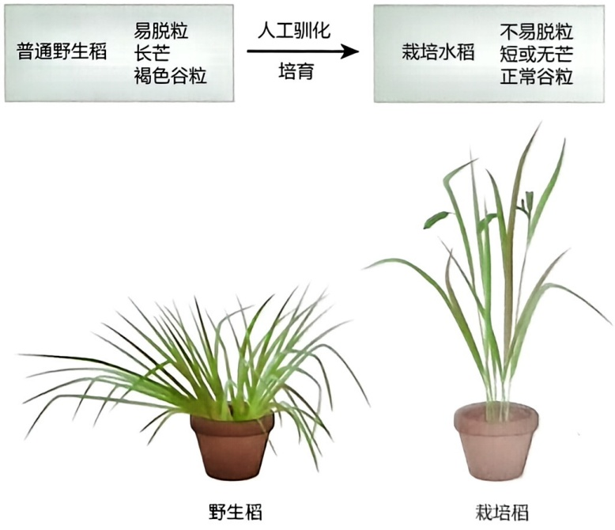

flowchart

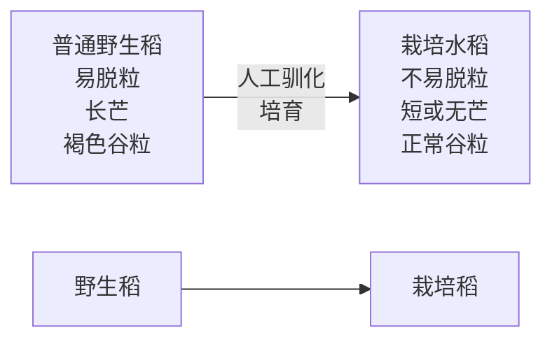

图15-4 栽培水稻由普通野生稻驯化而来

---

448

第十五章 植物发育

水稻研究所也进行了矮秆水稻的培育和种植。这些矮秆作物被逐渐推广后，从根本上扭转了全球因为人口激增而可能面临饥荒的局面。这个过程因此被称为“绿色革命”，布劳格也被称为“绿色革命之父”，于1970年获得诺贝尔和平奖。从70年代开始，通过获得天然或诱变产生的雄性不育作物，育种家利用杂交子一代在环境适应性、产量、抗性等方面均优于双亲的杂种优势生物学现象，培育了大量杂交水稻、杂交玉米品种，为世界粮食增产与食品安全做出了重大贡献。

常规育种技术本质上是以染色体重组交换为基础，通过相关基因优化组合来创造优良品种，存在重组交换频率低、重组位点分布不均、有害等位基因连锁等弊端。同时，常规育种对农艺性状的选择主要依赖于育种专家的经验，需要通过大规模的田间试验进行筛选，存在育种周期长、实践效率偏低的技术缺陷，一般培育一个新品种的整个育种周期需要8\~10年。1953年，DNA双螺旋结构的解析标志着生命科学研究进入分子水平。到了20世纪90年代初，得益于DNA分子标记技术和转基因生物育种技术的发展，作物育种开始进入到基于分子生物学理论的分子育种时代，其中的代表技术之一就是分子标记辅助育种。这种育种方法，通过开发和检测适合的分子标记，筛选与决定目标性状的基因紧密连锁的分子标记，快速检测育种材料中目的基因的分布，达到选择目标性状的目的，具有快速、准确、不受环境条件干扰的优点。分子标记的开发，可以包括抗病虫害、抗旱、高产、品质改良等各个方面，可以用于鉴别亲本亲缘关系、回交育种中数量性状和隐性性状转移、杂种后代选择、杂种优势预测，以及品种纯度鉴定等各个育种环节的辅助手段。分子育种的发展，使得作物育种成为以遗传学为理论基础，综合分子生物学、生理生化、病理学和生物统计学等多种学科知识的交叉学科。特别是以功能分子模块和可遗传操作为特征的分子模块育种，增强了育种目标性，显著缩短了育种周期，克服了很多常规育种方法中固有的困难，大幅度提升了品种培育效率。

进入后基因组时代，以新一代测序、基因组编辑、单倍体制种等为代表的新型技术不断出现，全面改写了作物育种的遗传理论与方法策略。在这种情况下，第四代育种技术，即分子设计育种或精准育种，就应运而生了。分子设计育种（molecular design breeding）将生物遗传学理论与杂交育种相结合，基于对控制作物重要性状的关键基因及其调控网络的深入认识，利用基因组学、表型组学等多组学数据进行生物信息学的解析、整合、筛选、优化，从而获取育种目标的最佳基因型。随着高通量组学技术的发展和应用，优异种质资源形成规律、新基因挖掘与功能解析、产量品质和抗性等重要性状形成的分子机制研究取得了重大进展，分子设计育种的理论体系正在不断完善。近年来出现的以CRISPR/Cas9系统为代表的基因组编辑技术，极大地拓宽了育种的方式方法，揭开了“无重组育种”的新篇章。理论上，可以根据育种家的设计蓝图，运用基因组编辑技术在作物基因组的特定位点上改变、添加或者删除DNA序列。因此，整合了基因组编辑技术的分子设计育种，具有比传统杂交育种更为突出的优越性，不仅可以快速优化组合天然变异，还可以引入人工合成的新变异，实现对基因型进行精确改变或大规模聚合选择，从而系统化、智能化拓宽作物的表型变异、最

---

第二节 植物发育的特点

449

终高效精准地培育出目标新品种。展望未来，基于遗传学，结合合成生物学、大数据科学等多学科交叉的科学研究，必将极大推动对植物生长发育的理解，带领作物遗传育种进入一个崭新的时代。

## 第二节 植物发育的特点

## 一、植物以胚后发育为主

## 1. 胚后发育的特点

植物与动物独立多细胞化，沿着不同的进化路径发展至今。植物与动物也具有诸多差异。例如，植物细胞具有细胞壁，既能保护细胞，也会约束细胞的形变和运动。植物细胞具有叶绿体，植物大多以自养为生。对应于植物细胞的特征，植物均固着生长，不能移动。植物的发育与动物具有显著不同，特别是植物一生中均维持了器官发生的能力。这一特点使植物的地上部分茎叶和地下部分根系均不断形成分枝，以类似分型的方式无限生长。无限生长（infinite growth）不仅可以形成百余米的参天大树，还可以由一粒种子形成一片森林或竹林。例如，帕尔梅栎（Quercus palmeri）通过不断分枝形成看似独立的个体，成为地下相连的树林，从而维持近乎无限的寿命。加利福尼亚州南部发现的一片帕尔梅栎据测定已有约13000岁，可能是迄今为止最长寿的生物。

## 2. 分生组织的概念、基本结构和功能。

植物的生长主要可以分为两个阶段，营养生长期和生殖生长期。被子植物在营养生长期产生叶片；在转换到生殖生长期后，产生花序和花。在营养生长期，胚后器官发生起源于特定的组织，称为分生组织（meristem）。植物在胚胎期形成茎尖分生组织，被子叶包被；同时形成根尖分生组织（root apical meristem），位于胚根顶端根冠之下。茎尖分生组织形成所有地上部分的组织和器官，包括茎、叶、花和果实。根尖分生组织形成整个根系。双子叶植物具有维管形成层，属于在植物发育后期启动的次生分生组织。通过径向分裂，原形成层前细胞产生木质部和韧皮部，使茎加粗生长。茎和根系均可以形成分枝。分枝来源于新的茎尖或根尖分生组织。在种子植物中，地上部分在胚后发育中形成侧生分生组织，与胚胎来源的茎尖分生组织具有类似的发育潜能。地下部分形成侧根，侧根根尖也有与胚根类似的根尖分生组织。植物不断产生分枝，有助于植物快速占据空间，地上部分增加捕获阳光的面积，地下部分吸收更多水分和离子。分枝的产生决定了植物的形态，对于作物是影响产量的要素（图15-5）。

茎尖分生组织位于植物茎顶部（图 15-6A），通常呈圆顶形（图 15-6B）。在营养阶段，茎尖分生组织周边周而复始地形成叶原基（leaf primordium），发育为成熟叶片。在植物诱导开花，进入生殖生长之后，茎尖分生组织以类似的模式在周围产生花原基

---

450

第十五章 植物发育

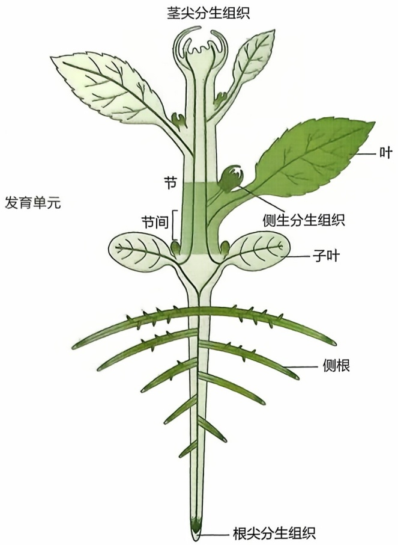

text_image

茎尖分生组织
叶
节
节间
侧生分生组织
子叶
发育单元
侧根
根尖分生组织

图 15-5 模块化植物发育

（flower primordium）或花序原基。茎尖分生组织向下形成节间，推动茎尖分生组织向上生长。根据细胞形态和细胞分裂活性，茎尖分生组织可以分为三个功能区——中央区、外周区和肋状分生组织（图15-6B）。中央区包含分裂速率较低的干细胞，它们的后代从中心移出并进入外周区。外周区细胞分裂加快，部分外周区细胞被招募到叶原基或花原基中，进而形成叶和花。同时，肋状分生组织内的细胞也不断分裂，它们的部分后代向下推出分生组织区，进而形成植物的茎和维管束系统，最终发育为连续的茎干。

茎尖分生组织也可以根据细胞谱系由三个细胞来源上独立的层组成（图15-6C）。最外层由称为L1和L2的两层细胞组成，而剩余的茎尖分生组织细胞构成L3层，也称为本体。L1层细胞和部分植物物种的L2层细胞只进行横向分裂，新形成的细胞壁与茎尖分生组织表面垂直。因此，L1和L2细胞的增殖产生表皮和亚表皮组织。与之不同，L3层中的细胞分裂不固定，在多个方向均可能形成新的细胞壁。这种分裂模式增加了细胞层数，形成内部组织。因此，L3层在形成植物的维管束和内部结构中发挥主要作用。

相比于茎叶，根的结构相对简单。根系可以分为三个不同但又相互重叠的区域，即分生区、伸长区和分化区。分生区与伸长区之间细胞分裂的边界称为过渡区。根尖分生组织位于胚根或侧根尖端的分生区，在模式植物拟南芥中约为 $300\mu \mathrm{m}$ 。与茎尖分生组织类似，根尖分生组织由干细胞（stem cell）和未分化的子代细胞组成，这些细胞分裂并产生各种根细胞。根尖分生组织末端是根干细胞龛（stem cell niche），由静止中心细胞和围绕在静止中心周围的干细胞组成。静止中心细胞很少分裂并抑制周

图15-6 茎尖分生组织

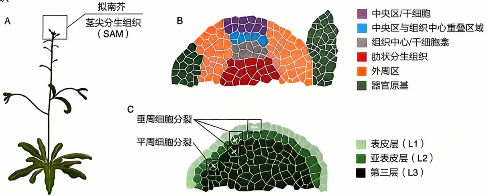

text_image

拟南芥
茎尖分生组织
(SAM)
A
B
中央区/干细胞
中央区与组织中心重叠区域
组织中心/干细胞龛
肋状分生组织
外周区
器官原基
C
垂周细胞分裂
平周细胞分裂
表皮层（L1）
亚表皮层（L2）
第三层（L3）

---

第二节 植物发育的特点

451

围干细胞的分化。周围的干细胞进行不对称分裂，子细胞进一步分裂并产生根的不同细胞类型。静止中心之下的子代细胞形成根冠，之上的子代细胞形成表皮、外皮层、内皮层、维管束和柱状细胞等多种细胞类型。以上这些细胞类型自外而内形成根的各层结构、向上进入伸长区，最终进入分化区。根尖分生组织不断分裂，形成的子代细胞向上积累，促进根的伸长和向下生长。

植物的分生组织具有干细胞，具备干细胞的特征，能够自我维持，并能够产生分化细胞。植物的分生组织还能够产生新的组织和器官，类似于哺乳动物胚胎期的内细胞团。分生组织自身维持和分化形成器官的平衡受到精密调控。对于调控的分子机制，已有一些了解。茎尖和根尖分生组织的活性均受到包括同源框转录因子、小肽信号和膜定位受体激酶为核心的保守分子回路的调节。KNOX1类同源框转录因子广泛表达在茎尖分生组织，在叶原基中停止表达。茎尖分生组织中的干细胞稳态受到表达更为特异的WUSCHEL（WUS）和CLAVATA（CLV）反馈环路的调节。WUS仅在中央区与肋状分生组织之间的组织中心表达（图15-6A），WUS蛋白扩散进入上层的中央区激活编码小肽CLV3表达。CLV3小肽被CLV1受体激酶在内的蛋白质复合物感知，抑制WUS基因的表达。WUS-CLV3构成的环路中，WUS激活CLV3表达，表达WUS的组织中心具有干细胞龛的作用，维持表达CLV3的干细胞活性。另一方面，CLV3抑制WUS的进一步激活，维持茎尖分生组织的稳态。类似机制在根尖分生组织中也发挥作用。与WUS高度同源的转录因子WOX5在静止中心中起作用，以维持周围细胞的干性。根静止中心与表达WUS的茎尖分生组织的组织中心具有类似的干细胞龛功能。WOX5的表达也受到与CLV3同源的CLE40小肽的调节。CLE40通过受体激酶抑制WOX5的表达。

## 二、地上部分器官发生的特点

## 1. 叶片等器官原基的建立

植物的地上部分形态通常称为“株型”。株型由多个发育过程的结果加和而成，株高和分枝是其中两个重要方面。从发育角度看，植物的地上部分呈现模块化的发育特点，由多个重复的发育单位组成，称为植物体节（phytomer）。一个植物体节包括节、一片或多片叶、芽及一段节间。叶片均在节处着生，腋芽在叶片基部叶腋处着生。植物体节的各个部分均来自于茎尖分生组织，正是植物体节的重复出现构成了植物的典型结构。尽管和动物体节一样规律性重复分布，但植物体节并非在胚胎期同时形成，而是逐步发育形成的。

叶片是典型的植物器官，通常是有限生长的，即生长到一定大小后停止。叶片通常只在有限时间行使功能:落叶树每年产生和丢弃叶片，规律性、可重复地更新叶片。如前所述，叶原基发生于茎尖分生组织的外周区，由一部分细胞获得特定的细胞命运，产生原基。在模式植物拟南芥中，约30个细胞构成一个叶原基。叶原基在外周区周期性发生，发生的位置高度有序。例如，在很多植物中，两个叶片之间的夹角

---

452

第十五章 植物发育

约为  $137.5^{\circ}$ ，形成螺旋叶序。螺旋叶序不只是视觉美观，更重要的是形成叶片之间相互遮挡最少的优势。此外，还有植物形成先后两片叶相对的互生叶序，每个节同时相对形成两片叶的对生叶序，每个节同时形成辐射排列多枚叶片的轮生叶序。数百年来，叶序模式一直让学者们感到好奇，催生了数列等概念。

根据对叶序形态的观察，很早就有学者提出已有叶片抑制新的叶片在周边形成。20世纪50年代初，植物学家伊恩·萨塞克斯（Ian Sussex，1927—2015）通过显微手术实验证明了新叶原基形成的位置受到已经存在的叶原基的影响，特别是新近形成的叶原基。长期以来，这种抑制背后的分子机制尚不清楚。对叶序遗传突变体的分析表明分生组织大小能够影响叶序，但并未能解释叶序如何形成。近年来的研究发现植物激素生长素（auxin）在叶原基形成中起决定性作用，生长素信号响应高点在茎尖分生组织外周区的周期性出现决定了叶序。由于生长素的化学性质，它能够自由进入细胞，但不能穿过细胞膜出细胞。生长素向细胞外的运输依赖于生长素外运蛋白PIN1。生长素在茎尖分生组织之外大量合成，通过PIN1向茎尖极性运输形成生长素流。茎尖分生组织中央区对生长素不敏感，而外周区对生长素敏感，能够形成原基。新形成的原基扰动了生长素的运输，通过PIN1介导的正反馈回路向原基汇聚生长素。计算模拟显示，只有在远离已有原基处能够产生新的生长素汇聚点，从而产生下一个原基。以上原基发生过程周而复始，形成了规则的叶序。

## 2. 叶片形态的建立

叶原基发生后，原基两侧生长速率不同，远离茎尖一侧快速生长（图15-7A）。叶原基两侧即未来的叶缘也快速生长，共同形成了两侧对称的叶原基初始形态。生长素富集促进了叶缘的快速生长。萨塞克斯的经典显微手术实验同时发现与茎尖切开的原基无法建立两侧对称，形成棒状叶。PIN1成像和对生长素运输的扰动实验表明，从茎尖和原基两侧指向原基的生长素极性运输促成了叶缘的生长素汇聚和叶片扁平化发育。

叶片在进一步发育中加厚非常有限，通常细胞层数没有增加，但在另外两个维度快速生长，形成扁平叶片（图15-7B）。膨压驱动了植物细胞的生长，而细胞壁约束的差异导致细胞的极性生长。叶原基细胞中由于初始建立的两侧对称形态，细胞内各个方向受力不同。微管受应力影响垂直于叶片表面排布，指导纤维素沿同样的方向合成。细胞的生长方向主要垂直于纤维素方向，使叶片增大。叶原基的进一步扁平化增大了细胞内的应力差，形成正反馈继续放大极性生长，最终形成宽大扁平的叶片。

与分生组织不同，叶原基细胞在分裂多次后停止分裂，大多彻底分化。不同植物的叶片形态各异，很大程度上取决于各自的细胞分裂停止时间和停止模式。在拟南芥等很多物种中，叶片顶端的细胞先停止分裂，并逐步向叶片基部蔓延，逐步停止细胞分裂。如果细胞分裂时间过长，会过度积累细胞，形成皱叶，如皱叶品种的莴苣、欧芹。细胞在停止分裂后仍会扩张。叶片的最终大小取决于细胞的数目，同时也在很大程度上取决于细胞的扩张程度。

叶片内部的细胞还可能出现局域化的分裂和扩张差异。茎尖调控原基形成的回

---

第二节 植物发育的特点

453

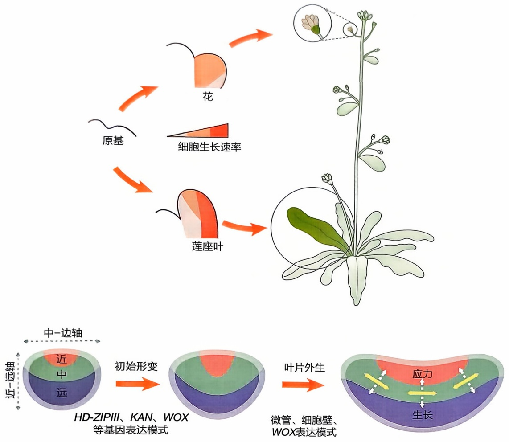

图15-7 叶片和花原基三维形态的获得

路有时在叶片发育过程中被再次激活，调控叶缘的形态。PIN1介导的生长素汇聚在叶缘周期性产生，汇聚点形成叶齿凸起。这个形态发生过程在不同物种中程度差异很大。有的物种缺少这个形态建成过程，形成平滑叶缘；有的物种通过短暂的形态建成形成或浅或深的叶缘；有的物种具有更长的形态建成期，形成深裂、掌状叶，甚至复叶。

侧芽是植物体节的另一个要素。侧芽位于叶片基部叶腋处，由侧生分生组织形成。在一些物种中，侧生分生组织被其形成的小叶片包被，构成侧芽。侧生分生组织具备和茎尖分生组织类似的发育潜能，也能够形成叶原基、花原基。侧生分生组织具有和茎尖分生组织类似的组织结构和基因表达。侧生分生组织来源于叶原基基部未完全分化的干细胞。叶腋处细胞分裂缓慢，维持了KNOX1同源框转录因子的表达。这些维持KNOX1表达的干细胞构成了未分化的细胞谱系。在叶片发育后期被激活，建立WUS-CLV3环路，形成新的茎尖分生组织。

侧芽形成后经常处于休眠状态。休眠的分生组织保留其生长和分化的潜力，但只有在特定条件下才能被激活，例如，当植物达到某个发育阶段（如开花）或受损后。继续发育的侧芽形成侧枝，侧枝的数目和角度是决定植物形态的要素。侧芽的生长通常受到茎尖的抑制，这种现象称为顶端优势（apical dominance）。生长素是抑制侧芽

---

454

第十五章 植物发育

生长的关键因素。茎尖向根大量运输生长素，抑制了侧芽的生长素外运，使侧芽积累了过高的生长素，抑制侧芽生长。这一机制类似于高速路上大量的车流阻挡了入口处车辆驶入。糖和其他激素也参与了侧芽生长的抑制或激活。光照时长、光质和温度等环境信号及营养状态等内源信号均可影响芽的休眠，它们的综合结果决定了芽是否维持休眠。分枝模式具有重要的生理和生态后果。一年生植物的分枝数量往往较少，而多年生植物分枝通常很多并且反复发生，即在分枝上再形成分枝。植物在垂直生长和侧向生长之间平衡，以更好适应特定生境。分枝的程度和分枝的角度决定了侧向生长，节间长度和节的数目决定了垂直生长。在作物中，分枝数目影响了花等繁殖结构的个数，是决定作物产量的要素。

节间的长度调控了植物的垂直生长，决定了株高。垂直方向的生长可以追溯到4亿年前的泥盆纪晚期，植物从水生到陆生环境的转变伴随着垂直生长。垂直生长不仅可以增加孢子以及之后出现的花粉和种子的传播范围，还避免了植物被附近物体遮蔽，获得更多光照。较矮的株高避免了过度营养生长并防止作物倒伏，显著增加了产量。作物矮化由此一直吸引着人们的兴趣。孟德尔在豌豆研究中使用的7个性状之一就是高度，他所用的豌豆分为高、矮两类表型。20世纪60年代的绿色革命选择和推广了半矮化的小麦和水稻品种。遗传育种专家布劳格和黄耀祥（1916—2004）分别选育了携带有Reduced height 1（Rht1）和semidwarf1（sdl）的半矮秆小麦和水稻品种。后续研究发现，这些矮化品种均与植物激素赤霉素（gibberellin）相关。赤霉素通过影响细胞扩展和分裂影响节间的伸长。孟德尔的矮豌豆隐性突变体中，赤霉素生物合成中GA3氧化酶编码基因活性降低，不能生产有活性的赤霉素。绿色革命的水稻sdl位点也是位于赤霉素合成通路中的基因突变，影响了正常的赤霉素合成。而半矮秆小麦的Rht1是一个显性功能获得型突变，阻碍了赤霉素信号的正常传递，同样造成节间生长受阻。

## 3. 营养生长向生殖生长的转换——开花

植物会整合环境信号和内源信号，进行营养生长期和生殖生长期的转换。在很多物种中，光照时长是决定性的开花信号。根据对每日周期中光照时数的敏感度，植物被分类为:如果开花不受光照日数的影响，则为日中性植物；如果在昼长夜短的季节（例如夏季）开花，则为长日照植物；如果在昼短夜长的季节（例如秋季）开花，则为短日照植物。在接收到开花信号后，植物的茎尖分生组织由形成叶原基转变为形成花原基或花序原基。

1936年，苏联植物生理学家柴拉克彦（Михайл Христофорович Чайлахян, 1902—1991）基于嫁接实验提出了成花素假说（florigen theory），猜测在生殖生长期的植物叶片中产生了成花素（florigen），这种开花诱导物质可能通过韧皮部运输到茎顶端分生组织，促进开花。自20世纪80年代以来，植物学家利用模式植物拟南芥通过突变体筛选和分析找到了成花素。感应开花信号后，FLOWERING LOCUS T（FT）蛋白质编码基因在叶片中转录，通过维管束中的长距离运输到达茎尖分生组织，促进茎尖分生组织向开花的转变。类似的成花素分子也在番茄、水稻等作物中被证实，是一

---

第二节 植物发育的特点

455

种保守的开花调控方式。FT 是一个小蛋白质，与茎尖分生组织中表达的 bZIP 转录因子 FD 结合，形成多蛋白质复合物，触发大量下游基因的表达，包括多个能够促进向开花转变的转录因子编码基因。茎尖还表达与 FT 序列类似但功能相反的 TERMINAL FLOWER 1（TFL1）等蛋白质。TFL1 也与 FD 结合形成复合物，但抑制 FD 对下游基因的激活，从而抑制向开花的转变。FD 的关键靶基因包括编码转录因子的 LEAFY（LFY）和 CAULIFLOWER（CAL），它们能够调控花原基的形成和发育。在花椰菜中，CAL 及其同源基因缺失，花原基不能继续发育，形成了大量未分化的花原基。

## 4. 花形态的建立

花原基与叶原基最初形态接近，但靠近茎尖一侧生长更快，呈现为辐射对称（而非两侧对称）的半球形。花原基中央为花分生组织，和侧生分生组织具有相似性。花分生组织形成后，会形成四轮或更多轮花器官，之后终止器官发生。因此，可以认为花分生组织是有限发育的特化侧生分生组织。花器官从外向内依次为萼片、花瓣、雄蕊和雌蕊。根据对拟南芥和金鱼草花发育突变体的分析，美国植物学家梅耶洛维奇（Elliot Meyerowitz）和英国植物学家科恩（Enrico Coen）提出了花发育的ABC模型。ABC模型对包括水稻和玉米等禾本科在内的其他物种同样适用。水稻等禾本科单子叶植物的花结构有很严重的特化，含有内轮雄蕊和雌蕊以及外轮的外稃、内稃和浆片。在水稻中A和B基因指定浆片的发育，B和C基因指定雄蕊的发育，C基因指定雌蕊的发育。A功能指定外稃和内稃的发育。

在 ABC 模型中，四轮花器官是由三种类型基因的不同重叠组合来界定的:最外轮的萼片由 A 基因单独界定；第二轮花瓣由 A 和 B 基因共同界定；第三轮雄蕊由 B 和 C 基因共同界定；第四轮雌蕊由 C 基因单独界定。根据 ABC 基因表达的变化可以预测花器官特性的变化。例如，当 B 基因缺失时，花具有两轮萼片和两轮雌蕊。C 基因还终止花分生组织，缺乏 C 基因的植物会产生额外的器官轮，表明花分生组织转为无限生长。在拟南芥中，C 基因 AGAMOUS 抑制干细胞基因 WUS 的表达。后来的研究进一步揭示，除了 ABC 类基因，另一类 E 基因在花原基各轮中均表达，在花的四个轮状器官发育中均发挥作用。当植物中所有的 E 基因缺失时，各轮花器官均消失，转为形成类似叶的结构。该发现支持了花由叶演变而来的假说，并暗示 ABCE 基因产物的功能是抑制叶基因和激活花的器官特性促进基因。此外，还有一类决定胚珠发育的基因被称为 D 基因，在花发育后期表达并发挥作用。ABCDE 蛋白质大多为 MADS 类转录因子，形成异源四聚体调控下游基因表达（图 15-8）。在不同轮的花器官中，由于表达的基因不同，形成的异源四聚体组分不同，其中 E 类蛋白质存在于各类复合物中。

## 三、根发育的特点

## 1. 根的基本结构

陆地植物的根系具有两个主要功能——固定植株并获取土壤中的水和养分。根系

---

456

第十五章 植物发育

图15-8 花发育的ABC模型

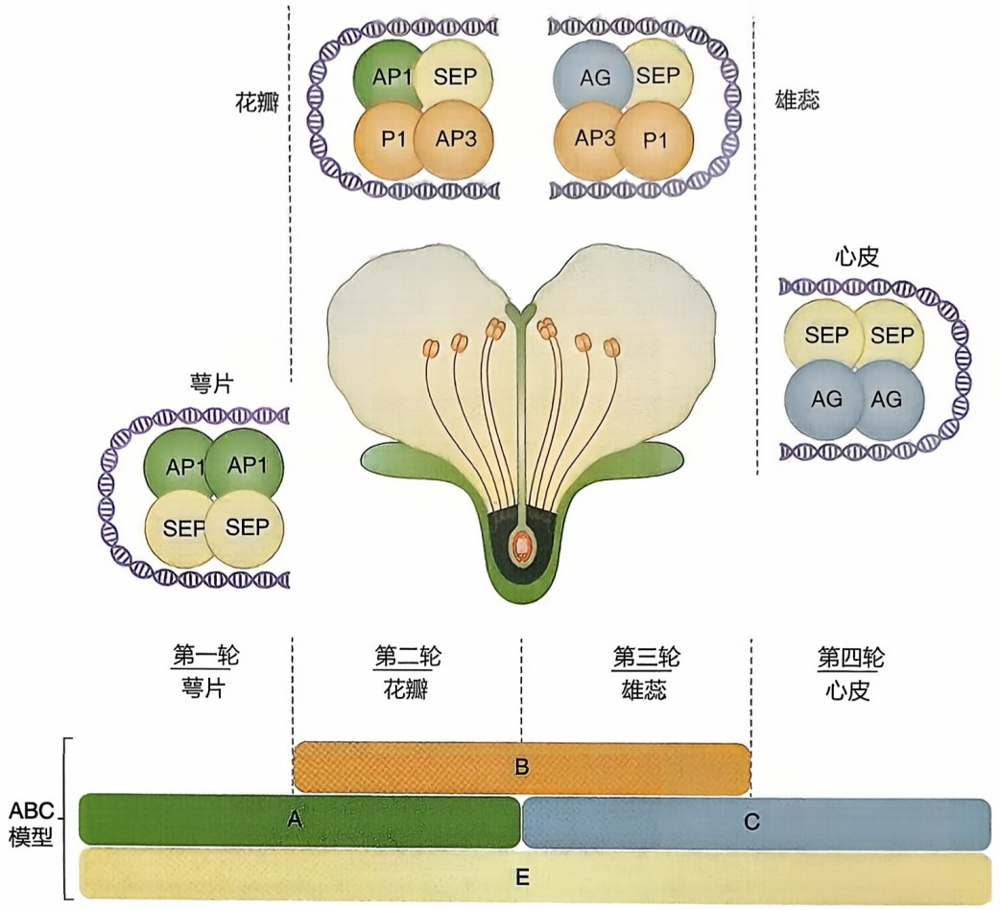

text_image

花瓣
雄蕊
心皮
萼片
第一轮
萼片
第二轮
花瓣
第三轮
雄蕊
第四轮
心皮
ABC
模型
A
B
C
E

也进化出了存储、生长调节物质的合成、繁殖和传播等其他功能。根系发育是一个反复进行的迭代过程，产生后生长并形成分支，分支产生后同样生长并产生分支。由此可见，根系发育类似于茎叶发育但更为简单。从种子中首先出现的是胚根，又称初生根（primary root）或主根。初生根在土壤中生长一段时间后形成分支，称为侧根或次生根（secondary root）；次生根继续分支产生三级根。侧根从它们的母根上以固定的时间间隔出现，两个侧根之间的距离是时间间隔和母根生长速率的函数。新形成的侧根相对于它们的母根以一定角度出现，侧根延伸到土壤中并具有改变方向的能力。侧根也可以形成高阶分支，通常与它们的母根相比具有不同的密度，形成复杂的树状结构，称为根系。整个根系由大量不同年龄、类型和发育阶段的根组成。不同物种间的根系差异远小于茎、叶的差异，可能是由于地下环境的变异范围有限。

单子叶植物和双子叶植物具有不同的根系结构。在双子叶植物根系中，初生根和一级侧根通常形成结构的主干。此外，一些双子叶植物物种下胚轴形成基根，成为根系的一部分。单子叶植物也可以形成基根。除了初生根和种子根外，单子叶植物通常从茎基部的节上生成不定根（adventitious root），又称茎生根。随着单子叶植物的生长，茎生根从主茎和分蘖（即分枝茎）的分枝节点中出现，构成第一级轴向根的大部分。双子叶物种中虽然也会有不定根，但对根系贡献通常较少。茎生根和种子根大致遵循与初生根相同的发育程序。此外，单子叶植物的根系不发生次生生长，不能加

---

第二节 植物发育的特点

457

厚。单子叶植物通过产生新的不定根来运输更多水分、支撑长大的植株。我们对根发育的了解大多来自于对模式植物拟南芥的研究。下文的介绍大多基于拟南芥根。但需要指出的是，拟南芥根结构相对简单。其他物种根的结构可能和拟南芥有很大差异，例如根中各层的细胞类型及其排布。

在胚胎发生早期，胚胎的顶-基极性就已经建立，与顶端的茎尖分生组织相对，胚胎底端为胚根。胚胎最下方的胚根原细胞不等分裂产生一个上部的透镜状细胞，将来成为静止中心。另一个较小的下部基底细胞发育为小柱干细胞和小柱细胞。胚胎期还形成了根中的维管束、根基本组织和表皮组织的干细胞。生长素调节胚根的形成，生长素合成、运输、感知和信号转导的扰乱都影响胚根的形成。在胚根发生过程中建立的根尖分生组织为根的生长提供新细胞。在根尖分生组织中，干细胞围绕着表达WOX5的静止中心。静止中心细胞分裂活性较低，形成了干细胞壁龛。位于静止中心上方的干细胞产生维管束、内皮层、外皮层、表皮和侧根冠细胞，而位于静止中心下方的干细胞产生小柱根冠细胞。干细胞的子细胞产生单细胞层，这些细胞层沿纵向根轴延伸并形成不同的组织层。尽管成熟的组织类型来源于独立的细胞谱系，由单个初始细胞衍生而来，但细胞位置而不是谱系决定根尖细胞身份。

在拟南芥根中，维管束被组织成一个中央圆筒称为中柱（stele），其中包含木质部（xylem）和韧皮部（phloem），以及分散的未分化的形成层细胞和周围的中柱鞘细胞层（图15-9）。这些组织来自靠近静止中心的原中柱鞘/维管束细胞。维管束在初级生长过程中纵向生长，在次生生长过程中横向生长。虽然根的外层组织表现出辐射对称性，但中柱是两侧对称的。拟南芥根中木质部细胞排列成一排。在木质部轴垂直的两极是两个韧皮部束。根基本组织包括外皮层和内皮层，均起源于共同的初始细胞。初始细胞先进行横向分裂以自我更新并产生子代细胞，子代细胞再进行纵向分裂以产生外皮层和内皮层。侧根冠和小柱细胞形成一层保护性细胞层，随着根尖生长，这层细胞会持续脱落。与表皮一起，这些组织构成了根的外部表面。中柱细胞在重力感知中发挥作用，而表皮形成的根毛则在水分和营养吸收中发挥重要作用。位于静止中心下侧的原中柱细胞形成中柱细胞，而位于静止中心外侧的原表皮/侧根冠细胞形成表皮和侧根冠。根冠位于根系最外端的尖端，从初生根到分支根的尖端均具有根冠。

## 2. 根瘤的形成

菌根（mycorrhiza）是普遍存在于植物根系和土壤真菌之间的互惠共生体。通过这两个共生伙伴之间亲密的细胞接触，菌根真菌从进行光合作用的寄主处获得固定的碳，以交换磷和氮等营养，对植物生长有积极影响。共生还提高了寄主植物对生物和非生物胁迫的耐受性。植物根系与微生物存在多种共生类型。超过 $80\%$ 的陆生植物可以与丛枝菌根真菌形成共生关系，豆科植物还可以与固氮细菌根瘤菌形成共生固氮关系。丛枝菌根共生与根瘤（root nodule）共生可通过提高植物对磷和氮的获取能力，从而协同促进植物生长。植物根系与微生物建立共生是长期共进化的过程。丛枝菌根共生形成于植物登陆早期，其共生信号通路被豆科植物进一步利用，参与建立

---

458

第十五章 植物发育

图15-9 拟南芥的根尖细胞结构

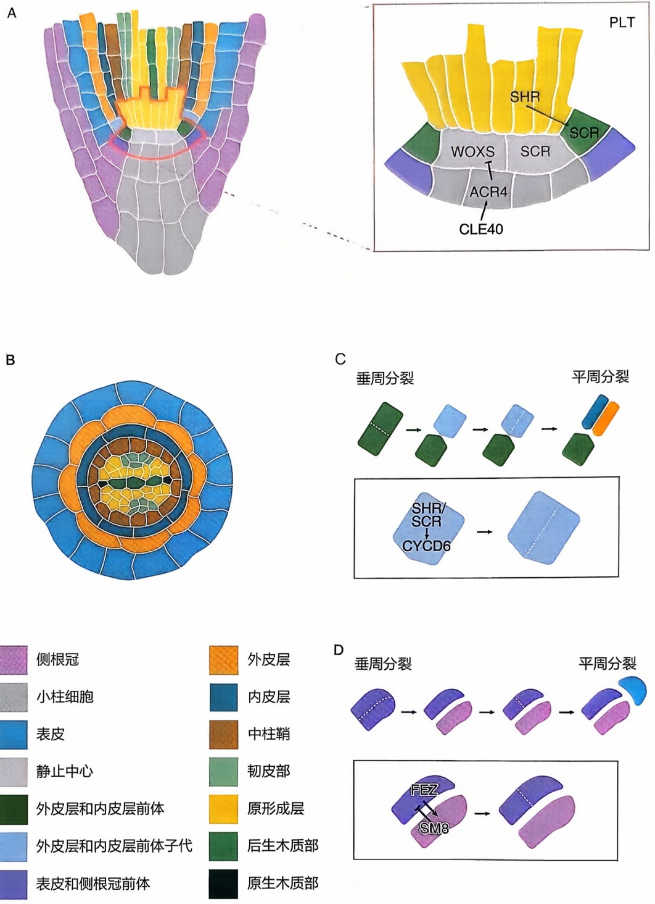

豆科植物与固氮根瘤菌的共生。豆类与固氮细菌根瘤菌形成共生根瘤。固氮根瘤的形成需要根表皮上的固氮细菌侵染和皮层细胞分裂相互协调。根瘤内含有称为类菌体（bacteroid）的类似细胞器结构，其中包含固氮细菌，可进行固氮作用。类菌体同时促进寄主和共生菌之间的代谢物交换。

---

第三节 可变环境下的植物发育可塑性

459

## 名词窗15-1

无限生长（infinite growth）:植物顶端分生组织保持其活性，并不断产生新的侧生器官，导致无限生长。

分生组织（meristem）:植物体的一类组织，是产生和分化其他各种组织的基础。分生组织是具有持续或周期性分裂能力的细胞群。分裂所产生的细胞排列紧密，无细胞间隙；细胞壁薄，细胞质浓厚，细胞体积较小，一般呈等径多面体，细胞核大，无明显的液泡。

芽休眠（bud dormancy）:植物生活史中芽生长的停顿现象。多数温带木本植物，包括松柏类植物和双子叶植物在年生长周期中明显地出现芽休眠现象。芽休眠可能被打破，形成枝。

生长素（auxin）:植物激素，植物体内普遍存在的天然生长素是吲哚乙酸，其前体是色氨酸。生长素参与几乎所有的植物发育过程。

成花诱导（floral induction）:被子植物从营养生长期向生殖生长期的转换，常受到环境因素、植物激素及营养物质的影响。

菌根（mycorrhiza）:菌根为植物根与土壤中真菌形成的共生结构，菌根主要有两种类型——外生菌根和内生菌根。外生菌根的菌丝不能进入根的细胞中，可以在根表面形成菌丝体包在幼根表面，或穿入皮层细胞的细胞间隙中，以菌丝体代替了根毛的功能。内生菌根的菌丝通过细胞壁，进入表皮和皮层细胞内形成丛枝状分支，加强吸收机能，促进根内物质运输。

根瘤（root nodule）:植物根上的瘤状突起，是土壤中的根瘤菌侵入根内而产生的共生结构，在豆科植物中发现较多。

## 第三节 可变环境下的植物发育可塑性

除少数藻类外，绝大多数植物都是固着生活的，固定的生存地点决定了植物无法像动物一样通过迁徙的方式选择更加合适的生活环境，只能通过改变自身的生长发育来更好地适应所处的环境，能够对生活环境做出最合适反应的个体，才能获得竞争优势并产生更多后代。在植物生活史中，很多环境因素都能够影响植物生长发育，比如光照、温度和机械压力，这三种环境变化因为其对植物生长发育的重要调控作用，对应的研究分别提出了光形态建成（photomorphogenesis）、温度形态建成（thermomorphogenesis）和接触形态建成（thigmomorphogenesis）三个概念。植物中由环境变化的感受到最终生长发育发生变化的调控过程称为信号转导通路（signal transduction pathway），在其中直接感受环境变化，将外界环境变化转化为植物内部信号变化的组分称为受体（receptor），受体经过各种方式将信号传入细胞核内的转录因子并调控植物转录组发生变化，最终调控植物的生长发育，使其适应环境的变化。本节将以光、温度和机械压力三个环境因素对植物形态发育的调控为例，介绍相对应的信号转导通路和形态建成的调控方式。

---

460

第十五章 植物发育

## 一、植物光形态建成

## 1. 植物光信号通路的组分

光是植物整个生活史中最重要的环境因素之一。一方面光是光合作用的能量来源，更是整个地球生物圈的能量来源，是维持植物生长繁殖的基本要素，另一方面光的强度、光质、光照时间等也是调控植物生长发育的重要环境因子。

作为固着生活的光合自养生物，为了能够及时接收光信号的强弱、光质和入射角等变化并迅速做出生长发育的调整以适应环境变化，高等植物在进化过程中产生了多个光受体家族，并进一步特化，使得植物能够感知从紫外光到远红光，波长为280～750 nm。以模式植物拟南芥为例，波长为600～700 nm的红光和700～750 nm的远红光是由一类光敏色素（phytochrome）家族感知的，包括phyA、phyB、phyC、phyD和phyE五个成员，主要调控植物种子萌发、幼苗变绿、避荫反应、开花、生物钟等生物学过程；有三类蛋白质可以感知波长在320～500 nm的蓝光，包括隐花色素（cryptochromes，CRY1和CRY2）、向光素（phototropins，PHOT1和PHOT2）以及Zeitlupe蛋白家族（ZTL、FKF1和LKP2），其中隐花色素可以调控植物的开花和生物节律，向光素主要调控植物向光性和气孔打开等过程，Zeitlupe蛋白主要参与植物开花和生物节律等过程；波长在280～320 nm的紫外光是由UVR8蛋白感知的，在紫外光下的光氧化修复和气孔开闭等方面发挥作用（图15-10）。

各种光受体接受光照后，进一步将光信号向下转导给一类光信号的抑制因子COP/DET/FUS（CONSTITUTIVE PHOTOMORPHOGENIC/DE-ETIOLATED/FUSCA），这类抑制因子的突变体幼苗在暗环境下就表现出光下生长的幼苗特征。其中COP1蛋白在整个植物生活史中都发挥着重要作用，是泛素-蛋白酶体信号通路中一类非常保守的蛋白质，在整个真核生物系统中都有同源蛋白质，并且蛋白质序列和功能都很保守。在光信号通路当中，COP1被认为是整个光反应的核心开关，主要以通过抑制

图15-10 光受体种类和功能

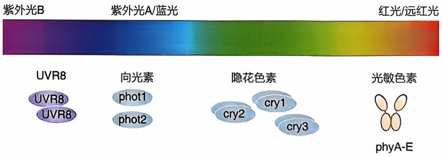

| UVR8 | 向光素 | 隐花色素 | 光敏色素 |
| --- | --- | --- | --- |
| 对紫外光的适应气孔打开 | 向性生长气孔打开叶绿体运动 | 去黄化发育开花时间生物钟 | 种子萌发去黄化发育向重力性开花时间生物钟 |

---

第三节 可变环境下的植物发育可塑性

461

下游光信号通路中的正调控因子，比如 HY5（ELONGATED HYPOCOTYL 5）等。光受体感受到光照信号后，能够解除 COP1 蛋白对下游信号通路的抑制，从而将光信号继续向下游传递。另一类抑制因子 DET1 在种子萌发、幼苗变绿、形态发育等过程中也发挥着非常重要的调控作用，但由于 DET1 蛋白的序列中没有发现已知的蛋白质功能结构域，所以对 DET1 的功能研究相对较少。目前发现 DET1 与另外两个蛋白质 COP10 和 DDB1 组成 COP10-DET1-DDB1 复合物（CDD 复合物）发挥作用，一方面可以通过泛素化（ubiquitination）调控下游蛋白质的稳定性，也可能通过调控染色质来调节下游基因的表达。

外界光信号的变化最终需要转化为植物内源基因表达的变化，从而对植物的生长发育产生影响。有多种转录因子受到光受体直接或者间接的调控，进而对植物基因组的转录水平进行调节。比如拟南芥中红光受体phyB在暗环境下定位在细胞质中，见光激活后促进细胞质内 $\mathrm{Ca^{2+}}$ 浓度迅速上升，激活了钙依赖激酶CPKs（calcium-dependent protein kinases），对phyB进行磷酸化（phosphorylation）后使得phyB进入细胞核内与各种转录因子相互作用并进行调控，最终激活光形态建成相关基因的表达（图15-11）。

其中光敏色素结合蛋白PIFs（phytochrome interacting factors）是一类bHLH（basic helix-loop-helix）转录因子，可以与DNA序列上的G-box（CACGTG）或者E-box（CACATG/CATGTG）结合，进而调控下游基因的转录。大多数PIFs转录因子在见光后与光敏色素直接相互作用，进而被磷酸化并泛素化，最终被26S蛋白酶体降解。PIFs转录因子在多种生物学过程中发挥重要作用，比如PIF1调控植物种子在光下的萌发过程，PIF3调控幼苗出土过程中的变绿过程、PIF4和PIF5调控生物节律和避荫

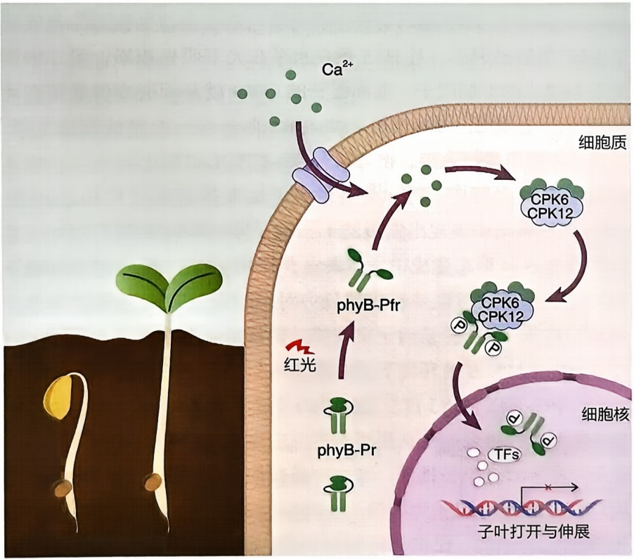

flowchart

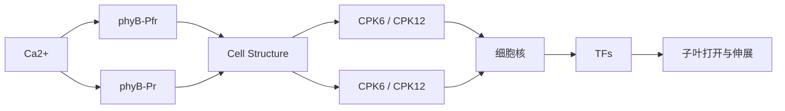

图15-11 红光刺激细胞质 $\mathrm{Ca^{2+}}$ 浓度上升并介导phyB转运进入细胞核

---

462

第十五章 植物发育

反应等。另一类转录因子 HY5 是光信号通路的正调控因子，属于 bZIP 类转录因子，在暗环境下 HY5 在 COP1 的调控下被泛素化最终降解，而光照下 COP1 功能被抑制，HY5 蛋白大量积累，积累水平与光照强度正相关，在植物幼苗下胚轴生长中起到重要作用。光照过强时，HY5 可以直接促进花青素合成酶相关基因的表达，增加花青素的合成，保护植物免受强光的伤害。另外有研究表明 HY5 对于植物地下部分的生长发育也有着重要的调控作用，光照下植物光合作用增强，需要更多的水分和矿物质吸收，而光照下积累的 HY5 蛋白可以由地上部分转移到地下部分，并促进根部的生长，从而平衡植物地上、地下部分的生长。

## 2. 植物的光形态建成与遮荫反应

种子植物的生活史开始于种子萌发，种子在土壤中萌发后，幼苗在土壤的覆盖下处于无光的暗环境下。以拟南芥幼苗为例，幼苗的形态会表现出伸长的下胚轴、明显的顶端弯钩以及闭合、收缩的子叶，这些特征统称为暗形态建成（skotomorphogenesis），这些结构特征能够保护幼嫩的子叶和顶端分生组织在出土过程中免受机械压力的结构性损伤；幼苗出土后受到光照，表现出下胚轴生长减慢、顶端弯钩打开以及子叶变绿、伸展等结构特征，统称为光形态建成，这些特征能够保证子叶可以尽可能伸展在空气中，充分接受光照，快速适应光合自养生长。

在研究植物暗形态建成调控机制的过程中，最初是利用遗传筛选寻找在光照环境生长时表现出暗形态建成特征的突变体，以及在暗环境生长时表现出光形态建成特征的突变体。第一种筛选最容易观察的表型就是下胚轴伸长状态。研究人员通过寻找在光照下伸长下胚轴表型的突变体，得到了一系列命名为ELONGATED HYPOCOTYL（HY）的突变体。进一步研究发现，这群突变基因中HY3编码红光受体光敏色素B（phytochrome B, phyB），HY2编码负责合成光敏色素结合的生色团的合成酶，HY5则编码是一个bZIP类转录因子，且HY5蛋白水平在光下明显积累。第二种筛选方法得到了很多光形态建成的抑制因子。前面提到的COP1就是因突变体幼苗在黑暗环境下表现出组成型光形态建成（constitutive photomorphogenesis）而被筛选克隆的。DET1基因的突变体也表现出类似表型，被命名为DE-ETIOLATED1。

在下胚轴的发育过程中，PIFs类转录因子也发挥着重要作用。pif的四突变体pif1 pif3 pif4 pif5在黑暗中表现出缩短的下胚轴，另一类转录因子EIN3（ETHYLENE INSENSITIVE3）也在暗形态建成中发挥着重要作用，EIN3蛋白在暗环境下积累，并减慢下胚轴的生长速度，可以减轻机械压力对植物幼苗顶端组织的冲击。如果将暗环境下积累的PIFs和EIN3转录因子突变掉，而将暗环境下被降解的HY5积累起来，得到的HY5ox/pifqee材料在暗环境下就会表现出与光下生长幼苗几乎一致的表型，说明暗形态建成中PIFs/EIN3/HY5这三类转录因子发挥着非常核心的作用（图15-12）。

顶端弯钩是双子叶植物幼苗在黑暗条件下产生的特殊结构，由子叶下方下胚轴两侧生长速度不对称导致。生长迅速、细胞伸长较快的一侧成为顶端弯钩的外侧，生长缓慢、细胞伸长较慢的一侧成为内侧。这种结构避免了顶端分生组织和幼嫩的子叶直接受到土壤颗粒的冲击，保护其结构完整性。这种不对称生长是由生长素的不对

---

第三节 可变环境下的植物发育可塑性

463

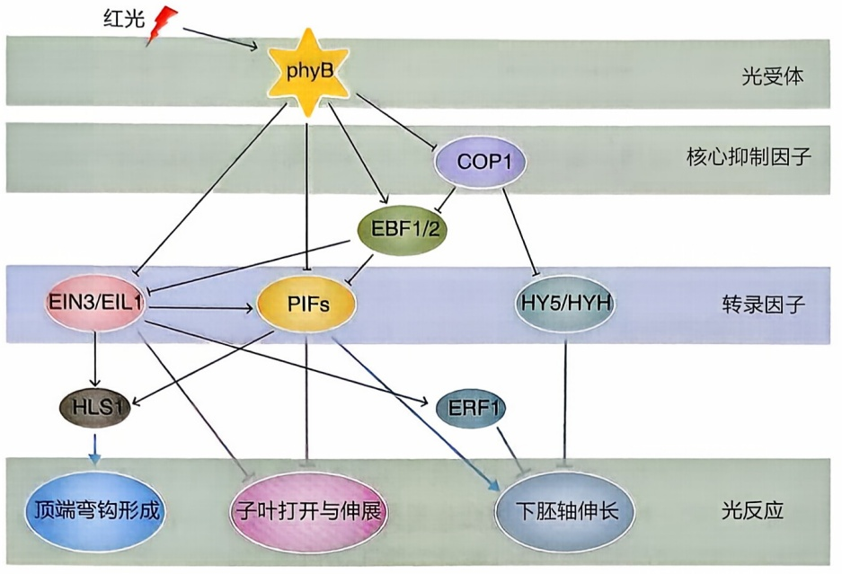

flowchart

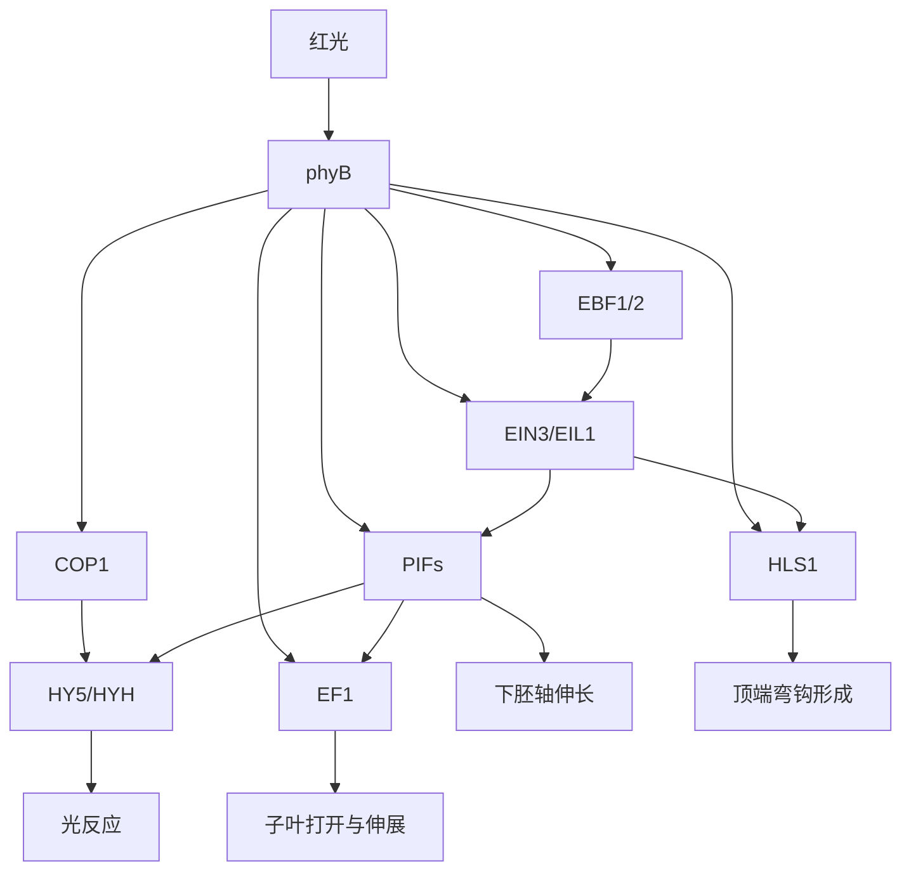

图15-12 PIFs、EIN3/EIL1和HY5介导的光形态建成的转录调控

称分布来调控的。顶端弯钩内侧生长素浓度很高，达到了抑制生长的浓度，从而抑制了内侧细胞的伸长，而外侧生长素浓度较低，促进细胞的伸长，最终形成了顶端弯钩结构。在筛选顶端弯钩缺陷的突变体中，发现了一个基因被命名为HOOKLESS1（HLS1），其突变体在暗下表现出顶端弯钩完全缺失的表型。HLS1的转录水平在暗环境下受到PIFs和EIN3两类转录因子的激活，蛋白质形成多聚体发挥功能，在暗环境下促进顶端弯钩的发育；而见光后一方面PIFs和EIN3受到降解，HLS1基因转录水平降低，另一方面光受体phyB可以与HLS1相互作用抑制多聚体的形成，抑制HLS1蛋白的功能，最终使得顶端弯钩在见光后逐渐打开，使得子叶充分接受光照。

植物野外生长的环境中，拥挤的冠层叶片互相遮挡，低层植物只能接受高层叶片

吸收后的光照。在农作物密集种植的时候，植物会受到周围植株的遮挡，接受日照也受影响。这种由周边光源竞争者所造成的光环境变化称为遮荫（shade）。遮荫的效果并不仅是总体光照强度的下降，还包括入射光在某些特定波长范围内的明显变化（图15-13）。在遮荫条件下，蓝光和红光下降更加明显，远红光波段下降较少，造成的结果是红光与远红光的比例（R/FR）出现了大幅下降。

对于遮荫环境的适应，植物进化出了两种应对策略，分别是耐荫型（shade tolerance）和避荫型（shade avoidance）。对于耐荫植物，主要是通过调整叶片的结构和叶绿素的合成来充分利用避荫条件下的光照，比如厚度增加、叶

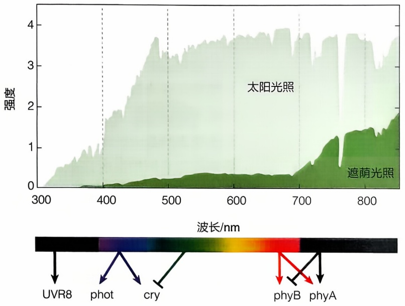

area

| Wavelength (nm) | Solar Light Intensity | Shadowed Light Intensity |
| --- | --- | --- |
| 300 | ~0.1 | 0 |
| 400 | ~1.8 | ~0.1 |
| 500 | ~3.2 | ~0.2 |
| 600 | ~3.5 | ~0.3 |
| 700 | ~3.6 | ~0.4 |
| 800 | ~3.5 | ~1.4 |

图15-13 遮荫条件下植物接受到的光照波长变化

---

464

第十五章 植物发育

绿素增多、表皮细胞透明化等，通过优化自身结构来提高光合效率的应对手段，以多年生草本植物海芋（Alocasia macrorrhiza）为代表；而对于避荫植物，入射光中远红光比例增加时，通过将能量分配给茎秆和叶柄的伸长，使得光合作用器官叶片尽可能生长并离开避荫范围，这一系列躲避性的变化统称为避荫反应（shade avoidance response）。以拟南芥为例，最显著的变化就是下胚轴的伸长和叶片的上翘生长。如果通过加速生长还不能摆脱持续的遮荫环境，植物会选择改变策略，通过提前开花和加速种子发育成熟的方式尽快结束生命周期，以等待环境变化在适合生长的条件下重启生命周期。在农业生产中，避荫反应会导致作物茎秆瘦弱、叶片细长、分枝数量少、种子收获率降低等不利表型，所以研究避荫反应的调控机制以合理密植对于农业生产有着重要的意义。

植物在避荫反应下红光和远红光的比例 R/FR 主要是通过光敏色素来被感受。光敏色素存在两种形式，Pr 形式可以吸收红光转变为 Pfr 形式，Pfr 形式可以吸收远红光转变为 Pr 形式，其中红光激活的 Pfr 形式是体内有活性的光敏色素，可以将光信号传递给下游的光信号通路组分。R/FR 的比例可以调控植物体内光敏色素两种形式的比例（Pfr/Pr），Pfr 比例越低表示环境中远红光强度越高，活性的光敏色素越少，植物的光形态建成特征减弱，下胚轴等组织会伸长，表现出避荫反应的特征。在模式植物拟南芥中，光敏色素下游的 PIFs 类转录因子中的 PIF4、PIF5 和 PIF7 在避荫反应中发挥着核心作用。光敏色素 phyB 在激活的 Pfr 状态下可以直接磷酸化 PIF4/5/7 并使其泛素化最终被 26S 蛋白酶体降解，从而抑制 PIFs 的功能；在遮阴条件下光敏色素的 Pfr 比例降低，对 PIF4/5/7 转录因子的抑制解除，而 PIF4/5/7 下游可以通过直接结合生长素合成相关通路的限速酶基因 YUCCA 等的启动子，促进其表达水平的上升，增加生长素的合成，最终促进下胚轴和叶柄等组织的伸长。

## 二、植物温度形态建成

## 1. 植物对环境温度具有感知与响应

陆地上的植物生长在一个昼夜交替、季节更替的环境中，其环境温度随着昼夜和季节变化存在较大幅度的波动，也会受到天气、气候变化的扰动。植物组织存在于不同的土壤深度以及距离土壤表面不同高度的空气中，其温度变化也存在差异，其中距离土壤表面最近的部分在一天之内经历的温度波动幅度最大。遮荫或直射的状态也会影响植物表面的温度，受到遮荫的植物一天内感受到的最高温度会降低，而最低温度受到的影响很小。

与动物不同，陆地生长的植物在自身生长过程中很难进行移动。而温度变化往往影响着植物各个阶段的生长发育进程，因此，植物对环境温度感知的敏感性对于其生存和发育至关重要。温度形态建成指的是植物应对环境温度变化而发生的相关形态改变。这个概念在1983年由斯托勒（Stoller）和伍利（Woolley）提出，用于描述温度因素诱导植物生长和发育在形态上发生特定变化的过程。

---

第三节 可变环境下的植物发育可塑性

465

对于拟南芥来说，突然且剧烈的高温（高于 $40^{\circ}\mathrm{C}$ ）可能会导致植物的死亡；然而，预先适应较为温和的中等强度高温（低于 $37^{\circ}\mathrm{C}$ ）可以提高拟南芥的存活率。并且，略微升高的环境温度（一般为 $27^{\circ}\mathrm{C}$ 左右，不高于 $32^{\circ}\mathrm{C}$ ）可以诱导拟南芥在植物体结构上发生许多重大变化、完成重要生长发育阶段的过渡，而不会导致拟南芥死亡。植物这一对略微升高的环境温度做出的响应过程，被不同的分子机制精确感知和调控，这一调控机制与植物对极端高温的反应有很大不同。

在拟南芥中，高温诱导的形态建成发生在其生长发育的不同阶段，并体现在多个不同的组织器官中（图15-14）。在适宜的温度条件下发芽对于提高幼苗的生存率和适应程度非常重要，高温对于拟南芥种子萌发有抑制作用，被称为热抑制（thermoinhibition）。在种子萌发后，随着土壤或空气的环境温度升高，拟南芥下胚轴的变化尤其明显，28°C环境下生长的拟南芥幼苗相较于21°C环境中下胚轴明显伸长；对于成苗来说，高温环境下生长的拟南芥茎也会明显增长。

除此之外，拟南芥的叶柄在高温下会发生明显伸长，并且叶柄近地侧和远地侧的生长速度会发生差异，使得叶片被抬离地面。除了地上部分，地下部分的根也会受到土壤温度的影响，发生形态的改变，高温可以诱导拟南芥主根的伸长生长。除了植物的营养生长，植物成苗的生殖生长也受到高温的影响。在非诱导开花的短日照条件下，环境温度的升高可以诱导拟南芥向成花的过程发生转变。在拟南芥等十字花科植物中，环境温度的升高会使得其果荚裂开的过程提早发生。

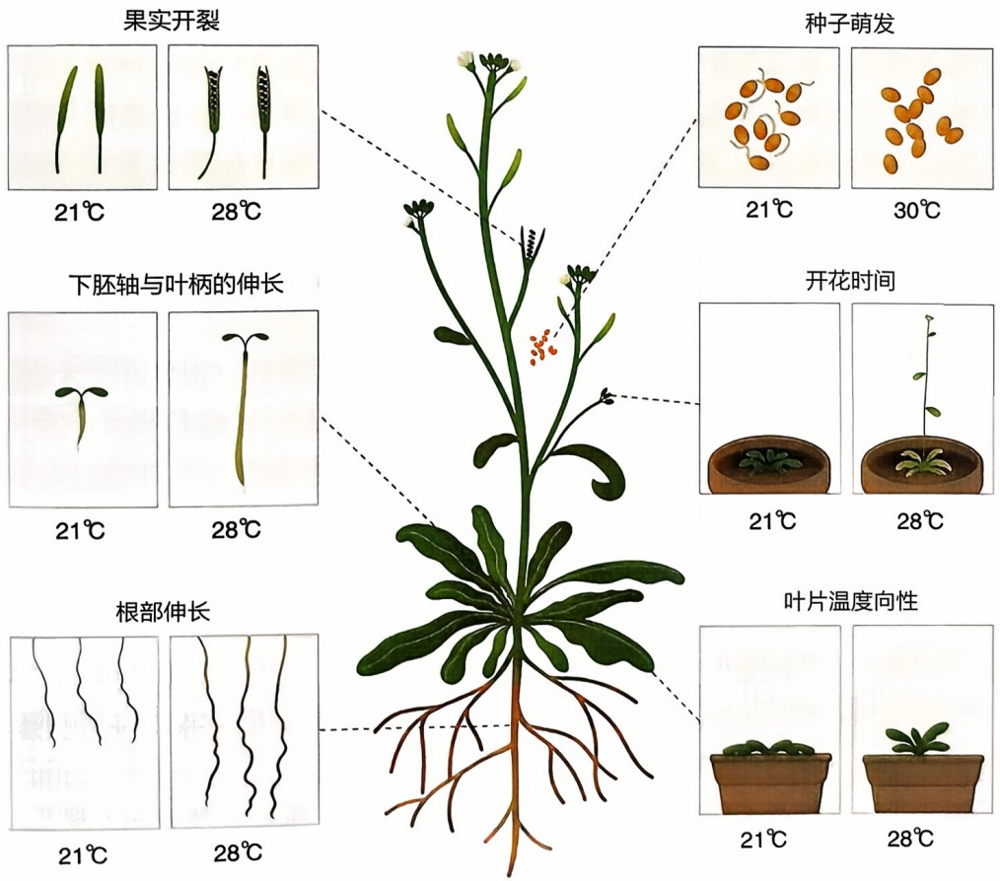

text_image

果实开裂
21℃
28℃
种子萌发
21℃
30℃
下胚轴与叶柄的伸长
21℃
28℃
开花时间
21℃
28℃
根部伸长
21℃
28℃
叶片温度向性
21℃
28℃

图15-14 环境高温对植物结构与发育的影响

---

466

第十五章 植物发育

低温对于植物的影响可以被分为冰点以上的低温和冰点以下的低温。冰点以上的低温影响植物体内的分子运动和各种代谢反应的活性，并且可能导致细胞内的结构改变；冰点以下的低温还可以进一步通过结冰直接对植物造成机械性的细胞结构破坏。与高温相似，一定程度的低温也可以在不导致植物死亡的前提下，诱导植物生长和发育进程的改变或过渡。温带的各类植物在不同生长发育阶段对低温的适应性变化包括种子和芽的休眠、春化作用、温度导致的光周期敏感性变化等。

## 2. 植物的温度响应元件

植物温度形态建成的相关研究发现了多类对温度有所响应的元件，共同构成了植物的温度响应网络。根据植物受温度影响后内部作用方式的变化，温度形态建成中的细胞与分子响应可以分成10类，包括染色质重塑、RNA的可变剪接、分子的异构化、分子的二聚化、基因表达调控、非编码RNA、蛋白质的降解、亚细胞定位变化、转录因子与DNA的相互作用、激素的累积等。

转录因子 PIF4（phytochrome-interacting factor 4）在温度形态建成和调控网络中发挥核心作用。PIF4 整合了上游多种不同信号，将对温度的响应传递到下游，调控了多种生物学过程。温度升高诱导的幼苗下胚轴伸长、叶柄生长以及叶片的热感性生长都依赖于 PIF4。PIF4 通过调控自身结合生长素合成相关等下游基因启动子的能力，调控拟南芥茎干的生长。高温对于植物免疫的抑制也依赖于 PIF4，PIF4 在高温环境下生长与免疫反应的平衡中发挥关键作用。PIF4 可以结合成花过程的整合因子 FT 的启动子，与 22℃ 或 12℃ 相比，27℃ 时的 PIF4 与 FT 启动子的结合增加，从而促进了成花过程的转变，并且这一促进过程是通过温度升高诱导的 H2A.Z 类型核小体占有率的减少而达成的。在拟南芥中，高温可以通过减少表达 SPCH（Speechless）的细胞数量，从而抑制表皮细胞的气孔分化，从而减少叶片的气孔指数（单位面积上气孔数量占表皮细胞总数的比例）。高温可以促使 PIF4 积累在气孔前体细胞中 SPCH 的启动子上，从而抑制 SPCH 的表达。

PIF4 自身受温度诱导的调控发生在不同层面（图 15-15）。其上游的多种转录因子在不同温度下的蛋白质稳定性和活性变化，导致其结合及对 PIF4 的调控发生改变，影响了 PIF4 的转录；组蛋白质的去乙酰化过程也被发现可能在 PIF4 的表达调控中发挥作用。PIF4 的蛋白质稳定性同样受到温度调控，phyB 可以促进 PIF4 的磷酸化和降解，在遮荫反应或升高温度时，phyB 活性的降低导致 PIF4 的稳定性提高。除此之外，PIF4 作为转录因子的转录调控活性也受到温度的调控。DELLA 蛋白可以直接与 PIF4 蛋白的 DNA 结合区域相互作用从而抑制其转录调控的活性，高温可以减少 DELLA 从而解除其对 PIF4 活性的抑制。HFR1（long hypocotyl in far red 1）等蛋白质可以与 PIF4 蛋白形成异源二聚体，形成的二聚体使得 PIF4 无法结合 DNA，高温可以进一步增加 HFR1 的含量。转录因子 SEU（SEUSS）与 PIF4 可以发生直接相互作用并增强 PIF4 与靶基因的结合，这一过程在高温下被增强。

植物温度形态建成以及相应过程中参与的元件众多，涉及染色质的乙酰化以及甲基化、FLM（flowering locus M）的 mRNA 可变剪接、phyB 的分子构象转变、UVR8

---

第三节 可变环境下的植物发育可塑性

467

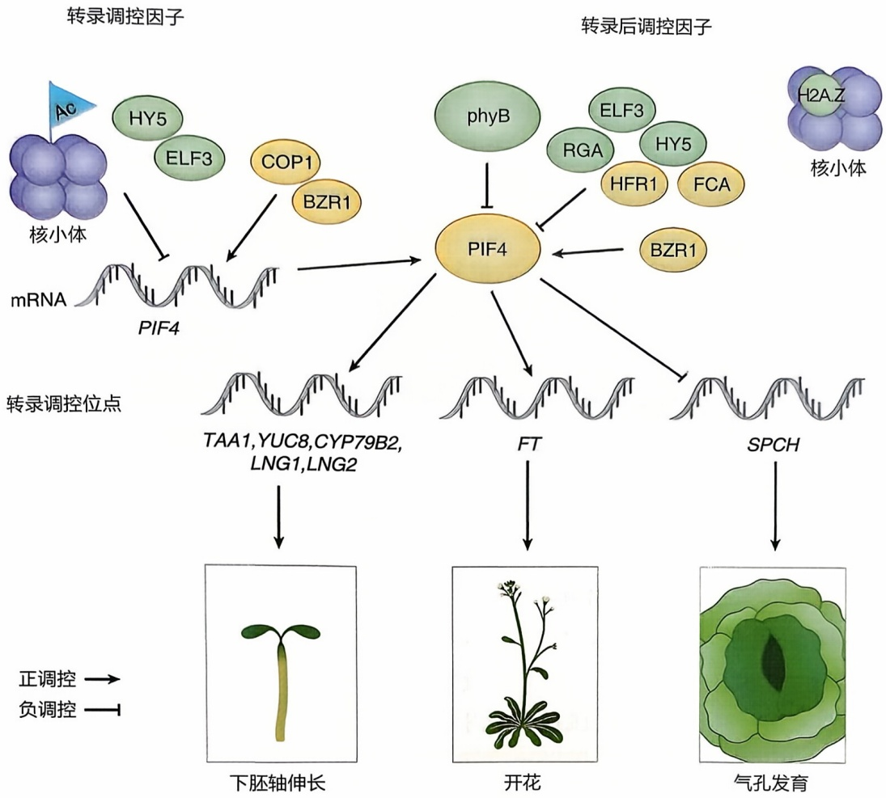

flowchart

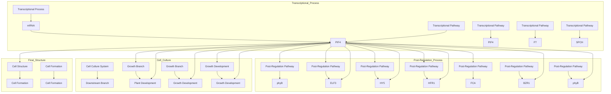

图15-15 温度形态建成的核心转录因子PIF4

的二聚化、PIF4等基因的表达、FLINC（flowering long intergenic noncoding RNA）等的基因表达调控、PIF4等转录因子的降解、COP1（constitutive photomorphogenesis protein 1）等蛋白质的亚细胞定位、ELF3（early flowering 3）等与DNA的结合与解离以及生长素的累积。尽管涉及的元件众多，涵盖多个生物学反应过程，逐渐构成了整个热响应网络，但温度的直接感知机制尚还需进一步明确。近年来，植物中温度的受体被逐渐发现和报道，在植物的温度感知研究中取得了重要突破。

## 3. 植物中的温度感知受体

phyB 是重要的光受体之一，研究发现它也作为热响应元件参与植物对温度的响应。与野生型相比，phyB 突变体在 22～27°C 几乎未出现下胚轴的伸长。这一结果显示缺失 phyB 会导致植物体在该区间的温度形态建成功能缺失。通过模型构建，卡萨尔（Casal）等人发现温度会影响 phyB 在活化状态 Pfr 构象和非活化状态 Pr 构象之间的转化。全长的 phyB 蛋白以二聚体形式存在，由于其活化状态的不同存在 Pfr-Pfr、Pfr-Pr 和 Pr-Pr 三种二聚体形式；温度的升高会促使 phyB 从 Pfr-Pfr 先转化为 Pfr-Pr，再从 Pfr-Pr 转化为 Pr-Pr。Pfr 构象和 Pr 构象可通过红光和远红光调控转化，该过程被称为光逆转。构象转化也可以不依赖于光发生，该过程被称为暗逆转或热逆转（dark reversion/thermal reversion）。高温会促使 phyB 从 Pfr 构象转化为 Pr 构象并进

---

468

第十五章 植物发育

一步驱动植物的温度形态建成，热逆转从Pfr-Pfr状态转化为Pfr-Pr状态的速率以及从Pfr-Pr状态转化为Pr-Pr状态的速率是不同的，后者几乎是前者的100倍。而光对phyB分子状态的影响取决于光质和光强，使得这两步转化的速率是相同的。这也从侧面说明温度和光调控的phyB构象转化机制存在差异。

真核生物细胞内存在大量类似于光小体（photobody）的无膜结构，近年来液-液相分离（liquid-liquid phase separation，LLPS）概念的引入使得研究人员对该类无膜结构有了更深入的理解。2022年的最新研究表明，phyB光小体的形成过程属于液-液相分离，并进一步明确了光小体的组装原则（图15-16A）。phyB的N端NTE（N-terminal extension）是一段固有无序序列，其C端OPM（output module）具有极强的寡聚化能力，可以进行自我聚集，这两段区域促使活化的phyB分子通过液-液相分离过程形成光小体。当phyB处于Pr构象时，NTE的一部分被包埋于GAF（cGMP phosphodiesterase, adenylate cyclase and FhlA）区域。由于构象折叠，整个N端对C端的寡聚能力产生抑制，此时无法形成光小体。而当光活化时phyB会发生构象的改变，NTE从GAF区域被释放出来，由于NTE具有固有无序序列的特性，可以与其他phyB分子的NTE发生弱多价相互作用，进一步解除N端对C端的抑制，使得C端暴露出

来并进一步寡聚化，形成光小体。

A

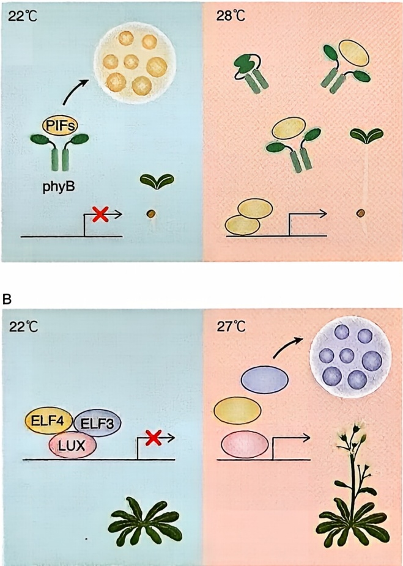

图15-16 植物通过液-液相分离机制整合植物对光与温度的感知

光和温度均能影响phyB光小体的形成与解离，但其机制存在区别。被锁定为Pfr形式的phyB形成光小体的过程不再受光调控，但温度仍会影响其形成与解离；而去除NTE后phyB仍具有形成凝集体的能力，但无法对温度变化做出响应。因此，NTE是phyB感受温度的特异序列，并且NTE对温度的特异性感知建立在形成光小体的基础上。此外，在植物开花的过程中，一个由ELF3/ELF4/LUX蛋白组成的复合体称为夜间复合体（evening complex），在温度调控开花的过程中也是通过液-液相分离机制感受温度变化来调控开花时间（图15-16B）。

水稻是我国重要的粮食作物，起源于热带和亚热带地区。温度是影响水稻品种形成和地域分布的主要环境因子，亚洲栽培稻主要分为粳稻和籼稻，粳稻低温耐受性较强，主要分布于我国北部和东北部，而籼稻低温耐受性较弱，主要分布于我国华南和淮河以南的热带/亚热带地区。粳稻的较强耐寒性是由一个重要基因COLD1决定的，其驯化选择的SNP2等位基因来自于中国野生稻。粳稻特异的SNP2影响了COLD1活性从而得以赋予粳稻耐寒性。包含粳稻COLD1基因的籼稻近等基因系以及过表达COLD1的粳稻材料都显著增强了耐寒性，而功能缺失突变体cold1-1或反义基因株系却对寒冷非常敏

---

第三节 可变环境下的植物发育可塑性

469

感。COLD1编码一个G蛋白的信号调节因子，具有9次跨膜结构域，定位于细胞膜和内质网上，可能作为离子通道或者离子通道的一部分调控细胞中 $\mathrm{Ca^{2+}}$ 浓度。低温处理时，COLD1与G蛋白 $\alpha$ 亚基RGA互作，参与依赖于G蛋白的信号转导，激活 $\mathrm{Ca^{2+}}$ 通道，触发下游耐寒防御反应，而后提高G蛋白的GTP酶活性以平衡G蛋白的动态活性，从而应对低温胁迫。

## 三、植物机械压力接触形态建成

## 1. 植物对机械压力的感知与响应

机械压力在植物的生长周期中广泛存在，例如土壤中的障碍物、昆虫啃食、攀缘生长、风吹雨打等，那么基于固着生长这一特征，植物能否对如此常见的机械刺激做出反应成为值得思考的问题。早在19世纪，达尔文便已发现植物的根系能够自发绕过障碍物，且攀缘生长的植物在感知到固体之后才会确定生长方向等。不仅如此，在植物中也同样存在较为敏感的类型，如含羞草、捕蝇草，这类在触碰反应下能够快速移动叶片的植物，被称为敏感植物。

以捕蝇草为例，在感知到“猎物”存在后，捕蝇夹快速关闭，进而分泌消化液分解“猎物”，那么在这个过程中，捕蝇草通过捕蝇夹内特化的“触摸毛”感知来自昆虫等的触碰，每当触摸毛被触碰一次，便会产生一个动作电位，而此时的捕蝇夹并不会立即关闭，当动作电位的数量达到两个及以上时，该信号便会介导茉莉酸（jasmonic acid）合成，在捕蝇夹关闭的同时产生消化酶。除此之外，在昆虫挣扎时，便会反复触碰触摸毛，刺激多个动作电位的产生，这也给捕蝇草一个“猎物”大小与种类的提示，使其能够根据动作电位的数量，产生相应量级的消化酶（图15-17）。捕蝇草的“捕猎”说明植物能够敏锐地感知触碰等机械压力刺激，并做出相应的反应。

而除了含羞草、捕蝇草等敏感植物外，大部分植物并不会表现出明显的即时触摸反应，在动物中，细胞之间的黏附作用造成的机械应力与早期胚胎发育过程中的形态发生密切相关。而早在20世纪80年代，人们便在植物中发现机械压力能够影响其生长发育。在自然界中风、雨等持续环境信号的刺激下，高等植物会逐渐发生一系列形态变化，这些变化不像含羞草与捕蝇草等敏感植物一样显著且迅速，但这些变化是累积增加的。如图15-18所示，当每天固定给予两次机械压力刺激后，拟南芥会出现非常明显的晚花与矮薹表现。这种机械压力刺激影响植物生长发育的现象，被称为接触形态建成。

为了深入了解植物的接触形态建成机制，人们从受体/感受器、植物激素、下游效应因子等多个方面进行探究，下文分别进行详细介绍。

## 2. 机械敏感的离子通道在受体层面发挥重要功能

捕蝇草的触碰反应机制提供了一个重要启示，电信号可在植物胁迫响应的早期阶段发挥重要功能。离子通道作为电信号产生的重要元件，在植物机械压力响应中同样

---

470

第十五章 植物发育

图15-17 捕蝇草捕获“猎物”反应示意图

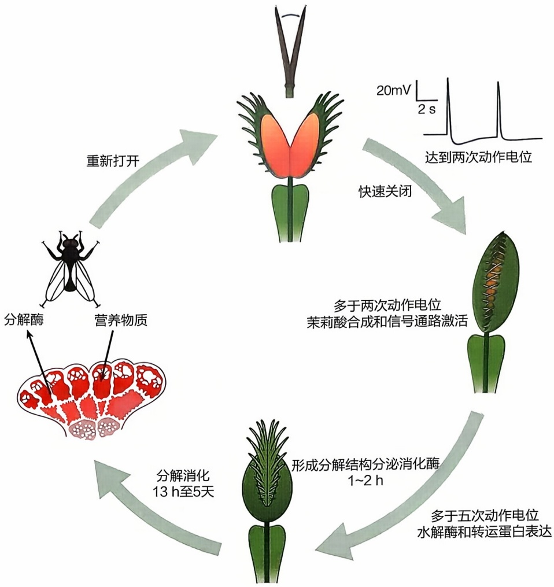

flowchart

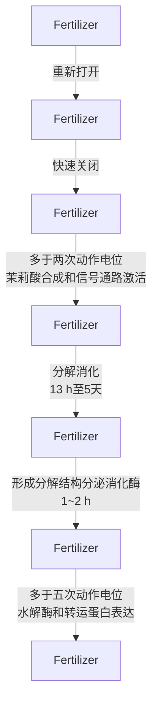

具有重要作用。含羞草触摸反应便与叶柄细胞的钾离子、氯离子及水通道的开放密切相关。而目前多个机械敏感离子通道（mechanosensitive ion channel）被解析，它们在机械压力响应的受体层面发挥重要功能。

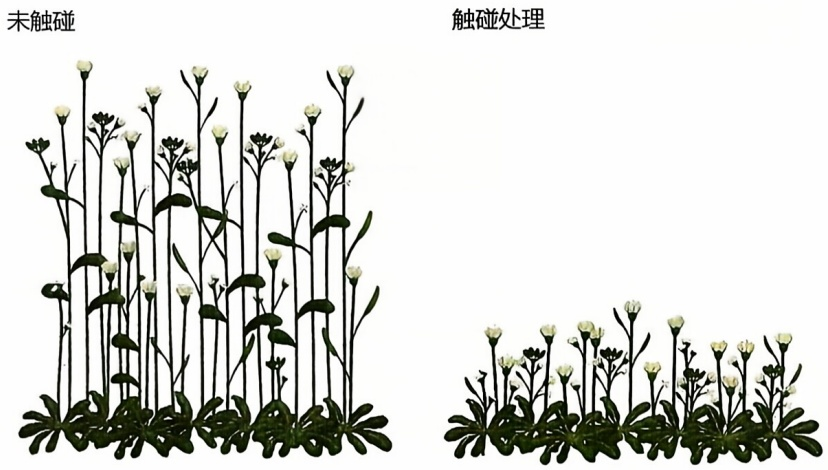

图15-18 拟南芥接触形态建成示意图

在细菌中存在一类感知渗透变化的机械敏感离子通道 MscS（mechanosensitive channel of small conductance），水稻存在 6 个 MscS 的同源基因 MSL（MscS-Like），拟南芥中同样发现了 MSL 蛋白家族。拟南芥 MSL 家族共有 10 个成员，其中 AtMSL2、AtMSL3 与绿藻中 MscS 家族的 MSC1 同源关系较近，也具有与 MSC1 类似的器官发生调控功能。为检验拟南芥 MSL 能否与 MscS 一样作为机械敏感的离子通道，研究人员对主要表达在根尖质膜上的 AtMSL9 与 AtMSL10 进行研究。根尖是植物感受机械压力较为敏感的

---

第三节 可变环境下的植物发育可塑性

471

组织，通过制备根部细胞的原生质体进行膜片钳检测，证实 AtMSL9/10 在机械压力刺激下能够通透钙离子，是机械敏感的钙离子通道，两者的双缺突变体会出现钙电流异常。这也是首次在植物中发现的机械敏感离子通道。

酵母 MID1 具有钙离子通道活性，其基因突变体 mid1 对拉伸不敏感。MID1 因此被认为是机械敏感的钙离子通道。在 mid1 酵母细胞中异源表达一个拟南芥基因能够回补其缺陷，该基因因此被命名为 MCA1（MID1-complementing activity1）。拟南芥 mca1 突变体根部穿透能力减弱，难以从低浓度琼脂培养基穿透到高浓度琼脂培养基中，说明了 MCA1 可能参与拟南芥根部对于机械压力的感知。后续膜片钳实验证实 MCA1 是质膜上可以被细胞拉伸形变激活的钙离子通道。通过基因组序列比对，具有高度相似的序列与结构特征，以及类似生理功能和突变表型的拟南芥 MCA2 也被发现（图 15-19）。

2021 年阿德姆·帕塔普蒂安（Ardem Patapoutian）教授因发现机械敏感的离子通道 Piezo 获得诺贝尔生理学或医学奖。Piezo 在希腊语中意为 “压力”，研究表明 Piezo1 参与血管发育、骨骼生长与修复、呼吸过程等，而 Piezo2 则帮助我们 “触摸世界”，与触觉感知密切相关。值得一提的是，Piezo1 在结构上具有三个 “螺旋桨片”，未受力情况下弯曲成碗状，当细胞受到机械压力刺激时，“螺旋桨片” 利用杠杆支撑原理延展成片状，带动中心孔道的打开。植物中同样存在 Piezo 同源蛋白，该蛋白质定位在液泡膜而非质膜上，能因液泡膜本身更大的运动自由度而更好地发挥功能。拟南芥 AtPiezo1 主要表达在根部及花粉粒中，作为阳离子通道在机械压力感知中发挥重要作用。此外，拟南芥中还发现了哺乳动物 TMEM16 同源的 OSCA 蛋白等更多机械敏感离

图 15-19 拟南芥潜在的机械敏感离子通道示意图

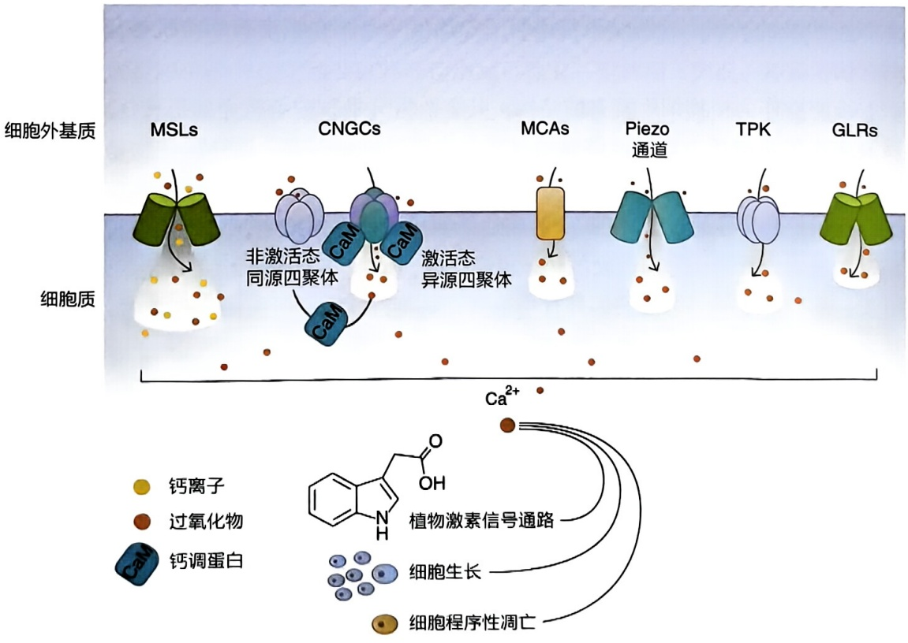

flowchart

This diagram illustrates the cellular mechanism of calcium ion transport in a plant, showing how calcium is oxidized by various proteins (MSLs, CNGCs, MCAs, Piezo, TPK, GLRs) and subsequently released into cells.

---

472

第十五章 植物发育

子通道。这些研究逐渐揭开植物对于机械压力感知的面纱，为更好地了解植物自身发育及环境适应性提供更多线索。

## 3. 植物接触形态建成响应因子

前文提到，高等植物在受到风、雨等持续环境刺激下，会发生逐渐的形态变化，该变化随着机械压力刺激时间而逐渐积累，那么植物是如何通过体内信号转导将机械压力刺激转化为最终的形态学变化，是解析接触形态建成的重要内容。除却上文对植物机械压力感知层面进行的简要介绍，下游的响应因子同样发挥重要功能。

乙烯（ethylene）作为唯一已知的植物气体激素，在果实成熟、叶片以及下胚轴发育中发挥重要功能，而乙烯易于扩散的特征也提示其对于植物抗逆响应中的重要作用。当拟南芥幼苗受到乙烯处理时，会呈现十分典型的“三重反应”（triple response），分别是下胚轴与根的伸长受到抑制，下胚轴变粗以及顶端弯钩加剧，这些反应能够使植物在遇到刺激时合理地承受及规避伤害。

早期研究表明，豌豆幼苗在遭受机械压力刺激时，会产生乙烯，导致下胚轴变短变粗，以应对机械压力对植株造成的损伤，且机械压力刺激越强，该反应越明显。除此之外，植物根系的机械压力响应同样与乙烯信号密切相关。当拟南芥根部在穿透不同浓度的琼脂培养基时，若下层硬度增加，根部穿透过程中乙烯合成量明显增加。除此之外，当乙烯的合成量增多时，根部能够穿透上下层交界面进入下层培养基，而当乙烯合成量减少时，拟南芥根部倾向于在上下层交界面上弯曲打圈，无法向下穿透。在拟南芥中，EIN3（ethylene insensitive 3）是乙烯信号通路中重要的转录因子，当使用砂土模拟自然界的出土环境时，EIN3蛋白的表达水平随着覆土厚度的增加明显升高，该过程同样伴随着乙烯含量的升高，相应的，ein3 eil1突变体出土能力相较野生型有明显的减弱。这些结果都说明了乙烯信号通路在拟南芥幼苗机械压力响应上的作用。

细胞壁作为植物细胞特有的结构，其重要组分果胶的结构受到机械压力的调节，反复多次的机械压力刺激能够逐渐改变细胞壁的机械强度，最终使植物呈现出接触形态建成的表型。拟南芥中编码多聚半乳糖醛酸的PGX3（ploygalacturonase involved expansion 3）介导此过程，PGX3的表达受到机械压力的抑制，且野生型拟南芥幼苗在机械压力刺激下，细胞壁硬度明显提高，而pgx3突变体显示出组成型增强的表型，不仅如此，该过程是可逆的，只有当拟南芥幼苗持续受到机械压力刺激时，PGX3表达水平及酶活长时间处于抑制状态，下胚轴细胞的伸长才会呈现明显的抑制反应。进一步研究显示，在PGX3的上游，乙烯起到重要调控作用，EIN3蛋白能够直接结合PGX3的启动子区域，抑制PGX3转录。该机制揭示了植物在机械压力刺激下，如何进行细胞可塑性的调整，确保幼苗在生长和出土期间的适应性，实现幼苗出土存活（图15-20）。

除了乙烯信号对于拟南芥幼苗接触形态建成中的重要作用外，茉莉酸、赤霉素、生长素等植物激素在植物成苗接触形态建成反应中均发挥重要功能。植物激素茉莉酸在抗逆反应中常常被提及，在茉莉酸介导的损伤响应中，受到调控的标志基因与机械

---

第三节 可变环境下的植物发育可塑性

473

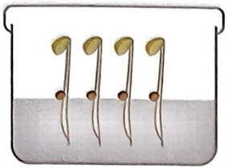

natural_image

Illustration of four seeds in a container with liquid, no text or symbols present

高皿 顶端无机械压力（D）

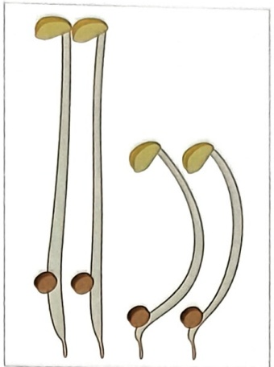

natural_image

Illustration of seedling structures with two curved arms and two brown seed pods (no text or labels)

D S

WT

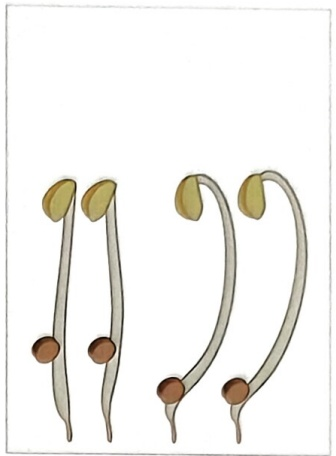

natural_image

Illustration of seed pods with brown seeds and yellow caps, no text or symbols present

D S

pgx3

图 15-20 暗环境下生长的拟南芥幼苗的接触形态建成

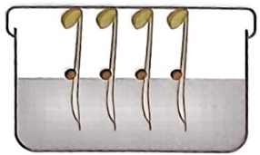

natural_image

Illustration of four seeds suspended in a container with liquid, no text or symbols present

矮皿 顶端有机械压力（S）

压力响应中的标志基因具有较大的重合，因而人们认为茉莉酸同样参与调控植物接触形态建成。其中机械压力响应标志基因 $TCH2/4$ （touch 2/4）同样在茉莉酸信号通路的下游，CAMTA1/2/3（calmodulin-binding transcriptional activator 1/2/3）作为茉莉酸介导的机械压力响应过程中的核心转录因子，能够直接结合在 $TCH2/4$ 的启动子区域，调控其表达，而 camta3 突变体基本缺失接触形态建成的表型，且在持续机械压力刺激下，未表现出明显的晚花。同样的，拟南芥茉莉酸合成相关酶 AOS（allene oxide synthase）突变体 aos 在受到持续机械压力刺激后，并未呈现出如野生型 gl-1 类似的晚花与矮薹表现，而过表达茉莉酸合成酶 OPR3（oxophytodienoate reductase 3）时，拟南芥成苗呈现出组成型激活的接触形态建成表型。以上内容均能够说明茉莉酸在拟南芥成苗的接触形态建成过程中发挥重要作用。此外，赤霉素与生长素含量在成苗接触形态建成过程中的分枝增加及腋芽活性增加也具有一定作用。因此，拟南芥等植物的确能够通过一系列反应对机械压力刺激作出响应，调整其生长发育，适应复杂多变的外界环境。

## 名词窗 15-2

光形态建成（photomorphogenesis）:植物对光的最初反应，茎和根分生组织被激活，通过细胞分裂和扩张等一系列变化导致植物细胞的分化、结构和功能改变，最终表现为组织和器官的建成。

泛素（ubiquitin）:一种广泛存在于真核生物中的小蛋白质，由76个氨基酸组成，标记需要分解掉的蛋白质，最终被泛素标记的蛋白质会被26S蛋白酶体降解。

26S 蛋白酶体（26S proteasome）:真核细胞中负责调控蛋白质降解的主要蛋白质降解机器，因整个复合物的沉降系数是 26S 而得名，特异性地降解被泛素化标记的蛋白质。

受体（receptor）:能够直接感受外界环境变化并通过改变自身性质将外界变化传递给生物体内部其他组分的物质。

---

474

第十五章 植物发育

温度形态建成（thermomorphogenesis）；植物应对环境温度变化，在生长和发育方面发生特定形态改变的过程。

热抑制（thermolinhibition）:高温对拟南芥等植物种子萌发的抑制作用。

温度感受器 / 温度感知受体（thermosensor）:生物体内能够接收特定温度或温度变化的刺激，并将其转换为可识别分子信号的分子。

液-液相分离（liquid-liquid phase separation, LLPS）:二元或多元混合物在一定条件下可以分离为不同的相，这种物理化学现象被称为相分离（phase separation）；当互相分离的两种或多种相都是液体时，这种现象被称为液-液相分离。相分离是一种高度动态的现象，生物大分子的液-液相分离对于生物体中多种无膜结构等功能组分的组织形成与生理功能具有重要作用。

光转换（photoconversion）:光敏色素（phytochrome）存在活化状态的Pfr构象（远红光吸收型，far-red light-absorbing form）和非活化状态的Pr构象（红光吸收型，red light-absorbing form）两种构象，两种构象之间可以通过红光和远红光的调控发生转换。

暗逆转 / 热逆转（dark reversion/thermal reversion）:区别于依赖于光的光转换，光敏色素可以通过不依赖于光的过程从活化状态的 Pfr 构象失活为非活化状态的 Pr构象。光敏色素的 Pfr 构象在黑暗中仍然可以缓慢逆转失活为 Pr 构象，这个过程不依赖于光，因此被称为“暗逆转”，这一术语被广泛使用；而“热逆转”更准确地描述了不依赖于光但受温度调控的 Pfr 失活（或称松弛，relation）的过程，这种松弛过程不仅发生在黑暗中，也可以发生在光中。

光小体（photobody）:光敏色素从 Pr 状态活化为 Pfr 状态后，会发生从细胞质向细胞核的转移，并在细胞核内形成点状结构，这种点状结构的形成一般依赖于光，被称为光小体。

接触形态建成（thigmomorphogenesis）:机械刺激影响植物生长发育的现象。

机械敏感离子通道（mechanosensitive ion channel）:一类由膜整合蛋白组成的门控离子通道，能够将细胞外的牵张、压力、重力、渗透压变化、病原体入侵和细胞自身因细胞分裂和生长产生的机械力等信息转化为电化学信号。

乙烯（ethylene）:植物激素，由甲硫氨酸在供氧充足的条件下转化而成的有机化合物。

三重反应（triple response）:乙烯诱导的植物生物学效应，分别是下胚轴与根的伸长受到抑制，下胚轴变粗以及顶端弯钩加剧。

茉莉酸（jasmonic acid）:植物激素，脂肪酸衍生物，高等植物体内的内源生长调节物质。

## ※ 复习思考题

1. 植物的双受精有怎样的生物学意义？
2. 植物发育和动物发育有哪些差异？
3. 以叶片发育为例，思考基因表达如何改变细胞和器官形态？
4. 光敏色素 B 作为植物光照和温度的共受体，如何区分感知两种环境信号？
5. 如何利用遗传学的方法筛选鉴定植物机械压力信号通路的功能组分？

---

推荐阅读

475

## ※ 推荐阅读

1. GE Z, BERGONCI T, ZHAO Y, et al. Arabidopsis pollen tube integrity and sperm release are regulated by RALF-mediated signaling [J]. Science, 2017(358): 1596–1600.
2. LIU J, WU M, LIU C. Cereal endosperms: development and storage product accumulation [J]. Annu. Rev. Plant Biol., 2022(73): 255–291.
3. REINHARDT D, MANDEL T, KUHLEMEIER C. Auxin regulates the initiation and radial position of plant lateral organs [J]. Plant Cell, 2000(12): 507–518.
4. COEN E, MEYEROWITZ E. The war of the whorls: genetic interactions controlling flower development [J]. Nature, 1991(353): 31–37.
5. KOINI M A, ALVEY L, ALLEN T, et al. High temperature-mediated adaptations in plant architecture require the bHLH transcription factor PIF4 [J]. Curr. Biol., 2009(19): 408-413.
6. SHI H, LYU M, LUO Y, et al. Genome-wide regulation of light-controlled seedling morphogenesis by three families of transcription factors [J]. Proc Natl Acad Sci U S A, 2018(115): 6482–6487.
7. WU Q, LI Y, LYU M, et al. Touch-induced seedling morphological changes are determined by ethylene-regulated pectin degradation [J]. Sci. Adv., 2020, 6: eabc9294.
8. WANG Z, WANG W, ZHAO D, et al. Light-induced remodeling of phytochrome B enables signal transduction by phytochrome-interacting factor [J]. Cell, 2024(187): 1–16.

（编写:邓兴旺、李磊、焦雨铃、钟上威、何光明；审读:王学路）
