# 第十六章 细胞死亡的分子机制

原始 PDF 第 492–512 页。

# 第十六章

# 细胞死亡的分子机制

细胞凋亡、程序性坏死和焦亡是3种由基因编程和调控的细胞死亡形式。这些分子机制的激活会导致不同形式的细胞死亡。半胱天冬酶（caspase）在调节3种细胞死亡形式中发挥着核心作用。在细胞凋亡中，半胱天冬酶家族的级联式激活介导了细胞自杀的全过程，包括信号转导、细胞损毁和凋亡小体的清除。在炎症情况下，半胱天冬酶剪切GSDM家族蛋白质，从而导致膜孔的形成以释放成熟的IL-1β。在某些外来病原入侵的情况下，这些GSDM家族蛋白质剪切后造成的大量膜孔可以介导细胞焦亡（一种坏死性细胞死亡）。此外，caspase-8可以直接剪切RIPK1来促进细胞凋亡并抑制程序性坏死。在半胱天冬酶缺乏的条件下，RIPK1的活化会促进和下游RIPK3的结合以及坏死小体的形成，RIPK3进而导致MLKL活化来介导细胞程序性坏死。除了激活细胞凋亡、程序性坏死或者焦亡而导致的细胞自杀之外，破坏细胞稳态可以直接造成细胞非自主死亡——“它杀”。细胞内存在着多种调控机制来维持细胞稳态，例如离子和氧化还原平衡、各种细胞膜和细胞器的完整性、溶酶体和蛋白酶体的稳定等。当细胞稳态受到破坏时可以直接导致细胞死亡，例如兴奋性毒性、铁死亡和溶酶体细胞死亡。因此，细胞也可以在存活机制被破坏时死亡，而无需调用基因编程和控制的细胞主动死亡机制。

---

第十六章 细胞死亡的分子机制

477

细胞凋亡和坏死是两种形态学特征截然不同的细胞死亡类型。细胞凋亡的形态学特征是细胞膜保持完整性，同时细胞质和细胞核发生浓缩；而细胞坏死的形态学特征则是细胞膜的破坏和由于细胞膜破坏后造成的细胞质稀释。

细胞凋亡受进化中高度保守的遗传程序所调控。细胞凋亡的核心调控因子是在秀丽隐杆线虫 C. elegans 的研究中首先被发现，其中包括 Egl-1、Ced-9、Ced-3 和 Ced-4 等。这些细胞凋亡的核心调控因子在从无脊椎动物到脊椎动物的基因组中都是高度进化保守的。CED-3 是 C. elegans 中激活程序性细胞死亡所需的唯一半胱天冬酶，而高等生物的基因组编码了多种半胱天冬酶。例如哺乳动物小鼠基因组编码了 11 种半胱天冬酶，而人类基因组编码了 13 种半胱天冬酶（图 16-1）。哺乳动物基因组编码的 Bcl-2 是秀丽隐杆线虫 Ced-9 的同源基因产物。Bcl-2 的高表达可以通过促进细胞存活而不是细胞增殖来导致癌症的发生。

细胞坏死传统上被认为是一种被动且不受调控的细胞死亡形式。然而2005年以来的突破性发现表明，哺乳动物和高等脊椎动物基因组编码的一些关键基因产物，包括ripk1（receptor interacting protein kinase 1）、ripk3（receptor interacting protein kinase 3）和mlkl（mixed lineage kinase domain like pseudokinase），介导了一种称为程序性坏死（necroptosis）的细胞死亡。此外，研究还发现caspase不仅可以介导细胞凋亡，还可以介导一种称为焦亡（pyroptosis）的细胞坏死。

细胞凋亡、程序性坏死和焦亡是由细胞主动调控的死亡形式，因为其细胞死亡过

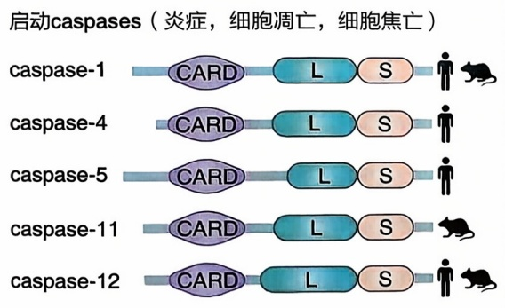

<details>
<summary>flowchart</summary>

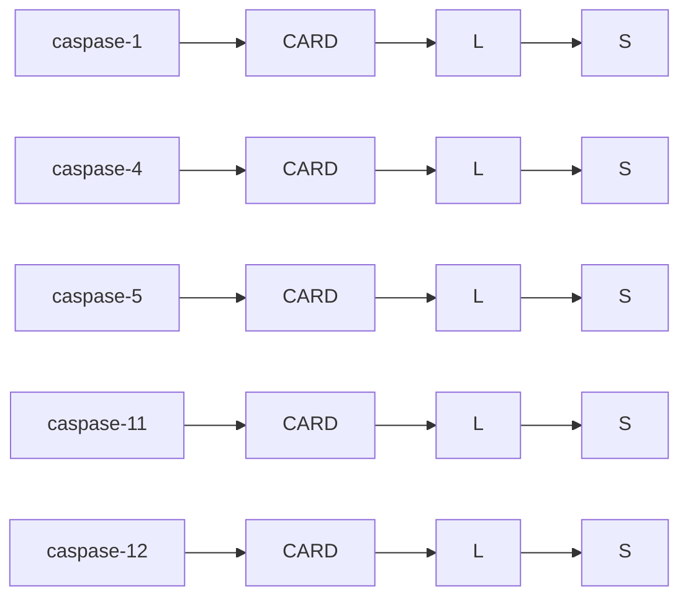
</details>

下游效应caspases（细胞凋亡）

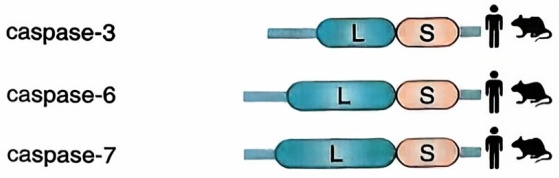

<details>
<summary>text_image</summary>

caspase-3
caspase-6
caspase-7
</details>

启动caspases（细胞凋亡，细胞焦亡）

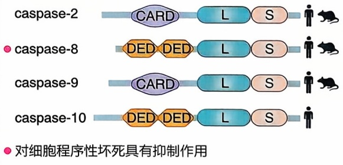

<details>
<summary>text_image</summary>

caspase-2
CARD L S
caspase-8
DED DED L S
caspase-9
CARD L S
caspase-10
DED DED L S
●对细胞程序性坏死具有抑制作用
</details>

启动caspases（细胞凋亡，细胞焦亡）

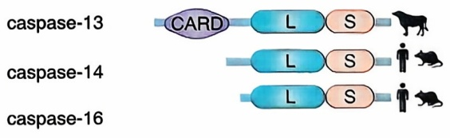

<details>
<summary>flowchart</summary>

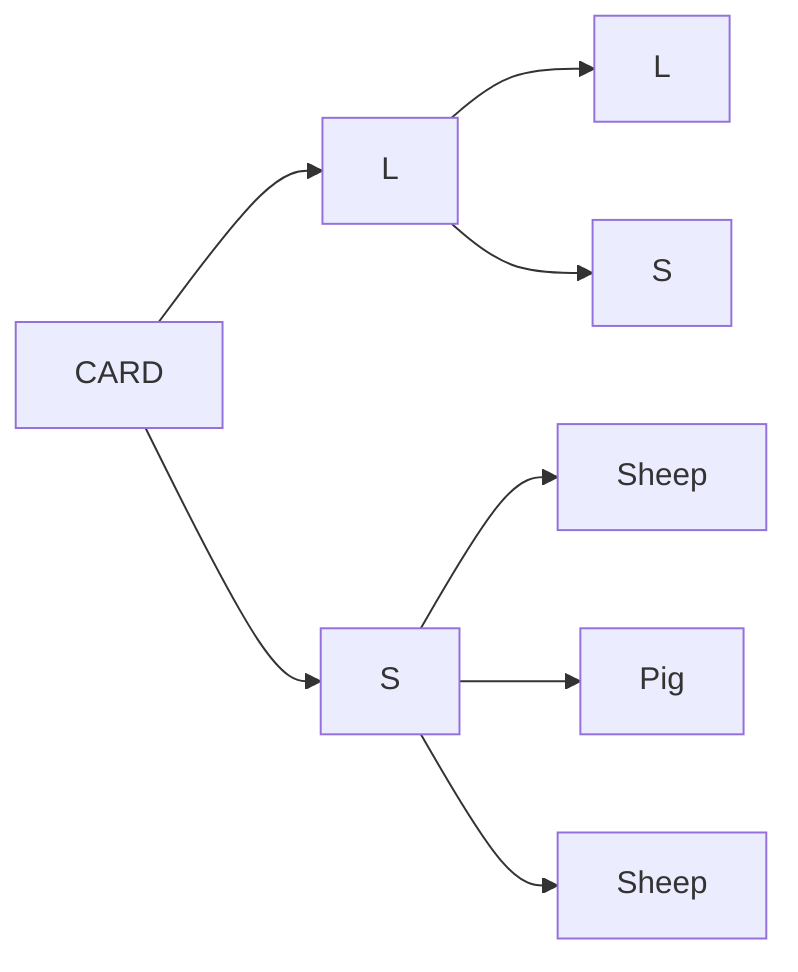
</details>

图16-1 caspase家族蛋白质

CARD
caspase募集结构域

DED
死亡效应结构域

L
大催化亚基

S
小催化亚基

caspase是根据其前结构域长度（短或长）和序列特征、caspase募集结构域（CARD）或死亡效应结构域（DED）以及功能（起动caspase或下游caspase）进行分类的。caspase-8对抑制细胞程序性坏死的发生具有重要作用。

---

478

第十六章 细胞死亡的分子机制

程都需要激活特定的死亡基因及其调控的细胞死亡程序。此外，细胞也可以由于破坏关键存活机制而被动地死亡。这些关键存活机制的主要功能是调节细胞稳态，而不是调控细胞死亡。细胞质膜完整性的破坏、兴奋毒性、错误折叠蛋白质的累积、过度的氧化应激反应和细胞抗脂质过氧化机制失活而导致的铁死亡等，都是由于细胞稳态被破坏造成的细胞被动性死亡。因此，哺乳动物细胞死亡的发生可以通过激活基因编辑的程序性细胞死亡机制，包括细胞凋亡、程序性坏死和焦亡，或者由破坏细胞稳态和存活机制而导致的被动性死亡。

在本章中，我们将首先概述3种由死亡基因编程调控的细胞程序性死亡形式，包括caspase介导的细胞凋亡和焦亡，以及由RIPK1、RIPK3和MLKL介导的程序性坏死。然后我们将介绍由于破坏细胞稳态而导致的细胞被动性死亡的例子（如兴奋性毒性、铁死亡和溶酶体破裂造成的细胞死亡），以及这些细胞被动死亡形式与基因编程的细胞程序性死亡机制之间的联系。最后，我们将简要介绍不同细胞死亡模式在人类疾病中的作用。

## 第一节 基因编程的细胞死亡机制

在本节中，我们将描述3种不同类型的细胞程序性死亡形式:细胞凋亡、程序性坏死和焦亡。这3种死亡形式都是通过活化基因编程的细胞死亡机制来介导的细胞自杀。

## 一、细胞凋亡

哺乳动物的细胞凋亡（apoptosis）受 caspase 家族和 Bcl-2 家族蛋白质的调控。细胞凋亡可分为内源性细胞凋亡和外源性细胞凋亡，其不同之处在于细胞凋亡触发的方式。外源性细胞凋亡的触发是由位于细胞质膜上的死亡受体（TNFR1 死亡受体家族）的激活，而内源性细胞凋亡是在没有死亡受体参与的情况下触发的（图 16-2）。

## 1. 内源性细胞凋亡

内源性细胞凋亡（intrinsic apoptosis）可以在细胞损伤和某些应激条件下被激活，如DNA损伤、生长因子缺失或线粒体损伤等（图16-2）。Bcl-2蛋白家族是内源性细胞凋亡的关键上游调节因子。Bcl-2蛋白家族（包括促凋亡和抗凋亡家族成员）的显著性特征是含有1\~4个Bcl-2同源结构域（BH结构域）（图16-3）。Bcl-2抗凋亡蛋白的高表达会抑制内源性细胞凋亡通路的激活。抗凋亡蛋白Bcl-2、Bcl-xL或Mcl-1的基因敲除小鼠具有致病或致死的表型，提示内源性细胞凋亡途径在机体发育中的重要性。当细胞受到DNA损伤、氧化应激、营养剥夺等情况时，BH3-only蛋白（如BIM、BID和PUMA）会在转录和翻译水平上被激活，将上游促凋亡信号转导到线粒体上，并驱动线粒体外膜通透性（mitochondrial outer membrane permeability，MOMP）的改变（图16-2）。在这个过程中，BH3-only蛋白利用其BH3结构域来抑制抗凋亡

---

第一节 基因编程的细胞死亡机制

479

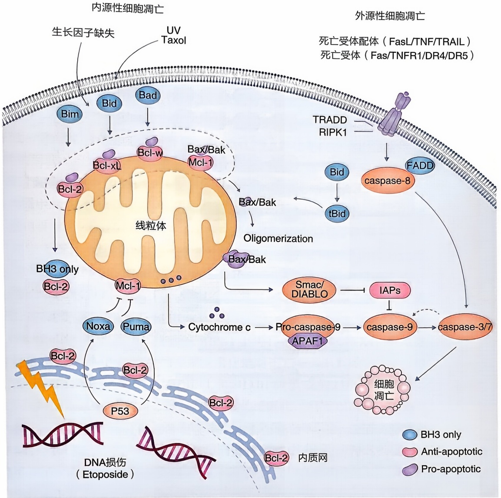

<details>
<summary>flowchart</summary>

```mermaid
graph TD
  subgraph InternalSourceCellDeath
  A["Bim"] --> B["Bid"]
  C["Bcl-xL"] --> D["Bcl-w"]
  E["Bcl-2"] --> F["BH3 only"]
  G["Mcl-1"] --> H["Noxa"]
  I["Puma"] --> J["Bcl-2"]
  K["P53"] --> L["Bcl-2"]
  M["DNA损伤 (Etoposide)"] --> N["Bcl-2"]
  O["Bcl-2"] --> P["Bcl-2"]
  Q["Bcl-2"] --> R["Bcl-2"]
  S["Bcl-bak"] --> T["Bax/Bak"]
  U["Oligomerization"] --> V["Bax/Bak"]
  W["TRADD RIPK1"] --> X["FADD"]
  Y["IAPs"] --> Z["caspase-9"]
  AA["caspase-3/7"] --> AB["细胞凋亡"]
  end

  subgraph ExternalSourceCellDeath
  AC["Bid"] --> AD["tBid"]
  AE["TADD RIPK1"] --> AF["caspase-8"]
  AG["FADD"] --> AH["caspase-8"]
  AI["IAPs"] --> AJ["caspase-9"]
  AK["Caspase-3/7"] --> AL["caspase-9"]
  AM["Caspase-9"] --> AN["caspase-9"]
  AO["Caspase-9"] --> AP["Caspase-9"]
  AR["Caspase-9"] --> AS["Caspase-9"]
  AT["Caspase-9"] --> AU["Caspase-9"]
  AV["Caspase-9"] --> AW["Caspase-9"]
  AX["Caspase-9"] --> AZ["Caspase-9"]
  BA["Caspase-9"] --> AC
  BA --> AD
  BA --> AE
  BA --> AF
  BA --> AG
  BA --> AH
  BA --> AI
  BA --> AJ
  BA --> AK
  BA --> AL
  BA --> AM
  BA --> AN
  BA --> AU
  BA --> AV
  BA --> AW
  BA --> AX
  BA --> AY
  BA --> AZ
  BA --> AY
  BA --> AZ
  end

  subgraph InternalSourceCellDeath
    AC -.->|UV Taxol| Bim
    Bim -.->|生长因子缺失| Bld
    Bld -.->|UV Taxol| Bad
  end

  subgraph ExternalSourceCellDeath
    AE -.->|TRADD RIPK1| AF
    AF -.->|TRADD RIPK1| AF
    AF -.->|TRADD RIPK1| AF
  end

  subgraph InternalSourceCellDeath
    AY -.->|Anti-apoptotic| AF
    AY -.->|Anti-apoptotic| AF
    AY -.->|Anti-apoptotic| AF
  end

  subgraph ExternalSourceCellDeath
    AY -.->|Pro-apoptotic| AF
    AY -.->|Pro-apoptotic| AF
  end

  subgraph InternalSourceCellDeath
    Bcl-xL -.->|Anti-apoptotic| Bcl-xL
    Bcl-xL -.->|Anti-apoptotic| Bcl-xL
    Bcl-xL -.->|Anti-apoptotic| Bcl-xL
    Bcl-xL -.->|Anti-apoptotic| Bcl-xL
  end

  subgraph InternalSourceCellDeath
    Bcl-w -.->|Anti-apoptotic| Bcl-w
    Bcl-w -.->|Anti-apoptotic| Bcl-w
    Bcl-w -.->|Anti-apoptotic| Bcl-w
    Bcl-w -.->|Anti-apoptotic| Bcl-w
  end

  subgraph InternalSourceCellDeath
    Bcl-2 -.->|Anti-apoptotic| Bcl-2
    Bcl-2 -.->|Anti-apoptotic| Bcl-2
    Bcl-2 -.->|Anti-apoptotic| Bcl-2
  end

  subgraph InternalSourceCellDeath
    BH3 only -.-> Mcl-1
    BH3 only -.-> Mcl-1
    BH3 only -.-> Mcl-1
  end

  subgraph InternalSourceCellDeath
    SMAC/DIABLO -.-> Smac/DIABLO
    SMAC/DIABLO -.-> SMAC/DIABLO
  end

  subgraph InternalSourceCellDeath
    Cytochrome c. ..-> Pro-caspase-9 / APAF1
  end

  subgraph InternalSourceCellDeath
    Cytochrome c. ..-> Cytochrome c. ..-> Pro-caspase-9 / APAF1
  end

  subgraph InternalSourceCellDeath
    Cytochrome c. ..-> Cytochrome c. ..-> Pro-caspase-9 / APAF1
  end

  subgraph InternalSourceCellDeath
    Cytochrome c. ..-> Cytochrome c. ..-> Pro-caspase-9 / APAF1
  end

  subgraph InternalGroupCellDeath
    Cyp40_1_1_1_1_1_1_1_1_1_1_1_1_1_1_1_1_1_1_1_1_1_1_1_1_1_1_1_1_1_1_1_1_1_1_1_1_1_1_1_1_1_1_1_1_1_1_1_1_1_1_2
  end

  subgraph InternalGroupCellDeath
  Cyp40_2_2_2_2_2_2_2_2_2_2_2_2_2_2_2_2_2_2_2_2_2_2_2_2_2_2_2_2_2_2_2_2_2_2_2_2_2_2_2_2_2_2_2_2_2_2_2_2_2_2_3
  Cyp40_3_3_3_3_3_3_3_3_3_3_3_3_3_3_3_3_3_3_3_3_3_3_3_3_3_3_3_3_3_3_3_3_3_3_3_3_3_3_3_3_3_3_3(II)
  Cyp40_4_4_4_4_4_4_4_4_4_4_4_4_4_4_4(III)_II

  subgraph InternalGroupCellDeath
  Cyp40_Cap -- "DNA损伤 (Etoposide)" --> Cyp40_Cap -- "内质网" --> Cyp40_Cap -- "内质网" --> Cyp40_Cap -- "内质网" --> Cyp40_Cap -- "内质网" --> Cyp40_Cap -- "内质网" --> Cyp40_Cap -- "内质网" --> Cyp40_Cap -- "内质网" --> Cyp40_Cap -- "内质网" --> Cyp40_Cap --"内质网" --> Cyp40_Cap --"内质网" --> Cyp40_Cap --"内质网" --> Cyp40_Cap --"内质网" --> Cyp40_Cap --"内质网" --> Cyp40_Cap --"内质网" --> Cyp40_Cap --"内质网" --> Cyp40_Cap --"内质网" --> Cyp47_Cap --"内质网" --> Cyp47_Cap --"内质网" --> Cyp47_Cap --"内质网" --> Cyp47_Cap --"内质网" --> Cyp47_Cap --"内质网" --> Cyp47_Cap --"内质网" --> Cyp47_Cap --"内质网" --> Cyp47_Cap --"内质网"<nl>  Cyp47_Cap -- "内质网" --> Cyp47_Cap -- "内质网" --> Cyp47_Cap -- "内质网" --> Cyp47_Cap -- "内质网" --> Cyp47_Cap -- "内质网" --> Cyp47_Cap -- "内质网" --> Cyp47_Cap -- "内质网" --> Cyp47_Cap -- "内质网" --> Cyp47_Cap -- "内部网" --> Cyp47_Cap -- "内部网" --> Cyp47_Cap -- "内部网" --> Cyp47_Cap -- "内部网" --> Cyp47_Cap -- "内部网" --> Cyp47_Cap -- "内部网" --> Cyp47_Cap -- "内部网" --> Cyp47_Cap -- "内部网" --> Cyp47_Cap -- "内部网" --> NA["N/A"]
```
</details>

图 16-2 内源性和外源性细胞凋亡

外源性细胞凋亡是通过配体（如 TNFα、FasL 和 TRAIL）激活其对应的、定位于细胞质膜上的死亡受体（如 TNFR1、Fas 及 TRAIL 的受体 DR4 和 DR5）来介导的。内源性细胞凋亡则是由于生长因子缺失、线粒体损伤和 DNA 损伤而被激活的。Bcl-2 家族中 BH3-only 蛋白的激活，例如 Noxa 和 Puma 的转录诱导、Bad 和 Bim 的翻译后修饰以及 Bid 的剪切；通过灭活促生存的 Bcl-2 家族成员，例如 Bcl-2、Bcl-xL 和 Mcl-1，以及激活促凋亡 Bcl-2 家族成员，例如 Bax 和 Bak 来促进线粒体损伤。线粒体损伤导致细胞色素 c 和 SMAC/DIABLO 的释放，从而促进 APAF1 介导的 caspase-9 激活。激活的 caspase-9 依次剪切下游的 caspase（caspase-3 和 caspase-7）以介导内源性细胞凋亡的执行。激活的 caspase-3 和 caspase-7 可以反馈激活上游 caspase 进行，从而放大 caspase 级联反应。

TNFR1（TNF receptor 1）:TNF受体蛋白1；Fas（CD95）:肿瘤坏死因子家族的I型跨膜受体，可与其配体FasL（CD95L）结合；TRAIL:肿瘤坏死因子（TNF）相关的凋亡诱导配体，可与其受体DR4（死亡受体4）和DR5（死亡受体5）结合；BH3:Bcl-2 homology 3；Bcl-2:B-cell lymphoma 2；Mcl-1:myeloid leukemia 1；Noxa:latin for damage；Puma:p53 upregulated modulator of apoptosis；Bad:Bcl-2 associated agonist of cell death；Bak:Bcl-2 antagonist/killer 1；smac:second mitochondria-derived activator of caspase；DIABLO:direct inhibitor of apoptosis-binding protein with low pl。

的 Bcl-2 蛋白，并直接激活促凋亡的 Bax 和 Bak 蛋白，从而驱动线粒体外膜上寡聚孔的形成。线粒体外膜的破裂导致细胞色素 c 和 Smac/DIABLO 蛋白的释放，而 Smac/DIABLO 蛋白可以进一步促进 caspase 的活化。APAF1 是线虫 Ced-4 的哺乳动物同源蛋白，也是 NOD 家族的成员。APAF1 可以形成七聚的凋亡复合体来促进 caspase-9

---

480

第十六章 细胞死亡的分子机制

图16-3 Bcl-2蛋白家族Bcl-2家族蛋白质根据其结构域（单个或多个BH3结构域）和功能（促凋亡或抗凋亡作用）进行分类。

BH3: Bcl-2 homology 3; TM: transmembrane.

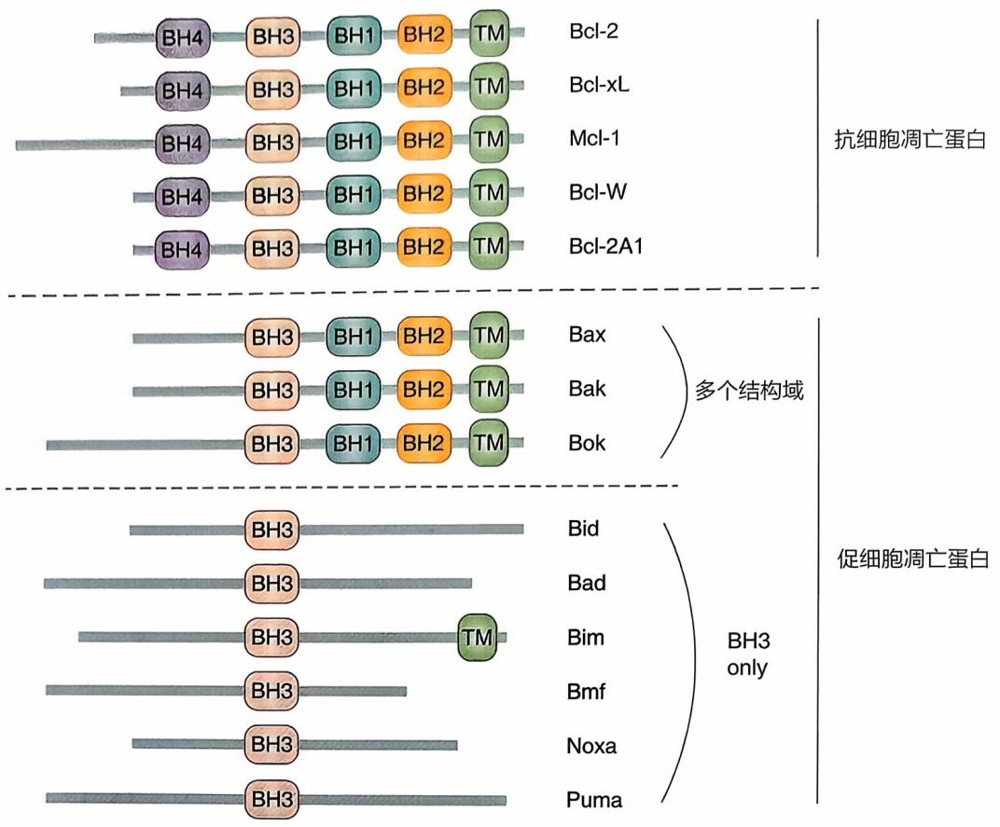

<details>
<summary>text_image</summary>

抗细胞凋亡蛋白
Bcl-2
BH4 BH3 BH1 BH2 TM
Bcl-xL
BH4 BH3 BH1 BH2 TM
Mcl-1
BH4 BH3 BH1 BH2 TM
Bcl-W
BH4 BH3 BH1 BH2 TM
Bcl-2A1
Bax
Bak
Bok
多个结构域
促细胞凋亡蛋白
Bid
Bad
Bim
Bmf
Noxa
Puma
BH3 only
BH3
BH3
BH3
BH3
BH3
BH3
BH3
BH3
BH3
BH3
BH3
BH3
BH3
BH3
BH3
BH3
BH3
BH3
BH3
BH3
BH3
BH3
BH3
BH3
BH3
BH3
BH3
BH3
BH3
BH3
BH3
BH3
BH3
BH3
</details>

的激活，而 caspase-9 的激活会进一步剪切和激活其他下游 caspase，如 caspase-3 和 caspase-7，后者进而剪切数百种蛋白质底物，从而完成细胞死亡的级联反应过程。新的研究发现这种简单的上、下游 caspase 级联反应导致细胞死亡的观点也许是不完整的，因为 caspase-3 和 caspase-7 双基因敲除小鼠也可以延迟“上游”线粒体损伤和细胞死亡。因此，细胞凋亡是一种具有自我扩增能力的循环级联反应。

电离辐射或化疗药物（如依托泊苷 Etoposide）处理造成 DNA 损伤进而激活内源性细胞凋亡，是传统癌症放射治疗和化学治疗的基础。然而，过去 10 年的研究揭示了哺乳动物细胞中细胞死亡存在代偿机制。虽然细胞和小鼠中 Bax 和 Bak 的双基因敲除产生至今为止已知最强的细胞凋亡抵抗条件，但仍有一小部分 Bax/Bak 双突变小鼠可以出生并存活数月，这表明机体发育过程中当内源性细胞凋亡机能丧失之后，代偿性的细胞死亡机制可以被激活从而消除不需要的细胞。此外，DNA 损伤可以通过促进线粒体损伤和激活下游 caspase 来诱导细胞凋亡，但是 DNA 损伤诱导的细胞凋亡可能仅占细胞对 DNA 损伤的死亡反应的一部分，因为严重的 DNA 损伤还可以导致有丝分裂错乱诱导的细胞灾变性死亡（见下述章节）。因此，当哺乳动物细胞中由死亡基因编程的细胞死亡机制被阻断时，细胞死亡可能通过破坏某些细胞稳态机制来完成。

脱落性凋亡（anoikis）也是一种内源性凋亡。在很多细胞中，整合素（integrin）介导的细胞与细胞外基质的黏附作用对细胞的存活很重要，这种黏附作用的缺失会触发脱落性凋亡。

---

第一节 基因编程的细胞死亡机制

481

## 2. 外源性细胞凋亡

外源性细胞凋亡（extrinsic apoptosis）是由细胞表面死亡受体介导的细胞凋亡。死亡受体定位于细胞质膜上，其主要特征是位于胞质内的信号转导结构域，称为死亡结构域（DD）。死亡受体家族包括Fas（CD95）、TNFR1、TRAIL（DR4）和TRAIL-R2（DR5）。这些受体与它们对应的配体结合导致受体激活，从而诱导外源性细胞凋亡（见图16-2和图16-4）。这些外源性细胞凋亡途径具有重要的病理学意义。Fas和FasL的遗传缺陷导致一种罕见的自身免疫性疾病，称为ALPS（自身免疫性淋巴增生综合征）。该疾病的表型可以在Fas和FasL突变小鼠模型中被复制。活化的T细胞可表达Fas配体，并通过与靶细胞中的Fas结合来募集FADD和caspase-8来诱导细胞凋亡。而Fas死亡结构域中与ALPS相关的突变导致FADD募集失败，从而抑制了caspase-8的激活。这些发现显示了caspase-8激活在Fas介导的细胞凋亡中的重要作用。

另一个研究较为清楚而且具有显著性病理学意义的、死亡受体介导的外源性细胞凋亡例子是TNFα介导的TNFR1激活。TNFα激活TNFR1导致细胞内快速形成一个瞬时的信号复合物（称为Complex I）。该复合物通过TNFR1的胞内DD，募集两种含有胞内DD的衔接蛋白TRADD和RIPK1（图16-4）。TRADD的主要功能是介导TRAF2/TRAF5和cIAP1/2的募集，继而在RIPK1上进行K63、K48和K11不同连接形式的多聚泛素化。由cIAP1/2产生的多聚泛素化链对于Complex I其他组分的招募至关重要，包括由HOIP（RNF31）、HOIL-1和SHARPIN组成的LUBAC复合物。LUBAC复合物可以对Complex I的组分进行M1连接的泛素化，包括RIPK1、NEMO、A20、TRADD和TNFR1。Complex I上的多聚泛素化链又反过来募集一些关键激酶，包括TAK1/TAB1/TAB2/3和NEMO/IKKα/IKKβ激酶复合物，并用于NF-κB的激活。因此，复合物Complex I中形成适当的多聚泛素化链对于介导经典NF-κB的激活至关重要。这是一种促生存和促炎症的转录途径，用以控制细胞凋亡和炎症的关键调节因子的表达（例如Cflar和Tnfaip3）。Tnfaip3编码的A20是一种关键的泛素编辑酶，可改变RIPK1的泛素化修饰模式；而Cflar编码多种c-FLIP亚型蛋白，其氨基酸序列与caspase-8相似但缺乏酶活性，可以直接与caspase-8结合并调节其活性。RIPK1泛素化的破坏，例如cIAP1/2、LUBAC或NEMO的缺失、TAK1或IKK的抑制或RIPK1（K377R）中关键Ub受体位点的突变都会导致RIPK1激酶活性的过度激活。激活的RIPK1反过来促进形成新的细胞质复合物（称为Complex IIa）。该复合物包括RIPK1/FADD/caspase-8，其主要功能是介导caspase-8的激活和促进RIPK1依赖性细胞凋亡（RDA）。因此，这些NF-κB激活的，包括TAK1、IKKs、NEMO、cIAP1/2和LUBAC在内的关键介质，也在抑制和调节RDA中发挥着重要作用。由于RIPK1的激酶活性可以激活caspase-8并影响细胞凋亡的关键检查点复合物Complex IIa的形成，因此抑制RIPK1的激酶活性可以有效地阻断RDA的发生。

---

482

第十六章 细胞死亡的分子机制

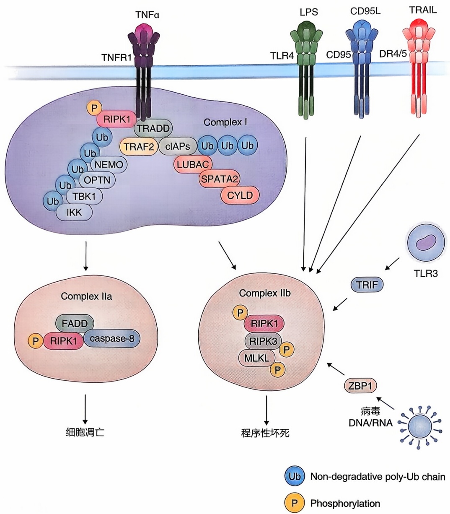

图 16-4 含死亡结构域的受体（TNFR1、CD95 和 DR4/5）与模式识别受体（PRR）（TLR3 和 TLR4）介导的细胞程序性坏死

被 TNFα 刺激激活后，TNF 受体 1（TNFR1）膜内部分的死亡结构域介导了一个瞬时的细胞内复合物的形成，称为 Complex I。该复合物继而招募接头蛋白 TRADD（与 TNFR1 结合的死亡结构域蛋白）、RIPK1（蛋白激酶受体相互作用死亡结构域蛋白 1）和多种泛素 E3 连接酶，包括 TRAF2（与 TNFR 结合的因子 2）、cIAP1/2（细胞凋亡抑制蛋白 1/2）、LUBAC（线性泛素链组装复合物）、泛素编辑酶 A20 和去泛素化酶复合物（CYLD 和 SPATA2），以及多种泛素结合蛋白（包括 NEMO、ABIN-1 和 OPTN）。在 Complex I 中，RIPK1 被 Lys63 连接的和线性 Met1 连接的泛素链快速多泛素化，从而介导 TAK1（TGFβ 激活的激酶 1）、TBK1 和 IKK（IκB 激酶）复合物的募集和激活。IκB（κB 抑制剂）的磷酸化和随后的 UPS（泛素-蛋白酶体系统）介导的降解导致 NF-κB（核因子-κB）的激活。Complex I 的失调会促进 RIPK1（p-S166 RIPK1）的激活，从而导致两种下游的胞内复合物的形成——Complex II a 或 Complex II b。Complex II a 包括 FADD（接头蛋白 FAS 结合的死亡结构域蛋白）、caspase-8 和 RIPK1，以促进 caspase-8 的激活，进而剪切下游 caspase 如 caspase-3，最终导致细胞凋亡。当 caspase-8 的激活被抑制时，活化的 RIPK1 激酶与 RIPK3 结合形成 Complex II b。活化的 RIPK3 继而磷酸化 MLKL，再通过破坏质膜的完整性来介导程序性坏死的执行。在 caspase 缺失的情况下，被其对应的配体，病毒核酸和 LPS，分别激活的 TLR3 和 TLR4 可促进 TRIF 和 RIPK3 的结合，从而介导程序性坏死。同样在 caspase 缺失的条件下，由其各自的 RHIM（受体相互作用蛋白质同型相互作用基序）介导的 Z-DNA 结合蛋白 -1（ZBP1）/Dai 和 RIPK3 的结合也可以促进程序性坏死。

---

第一节 基因编程的细胞死亡机制

483

## 二、程序性坏死

细胞坏死（necrosis）的特征之一是早期细胞质膜完整性的破坏。细胞坏死传统上被认为是一种被动的、不受细胞机制主动调控的细胞死亡。而2005年袁钧瑛实验室的研究发现，在凋亡通路受阻的情况下，配体激活的死亡受体（包括Fas/CD95和TNFR1）可导致激活细胞主动调控的坏死，并命名为程序性坏死。程序性坏死可以被Necrostatin-1（Nec-1）的小分子化合物所抑制。随后的研究发现Nec-1及其改进的类似物如Nec-1s是RIPK1激酶活性的抑制剂。TNFα结合受体TNFR1后，Complex I中RIPK1的翻译后修饰，包括泛素化和磷酸化，在控制RIPK1激酶的活化和持续时间方面起着关键性作用（图16-4）。Complex I组分的遗传缺陷，如cIAP1/2和LUBAC介导的泛素化修饰的缺失，泛素结合蛋白ABIN-1、NEMO和OPTN的缺失，泛素化编辑酶A20的缺失，以及TAK1和IKKs介导的抑制性磷酸化的缺失，都会促进RIPK1的激活。

如上所述，在 caspase 正常的情况下激活 RIPK1 可促进 RDA；而在 caspase 缺陷的情况下，RIPK1 的激活则促进包括 RIPK3 和 MLKL 在内的复合物 Complex II b（necrosome）的形成来介导程序性坏死。caspase-8 对 RIPK1 的中部结构域的剪切（切在鼠源 RIPK1 中的氨基酸 D325 和人源 RIPK1 中的氨基酸 D324 之后）是程序性坏死的关键检查点。激活的 RIPK1 与 RIPK3 的相互作用则促进了鼠源 RIPK3 中 Thr231/Ser232 的磷酸化和人源 RIPK3 中 Ser227 的磷酸化。RIPK1 和 RIPK3 的结合是由各自的 RIP 同型相互作用基序（RHIM）介导的。该基序可形成 RHIM 介导的淀粉样蛋白质类似结构，提示了淀粉样蛋白质信号在程序性坏死中的重要作用。活化的 RIPK3 继而介导人源假激酶 MLKL（mixed lineage kinase domain like）中 Ser358 或鼠源 MLKL 中 Ser345 的磷酸化，从而导致其寡聚化。MLKL 的 N 端四螺旋束（4HB）结构域 L 中的带电氨基酸会与质膜上的磷脂酰肌醇磷酸酯（PIPs）产生相互作用而形成寡聚体，并插入细胞膜来导致细胞破裂。多个抑制 RIPK1 激酶活性的点突变基因敲入小鼠，包括 D138N、K45A、K584R、S166A 和 S25D，在发育期和成年期是正常的，但对 TNFα 注射所诱导的、可导致野生型小鼠快速死亡的全身性炎症反应综合征具有高度抵抗性。RIPK3 或 MLKL 基因敲除小鼠也表现出对 TNFα 注射的全身性炎症反应综合征的抵抗性。因此，细胞程序性坏死对 TNFα 介导的炎症反应有至关重要的作用。

与Fas和TNFR1类似，在caspase缺陷情况下，DD受体DR4/5通过其对应配体TRAIL的激活也可以诱发程序性坏死。此外，模式识别受体（PRR），如Toll样受体3（TLR3）、Toll样受体4（TLR4）和ZBP1（zDNA结合蛋白-1）的激活，也可以诱导caspase缺陷条件下的程序性坏死（图16-4）。TLR3和TLR4介导的程序性坏死主要依赖RIPK3和TRIF蛋白（也称为TICAM1）的RHIM序列的参与。病毒的zRNA或zDNA在干扰素处理下激活ZBP1也可以促进程序性坏死。该作用是宿主防御反应的一部分，但与RIPK1和TNFR1无关。ZBP1是细胞质核酸的传感器，可以与病毒的

---

484

第十六章 细胞死亡的分子机制

zDNA/zRNA 结合，通过其两个 RHIM 结构域与 RIPK3 结合形成坏死小体，从而激活响应病毒感染的程序性坏死。这些 RHIM 接头蛋白的激活也可以导致程序性坏死效应蛋白 MLKL 的磷酸化、寡聚化和膜靶向。RIPK1 通过其支架功能抑制 ZBP1 与 RIPK3 的 RHIM 依赖性结合。因此，RIPK1 和 ZBP1 之间可能存在与 RIPK3 结合的竞争关系。敲除 ZBP1 或 IFN 信号转导的核心组分可延长 $Ripk1^{-/-}$ 小鼠的存活时间，表明 RIPK1 的缺失激活了 ZBP1 依赖性的 IFN 介导的反应。

代谢应激和缺氧也可以促进 RIPK1 的激活，从而介导 TNF/TNFR1 非依赖性的程序性坏死。能量应激介导的腺苷单磷酸激活蛋白激酶（AMPK）的激活起到了代谢检查点的功能。激活的 AMPK 可以直接介导人源 RIPK1 的 S416 和鼠源 RIPK1 的 S415 的抑制性磷酸化，但持续的葡萄糖剥夺可以促进 RIPK1、RIPK3 和 MLKL 的激活来介导细胞死亡。此外，在常氧条件下，RIPK1 的激活受多个主要由 EGLNs 介导的脯氨酸残基（例如 Pro195）上的脯氨酰羟基化控制。这导致 pVHL（von Hippel Lindau 肿瘤抑制蛋白）识别并抑制 RIPK1 激活。pVHL 是一种 E3 泛素连接酶，可靶向转录因子缺氧诱导因子 -1α（HIF-1α），促其进行蛋白酶体降解。而 HIF-1α 是细胞对氧浓度反应的关键调节因子。长时间缺氧会使 EGLN 失活，减少 RIPK1 上脯氨酸羟基化并抑制 RIPK1 与 pVHL1 的结合，从而促进 RIPK1 的激活而不影响其降解。这些机制研究强调了 RIPK1 在介导大脑、心脏和肾脏等多个器官缺血性损伤中的关键作用。

## 三、细胞焦亡

caspase-1 亚家族蛋白质的激活，包括鼠源的 caspase-11 和人源相应的 caspase-1 和 caspase-4/5，可以通过剪切前白细胞介素 1 诱导炎症反应，产生成熟的 IL-1β 以激活下游炎症反应和细胞凋亡（图 16-5）。沙门氏菌感染巨噬细胞引发 caspase-1 介导的细胞死亡，这种可能帮助去除被感染巨噬细胞的死亡形式被命名为细胞焦亡（pyroptosis）。研究表明，细胞焦亡是通过 caspase 介导的 GasderminD 剪切来进行的。GasderminD 是一种独特的 caspase 剪切底物。caspase 介导的 GasderminD 剪切去除了其自抑制性的 C 端结构域，从而允许剪切后的 Gasdermin-N 端结构域在细胞膜上形成孔洞，导致细胞坏死。GasderminD 的剪切可以由 caspase-1 亚家族蛋白质中的促炎性 caspase 以及其他凋亡性 caspase 如 caspase-8 和 caspase-3 来介导。剪切后的 Gasdermin-N 端结构域形成十六聚体，内径为 10\~14 nm 的孔洞，来介导成熟 IL-1β 的释放。在大量 Gasdermin-N 孔形成的条件下会导致细胞焦亡。细胞焦亡主要发生在各种吞噬细胞中，包括巨噬细胞、单核细胞和树突状细胞（DC）等。这些细胞可以在细菌或病毒等病原体的刺激下，由脂多糖（LPS）和病毒 DNA 等病原体衍生物诱导发生焦亡。

细胞膜中的 Gasdermin-N 孔可以通过电荷作用释放与细胞死亡无关的、成熟的 IL-1β 等促炎症因子。细胞因子，如成熟的 IL-1β，在没有信号肽的情况下如何被细胞释放一直是该研究领域的难题。炎症反应和细胞死亡对于严重炎症生物体的生存

---

第一节 基因编程的细胞死亡机制

485

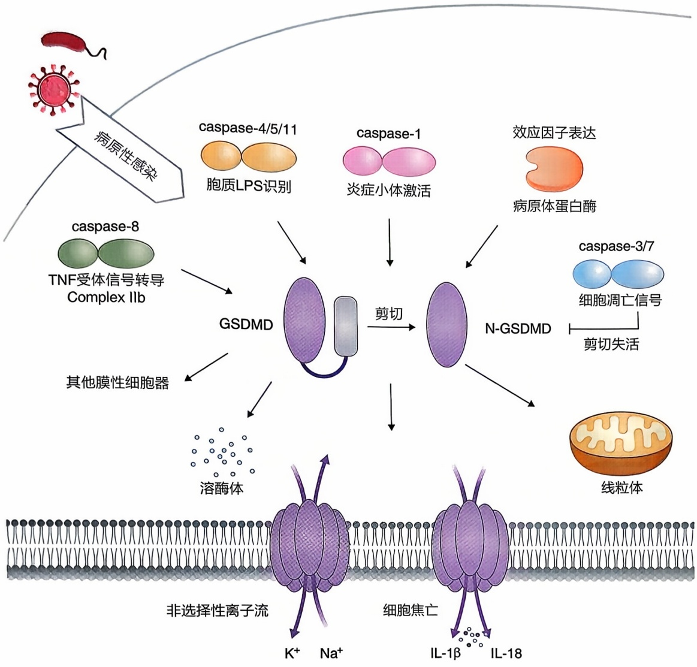

<details>
<summary>flowchart</summary>

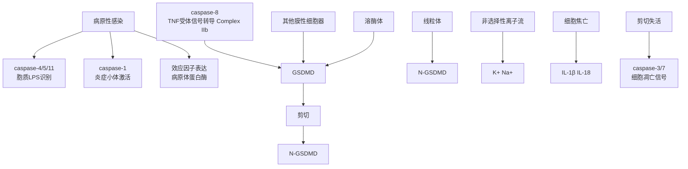
</details>

图16-5 细胞焦亡与成熟IL- $1\beta$ 的释放

细菌和病毒的病原性感染可促进小鼠体内 caspase-1 和 caspase-11 的激活，以及 caspase-1、caspase-4 和 caspase-5 介导 GSDMD 的剪切，从而将 GSDMD 的成孔 N 端结构域从其抑制性 C 端结构域中释放出来。活化的 caspase-8、caspase-3 和 caspase-7 以及致病性蛋白酶也可以介导 GSDMD 的剪切。N-GSDMD 形成的孔可以介导炎症条件下活细胞中成熟 IL-1β 和 IL-18 的分泌，并通过细胞裂解导致细胞焦亡。

都至关重要。例如，caspase- $11^{-/-}$ 小鼠可以抵抗LPS诱导的死亡。这种抵抗可能归因于对Gasdermin-N孔介导的促炎细胞因子（如成熟IL-1β和IL-18）释放的抑制，或对细胞焦亡的抑制或两者兼而有之。未来的生物标志物研究需要进一步区分这些可能性。

Gasdermin 家族的其他成员，即人类基因组编码的 GSDMA 到 GSDME 和 Pejvakin，也可以被细菌蛋白酶或哺乳动物 granzymeA 剪切。在 A 组链球菌（group A Streptococcus, GAS）感染的角质形成细胞中，细菌 SpeB 介导的 GasderminA（GSDMA）剪切促进细胞焦亡的发生。人源 GSDMA 三个同源物的三重基因敲除小鼠对高毒性 GAS 菌株的入侵异常敏感，表明细胞焦亡作为宿主防御机制的作用。GranzymeA 介导的 GSDMB 激活是自然杀伤细胞（natural killer cell）杀菌活性的重要部分。志贺氏菌中的 lpaH7.8 可靶向该细胞。有趣的是，细菌同样可以编码 Gasdermin 同源蛋白，同样具有孔形成活性，可用于防御噬菌体。这表明 Gasdermin 可能是进化上一种古老的宿主防御机制。

---

486

第十六章 细胞死亡的分子机制

## 四、胞葬对清除死亡细胞的重要作用

尽快清除死亡细胞对于避免细胞内容物释放从而造成炎症和自身免疫反应至关重要。被释放的细胞内物质可能作为损伤相关的分子模式来激活炎症反应甚至诱导自身免疫。细胞凋亡是一种“干净的、免疫沉默”的细胞死亡方式，其关键原因是胞葬（efferocytosis）可以有效地吞噬和清除凋亡细胞。在活细胞中，翻转酶的活力（包括ATP11A和ATP11C）将磷脂酰丝氨酸（PtdSer）不对称地保持在细胞质膜的内层中。凋亡细胞中 caspase-3 对翻转酶的剪切造成这些翻转酶的失活，以及同时活化磷脂促翻转酶（scramblase）XKR8（线虫中 Ced-8 的同源蛋白）使得磷脂酰丝氨酸（PtdSer）暴露在凋亡细胞表面。这些暴露在细胞表面的 PtdSer 是胞葬作用的识别信号，从而引导具有吞噬功能的细胞（例如巨噬细胞和树突状细胞）通过胞葬来清除凋亡细胞体，所以细胞表面的 PtdSer 是“吃我”信号。巨噬细胞通过 PtdSer 受体 TIM4 对凋亡细胞的识别和 TAM 酪氨酸激酶受体、MFG-E8（也称为 DEL1）和 GAS6/Protein S 的促进作用来完成胞葬作用。除此之外，与线虫中观察到的情况类似，Rho 和 Rab 家族的小 G 蛋白及其鸟嘌呤核苷酸交换因子则通过调节吞噬体的形成和成熟来降解凋亡小体，从而参与细胞胞葬作用的执行。

与细胞焦亡中 caspase 的激活一致，发生焦亡的细胞也会在其细胞外膜上暴露出 PtdSer 的“吃我”信号，由此导致死亡细胞被吞噬细胞迅速清除。这些研究结果表明，吞噬细胞不仅可以通过胞葬有效地清除凋亡细胞，也可以有效地清除焦亡细胞，从而避免或者减少细胞内容物的释放和 DAMP 的产生。而程序性坏死因为不涉及 caspase 的激活，目前尚不清楚机体是如何去除程序性坏死细胞的。

## 五、细胞凋亡和坏死中的细胞膜破裂

当死细胞的清除被延迟时，细胞质膜会发生有膜蛋白NINJ1参与的破裂。NINJ1在细胞死亡过程中会形成由紧密堆积的栅栏状跨膜 $\alpha$ 螺旋组成的丝状复合物。NINJ1抗体可以减轻肝损伤动物模型中的组织损伤，表明靶向膜损伤可以改善疾病的病理学进程。有研究报道，NINJ1蛋白与周边神经系统PNS和中枢神经系统CNS损伤后的细胞-细胞黏附有关。神经轴突损伤后DRG神经元中NINJ1的水平增加，并顺行转运至损伤点。在多发性硬化症和中风模型中，NINJ1也可能通过促进免疫细胞的活化和促进免疫细胞穿过BBB来参与炎症反应。需要进一步的研究来了解NINJ1在调节这些过程中的作用是否涉及细胞膜的破坏。由于死亡细胞在体内生理条件下往往通过胞葬作用被有效清除，因此需要确定体内存在有细胞膜破裂过程的疾病范式，比如急性神经系统和组织损伤导致的大量细胞死亡。这种大量的细胞死亡可能会超出机体清除机制的能力而导致细胞膜破裂后还不能被有效清除；其他可能的例子如吞噬作用相关基因的遗传缺陷可能会降低机体胞葬的效率，从而导致细胞膜的破裂和

---

第一节 基因编程的细胞死亡机制

487

细胞内容物的漏出。

## 六、三种基因编程调控的细胞死亡通路异同之处

虽然细胞凋亡、焦亡和程序性坏死都是由特定基因编程的细胞死亡机制执行的，但它们在生命中的进化起源和功能上却截然不同。控制细胞凋亡的基因存在于线虫和果蝇等原始生物中，而介导程序性坏死的基因，包括RIPK1、RIPK3和MLKL，仅在部分高度进化的脊椎动物和哺乳动物中存在（如小鼠和人类）。apaf-1基因敲除、caspase-9基因敲除以及caspase-3和caspase-7双敲除小鼠的胚胎发育缺陷证明了细胞凋亡在机体发育中非常重要。相比之下，caspase-1基因敲除和caspase-11基因敲除对小鼠的发育和存活没有明显影响，但对炎症性细胞凋亡、细胞焦亡以及IL-1β和IL-18的释放有严重抵抗作用。此外，虽然RIPK1基因敲除的小鼠会在围产期死亡，但激酶活性失活的多种RIPK1位点突变小鼠都发育正常，并且对TNFα诱导的炎性死亡具有高度抵抗性。RIPK3基因敲除小鼠和MLKL基因敲除小鼠也发育正常，也同样抵抗TNFα诱导的死亡。此外，阻断RIPK1激酶和程序性坏死可以抑制 $casp8^{-/-}$ 小鼠、 $Fadd^{-/-}$ 小鼠、 $Abin1^{-/-}$ 小鼠和 $Tbk1^{-/-}$ 小鼠的早期胚胎致死，表明程序性坏死可能参与了发育缺陷胚胎的清除。因此，细胞凋亡直接参与了机体的正常发育过程，而程序性坏死可能是高等脊椎动物进化出的一种通过终止有缺陷的胚胎来保证正常胚胎发育的质量检验机制。

细胞凋亡和程序性坏死在癌症中具有不同的作用:一方面，FADD的扩增和表达增加与多种癌症的进展有关，包括乳腺癌、卵巢癌、肺癌等。另一方面，在许多癌症和癌细胞系中都发现RIPK3的表达被抑制，以及由此而导致的癌细胞坏死能力的丧失。这些发现显示了caspase和细胞凋亡在机体发育中的独特作用，以及当caspase在胚胎发育和成年个体中失调时，程序性坏死作为终止非正常发育状态的检查点作用。尤其是RIPK3表达在癌细胞中的普遍缺失表明了程序性坏死在癌症发展中的重要的检查点作用。

尽管 caspase 依赖性的细胞焦亡和 caspase 非依赖性的程序性坏死介导了不同形式的坏死和炎症，它们之间可能通过相互作用和合作来调节炎症。例如 RIPK1 的激活可以诱导 IL-1β 的转录，而 IL-1β 的成熟和释放是由 caspase-1/11 介导的剪切和 GSDMD 形成的孔控制的。因此，非致死性激活的 RIPK1 和 caspase-1/11 之间的合作可以促进成熟 IL-1β 的转录和释放，从而调节炎症。程序性坏死是在 caspase 缺失的情况下被激活，而细胞凋亡和细胞焦亡是由 caspase 介导的。因此，激活程序性坏死和细胞凋亡 / 焦亡所需的条件可能互相排斥。此外，凋亡细胞在细胞膜上会迅速呈现出 “吃我” 的信号，所以体内可以导致在继发性坏死和细胞内容物释放之前被特定的吞噬细胞迅速吞噬消化。在有限的炎症情况下和由细胞控制的炎症反应过程中，髓室中特定促炎细胞因子的释放以及与它们的特异性受体和信号转导分子的相互作用，仍然是促进炎症的关键驱动因素。因此，细胞焦亡期间非特异性细胞内容物如 DAMP 的

---

488

第十六章 细胞死亡的分子机制

释放可能仅限于造成大量细胞死亡的、严重的病理状况。

## 第二节 破坏细胞稳态而导致的被动性细胞死亡

除了激活特定基因编程的细胞死亡程序外，细胞还可能由于促存活机制被破坏而死亡。本节将重点介绍由于失去细胞稳态促存活机制而导致细胞死亡的几个典型例子。

细胞凋亡和程序性坏死是由于激活了由基因编程来执行细胞死亡功能的特定蛋白质而发生的。与细胞凋亡和程序性坏死这样由基因主动调控的细胞死亡不同，破坏细胞稳态也足以诱导细胞死亡，并不需要活化基因编程的细胞死亡机制。值得注意的是，因特定细胞稳态破坏而死亡的细胞也能表现出凋亡或坏死的某些特征。然而，在这种情况下由于细胞失去了关键的存活机制，单独抑制细胞凋亡或坏死可能不足以挽救这类细胞死亡。

## 一、自噬和溶酶体细胞死亡

自噬（autophagy）是一种重要的细胞促存活机制。细胞在正常稳态条件下通过溶酶体途径促进细胞内物质的更新和再循环，并在应激状态下促进细胞的存活。“自噬性细胞死亡”术语最早是用于描述一种在胚胎组织中发现的、形态上不同于细胞凋亡的细胞死亡形式。然而，自噬的抑制可以促进细胞死亡。此外，自噬激活的形态学证据虽然在细胞死亡过程（如细胞程序性坏死）中发现，但是阻断自噬对细胞死亡的影响不大，只是可以增加与程序性坏死相关的细胞碎片的积累。这表明程序性坏死过程中自噬的激活会促进细胞碎片的降解，但不促进细胞死亡。在神经系统中，自噬可通过促进功能丧失的蛋白质（例如聚集的蛋白质）和细胞器（例如受损的线粒体）的降解和周转来维持细胞稳态。自噬或溶酶体功能缺陷与衰老相关的神经退行性疾病有关。

溶酶体是重要的细胞内循环中心，其中充满了如溶酶体酶 cathepsins 等不同的水解酶。这些酶可以降解大多数细胞内大分子来回收可用的氨基酸和其他代谢产物，因此对细胞存活至关重要。然而溶酶体也被称为“自杀袋”，因为溶酶体膜的破裂会导致溶酶体酶的泄漏，进而引发溶酶体细胞死亡（图 16-6）。溶酶体细胞死亡是通过溶酶体酶介导的关键凋亡蛋白的剪切和激活，如 caspases 和 Bcl-2 家族成员，以及由溶酶体酶对关键生存机制的直接破坏作用来实现的。戈谢病（Gaucher disease）是由葡萄糖脑苷酯酶（GBA）基因突变引起的最常见的溶酶体储存疾病。条件突变小鼠中 GBA 在神经元中的缺失导致 RIPK1/RIPK3 水平升高和细胞程序性坏死，而 RIPK3 敲除可以抑制这种死亡。此外，脊髓损伤诱导的溶酶体损伤可介导 RIPK1 被招募到溶酶体上并促进 RIPK1 和 RIPK3 的激活。由视网膜色素上皮细胞中脂褐素积聚引起的溶酶体通透性增加（这是 Stargardt 病和干性年龄相关性黄斑变性的原因）可以激活

---

第二节 破坏细胞稳态而导致的被动性细胞死亡

489

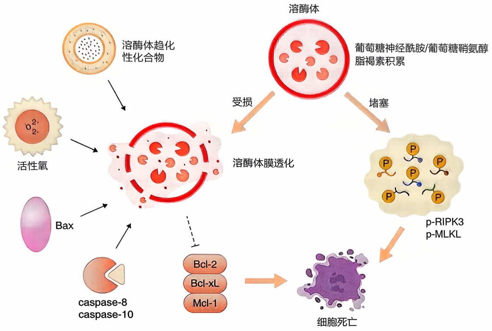

<details>
<summary>flowchart</summary>

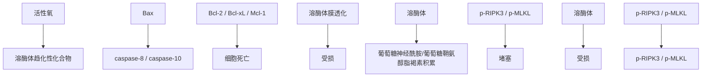
</details>

图16-6 由溶酶体功能破坏介导的细胞死亡活性氧、溶酶体趋向性化合物以及活化的Bax和caspase可诱导溶酶体膜透化（LMP），从而导致组织蛋白酶和其他水解酶从溶酶体腔释放到细胞质。戈谢病中葡萄糖神经酰胺和葡萄糖鞘氨醇的积累、Stargardt病中的脂褐素以及萎缩性增龄性黄斑变性引起的溶酶体堵塞导致RIPK3和MLKL的激活。

MLKL，导致非典型性程序性坏死。此外，还有一大类溶酶体储存疾病，这些疾病改变了溶酶体功能并导致多个器官尤其是中枢神经系统出现严重疾病。溶酶体内环境稳态生存机制的缺失可能是导致这些患者细胞死亡的驱动因素。

## 二、细胞侵入式死亡

细胞侵入式死亡（entosis）是指一个细胞直接吞噬和消化另一个活细胞的现象和过程，可以被认为是细胞同类相食的一种形式。吞噬过程由细胞脱离基质而触发，与肌动蛋白（actin）、肌凝蛋白Ⅱ（myosin Ⅱ）、Rho-GTP酶（Rho-GTPase）和Rho相关蛋白激酶（ROCK）产生的细胞收缩活动有关。被内吞的细胞最终通过溶酶体被降解。这个过程与被内吞的病原体如李斯特菌、A组链球菌和志贺氏菌的降解过程相似。在葡萄糖饥饿条件下AMPK的激活可以增强内吞的频率，提示代谢应激在调节内吞中有作用。此外，TRAIL激活的DR4和DR5也可以刺激由caspase-8的支架功能而不是其蛋白质剪切活性驱动的内吞。在人类癌症中虽然也发现有细胞内吞的现象，但其在癌症中的功能和作用仍需进一步研究。

## 三、铁死亡和脂质过氧化

铁死亡（ferroptosis）是一种由于脂质过氧化而造成的被动性细胞死亡形式。铁死亡可被 Erastin（交换转运蛋白 xCT 的不可逆抑制剂）和 RSL3（GPX4 的抑制剂）等外源小分子激活。铁死亡在形态学上与细胞凋亡或坏死不同，也不涉及介导细胞凋亡

---

490

第十六章 细胞死亡的分子机制

或程序性坏死的细胞死亡机制。维持细胞膜的脂质稳态对于细胞和动物的存活至关重要，打破细胞氧化还原平衡而造成不可逆的脂质过氧化会诱导铁死亡（图16-7）。SLC7A11基因编码的交换转运蛋白xCT和谷胱甘肽过氧化物酶4（GPX4）蛋白是细胞氧化还原机制的两个关键调节因子。xCT是一种异二聚体的氨基酸交换转运蛋白，用于输出谷氨酸以换取胱氨酸的输入。胱氨酸的还原会产生半胱氨酸。半胱氨酸是谷胱甘肽（GSH）合成中的限速前体，用以保护细胞免受氧化应激。GPX4是一种含硒蛋白，具有谷胱甘肽依赖性的过氧化物酶活性，是细胞抵抗脂质过氧化的主要防御机制蛋白。GPX4失活会导致产生过量活性氧（ROS），引发脂质过氧化和破坏细胞膜和线粒体膜，从而激活细胞死亡程序。在小鼠体内诱导GPX4失活会导致脂质氧化诱导的急性肾功能衰竭和动物死亡。细胞内ROS增加的一个结果是多不饱和脂肪酸（PUFA）的脂质过氧化，继而产生活性醛类物质如4-羟基壬烯醛（4-HNE）。4-羟

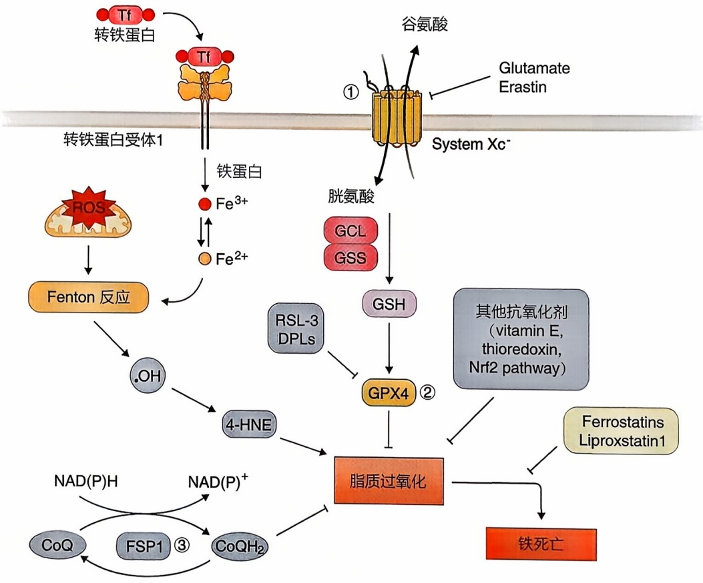

<details>
<summary>flowchart</summary>

This flowchart illustrates the biochemical pathway of iron metabolism, showing how iron is converted into iron and then to various metabolites (Glutamate Erastin, Glut氨酸, GCL/GSS) and their subsequent reactions.
</details>

图 16-7 脂质过氧化和铁死亡

防止脂质过氧化的细胞机制包括:① xCT（由基因 SLC7A11 编码）。它是一种异二聚体氨基酸逆向转运蛋白，专门用于输入胱氨酸（半胱氨酸的氧化形式），同时以 1:1 的比例交换输出谷氨酸。胱氨酸的还原产生半胱氨酸。半胱氨酸是谷胱甘肽合成中的限速前体，可保护细胞免受氧化应激。②谷胱甘肽过氧化物酶 4（GPX4）。它通过将脂质氢过氧化物转化为脂质醇来防止脂质过氧化。③ FSP1（质膜铁死亡抑制蛋白 1，以前称为凋亡诱导因子线粒体 2，AIFM2）。它作为氧化还原酶，通过还原 CoQ10（辅酶 Q10）来生成 RTA（亲脂性自由基捕获抗氧化剂），用于阻断脂质过氧化物。PUFA（多不饱和脂肪酸）的脂质过氧化产生活性醛，例如4-HNE（4-羟基壬烯醛）。它可以与蛋白质、脂质和DNA形成相对稳定的加合物。电子可能从细胞氧化还原反应中逸出并被氧捕获形成过氧化物（$\mathrm{H}_2\mathrm{O}_2$）。Fenton反应介导 $\mathrm{Fe}^{2+}$ 和$\mathrm{H}_2\mathrm{O}_2$ 的氧化，提供羟基自由基与脂质反应形成脂质自由基，引发脂质过氧化。RSL3和DPI对GPX4的化学抑制或Erastin对xCT的抑制可诱导铁死亡。Erastin会破坏针对脂质过氧化的细胞防御机制来诱导通过大量铁依赖性脂质过氧化的细胞死亡。Ferrostatins和Liproxstatin1通过其自由基捕获抗氧化剂（RTA）的功能来抑制脂质过氧化。

---

第二节 破坏细胞稳态而导致的被动性细胞死亡

491

基壬烯醛会与蛋白质、脂质和 DNA 形成细胞类型和浓度依赖性的加合物。

当氧化剂攻击脂质，特别是攻击多不饱和脂肪酸（PUFA）时，脂质过氧化就会发生。这是正常细胞代谢的一个自然结果，可以通过细胞氧化还原机制对其进行调节。在炎症和疾病条件下，细胞中可以发现过量的脂质过氧化。衰老可能导致氧化产物的增加，以致超过生物系统的解毒能力。与年轻小鼠相比，衰老小鼠不同器官的活细胞中HNE-1阳性水平明显增加，提示衰老与脂质过氧化增加有关。长期以来，氧化应激和脂质过氧化一直被认为与各种衰老相关的人类疾病有关，包括糖尿病和神经退行性疾病。

脂质过氧化水平是通过细胞氧化还原机制来进行调节的（图16-7）。增加的HNE水平可以通过增加Nrf2调控的HNE消除活性而减少。比如在Fraatin基因突变导致的弗莱德里希共济失调（Friedreich ataxia，FRDA）患者中，线粒体内铁处理的改变和线粒体呼吸的损害可以用NRF2激活剂来进行治疗。细胞中捕获自由基的抗氧化剂，包括维生素E和维生素K，可以抵御脂质过氧化和铁死亡。除了GPX4外，脂质过氧化还受到辅酶Q氧化还原酶FSP1的调节。该酶可催化还原形式的、具有捕获自由基抗氧化活性的泛醌和泛醌醇的再生。FSP1可以还原维生素K成为具有捕获自由基抗氧化活性的氢醌。此外，性激素受体，即雌激素受体（ER）和雄激素受体（AR）诱导的磷脂修饰酶MBOAT1和MBOAT2也可以调节脂质过氧化。

除了诱发铁死亡，过量的脂质过氧化也可能促进与细胞死亡无关的炎症反应。铁离子参与线粒体呼吸，是细胞稳态和生存的关键调节因子。转铁蛋白受体1（transferrin receptor1）在脑的铁摄取中起重要作用。它的缺失导致神经元铁缺乏以及多巴胺能神经元的进行性丢失。而铁蛋白轻链（FTL）在铁存储中起着重要作用，它的基因突变导致罕见的帕金森样疾病，即脑部铁过载引起的神经铁蛋白病。小胶质细胞中铁积累引起的炎症反应则与铁死亡相关。因此，细胞内关键的氧化还原促生存机制失活的结果可能也包括炎症的激活。

## 四、兴奋性毒性

离子通道过度激活后造成的细胞内离子平衡被破坏可导致称为兴奋性毒性（excitotoxicity）的细胞死亡（图16-8）。线虫机械敏感性的遗传学研究提供了一个由离子通道的过度激活而造成的兴奋性毒性的范例。线虫mec-4和deg-1基因编码了两个和脊椎动物上皮细胞中amiloride敏感的 $\mathrm{Na^{+}}$ 通道相似的蛋白质。这两个基因的错义突变导致线虫中离子失衡、触觉受体神经元肿胀和坏死退变。突变型mec-4和deg-1介导的细胞死亡不依赖ced-3，但部分由可被细胞内 $\mathrm{Ca^{2+}}$ 所激活的天冬氨酰蛋白酶和钙蛋白酶介导。

谷氨酸是哺乳动物神经系统中的一种重要的兴奋性神经递质。它的功能是根据幅度、持续时间和位置来驱动  $Ca^{2+}$  进入神经元（图 16-8）。在病理状态下， $Ca^{2+}$  信号的改变会导致第二信使水平过高，从而导致离子失衡而引发兴奋性毒性。细胞不能在细

---

492

第十六章 细胞死亡的分子机制

图16-8 离子平衡稳态破坏引起的兴奋性毒性在线虫中，mec-4和deg-1（脊椎动物amiloride敏感的上皮细胞 $\mathrm{Na^{+}}$ 通道的同源蛋白）过度激活后，细胞内离子平衡被破坏，导致接触感受器神经元坏死变性。这种细胞死亡不依赖于ced-3，但部分由被细胞内 $\mathrm{Ca^{2+}}$ 增加所激活的天冬氨酰蛋白酶和钙蛋白酶介导。哺乳动物神经系统在病理条件下的谷氨酸水平升高也会导致细胞$\mathrm{Ca^{2+}}$ 超载和离子失衡而使细胞丧失存活能力。兴奋性毒性的下游细胞死亡效应可能同时包括细胞凋亡和程序性坏死过程，这可能取决于稳态破坏的程度。

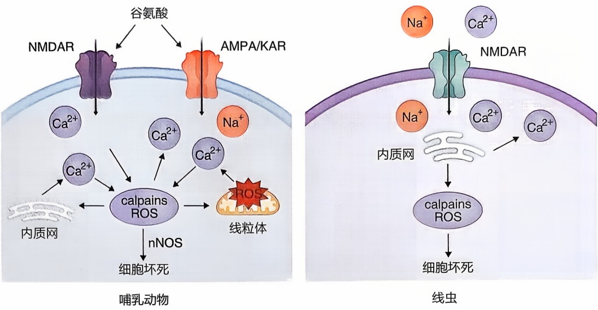

胞 $\mathrm{Ca^{2+}}$ 超载的情况下存活。兴奋性毒性的下游细胞死亡效应可能同时包括凋亡和坏死过程。星形胶质细胞对谷氨酸的清除和再循环可能也决定了谷氨酸作为神经递质的可用性。急性神经损伤（如脑缺血、持续性癫痫、创伤性中枢神经系统损伤和低血糖）后，谷氨酸门控离子通道（如NMDA受体）的过度或持久激活被认为与神经坏死性死亡有关。谷氨酸的细胞毒性可能是 $\mathrm{Ca^{2+}}$ 大量涌入所介导的神经型一氧化氮合酶（nNOS）的激活。该酶也参与多种生理功能，如突触可塑性、学习和记忆以及神经再生。神经元中的兴奋性毒性也可以改变氧化状态，而氧化状态已被证明可以导致蛋白质的S-亚硝基化。

## 五、有丝分裂灾变

细胞有丝分裂灾变（mitotic catastrophe）是一种由于细胞受到化学或物理压力，错误地进入有丝分裂而导致的细胞死亡形式。从生物化学角度来看，细胞有丝分裂灾变的特征为复制不完全的或受损的、在着丝粒（centromere）位置双链DNA发生断裂的染色体的过早凝缩。用微管的靶向药物（如紫杉烷类、长春碱类和秋水仙碱等）以及DNA损伤剂处理具有 $\mathrm{G}_2$ 期检查点基因遗传缺陷（例如:ATM、ATR、Chk1、Chk2和Polo样激酶家族，如Plk1、Plk2、Plk3）的癌细胞，可诱导细胞发生有丝分裂灾变。经历有丝分裂灾变的癌细胞可能表现出caspase激活的特征，但抑制caspase并不能阻止有缺陷的染色体分离，从而导致细胞分裂异常和异倍性染色体的产生。

## 第三节 细胞死亡和人类疾病

本节将简要讨论细胞死亡和细胞稳态破坏在人类疾病中的作用。

---

第三节 细胞死亡和人类疾病

493

## 一、抗凋亡 Bcl-2 家族蛋白质和癌症

Bcl-2是抗凋亡Bcl-2家族蛋白质中的一员。在人类滤泡性淋巴瘤中，Bcl-2的转录由于t（14；18）染色体易位而被激活。Bcl-2家族成员的过度表达在多种癌细胞中普遍存在。抗凋亡的Bcl-2家族蛋白质通常是通过促进癌细胞在应激条件下的生存来实现其促癌功能，而不是促进细胞增殖。用于治疗白血病和淋巴瘤的Venetoclax（Bcl-2特异性抑制剂）和Navitoclax（Bcl-2、Bcl-xL和Bcl-W抑制剂）的成功开发，突显了该家族蛋白质在调节死亡和生存平衡中的关键作用。

## 二、RIPK1 调节的细胞死亡和神经退行性疾病

程序性坏死在介导多种以细胞死亡和炎症为特征的人类疾病机制中发挥重要作用。这些疾病包括缺血性脑损伤、缺血性心脏损伤、缺血性肾脏损伤、青光眼、多发性硬化（MS）和肌萎缩性侧索硬化症（ALS）等。在肌萎缩性侧索硬化症（ALS）、多发性硬化（MS）和阿尔茨海默病（AD）死亡患者的病理样本中，都发现有显示RIPK1、RIPK3和MLKL激活的生物标志物，包括p-RIPK1、p-RIPK3和p-MLKL。由于RIPK1是通过DD介导的相互作用被特异性地招募到TNFR1，RIPK1激酶的激活特异性地介导了TNFR1信号转导。因此，抑制RIPK1激酶可选择性抑制由TNFR1介导的有害反应而不影响TNFR2信号通路。

## 三、人类疾病中 RIPK1 和 caspase 介导的促炎症机制

体内有两种主要的促炎症通路。一个是 RIPK1 介导的 TNFR1 下游促炎细胞因子的产生通路，另一个是炎症小体介导的 caspase-1 激活通路。虽然这两种途径的上游激活剂可能有刺激和细胞特异性，但下游细胞因子的产生和释放通常是一组共同的促炎因子，如 TNFα、IL-1β、IL-6 和 IFN γ。而这些因子释放的水平、时间和组织特异性可能会对机体产生不同的影响。抑制 caspase-8 介导的 RIPK1 剪切导致人类自身炎症性疾病。在程序性坏死和炎症情况下，如在 ALS 中，细胞核中可以检测到活化的 RIPK1。核内的 RIPK1 与一系列的转录激活剂和协同激活剂相互作用 [如 p65 (RELA)、SP1 和 JUNB，以及几乎所有 BAF 染色质重塑复合物的组分]，通过调节染色质动态变化来诱导和促进促炎因子的转录。

caspase-1、caspase-11 及相关 caspase 的激活是由多种分子复合物介导的。这些复合物被称为炎症小体，其中包括不同的模式识别受体（PRR）如 NLRP3、NLRP1、NAIPs（NLR 家族凋亡抑制蛋白）、NLRC4、AIM2（黑色素瘤缺失蛋白 -2）、Pyrin 和接头蛋白如 ASC（凋亡相关 Speck 样蛋白）等。这些复合物的下游信号通路是由 PRR 和刺激类型所决定的。最近有研究表明 NLRP3 炎症小体在神经退行性疾病中会被激

---

494

第十六章 细胞死亡的分子机制

活，导致炎症和神经退行性变化。GSDMD 的剪切调节成熟 IL-1β 和 IL-18 的释放以促进炎症反应，是人类炎症疾病条件下促进炎症反应的关键调控机制。

## 四、破坏细胞稳态和人类疾病

细胞稳态的破坏，包括蛋白质合成与降解之间平衡的破坏，会导致神经退行性疾病中错误折叠和聚集的蛋白质积累。细胞内稳态的恢复是治疗人类疾病的一种重要策略。TRADD蛋白是TNFR1信号通路中的重要接头蛋白。靶向TRADD一方面可以抑制RIPK1依赖性凋亡，同时也激活了自噬来促进错误折叠蛋白质的降解，从而恢复细胞稳态。

氧化还原稳态的破坏会导致活性氧（ROS）的积累，这在慢性炎症性疾病患者中很常见。此外，脂质过氧化的积累可以导致以4-HNE的存在为标志的细胞损伤和铁死亡。由于大脑消耗氧气的比例很高（约20%），而重量只占身体约2%，因此大脑对氧化损伤非常敏感。脂质过氧化是遗忘性轻度认知障碍和早期阿尔茨海默病患者大脑中淀粉样斑块形成的早期病理事件。在阿尔茨海默病动物模型中，氧化应激和脂质过氧化可能促进了淀粉样蛋白质斑块的形成。

秀丽隐杆线虫程序性细胞死亡的遗传学研究首次揭示了由Ced-3、Ced-4和Ced-9介导的控制发育中细胞凋亡的分子机制。这种在进化上保守的程序性细胞死亡机制在哺乳动物细胞中发生了明显的扩展，其中包括可能由于基因复制产生的编码Ced-3（caspase家族）和Ced-9（Bcl-2家族）蛋白质的多个同源基因。这些基因不仅参与调控发育过程中的细胞死亡，还参与调控疾病中的病理事件，包括细胞死亡和炎症。而RIPK1、RIPK3、MLKL和ZBP1介导的程序性坏死可能是在进化后期过程中出现的，用以满足复杂的多细胞生物中对清除带病细胞和防御病原体的额外需求。此外，caspase-11、caspase-1、caspase-3和caspase-8等caspase对GSDMD的剪切导致细胞焦亡，同时也可以在病理状态下介导没有信号肽的细胞因子释放，如成熟IL-1β，从而导致炎症发生。

激活体内特定细胞死亡通路和炎症的结果可能会因细胞种类而异，具体结果将取决于这些通路中不同介质的表达水平。例如，小胶质细胞中 RIPK1 的激活与促炎细胞因子的产生增加有关，而不是导致细胞死亡；而少突胶质细胞中 RIPK1 的激活则可能会导致由于成熟少突胶质细胞的损失和新少突胶质细胞的补偿性再生而产生的细胞死亡和髓鞘脱失。此外，caspase-1 和 caspase-11 的激活可以驱动下游 caspase（caspase-3 和 caspase-7）激活，因为它们的特异性与其他长前体 caspase（例如 caspase-9）相似。因此，不仅 caspase-1 和 caspase-11，而且 caspase-8 和 caspase-3 的激活都可以介导细胞凋亡底物和焦亡底物的剪切。然而，在细胞凋亡情况下，数百种细胞凋亡底物的剪切决定了细胞死亡的形式和这种自杀样事件的结果。

细胞正常存活需要多种调控细胞稳态机制的参与，打破任何一个重要的细胞稳态机制都可能造成细胞死亡，这解释了为什么我们会发现越来越多的细胞死亡形式。这

---

推荐阅读

495

些与细胞程序性死亡不同的细胞死亡形式告诉了我们哪些是可以用化学或者基因手段来影响细胞存活的关键点。研究细胞稳态机制的失活可能为选择性地诱导癌细胞死亡提供多种可能，因此靶向癌症特异的细胞生存机制可能为治疗癌症提供新策略。此外，许多目前治疗神经退行性疾病的干预策略都集中在阻断被激活的促死亡途径，而通过增强特异性的细胞生存机制来治疗神经退行性疾病的概念和策略还没有被充分探索。发现和确定特定细胞生存信号丢失的关键标志，并开发针对性的靶向疗法，可能使细胞（如神经元或胰腺 $\beta$ 细胞）在有害环境中也能存活。因此，了解连接细胞稳态和细胞死亡的信号通路交汇点将提供不仅可以抑制细胞死亡，还可以恢复细胞稳态和存活的新治疗策略。

## ※ 复习思考题

1. 细胞凋亡、程序性坏死和焦亡是3种由死亡基因编程调控的细胞程序性死亡形式，它们各有哪些特征性标记蛋白和特异性小分子抑制剂？描述在你的实验中如何区分这3种细胞死亡形式。
2. 在细胞水平上如何激活细胞凋亡、程序性坏死和焦亡？设计3个细胞水平的实验来分别激活和验证细胞凋亡、程序性坏死和焦亡。
3. 设计 2 个通过破坏细胞稳态来诱导细胞死亡的实验。
4. 细胞凋亡、程序性坏死和焦亡与发育和疾病有什么关系？
5. 细胞凋亡、程序性坏死和焦亡的共同调控分子是什么？3种不同形式的细胞程序性死亡形式有何关联之处？

## ※ 推荐阅读

1. YUAN J, SHAHAM S, LEDOUX S, et al. The C. elegans cell death gene ced-3 encodes a protein similar to mammalian interleukin-1beta-converting enzyme [J]. Cell, 1993, 75(4): 641–652.
2. MIURA M, ZHU H, ROTELLO R, et al. Induction of apoptosis in fibroblasts by IL-1 beta-converting enzyme, a mammalian homolog of the C. elegans cell death gene ced-3 [J]. Cell, 1993, 75(4): 653–660.
3. DEGTEREV A, HITOMI J, GERMSCHEID M, et al. Identification of RIP1 kinase as a specific cellular target of necrostatins [J]. Nat Chem Biol, 2008, 4: 313–321.
4. DEGTEREV A, HUANG Z, BOYCE M, et al. Chemical inhibitor of nonapoptotic cell death with therapeutic potential for ischemic brain injury [J]. Nat Chem Biol, 2005, 1: 112–119.
5. CHO Y S, CHALLA S, MOQUIN D, et al. Phosphorylation-driven assembly of the RIP1-RIP3 complex regulates programmed necrosis and virus-induced inflammation [J].

---

496

第十六章 细胞死亡的分子机制

Cell, 2009, 137: 1112–1123.

6. HE S, WANG L, MIAO L, et al. Receptor interacting protein kinase-3 determines cellular necrotic response to TNF-alpha [J]. Cell, 2009, 137: 1100–1111.
7. ZHANG D W, SHAO J, LIN J, et al. RIP3, an energy metabolism regulator that switches TNF-induced cell death from apoptosis to necrosis [J]. Science, 2009, 325: 332–336.
8. SUN L, WANG H, WANG Z, et al. Mixed lineage kinase domain-like protein mediates necrosis signaling downstream of RIP3 kinase [J]. Cell, 2012, 148: 213–227.
9. WANG S, MIURA M, JUNG Y K, et al. Murine caspase-11, an ICE-interacting protease, is essential for the activation of ICE [J]. Cell, 1998, 92(4): 501–509.
10. KAYAGAKI N, STOWE I B, LEE B L, et al. Caspase-11 cleaves gasdermin D for non-canonical inflammasome signalling [J]. Nature, 2015, 526: 666–671.
11. SHI J, ZHAO Y, WANG K, et al. Cleavage of GSDMD by inflammatory caspases determines pyroptotic cell death [J]. Nature, 2015, 526: 660–665.
12. DING J, WANG K, LIU W, et al. Pore-forming activity and structural autoinhibition of the gasdermin family [J]. Nature, 2016, 535: 111–116.
13. LIU X, ZHANG Z, RUAN J, et al. Inflammasome-activated gasdermin D causes pyroptosis by forming membrane pores [J]. Nature, 2016, 535: 153–158.
14. SUZUKI J, DENNING D P, IMANISHI E, et al. Xk-related protein 8 and CED-8 promote phosphatidylserine exposure in apoptotic cells [J]. Science, 2013, 341: 403-406.
15. SEGAWA K, KURATA S, YANAGIHASHI Y, et al. Caspase-mediated cleavage of phospholipid flippase for apoptotic phosphatidylserine exposure [J]. Science, 2014, 344: 1164–1168.
16. DIXON S J, LEMBERG K M, LAMPRECHT M R, et al. Ferroptosis: an iron-dependent form of nonapoptotic cell death [J]. Cell, 2012, 149: 1060–1072.

（编写:袁钧瑛、俞强、潘鹤龄；审读:朱洁滢、王波）
