## 第一章

## 导论

遗传学（genetics）和发育生物学（developmental biology）是生命科学的两个重要分支学科，深刻影响人类健康事业的进步，推动着科技发展的进程，与人类发展息息相关。遗传学是研究遗传信息的传递、变异、表达、相互作用及其调控的科学，涵盖分子、细胞、个体乃至群体的各个层面。本章第一节先追溯经典遗传学的科学历史，介绍早期的遗传学家如何通过敏锐的自然观察和严谨的科学实验揭示遗传变异的规律和遗传物质的本质。发育生物学是研究从受精卵、胚胎发育、生长，到性成熟的个体发育，再到个体衰老、死亡的规律及其调控机制的科学，也是与遗传学密切相关的另一生物学分支学科。本章第二节将重点介绍遗传和发育的内在联系:遗传物质为个体发育提供了基础，决定了个体的发育潜能，而遗传信息的有序表达是个体发育得以实现的关键。反过来，个体发育过程中细胞的分裂和分化确保了生物的体细胞拥有基本相同的遗传物质和特定的基因表达模式，也决定了遗传信息在世代间传递的方式。因此，遗传与发育相辅相成，两者既保证了物种的繁衍与发展，也是生命推陈出新、不断进化的基础。遗传分析作为遗传学研究生命科学问题的核心思想与科学方法，在解答发育生物学问题时展现出独特的价值。本章第三节以三个经典案例作为导引，简要介绍这一方法的研究思路和科学方法。在生命科学蓬勃发展的当下，遗传学和发育生物学的研究成果已广泛应用于生物技术、生物医药、农业育种等多个领域，在本章的最后一节，我们将展望学科前沿，简要介绍遗传学和发育生物学的应用与发展。

## 第一节 遗传与变异的基本规律

遗传学是人类从漫长的生存和生产实践经验中总结、分析、再实验探索而形成的一门自然科学。人类祖先很早就开始了动植物的驯化，先后培育了水稻、小麦、粟、猪、羊、狗等重要的农作物和家畜。大量的考古发现揭示，中国的长江中下游地区是水稻的独立驯化起源地。早在12 000～10 000年前，居住在中国长江中下游的人类就开始有意种植野生稻，在大约8 000年左右，通过驯化得到了适合大规模栽培的品种。例如，浙江金华上山遗址（距今约10 000年）出土的陶器上印有稻谷的痕迹，浙江杭州的跨湖桥遗址（距今约8 000年）发现了碳化稻谷，良渚文明（距今6 000～5 000年）遗址中不仅发现了大量碳化稻谷，还有大面积水稻栽培和灌溉系统的痕迹，提示当时已有发达的稻作农业。到了1 000年前的宋朝，还形成了“种瓜得瓜，种豆得豆”“一母生九子，九子各不同”等朴素的遗传学观念。

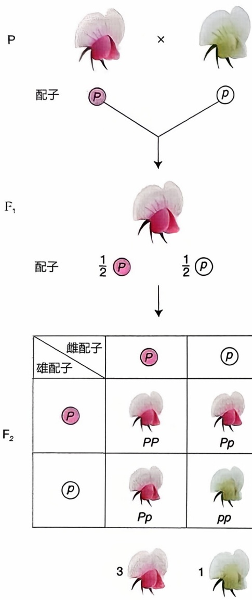

<details>
<summary>flowchart</summary>

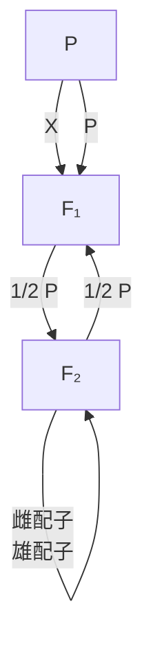
</details>

图1-1 豌豆中一对因子（紫花和白花）的杂交实验

## 一、孟德尔的豌豆杂交实验与遗传学的诞生

作为一门自然科学，遗传学的知识萌芽诞生于19世纪初的欧洲。这个时期，人们对生物遗传变异规律的主流观点是混合式遗传（blending inheritance），代表理论包括查尔斯·达尔文（Charles R. Darwin，1809—1882）提出的泛生论（hypothesis of pangenesis）。该理论认为身体各部分都存在一种“泛子”，决定细胞的分化和发育。各种泛子可随着血液循环汇集到生殖细胞中传递给后代。受精卵长成个体的过程中，泛子又不断地流到不同细胞中，控制细胞分化，产生特定的组织和器官。但是包括达尔文自己在内的很多学者也逐渐意识到这种学说存在严重的漏洞，那就是如果一直混合下去，遗传带来的结果必然是性状的均一化，这显然与自然界普遍存在的性状变异现象是相互矛盾的。这一时期还有英国植物学家托马斯·奈特（Thomas A. Knight，1759—1838）、德国植物学家约瑟夫·克尔罗伊特（Joseph G. Kölreuter，1733—1806）和卡尔·格特纳（Karl F. von Gärtner，1772—1850）等人开始通过植物杂交实验进行遗传研究，他们发现性状不同的两个亲本杂交，有时候后代并不是相同的居中性状，而是两种亲本性状以一定的比例出现。但是，他们都没有真正揭示这些现象背后的机制，直至格雷戈尔·孟德尔（Gregor J. Mendel，1822—1884）的出现。

豌豆是孟德尔的主要研究对象。在豌豆品种中，紫花和白花是一对相对性状。将开紫花的纯系植株与开白花的纯系植株，即亲代（parental generation，P）杂交（图1-1），得到的子一代（first filial generation、 $F_{1}$ ）植株全部开紫花。因为只有紫花的性状在 $F_{1}$ 中显示出来，紫花对白花是显性性状（dominant character），白花是隐性性状（recessive character）。 $F_{1}$ 的紫花植株自交，得到的子二代（second filial generation， $F_{2}$ ）中，除紫花植株外，又出现了特定比例的白花植株。在 $F_{2}$ 中隐性性状重新出现的现象被称作分离（segregation）。除了研究紫花和白花这一对相对性状，孟德尔还在豌豆中研究了其他6对相对性状，它们的遗传方式与花色一致，即在 $F_{2}$ 中都出现了分离现象，而且，显性性状的个体数目与隐性性状的个体数目的比值都接近3:1（表1-1）。

表 1-1 孟德尔的豌豆杂交实验（7 对相对性状）中 ${\mathrm{F}}_{2}$ 植株的统计结果

| 相对性状(显性/隐性) | 显性植株数目 | 显性植株比例/% | 隐性植株数目 | 隐性植株比例/% |
| --- | --- | --- | --- | --- |
| 紫花/白花 | 705 | 75.89 | 224 | 24.11 |
| 饱满子叶/皱缩子叶 | 5 474 | 74.74 | 1 850 | 25.26 |
| 黄色子叶/绿色子叶 | 6 022 | 75.06 | 2 001 | 24.94 |
| 成熟豆荚不分节/分节 | 882 | 74.68 | 299 | 25.32 |
| 未成熟豆荚绿色/黄色 | 428 | 73.79 | 152 | 26.21 |
| 花腋生/花顶生 | 651 | 75.87 | 207 | 24.13 |
| 高植株/矮植株 | 787 | 73.97 | 277 | 26.03 |

孟德尔为了解释这些结果，提出了7点假设:①遗传性状由遗传因子（现在被称为等位基因）决定；②每个植株内有许多成对的遗传因子；③雌雄生殖细胞内只含有每对遗传因子中的一个；④在每对遗传因子中，一个来自父本的雄性生殖细胞，一个来自母本的雌性生殖细胞；⑤生殖细胞形成时，每对遗传因子相互分开，分别进入不同的生殖细胞中；⑥雌雄生殖细胞的结合是随机的；⑦遗传因子有不同形式，即显、隐性之分。在这些假设的基础之上，我们就可以来解释紫花和白花的杂交结果了（见图1-1）。紫花是显性性状，决定该性状的遗传因子用字母 $P$ 来表示；白花是隐性性状，决定该性状的遗传因子用字母 $p$ 来表示。按照前面的假设，亲代紫花植株的细胞中有两个紫花因子，写作PP；亲代的白花植株的细胞中有两个白花因子，写作pp。紫花植株产生的生殖细胞中只有一个 $P$ ；白花植株产生的生殖细胞中只有一个 $p$ 。受精时，雌雄配子相互结合，两个因子加在一起，成为 $Pp$ 。因为紫花因子 $P$ 对白花因子 $p$ 是显性，所以 $\mathrm{F}_1$ 的植株都开紫花。$\mathrm{F}_1$ 产生的配子，只能得到两个遗传因子中的一个。这时因子 $P$ 与 $p$ 就分离，产生两种配子（雌雄配子都是两种），一种有 $P$ ，另一种有 $p$ 。两种配子的数目相等，是 $1:1$ 。因为雌雄配子各有两种，受精时就可有4种不同的组合:① $P$ 雌配子与 $P$ 雄配子结合，形成PP；② $P$ 雌配子与 $p$ 雄配子结合，形成 $Pp$ ；③ $p$ 雌配子与 $P$ 雄配子结合，形成 $pP$ ；④ $p$ 雌配子与 $p$ 雄配子结合，形成$pp$ 。所以，在 $\mathrm{F}_2$ 植株中，$1/4$ 是 $PP$ ，$2/4$ 是 $Pp$ ，$1/4$ 是 $pp$ 。由于 $P$ 对 $p$ 是显性，因此$1/4$ 的 $PP$ 和 $2/4$ 的 $Pp$ 都是开紫花的，只有 $1/4$ 的 $pp$ 是开白花的，最终 $\mathrm{F}_2$ 中紫花植株与白花植株的比例是 $3:1$ 。

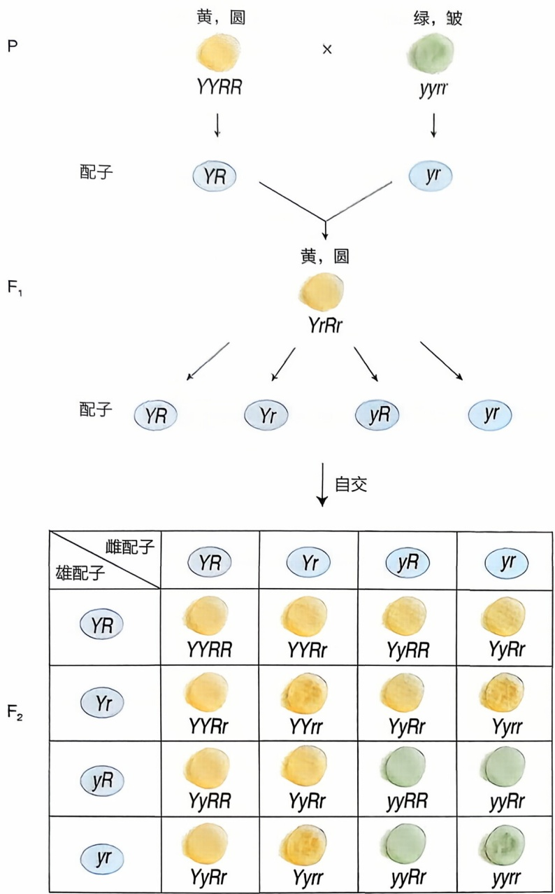

图1-2 豌豆中两对因子（饱满子叶与皱缩子叶、黄色子叶与绿色子叶）的杂交实验

孟德尔的一对相对性状的实验结果，后人把它归纳为孟德尔第一定律，又称分离定律（law of segregation），它指的是杂合子形成配子时，每对遗传因子（等位基因）相互分离进入不同配子中，两种类型的配子数目相同。分离定律说明，一对遗传因子（等位基因）在杂合状态中保持相对的独立性，在配子形成时，可独立分离到不同配子中去。在一般情况下，杂合子的配子分离比是 $1:1$ ，$\mathrm{F}_2$ 基因型分离比是 $1:2:1$ ，$\mathrm{F}_2$ 表型分离比是 $3:1$ 。分离后的隐性纯合子和隐性亲本在表型上是一样的，隐性遗传因子（隐性等位基因）并不因为和显性遗传因子（显性等位基因）在一起而改变它的性质，也就是说遗传因子是独立的单元，这就是孟德尔揭示的遗传规律。

在完成了一对相对性状的研究之后，孟德尔又针对两对性状的遗传进行了研究，发现两对性状之间是自由组合的，后人把这种现象归纳为孟德尔第二定律，或称自由组合定律（law of independent assortment）。如图1-2所示，子叶黄色和绿色是一对相对性状，决定这对相对性状的遗传因子分别用 $Y$ 和 $y$ 表示；子叶饱满和皱缩是另一对相对性状，决定这对相对性状的遗传因子分别用 $R$ 和 $r$ 表示。这样，亲本子叶黄色饱满的遗传因子组成，即基因型是YYRR，产生的配子只有一种，全为YR；亲本子叶绿色皱缩的基因型是yyrr，产生的配子也只有一种，全是yr。YR配子与yr配子结合，产生的 $\mathrm{F}_1$ 基因型是YyRr，表

型是子叶黄色饱满。 $F_{1}$  则可以产生4种配子，数目相等，即比例是1:1:1:1。从图1-2中可以看到，雌雄配子组合而成的 $F_{2}$  共有9种基因型。由于一些基因型的表型是相同的，因此表型只有4种，分离比例为:黄色饱满:黄色皱缩:绿色饱满:绿色皱缩 = 9:3:3:1，这一比例也和真实的实验结果相符。利用自由组合定律我们可以将两对基因的遗传规律推广到更多对基因中，因为只要是遵循自由组合定律的不同基因，它们的分离就都是独立的，子代的表型是基因型不同组合的结果（表1-2）。

在孟德尔之前，奈特、克尔罗伊特和格特纳等人都做过植物杂交实验，甚至也采用了豌豆作为实验材料，并也得到过类似的 $3:1$ 的分离结果。但他们都无法突破当时的科学局限，也没有创造性地利用数学作为研究生物学问题的工具。孟德尔曾在他的论文中指出这些学者的实验不足，包括没有对杂种子代中不同类型的植株进行分类计数、没有区分杂种后代的代次，观察每一代中的植株情况，也没有明确每一代中不同类型植株数之间的统计关系。孟德尔的伟大发现在于他善于总结前人的工作经验和教训，并利用刚刚开始出现的生物统计学方法将实验数据近似的3:1分离归结于理论的分离比。今天，研究者可以运用恰当的数学方法科学分析遗传学实验获得的各项数据（知识窗1-1）。

表 1-2 不同对数基因杂交得到的基因型与表型

| 杂交基因对数 | $F_2$表型数(完全显性的情况) | 表型分离比 | $F_2$基因型数 | 基因型分离比 |
| --- | --- | --- | --- | --- |
| 1 | 2 | $(3+1)^1$ | 3 | $(1+2+1)^1$ |
| 2 | 4 | $(3+1)^2$ | 9 | $(1+2+1)^2$ |
| 3 | 8 | $(3+1)^3$ | 27 | $(1+2+1)^3$ |
| ... | ... | ... | ... | ... |
| n | $2^n$ | $(3+1)^n$ | $3^n$ | $(1+2+1)^n$ |

## 知识窗1-1

## 孟德尔遗传中的数据分析

尽管孟德尔当时对他自己所得的分离比例并未做过统计学分析，但他已经发现只有子代个体数较多时才比较接近他提出的分离比，子代个体数不多时，会有明显的波动。从今天的统计学角度看，如果我们获得的样本量（子代数量）越多，那么实际分离比与理论分离比之间的偏差会随着样本量（$n$）的增加而减少。这是因为实际分离比（$\hat{p}$）是理论分离比（$p$）的估计值，属于随机变量，其方差为 $p(1 - p)/n$，因此该方差与样本量成反比。遗传学的杂交实验是以生物个体为单位的，通常单位的数量不会很大，因此配子形成和合子形成过程中往往存在较为明显的随机取样误差，从而造成了实际分离比随机波动的现象。

另外，我们现在也可以用统计学方法来检验一次杂交实验的结果是否符合孟德尔分离定律。例如，我们可以用卡平方统计量来做适合性检验，推断实际的分离比是否符合孟德尔的理论分离比。我们对实际每种性状的数量与理论预期数量的偏差的平方除以理论预期数量，然后求和，得到卡平方值（公式见后），进而得到统计检验的 $P$ 值。如果 $P < 0.05$ ，则说明实际观察数值的分布与理论预期相符的概率低于0.05，不太可能是由于随机波动造成的，应判定为不符合孟德尔分离比，反之，如果 $P > 0.05$ ，则判定为符合。

$$
\chi^ {2} = \sum {\frac {\left(\text {实得数} - \text {预期数}\right) ^ {2}}{\text {预期数}}}
$$

从孟德尔的经历中我们可以看到，理论的创新发展不仅需要批判性地继承前人的知识，有时候还需要灵活大胆地尝试交叉学科的知识和方法。在现代生命科学的研究中，数学、物理、化学和人工智能等多学科的深度融合正在推动学科的创新发展。例如，统计学能够帮助遗传学家从海量的组学数据中提炼出有价值的生物信息；物理学在生物医学成像等技术中发挥着不可替代的作用；化学是认识生命反应过程，进行药物设计与合成的必要基础；人工智能更是为生命科学领域带来了重大变革，在当下的生物数据分析、疾病预测模型构建等方面展现出巨大潜力。可见，多学科交叉融合已经成为现代生命科学创新发展的关键所在。只有像孟德尔那样勇于打破学科壁垒，大胆假设并小心求证，我们才能在科学研究的道路上走得更远。

## 二、摩尔根的基因论与基因概念的发展

在孟德尔提出了性状由成对遗传因子决定之后，威廉·约翰森（Wilhelm L. Johannsen，1857—1927）在1909年首次提出基因一词，用于描述孟德尔所说的遗传因子。1909年，刚刚转入哥伦比亚大学动物系不久的美国遗传学家托马斯·摩尔根（Thomas H. Morgan，1866—1945）开始以黑腹果蝇（Drosophila melanogaster）为实验材料开展遗传学研究。果蝇具有很多适合遗传学研究的优点，它体型小，饲

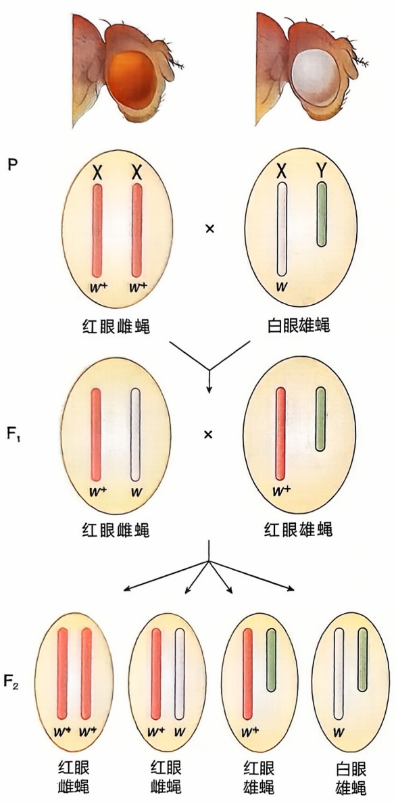

<details>
<summary>flowchart</summary>

This diagram illustrates the evolutionary relationships and genetic differentiation of red eye雌蝇 and white eye male蝇 in humans, showing how they interact with other organisms.
</details>

图1-3 白眼雄蝇与野生型红眼雌蝇的杂交

亲代红眼雌蝇的性染色体组成是两条 X 染色体，上面都携带了野生型等位基因  $w+$ ；白眼雄蝇的染色体组成是 XY，其中 X 染色体上携带了突变型等位基因 w（果蝇遗传学中基因的名称往往根据突变的表型来命名，白眼表型是 white eye，所以白眼基因用 w 基因表示），Y 染色体较短，上面没有相应的等位基因。

养容易，生活史短（在 $25^{\circ}\mathrm{C}$ 时经12天就可以完成一个世代），而且果蝇生命力强，繁殖率高。此外，果蝇还有很多容易观察的性状等。1910年的一天，摩尔根实验室饲养的大量野生型红眼果蝇中出现了一只白眼的雄性果蝇。摩尔根将这只白眼雄蝇与正常的红眼雌蝇交配，他发现，获得的 $\mathrm{F}_{1}$ 不论雌雄都是红眼的。如果继续将这些 $\mathrm{F}_{1}$ 自交产生 $\mathrm{F}_{2}$，又会发现:雌的全是红眼，雄的半数是红眼，半数是白眼（图1-3）。为了进一步确认白眼性状是否和性别有关，他又将最初的那只白眼雄蝇和 $\mathrm{F}_{1}$ 的红眼雌蝇杂交，发现后代中雌雄都有红眼和白眼，且比例接近（图1-4）。摩尔根据此提出了决定眼色的基因位于果蝇的X染色体上，因为雌雄果蝇的性染色体组成不同，雄蝇有且只有一条X染色体。由于性染色体上基因的遗传方式具有和性别相关的特点，所以被称为伴性遗传（sex-linked inheritance）。

根据白眼果蝇的实验，摩尔根第一次把一个特定基因（w）与一特定染色体（X染色体）联系了起来。随后，他和他培养的三位学生，艾尔弗雷德·斯特蒂文特（Alfred H. Sturtevant，1891—1970）、赫尔曼·穆勒（Hermann J. Muller，1890—1967）和卡尔文·布里奇斯（Calvin B. Bridges，1889—1938）通过大量的实验系统阐述了基因和染色体之间的关系。首先，既然基因位于染色体上，那位于同一条染色体上的非等位基因是否还会遵循孟德尔的自由组合定律呢？为了回答这一问题，摩尔根对生物性状的遗传规律进行了补充和完善，提出了连锁定律（law of linkage），即遗传学第三定律。

果蝇的黑体（black body）和残翅（vestigial wing）这两个突变体是由位于2号染色体上的两个非等位基因决定的，利用纯合的黑体长翅果蝇与纯合的灰体残翅果蝇进行杂交，结果发现位于同一条染色体上的非等位基因并不能够完全自由组合，而是更倾向于同时传递给后代，表现出连锁（linkage）

的关系，子代的表型与亲本相同；但与此同时，后代中也会出现少数不同于亲本的重组（recombination）类型，但比例远低于自由组合的结果。1913年，斯特蒂文特在摩尔根的指导下进一步建立了用于检测果蝇染色体上基因顺序的专门技术，并利用重组值的大小反映位于同一条染色体上基因之间距离的远近，揭示了基因在染色体上的直线排列方式以及基因之间的连锁关系。最终，他们发现果蝇的多个基因可以分为4个相互连锁的组，这正好对应于果蝇的4套染色体。连锁和重组现象的发现不仅丰富了性状的传递规律，更揭示了遗传多样性的另一个重要来源——位于同一条染色体上的非等位基因能够通过重新组合不同亲本的基因类型，产生新的基因型和表型，为生物群体提供更多的遗传变异，有助于生物体适应变化的环境，不断发展进化（详见第三章）。

1915年，摩尔根和他的学生在大量实验证据的基础上系统阐述了基因和染色体行为之间的一致性，出版了《孟德尔遗传的机制》（Mechanism of Mendelian Heredity）一书。1916年，布里奇斯进一步发现了果蝇的X染色体不分离（nondisjunction）现象，为基因在染色体上提供了更为坚实的证据。将白眼雌蝇与红眼雄蝇交配，通常子代雌蝇都是红眼、雄蝇都是白眼，但会有少数例外，大约每2000个子代中会出现一个例外的白眼雌蝇或红眼雄蝇，而且重复多次实验都是这个比例。布里奇斯通过仔细的观察与分析提出，这些例外果蝇的产生是由于雌性果蝇的卵母细胞在减数分裂过程中出现异常，两条X染色体没有正常分离，而是同时进入了细胞一极，最终产生携带两条X染色体或者不携带任何X染色体的成熟卵子。如图1-5所示，如果携带两条X染色体的卵子和携带一条Y染色体的精子结合，后代发育为白眼雌蝇；不携带任何X染色体的卵子和携带一条X染色体的精子结合，后代就会发育为红眼雄蝇。这些推论与实际细胞遗传学实验观察到的染色体组成完全一致，而且进一步将例外的白眼雌蝇与正常红眼雄蝇杂交，得到的后代表型也完全符合预期。在这一系列的证据之下，当时的遗传学界逐渐接受了摩尔根的理论。

$F_{1}$

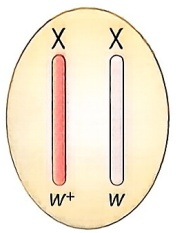

<details>
<summary>text_image</summary>

X
W+
X
W
</details>

红眼雌蝇

×

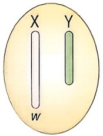

<details>
<summary>text_image</summary>

X
Y
W
</details>

白眼雄蝇

$F_{2}$

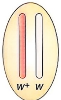

红眼雌蝇

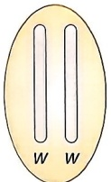

白眼雌蝇

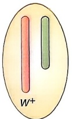

红眼雄蝇

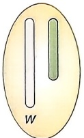

白眼雄蝇

图 1-4 白眼雄蝇与杂合子一代红眼雌蝇的杂交

P

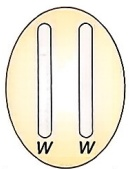

正常卵子

×

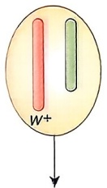

精子

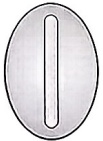

不分离卵子

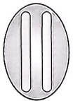

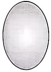

$F_{1}$


红眼雌蝇


死亡


例外
红眼雄蝇


白眼雄蝇


例外
白眼雌蝇


死亡

图1-5 果蝇的X染色体不分离现象

摩尔根实验室出现的第一只白眼果蝇是自发突变的结果，这种突变的频率极低，不利于遗传学的研究。摩尔根的另一个学生穆勒证明了X射线的照射可以大大提高果蝇的基因突变频率，并且突变率在一定范围内与X射线的剂量相关。穆勒还进一步建立了果蝇基因突变的检出方法，进一步促进了人们对基因突变的认识。1926年，摩尔根出版《基因论》，系统阐明了基因是遗传物质的重组单位、突变单位和功能单位，被简称为“三位一体”的基因概念（Morgan，1926）。摩尔根无疑是推动遗传学学科发展的重要历史人物，他和他的学生准确地找到了承载遗传因子的物质实体，发掘了果蝇这一良好的模式生物，揭示了连锁与交换的遗传学定律，并培养了一批优秀的学生继续发展和丰富遗传学研究的手段。中国遗传学的多位奠基人都深受摩尔根遗传学的影响。在20世纪中叶，遗传学在中国的发展曾经历了激烈的争论（知识窗1-2），但最终摩尔根遗传学在中国得到了积极的传播和发展。

## 知识窗1-2

## 摩尔根遗传学与米丘林遗传学的争论

孟德尔和摩尔根的遗传学理论并不是一经推出就得到了世人的接受，孟德尔的论文在沉睡了34年后才被其他学者“再发现”，而摩尔根遗传学也经历了和米丘林遗传学的激烈争论。米丘林遗传学是由苏联育种学家李森科提出的，以苏联植物育种学家伊万·米丘林（Ivan V. Michurin，1855—1935）的名字命名的一种遗传学说。米丘林是一位非常勤劳的育种学家，他在长期的果树育种实践中认识到孟德尔的遗传定律也有局限性，不适用于靠嫁接繁殖的多年生果树，但他并没有否定孟德尔定律，而是进行了一些修正和补充。但是，建立米丘林学说的李森科则把孟德尔和摩尔根的遗传研究看成伪科学，进行了全面否定，他坚持认为环境改变所引起的变异具有定向性，且这种获得性状能够遗传。

20世纪50年代，在我国学术界发生了一场长达8年之久的米丘林遗传学和摩尔根遗传学的尖锐争论，这场争论不仅引发了关于科学方法论和科学哲学的广泛讨论，还因为受到了政治因素的干扰，导致了一些不科学的结论和决策的产生，严重打击了刚刚起步的中国遗传学，一些学校被迫放弃教授摩尔根遗传学。但在这个艰难的时刻，一大批中国遗传学家仍然坚持真理，无所畏惧。例如，中国遗传学家谈家桢（1909—2008）、刘祖洞（1917—1998）等人坚持在复旦大学教授摩尔根遗传学，并继续开展亚洲异色瓢虫鞘翅色斑的遗传基础的研究工作。

1956年，毛泽东提出了“百花齐放、百家争鸣”的“双百方针”。同年8月，高等教育部和中国科学院在山东青岛组织召开了遗传学座谈会，与会专家们积极就我国的遗传学发展开展反思与讨论。谈家桢在这次座谈会上先后作了8次重要发言，尤其详细介绍了孟德尔和摩尔根的遗传理论，让尘封许久的遗传学重返中国的科学界。1956年、1957年复旦大学和北京大学先后设立了遗传学专业。1959年，谈家桢在全国率先恢复讲授摩尔根遗传学。与此同时，吴仲贤翻译了孟德尔的《植物杂交的试验》，卢惠霖翻译了摩尔根的《基因论》，这些代表性的遗传学译著影响了一大批中国生物学学者，中国的遗传学学科也得以恢复和发展。谈家桢曾说:“几十年遗传学的发展证明，不管是孟德尔还是摩尔根，他们的工作都有局限性，这反映了任何人都受到时代的局限，科学的发展需要一个过程。李森科抓住孟德尔遗传学中局部不完善的东西，否定其整个理论，这不是科学的态度。”

## 名词窗1-1

基因（gene）:孟德尔提出的遗传因子的现代概念，最初由丹麦学者约翰森在1909年提出，后来不断得到发展和修正。基因是遗传信息的基本单位，一般指的是位于染色体上能够编码一个特定功能产物（如多肽或RNA）的一段核苷酸序列（DNA或RNA）。

等位基因（allele）:位于相同基因座上、控制相同性状的不同遗传因子形式。例如，紫花因子 $P$ 和白花因子 $p$ 就是豌豆花色基因的不同等位基因形式。

基因型（genotype）:一个生物体或细胞内等位基因的组成。大多数生物是二倍体，含有两个等位基因，因此基因型符号通常包含两个字母。例如，PP、Pp 和 pp 就是决定不同花色的基因型。

基因组（genome）:一个生物体或细胞内所有基因或遗传物质的组成。

纯合子（homozygote）:两个相同的等位基因组成的基因型。例如，两个显性的紫花基因构成的 PP，两个隐性的白花基因构成的 pp。

杂合子（heterozygote）:两个不同的等位基因组成的基因型。例如，Pp 是一个杂合的紫花基因型。

表型（phenotype）:生物体或细胞表现出来的性状。例如豌豆的紫花和白花。表型是由基因型与环境相互作用共同产生的，需要发育或分化过程来实现。研究者通常会选择特定的物理化学方法进行测定。广义的表型泛指任何可观察到的生物性状，狭义的表型指特定基因型所表现出来的性状。

孟德尔性状（Mendelian character）:由单独一对等位基因控制的性状，也称为单基因性状（monogenic character）。例如，由 P 和 p 控制的花冠颜色。

## 第二节 遗传与发育的关系

发育（development）指的是多细胞生物从单细胞的受精卵到胚胎形成，直至产生成熟成体的变化过程。在17世纪，先成论（preformation theory）是发育生物学的主流思想，这一思想认为，成体是由预先存在于生殖细胞中的雏形不断生长放大发展而成的。例如，人体胚胎的发育只不过是在精子（“精原说”）或卵子（“卵原说”）中早已包含着的一个完整小人在发育中不断增大。因此，先成论认为有机体是先成的，不存在真正的发育。在有了显微镜技术后，一些学者能够在光学显微镜下看到一些物质的外部轮廓，他们发表了不少论文，声称自己在镜下观察到了“小人”和“小动物”。但这些仅凭想象力提出的观点是经不起实践检验的。随着科学的不断发展，研究者逐渐观察到胚胎发育是从简单的形态结构逐渐形成复杂形态结构的过程，这就是后成论（epigenesis theory）。今天，利用更加精密的显微成像和示踪技术，我们可以清晰地看到个体发育过程中广泛存在的细胞分化、细胞迁移、胚胎的形态改变、器官和组织的逐渐建成等现象。个体发育实际上是一个生物有机体的自我构建和自我组织的复杂过程，而且毋庸置疑的是，这一过程受到来自内部因素（遗传）和外部因素（环境）的精密调控。

## 一、遗传物质是发育的基础

植物种子的萌发是大家都很熟悉的自然现象，在适宜的温度和湿度下，种子就能自发地长出根系，并萌发幼芽。动物的受精卵其实亦是如此，只要环境合适，它们就会启动一个复杂但高度有序的发育过程。这些自然现象不由得让人们思考到底是怎样的内部因素决定了个体发育。答案仍然是遗传物质，发育与遗传是密不可分的。一方面，发育是从基因型到表型的过程。我们前面提到的所有性状，孟德尔研究的豌豆花色、摩尔根关注的果蝇眼色，这些性状的形成都是发育的结果，基因变异导致发育过程中出现了扰动，因此表型也发生了变化。另一方面，发育过程本身也受到遗传和变异的调控。这是因为发育需要连续不断的细胞有丝分裂，而每一次的有丝分裂过程都需要遗传物质的精确复制和均等分离。从一个受精卵长成为一个新个体，每个体细胞细胞核中的基因（组）都是等同的（不考虑体细胞中低频出现的基因重组和突变），遗传的作用保证了每个受精卵发育成为特定物种中的特定个体。与此同时，在发育中受精卵细胞不仅通过增殖增加数量，还通过分化形成形态、功能各不相同的细胞类型，成为一个复杂的多细胞生物。含有相同基因组的细胞能够在特定遗传机制的调控下发展成为一个高度有序的有机整体。

在摩尔根时代，遗传学研究者通常关注果蝇成体的表型变化（而不是胚胎的发育过程），例如复眼的颜色、翅膀的形态都是成体的表型，而发育生物学研究者的侧重点是胚胎的形成机制，并且主张环境因素，而非遗传因素，是促进胚胎发育的关键因子。直到20世纪30年代，美国发育遗传学家唐纳德·波尔森（Donald F. Poulson, 1910—1989）独立开展了一系列果蝇胚胎发育与染色体异常的研究，尤其是Notch突变体，揭示了遗传和发育的重要内在联系。摩尔根实验室很早就记录过Notch突变，它是X染色体连锁的遗传变异，在雌蝇中，Notch的杂合缺失突变会导致雌性果蝇翅的边缘造成缺刻，因此得名（图1-6）。Notch的纯合突变雌蝇和杂合突变的雄蝇（只有一条X染色体）都在胚胎阶段死亡。波尔森通过一系列仔细的胚胎观察发现，Notch突变实际上直接影响到了果蝇早期胚胎的发育，突变体胚胎丧失了胚层的分化，所有成形的组织和器官（形态高度异常）都是外胚层起源，神经系统和肠道过度发育，丧失中胚层和内胚层的分化，缺少表皮组织等（Poulson, 1937）。这项研究推翻了当时的环境决定胚胎发育的观点，率先揭示了遗传物质在个体发育中的重要作用。现在已经知道，Notch信号通路实际是个体发育中最重要的信号转导途径之一，在从

果蝇、线虫到哺乳动物的各个物种中都高度保守，在调节细胞凋亡、分化和迁移中发挥了关键作用。

20世纪50至70年代，另一位利用果蝇研究遗传和胚胎发育的代表性科学家是美国遗传学家爱德华·刘易斯（Edward B. Lewis，1918—2004），他在分析胚胎发育异常的突变果蝇时发现，一些调控果蝇体节特异性发育的关键基因相邻分布在染色体上.构成了一个基因复合体，复合体内的基因变异能够导致果蝇胚胎的一个节段转变为另一个节段，即同源异形突变（homeotic mutation）。本书后续的发育生物学章节将向大家详细介绍同源异形基因调控发育的作用与机制。

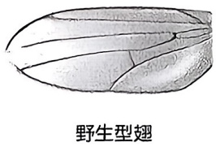

<details>
<summary>text_image</summary>

野生型翅
</details>

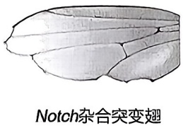

<details>
<summary>text_image</summary>

Notch杂合突变翅
</details>

图1-6 携带Notch杂合突变的雌蝇翅

## 二、胚胎发育相关基因的大规模筛选

19世纪末到20世纪初，发育生物学研究进入了实验胚胎学的阶段，代表性科学家是德国胚胎学家威廉·鲁（Wilhelm Roux，1850—1924）和汉斯·施佩曼（Hans Spemann，1868—1941），代表性成果是1924年施佩曼通过组织者（organizer）移植实验证明细胞之间存在诱导（induction）作用。后来，随着生物化学技术的发展，研究者尝试从早期胚胎中分离纯化控制发育的关键因子，但由于这些调控因子的数量少、稳定性差，并未取得理想的进展。直到1979至1980年，位于海德堡的欧洲分子生物学实验室的德国生物学家克里斯蒂安娜·尼斯莱因-福尔哈德（Christiane Nüsslein-Volhard）和美国发育生物学家埃里克·维绍斯（Eric Wieschaus）利用遗传分析的方法才打破了发育生物学机制研究的僵局。他们利用正向遗传分析策略对果蝇早期胚胎发育的遗传机制进行了全面分析（Nüsslein-Volhard & Wieschaus，1980）。这项工作也是遗传学历史上第一次在多细胞真核生物中开展的诱变工作，并大获成功，被称为海德堡筛选（详见第七章）。

两位研究者首先选定了果蝇早期胚胎发育的遗传机制这个科学问题，通过利用甲基磺酸乙酯（ethyl methane sulfonate，EMS）对果蝇进行随机诱变，这是一种带有活泼烷基的烷化剂，可造成碱基对的配对改变，实现基因诱变。实验的第二阶段是培育

突变品系，将诱变雄蝇与雌蝇交配得到 $F_{1}$ 。在特定剂量EMS的随机诱变作用下，各个 $F_{1}$ 果蝇在基因组的不同位置携带了不同的单拷贝基因突变（非致死的），将 $F_{1}$ 和野生型果蝇做单对杂交，可以得到携带相同突变的 $F_{2}$ 果蝇， $F_{2}$ 自交就能够在 $F_{3}$ 中得到各突变品系的杂合子和纯合子（图1-7）。实验的第三阶段，对 $F_{3}$ 的早期胚胎发育过程进行表型筛选。正常的果蝇胚胎在受精后10 h左右就能形成原肠胚，胚胎表面一系列均匀间隔的沟槽将胚胎沿着头尾的轴向有序划分出头部、胸部和腹部共计14个副体节。尼斯莱因-福尔哈德和维绍斯对经过诱变后的果蝇胚胎进行了深入分析，他们发

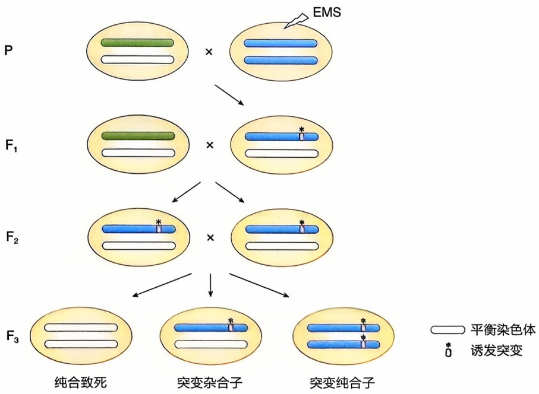

<details>
<summary>flowchart</summary>

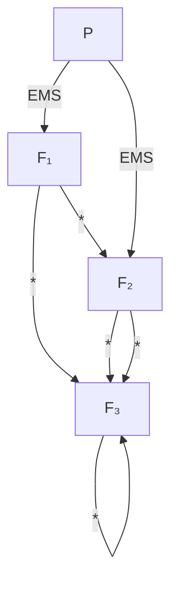
</details>

图1-7 海德堡筛选中诱变果蝇与繁育突变品系的简要流程

## 名词窗1-2

正向遗传学（forward genetics）:即通过生物个体或细胞的基因组的自发突变或人工诱变，首先寻找相关的表型或性状改变，然后从这些特定性状变化的个体或细胞中找到对应的突变基因，并揭示其功能的研究方法。

诱变（mutagenesis）:利用各种物理、化学和生物因子等因素，引起基因发生突变的过程。

模式形成（pattern formation）:胚胎发育过程中，卵裂形成的细胞团按照一定的时空模式精确有序地形成各种结构体的过程，包括体轴的建立和胚层的特化。

副体节（parasegment）:果蝇早期胚胎发育到原肠胚时出现的14个节段。这些节段与成虫真正的体节交错了半个体节的位置，即每个体节由上一个副体节的后半区室与下一个副体节的前半区室构成。

裂隙基因（gap gene）:果蝇胚胎发育早期控制相邻副体节发育的基因，它的突变会导致果蝇胚胎副体节发生的异常，产生大段的裂隙。

成对规则基因（pair-rule gene）:果蝇胚胎发育中控制相邻一对副体节形成的基因，它的突变会导致果蝇胚胎缺失一半的奇数或偶数体节。

体节极性基因（segment polarity gene）:果蝇胚胎发育中控制副体节内部极性的基因，它的突变会导致果蝇胚胎的各个副体节丧失头尾轴的极性。

现并收集了600个左右在果蝇胚胎模式形成中发生缺陷的突变体。对不同的突变表型进行了分类后发现，有的胚胎躯干上出现了大段缺失，连续缺失了好几个体节，有的是缺失了全部奇数或全部偶数的体节，还有的是丧失了体节内部前后轴的极性。在项目研究的最后一个阶段，他们对各个突变体进行基因定位，发现这600多个突变体大约对应了120个基因（一个基因可以有多个不同的突变体）。而这些基因无疑在果蝇早期胚胎发育中发挥重要作用，被分别命名为裂隙基因、成对规则基因和体节极性基因。

尼斯莱因-福尔哈德和维绍斯开展的这项海德堡筛选工作的影响力之大，以至于在这之后的近十年中，世界各地的果蝇实验室都在围绕他们发现的突变体和基因开展果蝇的发育生物学研究。更为重要的是，后来的研究揭示，调节果蝇胚胎发育的很多基因在进化中是非常保守的，它们也存在于哺乳动物包括人类的基因组中，为认识个体发育及人类疾病/性状的发生提供了重要基础（详见第十一、十二章等）。

## 第三节 遗传分析

遗传学发展的早期，孟德尔利用豌豆揭示了遗传因子的分离和自由组合定律，摩尔根利用果蝇揭示了基因在染色体上。二者的开创性工作有很多共同点:首先，都利用了模式生物来揭示生命的一般规律；其次，都从模式生物的表型变异入手，确切地说，是从一对相对性状入手。孟德尔研究的是紫花与白花豌豆，摩尔根研究的是红眼与白眼果蝇。孟德尔假设不同的遗传因子决定了紫花与白花的表型，摩尔根进一步证明存在于X染色体上white基因的突变导致了白眼性状。再看尼斯莱因-福尔哈德和维绍斯的海德堡筛选、他们通过人工诱变获得了很多不同于野生型的突变性状，然后寻找到被诱变的基因，建立基因型与表型的关系。总结以上这些研究方法的基本特征，不难看出，遗传学家们都是从突变体入手，利用它们与野生型个体的表型差异寻找其中的遗传机制。这是遗传学独有的分析思路，而这种遗传分析方法帮助研究者们解决了很多复杂的生命科学问题，推动了其他生命科学分支学科的发展与协作，这里先举几个代表性的案例。

## 一、大肠杆菌 DNA 聚合酶的鉴定

1957年，美国生物化学家阿瑟·科恩伯格（Arthur Kornberg，1918—2007）首次在试管中用脱氧核糖核苷酸、DNA模板和他从大肠杆菌（Escherichia coli）中纯化的一种蛋白质组分等成功完成了DNA的体外合成，轰动一时。随后，他将该蛋白质命名为DNA聚合酶（DNA polymerase），即负责大肠杆菌DNA复制的酶。两年后科恩伯格获得了诺贝尔生理学或医学奖，以表彰他在DNA生物合成分子机制中的发现。但事实上，当时科恩伯格纯化出的DNA聚合酶并非是大肠杆菌DNA复制的关键酶，而是参与DNA损伤修复的聚合酶。大肠杆菌含有5种DNA聚合酶:科恩伯格当年纯化的是DNA聚合酶I（DNA polymerase I），此外还有DNA聚合酶Ⅱ～V（DNA polymerase Ⅱ～V）。负责大肠杆菌体内DNA复制的是DNA聚合酶Ⅲ，具有3种重要的酶活性: $5'\rightarrow3'$ 聚合酶活性、 $3'\rightarrow5'$ 核酸外切酶活性和仅对单链DNA发挥作用的 $5'\rightarrow3'$ 核酸外切酶活性，这些酶活性是其介导DNA复制作用所必需的。相反，DNA聚合酶I、Ⅱ、Ⅳ和V则主要在不同的DNA损伤修复中发挥作用。由于DNA聚合酶Ⅲ在细胞内含量较低，利用分离纯化的传统生化技术难以获得。那后来的研究者是如何发现这一“错误”的呢？这要归功于大肠杆菌的遗传分析工作。

1969 年，美国分子生物学家约翰·凯恩斯（John Cairns，1922—2018）和他的团队利用随机诱变获得了大肠杆菌的多个突变品系，并且意外地发现其中包含了科恩伯格纯化得到的 DNA 聚合酶的编码基因 polA 的突变体菌株（Lucia et al.，1969）。由于 polA 突变体已经丧失了该酶  $5'\rightarrow3'$  聚合酶活性，理论上该突变菌株应该是无法正常存活的。但表型分析的结果是，突变菌株的 DNA 复制照常进行（只是对紫外照射敏感）。这一发现非常重要，它意味着大肠杆菌的 DNA 复制并不依赖于该酶的活性，负责大肠杆菌 DNA 复制的另有其他分子。在这项重要的遗传学工作的启发下，后来的生物化学家才纯化出了大肠杆菌的其他 DNA 聚合酶，包括负责 DNA 复制的 DNA 聚合酶Ⅲ。可见，遗传分析能够帮助研究者发现体内基因产物的真实功能，弥补体外合成这一代表性生物化学技术的不足之处。

## 二、酵母细胞分裂的分子机制

细胞周期的调控机制是生命科学领域另一个非常有吸引力的科学问题。最初，不少生物化学家首先尝试利用爪蟾、人类细胞等材料分离纯化不同细胞周期时相中的差异蛋白，但是进展缓慢。后来，遗传学的研究思路和另一种良好的模式生物——酵母在细胞周期调控机制的研究领域大放光彩。

20世纪60年代初，美国细胞生物学家利兰·哈特韦尔（Leland Hartwell）率先以酿酒酵母（Saccharomyces cerevisiae）作为实验对象研究细胞周期的调控机制（Hartwell，1967）。他建立了一套酵母的温度敏感型突变筛选技术，即将经过随机诱变的菌株先放在 $23^{\circ}\mathrm{C}$ 下正常培养，然后通过影印的方法接种到两个平板中，一个继续在 $23^{\circ}\mathrm{C}$ 下培养，另一个转移到 $36^{\circ}\mathrm{C}$ 高温下培养，筛选那些在正常条件下可以生长但是在高温下出现生长缺陷的突变体。之所以采用这种方法进行筛选是因为他意识到细胞周期进程一旦被破坏，酵母很可能无法存活（也就无法获得对应的突变品系），而温度敏感突变的筛选方法可以很好地解决这一问题。最终，他获得了上百个突变体，其中的一些出现了周期相关的表型——生长停滞在了特定的细胞周期时相。通过互补实验分析，哈特韦尔确认这些突变属于数十个不同的基因，他把它们统一命名为细胞分裂周期基因（cell division cycle genes, cdc）。例如，cdc28负责启动细胞从 $\mathrm{G}_{1}$ 期进入S期，cdc28的温度敏感突变菌在高温下不能出芽，停留在了 $\mathrm{G}_{1}$ 期。

在哈特韦尔的工作启发下，另一位英国遗传学家保罗·纳斯（Paul Nurse）在20世纪70年代，以裂殖酵母（Schizosaccharomyces pombe）为材料，通过相似的遗传筛选方法也获得了调控细胞周期进程的关键基因（Nurse，1986）。野生型裂殖酵母在细胞生长到一定长度后一分为二完成分裂，但纳斯发现，cdc2（和酿酒酵母的cdc28同源）和cdc25的突变型酵母即使生长得很长也不完成分裂，而wee1基因突变的酵母在还没有伸长的时候就提前开始了分裂（图1-8）。更有趣的是，cdc25和wee1都发生突变的个体可以正常分裂。通过更多的遗传分析，纳斯发现裂殖酵母的cdc2是调节细胞周期的关键基因，它编码的是一种周期蛋白依赖性激酶（cyclin-dependent kinase，CDK），在活性条件下促进细胞周期的进行。而cdc25和wee1分别是cdc2的促进型和抑制型调控因子。两位学者利用遗传筛选的方法不仅获得了通过生化手段已经纯化得到的一些细胞周期调节因子的编码基因，还获得了大量生化手段没有纯化出来的蛋白质的编码基因，尤其是一些含量极低的CDK调节基因。

细胞周期调节的另一个关键因子周期蛋白（cyclin）最早是由英国分子生物学家蒂姆·亨特（Tim Hunt）在无脊椎动物海胆的胚胎中通过分离纯化发现的，因为其表达水平随细胞周期发生变化，因此被命名为周期蛋白（Hunt，1991）。亨特根据周期蛋白的表达变化推测它在细胞周期调节中的重要作用，但他也进一步利用遗传学方法证明细胞周期的正常进展依赖于周期蛋白的参与，因为周期蛋白缺陷的菌株同样出现了细胞周期时相的停滞。

图 1-8 裂殖酵母的不同细胞周期调控因子的突变体

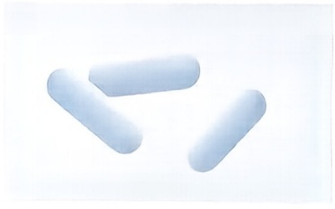

<details>
<summary>natural_image</summary>

Three light blue capsule-shaped pills on a white background (no text or symbols)
</details>

野生型

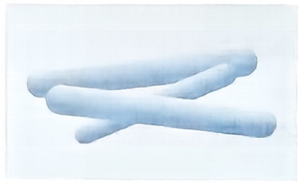

<details>
<summary>natural_image</summary>

Two light blue cylindrical objects arranged diagonally on a white background (no text or symbols)
</details>

cdc25 突变体

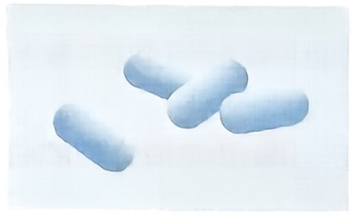

<details>
<summary>natural_image</summary>

Four light blue capsules arranged diagonally on a white background (no text or symbols)
</details>

wee1突变体

特别值得指出的是，利用遗传学方法在酵母中发现的细胞周期调控机制同样在高等生物如哺乳动物细胞中存在，这意味着真核细胞的细胞周期受到非常保守的调节机制的控制。生物学家们综合利用遗传学和生物化学等技术手段，才成功揭示了细胞周期的调控机制。

## 三、Ras信号转导通路与线虫发育

信号转导（signal transduction）指的是生物细胞在胞外/胞内信号的刺激下，引发细胞内的一系列生物化学反应和/或蛋白质相互作用，最终调节特定效应基因的表达，实现细胞增殖、分化、凋亡等各种生物学效应的过程。Ras编码一种和GTP结合的细胞信号转导分子，位于细胞膜的细胞质一侧，负责将细胞外信号传入胞内，在细胞增殖等细胞活性中扮演重要调控作用。1982年，包括癌症学家罗伯特·温伯格（Robert A. Weinberg）在内的多个团队从人膀胱癌细胞系中克隆到了Ras。Ras因在大鼠肉瘤（rat sarcomas）中鉴定得到而得名，它是研究者们克隆得到的第一个癌基因，也是一类对肿瘤发生发展有促进作用的肿瘤相关基因。

临床上近三分之一的肿瘤患者都携带Ras基因的突变，因此研究Ras的致病机制具有非同寻常的意义。研究者们很快就揭示了肿瘤细胞中的Ras存在一个错义突变，第12位氨基酸从甘氨酸变成了缬氨酸，正是这个错义突变改变了RAS蛋白质的结构，使其一直处于激活状态，进一步促进了细胞的无限增殖。但后续的研究陷入了僵局，很多研究者想从肿瘤细胞系中分离纯化RAS所在信号转导途径的下游分子并解析Ras这一信号通路，结果发表了上千篇相互矛盾的文章。直至近十年之后，遗传学家保罗·斯特伯格（Paul W. Sterberg）和华人遗传学家韩珉利用线虫（Caenorhabditis elegans）这一模式生物开展遗传分析，才真正揭示了Ras介导的信号转导通路，并发现了它在线虫器官发育中的关键作用。

在线虫中，RAS 的编码基因是 let-60，遗传分析显示 let-60 功能获得型突变的线虫阴门（vulva）发育异常，出现多阴门（multivulva，Muv）表型。韩珉等人随后发现另一个基因 lin-45 的功能降低型突变导致了无阴门（vulvaless，Vul）的表型（图 1-9），该基

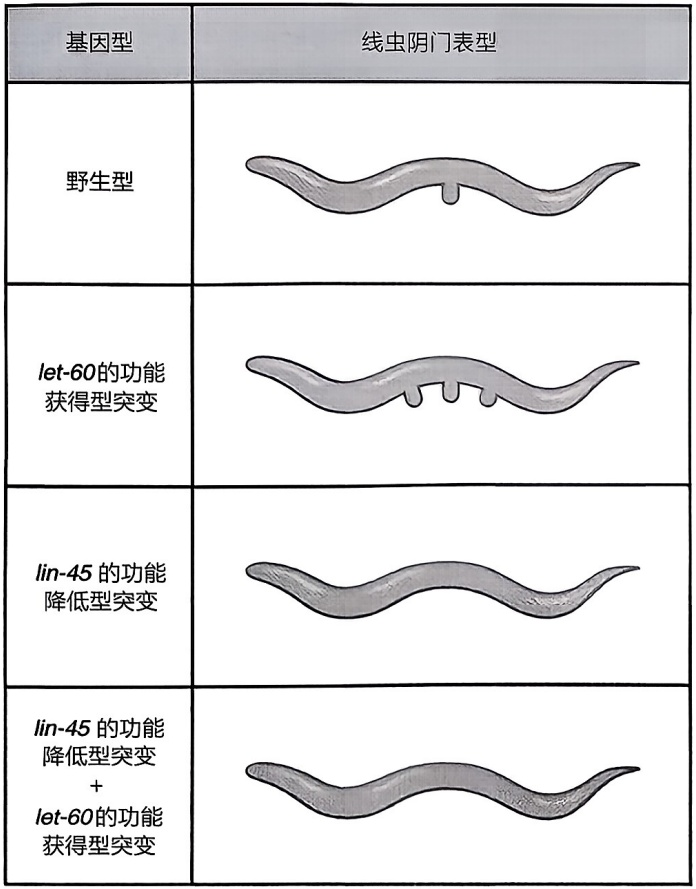

<details>
<summary>flowchart</summary>

```mermaid
graph LR
  A["基因型"] --> B["线虫阴门表型"]
  C["野生型"] --> D[""]
  E["let-60的功能获得型突变"] --> F[""]
  G["lin-45 的功能降低型突变"] --> H[""]
  I["lin-45 的功能降低型突变 + let-60的功能获得型突变"] --> J[""]
```
</details>

图1-9 let-60和lin-45突变体线虫的阴门发育表型

## 名词窗1-3

DNA 复制（DNA replication）:从亲代 DNA 合成子代 DNA 的过程。亲代 DNA 的两条链解开，每条链作为新链的模板，分别形成两个子代 DNA 分子。每一个子代 DNA 分子包含一条亲代链和一条新合成的链，因此也称为半保留复制。

DNA聚合酶（DNA polymerase）:以一条DNA链作为模板，催化由脱氧核糖核苷三磷酸合成新的DNA链的酶。

细胞周期（cell cycle）:连续分裂的细胞从上一次有丝分裂结束到下一次有丝分裂结束所经历的整个过程，包括分裂期和分裂间期。分裂间期又包括 $G_{1}$ 期（gap 1 phase）、S期（synthesis phase）和 $G_{2}$ 期（gap 2 phase）。

分裂期（mitotic phase）:真核生物细胞周期中完成细胞分裂的时期，包含了有丝分裂（核分裂）和胞质分裂两个阶段，最终母细胞被分为两个子细胞。

肿瘤（tumor）:脱离了接触抑制、锚定依赖，失去生长控制的细胞群。

癌症（cancer）:发生了侵袭和转移的肿瘤，又称为恶性肿瘤（malignant tumor）。

癌基因（oncogene）:正常情况下促进细胞增殖，但在肿瘤细胞中因功能获得型突变产生过度或不恰当的活跃形式，促使肿瘤细胞获得无限生长推动力的一类肿瘤相关基因。

原癌基因（proto-oncogene）:未发生突变的癌基因的等位基因类型，存在于正常细胞中，其编码的蛋白质产物负责调控细胞的正常增殖。肿瘤细胞中，原癌基因发生功能获得型突变，成为癌基因。

功能获得型突变（gain-of-function mutation）:导致获得原先没有的功能的基因突变，例如发生在基因编码区内的一个错义突变导致了蛋白质产物的活性上升，或者发生在表达调控区的一个插入突变导致蛋白质表达量的大幅上升等。

肿瘤抑制基因（tumor suppressor gene）:在正常情况下是负责监控细胞准确复制、正常分裂和生长、程序性凋亡的基因，因为功能丧失型突变失去了正常功能，使异常细胞逃避修复和清除，发展为肿瘤。

功能丧失型突变（loss-of-function mutation）:导致原有功能丧失的基因突变，例如基因编码区内的一个无义突变导致截短蛋白的产生，丢失了活性，或者整个基因序列发生了缺失，完全没有基因产物。

因编码了哺乳动物中丝氨酸 / 苏氨酸蛋白激酶 RAF 的同源蛋白。此外，同时携带 let-60 的功能获得型突变和 lin-45 的功能降低型突变的双突变体线虫仍然表现出无阴门表型，这说明 lin-45 很可能是位于 let-60 信号转导途径下游的信号分子（Han et al., 1993）。借助于这样的遗传分析思想，研究者们最终揭示了控制线虫阴门发育的 RTK/RAS/RAF/MAP 这一信号转导途径（详见第八章与第九章），并进一步在人肿瘤细胞系中得到了验证。

可见，遗传分析这一科学方法不仅可以筛选调控个体发育的关键基因，更能深入探索并清晰地描绘出调节生物发育的信号转导通路，为理解个体发育和疾病发生的分子机制提供有力的工具。