## 第四节 遗传学和发育生物学的应用

我们在前面提到的遗传学研究可以大致地归为孟德尔时期、摩尔根时期和分子遗传学时期。近几十年来、遗传学和发育生物学的发展日新月异。这一领域的研究成果不仅为理解生命的本质提供了重要的科学依据，也在生物技术、生物医药、农业育种等多个领域展现出巨大的应用价值。

## 一、基因工程技术是生物科技的开端

20世纪70年代，众多限制性内切酶、核酸连接酶的成功发现和纯化，使得体外构建重组DNA成为可能。将重组DNA成功导人大肠杆菌又推动了划时代的基因工程技术的发展。于1976年创立的美国基因工程技术公司（Genetech）是生物技术行业的创始者，他们利用基因工程技术开创了利用细胞工厂生产重组药物的时代。1977年该公司就成功合成出生长激素抑制素，1978年又合成了人胰岛素，1979年成功克隆生长激素编码基因。后来，重组人胰岛素成为第一个被批准使用的基因工程药物。与传统的生物化学纯化方法相比，利用重组DNA生产胰岛素具有成本低、产量高、活性高、安全性好等优点，为全球的糖尿病患者带去了福音。20世纪末，各种基因工程技术公司如雨后春笋般快速发展起来，生物医药正是基因工程技术应用最广泛的领域之一。多肽类药物、抗体类药物的生物合成为治疗疾病提供了新的手段。进入21世纪，肿瘤领域出现了靶向治疗和免疫治疗的新机遇，背后的治疗机制同样也与遗传学进展密不可分。例如，第一个临床使用的肿瘤靶向治疗药物格列卫（Gleevec）的研发就是得益于遗传学家揭示了染色体相互易位产生的融合蛋白BCR-ABL是诱发慢性髓系白血病的关键原因。华裔免疫学家陈列平在1999年发现的免疫检查点蛋白PD-L1（当时命名为B7-H1）是肿瘤局部出现免疫反应抑制的关键机制所在，他率先开展了针对PD-1/PD-L1的抗体药物的临床实验，为随后全球范围内的免疫治疗药物研发奠定了重要基础。

此外，农业生物技术相关的公司则通过遗传改良和基因编辑等技术手段，提高农作物的产量、品质和抗逆性。以袁隆平（1930—2021）为代表的中国水稻育种学家对水稻的雄性不育性状进行了深入的研究，在全球率先培育出杂交水稻并大面积应用于生产，为解决中国乃至全球的粮食安全发挥了不可替代的作用。

## 二、基因组学研究推动生命科学快速发展

人类基因组计划（Human Genome Project，HGP）在人类科学史上具有重要的地位。该计划于1988年正式批准实施，先后有美国、英国、日本、德国、法国和中国参与，旨在对人类全基因组进行序列测定。2001年，Nature和Science杂志同一时间公布了人类基因组草图图谱及初步分析结果，这在全球掀起了基因组学研究的浪潮，也意味着遗传学研究正式进入了基因组学时代。在人类基因组计划之后，以“单倍型图谱（Haplotype Map，HapMap）计划”为代表的人群遗传分析揭示了人类基因组DNA序列中的常见遗传变异，为人类疾病的遗传因素筛选提供了重要数据支撑。以“DNA元件的百科全书（Encyclopedia of DNA Elements，ENCODE）计划”为代表的功能基因组学研究旨在全面阐述人类基因组序列的结构和功能，破解人类自身的遗传密码。

近年来，其他组学研究，如转录组学（transcriptomics）、蛋白质组学（proteomics）、表观基因组学（epigenomics）、代谢组学（metabonomics）等也相继成熟，极大地推动了遗传学和发育生物学的发展。例如，转录组学是从RNA水平研究细胞的基因转录情况及转录调控的规律与机制，它能够揭示个体发育和疾病发生等过程中动态的基因表达变化，鉴定出其中的关键调控机制和调控因子。2020年宣告完成的多机构合作研究项目“基因型-组织表达”（Genotype-Tissue Expression，GTEx）绘制了来自近千人的上万个组织样本的转录组图谱，建立了全面开放的人类转录组数据资源。毫不夸张地说，当下遗传学和发育生物学研究的数据信息呈现井喷之势，为生命科学研究开拓了更为广阔和深入的领域。

## 三、遗传学和发育生物学研究中的科技伦理

在遗传学和发育生物学迅猛发展的同时，我们也要重视科学研究中伴生的科技伦理问题。克隆羊“多莉”的诞生引发了“克隆人”的争论，人类基因组的测序完成引发了遗传信息安全与遗传资源保护的争论，转基因技术的推广引发了转基因食物安全性的争论，基因编辑技术的成熟引发了能否运用到人类胚胎的全社会思考……

2021年4月正式实施的《中华人民共和国生物安全法》明确规定，从事生物技术研究、开发与应用活动，应当符合伦理原则。2022年3月国务院进一步印发《关于加强科技伦理治理的意见》，指出科技伦理是开展科学研究、技术开发等科技活动需要遵循的价值理念和行为规范，是促进科技事业健康发展的重要保障。每一位遗传学和发育生物学研究者都应该在科学研究的过程中严格遵循科技伦理，认真思考如何运用各项遗传学知识与技术，如何加强生命伦理学的交流与讨论，如何在发展遗传学和发育生物学的同时健全科技伦理，最终让遗传学和发育生物学更好地服务于全球的可持续发展。

## ※ 复习思考题

1. 结合本章的多个遗传学研究案例，思考遗传分析的基本策略是什么？
2. 遗传和发育有着怎样的内在联系？为什么遗传学方法能够解决一些发育生物学的问题？
3. 遗传学研究方法是否也有局限性？谈谈你的想法。

## ※ 推荐阅读

1. DE LUCIA P, CAIRNS J. Isolation of an E. coli strain with a mutation affecting DNA polymerase[J]. Nature, 1969, 224(5225): 1164–1166.
2. HAN M, GOLDEN A, HAN Y, STERNBERG P W. C. elegans lin-45 raf gene participates in let-60 ras-stimulated vulval differentiation[J]. Nature, 1993, 363: 133-140.
3. HARTWELL L H. Macromolecule synthesis in temperature-sensitive mutants of yeast[J]. J Bacteriol, 1967, 93(5): 1662–1670.
4. HUNT T. Cyclins and their partners: from a simple idea to complicated reality[J]. Semin Cell Biol, 1991, 2(4): 213–222.
5. MORGAN T H. The Theory of Gene [M]. New Haven, Conn.: Yale University Press, 1926.
6. NÜSSLEIN-VOLHARD C, WIESCHAUS E. Mutations affecting segment number and polarity in Drosophila[J]. Nature, 1980, 287(5785): 795-801.
7. POULSON D F. Chromosomal deficiencies and the embryonic development of Drosophila melanogaster [J]. Proc Natl Acad Sci U S A, 1937, 23(3): 133–137.
8. SIMANIS V, NURSE P. The cell cycle control gene cdc2+ of fission yeast encodes a protein kinase potentially regulated by phosphorylation[J]. Cell, 1986, 45(2): 261–268.
9. The English translation of Mendel, J.G. “Versuche über Pflanzenhybriden”, Druery, C.T.; Bateson, William(1901). “Experiments in plant hybridization” [J]. Journal of the Royal Horticultural Society, 1866, 26: 1–32.

（编写:许田、金力、吴燕华；审读:杨剑、吴晓晖）

## 第二章

## 遗传基础和基因组学

遗传学的基础理论起源于19世纪中期孟德尔的研究。本章首先回顾遗传学发展历史上一系列经典的里程碑事件，展示确立DNA作为遗传物质的科学探索历程。随后，解析遗传信息在生命体中传递和表达的分子机制，包括遵循孟德尔定律的细胞核遗传和不服从孟德尔定律的细胞质遗传。最后介绍现代基因组学，简述其作为经典遗传学的扩展正在推动遗传学研究在分子水平上迈向全基因组规模。

本章第一节主要介绍遗传学的基础知识，内容包括染色体和基因的概念、遗传物质的确定、DNA的分子结构，以及描述遗传信息流动的“中心法则”（central dogma），这些理论是现代生命科学和医学研究的基石。

第二节聚焦于细胞质遗传，这一非孟德尔遗传方式强调了核外遗传物质的重要性，主要介绍线粒体和叶绿体中的单亲遗传机制。作为细胞核遗传的重要补充，细胞质遗传解释了许多母系遗传现象，在相关疾病的诊断和植物学研究中具有重要的价值。

最后一节介绍迅速发展的基因组学。现代基因组学建立在高通量测序技术之上，通过在全基因组水平多维度地描述遗传信息的时空表达和调控过程，极大地加深了人们对于基因组结构与功能的认识和理解。实例展示了基因组学在精准医学、人类起源研究以及动植物遗传改良等不同学科和领域中的应用。

通过本章的学习，读者将系统掌握从经典遗传学到现代基因组学的核心概念，为后续学习遗传分析策略与方法，以及理解遗传变异在生物体发育和进化过程中的作用奠定坚实的理论基础。

# 第一节 遗传基础

遗传学是现代生物学的重要分支，其基本概念可以追溯到 19 世纪末和 20 世纪初的一系列重要发现。本节将深入探讨遗传学的早期里程碑事件，以及遗传的基本原理。

## 一、染色体和基因的提出

## 1. 孟德尔遗传定律

我们已经在导论中介绍了孟德尔于1866年提出“遗传因子”的概念，将生物性状归因于这些遗传因子。它们被视为离散的、独立的遗传单位，负责传递和决定生物性状，并遵循分离定律和自由组合定律。尽管当时孟德尔并未解释遗传因子的实际结构和运作机制，但他的研究为基因概念的提出提供了理论基础。

## 2. 染色体的发现

得益于显微技术的进步，科学家们在19世纪80年代通过一种新发现的有机和无机染料的组合方式能够直接观察细胞核内长而明亮的物体，并称其为染色体（chromosome）。通过观察配子形成过程中的染色体行为，科学家们逐渐意识到染色体可能携带遗传物质。这一认识促进了1902年染色体学说的提出，即染色体是细胞核内的结构，由DNA、蛋白质和其他分子组成，它们携带了生物体的遗传信息。染色体学说将遗传物质的概念从抽象粒子转化为物理实体，将遗传物质与染色体联系起来。

## 3. 萨顿 - 博韦里假说

1903年，美国遗传学家沃尔特·萨顿（Walter Sutton，1877—1916）以及德国动物学家西奥多·博韦里（Theodor Boveri，1862—1915）同时在模式生物海胆中注意到胚胎的发育过程需要全部染色体的参与。之后，萨顿又以蝗虫（Brachystola magna）为研究对象，发现染色体在减数分裂（meiosis）过程中的分离现象与孟德尔提出的遗传定律吻合（图2-1），这表明染色体很可能就是遗传定律的物质基础。这两位科学家的一系列重大发现被后人命名为“萨顿-博韦里假说”，又被称为“遗传的染色体学说”（chromosome theory of inheritance）。这一学说提出染色体是遗传物质的载体。

## 4. 基因概念的提出

1909年，丹麦遗传学家约翰森在他的著作《精密遗传学原理》中首次提出了“基因”（gene）概念，以替代孟德尔所称的“遗传因子”。这一新术语进一步强调了遗传信息的离散性，并为基因的研究奠定了基础。

## 5. 三位一体基因概念的确立

随着基因概念的提出，科学家开始关注基因的物理性质。在1910年前后，美国遗传学家摩尔根及其学生通过研究遗传学领域经典的模式生物果蝇，为染色体是遗传物质载体这一假设提供了实验证据。摩尔根在其1926年的著作《基因论》中提出了三位一体基因概念——基因是遗传的功能单位、结构单位以及突变单位。这一理论的确立将基因从抽象概念转化为物理实体，证明了基因位于细胞核内的染色体上、并影响着生物的性状。摩尔根的发现为现代遗传学的研究奠定了重要基础，并因此获得了1933年的诺贝尔生理学或医学奖。

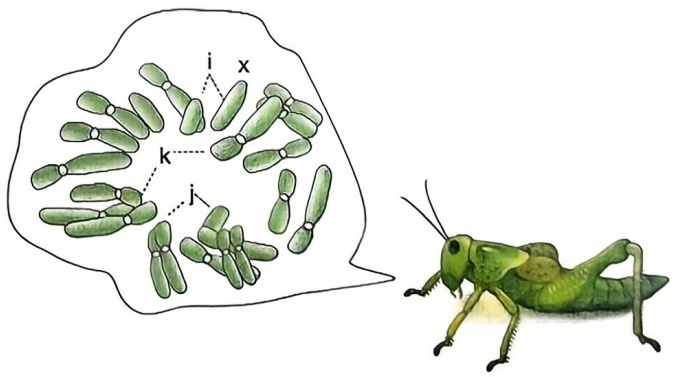

text_image

i x
k
j

图2-1 萨顿1902年发表的论文中描绘的蝗虫染色体

## 二、DNA 是遗传物质

## 1. 遗传物质的早期探索

尽管早期研究奠定了遗传学的基础，但直至20世纪初，科学家仍对遗传的分子本质缺乏认识。起初人们更倾向于认为蛋白质可能是遗传物质，因为蛋白质具有更加复杂的特性，能够解释遗传的多样性。然而，一系列实验逐渐揭示了核酸（nucleic acid）才是主要遗传物质。

## 2. 核酸的首次发现

1868年，瑞士医生弗雷德里希·米歇尔（Friedrich Miescher，1844—1895）首次在白细胞核中发现核酸，并将其命名为“核素”。他还观察到生殖细胞中细胞分裂前核酸含量显著增加，尽管当时他无法确认核酸的具体功能，但这一发现标志着对遗传物质的初步探索。

## 3. 肺炎双球菌转化实验

1928年，英国细菌学家弗雷德里克·格里菲斯（Frederick Griffith，1879—1941）进

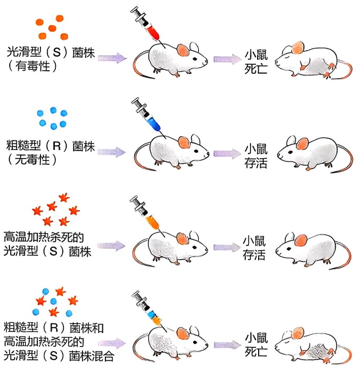

flowchart

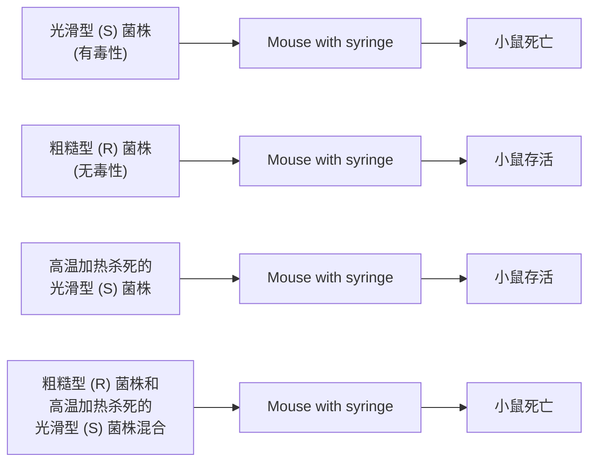

图2-2 格里菲斯的肺炎双球菌转化实验

行了关键性实验，发现了肺炎双球菌（pneumococcus）的“转化”能力，揭示了遗传物质的功能（图2-2）。他从肺炎双球菌中分离出两种不同的细菌类型——光滑型（smooth，S）和粗糙型（rough，R）。S型细菌是野生型，具有致病性，因能够在细胞外合成一层多糖荚膜而呈现光滑外表；而R型细菌是S型的突变体，没有致病能力，因无荚膜而呈现粗糙外表。格里菲斯发现，将活的R型菌和加热杀死的S型菌混合后注射到小鼠体内，会导致疾病，但单独注射这两种菌则没有致病效果。这一实验提出，经过高温杀死的S型菌内含有一种能够改变细菌遗传特性的物质，使R型菌转化为S型，并称之为“转化因子”。这一发现为遗传物质的存在提供了直接证据。

1944年，美国细菌学家奥斯瓦尔德·艾弗里（Oswald Avery，1877—1955）、科林·麦克劳德（Colin McLeod，1909—1972）和麦克林恩·麦卡蒂（Maclyn McCarty，1911—2005）从高温杀死的S型菌中提取无细胞液并纯化出了“转化因子”（图2-3）。他们的进一步实验发现，纯化的“转化因子”仍然具有转化活性，直到加入一种能够降解脱氧核糖核酸（deoxyribonucleic acid，DNA）的酶才完全破坏了这一活性。因此，科学家们得出结论:“DNA是Ⅲ型肺炎球菌转化因子的基本单位”。这一实验进一步验证了格里菲斯的发现，首次提出了DNA是遗传物质。艾弗里团队的这项革命性发现得益于洛克菲勒大学（Rockefeller University）跨学科的科研环境。尽管艾弗里的团队由生物学家构成，但他们与该校的化学家有着密切的合作与交流，这种跨学科的互动为识别DNA作为遗传物质的关键因素提供了新的视角和方法。他们的工作在理解DNA的化学性质和生物功能方面迈出了重要一步，为后来的DNA双螺旋（DNA double helix）结构的发现奠定了基础。

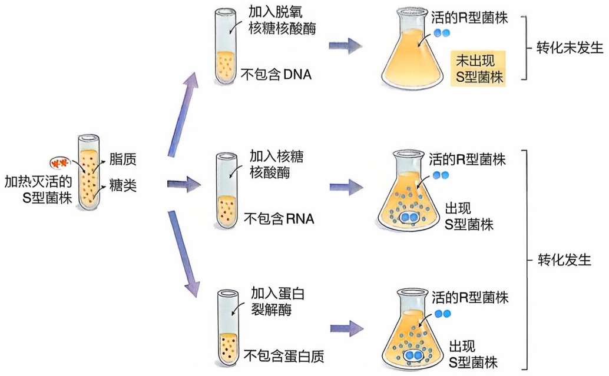

flowchart

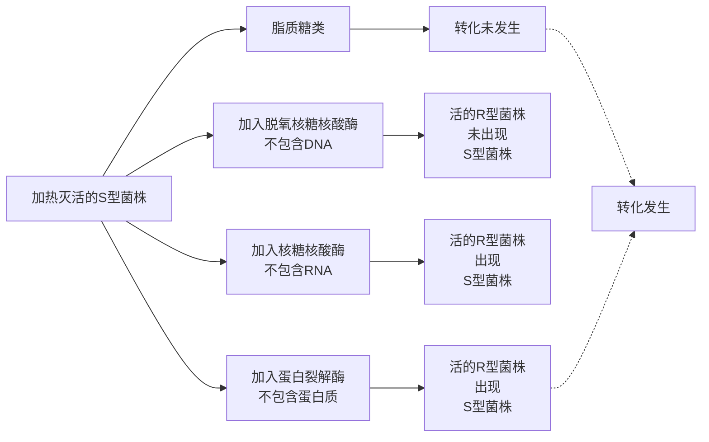

图2-3 艾弗里的肺炎双球菌转化实验

## 4. 噬菌体感染实验

1952 年，艾尔弗雷德·赫尔希（Alfred Hershey，1908—1997）和马莎·蔡斯（Martha Chase，1927—2003）利用 T2 噬菌体进行实验，最终确定了遗传物质是核酸而不是蛋白质（图 2-4、图 2-5）。他们使用了两种不同的同位素来标记两种大分子——硫（$^{35}$S）用于标记蛋白质，磷（$^{32}$P）用于标记 DNA。通过用这两种不同同位

素标记的噬菌体感染大肠杆菌，并测定同位素的位置，他们发现:当使用  ${}^{35}$ S 标记的噬菌体感染细菌时，放射性物质依然分布在噬菌体的外壳部分，而当使用  ${}^{32}$ P 标记的噬菌体感染细菌时，放射性物质则分布在大肠杆菌细胞内。这一实验清晰地表明，进入细胞的遗传物质是 DNA，而不是蛋白质。这一发现进一步巩固了 DNA 作为遗传物质的地位。

通过这些重要实验，科学家们逐渐确定了核酸是主要的遗传物质，并深入了解了其在遗传过程中的关键作用。这些发现为遗传学的发展奠定了坚实的基础，为我们理解生命的遗传机制提供了关键的见解。在本书的后续章节中，我们将更深入地探讨生物的主要遗传物质——DNA 的结构和功能。

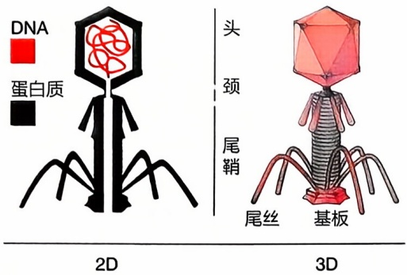

text_image

DNA
蛋白质
头
颈
尾鞘
尾丝
基板
2D
3D

图 2-4 T2 噬菌体构造

图2-5 T2噬菌体侵染大肠杆菌的实验

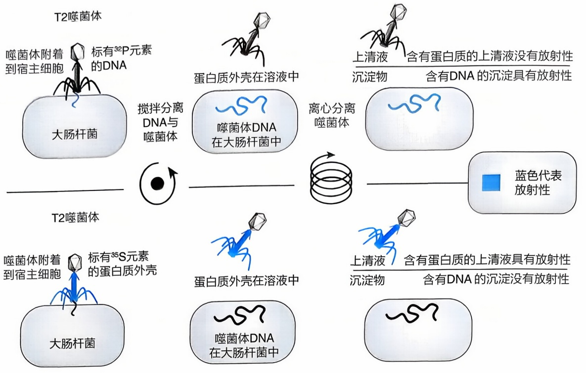

flowchart

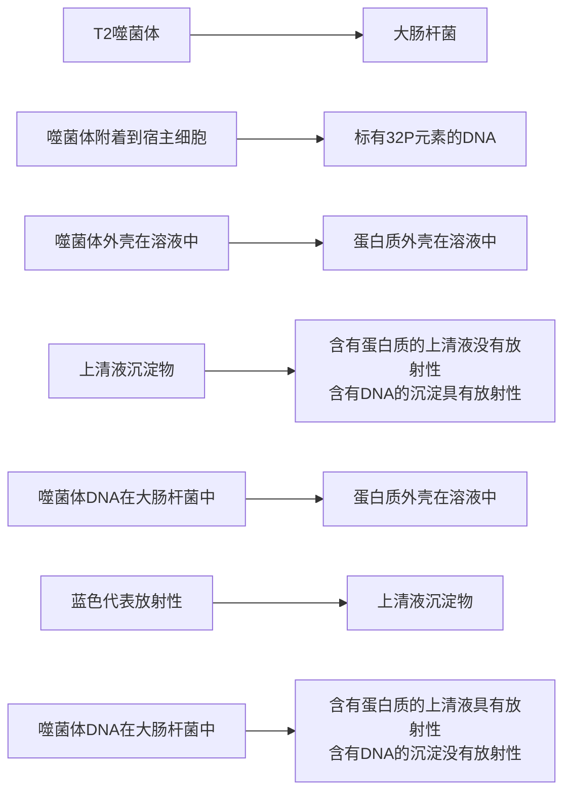

## 三、DNA 的分子结构

## 1. DNA 的化学结构

20 世纪初期，科学家们在前人发现核酸的基础上，进一步纯化了 DNA 和核糖核酸（ribonucleic acid, RNA），并阐明了它们的组成和化学结构。核苷酸（nucleotide）是构成核酸的基本单元，研究人员发现，DNA 分子由 4 种相似但不同的脱氧核苷酸（deoxynucleotide）构成，每种核苷酸的化学结构由中心的脱氧核糖，与 5' 碳端连接的一个无机磷酸盐以及与 1' 碳端连接的一个含氮碱基组成（图 2-6）。碱基又可分为 4 种类型:腺嘌呤（adenine, A）、胸腺嘧啶（thymine, T）、胞嘧啶（cytosine, C）和鸟嘌呤（guanine, G）。与 DNA 分子不同，RNA 分子的中心五碳糖为核糖（即 2' 碳端未脱氧），并在 4 种碱基类型中以尿嘧啶（uracil, U）取代胸腺嘧啶。在 20 世纪 40 年代晚期，奥地利裔美国人埃尔文·查戈夫（Erwin Chargaff, 1905—2002）发现，在任何物种的 DNA 中，腺嘌呤和胸腺嘧啶的含量大致相同；同时，鸟嘌呤和胞嘧啶的含量也大致相同。这一发现后来被称为碱基互补配对原则（Chargaff law）（图 2-7），为理解 DNA 分子结构提供了重要线索。

## 2. DNA 的物理结构

从 20 世纪 30 年代起，科学家们开始用 X 射线晶体衍射技术对生物大分子进行成像。1952 年，英国化学家、X 射线晶体学家罗莎琳德·富兰克林（Rosalind Franklin，

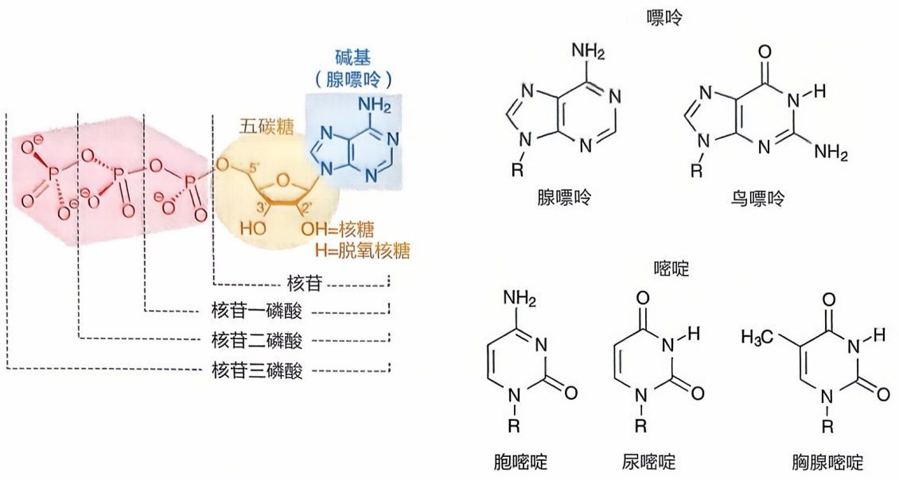

图 2-6 核苷酸的结构

脱氧核糖核酸（DNA）

图2-7 碱基互补配对

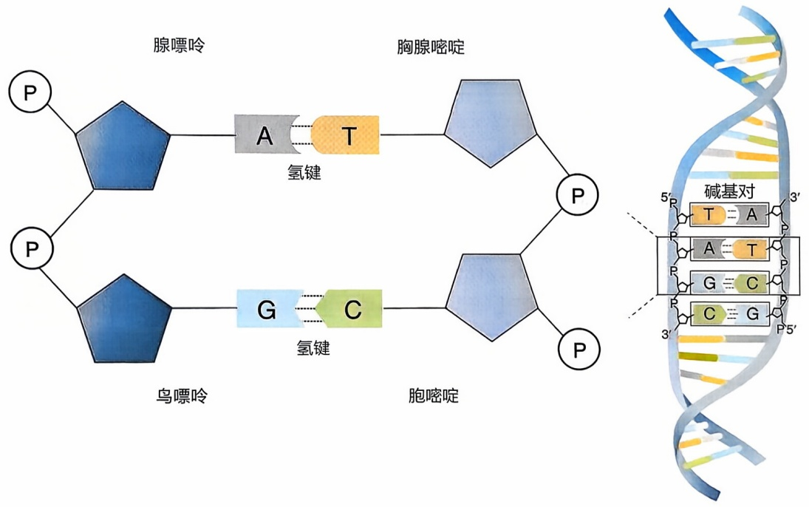

1920—1958）和她的研究生雷蒙·葛斯林（Raymond Gosling，1926—2015）拍摄到了一张DNA的X射线衍射照片，即著名的“照片51号”。这张照片被誉为“有史以来最美的X射线照片之一”（图2-8）。这一照片证明了DNA分子的有序螺旋状结构。由于和导师及同事不合，富兰克林离开了她就职的伦敦国王学院。随后，葛斯林将“照片51号”分享给了他后来的导师、同在伦敦国王学院使用X射线晶体衍射技术研究DNA结构的莫里斯·威尔金斯（Maurice Wilkins，1916—2004）。1953年，威尔金斯将“照片51号”展示给了来国王学院访问的朋友、美国生物学家詹姆斯·沃森(James Watson)，并参与了对DNA模型的讨论与后续修正。沃森和同在剑桥大学卡文迪许实验室工作的英国物理学家弗朗西斯·克里克（Francis Crick，1916—2004），结合富兰克林的衍射图像、查戈夫的碱基互补配对原则、DNA分子的物理排列以及核苷酸的化学结构，提出了著名的DNA双螺旋模型（图2-8）。他们的研究成果发表在Nature杂志（1953）。根据他们的模型，DNA分子由两条平行但方向相反的链组成，这两条链以右手螺旋绕成一个圆柱体；两条链的外侧骨架由核糖和磷酸二酯键连接而成，而内侧则由氢键连接的AT或GC碱基对组成。

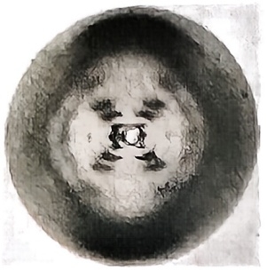

natural_image

Circular abstract texture with a central dark spot and faint curved patterns (no text or symbols)

图2-8 富兰克林拍摄的DNA晶体衍射图片（左）与沃森和克里克搭建的DNA双螺旋模型（右）

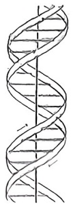

磷酸二酯键共价连接一个核苷酸分子的 $3^{\prime}$ 碳端以及下一个核苷

酸的 $5^{\prime}$ 碳端。这种连接方式赋予了DNA单链方向性，其中一个端点被称为 $5^{\prime}$ 端，另一个端点被称为 $3^{\prime}$ 端。两条链通过相反的方向平行连接，形成一个由强亲水性的磷酸基团排列在外侧的螺旋结构。DNA双链内侧配对的碱基通过氢键连接。腺嘌呤和胸腺嘧啶碱基之间有2个氢键连接，而鸟嘌呤和胞嘧啶碱基之间有3个氢键连接，因此双链内侧的化学结构非常稳定。研究表明，DNA双螺旋结构形成的圆柱体直径为 $20\AA$ （$1\AA$ 为 $10^{-10}\mathrm{m}$），每个螺旋周期的间距为 $34\AA$，而相邻碱基对之间的上、下间距为 $3.4\AA$，因此一次螺旋是由10对核苷酸缠绕而成的精密结构。

在沃森和克里克发表 DNA 双螺旋模型之前，因研究蛋白质的  $\alpha$  螺旋和  $\beta$  折叠二级结构而闻名的美国化学家莱纳斯·鲍林（Linus Pauling，1901—1994），也曾提出一个著名但错误的 DNA 模型。他认为 DNA 由三股螺旋缠绕而成，其中螺旋的磷酸骨架在内、碱基在外侧。鲍林假设骨架中间是中性不带电荷的磷酸基团，事实上核酸分子呈酸性，其磷酸基团带负电荷，而带负电荷的基团会相互排斥，不可能组成稳定的三螺旋核心。这是一个致命的矛盾，也催化了 DNA 正确模型的提出。在双螺旋模型发表后，鲍林曾公开发表导致他提出错误模型的几个重要原因，其中之一便是缺少高质量的 X 射线晶体衍射图像。

DNA 的双螺旋模型广泛存在于真核生物的细胞核染色体内，而在近年来的研究中，DNA 也被发现以其他形式的结构存在。例如，在一些细胞器和原核生物的染色体中可以找到环状的双链 DNA 结构，而一些 DNA 病毒则存在着体积较小的单链 DNA。此外，研究人员还发现自然界中不仅存在右手螺旋的 DNA 结构，还包括一些不规则的左手螺旋的 DNA 结构。

通过对 DNA 化学结构的理解，我们可以推断遗传信息是通过 4 种不同碱基的排列进行编码的，并且了解遗传信息是如何稳定存储的。DNA 双螺旋模型的提出为后续 DNA 高保真度的复制、转录和翻译等遗传信息传递过程的研究奠定了基础，推动了遗传学、分子生物学以及生物技术等领域的快速发展。沃森和克里克的 DNA 双螺旋模型代表着生物学领域的一次重大突破，他们与威尔金斯共同获得了 1962 年的诺贝尔生理学或医学奖。

## 四、DNA 的复制

## 1. 半保留复制假说

DNA 作为生物体内主要的遗传物质，其可能的复制机制早在科学家们研究 DNA 的分子结构时就已经引起了关注。由于 DNA 的骨架由稳定性较强的磷酸二酯键共价

连接，而骨架内部的碱基由稳定性较弱的氢键连接，这使得人们推测DNA的解旋是从内部氢键的断裂开始的。一旦DNA双螺旋解开，内部两条单链的碱基序列就会暴露出来，成为两条模板链（template strand）。依据严格的碱基互补配对原则，新的核苷酸分子可以与模板链上的碱基结合形成新的氢键，之后，新配对的核苷酸之间在某种酶的作用下共价连接成新链。经过这样的复制过程后，原始的DNA分子将产生两条新的DNA分子。每条新产生的DNA分子都包括一条原始的DNA链和一条新合成的DNA链，这样在每一代复制产物中都保留了上一代DNA分子的一半信息。这种复制假设被称为DNA的半保留复制（semiconservative replication），由沃森和克里克在1953年首次提出。当时对于DNA复制机制的假设存在许多不同的观点，除了半保留复制之外，还有原始链不变、仅形成新链的全保留复制假设，以及原始链和新链嵌合在一起的分散复制假设。直到1958年，美国遗传学、分子生物学家马修·梅瑟森（Matthew Meselson）和富兰克林·斯塔尔（Franklin Stahl）通过一项创新性的重氮实验，成功证明了DNA半保留复制假说的正确性（图2-9）。

梅瑟森和斯塔尔采用了同位素标记法来标记 DNA 中的氮原子，利用  ${}^{14}N$  和  ${}^{15}N$  之间的密度差异来区分原始 DNA 和

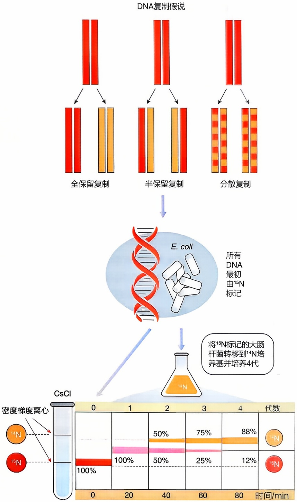

flowchart

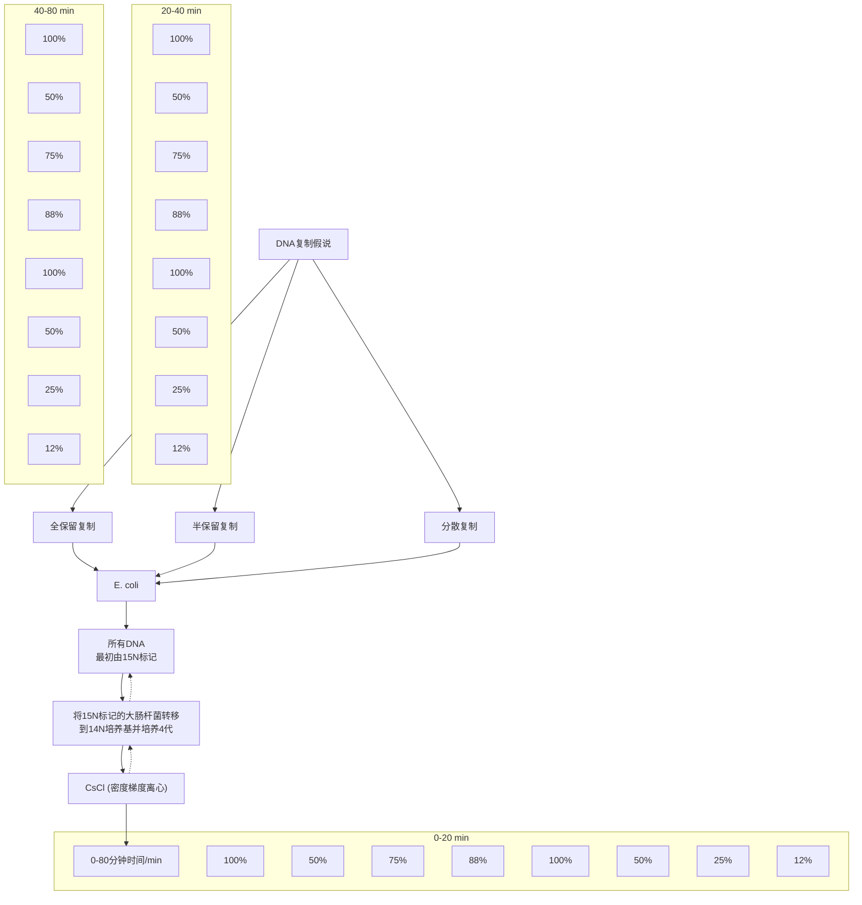

图2-9 梅瑟森和斯塔尔采用同位素标记法证明DNA半保留复制

新合成的DNA。他们首先将大肠杆菌分别培养在仅含有 ${}^{14}\mathrm{N}$ 的培养基和仅含有 ${}^{15}\mathrm{N}$ 的培养基中，使细菌合成的DNA中含有对应的标记氮元素。为区分含 ${}^{14}\mathrm{N}$ 和含 ${}^{15}\mathrm{N}$ 的DNA，梅瑟森和斯塔尔将提取出的DNA样品放置在氯化铯溶液中进行密度梯度离心，这样不同密度的含 ${}^{14}\mathrm{N}$ 和含 ${}^{15}\mathrm{N}$ 样品就会在不同位置形成条带。他们观察到，在 ${}^{14}\mathrm{N}$ 培养基中生长的大肠杆菌DNA在接近离心管管口的位置形成了一条纯 ${}^{14}\mathrm{N}$ 条带，而在${}^{15}\mathrm{N}$ 培养基中生长的大肠杆菌DNA于接近离心管底部的位置形成一条纯 ${}^{15}\mathrm{N}$ 条带。接着、他们将在 ${}^{15}\mathrm{N}$ 中培养的大肠杆菌转移到 ${}^{14}\mathrm{N}$ 培养基中，经过大肠杆菌的一个复制周期后（约 $20\mathrm{min}$ ），取出了第一代子细胞DNA进行离心，并观察到离心管中出现了一条新的条带，位置介于纯 ${}^{14}\mathrm{N}$ 和纯 ${}^{15}\mathrm{N}$ 条带之间，这一结果表明新生成的DNA分子含有一条 ${}^{15}\mathrm{N}$ 标记的旧链和一条 ${}^{14}\mathrm{N}$ 标记的新链，与当时人们对半保留复制的假说是一致的。随后，梅瑟森和斯塔尔继续使用 ${}^{14}\mathrm{N}$ 培养基培养这批子细胞，再经过一个复制周期后，取出第二代子细胞的DNA进行离心，此时离心管中出现了两条条带，一条位于纯 ${}^{14}\mathrm{N}$ 条带的位置，另一条出现在纯 ${}^{14}\mathrm{N}$ 和纯 ${}^{15}\mathrm{N}$ 条带之间。这一结果进一步证实了半保留复制假说的正确性，即 ${}^{14}\mathrm{N}^{15}\mathrm{N}$ 混合的DNA双链再次分离，利用 ${}^{14}\mathrm{N}$ 培养基中的原料，形成了一条全新的 ${}^{14}\mathrm{N}$ 子链和一条 ${}^{15}\mathrm{N}^{14}\mathrm{N}$ 子链。这一实验不仅证明了DNA半保留复制机制的合理性，也推翻了全保留复制和分散复制的假设。

## 2. DNA 复制的分子机制

DNA 半保留复制机制的提出为科学家们研究遗传物质的复制与传递提供了坚实的基础。然而，DNA 复制的详细分子机制仍然不明。1956 年，美国生物化学家阿瑟·科恩伯格首次从正处于复制阶段的大肠杆菌中纯化出 DNA 聚合酶 I（DNA polymerase I，DNA Pol I），证明了 DNA 的合成与复制需要特定酶的介入，这种酶能够识别 DNA 复制的模板链，并催化游离核苷酸结合形成聚合物。科恩伯格还通过实验验证了体外的 DNA 复制过程是可再现的。这一重大发现揭示了 DNA 聚合酶在 DNA 复制过程中的核心作用，为人们理解遗传信息如何高效、准确地传递奠定了分子层面的基础，因此他于 1959 年获得了诺贝尔生理学或医学奖。1970 年，美国生物化学家托马斯·科恩伯格（Thomas Kornberg），即阿瑟·科恩伯格次子，发现了 DNA 聚合酶 II（DNA polymerase II，DNA Pol II）和 DNA 聚合酶 III（DNA polymerase III，DNA Pol III）。其中，DNA 聚合酶 III 和 DNA 聚合酶 I 是 DNA 复制过程中依赖的主要酶，而 DNA 聚合酶 II 则主要参与 DNA 修复。随着研究人员对 DNA 聚合酶结构解析和功能研究的深入，DNA 复制的分子机制得到了进一步的完善。

DNA 复制的分子机制包括 3 个核心步骤——起始、延伸和终止（图 2-10）。在 DNA 分子上存在特殊的短核苷酸序列，称为复制起始位点。首先，一些有特定功能的蛋白质与复制起始位点结合形成复合体，进而触发 DNA 解旋酶（helicase）打开双螺旋结构，形成两条 DNA 模板链与两个复制叉。单链结合蛋白与两条 DNA 单链结合，保持其稳定性。随后，携带碱基的游离脱氧核糖核苷酸根据碱基互补配对原则与模板链上的对应碱基形成氢键，再由 DNA 聚合酶Ⅲ在上游核苷酸链的 3' 碳末端与游离的脱氧核苷三磷酸（deoxyribonucleoside triphosphate，dNTP）的首个磷酸基团之间形成磷酸二酯键，进而合成新的链。这一聚合过程的能量来源于DNA聚合酶切割上一个游离脱氧核苷三磷酸的高能磷酸键。由于DNA聚合酶Ⅲ只能从核苷酸链的3'碳端连接一个新核苷酸来形成新链，因此在模板链的3'端都需要一条引物来提供可连接的3'碳端。这些引物通常由一小段RNA组成，而连接RNA引物与模板链的酶则被称为引物酶（primase）。在延伸过程中，新链从模板链的3'端向5'端合成，也就是新链自身5'端至3'端的方向合成，并且复制叉也随着解旋酶的运动而前移。在这个过程中，随复制叉同向延伸的新链被称为先导链（leading strand），而与模板链反向互补，只能向复制叉相反方向延伸的新链被称为后随链（lagging strand）。先导链可以连续进行合成，而后随链只能以不连续的方式合成一系列片段。这些片段通常包含1000个左右的碱基对，被命名为冈崎片段（Okazaki fragment），以纪念最早发现这一现象的团队领导者——日本名古屋大学的冈崎令治（Okazaki Reiji，1930—1975）与冈崎恒子（Okazaki Tsuneko）夫妇。每当复制叉移动一段距离，引物酶就会在模板链上结合一段RNA引物，然后由DNA聚合酶将新核苷酸结合到引物片段的3'端，形成冈崎片段，一直延伸到前一段冈崎片段的RNA引物处。DNA聚合酶I介入两条相邻的端冈崎片段间，通过形成新的核苷酸片段来取代RNA引物。最后，DNA连接酶在片段间合成磷酸二酯键，得到一条完整的DNA新链。新链的延伸一直持续到整条DNA双链都被复制完毕才会终止。在真核生物中，DNA复制过程通常涉及多个复制起点的同时启动。

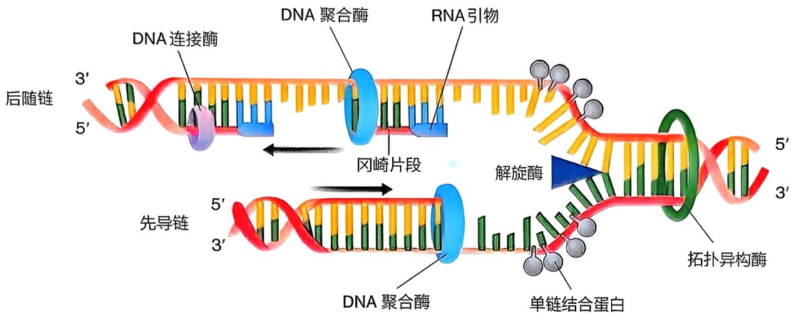

flowchart

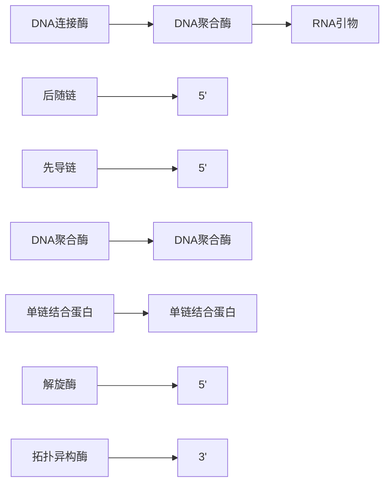

图2-10 DNA复制过程

在上述DNA复制的过程中，不仅涉及已提及的一系列酶，还有其他更为复杂的酶系统参与，以确保复制过程的稳定性和准确性。例如，在DNA双链解旋的过程中，随着解旋酶的前进，前方未解旋的双链将会形成高度卷曲的复杂结构。此时，拓扑异构酶（topoisomerase）会与卷曲区域结合，切断DNA双链，使其恢复到松弛状态，然后再次修复双链。拓扑异构酶减少了复制过程中DNA链断裂的风险，同时维持了DNA分子的稳定性。此外，一些DNA聚合酶具有校对和修复错配碱基的作用。当新合成的碱基对发生错误配对时，DNA聚合酶会倒退一个碱基，利用核酸外切酶（exonuclease）删除错配碱基，然后重新形成正确的配对，从而保证了DNA复制过程的高保真性与遗传信息在传递过程中的准确性。

## 3. DNA 复制原理的应用

DNA 的复制过程不仅是生命体遗传与发育的基础，还在生物技术的发展中发挥着重要的作用。基于 DNA 复制原理，科学家们发明了一代测序技术，也称为双脱氧终止法（dideoxy termination method），由费雷德里克·桑格（Frederick Sanger, 1918—2013）于 1977 年首次开发。这项技术利用双脱氧核苷酸（dideoxyribnucleoside triphosphate, ddNTP）随机终止 DNA 的复制过程，通过测定终止处的碱基，实现了 DNA 序列的确定。桑格的这一贡献使他在 1980 年第二次获得了诺贝尔化学奖。另一项革命性的技术是由凯利·穆利斯（Kary Mullis, 1944—2019）于 1983 年发明的聚合酶链式反应（polymerase chain reaction, PCR），这项技术通过交替使用 DNA 聚合酶和热循环来实现 DNA 的指数级扩增，使研究人员能够在短时间内大规模扩增特定 DNA 片段。凭借这一创新性成果，穆利斯于 1993 年获得了诺贝尔化学奖。这两项基于 DNA 复制机制的技术已成为遗传学、分子生物学和医学领域的关键工具，极大地推动了相关科学领域的研究和应用，为基因组学解析、新药研发、疾病诊断以及法医学等领域提供了重要支持。如今，它们仍然是生物学实验室中不可或缺的工具，并持续推动着现代生命科学和医学的发展。

## 五、中心法则

## 1. 中心法则的提出

DNA、RNA和蛋白质构成了生物体内的三大核心生物大分子，它们共同承载并传递着生物的遗传信息。在人们发现DNA作为主要的遗传物质并开始深入研究其分子结构的同时，另一些科学家已经开始致力于研究蛋白质的结构与功能。1951年，桑格成功地测定了第一个蛋白质——胰岛素的氨基酸序列，证明了蛋白质的一级结构由氨基酸序列所决定。桑格的这项开创性工作为后来中心法则与遗传信息流动的研究奠定了基础，也因此于1958年获得了他的第一个诺贝尔化学奖。随着DNA和蛋白质的分子结构逐渐被科学家们所揭示，一个关键性的问题浮现出来:核苷酸序列中的遗传信息是如何传递和体现在氨基酸序列中呢？

分子生物学的中心法则阐述了遗传信息在不同生物大分子之间的流动途径，这一理论最初由克里克于1957年提出。克里克认为遗传信息是由核酸编码，然后传递到氨基酸，形成蛋白质，而当信息一旦被转化为蛋白质后，就不会再流回DNA。这个理论强调了遗传信息流动的单向性。此外，克里克进一步预测，存在一种小分子适配器，这种小分子不仅能够准确识别核苷酸序列，还能合成相对应的氨基酸序列，这一假设中的小分子适配器后来被成功提取出来，并命名为转运RNA（transfer RNA，tRNA）。tRNA和核糖体RNA（ribosomal RNA，rRNA）的发现揭示了RNA作为中间介质在遗传信息传递过程中的关键作用，也为该过程中可能存在更多功能元件提供了线索，而后续信使RNA（messenger RNA，mRNA）的发现进一步印证了这一理论。1961年，两个实验室分别独立地发现了mRNA的存在，这一重要中间分子的作用是将存储于细胞核内的 DNA 信息传递到细胞质中，以便在细胞质中进行蛋白质的合成。至此、我们可以明确遗传信息从 DNA 到蛋白质的传递主要经历了两个阶段（图 2-11）、一是从 DNA 传递到 RNA，这一过程被称为转录（transcription）；二是从 RNA 传递到蛋白质，这一过程被称为翻译（translation）。

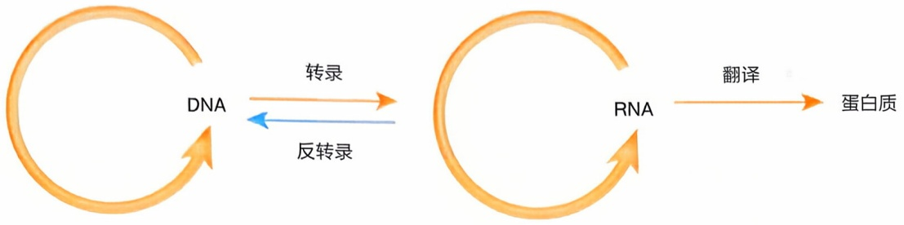

flowchart

图2-11 中心法则

## 2. 转录的分子机制

转录是指根据碱基互补配对原则，将DNA链作为模板合成单链RNA序列的过程。与转录生成的RNA序列相同（除了RNA中的尿嘧啶替代了DNA中的胸腺嘧啶）的DNA链被称为编码链（coding strand），又叫有义链（sense strand）或非模板链（non-template strand），另一条DNA链被称为非编码链（non-coding strand）、反义链（antisense strand）或模板链。催化RNA合成的酶被称为RNA聚合酶（RNA polymerase）。与DNA聚合酶的功能相似，RNA聚合酶通过在核糖核苷酸分子的3'碳末端连接下一个核苷酸的磷酸基团来合成RNA。因此RNA合成的方向也是从自身的5'端往3'端延伸，而RNA聚合酶从DNA模板链的3'端向5'端移动。

转录过程主要包括起始、延伸和终止三个阶段（图2-12）。在转录起始阶段，RNA聚合酶识别启动子（promoter），即位于转录起始位点的特殊DNA序列，并与其结合以开启转录过程。由于DNA上存在许多个启动子，转录可以在多个不同位置同时进行。RNA聚合酶与启动子结合导致双链DNA解旋，暴露了内部的碱基序列，进而形成转录泡（transcription bubble）。酶复合物识别起始转录的核苷酸并依据碱基互补配对的原则在DNA模板链上结合对应的核糖核苷酸，其中A对应U，C对应G。随后，RNA聚合酶催化核糖核苷酸之间形成磷酸二酯键。随着新生成mRNA链的3'端不断结合新的核苷酸，RNA聚合酶逐渐释放启动子，并沿着模板向前移动，此时转录进入延伸阶段。

在延伸阶段，RNA聚合酶继续沿着模板链的 $3^{\prime}$ 端至 $5^{\prime}$ 端移动，通过破坏双链DNA间的碱基配对而使模板链暴露，同时催化新的核糖核苷酸与DNA模板结合形成DNA-RNA杂合链。与此同时，在转录泡后方，已经生成的RNA链从DNA模板上解离，形成 $5^{\prime}$ 端游离在双链外的一条单链RNA。而DNA模板链则重新与非模板链结合，恢复了双螺旋结构。之后，被释放的启动子便可能再次与新的酶复合物结合。转录过程的终止是由mRNA链上一段特殊序列——终止子（terminator）所触发的。终止子能与RNA单链结合形成一个稳定发夹结构的环，使RNA聚合酶无法继续在 $3^{\prime}$ 端添加新的核苷酸，从而导致酶复合物从DNA模板链上解离，并释放出mRNA。

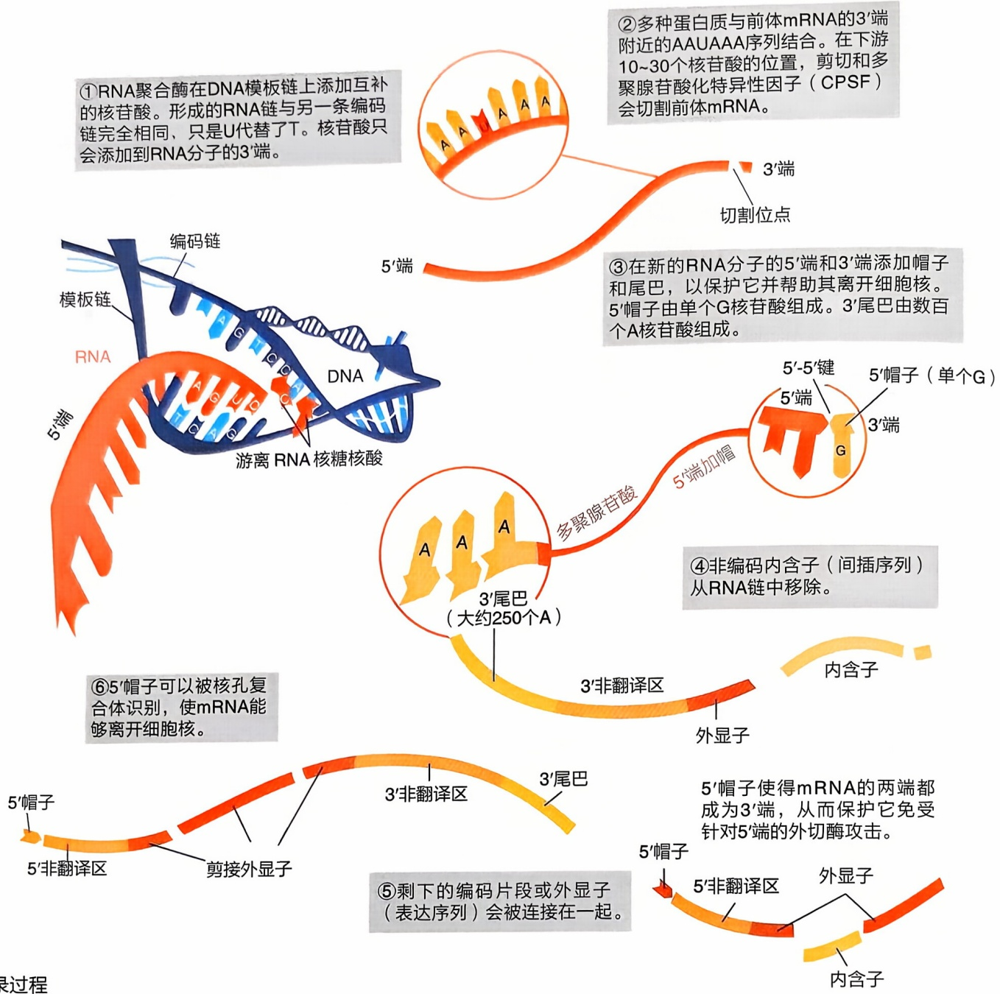

flowchart

This flowchart illustrates the process of RNA polymerization and editing, detailing steps from initial RNA binding to final mRNA cleavage and intracellular excretion.

图2-12 转录过程

## 3. 原核生物与真核生物在转录过程中的差异

转录过程在原核生物与真核生物之间存在许多差异。首先，转录所需的酶不同。在原核生物中，通常只有1种RNA聚合酶负责合成所有类型的RNA。然而，在真核生物中，核基因组中主要有3种不同类型的RNA聚合酶，各自负责合成不同类型的RNA。其中，RNA聚合酶Ⅱ负责合成全部的mRNA；RNA聚合酶I则是高度活跃的酶，主要负责合成rRNA——细胞中含量最多的RNA；RNA聚合酶Ⅲ则负责合成tRNA及其他小的非编码RNA（non-coding RNA，ncRNA）。2001年，DNA聚合酶发现者阿瑟·科恩伯格的长子，美国生物化学家、结构生物学家罗杰·科恩伯格（Roger Kornberg）团队发表了真核生物转录过程中RNA聚合酶Ⅱ的分子图像，首次从高分辨率解析了这个动态多蛋白复合体的结构。这一成果不仅是结构生物学领域的重大突破，还为深入理解真核生物的转录机制及基因表达的调控机制提供了关键的分