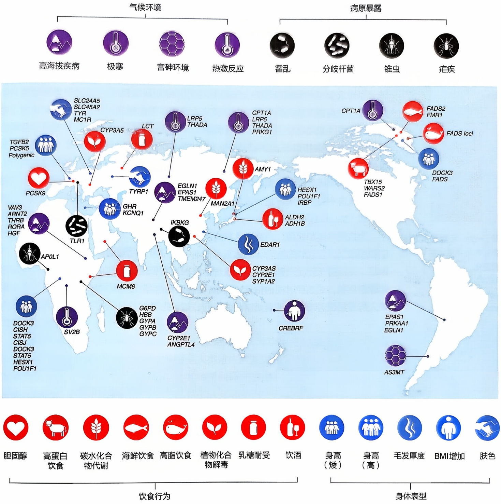

图5-21 人类适应性进化的经典案例

下降，导致全球约 65% 的成年人存在乳糖不耐受，但部分人群在成年后仍保留乳糖酶活性。这一性状呈现显著族群地理差异:欧洲北部人群耐受率高达 90%，而东亚人群不耐受率达 70%\~90%，非洲则存在区域分化。

乳糖耐受性是一种显性遗传特征，由乳糖酶基因 $LCT$ 调控。该基因在不同人群独立进化出多种适应性突变，使其在成年时期仍然保持着较高乳糖酶水平。欧洲人群 $LCT$ 基因上游约 $14\mathrm{kb}$ 处的一个顺式作用元件SNP（-13910\*T，rs4988235）调控了$LCT$ 基因的持续表达（Enattah et al., 2002）；非洲人群则携带-14010\*C，-13915\*G

图中标注了全球各地不同环境下的选择压力或表型，以及相应的适应性基因。

和 -13907\*G 等与其乳糖耐受性显著关联的遗传变异（Tishkoff et al., 2007），这说明不同人群乳糖耐受存在趋同进化的现象（图 5-22）。乳糖耐受性的适应性进化与人类开始饲养家畜和消费乳制品的历史紧密相关。距今约 1 万年前的新石器时代，动物的驯化带来乳制品消费的兴起。乳糖吸收不仅提供能量，还可能通过促进钙和维生素 D 吸收增强高纬度人群生存优势，或在流行病中减少腹泻风险。

尽管乳制品消费被认为是主要选择压力，最新研究揭示了乳糖耐受背后更复杂的遗传进化机制（Ma et al., 2025）。该研究首先基于全球现生人群的全基因组测序数据，在东亚人群2q21.3区域发现一种高频（约 $25\%$）单体型，并且发现这种单体型与LCT基因的表达以及LCT启动子区域cg20242066位点的甲基化水平有关，与此前报道的影响欧洲人群乳糖耐受性的遗传变异-13910\*T（rs4988235）有相似的效应，提示该单体型可能影响东亚人群的乳糖耐受性。然而这种东亚人常见的单体型在非洲和欧洲人群中完全缺失，进一步表明东亚人群乳糖耐受与欧洲非洲人群存在不同的遗传基础（Ma et al., 2025）。

图 5-22 乳糖耐受的世界分布及不同人群中的趋同进化

图改自:Leonardi et al., 2012; Ingram et al., 2008; Liebert et al., 2017。

为追溯单体型起源，研究团队整合尼安德特人和丹尼索瓦人等远古人类的全基因组测序数据，发现该东亚特异单体型可能通过远古时期尼安德特人遗传渗入现代人基因组，并经历长期正向选择。古代人群的基因组数据显示这种单体型在约1万年前已经普遍存在，对选择时间的估计也显示，该区域的自然选择约始于1万年前，早于东亚人群开始驯养动物及消费奶制品的时间，暗示牛奶消费引起的乳糖摄入并非东亚人群 2q21.3 区域适应性进化的初始驱动力。该单体型可以影响 2q21.3 区域基因（如 UBXN4、DARSI）在免疫细胞中的表达，并与白细胞和中性粒细胞计数变化显著相关，研究推测免疫相关的环境因素更可能是潜在的自然选择驱动力。

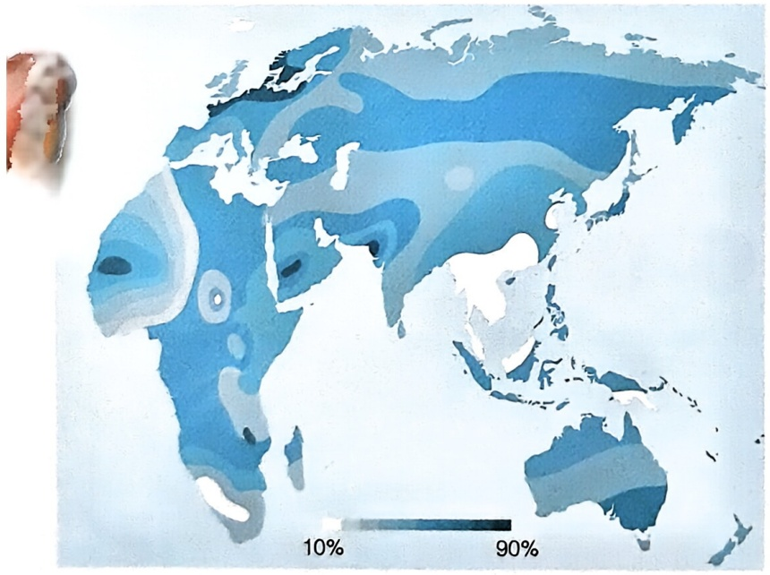

geo

| Region | Value Range |
| --- | --- |
| North America | 10%~90% |
| South America | 10%~90% |
| Europe | 10%~90% |
| Africa | 10%~90% |
| Australia | 10%~90% |

成年人中乳糖耐受者的比例

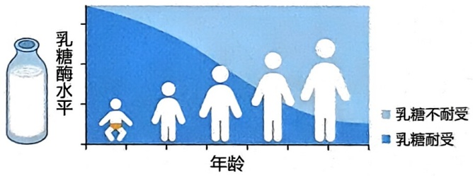

area

| 年龄 | 乳糖不耐受 (相对比例) | 乳糖耐受 (相对比例) |
| --- | --- | --- |
| 起始阶段 | 高 | 低 |
| 中期阶段 | 中 | 中 |
| 结束阶段 | 低 | 高 |

乳糖水平与年龄的关系

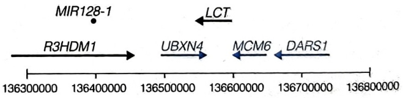

flowchart

人类2号染色体上与乳糖耐受相关的基因区域

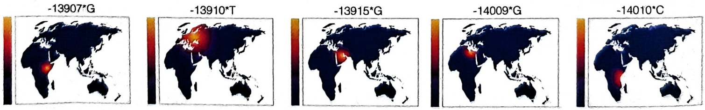

此外，近期一项迄今为止规模最大的关于欧洲人群乳糖耐受性进化的研究表明，欧洲人群牛奶消费的时间比欧洲人群获得乳糖代谢能力早了几千年，引发人们对2q21.3区域的自然选择是否仅与乳糖耐受相关的争论。该研究对这一争论提出了新的猜想，2q21.3区域的正向自然选择可能存在人群特异性进化驱动因素，该基因区域的全球适应性进化历史比既往认知更为复杂。乳糖耐受性的进化史揭示人类对环境挑战的多样化适应策略。传统“饮食驱动基因选择”模型已不足以解释全球人群差异，需结合群体特异性历史、免疫生态等多维度因素来考量。东亚人群乳糖耐受性的成因可能另有隐情，挑战了乳糖摄入是乳糖酶基因进化原初驱动力的传统认知，为理解基因-文化共进化提供了新视角，强调自然选择机制的复杂性和区域独特性（Ma et al., 2025）。

## 2. 高淀粉饮食

在人类的适应性进化历程中，饮食习惯与文化习俗的变革扮演着至关重要的角色，其影响力远不止于乳糖耐受这一现象。就拿长期食用高淀粉食物的人群来说，为了更高效地分解、利用淀粉，淀粉酶基因悄然发生适应性变化。这清晰地表明，从长远的时间跨度来看，人类生活方式的转变亦是驱动人群适应性进化的关键力量。

淀粉酶基因座（amylase locus，AMY）作为人类基因组中拷贝数变异最为频繁的功能区域之一，其拷贝数变异被认为是人类适应性进化的一个经典案例。AMY基因家族在人类1号染色体上串联分布，其转录翻译产物参与淀粉的消化过程（Perry et al., 2007）。该基因家族包括AMY1、AMY2A和AMY2B三个亚型，AMY1在唾液腺中特异性表达，而AMY2A和AMY2B则在胰腺中特异性表达（Bolognini et al., 2024）。淀粉酶基因座内部由高度相似的片段重复序列构成（León-Mimila et al., 2018），不同淀粉酶基因亚型之间高度同源，因此难以被精确解析。得益于长读长测序（long-read sequencing）技术的应用，科学家们得以实现淀粉酶基因座局部区域的高质量组装，并开始对全球不同人群中淀粉酶基因座的复杂结构进行精细解析。淀粉酶基因座在人群中具有高度多态性，其长度变化范围为 $100\sim 400\mathrm{kb}$，高可信度单体型种类多达30余种。其中，H1a和H3r单体型占据主导地位，可以涵盖 $60\% \sim 70\%$ 的人类基因组淀粉酶单体型。AMY基因的拷贝数在非人灵长类中较为保守，在丹尼索瓦人和尼安德特人中出现了一定程度的扩增。随着人类走出非洲，以东亚为代表的水稻种植范围逐渐扩大，现代人类基因组中AMY1基因的拷贝数经历了快速变异时期，整体呈现拷贝数扩增趋势（Yilmaz et al., 2024）。编码唾液淀粉酶的基因AMY1的拷贝数变异在农业社会人群与热带雨林狩猎采集人群间存在明显分化，表明了经历了农业文明的人群因饮食习惯的改变而在该基因上受到了选择。通过比较农业人群与狩猎采集人群基因组发现，农业人群中AMY1基因拷贝数显著更多。这些现象提示AMY1基因拷贝数可能与人类历史上农业转型以及淀粉摄入量增加的饮食变革有着密切关联。这些研究揭示了AMY基因在人类进化中的作用，并且指出了基因拷贝数变异在人类适应环境变化中的重要性。以此为代表的基因组单体型解析和基因拷贝数研究在深入探究人类基因组复杂性与多样性的同时，也为探索人类适应性进化提供了新的视角。

## 3. 维生素 $\mathrm{B}_{1}$

维生素 $\mathrm{B}_{1}$ （又称硫胺素）是一种人体必需的微量营养物质，在糖类代谢、免疫系统中发挥重要功能。全麦谷物、豆类、坚果和肉类等食物是人体维生素 $\mathrm{B}_{1}$ 的唯一来源。体内游离的硫胺素通过硫胺素转运体被肠上皮吸收，其中SLC19A2和SLC19A3分别编码硫胺素转运蛋白1和硫胺素转运蛋白2，SLC19A2在东亚人群中受到人群特异性正选择（Sabeti et al., 2007）。另一项研究证实了这一分析结果，并且进一步发现SLC35F3和SLC35F4基因在东亚人群中也存在特异性的适应性选择信号（Ma et al., 2022）。其中，SLC35F4的适应性单体型和尼安德特人的单体型有极高的相似性（>90%的碱基匹配率），提示这种单体型可能源自现代人祖先和尼安德特人及其类似古人的基因交流（图5-23）。SLC35F4的适应性单体型频率在1万年前达到了最大值，而在近1万年内未发生较大改变，表明适应性进化在1万年前已经完成，这可能提示东亚地区农业发展后人群饮食结构的改变并非自然选择的原初驱动力。

## 4. 新冠病毒

全球性的新冠病毒（SARS-CoV-2）感染在不同地域、国家、人群间呈现出有差异的感染风险以及重症率和死亡率。过去3年多以来，国内外开展的多项大规模人群研究鉴定出一些潜在的新冠病毒易感因子，其中包括在欧美人群中鉴定出的ACE2、OAS1、ABO等重要易感基因，以及在中国人群中发现的与新冠病毒感染重症化风险相关的人类白细胞抗原区域（human leukocyte antigen，HLA）、11q23.3和11q14.2等区域，这表明遗传因素可能在疾病进展中起着一定作用。其中，位于3号染色体上与欧洲人群重症肺炎风险相关的基因可能来源于尼安德特人（Zeberg et al., 2020）。尼安德特人来源的重症新冠病毒感染基因单体型在南亚地区人群出现频率高达 $30\%$ ，在欧洲人群中频率为 $8\%$ ，在混血美国人中频率为 $4\%$ ，而中国所在的东亚地区人群的频率更低。然而，中国研究团队通过系统性解析新冠病毒入侵人体细胞的关键受体——血管紧张素转化酶2的编码基因ACE2的群体多样性特征，鉴别出在地理人群间差异性分布的ACE2基因谱系，发现了在东亚人群中尤为显著的谱系特异性自然选择印迹，并进一步揭示了ACE2基因谱系与新冠病毒感染病症轻重程度的统计学关联（图5-24）（Pan et al., 2022）。这一东亚人群特有适应性谱系在史前经历了适应性进化，最初自然选择可能起始于约10万年前，但在距今5000\~3000年前达到峰值，早在新冠病毒感染之前的病毒感染和大流行可能是其中潜在的驱动力。人类基因多样性的形成与人类生活环境中的病毒密不可分，是一个相互作用不可分割的共进化过程，揭示人群和个体遗传易感性差异并阐明其分子机制，有助于产生具有实践意义的预测和作为卫生防疫政策制定和实施的重要参考依据。

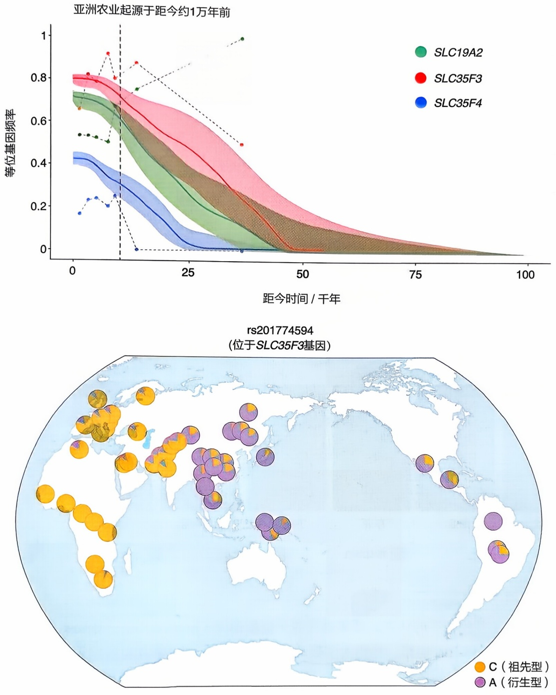

图 5-23 维生素 B$_{1}$代谢基因在东亚人群中受到特异性正选择

参与维生素 $B_{1}$ 代谢通路的SLC19A2、SLC35F3和SLC35F4基因在东亚人群与其他大洲人群中表现出极为显著的差异。上图展示了这三个基因上代表性遗传变异的衍生型等位基因频率的历史动态变化。其中，实线及阴影部分表示由现生东亚人群基因组估算得到的不同历史时间对应等位基因频率及其95%置信区间；虚线表示由对应年代的古人基因组计算所得等位基因频率随时间变化趋势。下图则以SLC35F3的代表性遗传变异为例，展示了其在全球人群中的频率分布，其中在具有东亚血统的人群中频率较高。图改自:Ma et al., iScience, 2022, 25: 105614。

## 5. 高原人群低氧环境适应

高原自然环境以高寒、缺氧、强辐射等为主要特征，是人类居住的最极端环境之一。世界“第三极”青藏高原的平均海拔为4 000 m以上，含氧量为平原的60%。生活在平原上的人进入青藏高原后，血氧饱和度降低，引起各组织器官供氧不足，进而易引发高原肺水肿、高原脑水肿、高原心脏病等高原疾病。然而，世居于青藏高原、安第斯山、埃塞俄比亚高原等高海拔地区的人群患高原疾病的风险比平原人群低很多。高原世居人群的低氧环境适应，是指高原世居者为了能够在高原生存所产生的非可逆、可遗传的形态结构、生理和生化特性改变过程，涉及多种组织、器官的生理变化（图5-25）。经过国内外近十余年的密集研究，人们对藏族高原适应的遗传学基础有了一些初步的认识。低氧诱导因子信号通路（hypoxia-induced factor signaling pathway），简称 HIF 通路，是绝大多数动物中氧水平感知和适应的最重要生物学通路（图 5-26）。

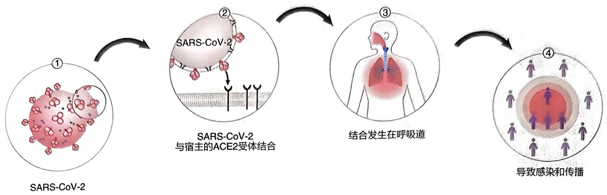

flowchart

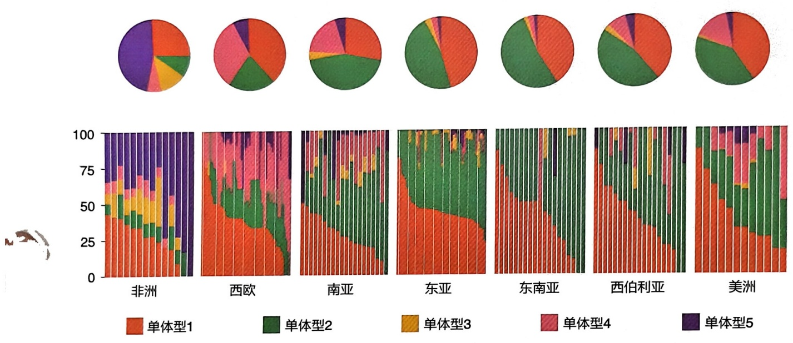

pie

| Region | 单体型1 (%) | 单体型2 (%) | 单体型3 (%) | 单体型4 (%) | 单体型5 (%) |
| :--- | :--- | :--- | :--- | :--- | :--- |
| 非洲 | ~40 | ~10 | ~10 | ~10 | ~30 |
| 西欧 | ~75 | ~25 | ~5 | ~10 | ~5 |
| 南亚 | ~50 | ~40 | ~5 | ~10 | ~5 |
| 东亚 | ~80 | ~20 | ~5 | ~5 | ~5 |
| 东南亚 | ~60 | ~40 | ~5 | ~5 | ~5 |
| 西伯利亚 | ~90 | ~10 | ~5 | ~5 | ~5 |
| 美洲 | ~90 | ~10 | ~5 | ~10 | ~5 |

图 5-24 SARS-CoV-2 受体基因 ACE2 在东亚人群中特异的单体型谱系上图展示了 SARS-CoV-2 感染人的途径，通过与宿主的 ACE2 受体结合引发呼吸道感染。下图展示了受体基因 ACE2 在世界不同地域人群中的单体型构成。其中，饼图示意某大洲或地区整体水平的 ACE2 单体型组成占比；直方图表示该地区不同人群的单体型组成占比。图改自:Yuwen Pan et al., National Science Review, 2022, 9: nwac118。

早在 2010—2011 年间开展的多项研究均报道 EPAS1 和 EGLN1 在高海拔和低海拔人群间存在显著的遗传分化（Beall et al., 2010; Xu et al., 2011）。EGLN1 基因上的两个错义突变 rs12097901（c.12C > G, Cys127Ser）和 rs186996510（c.380G > C, Asp4Glu）被认为是在藏族人群中特异性富集的关键适应性突变（Lorenzo et al., 2014; Xiang et al., 2013），其在藏族人群中的频率达到 80%。这两个关键适应性变异与藏族血红蛋白水平显著关联，并在小鼠实验中得到证实。EPAS1 基因上未能定位到功能突变，但其下游跨膜蛋白编码基因 TMEM247 上的藏族特异性错义突变 rs116983452（c.248C > T; p.Ala83Val）可能具有比 EPAS1 更显著的表型后果，且二者之间可能存在一定的相互作用（Deng et al., 2019）。这一错义突变也是迄今发现的汉藏频率差异最大的功能变异——在藏族人群中的携带率达到 90% 以上，而在世界其他人群中非

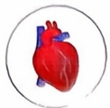

## 心脏

↓静息心率♀
↑收缩压
↓舒张压♂
↑舒张期右心室面积♂
↑三尖瓣环平面收缩期位移♀
↓三尖瓣反流射流的最大速度
↓肺动脉压

## 皮肤

↑臀部皮肤颜色的红度♂
↑腋下皮肤颜色的黄度♂
↑手、臀部和腋下皮肤颜色的深浅

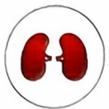

## 肾脏

↓肌酐
↓尿酸
↓尿素氮♂

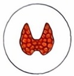

## 甲状腺

↓游离甲状腺素♂
↓促甲状腺激素 ♀
↓甲状旁腺激素
↓游离三碘甲状腺原氨酸♂

## 身体

↑体重♀
↓身高♀
↑体脂指数 ♀
↑胸围
↑腰围 ♀

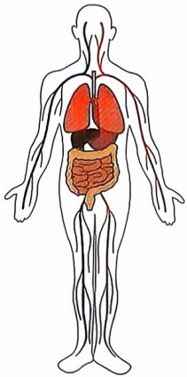

natural_image

Human body diagram showing internal organs including lungs, intestines, and kidneys (no text or labels)

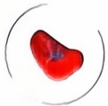

## 脾脏

↓脾脏厚度

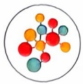

## 新陈代谢

↓同型半胱氨酸
↓血清钠♀、↓铝♀、↓铁♀
↓同型半胱氨酸
↓糖化血红蛋白
↓一氧化氮、↑葡萄糖
↓叶酸、↑维生素B$_{12}$

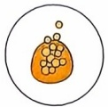

## 脂质

↓甘油三酯
↑高密度脂蛋白♀

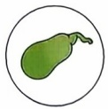

## 胆囊

↑胆囊壁厚度

## 眼睛

↓眼睛中央角膜厚度♀
↓眼睛晶状体厚度♀
↓眼睛的球镜等效

## 血液

↓血红蛋白
↓红细胞压积
↓红细胞
↓外周氧饱和度
↓平均红细胞体积 ♀
↓平均红细胞血红蛋白
↑平均红细胞血红蛋白浓度♂
↑血小板计数 ♀
↓平均血小板体积
↑血小板压积
↓淋巴细胞百分比和计数
↑中性粒细胞百分比和计数♂

↑平均红细胞体积的标准差♂和变异系数

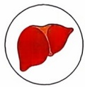

## 肝脏

↑碱性磷酸酶
↑谷氨酰转肽酶
↑γ-谷氨酰转肽酶
↑谷氨酸丙酮酸转氨酶♀
↓间接、直接♀和总胆红素
↑直接胆红素/总胆红素比值
↓天冬氨酸转氨酶/丙氨酸转氨酶比值 ♀图5-25 藏族高原适应涉及的生理表型

与高海拔地区的汉族移民相比，高原世居的藏族人群在图中所示的12个器官系统中展现出显著的生理学特征差异。图中的上箭头代表藏族人群中这些特征的数值较高，而下箭头则指示相反的情况。此外，藏族男性和女性各自特有的适应性表型分别用特定的符号（男性:♂；女性:♀）进行了标注，以便于区分。图改自:He et al., iScience, 2023, 26: 107677。

常罕见，频率小于 $3\%$ 。此外，EPAS1下游也存在一个长度 $3.4\mathrm{kb}$ 的藏族人群富集型缺失（Tibetan-enriched deletion，TED）（Lou et al., 2015）。

事实上，人类征服青藏高原的历程悠久而曲折。研究表明，青藏高原人群的遗传起源可追溯至距今6万至4万年前的旧石器时代中晚期，早期进入青藏高原的人类族群间发生广泛的基因交流，并与后期进入青藏高原的族群发生进一步遗传混合，最终形成了一个包含现代智人和早期智人多个谱系（包括考古学已经发现的尼安德特人和丹尼索瓦人等，以及其他未知古人类）的遗传构成极其复杂的混合人群（Lu

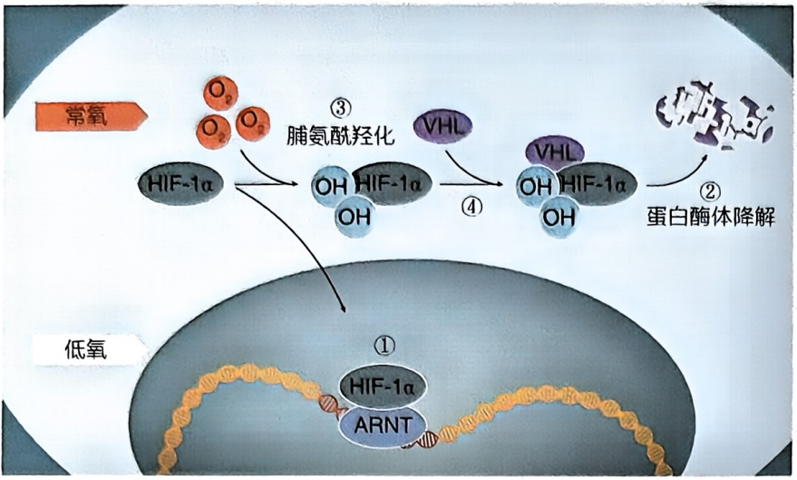

flowchart

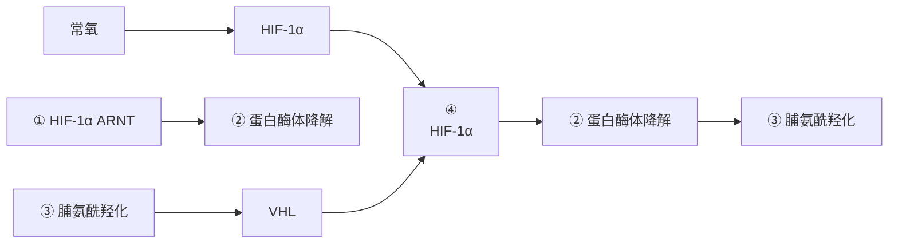

图 5-26 低氧诱导因子信号通路（HIF 通路）是低氧感知和适应的重要生物学通路

① 在缺氧条件下，HIF-1α蛋白免受降解，因而在细胞核内积聚。在此，它与ARNT蛋白结合，共同识别并结合到缺氧响应基因（HRE）的特异DNA序列上，从而调控这些基因的表达。② 正常氧水平下，HIF-1α会被蛋白酶体快速降解，以维持细胞内HIF-1α水平的平衡。③ 氧水平的高低通过在HIF-1α蛋白上添加羟基（OH）来调控其稳定性，这一过程是HIF-1α降解的关键调节机制。④ VHL蛋白在氧充足时能够识别HIF-1α，并与之结合形成复合体，这一复合体的形成是HIF-1α降解的前提，且该过程依赖于氧的存在。

et al., 2016)。这个过程中，一些曾经帮助人类适应高原环境的古人类基因片段得以保留下来，因高原极端环境的自然选择作用，在现今高原人群中积累到较高的频率，这一现象被称为适应性渗入（adaptive introgression）。除藏族之外，研究人员在其他高原世居人群中也发现了EPAS1和EGLN1适应性进化的现象，但也在僬人、夏尔巴人中鉴定出族群特异性的高原适应性基因（Zhang et al., 2019; Ge et al., 2023）。以上的结果都提示了不同高原人群经历了不同的进化历史和自然选择历程，同时也意味着人类的高原适应机制可能极其复杂，而基因组中大量的变异似乎可以组成不同的方案使得生物体具备应对环境改变的能力，即人类对高原环境的适应可能存在趋同进化的机制并且有可能是普遍存在的现象。

## 6. 人类肤色的适应性进化

肤色是人类适应性进化的重要表型之

一，它在不同地域和人群中展现出丰富的多样性。肤色的深浅主要由黑色素的含量决定。纬度和紫外线强度是影响肤色的直接环境因素。生活在赤道附近的人们通常拥有较深的肤色，这有助于保护皮肤免受强烈紫外线的伤害，降低皮肤损伤和皮肤癌的风险。相比之下，生活在高纬度地区的人们则倾向于拥有较浅的肤色，这有助于他们更有效地吸收紫外线，从而促进体内维生素D的合成（图5-27）。前期研究表明，欧洲和东亚人群的浅肤色特征可能是通过趋同进化形成的。例如，在东亚人群中，OCA2基因经历了正选择；而在欧洲人群中，SLC24A5和SLC45A2等基因也受到了类似的选择压力。近期研究揭示了在藏族人群中，色素合成相关基因GNPAT受到了强烈的正选择（Yang et al., 2022）。该基因第二内含子中的一个增强子调控元件rs75356281发生了点突变，这一突变的衍生等位基因在藏族人群中的频率高达 $58\%$ ，而在世界其他人群中则不到 $18\%$ 。这一突变与藏族人群中的原始肤色（如臀部肤色）和继发性肤色（如手背肤色）均存在显著的相关性。通过体外细胞功能实验，研究者们证实了这一突变导致了转录因子结合模式和增强子活性的变化。在自然选择的推动下，GNPAT基因在藏族人群中经历了适应性突变的积累。这些突变增强了藏族人群的黑色素合成能力，使得他们肤色变深，从而更好地适应高原地区强烈的紫外线辐射环境。

另一项研究深入探讨了全球赤道附近深肤色人群的遗传学特征。研究团队收集了全球热带地区近1000例原住民的基因型数据，对色素基因在全球人群中的遗传变异模式进行了分析，并据此提出了几种关于赤道附近人群深肤色进化的模型（图5-28）

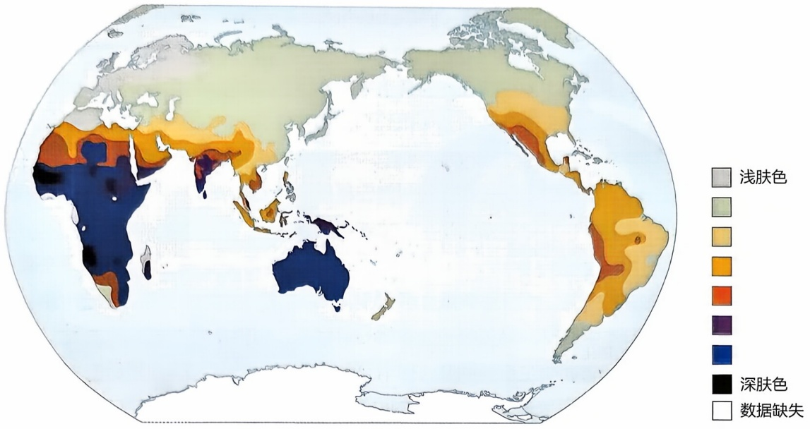

geo

| Color Category | Description |
| --- | --- |
| Light (Grey) | 浅肤色 |
| Medium-Light (Light Green) | N/A |
| Medium (Yellow) | N/A |
| Medium-Dark (Orange) | N/A |
| Dark (Red-Orange) | N/A |
| Dark Purple (Dark Purple) | N/A |
| Blue (Blue) | N/A |
| Black (Black) | 深肤色 |
| White (White) | 数据缺失 |

图5-27 世界人群肤色分布

(Deng et al., 2022)。首先，研究指出，与肤色相关的遗传变异可能源自共同祖先，并在不同人群分化后经历了平行进化。通过分析发现，许多在非洲人群中已报道的深肤色关联遗传变异，在亚洲热带原住民中也以一定频率存在。这些携带古老单体型的变异，暗示了亚洲早期祖先可能为当地原住民深肤色表型提供了部分遗传基础。其次，研究提出了趋同进化的可能性，即不同人群在各自的进化过程中独立获得了相同的肤色相关遗传变异。一种情况是古人基因渗入事件，古人与亚洲热带原住民的遗传混合可能重新引入了在“走出非洲”过程中丢失的深肤色相关遗传变异。另一种可能是独立发生的新发突变，例如在STK11基因上，多个亚洲热带原住民人群携带了同一新发突变，该基因参与紫外线诱导的DNA损伤修复。尽管不同人群独立发生相同新发突变的概率较低，但目前的分析尚不能完全排除这种可能性。

现今，我们的科学研究正从第四范式——数据密集型科学研究时代，向着尚未形成共识的第五范式——人工智能时代迈进，人类群体遗传学研究近年来取得了突破性进展，人类基因组的密码不断被破解。在泛基因组技术、大数据与人工智能技术的推动下，一方面，我们终将有望揭示人类遗传多样性格局，精准还原人类在漫长进化历程中基因流动、分化与融合的壮丽史诗，让人类起源、迁徙与发展的历史脉络清晰浮现；另一方面，长期困扰医学界、错综复杂的复杂疾病背后隐藏的遗传机制，也将逐步明朗清晰。无论我们的科学技术如何发展，始终有一根主线，就是遗传与进化。最终，我们必须回到基因，回到遗传学，从进化的视角重新审视这个世界以及人类自身。

图5-28 赤道附近人群深肤色进化模型

图中从上至下依次展示了人类深肤色适应性进化的三种不同模型及相应基因变异在全球人群中的等位基因频率分布。饼图中的颜色与左侧谱系树中各人群名称的颜色相匹配。

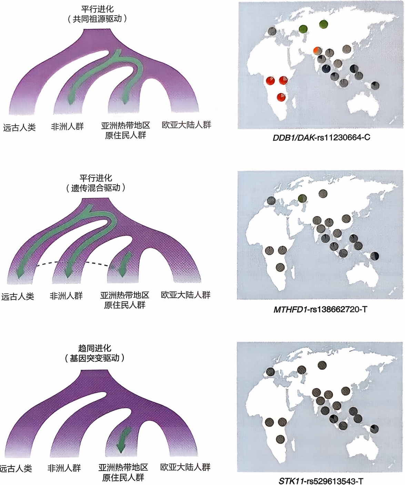

## ※ 复习思考题

1. 请使用千人基因组浏览器查询PRNP基因上SNP位点rs1799990的等位基因和基因型频率，并检验该位点在英国人群（GBR）、非洲卢旺达人群（LWK）、中国北京汉族人群（CHB）和哥伦比亚人群（CLM）中是否处于哈迪-温伯格平衡（HWE）。
2. 为什么人群的有效群体大小与实际人口大小有差异？如果有效群体大小在大幅减少后经历迅速扩张，对中性等位基因和受正选择的等位基因频率变化分别有什么影响？是否能促进两种等位基因在人群中迅速固定下来？
3. 使用来自某个人群的 100 个个体基因序列，如何验证某个基因经历过长期平衡选

择？如果同时提供100个黑猩猩个体的基因序列，是否会对上述验证分析有帮助？

4. 研究人员发现来自丹尼索瓦人的 EPAS1 等位基因可能促进了青藏高原世居人群的高原环境适应，由此我们推断丹尼索瓦人也具备高原低氧环境的适应能力。请问这一推断是否合理？另外还有哪些线索或者证据可以用于验证这一推断？
5. 连锁不平衡现象在复杂疾病全基因组关联研究（GWAS）中起到了关键作用，请详细说明其如何助力研究人员从海量基因数据中精准定位疾病相关基因位点的？并且深入思考，随着基因测序技术的不断进步，连锁不平衡的研究模式可能会面临哪些新的机遇与挑战？
6. 遗传漂变和自然选择是生物进化的两大重要驱动力，但在某些特殊生态环境下，它们之间的界限似乎变得模糊。请举例详细阐述一种这样的特殊生态环境，并深入分析在该环境中遗传漂变和自然选择是如何相互作用，共同塑造生物种群进化轨迹的？
7. 乳糖不耐受现象在不同地区人群中的分布存在显著差异，除了文中提到的畜牧文化因素外，请深入剖析还有哪些地理、历史、社会经济等因素可能影响乳糖耐受基因的频率变化？并且思考随着全球饮食文化交流日益频繁，这种基因频率变化趋势可能会发生怎样的改变？

## ※ 推荐阅读

1. BERGSTRÖM A, MCCARTHY S A, HUI R, et al. Insights into human genetic variation and population history from 929 diverse genomes[J]. Science, 2020, 367: eaay5012.
2. THE HUGO PAN-ASIAN SNP CONSORTIUM, ABDULLA M A, AHMED I, et al. Mapping human genetic diversity in Asia[J]. Science, 2009, 326: 1541–1545.
3. SABETI P C, VARILLY P, FRY B, et al. Genome-wide detection and characterization of positive selection in human populations[J]. Nature, 2007, 449: 913–918.
4. LU D, LOU H, YUAN K, et al. Ancestral origins and genetic history of Tibetan highlanders[J]. American Journal of Human Genetics, 2016, 99: 580–594.
5. FENG Q, LU Y, NI X, et al. Genetic history of Xinjiang's Uyghurs suggests Bronze age multiple-way contacts in Eurasia[J]. Molecular Biology and Evolution, 2017, 34: 2572–2582.
6. TISHKOFF S A, REED F A, RANCIARO A, et al. Convergent adaptation of human lactase persistence in Africa and Europe[J]. Nature Genetics, 2007, 39: 31–40.
7. GAO Y, YANG X, CHEN H, et al. A pangenome reference of 36 Chinese populations[J]. Nature, 2023, 619: 112–121.

（编写:金力、徐书华、陆艳、邓恋；审读:卢大儒）

## 第六章

# 人类遗传学与疾病

人类遗传学研究的核心目标之一是揭示基因变异与疾病之间的关联，为疾病的预防、诊断和治疗提供科学依据。本章系统探讨了遗传学与疾病的关联，涵盖遗传模式、致病基因鉴定、遗传检测及治疗方法等多个方面。本章首先介绍人类性状的遗传模式，包括单基因病、寡基因病和多基因病的遗传特点。通过系谱分析，详细阐述了5种常见的遗传模式各自的遗传规律，并讨论了外显率、表现度、遗传印记等复杂遗传现象对常见孟德尔式系谱的影响。后进一步系统阐述功能克隆、定位克隆和二代测序技术在鉴定单基因遗传病致病基因方面的具体应用。全外显子组和全基因组测序目前已经成为鉴定致病突变的主流方法，但其数据解读仍然存在很大的挑战。全基因组关联研究已经广泛应用于复杂疾病易感基因的筛查，本章也对其取得的成就、仍然存在的问题和未来的发展方向进行了深入探讨。遗传检测可以更早地识别高风险个体，并制定个性化的健康管理策略。检测技术的进步使得产前筛查、新生儿筛查和携带者筛查成为可能，显著降低了严重遗传病的发生率，提升了人口健康水平。在治疗领域，基因治疗和基因组编辑技术为遗传病的治愈带来了希望。通过修复或替换缺陷基因，这些方法有望从根本上解决传统疗法无法应对的遗传性疾病。同时，药物遗传学研究为个性化用药提供了依据，优化了药物疗效并减少了不良反应。

人类遗传学的发展不仅推动了医学进步，也对社会伦理和法律提出了新的挑战。如何在技术创新与伦理规范之间取得平衡，是未来需要持续探讨的重要议题。总而言之，遗传学研究为人类健康事业开辟了新途径，其意义已超越科学领域，深刻影响着医疗实践和社会福祉。

## 第一节 人类性状的遗传模式

最简单的遗传模式表现为由单一基因座上的基因型决定的遗传性状在家系中的传递方式，但这并不意味着该性状本身只由这一对基因决定。因为任何一个人类性状的产生实际上都是大量遗传和环境因素共同作用的结果。在正常的人类遗传和环境背景下，有时候某一个基因座位上的特定基因型对于性状的出现是充分而必要的。那么这类单基因性状称为孟德尔性状（Mendelian character）。如果该性状表现为某种疾病，我们将它称为单基因病（monogenic disease）或者孟德尔病（Mendelian disease），例如:编码凝血因子Ⅷ或Ⅸ的基因如果发生突变导致功能丧失，可以分别引起甲型或乙型血友病。孟德尔性状可以用特征性的系谱来进行识别。获得人类病理性或非病理性状相关信息的最佳来源之一是OMIM数据库（the Online Mendelian Inheritance in Man）。OMIM数据库目前收录有分子基础已知的人类性状7551种，包含引起表型突变的基因4930个，其中单基因突变引起的疾病和性状有3451种，相关基因4569个（截至2024年10月11日）。

现在我们已经知道，孟德尔性状的背后也是由多个基因组成的通路或网络，其中孟德尔性状对应的基因座往往是这些通路或网络中的关键节点。更多时候，关键节点的作用没有那么明显，导致多数人类性状的遗传变化并不呈现为简单的孟德尔式遗传。如果疾病或者其他性状变化是由2个、3个或更多基因座的变异结果一起决定的，换句话说，如果疾病主要的遗传决定因素仅包含少数几个基因座，那么我们将其称为寡基因病（oligogenic disease），例如:先天性巨结肠与RET、EDNRB、EDN3、GDNF等若干基因的突变相关。如果疾病的遗传决定因素由许多个具有微小效应的基因座组成，我们称之为多基因病（polygenic disease）。传统观点认为高血压、糖尿病等常见病大多属于多基因病。实际上，人类性状从完美的孟德尔式遗传到真正的多基因遗传会形成一个连续的谱系（图6-1A）。而且在此基础上会叠加或多或少的环境因素的影响，最终性状的总体病因学会落在图6-1B所示三角形的某个点上。

孟德尔性状是非此即彼的，例如囊性纤维化或者多指，要么表现出症状，要么没有症状。但是绝大多数人类性状在某种程度上是连续的或者可以量化的，例如身高和体重。这些性状是非孟德尔式的，但是并不意味着基因对其没有决定作用，对这类性状起作用的基因通常被称为数量性状基因座（quantitative trait loci，QTLs）。有些表现为非此即彼的性状也有可能是非孟德尔式的，例如常见的出生缺陷（包括神经管畸形、唇腭裂、先天性心脏病等）。但是它们部分或全部是由遗传决定的:它们倾向于在家族中传递，但是可能并不符合标准的孟德尔式系谱。这些遗传因素被称为易感基因（susceptible gene）。数量性状基因座和易感基因在分子水平上与决定孟德尔式性状的基因并无区别，只是它们的性状决定是通过一种更为复杂的方式罢了。更为复杂的情况是常见的一些人类疾病，在其具体的致病原因上可能具有高度的异质性。例如糖尿病，有些是简单的孟德尔式，有些则完全是环境因素的结果，当然大多数是多种因素共同作用的结果。因此这些疾病我们称之为复杂疾病（complex disease）。

图6-1 表型的决定因素（A）ABO血型取决于染色体9q34上的ABO基因座上的基因型（除极少数例外）。新生儿的Rh溶血症取决于母亲和婴儿在染色体1p36上RHD基因座的基因型，但也会受到母亲和婴儿的ABO血型相容性的影响。先天性巨结肠取决于几个基因座的相互作用。成人身高是由许多基因座累积的微小影响决定的。（B）一个性状的整体决定因素可以表示为三角形中的某个点。

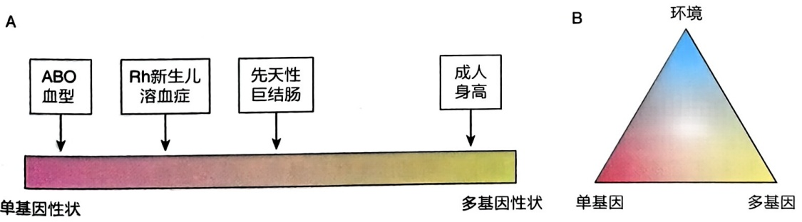

除了这些 DNA 水平的变异之外，有时候我们发现染色体的部分区段甚至整条染色体会出现缺失、重复甚至重排，这种大范围的染色体结构性变异导致的疾病我们称之为染色体病（chromosome disease），例如:21 号染色体三体引起的唐氏综合征等。此外，在人类细胞的线粒体中也含有遗传物质 DNA，当发生突变的线粒体 DNA 占到一定比例时会严重影响细胞的能量供应，从而引起疾病，并且以母系方式遗传，我们称之为线粒体遗传病（mitochondrial genetic disease），例如:Leber 遗传性视神经病、Leigh 综合征等。

## 一、孟德尔式系谱

一个孟德尔性状如果能够在家族中传递意味着该性状不会明显影响个体生育后代，那么它会呈现特征性的孟德尔式系谱。系谱是从家系中第一个被医生或研究者发现罹患某种遗传病或者带有某种性状的先证者（proband）入手，详细调查其所有家族成员的亲属关系以及遗传病或性状的分布情况，并用特定的系谱符号按照一定的格式绘制而成的图谱（系谱中的常用图标见图6-2）。

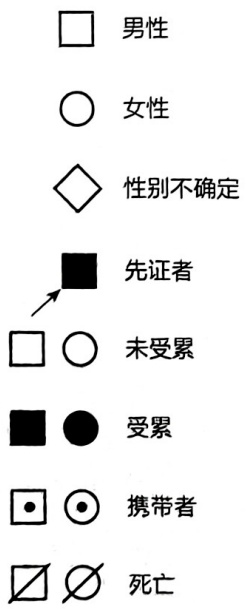

text_image

□ 男性
○ 女性
◇ 性别不确定
■ 先证者
□ ○ 未受累
■ ● 受累
□ ⊙ 携带者
∅ 死亡

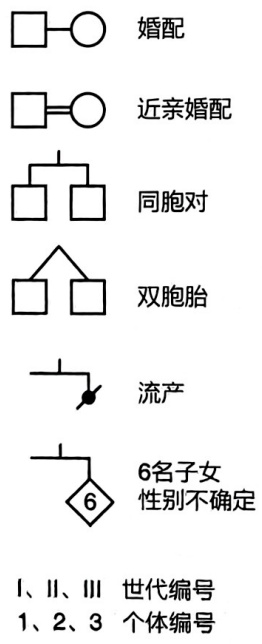

flowchart

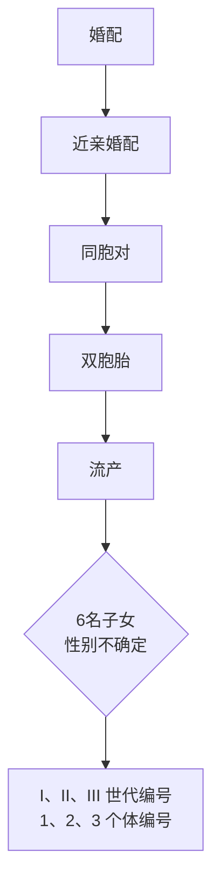

图 6-2 系谱中的常用图标

由确定的染色体位置上的 DNA 或染色质决定的可遗传性状都符合这种系谱的特征。尽管绝大多数孟德尔性状的决定因子是影响蛋白质编码序列的各种变异，但事实上孟德尔性状的决定因子也可以不是基因或者传统意义上的蛋白质编码序列，而是某个特定染色体区域的结构变异，例如脆性 X 染色体。

根据决定孟德尔性状的基因座所在的染色体位置是常染色体还是X染色体以及该性状的显隐性，可以分为五种基本的遗传方式:常染色体显性（autosomal dominant, AD）、常染色体隐性（autosomal recessive, AR）、X连锁显性（X-linked dominant inheritance, XD）、X连锁隐性（X-linked recessive, XR）、Y连锁遗传（Y-linked inheritance）（知识窗6-1）。如果疾病或性状的决定基因位于第1\~22号常染色体上，而且该性状呈显性，那么这种遗传方式称为常染色体显性遗传（图6-3A）。人类有许多性状都是常染色体显性遗传的，比如有耳垂就是显性性状。人类的许多疾病也呈现为常染色体显性遗传，例如成骨发育不全、亨廷顿舞蹈症等。如果疾病或性状的决定基因位于第1\~22号常染色体上，而且该性状呈隐性，那么这种遗传方式称为常染色体隐性遗传（图6-3B）。苯丙酮尿症、白化病、囊性纤维化等都是人类常见的常染色体隐性遗传病。如果疾病或性状的决定基因在X染色体上，而且该性状呈显性，那么这种遗传方式称为X连锁显性遗传（图6-3C），人类常见的X连锁显性遗传病有色素失调症、抗维生素D性佝偻病等。如果疾病或性状的决定基因位于X染色体上，而且该性状呈隐性。那么这种遗传方式称为X连锁隐性遗传（图6-3D），人类X连锁隐性遗传病包括红绿色盲、血友病等。Y连锁遗传的性状组成了第五种系谱，但是Y染色体上携带的基因很少而且其变异的病理效应往往会引起男性不育。因为决定成为男性的SRY（sex-determining region of Y-chromosome）基因就位于Y染色体上，所以真正符合Y连锁遗传的系谱并不多。其他性状，例如多毛耳等，其实很难完全确定是真正以Y连锁方式遗传的。

图6-3 孟德尔式系谱

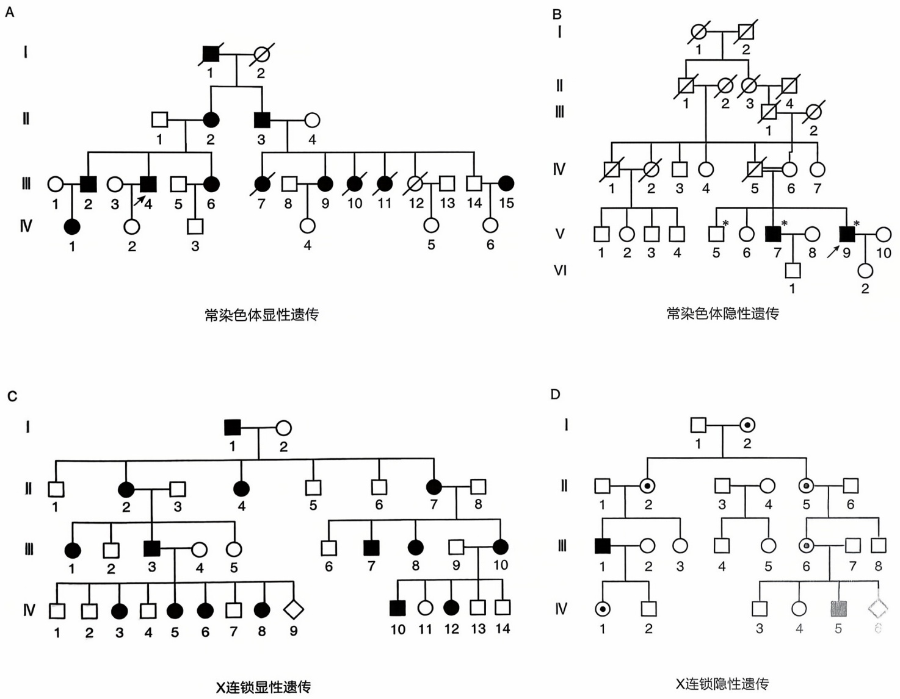

## 知识窗6-1

## 基本孟德尔式系谱的遗传规律

常染色体显性遗传:受累者通常至少有一个受累的父母（但有例外情况，例如新发突变或不外显）。两性皆可受累，且两性均可传递致病基因。父母一方受累，另一方未受累，那么他们的孩子有50%的概率受累（假设受累者都是杂合子的情况）。

常染色体隐性遗传:受累者通常是由未受累的父母所生，受累者的父母通常是无症状的携带者。两性皆可受累。如已有受累子女出生，那么后续每个孩子都有25%的机会受累（假设父母双方都是杂合子携带者）。

X连锁显性遗传:父母双方通常至少有一方受累。女性受累者通常比男性受累者的症状变异更大或更轻微（因为X染色体随机失活）。受累女性的孩子，无论其性别如何，都有 50% 的概率受累。受累男性的所有女儿都会受累，但儿子无一受累。

X连锁隐性遗传:主要累及男性。受累男性通常由未受累的父母所生，通常母亲是无症状携带者，但母方可能有受累的男性亲属。如果父亲受累且母亲是携带者，或者偶发的X染色体随机失活，也会导致女性受累的情况出现。该谱系中通常不会出现男性到男性的传递（但受累男性和携带者女性婚配会出现男性到男性传递的假象）。

Y 连锁遗传:只有男性受累。受累男性总是有一个受累的父亲（除非是新发突变）。受累男性的所有儿子皆受累。

## 二、基本孟德尔式系谱中的复杂情况

各种孟德尔性状或疾病在群体和家系中的分布具有各自的规律，通过对多个家系的调查和系谱分析，可以对疾病的遗传模式做出初步判断并且预测后代的发病风险。然而在现实生活中出现的各种复杂情况往往会掩盖基本的孟德尔式系谱关系，这里列举一些常见的复杂情况。

## 1. 可变表现度

表现度（expressivity）是指个体间基因表达的变化程度，即在不同的遗传背景和环境因素影响下，相同的基因变异在不同个体中表现出的性状和疾病的特征和严重程度可能存在显著差异。显性疾病常常具有可变表现度的特征，图6-4显示了一个常染色体显性遗传成骨不全家系的例子。

通常在人类身上观察到的可变表现度（variable expressivity）现象比在模式生物身上观察到的更为明显，这是因为模式生物在遗传背景上要比人类一致得多，而且生活在更为稳定的环境中。这也是研究人类疾病的动物模型时需要考虑的一个重要因素。

## 2. 不外显和拟表型

基因表达的另一种变异方式是不同的外显率。外显成骨不全患者可以表现出多发性骨折、蓝色巩膜和耳聋这三种性状中的一种或多种。

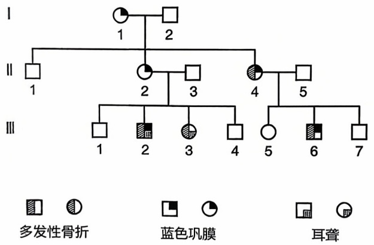

flowchart

This image displays a hierarchical classification tree (a type of flowchart) showing the relationships between three categories: Multi-ferential骨折, Blue巩膜, and Ear聋.

图6-4 可变表现度