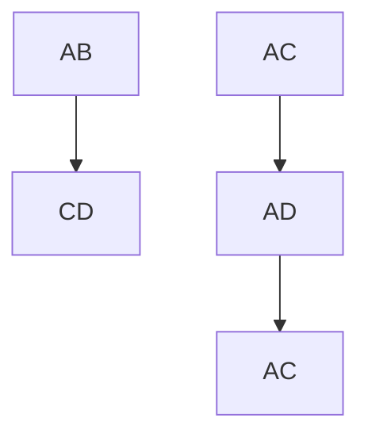
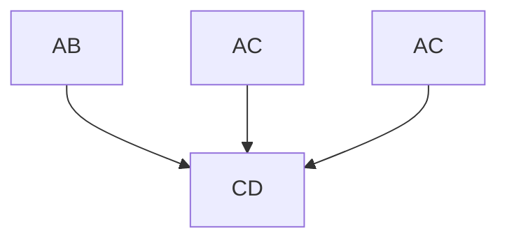
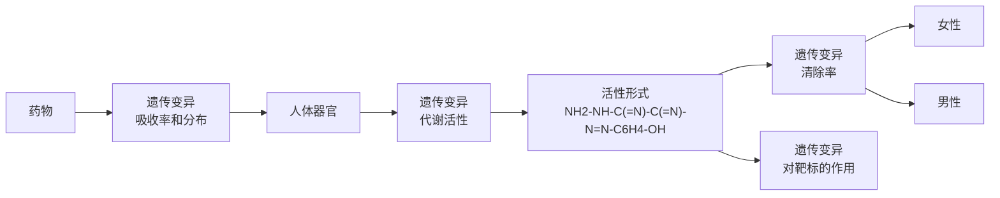

## 知识窗6-5

## 从各类数据库中希望获得的信息

1. 该基因是否已经被报道过与某种疾病或表型相关？
2. 是否报道过包含该基因的染色体结构变异，如果有，是在正常人中还是在某些疾病人群中？
3. 有报道过该基因上存在哪些变异，是以什么样的频率出现？
4. 该基因在发育的什么时间在机体的哪些部位表达？
5. 该基因有哪些不同的剪接体？
6. 基因产物可能的生化功能是什么？

7. 与基因产物能够互作的蛋白质有哪些？它们有什么功能？
8. 该基因的表达是如何被调控的？
9. 该基因有哪些已知的种内或种间同源基因？
10. 该基因的种内和种间同源基因的序列保守性如何，特别是候选致病变异影响的特定氨基酸的保守性如何？
11. 在其他物种中是否存在敲除或者过表达该基因同源基因的相关结果？

## 第三节 复杂疾病易感基因的鉴定与风险评估

连锁分析在孟德尔病的致病基因鉴定中取得了巨大的成功，但是在鉴定复杂疾病的易感基因时绝大多数都不成功。迄今为止研究复杂或多因素疾病最大的成就还是来自于全基因组关联研究（GWAS）。随着二代测序价格的持续下跌，它在鉴定易感因素中的作用将会越来越大。但是在投入到鉴定复杂疾病易感因素的尝试之前，我们需要先通过疾病的流行病学检查其中是否有证据证明有遗传因素的参与。

## 一、确定复杂疾病的病因中是否存在遗传因素

要确定遗传是否在疾病的病因中发挥作用，一个显而易见的判断方法是证明该性状能够在家族中传递，也就是它具有家族聚集性（图6-19）。疾病的家族聚集程度可以用风险比（$\lambda_{\mathrm{R}}$）表示，$\lambda_{\mathrm{R}}$ 为受累者亲属的患病风险相对于群体患病风险的比值。$\lambda_{\mathrm{R}}$ 为1，意味着受累者亲属并没有高于一般群体的额外风险。不同级别亲属的数值可以单独计算出来，例如 $\lambda_{\mathrm{s}}$ 是指同胞对的风险比。表6-2显示了来源于多个精神分裂症研究的汇总数据，升高的 $\lambda$ 值证实了家族聚集性。例如:当父母都是精神分裂症患者时，风险增加了7倍。正如预期的一样，在远亲（例如:侄儿、侄女、表兄弟姐妹）中 $\lambda$ 值将向1回落。

但是我们必须记住父母给予子女的不仅仅是基因，还有环境，因此必须考虑到是否共同的环境才是性状出现家族聚集性的原因。这一点对于行为特征，比如智商或者精神分裂症尤为重要。因为对这类疾病来说，养育的影响可以非常显著。即使对于生理特征或者出生缺陷，也不能够完全忽略环境的影响，因为共同的家庭生活方式可能包括非比寻常的饮食习惯或者一些传统药物，它们都会引起发育缺陷。所以除了家族聚集性之外必须有其他证据来证实遗传易感性。双生子研究和领养研究是常见的解决方法（图6-19）。

表 6-2 精神分裂症患者亲属的患病风险

| 受累亲属 | 风险人数 | λ值 |
| --- | --- | --- |
| 父母中一方 | 8020 | 7 |
| 同胞兄弟姐妹之一 | 9920.7 | 12.6 |
| 父母中一方+同胞兄弟姐妹之一 | 623.5 | 20.8 |
| 同父异母或同母异父的兄弟姐妹 | 499.5 | 5.2 |
| 姑姨舅叔或甥侄 | 6386.5 | 3.5 |
| 孙子女或外孙子女 | 739.5 | 4.6 |
| 堂兄弟姐妹或表兄弟姐妹 | 1600.5 | 3 |

注:考虑到一些有风险的亲属低于或仅在精神分裂症风险年龄（例如15\~35岁）以内，因此对有风险的数字进行了校正，从而得出了非整数值。 $\lambda$ 值的计算假设人口发病率为0.8%。数据来源于McGuffin P, Shanks MF, Hodgson RJ. The Scientific Principles of Psychopathology. Grune & Stratton, 1984。

同卵双生子（monozygotic twins，MZ）被认为是遗传上完全等同的克隆，在任何由遗传决定的性状上都必然是一模一样的，不管遗传方式如何或者有多少个基因参与都应该是如此。唯一的例外是由形成合子之后发生的遗传变异所决定的性状，比如女性中的X染色体随机失活、功能性免疫球蛋白和T细胞受体基因库、引起嵌合现象的合子后随机体细胞突变等。异卵双生子（dizygotic twins，DZ）平均共享一半的基因，他们本质上相当于同胞对。理论上，遗传性状应该在同卵双生子中显示出比异卵双生子更高的一致性。当然很多性状实际上也的确是这样的。在对覆盖了17804个性状，包含14558903对部分重合双生子的2748项研究进行荟萃分析之后得出的结论是:

图6-19 确定疾病受到遗传因素影响的方法红色文字为每种方法中可能存在的问题。

对于大多数性状来说，同卵双生子中的一致性的确是高于异卵双生子。

如果将同卵双生子在出生时分开，然后放在截然不同的环境中抚养，看上去是区分遗传因素和家庭环境因素的理想方案。然而在操作上这一方案是不切实际的，而且双生子毕竟是比较特殊的人群。因此领养研究成为检测性状多大程度上是由遗传决定的金标准。领养研究有两种研究方案:

（1）找到被特定疾病所困扰的被领养人，询问该疾病是在其生物学家庭中传递还是在领养家庭中传递。
（2）寻找孩子是从家庭之外收养的受累者父母，询问收养是否使孩子免于罹患在家族中传递的疾病。

采用第一种设计进行了一项关于精神分裂症遗传因子检测的研究，结果显示是基因而非家庭环境增加了子女患精神分裂症的风险。领养研究主要的障碍是缺乏生物学家庭的信息，因为只有少数国家实行了有效的领养登记。其次是选择性安置问题，领养机构出于孩子的利益往往会选择与其生物学家庭比较类似的家庭进行安置。因为这些困难，所以领养研究主要用于解决生育-养育之争尤为激烈的精神类疾病。

## 二、采用连锁分析研究复杂疾病

家系、双生子和领养研究证实了遗传因素与复杂疾病的相关性，但是它们并不能鉴定出这些遗传因素。受到连锁分析在鉴别孟德尔病致病基因中取得巨大成功的鼓舞，20世纪90年代的研究者试图将连锁分析应用到复杂疾病中。用于从家系数据中计算Lod值的标准程序要求明确候选疾病基因座上每个等位基因的频率和外显率。对于孟德尔性状可以对这些参数进行合理猜测，但是显然并不适用于复杂疾病。因此，复杂疾病的连锁分析必须是不设模型的，也就是非参数分析。非参数分析是比较亲属通过传递一致性（identical by descent，IBD）共享等位基因/单倍型的程度和他们共享表型的程度。如果在患病亲属中共享传递一致性的等位基因/单倍型的概率比孟德尔定律估计的要大，那么这就是连锁的证据（图6-20）。

受累同胞对是非参数分析的主要研究对象。收集受累同胞对和他们父母的DNA，对覆盖他们基因组的遗传标记进行分型。寻找通过传递一致性共享2个、1个或0个单倍型超过随机的 $1:2:1$ 比例的染色体区域（图6-21）。即使在20世纪90年代付出了大量努力，研究人员也只鉴定出了少量候选区域，而且针对同一疾病的不同研究往往产生相互矛盾的结果。少数几个明确的阳性结果之一是在1991年通过无模型连锁的标准Lod值分析发现了晚发型阿尔茨海默病和19号染色体连锁，后来证实该区域与编码载脂蛋白ApoE的基因座连锁。

受累同胞对分析是非常强有力的手段，它本身并不图中两个同胞对都共享等位基因 $A_{1}$，但左边同胞对中的 $A_{1}$ 是两个独立拷贝，所以是状态一致性，而非传递一致性。右边同胞对共享同一个亲代的 $A_{1}$ 等位基因拷贝，所以是传递一致性。因此IBS和IBD只有在亲代基因型已知的情况下才能区分开。

图 6-20 状态一致性（IBS）和传递一致性（IBD）

text_image

A
概率
AB
CD
AC
AC
1/4
AD
1/2
BC
1/4
BD

flowchart

flowchart

text_image

D
概率
AB
CD
AC
AC
>1/4
>1/2
BC
BD
<1/4

图 6-21 受累同胞对分析

（A）通过随机分离，同胞对共享2个（均为AC）、1个（AC与AD或BC）或0个（AC和BD）亲本单倍型的概率分别为 $1 / 4$ 、 $1 / 2$ 和 $1 / 4$ 。  
（B）都患有孟德尔显性疾病的同胞对必须共享携带疾病的等位基因片段，他们可能共享也可能不共享（$50\% : 50\%$ 的机会）未受影响的那

个父母单倍型。（C）都患有孟德尔隐性疾病的同胞对必然在相关染色体片段上共享相同的两个亲本单倍型。（D）对于复杂的情况，单倍型共享如果高于预期偶然发生的单倍型（如图A所示），就可以识别出含有易感基因的染色体片段。

存在方法学问题或者理论漏洞，主要问题在于它的统计学效力低下，所以需要大量同胞对才能够找到效应极强的位点。1996年发表的论文计算了具有 $80\%$ 统计效力能够检测到显著连锁所需要的同胞对数量（表6-3）。这一数字依赖于易感等位基因的频率和它赋予额外风险的程度，但是总的来说，只有能够提供4倍以上相对风险的罕见等位基因才有可能在合理数目的同胞对中被检测出来。除了证实采用无模型连锁分析来鉴定效应微弱的易感基因是不切实际的之外，这篇文章也指出在基于特定假设的情况下，关联研究具有高得多的统计效力，因此使得对于复杂疾病的研究在后续几年之内从连锁分析转向了关联研究。

## 三、关联研究

关联（association）与连锁不同，它并不是一种特殊的遗传学现象，而是等位基因与表型共同出现的一种统计学表述。如果某些人同时具有疾病D和等位基因 $A$ 的频率显著高于或低于群体中D和 $A$ 各自的频率，那么我们就认为等位基因 $A$ 和疾病D相关联。例如:英国普通群体中HLA-DR4的比例是 $36\%$ ，但是类风湿性关节炎的群体中HLA-DR4的比例为 $78\%$ ，那么HLA-DR4与类风湿性关节炎就是相关联的。产生关联的可能性很多，并不一定都是由于遗传的原因。例如:

表 6-3 具有 $80\%$ 效力检测到显著连锁所需要的同胞对数量

<table><tr><td>相对风险</td><td></td><td colspan="4">4</td><td colspan="4">2</td><td colspan="3">1.5</td></tr><tr><td>等位基因频率</td><td>0.01</td><td>0.1</td><td>0.5</td><td>0.8</td><td>0.01</td><td>0.1</td><td>0.5</td><td>0.8</td><td>0.01</td><td>0.1</td><td>0.5</td><td>0.8</td></tr><tr><td>所需同胞对数量</td><td>4 260</td><td>185</td><td>297</td><td>2 013</td><td>296 710</td><td>5 382</td><td>2 498</td><td>11 917</td><td>4 620 807</td><td>67 816</td><td>17 997</td><td>67 816</td></tr></table>

知识窗6-6

## 连锁与关联的区别与联系

连锁是基因座之间的关系，关联是等位基因与表型间的关系。连锁是一种特殊的遗传学关系，关联单纯是对各种因素的统计学观察。连锁在家系中可以产生关联，但在一般群体中不产生任何关联。

（1）直接原因:携带等位基因 $A$ 使人对疾病D更加易感。具有 $A$ 可能对于发展出疾病D既不充分也不必要，但是会增加其可能性。
(2) 自然选择: 患有疾病 D 的人如果携带等位基因 A 会更有可能存活并生育子女。
(3) 群体分层: 群体包含了好几个遗传背景不同的亚群, 疾病恰好和等位基因一起特别频繁地出现在某一个亚群中。例如: 在 HLA 基因座携带 $A_{1}$ 等位基因和用筷子吃饭相关联, 实际上是因为 $\mathrm{HLA}^{*}A_{1}$ 在华裔中的频率远高于白种人。
（4）连锁不平衡（linkage disequilibrium，LD）:疾病相关联等位基因 A 对于易感性没有任何直接作用，但是它标记了含有易感性变异的一个古老的染色体片段。实际上，我们目前鉴定出来证据确凿的关联，其中绝大多数都是由于连锁不平衡而找到的，随后要做的步骤就是鉴定出真正的致病性序列变异。

其实在 1980 年适合连锁分析的 DNA 标记出现之前，关联研究就已经广泛应用于遗传学研究。人类白细胞抗原（human leucocyte antigen，HLA）与各种疾病的关联研究在 20 世纪 60 和 70 年代是遗传学研究的主要组成部分。早期通过关联研究找到了 HLA-DR4 与风湿性关节炎、HLA-DR3 和 DR4 与 1 型糖尿病以及 HLA-B27 与强直性脊柱炎之间的相关性。后期采用非 HLA 标记也取得了一些成功。但是早期关联研究都存在一个共同的问题，那就是低可重复性，其主要原因是缺乏数量足够的相匹配的对照、没有对多重检验进行充分校正、统计效力不足等。

## 四、全基因组关联研究（GWAS）

很多早期的关联研究由于病例-对照数量小，从而导致统计效力不足，所以即使是真实的关联也可能在独立样本中无法得到重复验证。在经历了很多年挫败和不可重复的结果之后，2007年全基因组关联研究（GWAS）在Wellcome trust病例-对照联盟（the Wellcome Trust Case-Control Consortium，WTCCC）的领导下横空出世，开启了GWAS研究浪潮。

## 1. 全基因组关联研究的代表性案例

在 WTCCC 中，英国研究者收集了 7 种疾病的各 2000 例病例，这 7 种疾病分别是:双相障碍（躁郁症）、冠心病、克罗恩病（Crohn disease）、高血压、风湿性关节炎、1 型糖尿病和 2 型糖尿病。此外还收集了 3000 例健康对照。然后在所有的样本中都对超过 500 000 个 SNP 进行了分型。项目预计如果最小等位基因频率（minor allele frequency，MAF）至少为 0.05 的情况下，相对风险为 1.3 时检测效力是 43%，1.5 时检测效力是 80%。WTCCC 发表的第一篇文章非常值得仔细阅读，因为它非常详尽地讨论了目前已经认为理所当然的质量控制问题。在这 7 大类患者群体中，25 个疾病相关的信号因为 P 值超过显著性阈值而被鉴定出来（图 6-22）。

在这一研究中显著性阈值设定为 $P < 5 \times 10^{-7}$，而不是目前绝大多数研究常用的 $P < 5 \times 10^{-8}$。作为新一代大规模GWAS的实验平台，一个关键的问题是这25个位点中有哪些可以重复？不管是后续的验证还是和此前研究的一致性比对，结果都非常令人欣慰。这7种疾病在之前研究中已经鉴定出的15个位点有强有力的可重复证据证实，与一种或更多疾病关联。这15个位点中有13个都在WTCCC研究中被明确地鉴定出来了，虽然其中只有7个超过了显著性阈值。

WTCCC 的 GWAS 研究价值主要是开创了一个如何进行合理的可重复的关联研究范例，而不是鉴定出特定的候选基因。随后 GWAS 迅速地应用于形形色色的常见疾病中。从 2010 年开始报道了很多其他的 GWAS 研究。截至 2022 年 7 月，GWAS 数据库中收录了 5848 项研究，398342 个特定的 SNP-性状之间的关联。

## 2. 后 GWAS 阶段的研究方法:分相、数据填补和荟萃分析

基于 SNP 芯片基础上的传统 GWAS 研究给出的原始数据是由很多 tagSNP 的基因型组成的，将基因型转换为单倍型就是分相（phasing）。如果我们用共享祖先染色体

图6-22 WTOCC的GWAS结果

（A）寻找疾病相关SNP位点的原理；（B）在7种疾病中找到的显著相关SNP位点示意图。

A

text_image

3 4
1 2

包含500000个SNP的芯片平台，每个SNP有两个等位基因

bar

| 类别 | 等位基因 | 频率 |
| --- | --- | --- |
| 健康对照 | 1 | ~0.6 |
| 健康对照 | 2 | ~0.7 |
| 疾病患者 | 3 | ~0.5 |
| 疾病患者 | 4 | ~0.5 |
| 疾病患者 | 1 | ~0.6 |
| 疾病患者 | 2 | ~0.8 |
| 疾病患者 | 3 | ~1.0 |
| 疾病患者 | 4 | ~0.2 |

B

manhattan

| Category | Sample ID | -log10(p) |
| --- | --- | --- |
| 双相障碍 | 1 | ~3 |
| 双相障碍 | 2 | ~3 |
| 双相障碍 | 3 | ~3 |
| 双相障碍 | 4 | ~3 |
| 双相障碍 | 5 | ~3 |
| 双相障碍 | 6 | ~3 |
| 双相障碍 | 7 | ~3 |
| 双相障碍 | 8 | ~3 |
| 双相障碍 | 9 | ~3 |
| 双相障碍 | 10 | ~3 |
| 双相障碍 | 11 | ~3 |
| 双相障碍 | 12 | ~3 |
| 双相障碍 | 13 | ~3 |
| 双相障碍 | 14 | ~3 |
| 双相障碍 | 15 | ~3 |
| 双相障碍 | 16 | ~3 |
| 双相障碍 | 17 | ~3 |
| 双相障碍 | 18 | ~3 |
| 双相障碍 | 19 | ~3 |
| 双相障碍 | 20 | ~3 |
| 双相障碍 | X | ~3 |
| 冠心病 | 1 | ~3 |
| 冠心病 | 2 | ~3 |
| 冠心病 | 3 | ~3 |
| 冠心病 | 4 | ~3 |
| 冠心病 | 5 | ~3 |
| 冠心病 | 6 | ~3 |
| 冠心病 | 7 | ~3 |
| 冠心病 | 8 | ~3 |
| 冠心病 | 9 | ~15 |
| 冠心病 | 10 | ~3 |
| 冠心病 | 11 | ~3 |
| 冠心病 | 12 | ~3 |
| 冠心病 | 13 | ~3 |
| 冠心病 | 14 | ~3 |
| 冠心病 | 15 | ~3 |
| 冠心病 | 16 | ~3 |
| 冠心病 | 17 | ~3 |
| 冠心病 | 18 | ~3 |
| 冠心病 | 19 | ~3 |
| 冠心病 | X | ~3 |
| 克罗恩病 | 1 | ~3 |
| 克罗恩病 | 2 | ~3 |
| 克罗恩病 | 3 | ~3 |
| 克罗恩病 | 4 | ~3 |
| 克罗恩病 | 5 | ~3 |
| 克罗恩病 | 6 | ~3 |
| 克罗恩病 | 7 | ~3 |
| 克罗恩病 | 8 | ~3 |
| 克罗恩病 | 9 | ~15 |
| 克罗恩病 | 10 | ~3 |
| 克罗恩病 | 11 | ~3 |
| 克罗恩病 | 12 | ~3 |
| 克罗恩病 | 13 | ~3 |
| 克罗恩病 | 14 | ~3 |
| 克罗恩病 | 15 | ~3 |
| 克罗恩病 | 16 | ~3 |
| 克罗恩病 | 17 | ~3 |
| 克罗恩病 | 18 | ~3 |
| 克罗恩病 | X | ~3 |
| 高血压 (Red Triangles) | 1-24 (Sample) | N/A |
| 风湿性关节炎 (Red Triangles) | 1-24 (Sample) | N/A |
| 风湿性关节炎 (Sample) | X-24 (Sample) | N/A |
| 风湿性关节炎 (Sample) | X-25 (Sample) | N/A |
| 风湿性关节炎 (Sample) | X-26 (Sample) | N/A |
| 风湿性关节炎 (Sample) | X-27 (Sample) | N/A |
| 风湿性关节炎 (Sample) | X-28 (Sample) | N/A |
| 风湿性关节炎 (Sample) | X-29 (Sample) | N/A |
| 风湿性关节炎 (Sample) | X-30 (Sample) | N/A |
| 风湿性关节炎 (Sample) | X-31 (Sample) | N/A |
| 风湿性关节炎 (Sample) | X-32 (Sample) | N/A |
| 风湿性关节炎 (Sample) | X-33 (Sample) | N/A |
| 风湿性关节炎 (Sample) | X-34 (Sample) | N/A |
| 风湿性关节炎 (Sample) | X-35 (Sample) | N/A |
| 风湿性关节炎 (Sample) | X-36 (Sample) | N/A |
| 风湿性关节炎 (Sample) | X-37 (Sample) | N/A |
| 风湿性关节炎 (Sample) | X-38 (Sample) | N/A |
| 风湿性关节炎 (Sample) | X-39 (Sample) | N/A |
| 风湿性关节炎 (Sample) | X-40 (Sample) | N/A |
| 风湿性关节炎 (Sample) | X-41 (Sample) | N/A |
| 风湿性关节炎 (Sample) | X-42 (Sample) | N/A |
| 风湿性关节炎 (Sample) | X-43 (Sample) | N/A |
| 风湿性关节炎 (Sample) | X-44 (Sample) | N/A |
| 风湿性关节炎 (Sample) | X-45 (Sample) | N/A |
| 风湿性关节炎 (Sample) | X-46 (Sample) | N/A |
| 风湿性关节炎 (Sample) | X-47 (Sample) | N/A |
| 风湿性关节炎 (Sample) | X-48 (Sample) | N/A |
| 风湿性关节炎 (Sample) | X-49 (Sample) | N/A |
| 风湿性关节炎 (Sample) | X-50 (Sample) | N/A |
| 风湿性关节炎 (Sample) | X-51 (Sample) | N/A |
| 风湿性关节炎 (Sample) | X-52 (Sample) | N/A |
| 风湿性关节炎 (Sample) | X-53 (Sample) | N/A |
| 风湿性关节炎 (Sample) | X-54 (Sample) | N/A |
| 风湿性关节炎 (Sample) | X-55 (Sample) | N/A |
| 风湿性关节炎 (Sample) | X-56 (Sample) | N/A |
| 风湿性关节炎 (Sample) | X-57 (Sample) | N/A |
| 风湿性关节炎 (Sample) | X-58 (Sample) | N/A |
| 风湿性关节炎 (Sample) | X-59 (Sample) | N/A |
| 风湿性关节炎 (Sample) | X-60 (Sample) | N/A |
| 风湿性关节炎 (Sample) | X-61 (Sample) | N/A |
| 风湿性关节炎 (Sample) | X-62 (Sample) | N/A |
| 风湿性关节炎 (Sample) | X-63 (Sample) | N/A |
| 风湿性关节炎 (Sample) | X-64 (Sample) | N/A |
| 风湿性关节炎 (Sample) | X-65 (Sample) | N/A |
| 风湿性关节炎 (Sample) | X-66 (Sample) | N/A |
| 风湿性关节炎 (Sample) | X-67 (Sample) | N/A |
| 风湿性关节炎 (Sample) | X-68 (Sample) | N/A |
| 风湿性关节炎 (Sample) | X-69 (Sample) | N/A |
| 风湿性关节炎 (Sample) | X-70 (Sample) | N/A |
| 风湿性关节炎 (Sample) | X-71 (Sample) | N/A |
| 风湿性关节炎 (Sample) | X-72 (Sample) | N/A |
| 风湿性关节炎 (Sample) | X-73 (Sample) | N/A |
| 风湿性关节炎 (Sample) | X-74 (Sample) | N/A |
| 风湿性关节炎 (Sample) | X-75 (Sample) | N/A |
| 风湿性关节炎 (Sample) | X-76 (Sample) | N/A |
| 风湿性关节炎 (Sample) | X-77 (Sample) | N/A |
| 风湿性关节炎 (Sample) | X-78 (Sample) | N/A |
| 风湿性关节炎 (Sample) | X-79 (Sample) | N/A |
| 风湿性关节炎 (Sample) | X-80 (Sample) | N/A |
| 风湿性关节炎 (Sample) | X-81 (Sample) | N/A |
| 风湿性关节炎 (Sample) | X-82 (Sample) | N/A |
| 风湿性关节炎 (Sample) | X-83 (Sample) | N/A |
| 风湿性关节炎 (Sample) | X-84 (Sample) | N/A |
| 风湿性关节炎 (Sample) | X-85 (Sample) | N/A |
| 风湿性关节炎 (Sample) | X-86 (Sample) | N/A |
| 风湿性关节炎 (Sample) | X-87 (Sample) | N/A |
| 风湿性关节炎 (Sample) | X-88 (Sample) | N/A |
| 风湿性关节炎 (Sample) | X-89 (Sample) | N/A |
| 风湿性关节炎 (Sample) | X-90 (Sample) | N/A |

片段来解释关联，那么疾病风险实际上是由单倍型决定的而不是由基因型决定的。换句话说、单倍型-疾病相关性比等位基因-疾病相关性更加接近现实。

进行分相所需要的初始单倍型频率表可以通过不同的方法产生:

（1）如果有亲属的基因型数据可用，那么单倍型可以通过鉴定IBD片段推导出来。最简单的情况是:如果我们有父母孩子组成的三口之家的数据，除了那些3个人都是同样杂合基因型的基因座，其他单倍型都可以直接读出来。
（2）直接测序可以提供同一读长上基因座的分相数据。目前大多数实验室使用的二代测序仪给出的短读长测序数据的价值有限，但是像PacBio这种单分子测序仪获得的长读长测序数据可以对几十kb范围内的基因型进行分相，而整条染色体可以采用互相重叠的读长来进行分相。
（3）很多方法，包括显微切割、流式细胞分选或者制备单倍体细胞可以在实验室里分离出染色体单体进行测序。
（4）微流体可以允许随机产生长的DNA分子分散到液滴中，在这里它们会被分解成小片段，每一个都用液滴特异性的条形码标记。来自于很多液滴的片段会汇总进行常规的短读长测序，然后可以用条形码将短读长数据重新装配成最初的长分子。每个液滴里长分子的数目可以进行计算，基本不可能出现来源于同一基因组区域的两个长分子正好都存在于同一个液滴中的情况。

这些方法都可以用于构建出相对小尺度的单倍型参考数据。然后一个典型的GWAS中数以千计的病例和对照都可以通过计算来进行分相，其准确率依赖于片段大小和单倍型参考数据的质量。千人基因组的数据经常被当作单倍型参考数据来使用。很多其他人群中也陆续建立起了合适的单倍型参考数据。

数据填补（imputation）是利用连锁不平衡和分相的结果将初始实验中没有直接获得那些基因座的基因型填补进去。经过填补的基因型可以像从实验中确定的基因型那样进行关联检测。单个的SNP可以在不同单倍型中出现，因此会弱化其他单倍型与特定疾病的关联。填补后的SNP可能碰巧只呈现在疾病相关的单倍型上，然后显示出更强的关联性，甚至它本身可能就是致病性变异。正确的数据填补依赖于分相的准确性，而且对于罕见变异来说要困难得多。据估计在典型的SNP基因分型研究中，根据千人基因组的数据进行的数据填补可以鉴定出 $97\%$ 的常见变异，但是只能鉴定出$72\%$ 的罕见变异（MAF<0.01）。在数据越来越多的情况下，罕见变异的数据填补能力也会提高。

数据填补的主要价值就在于进行荟萃分析（Meta-analysis）。在 WTCCC 研究中，每种疾病 2000 个病例和 3000 个对照也只能提供 43% 的效力，检测出 OR 值为 1.3 的变异。然而绝大多数易感因素甚至效应比这还要微弱，鉴定它们需要更大规模的研究、更多的病例和对照。在荟萃分析中可以将研究同一疾病的好几个独立研究合并在一起，组成更大的队列。一个典型的荟萃分析可以包括上万个研究对象，例如:对于成人身高的 GWAS 荟萃分析包含了来自 79 项不同研究的 253288 个欧洲祖先的个体。由于不同的研究常常使用不同基因分型平台对一个单倍型域中的不同 SNP 进行基因分型、所以通过数据填补产生一套通用的SNP对于合并不同的数据集是非常必要的。此外，非常大型的研究可以检测疾病与罕见变异之间的关联。WTCCC研究和绝大多数第一代GWAS研究一样局限于MAF>0.05的变异，而且绝大多数鉴定出来的变异都具有相对较弱的效力。从自然选择的角度来看，任何具有较强致病效力的变异都有可能是罕见的。因此疾病的致病变异很有可能隐藏于不常见的变异（MAF介于0.01\~0.05之间）或者罕见变异（MAF<0.01）之中。但是为了获得足够多携带这两类变异的人，就需要极大数量的病例和对照。

## 3. 复杂性状遗传的启示与展望

首先我们需要用平衡的观点来理解遗传在非孟德尔病中的作用:基本没有什么性状是可以完全归因于遗传或者环境因素的。几乎所有性状都是同时包括遗传和环境因素的。在任何一个人类特征中完全没有哪怕一定程度的遗传原因是非常难以理解的。但同样，我们有责任不要过度夸大遗传因素在人类变异中的作用，继而我们应该避免夸大遗传测试的用途。遗传测试检测的是基因型，不是表型。那些对预测表型有用的基因型当然极具价值，但是遗传检测并不是必然可以用于预测一个个体的风险。那些公司在网络上提供的“生活方式”遗传检测可以当作是参考，但不要与临床诊断相混淆。基因决定不能成为对一种疾病的宿命论借口。高遗传率仅仅意味着在现有的环境中没有什么常见变量具有很大的影响，但它并不会影响环境干预手段的潜力。苯丙酮尿症的例子应该足以说明这个观点:在这种完全遗传的孟德尔病中出现的智力障碍是可以采用特定饮食来预防的。

看上去 GWAS 研究过的每种性状都存在 “丢失的遗传率” 问题，提示绝大多数非孟德尔性状很大程度上都是多基因决定的。与之相关的另一个问题是:复杂疾病多大程度上是孟德尔病或亚孟德尔病的集合？这个需要针对具体问题来具体分析。比如癌症方面已经取得了有价值的进展，目前可以把常见癌症分为由不同功能异常通路驱动的亚型，并且对应不同的治疗方法。先天性心脏病常常可以归因于特定的基因突变，这一信息对于家族检测和再发风险咨询很有用，但是它对于治疗没什么影响。大部分病例都是通过手术来纠正婴儿特定的心脏异常。对于成年期发病的心脏病，生活方式则更为重要。

另一方面，作为GWAS研究的主要对象之一的2型糖尿病，除了占比很低的青少年成人型糖尿病（maturity-onset diabetes in young，MODY）之外，无法通过基因分型区分成适用于不同临床治疗方法的不同亚型。后者是由于7个基因中的某一个突变造成的孟德尔病。不同的药物对不同的突变基因有用，所以MODY的诊断和基因分型是有临床价值的。但是对于占 $95\%$ 的非MODY的2型糖尿病只有微弱的遗传亚型线索可能会对不同的治疗有益。

精神疾病具有固有的复杂性。如果诊断标签能够从广泛的行为分类到特定的遗传分类，会是一个巨大的进步，而且毫无疑问会引起治疗的极大改善。理解精神分裂症和孤独症的遗传学有所进展，但是主要来自于鉴定由拷贝数变异或者新发突变引起的很小的亚型。每种疾病的核心仍然极为复杂。有趣的是，有些确定的遗传易感因子是几种疾病共有的，例如精神分裂症、孤独症和智力障碍。这说明可能存在某种受遗传影响的通用的神经发育中的脆弱性，它显示为不同的疾病依赖于某些特定的诱发因素。

其次、孟德尔病和复杂疾病的一个显著差异在于相关遗传因子在基因组中所处的位置。虽然有相当多的例外，但是决定孟德尔病的变异通常位于蛋白质编码序列。对单基因的外显子和剪接位点或者全外显子组进行测序可以鉴定出绝大多数孟德尔病中超过 $80\%$ 病例中的致病突变。但是绝大多数GWAS鉴定出来的易感变异并不位于蛋白质编码序列中。这一点很符合直观感受。对于孟德尔病，一个DNA序列改变就必然导致疾病，它与基因组中约400万个其他变异无关，也与环境、生活方式和家族史无关。如果那些其他因素中的任何一个对疾病的发生产生显著影响，那么它就不会是孟德尔病了。只有蛋白质上的明显改变才有可能具有如此强烈的效应。在另一方面，参与复杂疾病的变异必然具有微弱得多的效应，这样他们只有联合很多其他变异一起才能够影响表型。他们可能影响调控序列，轻微地增加或降低基因的表达。实际上，很多GWAS鉴定出来的变异定位于eQTLs，也就是影响基因表达水平的基因座。

这一差异也意味着鉴定GWAS中隐藏的易感性变异会比较困难。对于孟德尔病，一般可以在编码区寻找致病突变。他们可能是缺失、移码、无义突变或者剪接位点突变。只有错义突变或者不那么明显的改变剪接的位点会不太容易确定。但GWAS的数据要难解释得多。GWAS数据可能会将效应定位于某个单倍型区块，但是在该区块中可能会有50个或更多的变异，其中任何一个都有可能是该效应的实际原因，但是由于连锁不平衡，它们都会与疾病相关联。在一个区块内，可以通过数据填补出所有变异然后检查其中哪个具有最强的效应，但是这在某种程度上依赖于在这一位点不同单倍型共享等位基因方式的随机效应。然后，因为任何易感变异都有可能是在一个已有的常见区块中出现的一个新突变，所以只有其中部分区块才包含有真正的功能变异。对于只在一个给定区块中的部分样本中出现的可能易感变异，数据填补并不能很好地运转。

此外，由于易感变异常常落在非编码区，经常很难评估增强子序列中的一个核苷酸改变的具体效应。我们可以检测该变异对转录因子结合情况的影响，但是真正的功能结合位点常常并不总是具有体外研究中评出的最优序列，因为比较弱的结合可以进行更为灵活的控制。当然基因编辑技术打开了构建任何变异的可能性，理论上我们可以在一个固定的背景下一个接一个地分别检测它们的效应。但是与检查编码序列的改变相比它们要费力得多，而且有数以百计的候选变异等待检测。因此从关联变异到易感变异的推进会很缓慢。

除了帮助我们理解疾病的机制之外，鉴定易感因素对于预防和治疗复杂疾病有什么实际好处吗？我们希望的是对于这些易感因素的了解可以揭示疾病的致病机制并且给出预防或治疗的方法。对个体一系列的变异进行基因分型也许可以预测个体的风险。但是实际进展是令人失望的。我们所期待的由“诊断和治疗”到“预测和预防”的医疗模式转换还在非常缓慢地到来。可能是因为“丢失的遗传率”问题限制了我们现在的预测能力。一旦我们找到了这些丢失的遗传率，那么这些限制是不是就消失了呢？研究人员建立了一种方法，利用同卵双生子的一致性数据估计复杂疾病遗传学的所有知识在多大程度上能够做出临床上的有用预测，选取24种覆盖各种类型的疾病，想要回答的问题是:如果知道每一个易感因素并且理解它们之间的所有互作，那么能否使用一个人的全基因组序列去进行“临床有用”的预测？他们把“临床有用”定义为风险提高 $10\%$ 或者是群体风险的2倍，这两者中更大的那一个。最好的场景下$90\%$ 的个体会获得一个临床有用的预测，也就是24种疾病中至少一种风险增加。对于绝大多数疾病绝大多数人会得到一个阴性预测，即没有明显增加的风险。该研究得出的结论是对于绝大多数患者来说遗传检测不能够替代常规检查和基于家族史、身体状况和生活方式的风险管理，这些仍然是主要的医学预防策略。

当然如果知道所有的情况，我们就能够精确预测每一个人的每一个遗传风险。可问题是绝大多数常见复杂疾病都具有很多独立微弱的遗传易感因素。只有在很少一部分个体中，所有或者绝大部分风险因素都指向同一方向——增加或者降低易感性。对于绝大多数人，会是增加和降低风险的因素混合在一起，使得个体风险总体上略高或略低于群体风险。因此，的确最好的知识会得到最好的个体风险预测，但是只有极少数人的风险足以和群体风险区分，以达到临床上有用的预测。要注意的是以上结论只适用于常见复杂疾病而不是孟德尔病，后者的序列变异信息常常是至关重要的。

如果个体化的风险预测没有那么值得期待，那么我们能够从日益增加的对复杂疾病的理解中获得哪些实际的益处呢？一个主要方面是更有效的药物研发。在2016年，从最初的潜在药物到市场准入平均直接费用估计是14亿美元而且耗时长达10年以上，其中绝大部分是由于有效性不足或者副作用导致的临床试验失败。有些罕见但是严重的副作用只有在市场化后的监管中才变得很明显，在这一阶段撤回药物对于制药公司会产生严重的经济后果，导致长时间的诉讼，甚至名誉损失，比如罗非昔布（Rofecoxib，$\mathrm{Vioxx}^{\mathrm{TM}}$）的例子。鉴定疾病的易感因素可以提示新的药物研发方向，但是基因组知识的主要好处可能是选择最有希望的临床试验患者，并且预测那些具有副作用风险的人。阿斯利康制药公司计划与人类寿命公司、桑格研究院、赫尔辛基大学、蒙特利尔心脏研究所和英格兰基因组合作对两百万人基因组进行测序，也许能够证实这一点。

虽然医学的未来看上去并不在于个性化的风险预测，但是分层药物或者精准药物，即采用基因组数据通知管理者或治疗患者，可能会是一个主要的发展领域。肿瘤学是这一方法目前的主要受益者，但是我们的愿景是将其扩展到医学的所有领域。2015年美国宣布投入2.15亿美元用于精准医疗计划。2016年，美国宣布投入几十亿美金开展为期15年的精准医学计划。在英国，2014年启动了一项花费3亿英镑的100000基因组计划。随着各国精准医疗计划的实施与完成，也许会开启一个新的纪元。

## 第四节 遗传检测与遗传咨询

之前的各节已经覆盖了遗传检测的很多原则和它在研究中的应用，例如探索人类基因组的自然变异度和理解疾病中遗传变异的作用。在本节中我们主要考虑如何将遗传检测应用于人类疾病诊断、群体筛查和个体鉴定中。其中利用遗传检测进行临床诊断的具体内容将在本书第一部分进行阐述。当我们能够对一种疾病未来是否会发生进行预测诊断时，人们就会期望对整个人群进行检测，以期能够提前预防疾病的发生或尽早进行干预。然而事情没有这么简单。第二部分阐述了在群体筛查项目中存在的各种问题。对于个性化或者精准医疗最有前景的进展是遗传信息不仅可以用于诊断疾病，而且还可以用于管理患者的疾病。医生在临床上经常会观察到不同患者对很多药物的反应不同。基因型虽然只是众多引起不同药物反应的因素之一，但是对于鉴定出那些具有严重副作用风险的人员来说尤为重要。第三部分将对这一内容展开讨论。此外，当警察和律师需要确定个人身份或者两人关系时也要用到遗传检测。这样的问题需要由第四部分中描述的DNA指纹图谱来解决。

## 一、临床诊断性检测

有时候，遗传检测希望确定一个或更多事先已知的特定变异，典型的案例包括:

（1）在家族中进行诊断。一开始可能需要通过测序来确定家族中传递的致病突变，但一旦鉴定出致病突变，其他的家族成员通常只需要检测这个特定的突变即可；

（2）诊断和筛查在一个特定人群中由于强烈的奠基者效应引起的疾病；

(3) 检测由患者表型提示的特定微缺失或者微重复;

(4) 检测肿瘤活检标本, 寻找对靶向药产生反应的突变;

（5）检测对照样本，看看患者中的变异是否实际上只是一个低频的群体多态；

(6) 扩增特定的微卫星以检测重复次数;

(7) 进行 SNP 分型。

实际上测序本身可以解决以上所有问题，但是当靶标变异已知的时候，我们可以采用各种更便宜更简单的方法来进行基因分型。但更为常见的遗传检测往往需要通过对一个基因的所有外显子、一组基因、全外显子组或全基因组进行检测。二代测序使这些任务变得更加容易。关于二代测序确定的变异是否需要通过一代测序进行确认，仍存在持续的争论。毫无疑问，总体趋势是越来越少地使用一代测序，越来越依赖二代测序。一旦价格大幅下降，全基因组测序很可能会取代外显子组测序，其主要优点并不是能够识别 $98\%$ 的基因组中的非编码变异，而是避免了进行外显子捕获。有许多编码序列变异在外显子组测序中会被遗漏，但在对相同样本进行全基因组测序时则可以被检测到。全基因组测序的另一个好处是能够检测出基因组中的结构变异，这在外显子组测序中是无法实现的。

一旦拿到经过验证的变异列表，就必须对其进行过滤，以确定任何可能解释患者

病情的变异。解释变异时要考虑的三个要点是先例、保守性和稀有性。

（1）可以通过ClinVar数据库来评估是否存在先例。它包含了基因中已报道致病性变异以及其表型的细节。
（2）使用多序列比对来评估错义突变中改变的氨基酸的保守性，例如:通过 POLYPHEN 和 SIFT 等工具进行预测。高度保守氨基酸的变化被预测为具有破坏性，而非保守的氨基酸改变预计是良性的。这些评估的准确率通常在 80% 左右。不同工具可能给出不同答案，因此需要同时使用几个工具进行预测并寻求一致性。同时需要注意的是，这类比对并不涉及序列变化是否会影响剪接，也无法预测对蛋白质的破坏性影响是否会真的给整个人体带来任何问题。

（3）变异具有致病性的证据主要来自于比较其在患者和对照中的频率。最理想的情况下，它只会在患者中出现，在对照组中完全没有。如果它仍然会在某些健康对照中出现，那么频率是非常重要的。如果它在疾病中占主导地位，那么对照组中变异的频率必须显著低于疾病组的频率（因此允许外显率降低）。对于隐性疾病，对照中候选变异的频率必须不高于携带者的预期频率。GnomAD数据库包括126 216个外显子组和15 136个基因组，是非常宝贵和强大的工具。如果一个变异在健康对照中过于频繁地出现，可以证明它实际上并没有致病性。许多先前被报道为致病性的变异均未能通过该数据库的检测。

根据上述的过滤原则，人们将变异分为五类:致病性的、可能致病的、意义不确定的、可能是良性的和良性的。美国医学遗传学联合会（American College of Medical Genetics and Genomics，ACMG）的工作组对此提供了广泛的指导意见。其中对每一条可能证据线的注意事项和问题进行了相当详细的说明。如果所涉及的变异位于以前与患者病情无关的基因中，那么所有这些判断都将更加谨慎。

虽然二代测序的稳步发展使许多以前使用的基因检测方法都过时了，然而，并不是诊断实验室碰到的每个问题都能通过当前的二代测序方法来解决。因此临床上仍然采用一些非测序方法来回答某些特定的问题。例如:比较基因组杂交（array-based comparative genomic hybridization，aCGH）是检测结构变异、拷贝数变异等的常用手段；依赖连接的多重探针扩增（multiplex ligation dependent probe amplification，MLPA）广泛用于检测整个外显子的缺失或重复；RNA分析用于检测异常的基因表达或者剪接效应；甲基化分析可以用于鉴定肿瘤和印记基因等。

实际上，任何遗传检测在应用于临床服务之前都必须对其进行严格评估。不仅要评估实验方法本身的有效性，还要评估引入检测的总体效果，包括:

（1）检测本身的有效性:检测方法对其检测内容的实际效果如何？其灵敏度和特异性是否足够？
（2）临床有效性:该项检测对预后的预测效果如何？这主要取决于基因型-表型相关性的强度。
（3）临床实用性:检测结果具有哪些实际的临床用途？它会导致疾病管理或疾病治疗手段的任何变化吗？

（4）伦理、法律和社会方面:检测是否符合法律和伦理标准，能否为社会所接受？

任何一项检测结果都将与其他所有相关信息放在一起进行考量，例如:患者的年龄和性别、总体健康和社会状况，以及任何其他检测的结果。有用的检测应该是对推动人们跨越行动门槛的过程中做出重大贡献的检测。在这方面，绝对风险往往比相对风险要重要得多。例如:检测结果表明某人的患病风险提高了十倍，但其风险只是从万分之一变为千分之一，那么可能不会产生任何实际的差异。另一方面，BRCA1突变检测呈阳性的相对风险仅为7左右（携带者风险为 $80\%$ ，普通人群风险为 $12\%$ ），但这一检测结果很重要，因为携带者的绝对风险非常高。

## 一、群体筛查

群体筛查是由公共权力机构向整个人群（或者特定的大型群体）提供的大规模检测服务，其目的并不是解决参与其中的某个个体的个人健康问题，而是改善公共卫生状况。因此群体筛查是自上而下的。它与由个人或他们的医生发起的基因检测不同，那是一个

flowchart

图6-23 筛查和诊断的检测目的不同

自下而上的过程，主要用来回答由他们的症状或家族史所引发的特定问题。

筛查检测不是诊断检测，尽管有时两者的区别会变得模糊。通常情况下，筛查的目的是确定高危人群，然后为他们提供明确的诊断检测（图6-23），针对的是个人检测不会碰到的一些特殊问题。

由于群体筛查都是比较集中的大型项目，运营机构必须仔细评估是否需要花钱实施任何筛查计划。筛查项目是正式的官方政策问题，而不是个人的突发奇想。个人在决定是否进行基因检测时可能会不切实际，但中央权力机构，无论是政府机构还是保险公司，都必须对筛查提案进行正式评估。表6-4总结了群体筛查项目的一些基本要求。

遗传筛查可能涉及其中任何一项:①产前筛查；②新生儿筛查；③孕前携带者状态筛查；④筛查成年人对晚发性疾病的易感性。后续将一一举例说明。

表 6-4 群体筛查项目的基本要求

| 要求 | 示例及说明 |
| --- | --- |
| 阳性结果必须能促成一些有用的行动 | 例如，苯丙酮尿症可采取特殊饮食的预防性治疗；在囊性纤维化携带者筛查中对生育选择进行审查和抉择。 |
| 检测必须具有高灵敏度和特异性 | 如果产生很多假阴性结果的检测会破坏人们对该计划的信心；如果产生很多假阳性结果的检测，即使随后可以通过明确的诊断测试将其剔除，也会造成令人无法接受的焦虑。 |
| 整个项目在社会和伦理上必须是可接受的 | 受试者必须在知情同意的情况下选择加入该项目；不得对父母可接受后果的受累妊娠施加压力使其终止妊娠；筛查不得具有歧视性。 |
| 该项目的收益必须大于成本 | 以低效的方式使用原本有限的医疗保健预算是不道德的。 |

## 1. 产前筛查:以唐氏综合征（Down syndrome）为例

对于染色体异常检测来说，传统的诊断检测需要获得胎儿细胞样本。在妊娠10～14周时进行绒毛膜活检或者16～20周时进行羊水穿刺都可以获得胎儿细胞样本。但这两种手术都是侵入性的，有大约 $1\%$ 的流产风险，而且费用不菲。对于有可能生育染色体异常胎儿的高危女性来说，这些缺点可以忽略不计，但如何识别出这类高危女性呢？

除了染色体平衡易位携带者及其配偶之外，对于大多数女性来说，年龄是主要的风险因素。随着母亲年龄的增长，生下患有唐氏综合征或其他染色体数目异常婴儿的概率急剧上升（表6-5）。虽然年龄较大的母亲生育患儿的风险要高得多，但对于年轻女性来说，这一风险也不容忽视。

表 6-5 母亲年龄与胎儿唐氏综合征风险

| 母亲年龄 | 20 | 30 | 34 | 36 | 38 | 40 | 42 | 45 |
| --- | --- | --- | --- | --- | --- | --- | --- | --- |
| 胎儿风险 | 1/1 500 | 1/900 | 1/500 | 1/300 | 1/200 | 1/100 | 1/60 | 1/30 |

从母体血清中已经鉴定出几种生物标志物，包括甲胎蛋白、非偶联雌三醇、人绒毛膜促性腺激素、抑制素-A和PAPP-A（妊娠相关血浆蛋白A）。这些生物标志物在胎儿患或不患唐氏综合征的妊娠中显示出不同分布。此外，通过非侵入性的超声检查测量胎儿颈部半透明带的厚度，也可以提示唐氏综合征风险。虽然这些检测单独使用的可信度都不高，但是它们结合在一起，再加上产妇年龄就可以提供有价值的风险预测。美国国立卫生研究院的FASTER研究比较了几种可能的方案。在许多项目中，提供侵入性诊断检测的阈值是唐氏综合征的复合风险为1/300或更高。FASTER研究中各种选择的检出率为90%\~95%，假阳性率为5%。

无创产前检测（non-invasive prenatal testing，NIPT）为产前筛查提供了新的选择。在孕妇血液中通常含有无细胞 DNA，其中 5%\~10% 来自胎盘，即胎儿组织。如果胎儿有一条额外的染色体，当 DNA 测序达到足够的深度时，在无细胞 DNA 中该染色体序列与正常二倍体的染色体序列相比数量会略大一些（图 6-24）。

bar

| Category | Value (Reads Depth) |
| --- | --- |
| 第21号染色体序列 | ~0.85 |
| 其他染色体序列 | ~0.65 |

图6-24 唐氏综合征的无创产前检测

NIPT 从妊娠 9 周左右开始就具有非常高的灵敏度。原则上，它还可以揭示更多关于胎儿的信息，例如:胎儿性别鉴定；Rh 分型以预测新生儿溶血问题；检查特定突变（但不包括母体中已存在的变异）。但是 NIPT 仍然被视为筛查手段，而不是确诊手段。NIPT 检测呈阳性的女性会被建议通过绒毛膜活检或羊膜穿刺术进行侵入性检测。但与以往相比，需要进行这些侵入性检测的女性人数已经大大减少。

## 2. 新生儿筛查项目是为了筛出可以进行干预的疾病

各个国家和地区都有一个进行新生儿筛查的疾病清单。挑选的原则是有可用的治疗方法，并且早期诊断可以明显改善预后。美国医学遗传学联合会（ACMG）认为:新生儿筛查不仅仅在于检测本身，它包含协调、管理和项目评估。ACMG建议筛查29种疾病，主要是先天性代谢疾病。英国国家卫生服务局更为谨慎地选择筛查9种遗传疾病（镰状细胞病、CF、先天性甲状腺功能减退和6种先天性代谢疾病）。

苯丙酮尿症在所有发达国家的新生儿筛查中都榜上有名，可通过刺破婴儿的脚后跟来测量血点中的苯丙氨酸水平。注意，苯丙酮尿症筛查不是基于DNA水平的，因为许多不同基因的功能丧失型突变都会导致苯丙酮尿症。检测结果呈阳性的婴儿可能患有良性的高苯丙氨酸血症，无需进一步治疗；但也有可能会由于四氢生物蝶呤缺乏而出现苯丙酮尿症，这是一种罕见但非常严重的疾病。未经治疗的苯丙酮尿症会导致严重的智力残疾，通常还伴有癫痫和行为异常，因此需要特定的膳食补充剂来限制苯丙氨酸的摄入。苯丙氨酸是一种必需氨基酸，婴儿需要足够的苯丙氨酸来支持正常生长，但不能过量累积以至于损害其发育中的大脑。在严密监控下，苯丙酮尿症患儿可以正常完成神经发育，避免出现智力残疾。

## 3. 育龄人群可以进行隐性疾病携带者筛查

我们每个人都可能是一种或多种严重隐性疾病的携带者。对育龄人群进行携带者情况筛查，在双方都是携带者的情况下，可以通过产前诊断或者试管婴儿来避免生育患有严重隐性疾病的婴儿。由于携带者通常表型正常，与非携带者相比往往没有明显的生化差异，因此携带者筛查必须通过基因分型来完成。

隐性疾病几乎总是由功能丧失型突变引起的，因此通常表现出广泛的等位基因异质性。如果某种隐性疾病在特定人群中很常见，那么很可能会有一个或几个奠基者突变，可以通过特定的DNA检测进行确认。然而，这种针对特定变异的检测往往会漏掉一些携带不同变异的人。因此只有在能够进行外显子组测序的情况下，才能进行全面的携带者筛查。

## 三、药物遗传学和个性化用药

某些对大多数人有效的药物会对某些人无效或会引起不良反应。即使药物有效的情况下，不同个体往往需要不同的剂量才能达到相同的治疗效果。其中有些差异效应是由于环境原因造成的:一个人吸收或代谢药物的能力可能会因其疾病状态或生活方式（例如:饮酒、吸烟、锻炼等）而改变，但也有许多差异效应是由于人与人之间的遗传差异造成的。

药物遗传学和药物基因组学就是探索遗传差异对药物效应的影响。图6-25总结了可能受到遗传变异影响的药物效应。

实际上，药物遗传学效应可分为两类。

(1) 药物代谢动力学: 涵盖涉及药物吸收、分配、代谢和消除的遗传变异、换句

flowchart

图6-25 药物遗传变异可以影响药物作用的多个方面

话说，就是人对药物的作用；

（2）药效学:涵盖药物靶点对给定药物产生反应的遗传变异，换句话说，就是药物对人的作用。

## 1. 遗传差异影响药物代谢水平

药物代谢可以分为两阶段。第一阶段，药物通过氧化、羟基化或水解产生生物活性分子，有时第一阶段产物也可能是药物失活和降解的中间体。第二阶段，药物通过结合反应，如乙酰化、葡萄糖醛酸化或硫酸化等产生更容易排泄的水溶性化合物。参与这两个阶段的酶通常存在影响其活性的多态性差异，这会影响个体对许多药物的反应。这些酶原本的功能是处理外源性物质，尤其是可能存在于饮食中的植物生物碱（图6-26）。

细胞色素 P450 是一个大的酶家族，它们都具有铁硫活性位点和 450nm 处的光吸收峰，负责药物代谢的第一阶段。它们的作用是将分子氧衍生的单个氧原子插入到非常广泛的有机化合物中。最终产物通常是底物的极性羟基化衍生物。人类有大约 60 个 P450 基因编码酶，它们负责大约 60% 处方药的 1 期代谢，其中至少有 10 种不同的 P450 酶在 1 期药物代谢中具有重要作用。

CYP3A4是肝脏中含量最丰富的P450细胞色素，参与了大约 $40\%$ 的药物代谢。它的活性在个体之间的差异高达30倍。该酶被许多不同物质高度诱导，其变异性主要来源于控制诱导性的上游调控序列变异，尽管也存在一些编码序列变异。CYP2D6参与了大约 $25\%$ 的药物代谢。低代谢者CYP2D6基因有功能丧失型突变，而超快速代谢者的基因拷贝数增加（高达13个拷贝），其活性的变化对一些用于治疗高血压和心脏病的 $\beta$ 受体阻滞剂，以及包括三环类抗抑郁药在内的几种精神药物的反应有显著影响。代谢不良的人有服用这些药物过量的风险。图6-27显示了CYP2D6活性如何

图6-26 药物代谢的阶段第一阶段，药物分子通过氧化、羟基化或水解以产生极性化合物，结果通常是产生活性化合物或降解产物。第二阶段，药物分子可与乙酰基、葡萄糖醛基或谷胱甘肽基偶联，形成可排泄的水溶性分子。

flowchart

