## 知识窗 7-1

# 遗传筛选发现果蝇模式形成的奥秘

多细胞动物由受精卵经过细胞增殖和分化发育而来。在胚胎发育过程中，细胞会按特定的时空模式，精确有序地形成各种结构，这一过程称为模式形成。自古希腊时期，人类就对动物发育表现出浓厚兴趣。希波克拉底（Hippocrates of Kos, 460—370 BC）、亚里士多德（Aristotle, 384—322 BC）和克劳狄乌斯·盖伦（Claudius Galenus of Pergamum, 129—199）都曾讨论过鸡胚的发育。亚里士多德还描述过角鲨的胎生现象。19世纪末，随着实验生物学的发展，模式形成成为发育生物学（当时被称为胚胎学）的核心问题。1924年，施佩曼用异种组织移植实验，发现蝾螈胚胎背唇的一小群细胞可以诱导胚胎形成第二体轴，从而提出了“组织者”和“诱导”的概念（图7-2）。这一工作表明，模式形成是一个受到精确调控的生物学过程，施佩曼因此获得了1935年诺贝尔生理学或医学奖。

在施佩曼发现的诱导现象背后，究竟是怎样的生物学机制在发挥作用？为了解答这一问题，发育生物学家们进行了多种尝试。这些活动包括:20世纪30年代，活跃的剑桥和伦敦“理论生物学俱乐部”，试图明确科学问题并研讨破解方法；30—40年代的生物化学探索，50—70年代的细胞生物学研究；以及50年代将胚胎学更名为发育生物学，以鼓励多学科交叉研究。然而，在将近半个世纪里，上述努力一直未能发现模式形成背后的生物学机制。

1979年，刚到欧洲分子生物学实验室（European Molecular Biology Laboratory，EMBL）工作的尼斯莱因-福尔哈德和维绍斯决定尝试利用果蝇破解模式形成机制。两人此前曾一起在果蝇发育遗传学家瓦尔特·格林（Walter J. Gehring，1939—2014）实验室工作过几个月，之后也一直保持着联系。他们选用果蝇研究胚胎发育，不仅基于专业背景，还因为果蝇具有适合充当遗传学模式生物的多种特性、当时最丰富的遗传学工具和技术积累，以及明显的模式形成特征。

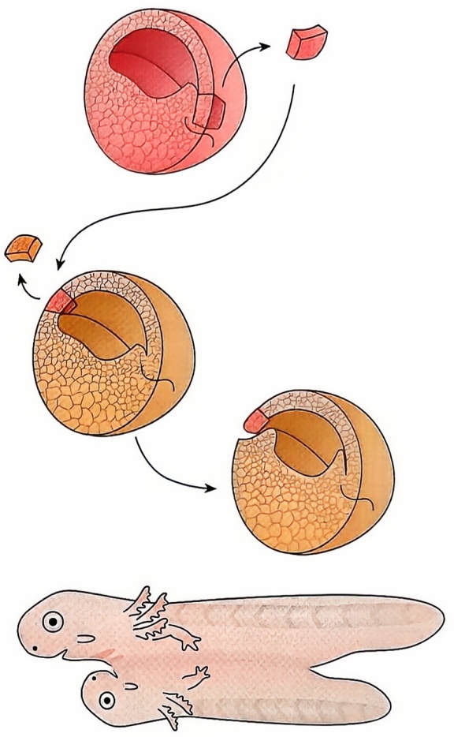

flowchart

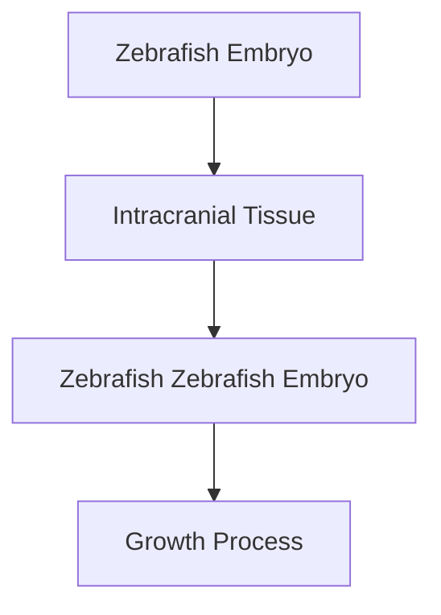

图7-2 施佩曼发现诱导现象

与其他昆虫一样，果蝇躯体由多个体节组成。这一躯体规划模式早在胚盘时期就已经确定。果蝇幼虫时体节区分极为明显，成虫时头部体节愈合，但胸腹部体节区分依然清晰可见。果蝇体节沿前后体轴分布，不同位置的体节发育命运各异。各体节内的细胞随前后和背腹位置不同也具有不同的命运。值得注意的是，体节的产生和分化也是高等动物胚胎发育的必经步骤。当时，对这些发育过程遗传调控机制的研究极少，相关的果蝇基因突变只有bicaudal等寥寥数种。

为系统搜寻调控果蝇模式形成的基因，尼斯莱因-福尔哈德和维绍斯决定合作开展全基因组诱变筛选（图7-3）。果蝇共有4对染色体，其中X染色体和两条常染色体（Ⅱ、Ⅲ号）拥有核基因组的绝大部分DNA，Ⅳ号染色体长度只有前三者总和的约 $1\%$ 。尼斯莱因-福尔哈德和维绍斯分别设计了3组平行实验来筛选X和Ⅱ、Ⅲ号染色体上影响模式形成的基因。在当时的技术条件下，他们选用果蝇胚胎的表皮角质层（cuticle）形态作为主要表型指标。角质层由胚胎表皮细胞分泌的几丁质构成，具有小齿（denticle）和细毛（hair）等附着结构。这些附着结构的大小、数量、分布区域形状因体节而异，且在各体节内有明显的背腹、前后分布差异，可以指征胚胎模式形成的变化，并易于通过整装制片观察。他们认为，控制果蝇模式形成的基因失活会导致体节发育异常和胚胎死亡，通过观察致死品系的胚胎表皮角质层形态变化即可发现这些基因。

尼斯莱因-福尔哈德和维绍斯首先对Ⅱ号染色体进行了遗传筛选，利用甲基磺酸乙酯（ethyl methane sulfonate，EMS）喂食诱变雄蝇，待其恢复体力后与野生型雌蝇交配；再将下一代（ $F_{1}$ ）雄蝇逐一与野生型雌蝇交配，产生的后代（ $F_{2}$ ）中的雌雄果蝇再互相交配，建立纯合品系，观察胚胎发育变化（图7-3）。他们一共检测了5764个 $F_{2}$ 品系，发现了1620个胚胎致死突变品系，其中272个品系有较明显的表皮角质层形态变化。通过互补测验和遗传定位（详见第八章），他们最终在Ⅱ号染色体上确定了61个影响果蝇胚胎模式形成的基因（Nüsslein-Volhard et al., 1984）。

尼斯莱因-福尔哈德和维绍斯采用了一系列遗传学技术提高研究效率。例如，他们采用了携带眼色突变标记（朱砂眼cinnabar，cn；褐眼brown，bw）的Ⅱ号染色体作为诱变区域。这两种隐性眼色突变不影响果蝇胚胎发育，但同时存在会使果蝇复眼呈现白色。这样，携带突变的Ⅱ号染色体纯合子可以通过复眼颜色与其他红色复眼的果蝇相区分，帮助快速识别携带Ⅱ号染色体纯合致死突变的品系。又如，他们使用了名为CyO的平衡染色体（详见本章第二节）抑制在遗传筛选中获得的Ⅱ号染色体上的基因突变与眼色突变标记的重组。CyO 染色体携带的显性遗传标记卷翅（Curly，Cy）可以帮助区分Ⅱ号染色体纯合致死突变品系，同时携带两条CyO染色体的果蝇则死于幼虫期而不干扰后续实验。他们还使用了显性温度敏感致死（dominant temperature sensitive，DTS）突变标记未经诱变的Ⅱ号染色体，并在29℃环境下繁殖 $F_{2}$ 果蝇。此时，携带DTS标记染色体的果蝇因无法完成胚胎发育而被清除。这些遗传学技术结合勤勉工作，使得Ⅱ号染色体基因的系统筛选仅用时

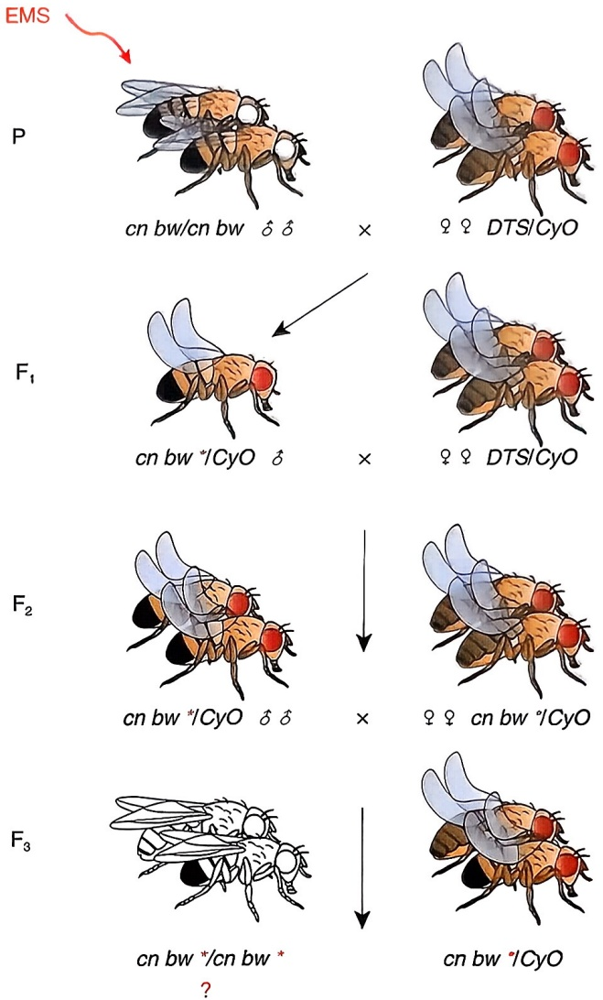

text_image

EMS
P
cn bw/cn bw δ δ ×
♀ ♀ DTS/CyO
F₁
cn bw */CyO δ ×
♀ ♀ DTS/CyO
F₂
cn bw */CyO δ δ ×
♀ ♀ cn bw */CyO
F₃
cn bw */cn bw *
? →
cn bw */CyO

图7-3尼斯莱因-福尔哈德和维绍斯筛选果蝇Ⅱ号染色体模式形成基因

3 个月即告完成。

此后，尼斯莱因-福尔哈德和维绍斯又以类似策略完成了果蝇X染色体和Ⅲ号染色体基因的诱变筛选，并分析了Ⅳ号染色体的突变品系。这些工作一共建立并分析了近27000个突变品系，鉴别了139个影响果蝇胚胎模式形成的基因位点。他们发现的基因及其突变表型显示，果蝇胚胎发育中存在调控前后轴和背腹轴的两套机制。在参与前-后轴决定的基因中，裂隙基因（gap gene）突变导致连续数个体节缺失，成对规则基因（pair rule gene）突变导致奇数或偶数编号体节的结构缺失，体节极性基因（segment polarity gene）突变则导致各体节内结构缺失和部分重复。此外，还有一些基因突变会导致体节内结构扩张或缺失。这些结果提示果蝇体节形成遵循由大到小、先粗后细的决定顺序（图7-4）。

尼斯莱因-福尔哈德和维绍斯在诱变筛选时非常重视工作的规模和完整性（筛选的“饱和”程度）。他们筛选发现的大部分基因位点都获得了多个突变品系，随着筛选的持续，发现新基因的速度也逐渐减缓。这些现象符合筛选已经“饱和”的预期。然而，这些证据只是表明他们获得了符合筛选标准的基因突变，并不意味着他们发现了所有控制果蝇模式形成的基因。例如，控制模式形成的基因失活会出现表型变化的工作假设，不可避免地受到基因功能冗余的影响。又如，他们的筛选只检查了基因突变纯合子，涉及的基因必须在胚胎发育时就已经开始表达。然而，果蝇胚胎发育还受母体在卵子中储存的基因产物影响（母体效应），这些基因在筛选过程中并未得到有效关注。事实上，用相似策略分析纯合突变雌蝇的后代随后发现了至少30个影响胚胎发育的母体效应基因（Nüsslein-Volhard，1996）。

随着尼斯莱因-福尔哈德和维绍斯筛选发现的模式形成调控基因陆续被克隆，同行们很快意识到它们的同源基因在不同物种中调控着类似的信号通路，广泛参与了各种发育和疾病过程。现在广为人知的Notch、Hedgehog、Wnt、EGF、BMP等信号转导分子都在尼斯莱因-福尔哈德和维绍斯的基因列表中出现过。这些工作不仅揭示了果蝇模式形成的遗传调控框架，也使得果蝇成为广受欢迎的遗传模式生物。

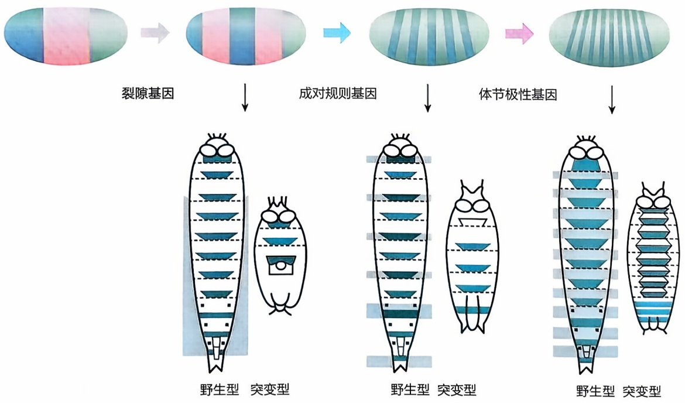

flowchart

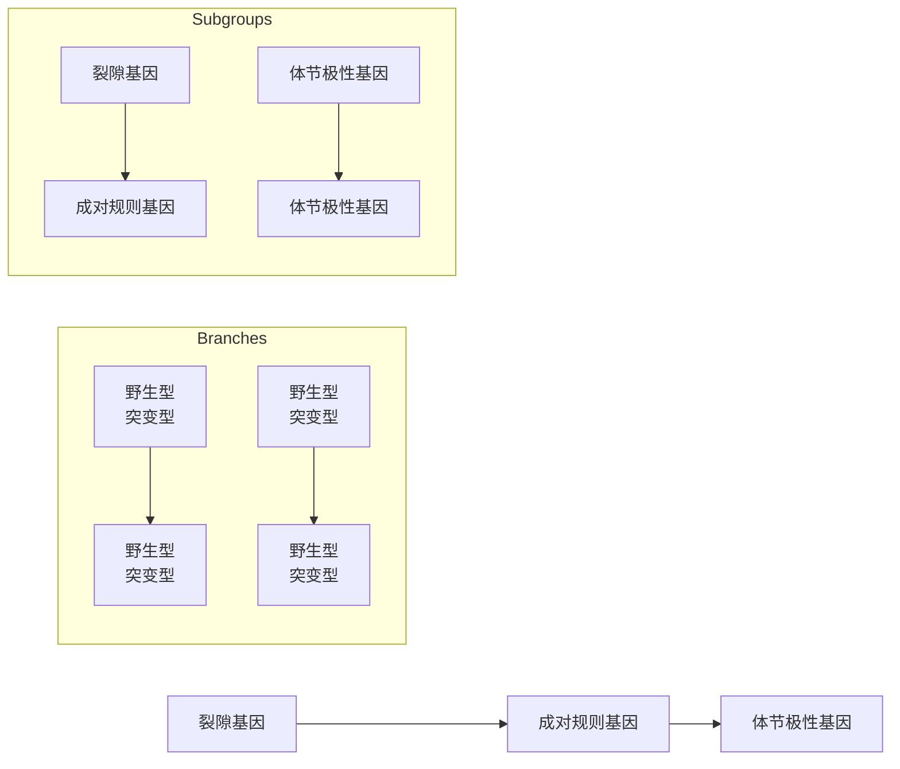

图7-4 果蝇胚胎发育早期模式形成的基因调控

## 一、遗传筛选的基本步骤

遗传筛选包括 5 个基本步骤:①设定研究目标，确定一个合适的生命活动过程作为研究对象；②选定研究体系，选择一种合适的模式生物开展工作；③设计并实施筛选，获得改变相应生命活动的基因突变；④分析突变，解析基因功能和作用方式；⑤研究基因相互作用，以勾勒生命活动的遗传调控机制。

生物学背景了解浅、分子机制不清楚、难以建立体外研究体系或用其他研究策略停滞不前的领域，适合通过遗传筛选进行研究突破。这是因为遗传筛选只要求被研究的生命活动过程由基因调控，不需要更多的前提条件。此外，遗传筛选涉及全基因组范围的基因诱变、表型鉴定和基因相互作用分析，更适合为其他研究策略提供知识框架和研究蓝图。历史上著名的遗传筛选研究多为这类问题。例如，在尼斯莱因-福尔哈德和维绍斯对果蝇模式形成的研究之前，对早期胚胎发育的研究已经在施佩曼发现“组织者”并提出诱导概念后，停滞了约半个世纪。同样，在2002年诺贝尔生理学或医学奖得主霍华德·霍维茨（Howard R. Horvitz）用遗传筛选寻找控制细胞凋亡的基因时，人们对细胞凋亡的分子机制几乎一无所知。

用于开展遗传筛选的模式生物，首要条件是体内存在待研究的生命活动过程。满足这一前提后，应选用构造尽可能简单、繁殖周期短、养殖成本低的物种，以提高研究效率。对此，现代分子生物学奠基者之一、2002年诺贝尔生理学或医学奖得主悉尼·布伦纳（Sydney Brenner，1927—2019）于1963年申请开展线虫研究时说过:“我们应该以类似的方式解决细胞发育问题，选择尽可能简单分化的生物，将其置于微生物遗传学的分析方法之下”。常用的遗传学模式生物有酵母、线虫、果蝇、斑马鱼、小鼠、拟南芥等。它们都可以在实验室大规模培养，有较完备的遗传操作与基因功能分析技术方法，为全世界研究人员广泛使用。关于模式生物的具体介绍可详见本章第二节。

## 二、遗传筛选的设计与实施

设计和实施遗传筛选旨在高效获得特异影响待研究的生命活动的基因突变。精巧的筛选设计依赖于使用各种模式生物的独特优势，以下对遗传筛选遇到的几个常见问题进行讨论。

## 1. 人工诱变

真核生物基因自发突变率极低，远不能满足高效筛选的需求。因此，以人工诱变获得大量基因突变，是遗传筛选要进行的第一步工作。常见的人工诱变方法包括物理诱变（如X射线辐照）、化学诱变（如使用诱变剂）和生物诱变（如病毒或转座子插入），具体介绍详见第三章和第十章。合适的诱变剂量对遗传筛选至关重要:剂量过高可能导致接受诱变处理的个体死亡或不育，剂量过低则会增加后续筛选的工作量。为提高突变个体的生产效率，一般对雄性进行诱变处理，待其生育力大体恢复后再与

多个雌性个体交配繁殖。

## 2. 克服致死和不育突变的影响

真核模式生物多为二倍体，大多数突变基因对野生型基因而言是隐性的。因此，设计遗传筛选时需要繁育突变纯合子，以便通过表型变化发现尽可能多的基因突变。然而，许多纯合基因突变会导致个体死亡或不育，获得的纯合子无法用于传代或重现实验。为此，通常采用杂合子交配保种或保存条件基因突变策略。尼斯莱因-福尔哈德和维绍斯在筛选胚胎发育缺陷突变时，使用杂合子交配保种。哈特韦尔在酿酒酵母中筛选细胞周期调控基因时，选择了在 $23^{\circ}\mathrm{C}$ 活性不受影响、而在 $36^{\circ}\mathrm{C}$ 时失活的温度敏感突变。

## 3. 认识基因功能冗余和多效性

基因功能冗余（redundancy）是指多个基因功能相似，可以部分或全部互相替代的现象。真核生物在进化过程中常发生基因复制，复制后的基因常会发生功能冗余。单个功能冗余基因突变时表型变化通常较弱，同时突变时才会出现较强的表型改变，这被称作协同表型（synthetic phenotype）。基因功能的多效性（pleiotropy）是指一个基因突变影响多种表型的现象。冗余和多效性并不罕见。例如，线虫有两组与多阴门（Muv）表型相关的基因，这两组基因各自单突变均不影响阴门发育，只有同时突变才会导致阴门数量异常。又如，小鼠ABL1和ABL2基因编码结构和功能相似的两个蛋白激酶c-Abl和Arg。c-Abl功能具有多效性，基因敲除后引起多系统异常和部分致死。c-Abl和Arg还存在功能冗余，双突变小鼠神经胚形成异常，导致胚胎早期死亡。冗余会导致遗传筛选时突变检出率的降低，需要设计针对性的筛选方法。多效性可能导致突变后早发表型的出现掩盖了迟发表型，影响对基因功能的全面了解。研究成年期或组织特异基因失活的个体可以弥补这一不足。

## 三、分析突变、研究机制

获得突变只是遗传筛选的第一步，分析突变如何影响基因功能、利用突变间的遗传互作推测基因作用机制，是遗传筛选最终推动领域进步的关键。这些内容将在后续章节进行详细讨论。

## 第二节 模式生物

生命从简单到复杂不断进化，每次改变几乎总是对既有生命形态的再利用与再创造。因此，对一个物种生命活动过程的研究，可以帮助了解类似物种的生命活动过程；对简单生物生命活动机制的分析，也可以帮助探索复杂生物生命活动的类似机制。模式生物就是被研究人员在实验室中广泛选用，为研究生命活动过程充当模型，帮助明确基因型和表型间的关系，从而为分析、理解乃至调节人及其他物种生命活动提供启示的一组生物的总称。

人类驯养动物、植物和微生物的历史可以追溯到旧石器时代。狗的驯化历史至少有18000年，小麦等成为农作物也超过10000年，酵母用于酿酒可追溯到7000年前。这些驯化的物种不少被用于科学研究，但成为模式生物的只是少数。与一般用于科学研究的物种相比，模式生物通常具有以下几个特征。

首先，模式生物应具有良好的代表性，获得的研究成果可以启发对其他物种生命活动的理解。例如，对秀丽隐杆线虫细胞谱系发育的研究帮助人们认识了细胞凋亡的基因调控机制。这一机制被证实在从线虫到人的多细胞动物中都是高度相似或保守的。又如，对黑腹果蝇体节发育的研究帮助人们认识了躯体模式形成（body patterning）的遗传调控，而哺乳动物也使用大体类似的分子机制调控肢体和体节的形成。相比之下，许多实验室生物主要被用于研究特定生物学问题，代表性较为有限。例如，蚊虫20世纪60年代已有实验室饲养，迄今仍主要用于疟疾等虫媒传染病的防控研究。

其次，模式生物要具备便于实验室研究的生物学特性和较完备的遗传操作与基因功能分析技术方法。模式生物一般个体较小，饲养成本可控，世代周期较短，后代数量较多，可在实验室环境下迅速繁殖大量后代，在实验室间运输也较为容易。模式生物的基因组往往较小，诱变处理后容易产生基因突变，也适合转基因和基因靶向诱变，能有效进行个体水平的基因功能整合分析。相比之下，豚鼠（Cavia porcellus）等曾经常用的实验动植物由于开展遗传学和基因功能研究的难度较高，未能跻身模式生物之列。

第三，模式生物得到全世界研究人员广泛使用。模式生物由于其生物学和实验优势得到许多研究人员青睐。在各自使用模式生物开展工作的同时，这些研究人员又积极建立起了一致的研究规范和密切的学术联系。他们有意识地推广模式生物研究技术、及时共享生物品系、研究材料和研究成果，逐步建立各种模式生物品系中心和数据库。这种共享互利的价值观反过来又促进了模式生物得到更多认可和使用。

模式生物为人类分析理解基因组的组成、结构与功能做出了巨大贡献，对建立疾病动物模型、研发疾病干预方法也有重要价值。进入21世纪以来，以模式生物为主要研究对象的生命科学研究已获得过至少14次诺贝尔奖。

## 一、酵母

酿酒酵母（Saccharomyces cerevisiae）和粟酒裂殖酵母（Schizosaccharomyces pombe，以下简称裂殖酵母）都是重要的真核模式生物，它们3.5亿年前由共同祖先分别进化而来。基因组研究发现，酿酒酵母较裂殖酵母与哺乳动物共享基因更少，提示裂殖酵母进化较酿酒酵母缓慢。酿酒酵母于19世纪末被嘉士伯实验室（The Carlsberg Laboratory）用于工业发酵研究，20世纪初起被用于代谢等生化研究，20世纪30年代开始用于遗传学研究（Greig et al., 2009）。相比之下，裂殖酵母遗传学直到20世纪

40 年代末才得以建立。

## 1. 酵母生物学

酿酒酵母细胞呈椭球型，以单倍体和二倍体两种形式存在，均可通过有丝分裂出芽繁殖（图7-5）。条件合适时酿酒酵母每 $1.5\sim 2\mathrm{h}$ 分裂一次，较小的子细胞以出芽方式离开较大的母细胞。酿酒酵母单倍体分为 $a$ 型（MATa）和 $\alpha$ 型（MATα），两者交配后形成二倍体细胞（MATa/MATα）。环境营养匮乏时，二倍体细胞减数分裂形成四分子，其中包含 $a$ 型和 $\alpha$ 型单倍体孢子各两个。酿酒酵母可用液体培养基或琼脂培养基繁殖，也可 $-80^{\circ}\mathrm{C}$ 冷冻保藏。

裂殖酵母细胞呈圆柱形，主要以单倍体形式存在，通过有丝分裂成为两个对称的子代细胞。裂殖酵母细胞生长时只向两端延伸，用细胞长度可判断所处的细胞周期，条件合适时每 $2\sim 2.5\mathrm{h}$ 分裂一次。裂殖酵母单倍体有 $h^{+}$ (mat1-P) 型和 $h^{-}$ (mat1-M) 型，环境胁迫下两者可结合形成二倍体，随后迅速减数分裂形成四个单倍体孢子，待环境好转时再发育为单倍体细胞。实验室条件下，也可利用mat2-102等突变菌株获得稳定的二倍体细胞。裂殖酵母可进行液体和固体培养，并可冷冻保藏。

酿酒酵母于1996年成为第一个完成基因组测序的真核生物。它的单倍体基因组约 $12.5\mathrm{Mb}$，共有16条染色体，进化中经历过全基因组复制。酿酒酵母有近6000个蛋白质编码基因，其中仅 $4\%$ 有内含子。裂殖酵母于2002年成为第六个完成基因组测序的真核生物。它的单倍体基因组有3条染色体，约 $13.8\mathrm{Mb}$，进化中未发生全基因组复制。裂殖酵母有5000多个蛋白质编码基因，其中逾 $40\%$ 有内含子。

## 2. 酵母遗传学研究

由于可以方便地获得数十亿计的酵母细胞，正向遗传学研究可以直接筛选自发突 图7-5 酵母生活史变，也可先进行化学诱变或转座子插入诱变再进行筛选。诱变酿酒酵母常用的转座子有 $mTn3$ 、 $mTn7$ 和 $Ty1$ ，诱变裂殖酵母则可以用Hermes和piggyBac。由于培养容易、细胞数多，较为罕见的温度敏感突变可以经常由诱变获得。用两种酵母的单倍体可以直接观察基因突变表型，结合温度敏感突变和影印平板培养等技术，即使致死突变也可以快速检出。同时，实验室条件下两种酵母稳定存在二倍体，可用于基因功能互作的双突变体分析。通过自动化的协同基因阵列（synthetic gene array）分析技术，可以将获得的基因突变与包含几乎所有基因缺失的突变体库交配，逐一检验基因的相互作用。

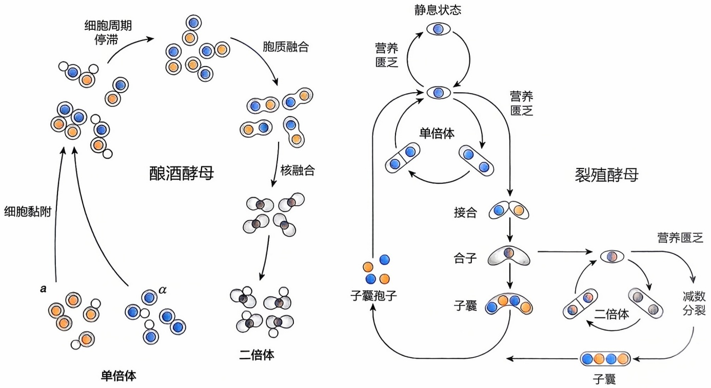

图7-5 酵母生活史

在酵母中还可以进行各种反向遗传学操作，转基因DNA既能以自主复制的染色体外质粒形式存在，也可以高效同源重组整合到染色体上。裂殖酵母多用原生质体转化和醋酸锂法转基因，酿酒酵母常用的转基因方法还包括电转移和基因枪。抗生素标记和营养缺陷型标记都常用于快速发现转基因细胞。利用携带转基因标记的酵母cDNA文库转化基因突变细胞，可以快速确定突变基因。

酿酒酵母和裂殖酵母同源重组功能发达。人类基因组 $1\%$ 重组率（$1\mathrm{cM}$）约合 $1\mathrm{Mb}$，而在酿酒酵母和裂殖酵母基因组中仅分别相当于 $2500\mathrm{bp}$ 和 $6250\mathrm{bp}$。事实上，酿酒酵母和裂殖酵母仅分别需要转基因DNA两端各 $40\mathrm{bp}$ 或 $60\mathrm{bp}$ 的同源序列即足以引发同源重组。高效的同源重组不仅使基因靶向诱变变得非常容易，也允许对基因组DNA进行更复杂的改造。此外，裂殖酵母可以用RNAi抑制基因表达。由于Dicer等基因缺陷，酿酒酵母不能进行RNAi操作。

## 3. 酵母对当代生命科学的贡献

酵母是研究真核细胞生物学的重要模型，被广泛用于真核细胞转录翻译、异染色质结构功能、基因表达调控、DNA复制修复、着丝粒功能、染色体高级结构、细胞周期、细胞器发育、细胞骨架组织、细胞分裂等各种基本生物学过程的探索。哈特韦尔和纳斯通过筛选温度敏感突变，分别在酿酒酵母和裂殖酵母中发现了CDC、CDK等一系列细胞周期调控基因，荣获2001年诺贝尔生理学或医学奖。用酵母开展的端粒酶功能研究帮助杰克·绍斯塔克（Jack W. Szostak）和伊丽莎白·布莱克本（Elizabeth H. Blackburn）获得了2009年诺贝尔生理学或医学奖。兰迪·谢克曼（Randy W. Schekman）利用酿酒酵母温度敏感突变筛选找到了控制内质网、高尔基体和细胞表面膜泡运输的系列基因，从而获得了2013年诺贝尔生理学或医学奖。大隅良典（Yoshinori Ohsumi）因利用蛋白酶缺陷的酿酒酵母筛选发现自噬调控信号通路，获得了2016年诺贝尔生理学或医学奖。此外，酿酒酵母还帮助罗杰·科恩伯格因真核生物转录机制研究获得了2006年诺贝尔化学奖。

酵母基因组学是基因组学研究的开路先锋之一。由于基因组和细胞尺寸较小，酵母非常适合高通量研究。2002年完成的酵母基因组缺失计划（Saccharomyces Genome Deletion Project，SGD）系统培育了各个基因失活的酿酒酵母。诱导基因失活的插入片段携带不同DNA序列组成的“条形码”，使利用液体培养基筛选群体表型成为可能。目前，酿酒酵母和裂殖酵母都有多种基因失活品系库、基因过表达品系库和GFP、

TAP等标签融合品系库，为进行基因功能、蛋白质细胞内定位和互作研究提供了巨大的便利。使用荧光报告基因和自动化设备的酵母全基因组表型筛选已可在2周内完成。酵母也是合成生物学的重要模型之一。覃重军等结合使用CRISPR/Cas9系统和同源重组，培育了16条染色体合一的单染色体酿酒酵母（Shao et al., 2018）。以从头合成酿酒酵母基因组为目标的国际合作Sc2.0计划也已完成技术路线设计。

## 二、线虫

秀丽隐杆线虫（Caenorhabditis elegans，曾用名 Rhabditis elegans，以下简称线虫）最早于 1900 年被弗朗索瓦·莫帕（François É. Maupas, 1842—1916）命名并用于生物学实验。莫帕发现线虫具有正常态和耐受态（dauer）两种发育过程，并描述了线虫的繁殖方式。1966 年，现代分子生物学奠基者之一、2002 年诺贝尔生理学或医学奖得主布伦纳在英国医学研究理事会（Medical Research Council，MRC）工作时决定用线虫研究发育生物学与神经生物学，并于 1974 年发表了他的第一篇线虫遗传学论文，揭开了线虫作为模式生物的序幕（Brenner，1974）。

## 1. 线虫生物学

线虫是一种自由生活，以细菌为食的线形动物，一生经历卵、幼虫、成虫三阶段（图7-6）。线虫的幼虫共四龄，成虫体长约 $1\mathrm{mm}$，$25^{\circ}\mathrm{C}$ 下3天即可完成一个世代周期。在群体拥挤食物匮乏时，二龄幼虫会进入耐受态，待食物来源恢复后再继续成长为四龄幼虫。实验室条件下，线虫既可饲养在琼脂平板上以大肠杆菌为食，也可进行液体饲养以进行需要大量虫体的生物化学研究。

线虫通体透明，体细胞数量和发育谱系固定，是已知唯一体内所有细胞都能被清楚盘点归类的多细胞生物。它有五对常染色体和一对或一条性染色体X，具有两条X染色体时发育为具有959个体细胞的雌雄同体，只有一条X染色体时发育为具有1031个体细胞的雄体。雌雄同体可以自体受精产下约300枚卵，其中雄性个体只占不到 $0.2\%$ 。雌雄同体与雄性交配后将会先使用雄性精子，且产卵数上升至约1000枚。线虫染色体没有着丝粒，也不需要特定序列与微管结合。

线虫基因组约 100 Mb，于 1998 年完成测序，是第一种完成基因组测序的多细胞生物。线虫基因组具有约 20 000 个蛋白质编码基因，38% 以上线虫基因在人类基因组中有直系同源基因（orthologue），逾 60% 人类基因在线虫基因组中有直系同源基因。

## 2. 线虫遗传学研究

在进行基因组随机诱变时，化学诱变、辐射诱变、Tc1和Mos1转座子插入诱变等方法都适用于线虫。除了个体小、后代多、世代短、饲养容易等常见的实验优势外，线虫雌雄同体的特性赋予其独特的操作便利。自体受精不仅减少了保种工作量，而且容易得到突变纯合子，即使导致运动障碍的基因突变一般也不影响其繁殖。研究人员可以同时诱变所有染色体，而不担心在后续繁殖中丢失基因突变。如同果蝇一样，线虫被发现存在一些倒位、易位等畸变染色体，可充当平衡染色体保存致死突变。此外，线虫可以耐受冷藏，进一步降低了诱变筛选的工作量。

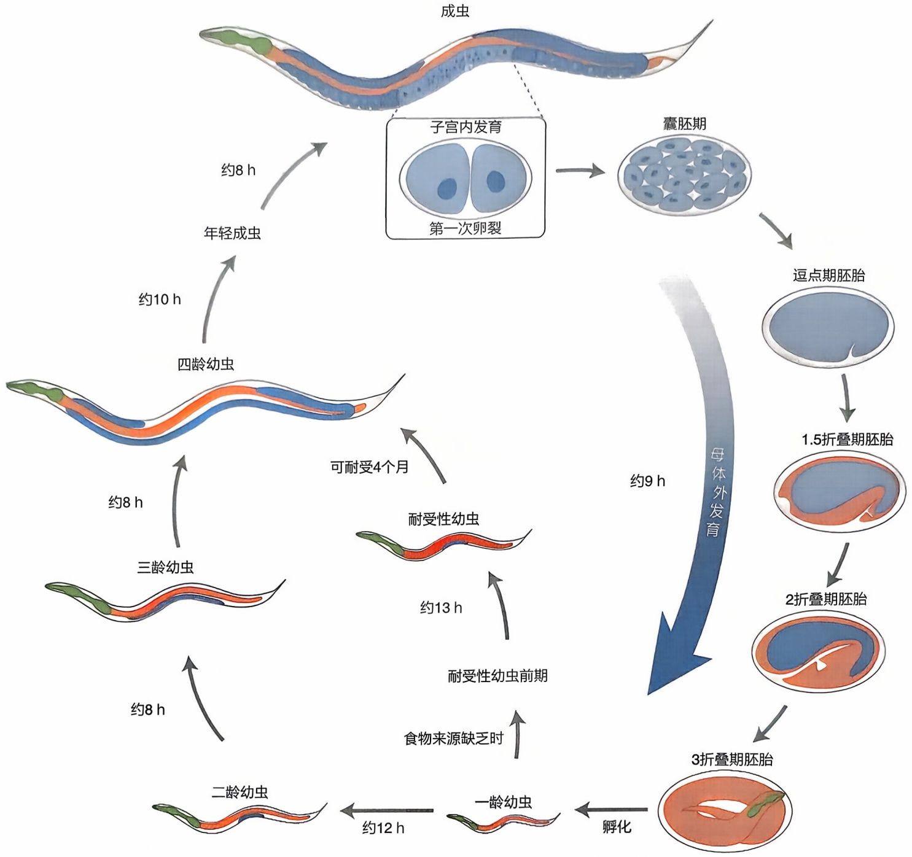

flowchart

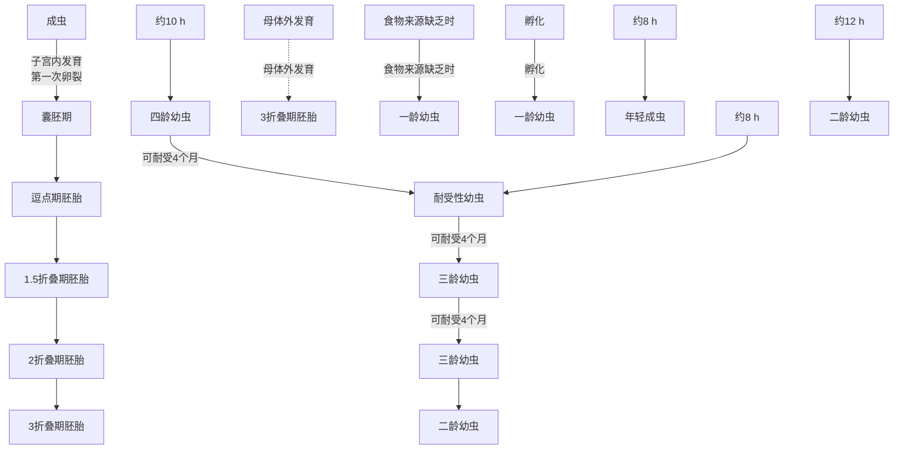

图7-6 线虫生活史

通过向线虫性腺合胞体显微注射 DNA 或利用基因枪轰击虫体可以培育转基因个体。注射的线性或环状 DNA 会重组形成多拷贝染色体外阵列，但通常只在体细胞表达。染色体外阵列可不同程度传代，这一特性可用于培育遗传嵌合体线虫。利用基因枪将携带 DNA 的金颗粒轰击细胞，可以得到整合于染色体上的低拷贝 DNA，并实现生殖细胞表达。线虫中可以高效地利用 RNAi 抑制基因表达。TALEN 核酸酶和 CRISPR/Cas9 系统也成功被用于在线虫中实现基因的靶向诱变。线虫中有同源重组实现序列替换的报道，但其发生率仅为 DNA 染色体整合事件的 0.5%\~7%。NemaGENETAG 联盟培育了 13 000 多个基因组定位明确的 Mos1 转座子插入品系。

MosDEL技术选择目标基因附近的插入品系，诱导Mos1切离形成DNA缺失以获得基因突变。

## 3. 线虫对当代生命科学的贡献

线虫是正向遗传筛选周期最短的多细胞模式生物。它细胞谱系清楚，细胞数量不多，虫体透明容易观察。同时，细胞已经出现结构和功能的分化，个体又具有营自由生活必需的趋利避害等一系列复杂技能。因此，线虫既适合研究细胞增殖、分化、互作等基本生物学过程，也适合研究神经、运动和器官发育等复杂过程。利用线虫开展的工作推动了许多重要信号通路的发现与阐明。例如，细胞凋亡发育的必经步骤，凋亡异常在肿瘤、免疫和退行性病变中都发挥重要作用。霍维茨等人研究线虫细胞谱系发育的遗传调控，筛选发现了十多个细胞凋亡调控相关基因。其中不少在人类基因组中有类似功能的同源基因。这些工作不仅勾勒了细胞凋亡的遗传调控框架，也促进了人类疾病生物学研究，霍维茨因此共享了2002年诺贝尔生理学或医学奖。又如，Ras原癌基因信号通路从线虫到人高度保守，该通路的许多环节首先是由斯特恩伯格和韩珉等人以线虫阴门（vulva）发育过程为模型，通过遗传筛选发现并阐明作用方式的（Sternberg et al., 1998）。此外，线虫还为衰老、干细胞、miRNA等诸多领域研究做出了重要贡献。

线虫也为基因功能研究技术做出了重要发现。法尔和梅洛在线虫中建立的RNAi技术不仅推动了线虫遗传学的发展，也被用于从植物到人的各种生物，因而获得2006年诺贝尔生理学或医学奖。目前，RNAi干扰已获批用于遗传性转甲状腺素蛋白淀粉样变性（hereditary transthyretin amyloidosis）的治疗。线虫也是最早在研究中用绿色荧光蛋白进行细胞标记的模式生物，马丁·查尔菲（Marin L. Chalfie）因此共享了2008年诺贝尔化学奖。液体培养技术、多孔板体系、移液机器人、流式分选技术、自动图像识别系统与转基因GFP细胞标记技术和RNAi相结合，使研究人员可用线虫筛选数以万计化合物的生物学效应，在 $1\mathrm{h}$ 内完成鉴定多达十万条线虫的表型变化。

## 三、果蝇

黑腹果蝇（Drosophila melanogaster，曾用名 Drosophila ampelophila，以下简称果蝇）最早于 1905 年被弗雷德里克·卡彭特（Frederic W. Carpenter, 1875—1925）用于生物学研究。一年后，卡彭特发现近交对果蝇繁殖力没有影响。这是果蝇适于作为遗传学研究材料的原因之一。1907 年，哥伦比亚大学动物学教授摩尔根开始在实验室饲养果蝇，并于 1910 年发现了第一个表型异常（白眼）的果蝇。摩尔根、斯特蒂文特、穆勒和布里奇斯于 1915 年总结果蝇研究成果撰写了《孟德尔遗传机理》（Mechanisms of Mendelian Inheritance）一书，确定遗传的染色体理论基础和果蝇作为模式生物的地位。

## 1. 果蝇生物学

果蝇是完全变态昆虫，一生经历卵、幼虫、蛹、成虫四阶段（图7-7）。果蝇幼虫共三龄，成虫体长约 $3\mathrm{mm}$，$25^{\circ}\mathrm{C}$ 下10天即可完成一个世代周期。实验室条件下，果蝇可用含玉米粉、糖和酵母等成分的琼脂培养基饲养。由于不耐寒冷，果蝇品系需定期转移到新鲜培养基上以维持种群。

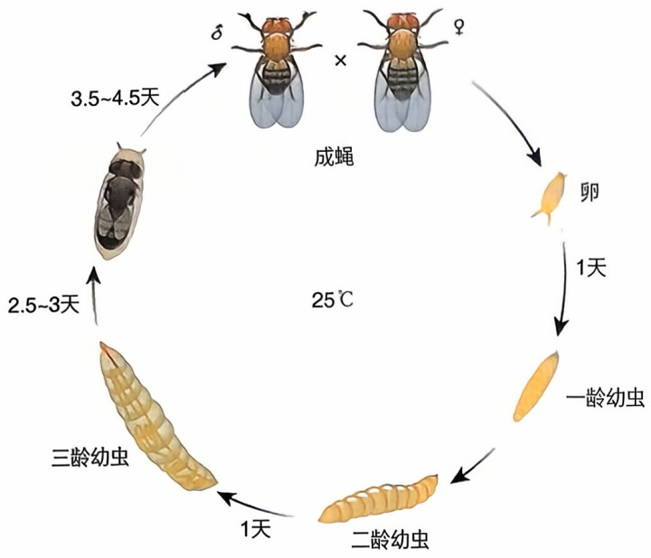

flowchart

This diagram illustrates the life cycle of a fly, showing the progression from egg to eggbee and subsequent stages of egg growth.

图7-7 黑腹果蝇生活史

果蝇有三对常染色体和一对性染色体，雌蝇携带两条X染色体，雄蝇携带X和Y染色体各一条。与哺乳动物不同的是，果蝇性别由X染色体和常染色体组的比例决定，只有一条X染色体而没有Y染色体的果蝇仍是雄性。同时，雄蝇生殖细胞减数分裂时也不发生同源染色体联会和重组。雌蝇羽化后需要8\~12h才能进行交配，一次交配可以产卵达400枚。果蝇幼虫唾液腺具有巨大的多线染色体，便于染色体畸变观察和基因染色体定位。

果蝇基因组约 $180\mathrm{Mb}$，于2000年完成测序。果蝇基因组与人类基因组有约 $60\%$ 同源，具有近14000个蛋白质编码基因。$75\%$ 的人类疾病基因在果蝇基因组中有同源基因。

## 2. 果蝇遗传学研究

果蝇个体小、后代多、世代短、饲养容易，是遗传学研究的好材料，对遗传学发展做出了重要贡献。遗传的染色体理论、染色体畸变、基因的连锁与交换、等位基因相互作用方式等知识都是最先通过对果蝇的研究而明确的。在一百多年的发展历史中，果蝇领域诞生了大量重要的模式生物学遗传学研究方法，使果蝇成为目前遗传学操作最方便的模式生物系统之一。

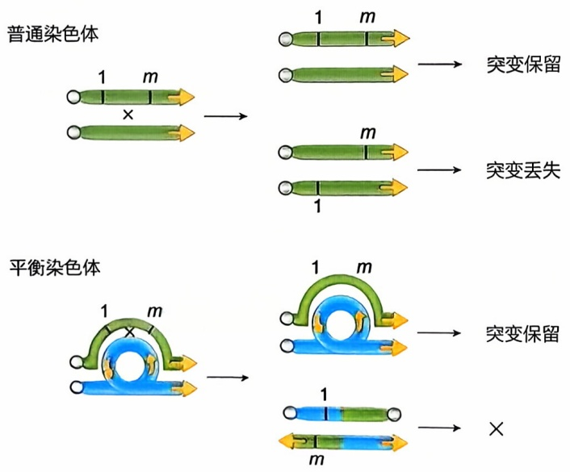

flowchart

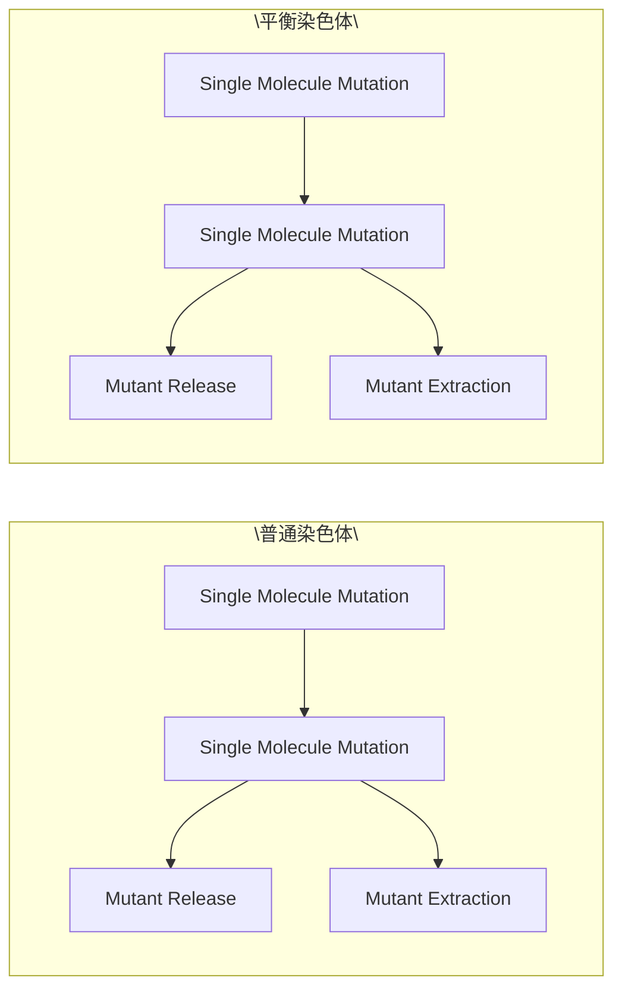

图7-8 平衡染色体的作用原理

在进行正向遗传筛选时，化学诱变、辐射诱变、P 和 piggyBac 转座子插入诱变都适用于果蝇。目前，果蝇基因诱变计划（Gene Disruption Project, GDP）已经培育并收集了 18 000 余个 P 和 piggyBac 等转座子插入突变品系供研究人员选用。

穆勒等发明的果蝇平衡染色体携带一个或多个倒位，能有效抑制相应区域的同源染色体重组。平衡染色体还携带显性标记，以及隐性不育或致死突变。前者方便识别具有平衡染色体的个体，后者用以控制群体中平衡染色体频率（图7-8）。用平衡染色体和致死突变形成杂合子，其后代可不经人工选择而一直以杂合子保存致死突变。用平衡染色体也可以防止同一染色体上的两个突变因发生交换而丢失，从而有效保存双突变。在正向遗传筛选时，用平衡染色体不仅可保存新突变并进行基因组初步定位，也能帮助识别突变纯合子以分析表型，与常规方法相比可以提高效率近300倍。

在进行反向遗传学研究时，果蝇可以方便地进行转基因和靶向基因诱变。利用 $P$ 因子载体培育的转基因果蝇中，外源DNA绝大多数以单拷贝整合于染色体上。维也纳果蝇品系中心（VDRC）、转基因RNAi计划（TRiP）、Bloomington果蝇品系中心（BDSC）和日本遗传学研究所（NIG）都有规模过万的果蝇RNAi品系资源。利用I-Sce1内切酶和源自酵母的位点专一重组酶FLP可以实现果蝇基因靶向诱变。TALEN核酸酶和CRISPR/Cas9系统也被成功用于类似用途。果蝇还发展出了GAL4/UAS/GAL80等多个二元转基因表达系统，进一步提高了研究效率。GAL4和GAL80是源于酵母的转录因子，对果蝇细胞无不良影响。UAS序列（upstream activation sequence，UAS）是GAL4识别的启动子序列，只有GAL4存在时才表达下游的目标基因，GAL80则抑制GAL4的激活效应。因此，只要培育一个UAS转基因品系，将其和不同时空表达的GAL4品系交配，就可以实现目标基因在多个发育时段和组织的过表达或异位表达。即使目标基因表达后致死，也可通过不断交配UAS品系和GAL4品系稳定重现实验结果。目前，BDSC已保存9000余种GAL4和80余种GAL80品系。

## 3. 果蝇对当代生命科学的贡献

果蝇基因组冗余程度低，适于进行遗传筛选和信号通路分析，对生命科学研究具有重要价值。尼斯莱因-福尔哈德和维绍斯对果蝇胚胎发育进行遗传筛选和刘易斯发现的果蝇同源异形基因一起帮助他们入选1995年诺贝尔生理学或医学奖。朱尔斯·霍夫曼（Jules A. Hoffmann）对尼斯莱因-福尔哈德和维绍斯筛选发现的Toll基因进行研究，发现Toll信号通路对果蝇感知感染并启动免疫反应的重要作用，因而获得了2011年诺贝尔生理学或医学奖。杰弗里·霍尔（Jeffrey C. Hall）、迈克尔·罗斯巴什（Michael Rosbash）和迈克尔·扬（Michael W. Young）等则因为在果蝇中克隆了调控昼夜节律的基因period（per）并发现其作用机制而获得了2017年诺贝尔生理学或医学奖。现在知道，动植物均使用类似的机制调控各自的昼夜节律。

培育与人保守的信号通路基因突变品系，或直接转基因表达人类疾病基因都可培育疾病果蝇模型。脑癌、肺癌、结直肠癌等多种人类肿瘤模型已在果蝇建立，并验证或筛选出了多个化合物的抗肿瘤活性。果蝇还可用于替代人源肿瘤异种移植小鼠进行个体化治疗药效学检测。根据肿瘤测序发现的有害突变培育同源基因RNAi果蝇被用于寻找抗癌药物组合，最终成功用于患者。神经退行性疾病、肥胖、睡眠障碍等多种疾病果蝇模型也已用于小分子先导化合物筛选。

## 四、斑马鱼

斑马鱼（Danio rerio，曾用名 Brachydaniorerio）不晚于20世纪30年代被查尔斯·克里瑟（Charles W. Creaser）用于实验教学。20世纪60年代末，乔治·斯特赖辛格（George Stresinger，1927—1984）开始利用斑马鱼进行系统遗传学研究，试图了解脊椎动物神经系统发育调控的奥秘。此后，愈来愈多的研究人员利用斑马鱼进行研究。诺贝尔奖得主尼斯莱因-福尔哈德与学生沃尔夫冈·德赖弗（Wolfgang Driever）合作利用斑马鱼进行大规模正向遗传筛选，于1996年发表了包含1100多个突变体的系列研究成果。这一“大筛选”使斑马鱼成为被全世界研究人员关注的模式脊椎动物。

## 1、斑马鱼生物学

斑马鱼是一种原产东南亚的小型热带淡水鱼，自然界常生活在稻田周围 $24\sim 38^{\circ}\mathrm{C}$ 的温水里，以昆虫和线虫为食。成年斑马鱼体长 $2.5\sim 4\mathrm{cm}$，常在黎明时交配。作为脊椎动物，斑马鱼的肌肉、血管、肾脏和眼等器官结构均与人有一定相似性，心电等生理活动也类似。

实验室条件下，斑马鱼可置于有水过滤装置和固定光照周期的  $28.5^{\circ}$ C 水箱内，以干鱼食和新孵化的卤虫饲养。每升水最多可以饲养 9 条成年斑马鱼。此时，母鱼每周可产卵二三百枚。斑马鱼受精卵和胚胎透明，胚胎血管等结构和发育过程清晰可辨。 $28.5^{\circ}$ C 时，卵受精 45 min 后即开始不完全卵裂，2 到 3 天内完成胚胎发育。胚胎以被动扩散从水中获得氧气，利用卵黄提供营养，即使有严重心脏缺陷也可存活。幼鱼孵化约 4 周成为亚成体，约 90 天性成熟（图 7-9）。斑马鱼精子可以冷冻保存，性别决定受遗传和环境共同影响。水温、鱼群拥挤程度会改变性别比例。

斑马鱼基因组约 $1400\mathrm{Mb}$，含25对染色体逾26000个蛋白质编码基因，于2013年完成测序。由于斑马鱼基因组2.7亿年前经历的全基因组复制，人类基因 $47\%$ 有单拷贝的斑马鱼直系同源基因，$24\%$ 有多于一个的斑马鱼同源基因。

## 2. 斑马鱼遗传学研究

斑马鱼有成熟的正向遗传学研究技术。向水中投放乙基亚硝基脲（N-ethyl-N-nitrosourea，ENU）可进行化学诱变，向受精卵注射 Sleeping Beauty 转座子或向 1 000

个细胞左右的胚胎注射反转录病毒可以进行插入诱变。插入诱变效率显著低于ENU诱变，但可以使用反向PCR等方法获得插入位点相邻的基因组序列，突变定位方便。紫外线照射的精子可以刺激孤雌单倍体胚胎发育，用热休克、冷休克或水压处理还可以从单倍体胚胎获得孤雌二倍体成体，这些技术都可用于提高特定筛选的效率。

显微注射受精卵可以获得转基因斑马鱼。Tol2和Sleeping Beauty转座子都可作为转基因载体，将转基因DNA整合入斑马鱼染色体。这种方法还可以培育表达荧光蛋白、Cre重组酶等的工具品系，或用于基因捕获。用磷酸被吗啉基替换的核苷酸可以合成25碱基长的吗啉基寡核苷酸（morpholino），它可以与序列互补的mRNA结合阻断基因表达。阻断效应持续2\~3天后会因细胞分裂稀释Morpholino而终止，且有不可忽视的脱靶效应。为实现基因靶向诱变，斑马鱼研究者常用 ZFN、TALEN 和 CRISPR/Cas9 等工具。CRISPR/Cas9 系统还被用于细胞谱系标记，进行发育过程分析。此外，GAL4/UAS 和 Cre/loxP 系统也可用于斑马鱼遗传操作。

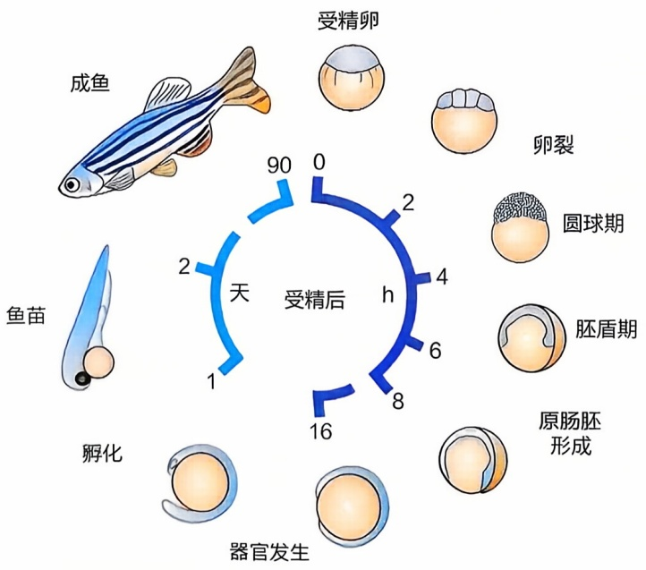

flowchart

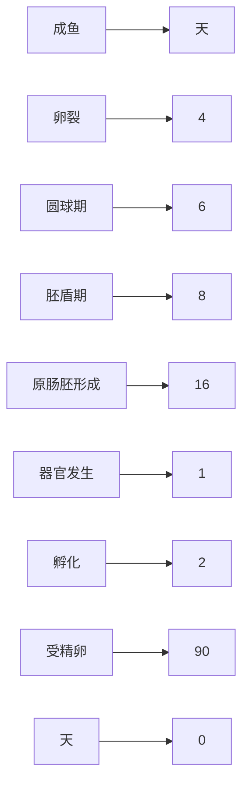

图 7-9 斑马鱼生活史

## 3. 斑马鱼对当代生命科学的贡献

斑马鱼造血系统与人类似，是研究血液发育的好材料，利用斑马鱼已经发现了数十个造血系统异常的基因突变。斑马鱼心脏和肾脏虽然与哺乳动物存在结构差异，但各关键发育环节的细胞和分子信号通路保守，适于胚胎期观察与研究。对斑马鱼体节发育突变体的研究阐明了体细胞生物节律调控的机制。斑马鱼的鳍、心脏、中枢神经系统和视网膜神经元都可再生，对这些过程的研究促进了再生生物学和干细胞研究的发展。

斑马鱼也是重要的疾病模型。它个体不大，可以开展全组织、全器官或全个体的转录组、蛋白质组分析，被广泛用于造血系统、心血管、肾脏、衰老、代谢、肿瘤、神经精神疾病和传染性疾病的模拟与研究。正向遗传筛选发现的ALAS2突变斑马鱼是首个先天性铁幼粒细胞性贫血动物模型；Gridlock突变则与人一样发生心脏流出道狭窄。甲福明等糖尿病药物对斑马鱼同样有效，显示两种生物代谢机制的相似性。此外，斑马鱼可以被结核杆菌和甲型流感病毒等病原体感染，并对相应药物有良好反应。

斑马鱼生命周期的第一周躯体透明，可不用喂食而存活，适用于自动化筛选药用化合物和环境毒理学研究。用斑马鱼幼鱼筛选发现的丙酮酸羧激酶激动剂可以在小鼠中同样诱导肝糖原异生，抑制肥胖导致的脂肪肝。对人胚胎发育具有致畸作用的反应停同样导致斑马鱼胚胎发育缺陷，但不影响小鼠。利用斑马鱼系统进行的研究帮助确认了药物反应停作用的靶蛋白。斑马鱼还被用于高通量筛选改变趋光、睡眠、学习记忆等行为的基因突变或药物。

## 五、小鼠

小家鼠（Mus musculus，以下简称小鼠）是最常用的哺乳类模式生物，具有与人非常类似的解剖结构、发育过程、生理活动和基因功能。小鼠约一万年前就和人类的祖先生活在一起。《汉书》收录的儒家经典《尔雅》中就有关于小鼠的记载。18世纪时，饲养不同毛色的宠物小鼠成为日本社会时尚。19世纪时这种时尚传到了欧洲，维多利亚时代的英国甚至成立了为培育不同毛色宠物鼠制定标准的专门机构。从这一时期开始，宠物鼠的毛色变化得到了生物学家的关注。遗传学奠基人孟德尔曾试图研究小鼠白化毛色的遗传，被修道院禁止后才转而使用豌豆（Paigen et al., 2003）。1902年，吕西安·居埃诺（Lucien C. M. J. Cuénot, 1866—1951）首次证明小鼠毛色分布符合孟德尔遗传规律。1909年，克拉伦斯·利特尔（Clarence C. Little, 1888—1971）为了研究移植肿瘤如何能在受体小鼠中存活，培育了世界上第一种近交系小鼠DBA。此后，小鼠逐渐被广泛用于哺乳动物生理学、生物化学和病理学研究。

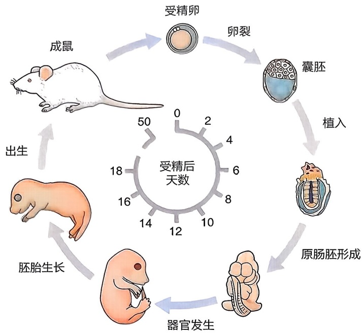

flowchart

```mermaid
graph LR
  A["成鼠"] --> B["受精卵"]
  B --> C["卵裂"]
  C --> D["囊胚"]
  D --> E["植入"]
  E --> F["原肠胚形成"]
  F --> G["器官发生"]
  G --> H["胚胎生长"]
  H --> I["出生"]
  I --> J["胚胎"]
  J --> K["受精后天数"]
  L["胚胎"] -.-> M["胚胎"]
  M -.-> N["胚胎"]
  N -.-> O["胚胎"]
  O -.-> P["胚胎"]
  P -.-> Q["胚胎"]
  Q -.-> R["胚胎"]
  R -.-> S["胚胎"]
  S -.-> T["胚胎"]
  T -.-> U["胚胎"]
  U -.-> V["胚胎"]
  V -.-> W["胚胎"]
  W -.-> X["胚胎"]
  X -.-> Y["胚胎"]
  Y -.-> Z["胚胎"]
  Z -.-> AA["胚胎"]
  AA -.-> AB["胚胎"]
  AB -.-> AC["胚胎"]
  AC -.-> AD["胚胎"]
  AD -.-> AE["胚胎"]
  AE -.-> AF["胚胎"]
  AF -.-> AG["胚胎"]
  AG -.-> AH["胚胎"]
  AH -.-> AI["胚胎"]
  AI -.-> AJ["胚胎"]
  AJ -.-> AK["胚胎"]
  AK -.-> AL["胚胎"]
  AL -.-> AM["胚胎"]
  AM -.-> AN["胚胎"]
  AN -.-> AO["胚胎"]
  AO -.-> AP["胚胎"]
  AP -.-> AQ["胚胎"]
  AQ -.-> AR["胚胎"]
  AR -.-> AS["胚胎"]
  AS -.-> AT["胚胎"]
  AT -.-> AU["胚胎"]
  AU -.-> AV["胚胎"]
  AV -.-> AW["胚胎"]
  AW -.-> AX["胚胎"]
  AX -.-> AZ["胚胎"]
  AZ -.-> BA["胚胎"]
  BA -.-> BC["胚胎"]
  BC -.-> BD["胚胎"]
  BD -.-> BE["胚胎"]
  BE -.-> BF["胚胎"]
  BF -.-> BG["胚胎"]
  BG -.-> BH["胚胎"]
  BH -.-> BI["胚胎"]
  BI -.-> BJ["胚胎"]
  BJ -.-> BK["胚胎"]
  BK -.-> BL["胚胎"]
  BL -.-> BM["胚胎"]
  BM -.-> BN["胚胎"]
  BN -.-> BO["胚胎"]
  BO -.-> BP["胚胎"]
  BP -.-> BR["胚胎"]
  BR -.-> BB["胚胎"]
  BB -.-> BC["胚胎"]
  BC -.-> BDZ["胚胎"]
  BDZ --> AB
  AB --> AC
  AC --> AD
  AD --> AE
  AE --> AF
  AF --> AG
  AG --> AH
  AH --> AI
  AI --> AJ
  AJ --> AK
  AK --> AL
  AL --> AM
  AM --> AN
  AN --> AO
  AO --> AP
  AP --> AQ
  AQ --> AR
  AR --> AS
  AS --> AT
  AT --> AU
  AU --> AV
  AV --> AW
  AW --> AX
  AX --> AZ
  AZ --> BA
  BA --> BC
  BC --> BDZ
  BDZ --> BE
  BE --> BF
  BF --> BG
  BG --> BH
  BH --> BI
  BI --> BJ
  BJ --> BK
  BK --> BL
  BL --> BM
  BM --> BN
  BN --> BO
  BO --> BP
  BP --> BG
  BG --> BHZ
  BHZ --> BIZ
  BIZ --> BI1
  BI1 --> BI2
  BI2 --> BI3
  BI3 --> BI4
  BI4 --> BI5
  BI5 --> BI6
  BI6 --> BI7
  BI7 --> BI8
  BI8 --> BI9
  BI9 --> BI10
  BI10 --> BI11
  BI11 --> BI12
  BI12 --> BI13
  BI13 --> BI14
  BI14 --> BI15
  BI15 --> BI16
  BI16 --> BI17
  BI17 --> BI18
  BI18 --> BI19
  BI19 --> BI20
  BI20 --> BI21
  BI21 --> BI22
  BI22 --> BI23
  BI23 --> BI24
  BI24 --> BI25
  BI25 --> BI26
  BI26 --> BI27
  BI27 --> BI28
  BI28 --> BI29
  BI29 --> BI30
```

图 7-10 小鼠生活史

## 1. 小鼠生物学

小鼠是啮齿目哺乳动物，有1对终身生长的门齿和3对臼齿，前、后足各5趾，没有阑尾。成年小鼠体重20\~40 g，按每100 g体重计每天摄食12\~18 g，饮水约15 mL。实验小鼠攻击性不强，感觉危险时常选择逃避。小鼠是一种社会性动物，最好使其处于一个适合的群体内生活。

新生仔鼠体重约 1 g，哺乳期 21～28 天，通常生长到 7～8 周龄时达到性成熟（图 7-10）。母鼠性成熟后每 4～5 天会规律性地发情。作为夜行性动物，小鼠通常在晚间交配，交配后雄鼠的囊泡腺分泌物会在母鼠体内凝固形成阴道栓并留存数小时。母鼠怀孕期约 21 天，一胎产仔鼠数随品系不同有较大差异，常在 6～12 只之间。母鼠分娩后不久即可发情，此时如没有交配则要等到仔鼠断奶后才能怀孕。小鼠精子

和发育早期的胚胎均可冷冻保存。

小鼠有20对染色体，母鼠携带两条X染色体，雄鼠携带X和Y染色体各一条。小鼠基因组约 $2500\mathrm{Mb}$，于2002年完成测序。小鼠基因组具有约24000个蛋白质编码基因，$99\%$ 具有人类同源基因。

现代实验室多使用无特定病原体（specific pathogen free，SPF）级小鼠开展研究，有的工作还需要使用无菌小鼠。SPF级小鼠必须不携带标准所列的微生物和寄生虫等病原体，但相关标准因国家和地区而异。为达到SPF要求，小鼠通常使用屏障式系统（barrier system）饲养，进出屏障的人员，物资（笼盒、饲料、水等）和小鼠都必须按特定程序消毒、灭菌或检疫，屏障内的温度、湿度、通风、光照和噪声也必须符合相关标准要求。

## 2. 小鼠遗传学研究

许多实验小鼠品系都是由艾比·莱斯罗普（Abbie E. C. Lathrop，1868—1918）在1900—1918年间培育的。她不仅是宠物供应商，也是遗传学家威廉·卡斯尔（William E. Castle，1867—1962）和利特尔的科研合作者。1929年，时任密歇根大学校长的利特尔在汽车业巨子埃德塞尔·福特（Edsel B. Ford，1893—1943）和罗斯科·杰克逊（Roscoe B. Jackson，1895—1929）资助下于美国缅因州创建了杰克逊实验室（The Jackson Laboratory），以癌症及免疫排斥作为主要研究方向。在经济大萧条的20世纪30年代，实验室开始出售育种及繁殖的实验小鼠以获取收入，逐渐发展为全球最重要的实验小鼠养殖供应中心之一。

描述小鼠遗传背景常用近交系、重组近交系、同源近交系、同源导入系等概念。近交系是至少连续20代同窝兄弟姐妹交配得到的各位点高度纯合的品系，重组近交系是两个不同的近交系交配得到的第一代杂交小鼠连续20代同窝兄弟姐妹交