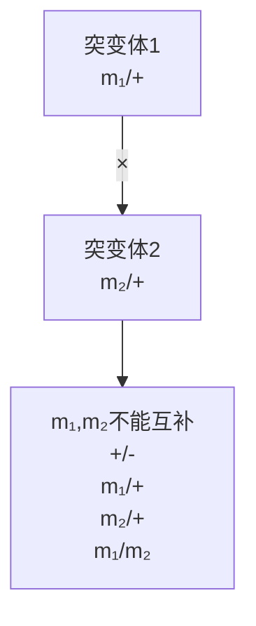

配得到的品系；同源近交系是与某一近交系因自发突变或人工诱变而存在单基因差异的品系；同源导入近交系是由单基因突变小鼠近交系小鼠交配，并让后代与同一近交系连续交配（回交）至少10代获得的品系。小鼠众多的近交系资源还可被用于构建多重重组近交系（collaborative cross，CC）和染色体替换近交系（chromosome substitution strain，CSS），它们与遗传异质品系（heterogeneous stock，HS）、差异远交品系（diversity outbred stock，DO）、杂交小鼠多样性组合（hybrid mouse diversity panel，HMDP）等杂交和驯化小鼠资源均可用于数量性状遗传定位。

在进行正向遗传学诱变筛选时，ENU能高效诱导小鼠基因变异，平均每1000个接受诱变的精子就能产生一个靶位点突变。诱变产生的后代可以与亲代回交，以尽快得到供表型分析用的突变纯合个体。覆盖单条染色体全长或部分区域的小鼠平衡染色体已经出现。新一代全基因组测序技术可以加快突变定位，利用复旦大学发明的piggyBac（PB）转座子系统也可快速获得基因组定位明确的基因突变小鼠（Ding et al., 2005）。

小鼠反向遗传学技术较为发达，是最早实现转基因操作的模式动物系统之一，也是首个实现基因靶向诱变的模式动物。基于胚胎干细胞DNA同源重组的基因打靶技术，不仅可以去除部分内源基因序列，实现基因敲除（knock out）；也可以往内源基因引入点突变，实现基因敲入（knock in）；还可以在内源基因外显子两侧引入源于P1噬菌体的loxP或源于酵母的FRT等重组位点，分别与时空特异表达Cre或FLPe重组酶品系交配以实现基因的组织或发育时段“条件性敲除”（conditional knock out）。卡佩基、埃文斯和史密斯因对这一技术的开创性贡献获得了2007年诺贝尔生理学或医学奖。近年来，CRISPR/Cas9系统也被用于小鼠基因靶向诱变（详见第十章）。

小鼠发达的反向遗传学研究技术一定程度上弥补了它后代数量较少、世代时间较长的弱点。国际小鼠表型分析联盟（International Mouse Phenotyping Consortium，IMPC）正在大规模诱变小鼠基因，并试图对基因突变小鼠进行系统表型分析，以获得对哺乳动物基因功能的深入认识。此外，柳泽隆造等于1998年通过向去核卵细胞移植体细胞核，成功培育了体细胞克隆小鼠。李劲松和周琪等于2012年分别利用单倍体胚胎干细胞注射卵子，获得了基因靶向诱变和转基因小鼠。这些技术与CRISPR/Cas9等方法的结合，将有望进一步提高小鼠基因功能分析效率。

## 3. 小鼠对当代生命科学的贡献

小鼠和人同属哺乳类，是研究人类生物学和疾病机制，寻找药物靶标的常用动物模型。利特尔等用小鼠开展的移植肿瘤研究，启发乔治·斯内尔（George D. Snell，1903—1996）培育同源导入近交系，发现了决定移植组织能否生长的主要组织相容性复合物（MHC）位点。斯内尔因此分享了1980年诺贝尔生理学或医学奖。小鼠Toll样受体的克隆则开启了哺乳动物先天性免疫领域研究的大门，帮助博伊特勒分享了2011年诺贝尔生理学或医学奖。目前，已经有数以百计的小鼠模型被用于自身免疫性疾病研究。拥有“人源化”免疫功能的遗传工程小鼠也被用于建立人源肿瘤异种移植模型，进行肿瘤生物学研究和个体化治疗药效学检测。

小鼠为代谢相关疾病研究做出了重要贡献。对小鼠ob和db基因的研究发现了哺乳动物调控能量代谢的瘦素信号系统。对小鼠Agouti毛色突变的分析则发现了黑皮素受体MC4R，该基因也是肥胖人群中最常见的突变位点之一。小鼠也是哺乳动物表观遗传学研究的重要模式系统。对小鼠X染色体连锁性状的研究为哺乳动物X染色体随机失活提供了线索。对基因组印迹的研究已经培育出了孤雌或孤雄来源的小鼠。此外，小鼠还被广泛用于研究神经、骨骼、肌肉、消化、泌尿等系统发育与疾病。

## 六、拟南芥

拟南芥（Arabidopsis thaliana）原产于欧亚大陆与非洲，早在16世纪就为植物学家所知。第一种被记载的拟南芥突变（重瓣花）出现于1873年。20世纪中叶，植物学家弗里德里希·莱巴赫（Friedrich J. Laibach，1885—1967）将拟南芥用于遗传学研究，并首先使用X射线诱变拟南芥。20世纪80年代，拟南芥乙醇脱氢酶得到克隆，农杆菌T-DNA介导转化技术也被发明。从那时起，拟南芥作为遗传学模式生物的地位得到广泛认可。

## 1. 拟南芥生物学

拟南芥是一年生的小型十字花科植物，株高 $25\sim 30~\mathrm{cm}$ 。它生长迅速、栽培容易。在实验室条件下每天提供 $12\sim 16\mathrm{h}$ 光照，保持室温 $20\sim 25^{\circ}C$ 和适当湿度，每6周即可完成一个世代周期，还可顺利生长于土壤或配方培养基上（图7-11）。拟南芥繁殖时可通过自花授粉方便地保存突变品系，也可通过人工授粉杂交。它繁殖力强，每棵植株可以产生多达 $5000\sim 10000$ 颗种子，并可长期保存。

拟南芥具有已知植物最小的基因组，重复序列也较少，便于遗传定位和基因克隆。拟南芥基因组测序于2000年完成，全长约 $125\mathrm{Mb}$，含5对染色体逾25000个蛋白质编码基因。在1001基因组计划的推动下，已有1000多种野生拟南芥自交系的基因组完成测序。

## 2. 拟南芥遗传学研究

拟南芥有成熟的正向遗传学研究技术。可以用甲基磺酸乙酯或者快中子辐射诱变，也可以用农杆菌T-DNA携带 $Ds$ 转座子进行插入诱变。进行插入诱变时，携带$Ds$ 转座子和 $Ac$ 转座酶的T-DNA载体被用于转化植株。传代时 $Ds$ 转座子发生转座，新旧位点因T-DNA携带的IAHH负筛选标记和转座子携带的抗生素抗性筛选标记而分离，在筛选后得到只有转座子插入的个体。

拟南芥的反向遗传学操作也较为齐全，可以用T-DNA作为载体培育转基因植株，也可以用CRISPR/Cas9系统实现基因的靶向诱变。农杆菌T-DNA转基因常出现多拷贝串联体整合，并可能携带部分农杆菌质粒序列，给转基因的染色体定位带来麻烦。

## 3. 拟南芥对当代生命科学的贡献

拟南芥遗传学研究回答了许多长期悬而未决的生物学问题。例如，对拟南芥乙烯信号通路的研究发现了第一个植物激素受体。李建明等人对油菜素甾醇合成缺陷突变体研究发现了这一激素对植物发育的重要作用（Li et al., 1996; Szekeres et al., 1996）。拟南芥突变体帮助发现了决定植物向光性的光受体和信号通路。此外，拟南芥对植物营养、代谢、抗逆等方面的遗传调控和信号转导研究也做出了巨大贡献。通过对拟南芥的研究，科学家们深入了解了植物的基本生物学过程，为农业生产、环境保护和食品安全等领域提供了重要的科学依据。

图 7-11 拟南芥生活史

text_image

A. 花
0.05 mm
B. 种子
1 mm
C. 10天
2.5 mm
D. 14天
G. 42天
2 cm
F. 35天
1 cm
E. 21天
1 cm

## ※ 复习思考题

1. 随机诱变和靶向诱变哪一种更适合用于遗传筛选？简述你的判断理由。
2. 你更喜欢使用单倍体生物还是二倍体生物开展遗传筛选？请简述理由。
3. 哪一种模式生物更适合研究社会行为的遗传调控？为什么？

## ※ 推荐阅读

1. NÜSSLEIN-VOLHARD C, WIESCHAUS E. Mutations affecting segment number

and polarity in Drosophila [J]. Nature, 1980, 287(5785): 795–801.
2. LEWIS E B. A gene complex controlling segmentation in Drosophila [J]. Nature, 1978, 276(5688): 565–70.
3. NÜSSLEIN-VOLHARD C, WIESCHAUS E, KLUDING H., Mutations affecting the pattern of the larval cuticle in Drosophila melanogaster: I. Zygotic loci on the second chromosome [J]. Wilehm Roux Arch Dev Biol, 1984, 193(5): 267–282.
4. NÜSSLEIN-VOLHARD C. The identification of genes controlling development in flies and fishes(Nobel lecture)[J]. Angewandte Chemie-International Edition, 1996, 35(19): 2177–2188.
5. GREIG D, LEU J Y. Natural history of budding yeast [J]. Curr Biol, 2009, 19(19): R886–90.
6. SHAO Y, LU N, WU Z, et al. Creating a functional single-chromosome yeast [J]. Nature, 2018, 560(7718): 331–335.
7. BRENNER S. The genetics of Caenorhabditis elegans [J]. Genetics, 1974, 77(1): 71–94.
8. STERNBERG P W, HAN M. Genetics of RAS signaling in C. elegans[J]. Trends Genet, 1998, 14(11): 466–472.
9. Paigen K. One hundred years of mouse genetics: an intellectual history. I. The classical period(1902–1980)[J]. Genetics, 2003, 163(1): 1–7.
10. DING S, WU X, LI G, et al. Efficient transposition of the piggyBac(PB)transposon in mammalian cells and mice[J]. Cell, 2005, 122(3): 473–483.
11. LI J, NAGPAL P, VITART V, et al. A role for brassinosteroids in light-dependent development of Arabidopsis[J]. Science, 1996, 272(5260): 398–401.
12. SZEKERES M, NEMETH K, KONCZ-KALMAN Z, et al. Brassinosteroids rescue the deficiency of CYP90, a cytochrome P450, controlling cell elongation and de-etiolation in Arabidopsis[J]. Cell, 1996, 85(2): 171–182.

（编写:吴晓晖、许田；审读:唐鸿云）

## 第八章

# 突变分析和表型分析

鉴定基因突变个体的表型，将其与正常个体的表型进行比较，以明确基因突变与表型变化的关系，进而推测正常基因的作用，是遗传学研究中确定基因功能的基本方法。本书第七章介绍了遗传筛选的基本策略，通过遗传筛选可以获得大量影响特定生命活动过程的基因突变。本章将进一步介绍如何定位这些突变所对应的基因，如何分析这些突变导致的表型变化，如何确定这些突变对基因功能的影响。对未知基因的突变分析有助于了解基因功能，研究已知基因的新突变也可以加深对基因功能的认识。虽然本章以遗传筛选发现的突变为对象进行介绍，但相关原理和策略同样适用于对自发变异和靶向突变的分析研究。

# 第一节 寻找突变的基因

全基因组随机诱变产生的突变数量总是多于相应的基因数量。为了方便后续基因功能和作用机制研究，首先需要明确突变对应的基因。完成这项任务的常用方法是对突变引起的基因功能变化进行互补测验和对突变进行基因组定位。

## 一、互补测验

常见的互补测验（complementation test）并不复杂:当两个隐性突变具有相同表型时，将两种突变体交配产生下一代。下一代双突变体因为两个同源染色体各携带一个不同来源的基因突变，也被称为突变的反式杂合子（trans-heterozygote）。如果反式杂合子突变体产生与两种亲代突变体相同的表型，则两个突变不能互补。这时，两个突变被认为属于同一个互补群（complementation group），很可能影响同一个基因。如果反式杂合子突变体表型回复正常，则两个突变可以互补，被认为属于不同互补群，很可能影响不同基因。这一方法早在20世纪40年代就被刘易斯用于系统分析果蝇双胸复合物突变，目前已经成为遗传学研究的基本手段之一。

两个隐性突变具有相同表型是进行互补测验的前提。一方面，隐性遗传方式表明，只要存在一份正常基因拷贝就可以完成相应的生物学功能，而两份拷贝都受影响才会出现功能异常，导致表型变化。因此，如果下一代个体中基因的两个拷贝分别被不同突变所破坏，应该产生表型变化。另一方面，两个隐性突变的表型相同，表明它们对基因功能的影响方式相同，由它们构成反式杂合子突变体的表型也应该产生相同变化。

从上述分析不难看出，互补测验不适用于显性突变，因为显性突变造成的表型改变会屏蔽或干扰反式杂合子突变体中另一个突变对表型的可能影响。同时，互补测验应该使用两种突变体交配产生的反式杂合子，而不是它们继续繁殖的后代进行表型分析。因为即使两种突变都影响同一个基因，突变仍有可能在后续繁殖时发生重组，产生携带正常染色体的后代。此外，互补测验的出发点是根据表型将突变进行组合测试。对于一个有功能多效性的基因，如果突变影响了不同的基因功能，这些突变会因产生的表型不同而被认为属于不同基因，在初始分析中不被用于同一组互补测验。在表型类似的突变很多时，进行互补测验的工作量还会呈指数级增加，显著降低工作效率（图8-1）。

互补测验最广为所知的例外是基因内互补（intragenic complementation）和基因间不互补（intergenic noncomplementation）。基因内互补又称等位基因互补（allelic complementation），指同一基因的两个不同突变在体内功能互补。导致基因内互补的生物学机制各有不同。例如，酵母His4基因编码的蛋白质具有磷酸核糖-AMP-环化水解酶、磷酸核糖-ATP-焦磷酸水解酶、组氨醇脱氢酶三个可以独立作用的活性结构域，分别催化组氨酸生物合成的三步反应。影响这些结构域的突变形成三个互补群(His4A、His4B 和 His4C)，相互之间可以互补（图 8-2）。又如，刘易斯曾经发现果蝇双胸复合物的某些突变存在基因内互补，但互补仅在两个突变都位于染色体原位时才能发生。被他称为平延（transveciton）的这种现象与同源染色体相互作用有关，存在于多个基因座（Fukaya et al., 2017）。

A

flowchart

B

flowchart

图8-1 互补测验原理红色显示正常表型个体，蓝色显示异常表型个体。

C

flowchart

D

heatmap

| 测验数 | m1 | m2 | m3 | m4 | m5 | m6 | ... | mx |
| --- | --- | --- | --- | --- | --- | --- | --- | --- |
| m1 | — | — | — | — | — | — | — | — |
| m2 | 高 | — | — | — | — | — | — | — |
| m3 | 高 | 高 | — | — | — | — | — | — |
| m4 | 高 | 高 | 高 | — | — | — | — | — |
| m5 | 高 | 高 | 高 | 高 | — | — | — | — |
| m6 | 高 | 高 | 高 | 高 | 中高 | — | — | — |
| ... | 高 | 高 | 高 | 高 | 中高 | 中高 | — | — |
| mx | 高 | 高 | 高 | 高 | 中高 | 中高 | 中高 | — |

基因间不互补是指分属两个基因的突变同时存在于同一个体内时仍产生突变表型的现象。不能互补的两个突变可能位于有功能关联的两个基因。当突变同时存在时，基因所在的信号转导途径或基因产物形成的复合物功能降到必需水平以下，从而产生突变表型。另一种可能是两个突变基因的产物形成毒性复合物，造成损害。此外，许多导致非等位基因增强作用的机制都可以促进基因间不互补的发生（详见第九章）。基因间不互补存在于各种生物。人视网膜色素变性就可因同时携带视杆细胞外节蛋白1（ROM1）和外周蛋白-2（peripherin-2）突变而发生（Kajiwara et al., 1994）。这两个蛋白质正常时形成异源二聚体，在维持视杆细胞外节形态中发挥作用。

A

text_image

His4A
His4B
His4C
磷酸核糖-
AMP-环化
水解酶
磷酸核糖-
ATP-焦磷酸
水解酶
组氨醇
脱氢酶
\frac{His4A-B+C^+}{His4A+B-C^+} : 组氨酸原养型

B

text_image

Diagram illustrating molecular or structural changes with labeled components P and E, showing directional arrows indicating movement or transformation.

图8-2 互补测验原理（A）酵母His4基因编码具有三个独立酶活结构域的蛋白质。（B）解释平延现象的两种模型，染色体构象变化改变增强子E和启动子P互作，影响基因表达。（C）正常基因剂量不足可导致基因间不互补。（D）有毒复合物的产生也可导致基因间不互补。

C

text_image

A
a
A
a
B
B
b
b
正常复合物（AB）数量不足

D

text_image

A
a
A
a
B
B
b
b
新的异常复合物（ab）造成损害

## 二、基因定位

互补测验遇到的大多数困难都可以用基因定位来帮助解决。基因定位可以有效减少互补测验的工作量，因为位于染色体不同区域的突变虽然有相同表型，也必然属于不同基因。基因定位相同的突变，即使是显性突变或是表型不一致的突变，也可能属于同一个基因。

传统的基因定位基本依靠连锁作图，根据不同基因座之间连锁与交换可能性确定基因（或突变）在染色体上的位置。连锁现象最早由遗传学家威廉·贝特森（William Bateson，1861—1926）、伊迪丝·桑德斯（Edith R. Saunders，1865—1945）和雷金纳德·庞尼特（Reginald C. Punnett，1875—1967）在植物遗传学研究中发现（Bateson et al., 1904）。此后，摩尔根和斯特蒂文特等用果蝇深入研究了连锁与交换（详见第三章），相关成果成为证明遗传的染色体理论的关键证据之一。这些研究指出，减数分裂产生配子时，如果两个基因或突变相距较远，它们之间发生重组的机会就较高；如果两个基因或突变相距较近，它们之间就不容易发生重组。因此，可以利用突变与已知染色体位置的遗传标记间发生重组的频率来指征两者的遗传距离。当时还在读大学的斯特蒂文特据此绘制了世界上第一张连锁图，标识了果蝇X染色体5个基因突变的位置。这一策略此后被广泛用于确定基因在各种生物基因组中的位置。尼斯莱因-福尔哈德和维绍斯筛选发现的果蝇胚胎发育调控基因几乎都是用连锁作图完成的基因定位。

在进行连锁作图时，需要使用已知染色体位置的遗传标记作为参照。遗传标记可以是能够方便追踪表型的形态变异，也可以是能够通过分子生物学手段快速鉴定 DNA 序列特征。另一方面，待定位的突变本身一般缺乏合适的 DNA 序列特征，需要根据突变表型判断其是否存在。对隐性突变而言，这一目的是通过与确定携带突变的个体进行测交（test cross）达到的。连锁作图确定的突变与遗传标记间的相对距离。在基因呈线性排列的染色体上，只使用一个遗传标记会导致定位结果的不确定性。实际研究时，往往同时使用多个标记进行基因定位（图 8-3）。

连锁作图依赖于重组的发生。用连锁作图进行基因定位必须繁殖一定数量的后代以保证定位精度。随着定位区间的缩小，突变与遗传标记的重组可能性也迅速下降。因此，在世代周期较长的生物中开展连锁作图，需要消耗大量的时间与资源。随着DNA测序技术的发展和各个物种基因组序列的公布，人们越来越多地通过测序追踪某个突变在基因组中的位置。通过全外显子组测序寻找突变个体或疾病患者共享的基因突变，可能快速发现与某个表型变异关联的基因突变。但是，连锁作图仍然是在序列多态性较丰富的基因组中确定突变位置的重要方法。

A

## 第二节 表型分析

对表型的充分鉴定是明确基因功能的关键之一。基因突变会引起表型变化，但研究突变表型时，首先要明确什么是正常的表型，然后才能比较突变表型与正常表型的差异。正常的表型常被称为野生型（wild type），但野生型一词也可被用于形容基因型。从字面上看，野生型是存在于野生群体的表型或基因型。但是，同一物种的野生群体中，每个基因都往往存在多种序列变异，每个个体的表型也因此存在差异。同时，许多常用的模式生物经过长期驯化，已不能适应野外生活环境，也不存在基因组

图8-3 连锁作图原理携带隐性突变 $m$ 或显性突变 $M$ 的品系与携带遗传标记（1\~4）的作图品系交配后，将子代与携带 $m$ 的测交品系或野生型交配。随后，检验下一代突变个体中携带各个遗传标记的比例，计算突变与遗传标记的重组频率（遗传距离）。与突变相距较远或不处于同一染色体上的遗传标记的重组频率预期 $50\%$ ，与突变相距较近的遗传标记则可能检测不到重组后代。

结构完全相同的野生群体。因此，在实验室研究中所说的野生型，指的是作为研究对象的种群中最常见的基因型或表型。

## 一、遗传背景对表型分析的影响

野生型概念的这一变化反映了遗传背景对基因功能研究的重要影响。基因功能的发挥与个体的遗传背景关系密切。本泽研究果蝇行为时就发现，实验室保存的6个果蝇群体只有C-S这一种对光刺激反应较为均一（Benzer，1967）。为提高研究效率，研究人员往往选择使用多代近亲交配培育的近交系（inbred line），以获得大量遗传背景一致的个体。然而，近交本身会带来繁殖力减弱和多种生命活动异常，对研究造成干扰。例如，C57BL/6J品系小鼠容易发生肥胖和小眼畸形，而BALB/cJ品系小鼠则多间心脏钙质沉着（Percy et al., 2016）。同时，近交会导致同一物种不同品系的遗传背景差异，影响基因突变造成的表型变化。例如，瘦素基因缺陷会造成小鼠近交系C57BL/6J严重肥胖。同样的基因缺陷在近交系BALB/cJ中造成的肥胖程度明显减轻，但会进一步提高血液中甘油三酯的浓度（Qiu et al., 2001）。与变化频繁的野外相比，实验室环境常为提高模式生物存活率和繁殖率而优化，一些应对环境压力所需的基因即使发生突变也不容易被察觉，另一些则可能因驯化和繁育过程中的人工选择而改变。此外，不少模式生物不能用冷冻胚胎或种子的方法降低繁殖速度，在实验室或供应商处长期传代后容易积累自发突变，对研究带来影响。因此，研究基因突变对模式生物带来的表型变化时，经常要仔细考察遗传背景的影响。尼斯莱因-福尔哈德和维绍斯在系统筛选调控果蝇模式形成的基因前，就对被诱变的染色体进行了等基因化（isogenize）处理，以建立携带同一条染色体的果蝇种群，减少背景突变的干扰（Nüsslein-Volhard et al., 1984）。在比较同一基因不同突变的表型差异时，也可通过多代回交（back cross）将突变导入同一遗传背景后再进行比较分析。

遗传背景的影响还体现在诱变筛选过程中。诱变筛选时一般采用促使个体产生多个突变的诱变剂量。这样一方面获得了更多影响特定生命活动的基因突变个体，另一方面不可避免地在所有个体中引入了背景突变。当根据表型变化筛得相应的基因突变个体时，它们携带的背景突变不仅会保留，有的还会与靶突变一起在后续繁殖中纯合化。因此，背景突变不仅可能影响靶基因突变的表型变化，有时还会成为异常表型的原因。为克服背景突变的影响，通常需要将携带靶基因突变的个体连续多代与野生型交配，使背景突变逐渐稀释乃至丢失。也可以培育靶基因突变的反式杂合子，在破坏靶基因的同时尽可能避免背景突变纯合（图8-4）。这两种方法都被普遍用于尼斯莱因-福尔哈德和维绍斯对果蝇模式形成调控基因的系统筛选（Nüsslein-Volhard et al., 1984）。

背景突变的存在还会干扰人类遗传学研究。人类基因组序列多态性强，各个位点杂合度高。在根据疾病表型定位突变基因时，邻近区域存在的多个突变会使致病基因确定变得困难。此时，除了与其他人类遗传学或疾病生物学研究结果相印证外，往往需要培育相应基因突变模式动物，根据动物表型的变化做出结论（相关内容可详见第六章）。

## 二、基因多效性对表型分析的影响

基因的多效性（pleiotropy）也会影响表型分析。多效性指一个基因可以参与多个生命活动过程，对多种遗传性状产生影响。生物进化倾向于赋予既有基因新的用途，而不是为新任务从头发明一套基因。进化对基因改良的这种偏好，导致基因多效性成为普遍现象。例如，尼斯莱因-福尔哈德和维绍斯发现的果蝇模式形成调控基因许多是后续肢体和器官发育的调控者。又如，哺乳动物毛色基因突变往往对视觉和听觉产生影响（Reissmannd et al., 2013）。有时，一个多效基因的不同突变可以分别改变基因的不同功能，而与靶基因突变连锁的背景突变也可能在各种分析中产生类似效果，这使得通过表型分析了解基因功能更为复杂。广义的基因功能多效性还包括由原发表

图8-4 避免背景突变对诱变筛选的干扰

（A）随机诱变果蝇基因组时，会在各染色体造成多个背景突变（x，y…）。如背景突变与筛选获得的突变位于同一染色体，将可能在纯合化以后干扰表型筛选。（B）将具有背景突变的个体与野生型多代交配，可以稀释背景突变。（C）培育靶基因突变的反式杂合子验证突变表型，可以尽量避免背景突变（a，b，x，y…）的影响。

型导致继发表型的情形。例如，影响低密度脂蛋白胆固醇浓度的基因突变会改变冠心病发生率、因为较高的低密度脂蛋白胆固醇水平是导致冠心病的原因之一（Cohen et al., 2006）。

组织特异性基因敲除等方法可以只在个别组织、器官或部分细胞内诱导基因纯合突变。这一策略能部分克服基因多效性对表型分析和基因功能研究的影响，对研究个体早期发育必需的基因尤其有用。对突变体表型变化的各个方面分别进行基因组定位，也可以帮助澄清基因多效性和背景突变干扰的区别。更多情况下，要深入了解基因的功能，需要仔细分析该基因的各种突变，并对相关生命活动过程有深入理解。

## 第三节 突变对基因功能的改变

诺贝尔奖得主穆勒于1932年首先提出，可以从突变对基因功能影响的角度，将突变突变分为5类（图8-5）。他把造成基因功能完全丧失的突变被称为无效突变（amorph, amorphic allele, null mutation），把造成基因功能部分丧失的突变被称为亚效突变（hypomorph, hypomorphic allele, partial loss-of-function mutation）。同时，他将导致基因获得超额正常活性的突变称为超效突变（hypermorph, hypermorphic allele），将导致基因正常功能被抑制的突变称为反效突变（antimorph, antimorphic allele），将导致基因获得原来没有的新功能的突变称为新效突变（neomorph, neomorphic allele）。

基因缺失

无效突变

野生型

亚效突变

反效突变

基因过表达

超效突变

新效突变

图 8-5 突变对基因功能的改变

无效突变；基因完全失活；亚效突变；基因部分失活；反效突变:突变拮抗正常基因功能；超效突变；突变增加正常基因功能；新效突变:突变获得正常基因不具备的功能。

这一分类体系中的无效突变和亚效突变也常被统称为功能丧失型突变（loss-of-function mutation）。对应地，另外3种突变被统称为功能获得型突变（gain-of-function mutation）。

了解穆勒的这些概念对通过突变表型推断基因功能至关重要。下面，我们用 Ras 信号对线虫阴门发育的调控为例进行说明。

## 一、Ras 信号对线虫阴门发育的调控

如第七章所述，线虫有雄性和雌雄同体两种性别，后者在正常群体中占绝大多数。雌雄同体线虫共有1031个体细胞，其中22个细胞最终构成了阴门（Schindler et al., 2013）。阴门与子宫相连，为将初步发育的胚胎产出体外提供通道。构成阴门的22个细胞最早起源于幼虫腹侧的表皮前体细胞。二龄幼虫（L2）时，表皮前体细胞中的6个特化为阴门前体细胞（vulval precursor cell, VPC）。三龄幼虫（L3）时，在来自于性腺锚细胞（anchor cell）的诱导信号和来自于 VPC 的旁侧抑制信号共同作用下，3 个 VPC 被诱导向阴门细胞发育，其余 VPC 则转而发育为表皮细胞（图 8-6）。如果来自锚细胞的诱导过强，所有 VPC 都可转向阴门发育，导致成虫具有多个阴门样结构（multivulva，Muv）。如果锚细胞被激光照射去除，或诱导信号因基因突变被削弱，VPC 将发育为表皮，导致成虫缺乏阴门（vulvaless，Vul）。

锚细胞发出的主要诱导信号分子是lin-3基因编码的表皮生长因子（epidermal growth factor，EGF）。它与由let-23基因编码、分布于VPC表面的受体酪氨酸激酶相结合，促进受体分子二聚化和磷酸化。Let-23随后招募衔接蛋白和鸟嘌呤核苷酸交换因子（guanine nucleotide-exchange factor，GEF），由GEF将小GTP酶Ras从与GDP结合的非活化形式转变为与GTP结合的活化形式，进而激活蛋白激酶Raf，通过激酶级联反应依次激活MEK、MPK等下游分子，调控转录因子等靶蛋白活性。活化的Ras-GTP又可以在GTP酶激活蛋白（GTPase-activating protein，GAP）作用下转变为非活化的Ras-GDP。因此，Ras-GDP和Ras-GTP的互相转化起到了传递锚细胞诱导信号的开关作用（图8-7）。需要指出的是，发现于60年前的Ras早在1982年就成为第一个得到确认的人类癌基因，但相关信号转导途径却主要通过研究线虫阴门发育的遗传调控才得以阐明（Fernandez-Medarde et al., 2021）。事实上，Ras信号转导途径的许多核心调控因子都是首先在线虫遗传筛选中发现的，韩珉等华人学者为此做出了重要贡献（Sundaram, 2006）。

图 8-6 线虫阴门发育

图8-7 Ras信号转导途径

flowchart

This diagram illustrates the biochemical signaling pathway of Ras (Ras) and its downstream effects on GTP, GAP, and MEK receptors. It shows how GTP and GAP modulate the response to RTK activation, leading to activation of MEK.

编码线虫Ras蛋白的基因是let-60（Han et al., 1990）。正如基因名称所提示的，造成let-60活性缺失的无效突变使线虫死于L2期。只造成基因活性部分丧失的let-60亚效突变不影响线虫存活，但会导致成虫出现不同程度的阴门缺失。这些结果表明，let-60是一个多效性基因，其活性同时为线虫生存和正常阴门发育所必需。与亚效突变表型类似，let-60的反效突变也导致线虫缺失阴门。但let-60亚效突变与反效突变的差异在于:前者是隐性的，只有突变纯合时才能观察到表型；后者是显性的，在突变杂合时就能观察到变化。因此，反效突变也常被称为显性负效突变（dominant negative mutation）。使let-60过度激活的超效突变会导致成年线虫具有多个阴门，显示let-60的活性不仅为阴门发育所必需，也控制着这一结构的成长（Riddle, 1997）。超效突变不少也是显性的，常被称为显性激活突变（dominant active mutation）。从let-60的例子不难看出，只有明确突变对基因功能的改变方式，才能从表型变化有效推测基因功能。第九章还会提到，分辨使基因完全失活的无效突变和使基因部分失活的亚效突变，对研究基因相互作用也具有重要意义。

## 二、正确区分不同类型的基因突变

在二倍体生物中，大多数突变基因对野生型基因而言是隐性的（Lindsley et al., 1972; Orr, 1991）。只要同一个基因的两份拷贝有一个功能正常，个体就能正常存活。当基因功能被突变削弱到再也无法维持正常生命活动时，个体会出现表型异常。

如果基因功能被继续削弱，表型异常会随之加剧，甚至可能致死。同理，如果突变异常增强基因功能超过一定限度，个体也会因正常生命活动难以维持而出现表型异常。这类异常同样会随着基因功能的不断增强而加剧，严重时也可能致死。因此，遗传学研究中常用突变表型随基因剂量的变化来帮助判断突变种类（表8-1）。

表 8-1 不同种类突变对野生型基因剂量变化的响应

| 突变种类 | 野生型基因剂量增加 | 野生型基因剂量减少 |
| --- | --- | --- |
| 无效突变 | 减弱 | 不变 |
| 亚效突变 | 减弱 | 增强 |
| 超效突变 | 增强 | 减弱 |
| 新效突变 | 不变 | 不变 |
| 反效突变 | 减弱 | 增强 |

衡量突变表型强弱的标准通常有三种。一是外显率（penetrance），即给定条件下同一基因型个体出现预期表型变化的比例。外显率越高，表明突变对基因功能的改变越强。二是表现度（expressivity），即相同基因型的个体间预期表型变化的差异。综合比较两种基因型各自的表型变化差异范围，可以判断突变对基因功能的影响强弱。三是多效性，突变个体出现的异常表型越丰富，突变对基因功能的影响越大。

此外，不论是随机诱变还是自发突变，发现功能丧失型突变的可能性都较高，发现功能获得型突变都较为困难。这是因为功能获得型突变往往需要以一些特定方式改变基因，才能赋予基因产物特定功能。相比之下，破坏基因功能的途径就多得多。因此，诱变时分离到某类突变的比例也常被用于帮助判断突变种类。

## 1. 无效突变和亚效突变

无效突变导致基因功能的完全丧失。基因或所在染色体区域的缺失（deficiency, Df）是无效突变，能早期终止转录或翻译的突变不少也是无效突变。理论上，无效突变会导致最强的表型变化。事实上，基因多效性的存在使无效突变的表型往往指向一生中基因首次发挥作用的时间窗口或组织器官。与无效突变相比，亚效突变对基因功能的影响较小。不少引起基因表达水平下降、基因表达产物半衰期缩短、或者编码蛋白质功能减弱的突变都可能是亚效突变。亚效突变也因其残存的野生型基因活性而被称为渗漏突变（leaky mutation）。它们有可能使个体度过需要基因功能才能生存的时间窗口，帮助研究者了解基因在后续生命活动中的作用。

绝大多数无效突变和亚效突变都是隐性的，但也存在例外。有些基因只要一份拷贝失活就不足以维持正常生命活动，导致出现显性表型。这种现象被称为单倍剂量不足（haploinsufficiency）。例如，果蝇Notch基因的无效突变纯合致死，但杂合状态时仍会在成虫翅膀边缘产生缺刻。这也是该基因被命名为Notch（缺刻）的原因。在人类基因组中，被描述具有单倍剂量不足效应的基因已有约300种（Dang et al., 2008）。另外，肿瘤抑制基因失活突变的携带者随着年龄增长，体细胞内正常的肿瘤抑制基因拷贝可遭遇新发突变，使细胞成为肿瘤抑制基因失活突变纯合子，导致肿瘤的发生。阿尔弗雷德·克努森（Alfred G. Knudson，1922—2016）在研究视网膜母细胞瘤时提出的这一“双击假说”（two-hit hypothesis），解释了肿瘤抑制基因突变携带者家系肿瘤高发，易被误认为是显性遗传的原因（Knudson，1971）。

将无效突变纯合子的一份突变拷贝替换为缺失不会改变纯合子的表型，替换为野生型则会使突变表型消失或减弱。将亚效突变纯合子的一份突变拷贝替换为缺失或无效突变。将增强突变表型，替换为野生型则会使突变表型消失或变弱。类似地，用染色体重复（duplication，Dp）或转基因在无效突变或亚效突变的纯合个体中增加野生型基因表达，也会导致突变表型消失或减弱。需要指出的是，判断突变表型变化受表型选择和分析灵敏度的限制。有时，基因活性仍有残余的突变可以在分析中出现与完全失活突变一致的表型变化。因此，确切区分无效突变和亚效突变需要结合多方面证据。

## 2. 超效突变

超效突变使得基因获得超额的正常活性。因此，引起基因表达水平上升或基因表达产物半衰期延长、导致编码蛋白质功能增强或不受抑制的突变都可能是超效突变，转基因过表达也可以起到超效突变的效果。超效突变一般是显性的。在野生型背景上的超效突变比在无效突变或亚效突变背景上的超效突变表型更强。用染色体重复在超效突变杂合个体中增加野生型基因，也会导致突变表型增强。超效突变造成的表型变化与功能丧失型突变相反，两者对照可以印证对基因功能的推测。

许多癌基因的致癌突变是超效突变。例如，人 Ras 基因编码第 12 位或 13 位氨基酸的序列发生点突变可以分别破坏 Ras-GTP 与 GAP 的结合或促进 Ras-GDP 与 GEF 的结合，使更多 Ras 蛋白处于活化状态，导致肿瘤的发生（Scheffzek et al., 1997; Johnson et al., 2019）。

## 3. 反效突变

反效突变抑制基因的正常功能。许多时候，反效突变影响的基因编码以二聚体或多聚体形式行使功能的蛋白质。在反效突变杂合子体内，野生型基因编码的正常蛋白质单体会与反效突变基因编码的异常蛋白质单体随机组合，产生大量不能正常发挥作用的二聚体或多聚体，从而导致表型异常。另一些时候，受反效突变影响的基因产物与正常基因产物一起竞争有限的上游激活因子或下游底物，从而干扰正常基因的功能。例如，线虫 let-60 基因的多个反效突变都改变了 Ras 蛋白与 GTP/GDP 结合部位的氨基酸。突变蛋白能与 GEF 蛋白结合，但不能如正常 Ras 蛋白一样被 GEF 激活为 Ras-GDP。这样，突变蛋白消耗了 Ras 信号转导通路中的限速分子 GEF，导致正常 Ras 蛋白不能被有效激活（Han et al., 1991）。

反效突变对正常基因功能的干扰是显性的，会随着正常基因产物的增加而减弱。用染色体重复或转基因在反效突变杂合个体中提高野生型基因表达，会导致反效突变表型消失或减弱。将反效突变杂合个体中的野生型基因改变为无效突变或亚效突变，则可能加剧反效突变的异常表型。反效突变的表型与基因失去功能突变类似，可以用