于探索研究基因功能。利用反效突变的显性遗传方式，更能简化基因功能和作用机制的遗传分析。

## 4. 新效突变

新效突变导致基因获得原来没有的新功能。这一定义既适用于基因表达产物的生化活性，也适用于基因表达产物的时空分布。例如，果蝇触角足（antennapedia, Antp）基因的一些功能获得型突变会让基因在不应表达的头部表达，改触角的发育命运为足（Talbert et al., 1994）。用转基因技术诱导 Antp 基因在头部外源表达也能起到类似效果（Schneuwlyd et al., 1987）。人 8 号染色体长臂的一些异位会导致癌基因 Myc 在免疫球蛋白基因启动子调控下持续高表达，引起伯基特淋巴瘤。人染色体异位还经常造成癌基因或肿瘤抑制基因与其他基因融合，表达功能异常的融合蛋白（Knott et al., 2019）。不少癌基因或肿瘤抑制基因的点突变也会给它们带来与正常功能无关的新功能（Takiar et al., 2017）。因此，认识新效突变对生物学和医学研究有重要意义。

新效突变造成的表型变化与野生型基因功能无关，在新效突变个体中增加或减少野生型基因剂量并不能改变突变表型。已经发现的新效突变绝大多数是显性的，但隐性的新效突变也有报道。例如，人载脂蛋白L1基因（APOL1）存在两种变异G1和G2。与野生型G0相比，G1和G2能帮助杂合个体抵御更多种类锥虫感染，但也会让纯合个体更容易罹患肾病。研究表明，G1和G2型蛋白具有细胞毒性，其表达量决定了转基因小鼠肾损伤表型，而与小鼠是否表达G0型蛋白无关（McCarthy et al., 2021）。

从突变对基因功能的影响进行突变分类，是从突变表型变化出发分析基因正常功能的必要条件。作为由众多基因携带遗传信息指导形成的复杂系统，每种生物体都具有内在的稳健性，可以在一定程度上抵御突变对单基因及其产物造成的影响。当突变的影响超过个体所能容忍的限度，个体就会出现表型的异常改变，甚至可能危及生命（图8-8）。另一方面，突变对个体的影响总会存在波动。利用外显率和表现度两个概念描述群体水平的表型变化，可以帮助我们更客观地比较突变对基因功能的影响。

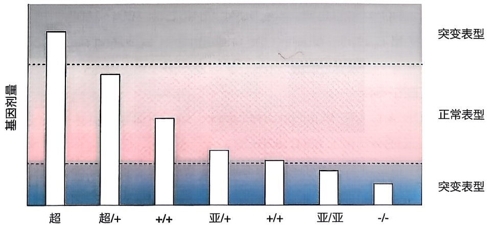

<details>
<summary>bar</summary>

| 基因类型 | 基因剂量 |
| --- | --- |
| 超 | ~高 |
| 超/+ | ~中高 |
| +/+ | ~中 |
| 亚/+ | ~低 |
| +/+ | ~低 |
| 亚/亚 | ~低 |
| -/- | ~极低 |
</details>

图8-8 不同种类突变对基因功能的影响

超:超效突变；亚:亚效突变:-:无效突变；+:野生型；虚线:维持正常表型的阈值。

## ※ 复习思考题

1. 显性突变和隐性突变各自有哪些类型，如何快速甄别？
2. 进化过程中不少基因发生过复制，在基因组里留下不止一个拷贝。对涉及这些基因的突变进行基因组定位时，连锁作图或测序各有什么优缺点？
3. 如何研究新效突变对应的野生型基因功能？

## ※ 推荐阅读

1、BATESON W, et al. Experimental studies in the physiology of heredity[J]. Reports to the Evolution Committee of the Royal Society, 1904: 1–154.
2. BENZER S. Behavioral mutants of Drosophila isolated by countercurrent distribution[J]. Proc Natl Acad Sci U S A, 1967, 58(3): 1112–1119.
3. COHEN J C, et al. Sequence variations in PCSK9, low LDL, and protection against coronary heart disease[J]. N Engl J Med, 2006, 354(12): 1264–1272.
4. DANG V T, et al. Identification of human haploinsufficient genes and their genomic proximity to segmental duplications[J]. Eur J Hum Genet, 2008, 16(11): 1350–1357.
5. FERNANDEZ-MEDARDE A, et al. 40 Years of RAS-A Historic Overview[J]. Genes (Basel), 2021, 12(5).
6. FUKAYA T, LEVINE M. Transvection[J]. Curr Biol, 2017, 27(19): R1047-R1049.
7. HAN M, STERNBERG P W. let-60, a gene that specifies cell fates during C. elegans vulval induction, encodes a ras protein[J]. Cell, 1990, 63(5): 921-931.
8. HAN M, STERNBERG P W. Analysis of dominant-negative mutations of the Caenorhabditis elegans let-60 ras gene[J]. Genes Dev, 1991, 5(12A): 2188-2198.
9. JOHNSON C W, et al. Isoform-specific destabilization of the active site reveals a molecular mechanism of intrinsic activation of KRas G13D[J]. Cell Rep, 2019, 28(6): 1538-1550 e1537.
10. KAJIWARA K, et al. Digenic retinitis pigmentosa due to mutations at the unlinked peripherin/RDS and ROM1 loci[J]. Science, 1994, 264(5165): 1604–1608.
11. KNOTT M M L, et al. Targeting the undruggable: exploiting neomorphic features of fusion oncoproteins in childhood sarcomas for innovative therapies[J]. Cancer Metastasis Rev, 2019, 38(4): 625–642.
12. KNUDSON A G, JR. Mutation and cancer: statistical study of retinoblastoma[J]. Proc Natl Acad Sci U S A, 1971, 68(4): 820–823.
13. LINDSLEY D L, et al. Segmental aneuploidy and the genetic gross structure of the Drosophila genome[J]. Genetics, 1972, 71(1): 157–184.
14. MCCARTHY G M, et al. Recessive, gain-of-function toxicity in an APOL1 BAC

transgenic mouse model mirrors human APOL1 kidney disease[J]. Dis Model Mech, 2021, 14(8).

15. NÜSSLEIN-VOLHARD C, et al. Mutations affecting the pattern of the larval cuticle in Drosophila melanogaster: I. Zygotic loci on the second chromosome[J]. Wilehm Roux Arch Dev Biol, 1984, 193(5): 267–282.
16. ORR H A. A test of Fisher's theory of dominance[J]. Proc Natl Acad Sci U S A, 1991, 88(24): 11413–11415.
17. PERCY D H, et al. Pathology of Laboratory Rodents and Rabbits[M]. Ames: John Wiley & Sons, Inc., 2016.
18. QIU J, et al. Leptin-deficient mice backcrossed to the BALB/cJ genetic background have reduced adiposity, enhanced fertility, normal body temperature, and severe diabetes[J]. Endocrinology, 2001, 142(8): 3421–3425.
19. REISSMANN M, LUDWIG A. Pleiotropic effects of coat colour-associated mutations in humans, mice and other mammals[J]. Semin Cell Dev Biol, 2013, 24(6–7): 576–586.
20. RIDDLE D L. C. elegans II[M]. New York: Cold Spring Harbor Laboratory Press, 1997.
21. SCHEFFZEK K, et al. The Ras-RasGAP complex: structural basis for GTPase activation and its loss in oncogenic Ras mutants[J]. Science, 1997, 277(5324): 333-338.
22. SCHINDLER A J, SHERWOOD D R. Morphogenesis of the Caenorhabditis elegans vulva[J]. Wiley Interdiscip Rev Dev Biol, 2013, 2(1): 75–95.
23. SCHNEUWLY S, et al. Redesigning the body plan of Drosophila by ectopic expression of the homoeotic gene Antennapedia[J]. Nature, 1987, 325(6107): 816–818.
24. SUNDARAM M V. RTK/Ras/MAPK signaling[J]. WormBook, 2006: 1–19.
25. TAKIAR V, et al. Neomorphic mutations create therapeutic challenges in cancer[J]. Oncogene, 2017, 36(12): 1607–1618.
26. TALBERT P B, GARBER R L. The Drosophila homeotic mutation Nasobemia (AntpNs) and its revertants: an analysis of mutational reversion[J]. Genetics, 1994, 138(3): 709–720.

（编写:吴晓晖、许田；审读:唐鸿云）

## 第九章

## 修饰基因和双突变分析

研究基因在其所处的基因组环境中如何发挥作用，是在分子层面上理解生命过程的核心内容。基因并非独立发挥作用，而是在复杂的调控网络中与其他基因互作，影响彼此的表型特征。例如，一个遗传突变是否导致疾病，往往与个体的特定遗传背景紧密相关。其遗传背景中是否含有其他基因突变，可影响该基因突变引发疾病与否以及疾病严重程度。因此，解析基因间的遗传相互作用，即一个基因的功能如何依赖于另一个基因的状态，对于理解基因如何共同协作继而产生特定表型至关重要，为阐释生命活动过程和疾病的发生、发展提供机制性见解。构建双突变体进行表型互作分析，是解析基因之间如何相互作用的重要策略。当多个基因作用于同一生命活动过程，一个基因的突变可能影响通路中其他基因的功能，导致表型改变。研究不同基因突变间的表型相互作用，即一个基因突变如何抵消、缓解或者增强另一个基因突变的表型，能够帮助研究者推断基因之间的功能关联和相互依赖性。此外，通过大量的双突变分析，揭示功能上互相关联的基因群体及其相互作用，可进一步从系统和网络的角度来理解复杂的生命活动过程，有助于更全面地理解基因间的复杂相互作用，揭示生物系统的稳健性和适应性。因此，解析遗传相互作用，理解基因如何相互合作、补偿或抵消彼此的功能，对于开发治疗疾病的新方法、提高农作物产量，以及解析基本生命活动的遗传基础具有重要意义。本章将介绍“修饰基因”这一概念，解释一个基因如何依赖另一个基因的状态来影响生物体的表型，继而探讨如何通过双突变分析来明确基因间的相互作用性质，以及它们在生物通路中的上、下游关系，并且通过丰富的研究案例来说明遗传相互作用在理解疾病机制、发现潜在治疗靶点以及发展个性化医学策略中的应用和重要性。

## 第一节 修饰基因

## 一、修饰基因的概念

修饰基因（modifier gene）是一类影响其他基因表型的基因。例如，当基因 $A$ 的突变影响基因 $B$ 的突变表型时，基因 $A$ 就被称为基因 $B$ 的修饰基因（图9-1）。

修饰基因的概念由约翰·霍尔丹（John. B. S. Haldane, 1892—1964）在1941年提出（Haldane, 1941），它们可直接或间接地影响被修饰基因的功能，因而影响这些基因突变产生的表型变化。例如，家族性结直肠癌研究中被广泛使用的Min突变小鼠产生结直肠肿瘤数量受到遗传背景的强烈影响

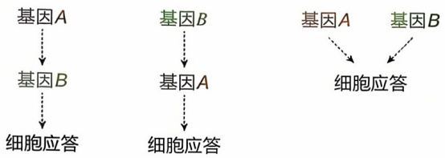

<details>
<summary>flowchart</summary>

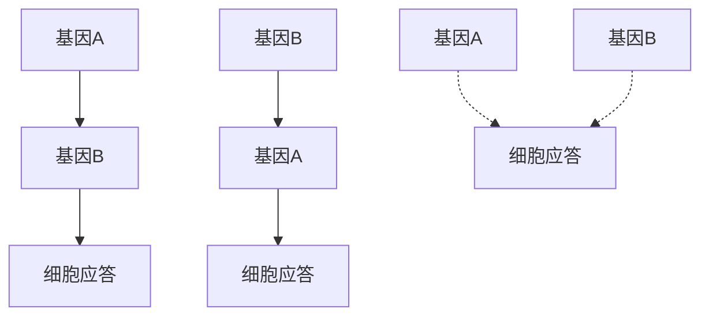
</details>

图9-1 修饰基因与目标基因的功能关系示意图  
修饰基因 $A$ 可以位于目标基因 $B$ 的上游、下游或以平行作用的方式影响基因 $B$ 的功能和表型。

(图 9-2)。Mom-1 被鉴定到作为一个主要的修饰基因显著抑制 Min 突变导致的结直肠肿瘤表型（Gould，1996）。修饰基因在人类的遗传疾病中同样扮演重要角色，影响疾病的发生和发展。DFNB26 基因突变可引发家族性聋哑症，但研究发现某些含有该基因突变的人具有正常听力。通过遗传分析，斋玛·里亚祖丁（Saima Riazuddin）和他的同事确定了 DFNMI 突变作为修饰基因能抑制 DFNB26 突变导致的聋哑症状（Riazuddin et al., 2000）。在人类疾病中，修饰基因本身并不是导致疾病的直接原因，却可以增强或抑制疾病症状。人类中已识别出大约 7000 种罕见疾病，其中 80% 可能有遗传因素（Rahit et al., 2020）。尽管这些疾病各自的发病率不高，全球预计却有

大约4亿人受到不同罕见疾病的影响。在许多遗传性罕见疾病中，即便是携带相同致病基因突变的患者，他们展现出的临床症状也可能存在差异，暗示修饰基因在其中的关键作用。揭示修饰基因和疾病之间的关系，有助于根据患者独特的遗传组成将修饰基因作为潜在的靶标来定制治疗方案，为疾病发生的机理及开发治疗策略提供关键理解，也为个性化治疗疾病提供重要思路（Haldane, 1941; Genin et al., 2008）。此外，遗传分析时，通过向突变个体引入修饰基因突变，可以根据表型变化判断两个基因间的功能关系，例如它们是否在同一生命活动过程中发挥作用，二者间的相互作用性质及次序等（见图9-1）。综上所述，寻找修饰基因并理解其与目标基因的功能关系，有助于揭示复杂的基因调控网络，并为理解目标基因发挥功能的潜在机制和疾病机理提供关键线索。

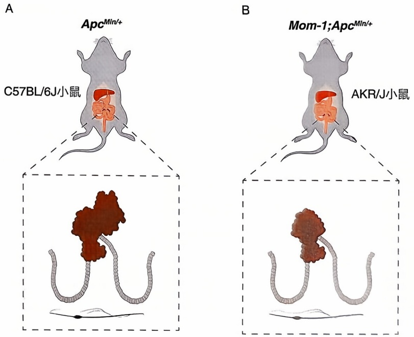

图 9-2 修饰基因对 Min 突变小鼠的结直肠肿瘤数量影响

（A）C57BL/6J遗传背景中无修饰基因Mom-1; $Apc^{Min/+}$ 小鼠结直肠肿瘤数量多；  
（B）AKR/J遗传背景中，存在修饰基因Mom-1; $Apc^{Min/+}$ 小鼠结直肠肿瘤数量少。

## 二、双突变分析

双突变分析是通过比较双基因突变体与单基因突变体的表型差异，解析两个不同基因之间功能关系的遗传分析方法。通过统计个体表型变化展现的程度（表现度，expressivity）和展现表型变化个体的比例（外显率，penetrance），可以比较双突变体和单突变体的表型差异。根据双突变体表型呈现的累加效应（additive effect）、上位效应（epistasis）、抑制效应（suppression）或增强效应（enhancement），可以初步判断这些基因间的遗传相互作用、是否在同一生命活动过程中发挥作用，以及它们间的调控关系和依赖性。

## 三、累加效应

累加效应指的是双基因突变的表型结果是两个单基因突变各自表型的累加


<details>
<summary>flowchart</summary>

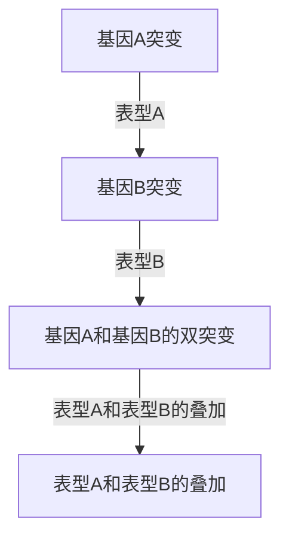
</details>

图9-3 累加效应示意图

基因 $A$ 突变呈现表型A，基因 $B$ 突变呈现表型B，基因 $A$ 和 $B$ 双突变呈现表型A和表型B叠加的表型，这种效应称为基因的累加效应。

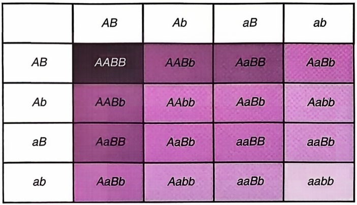

<details>
<summary>flowchart</summary>

```mermaid
graph LR
  A[""] --> B["AB"]
  B --> C["Ab"]
  C --> D["aB"]
  D --> E["AaBb"]
  E --> F["AaBb"]
  F --> G["AaBb"]
  G --> H["aaBb"]
  H --> I["aaBb"]
  I --> J["aabb"]
```
</details>


<details>
<summary>text_image</summary>

植株高度
低	高
</details>

图9-4 植株高度相关基因的累加效应示意图

基因 $a$ 和 $b$ 的等位基因 $A$ 和 $B$ 为植株“促高”基因，每增加一份基因$A$ 或者基因 $B$ 的拷贝，植株高度呈现相应的累加。

(图 9-3)，说明每个基因独立地对表型作出贡献，没有明显的互作或协同作用。缺乏这种互作和协同意味着两个突变基因的联合效应并不比单个突变基因的性状相加后更严重，提示这两个基因很可能在平行或独立的通路中发挥作用。例如，假设植物高度由多个基因共同决定，它们对高度的贡献是累加的，那么可观察到:每增加一个“促高”基因突变会使植物高度增加，而每增加一个“抑高”基因突变则会使高度降低，植物的最终高度是这些基因突变效应的简单加和（图 9-4）。需要注意的是，累加效应不一定意味着这两个基因在功能上无关，它们可能仍参与相关的过程或通路，但在突变时对表型具有独立的贡献。因此，通常需要辅助生化分析和进一步的遗传研究才能确定具有累加效应的基因之间相互关系的准确机制。

## 四、上位效应

上位效应指的是双突变体只显示其中一个单突变体表型的现象。换句话说，一个基因的突变遮盖了另一个基因突变的表型，具有遮盖作用的基因突变称为上位（epistatic）突变，被遮盖表型的基因突变被称为下位（hypostatic）突变（图9-5）。基于对双突变基因杂交和分离过程产生的单基因突变体表型偏离孟德尔分离的观察，上位效应最早由贝特森在1908年用于描述一个基因突变的表型对另一个基因突变的表型呈现的“显性”（Phillips，1998）。

以调控线虫阴门（vulva）细胞命运决定的 let-60/Ras 信号通路为例，let-60/Ras 功能获得型突变导致 LET-60/RAS 蛋白的组成性激活，引发下游信号通路的过度活化，诱发多阴门（Muv）表型（Sternberg et al., 1998）。let-23 编码 EGFR 受体，其功能部分缺失突变阻断了胞外信号对 Ras 信号的激活，阴门前体细胞无法分化，导致无阴门（Vul）表型。同时携带 let-60 功能获得型突变和 let-23 功能丧失型突变的线虫呈现多阴门表型，该结果显示 let-60 功能获得型突变引起的 Ras 信号过度活化，可绕过对 LET-23/EGFR 介导的胞外诱发信号的需求（图 9-6）。因此，let-23 失活突变无法抑制组成性激活形式 Ras 的活性，双突变体呈现与 let-60/Ras 组成性激活突变体相同的多阴门表型，所以 let-60 组成性激活突变对 let-23 功能丧失型突变表现出上位效应，表明前者的存在遮盖了后者产生的表型。

上位效应的存在提示两个被检测基因具有功能关联，它们可能在共同通路或过程中发挥作用且功能上可能相互依赖，这为解析遗传通路的构成提供重要信息。如上所述，let-60组成性激活突变可以绕过对LET-23介导的胞外信号的需求，表明let-23在调节阴门细胞分化的信号通路中可能处于let-60的上游。需要注意的是单独遗传分析不足以揭示上位效应背后的具体机制，研究中需要结合进一步的生化分析和更多的遗传实验进行解析。

## 五、抑制效应

一个基因的突变减轻另一个突变基因表型的现象被称为抑制效应（图9-7）。抑制效应也被称为正向上位效应（positive epistasis），因第2个基因突变的存在可以改善初始基因导致的表型缺陷。线虫LET-60/RAS通路调控阴门发育，mpk-1/ERK功能部分丧失突变体中大部分个体的阴门发育正常。韩珉等发现该mpk-1/ERK突变可缓解LET-60过度激活引发的多阴门表型，该双突变体中大部分个体呈现正常阴门发育（图9-8）。因此mpk-1/ERK基因突变对let-60基因功能获得型突变的多阴门表型呈现抑制效应。抑制效应提示两个相互作用的基因很可能调控相同的生命活动过程，表现为一个基因的突变可以弥补或抵消另一个基因突变引起的表型改变，其中前者称为后者的抑制基因或抑制子。

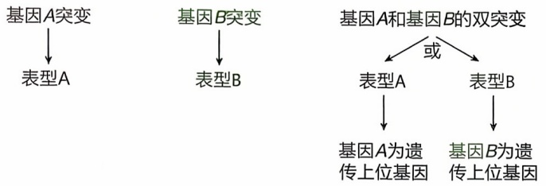

<details>
<summary>flowchart</summary>

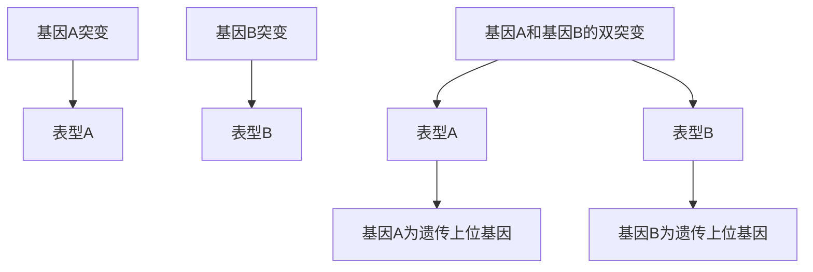
</details>

图9-5 上位效应示意图

基因 $A$ 突变呈现表型A，基因 $B$ 突变呈现表型B，基因 $A$ 和 $B$ 双突变呈现表型A或者表型B，这种效应称为基因的上位效应。

<table><tr><td>突变体类型</td><td>线虫阴门表型</td></tr><tr><td>let-23(rf)</td><td>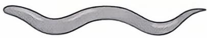</td></tr><tr><td>let-60(gf)</td><td>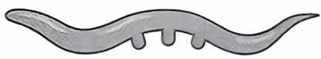</td></tr><tr><td>let-23(rf); let-60(gf)</td><td>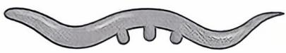</td></tr></table>

图9-6 线虫阴门发育相关基因的遗传上位分析

let-23 (rf, reduction of function, 功能部分丧失) 突变体线虫呈现无阴门表型，let-60 (gf, gain of function, 功能获得型) 突变体线虫呈现多阴门表型，let-23 (rf); let-60 (gf) 双突变体线虫呈现与 let-60 (gf) 单突变体线虫相同的多阴门表型。

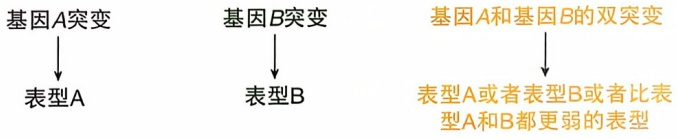

<details>
<summary>flowchart</summary>

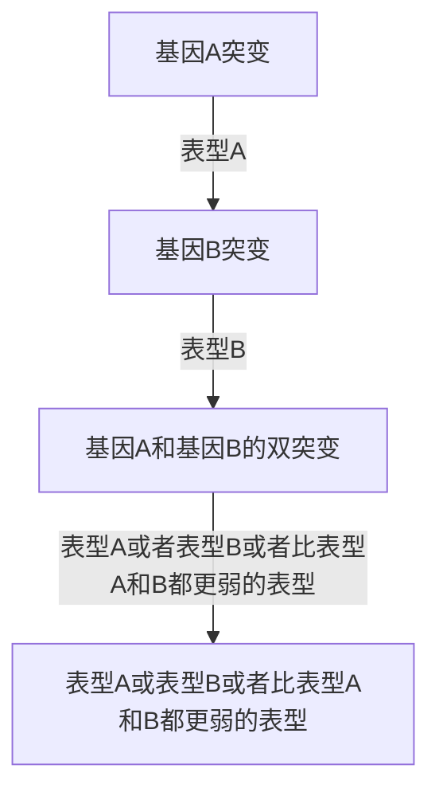
</details>

图9-7 抑制效应示意图

基因 $A$ 突变呈现表型A，基因 $B$ 突变呈现表型B，基因 $A$ 和 $B$ 双突变呈现表型A，或者表型B，或者比A和B都更弱的表型，这种效应称为基因的抑制效应。

<table><tr><td>突变体类型</td><td>线虫阴门表型</td></tr><tr><td>let-60(gf)</td><td>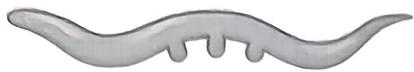</td></tr><tr><td>mpk-1(rf)</td><td>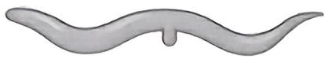</td></tr><tr><td>let-60(gf);mpk-1(rf)</td><td>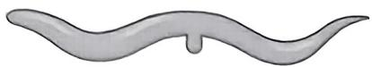</td></tr></table>

图9-8 线虫阴门发育相关基因的抑制效应分析

大部分 $mpk-1(rf)$ 功能部分丧失突变体线虫的阴门发育正常，let-60(gf)功能获得型突变体线虫呈现多阴门表型，let-60(gf); $mpk-1(rf)$ 双突变体的大部分线虫则呈现与 $mpk-1(rf)$ 单突变体线虫相同的正常阴门发育表型。

抑制子的突变可发生在原始突变基因中的另一位点或者另一独立基因中，本章主要探讨后一类抑制子，其可提供基因间相互作用的关键信息。这一类抑制子突变可以通过重新恢复原有通路活性、激活替代通路或改变相关基因的表达和活性等补偿初始突变引起的功能异常。对抑制子突变的研究可帮助揭示同一通路内不同基因间的相互作用顺序及不同通路间遗传相互作用的属性。抑制子缓解相应突变基因的表型存在以下多种机制。

(1) 抑制子通过改变初始突变基因所在通路的活

性，弥补初始突变引起的通路活性异常，促成表型的抑制。通常这类抑制效果是基于抑制子突变对初始突变基因的上位效应所实现的。这里以线虫生殖腺性别决定通路中tra-2和fem-3基因之间的遗传相互作用为例阐释通过上位效应实现抑制效果的抑制子突变（Goodwin et al., 2002）。tra-2功能获得型突变诱导生殖腺雌性化，fem-3功能获得型突变导致生殖腺的雄性化，而同时携带这两个突变的线虫呈现生殖腺雄性化的表型（图9-9）。因此，fem-3功能获得型突变可以抑制tra-2功能获得型突变引起的生殖腺雌性化表型。进一步生化研究表明，fem-3功能获得型突变促进fem-3过表达从而逆转在tra-2功能获得型突变体中下游促雄性化基因受抑制的情况，因此该fem-3突变通过遗传上位效应抑制tra-2突变的表型。恢复突变通路活性的上位遗传抑制类型有助于解析同一通路不同基因之间的作用顺序。

（2）抑制子基因突变产物与初始突变基因产物直接相互作用，恢复突变蛋白的活性，达到抑制效应。在酵母中，act1编码肌动蛋白，其正常聚合对维持细胞正常形态和功能至关重要。act1-1是编码该肌动蛋白基因的温度敏感型突变，其编码的蛋白质在高温下无法正常聚合，进而导致细胞生长和形态的缺陷。酵母sac6编码一种与肌动蛋白结合并调节其结构的蛋白质。艾立森·亚当（Alison E. M. Adams）在sac6基因中鉴定到一个抑制突变，其编码的蛋白质稳定了ACT1-1突变肌动蛋白丝的结构、促进了肌动蛋白的正确组装，弥补act1-1突变引起的肌动蛋白聚合缺陷，即使在高温下也能恢复正常的细胞生长和形态（Adams et al., 1989）。该类型的抑制效应暗示抑制子直接与突变蛋白相互作用，通过改变其活性、稳定性或定位，减轻初始突变引起的表型缺陷。因此，直接相互作用介导的抑制效应为理解初始突变基因发挥功能的分子机制提供重要信息。

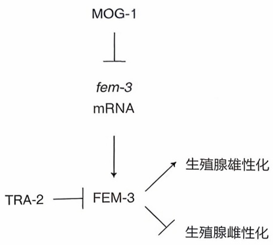

<details>
<summary>flowchart</summary>

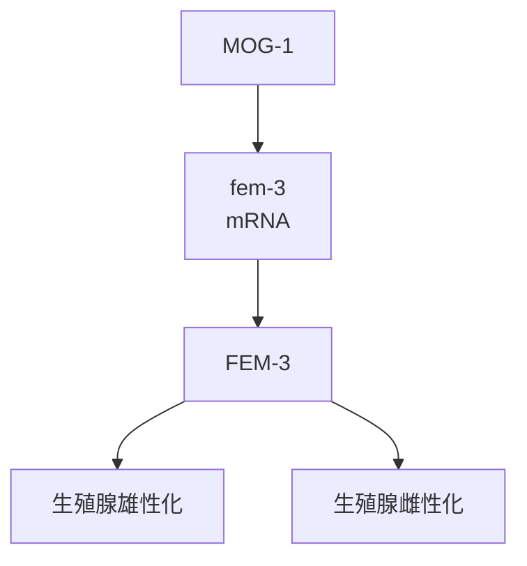
</details>

<table><tr><td>突变体类型</td><td colspan="3">线虫生殖腺性别决定表型</td></tr><tr><td>WT</td><td colspan="3">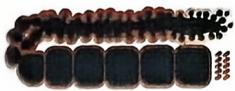</td></tr><tr><td>tra-2(gf)</td><td colspan="3">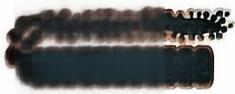</td></tr><tr><td>fem-3(gf)</td><td colspan="3">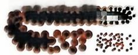</td></tr><tr><td>tra-2(gf); fem-3(gf)</td><td colspan="3"></td></tr><tr><td>mog-1(lf)</td><td colspan="3"></td></tr><tr><td>tra-2(gf); mog-1(lf)</td><td></td><td></td><td></td></tr></table>

图9-9 线虫生殖腺性别决定相关基因的功能相互作用分析左图为线虫生殖腺性别决定调控通路的简图，右图为不同性别决定相关基因突变体线虫的表型图表。野生型（WT）雌雄同体线虫生殖腺可以同时产生精子和卵细胞，tra-2(gf)功能获得型突变体线虫的生殖腺只产生卵细胞（即生殖腺雌性化表型），fem-3(gf)功能获得型突变体线虫的生殖腺持续产生精子且无卵细胞产生（即生殖腺雄性化表型），tra-2(gf); fem-3(gf)双突变体线虫生殖腺呈现和fem-3(gf)单

突变体一样的生殖腺雄性化表型；mog-1(lf)失活突变体线虫的生殖腺呈现雄性化表型，而tra-2(gf);mog-1(lf)双突变体线虫不再呈现出tra-2(gf)单突变体的生殖腺雌性化表型，而是大部分生殖腺呈现出雄性化或者正常分化。进一步生化分析显示，mog-1转录后抑制fem-3基因表达，TRA-2蛋白则通过结合FEM-3蛋白抑制其功能，因此mog-1和tra-2分别在两个平行通路中发挥作用调控fem-3的功能。

（3）激活替代通路抑制初始突变基因的表型。抑制子突变激活了一条平行或补偿途径，以纠正由于初始基因的突变所引起的通路异常，抑制原发突变的表型。例如，线虫性别决定通路中，TRA-2与FEM-3结合相互抑制对方功能，因此二者间的相对比例决定了性别分化的方向。当tra-2发生功能获得型突变后，会导致tra-2过量表达从而抑制FEM-3的促雄性化作用诱发性腺雌性化。MOG-1参与转录后负调控fem-3的表达，因此mog-1失活突变导致fem-3的过表达。此处，MOG-1抑制性调控fem-3表达的通路平行于TRA-2抑制FEM-3活性的通路（Goodwin et al., 2002），当mog-1失活突变后激活该平行通路促进fem-3表达可抑制tra-2功能获得型突变的性腺雌性化表型（见图9-9）。鉴定该类型的抑制子有助于发现平行通路，揭示基因功能的补偿机制。
(4) 抑制子改变突变蛋白的数量, 对后者的表型进行抑制。抑制子可通过调节原发突变基因编码产物的表达、稳定性或降解改变突变蛋白的水平，减轻原发突变基因引起的表型。例如，某些抑制子基因突变可以增强蛋白酶体对突变蛋白的降解，降低突变蛋白的水平，从而抑制其表型。以亨廷顿舞蹈病为例，变异的亨廷顿蛋白中扩展的多谷氨酸重复序列容易聚集引起细胞毒性，进而可能引发亨廷顿舞蹈症神经退行性疾病的发生。研究人员发现某些编码泛素蛋白连接酶复合体成分的基因突变可以增强对突变型亨廷顿蛋白的降解，减少该蛋白质的积累并减轻疾病症状（Bennett et al., 2007）。此外，抑制子可以影响原发突变基因的表达，导致这些突变蛋白水平发生改变，恢复表型。在某些 $\beta$ 地中海贫血的病例中，抑制子基因突变发生在HBS1L-MYB隔位区域（Thein et al., 2007），其可在成人中激活胚胎和/或胎儿珠蛋白基因表达，从而部分补偿成人中珠蛋白的减少，缓解由成人珠蛋白基因突变引起的相关贫血症状。对这类抑制子的研究，可以帮助理解目的基因在蛋白质稳态、折叠及降解等过程中的调控机制。

## 六、增强效应

增强效应指的是两个基因突变的联合效应大于各自单突变效应之和的现象（图9-10）。假设基因 $A$ 的单突变引起轻微的表型，基因 $B$ 的单突变也引起轻微的表型，但同时携带基因 $A$ 和基因 $B$ 突变的双突变体表现出比两个单突变相加更严重的表型，包括出现新的表型，则说明这两个基因突变间存在增强效应。在遗传分析中，增强效应可以提供两个不同基因之间功能关系的重要见解，提示相比较的两个基因可能在平行或同一通路中调节相同生命活动过程。因此，基因间的增强效应信息可以为研究两个基因之间功能关系的分子机制，以及它们可能参与调控的生命活动过程提供重要线索。基因间的增强效应可能存在以下多种机制。

（1）同一通路中另一基因的突变增强原发突变基因的表型。一个功能降低/增强型突变基因与同一通路不同步骤中发挥作用的另一功能降低/增强型突变基因结合时，可能会表现出增强效应。具体来说，同一通路中两个不同基因，其功能降低型双突变或者功能获得型双突变可能会导致整个通路的活性比单独突变时更加异常，从而出现比单突变体更严重的表型。该类增强效应可以帮助鉴定同一通路中其他基因，进一步揭示遗传通路的构成。例如，在线虫中，Ras信号通路的适度激活对于线虫的生存是必需的，因此let-60/Ras完全失活突变体呈现致死表型（Sternberg et al., 1998）。


<details>
<summary>flowchart</summary>

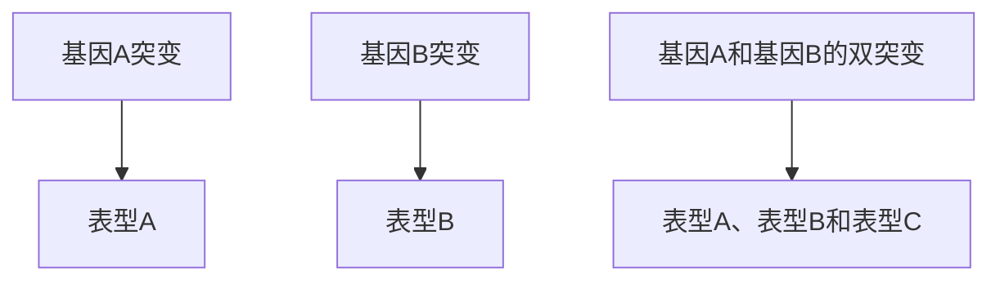
</details>

图9-10 增强效应示意图

基因 A 突变呈现表型 A，基因 B 突变呈现表型 B，基因 A 和 B 双突变呈现比表型 A 和表型 B 相加更严重的表型，包括可能出现新的表型 C，这种效应称为基因的增强效应。

let-60 功能部分丧失型突变或该通路中其他基因的功能部分丧失不会导致线虫生存缺陷，因为整个通路仍然能维持部分活性，可有效满足相应生命活动过程的需求。但是，当 let-60 功能降低型突变与该通路中某个其他基因如 mpk-1 的功能部分丧失突变杂交后，则会导致整个线虫中 Ras 通路活性进一步降低，导致个体死亡（图 9-11）。值得注意的是，同一通路的突变基因间是否表现出增强效应与具体的遗传背景、突变性质及所研究通路的组成相关。同一通路不同步骤中基因突变间的增强效应提供了判断基因间功能关系，以及这些基因在维持通路完整性方面的重要信息。进一步确定呈现该类型增强效应的基因是否在同一通路中、通常需结合进一步的生化实验及更深入的遗传分析揭示其潜在分子机制进行判断。

（2）与初始突变基因直接互作基因发生突变，引发增强效应。当两个基因的编码产物会发生相互作用时，一个基因的单独突变部分破坏相互作用，而双突变导致相互作用进一步被破坏，因此引发增强效应。在酵母中，sac6编码蛋白与act1编码的肌动蛋白发生物理互作，调节细胞内的肌动蛋白动态和组织。在分别含有act1另一突变（act1-4）和sac6单突变的酵母细胞内，虽然突变的基因编码产物与其对应的野生型互作蛋白间的相互作用在一定程度上被破坏，但仍能维持细胞的生长。但是，当sac6和act1-4同时突变后，这两个突变蛋白间无法形成有功能的相互作用，完全破坏了肌动蛋白丝的稳定性和功能，导致酵母细胞存活缺陷。因此，该遗传增强效应可以帮助鉴定具有直接相互作用的基因。
（3）与初始突变基因所在通路的平行途径失活，引发增强效应。该类增强效应提示存在补偿初始突变基因所在调控通路的机制。例如，在线虫中，ire-1 和 pek-1/PERK 基因所参与的通路分别是两条不同的内质网未折叠蛋白质反应（ER unfolding protein response，UPR $^{ER}$ ）通路，共同协调处理内质网应激和维持蛋白质稳态（Shen et al., 2005）。ire-1 或 pek-1 的单基因突变会导致部分 UPR $^{ER}$  信号转导失活，但线虫仍能正常发育（图 9-12）。然而，当同时突变 ire-1 和 pek-1，UPR $^{ER}$  信号被进一步阻断，导致线虫发育缺陷。该增强效应是由于 ire-1 和 pek-1 所代表的两条平行通路同时被抑制，导致原本存在的功能补偿机制丧失所引起的，凸显了多条平行通路的存在对蛋白折叠和质量控制的调节有重要作用。因此，失活平行途径产生的增强效应有助于发现相应基因 / 通路的补偿机制，解析冗余功能。

<table><tr><td>突变体类型</td><td>线虫阴门表型</td></tr><tr><td>let-60(rf)</td><td>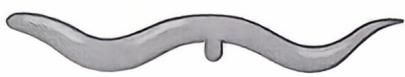个体存活</td></tr><tr><td>mpk-1(rf)</td><td>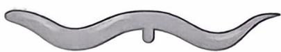个体存活</td></tr><tr><td>let-60(rf);mpk-1(rf)</td><td>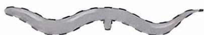个体死亡</td></tr></table>

图9-11 线虫Ras信号通路基因的功能部分丧失突变体的增强效应分析

let-60(rf)功能部分丧失突变体线虫可以正常存活，mpk-1(rf)功能部分丧失突变体线虫也可以正常存活，而 let-60 和 mpk-1 基因的功能同时部分失活 [let-60(rf); mpk-1(rf)] 则使线虫致死。

图9-12 IRE-1、PEK-1/PERK和ATF-6通路冗余调控内质网未折叠蛋白质反应相关基因，维持细胞活力

ire-1或pek-1的单基因突变导致部分UPR $^{ER}$ 信号转导失活，但线虫仍呈现正常发育；同时突变ire-1和pek-1基因，UPR $^{ER}$ 信号转导被严重阻断，线虫则呈现发育缺陷表型。

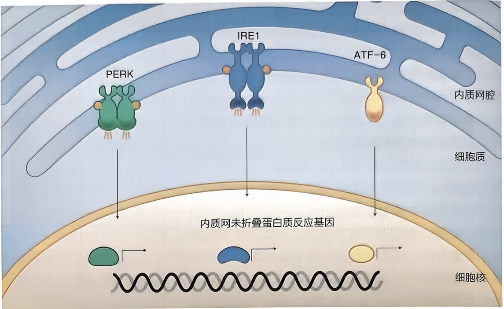

<details>
<summary>flowchart</summary>

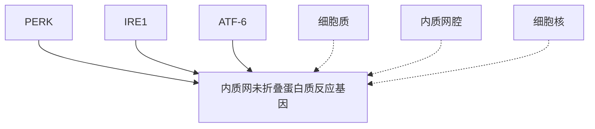
</details>

## 第二节 上位分析

## 一、上位分析的概念

上位分析（epistasis analysis）是基于一个基因突变对另一个基因突变表型的遮盖作用，判断基因间功能关系的一种遗传分析方法。在遗传分析中，利用基因间的上位效应，即一个基因的突变抑制或遮盖另一个基因突变表型的现象，可用来解析不同基因如何互作，从而决定它们的最终表型结果。上位分析可以在不清楚基因之间是否存在直接相互作用的情况下，帮助确定这些基因是否在同一生命活动过程中发挥作用，也有助于揭示同一通路中两个基因间的功能顺序，从而为理解这些基因参与相应生命活动过程的潜在分子机制提供线索。因此，上位分析通过研究不同基因突变的表型，揭示基因间的功能依赖关系及潜在的代偿机制，鉴定基因所在的通路和网络，阐释复杂表型背后的遗传基础。

进行遗传上位分析时，首先对目标基因构建相应的遗传修饰细胞或个体；然后，将这些不同的遗传突变进行组合，生成不同的双突变体；最后，通过比较单一突变体和双突变体的表型，如形态、生理、行为特征或者相关的分子特征如基因表达等，评估突变基因间的相互作用效应。上位分析对解析在同一生命活动过程中发挥作用的基因功能关系最为有效，因此合理利用各种已知的遗传或生化信息，预判这些基因发挥作用的过程，有助于利用上位分析更准确地构建遗传通路。

细胞通路属性可影响对上位分析结果的阐释，因此在进行遗传分析前，有必要对目标突变基因进行深入的表型分析，以帮助确定这些基因参与的通路类型。细胞内调控生命活动过程的通路通常可分为两种类型:生物合成通路（biosynthesis pathway）和信号转导通路（signal transduction pathway）（图9-13）。生物合成通路，比如各种代谢途径，最终发挥功能需要依赖于一系列底物转化成为最终的效应分子或结构，因此也被称为底物依赖型通路（substrate-dependent pathway）（Huang et al., 2006）。信号转导通路则是基因/基因产物以分子开关的形式发挥作用，一旦打开基因/基因产物后，可绕过对上游基因的需求去推进下游通路，不涉及对前面步骤中相关底物的依赖（见图9-13）。

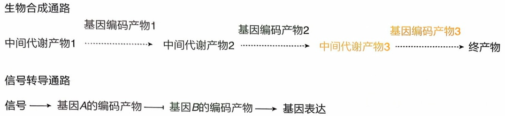

<details>
<summary>flowchart</summary>

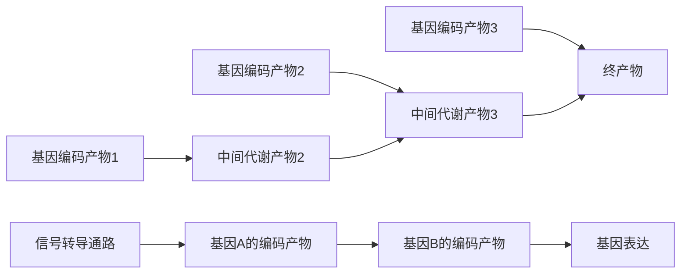
</details>

图9-13 调控生命活动过程的两种通路类型图中箭头指示正调控作用，顿头代表负调控作用。

## 二、生物合成通路的上位分析

下面以酵母腺嘌呤合成途径为例，阐述上位分析如何帮助确定生物合成通路中不同基因间的作用顺序及相互关系。ade-2 和 ade-3 是酵母腺嘌呤生物合成途径中的两个关键基因（图 9-14）。氨基咪唑核苷酸是腺嘌呤合成过程中的一个中间代谢产物，其过量积累会导致酵母细胞内形成红色色素，因此呈现红色菌落（Dorfman，1969）。为了进行上位分析帮助明确 ade-2 和 ade-3 遗传互作和功能关系，研究人员构建了双缺失突变体（ade-2Δade-3Δ），并与 ade-2Δ 和 ade-3Δ 单突变体的表型进行比较。结果显示:ade-2Δ 显示红色菌落表型，表明失去功能性 Ade-2 蛋白导致氨基咪唑核苷酸的积累。具体而言，Ade-2 蛋白可能在将氨基咪唑核苷酸转化为下游产物过程中发挥作用，缺乏这种代谢转化导致红色色素的形成。另一方面，ade-3Δ 单突变酵母显示白色菌

图9-14 酵母腺嘌呤生物合成途径

酵母腺嘌呤生物合成途径示意图（上）以及野生型和各突变体酵母所对应的菌落颜色示意图（下）。

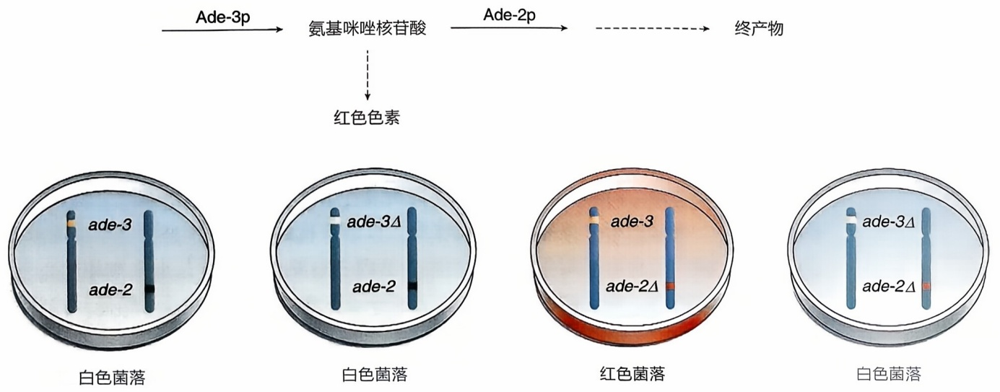

<details>
<summary>flowchart</summary>

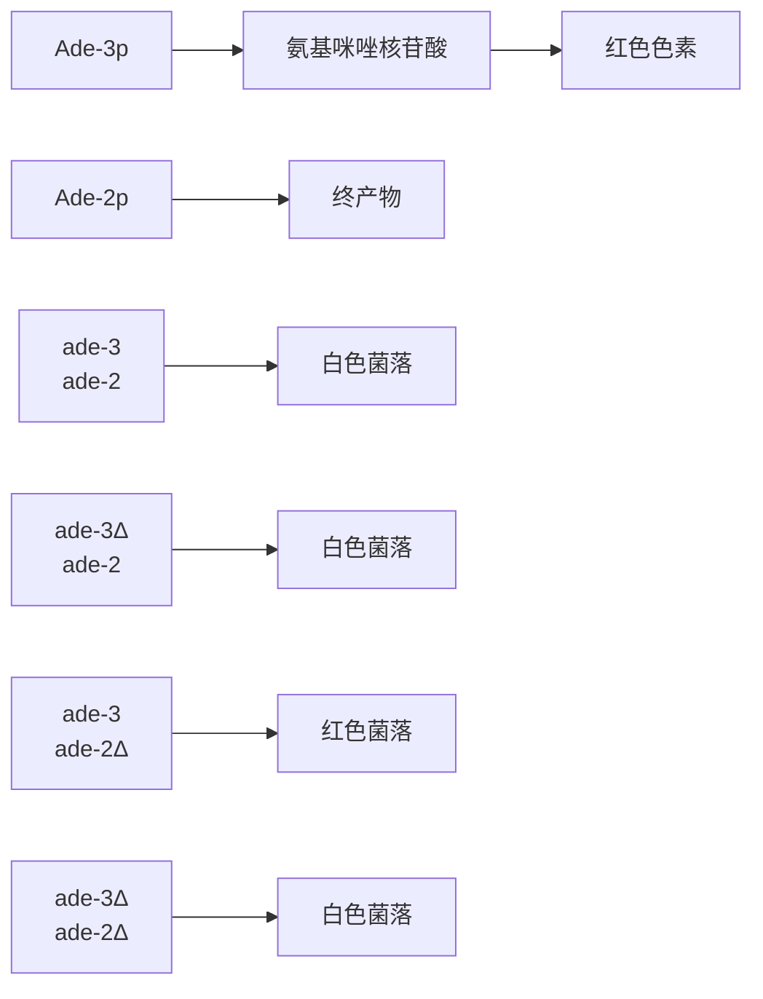
</details>

落表型，表明无氨基咪唑核苷酸的积累，提示 Ade-3 蛋白位于 Ade-2 蛋白的上游，可能对于产生氨基咪唑核苷酸是必需的。反之，如果 Ade-3 蛋白位于 Ade-2 蛋白的下游、ade-3Δ 单突变酵母也应当显示红色菌落。双突变分析发现，ade-2Δ ade-3Δ 双突变体也显示白色菌落表型，所以 ade-3Δ 突变位于 ade-2Δ 突变的遗传上位，这一结果表明 ade-3 的缺失抑制了 ade-2 失活突变所导致的氨基咪唑核苷酸的积累，进一步支持 Ade-3 蛋白位于 Ade-2 蛋白的上游，可能对于氨基咪唑核苷酸的合成是必需的（图 9-14）。因此，在生物合成通路中，处于遗传上位的基因在通路相对上游的位置。生化研究进一步支持该上位分析结果，研究人员发现:ade-2 基因编码产物将中间代谢产物氨基咪唑核苷酸进行羧化，继而进入腺嘌呤生物合成途径；而 ade-3 基因编码产物则位于整个合成通路的相对上游，对生成氨基咪唑核苷酸是必需的。为保证遗传上位分析的准确性，研究人员通常会将目标基因与同一通路中其他不同基因进行尽可能多的双突变分析，并同时辅助生化分析，如检查代谢物的水平及酶活分析等，进一步在分子水平上确认遗传互作的机制。

## 三、信号转导通路的上位分析

Ras 信号通路是生物体中较早鉴定的一个典型信号转导通路（Wassarman et al., 1995; Sternberg et al., 1998），为理解生物体信号如何被感知、转导和传递提供了重要的框架性理解（图 9-15）。在线虫中 Ras 信号调控阴门前体细胞（vulva precursor cell）的分化，下面以线虫 Ras 信号通路中部分基因为例，阐述上位分析如何确定信号转导通路中不同基因间的作用顺序，从而帮助构建遗传通路。在线虫 Ras 信号通路中，lin-1 基因负调控阴门的形成，因此 lin-1 功能丧失单突变体表现出多阴门表型。而 let-60/Ras 对于阴门的形成则是必需的，let-60 基因功能丧失突变体表现出无阴门表型。这些相反的表型提示这两个基因调控同一生命活动过程，为解析它们在整个信号通路中作用的顺序和功能关系，对它们的双突变体的表型进行分析。结果发现:let-60 和 lin-1 双基因缺失突变体呈现多阴门表型，因此 lin-1 突变位于 let-60 突变的上位；由于 lin-1 缺失所诱导的多阴门表型不依赖于 let-60 的信号，表明 lin-1 可以绕过对 let-60 信号的需求来调控阴门形成，据此，let-60 应该作用于 lin-1 的上游。因此，在一个信号转导通路中，处于遗传上位的基因通常位于通路的相对下游，但确切的结论仍需要结合更多遗传和生化分析进行明确，尤其需要注意判断是否存在上位基因在平行通路中发挥作用的可能性。

进行遗传上位分析时，需要注意以下关键点。首先，当两个基因突变呈现相同或相似表型时，无法进行上位分析，因为无法判断双突变体中各单突变的表型受遮盖情况。因此，进行上位分析时需要比较的突变基因表型要有区分度，如呈现相反表型。其次，上位分析时，需要使用基因的完全缺失突变才能得到相对明确的结论，如使用部分失活突变或者功能获得型突变则需要结合更多分析方法进一步明确，防止得出错误结论。再次，通常需结合生化实验及分子和细胞生物学分析，进一步明确上位分析中确定的基因间功能关系的具体机制。第四，上位分析对于在同一生命活动过程中发挥作用的基因间关系判断最有效，因此表型鉴定的准确性对于遗传上位分析非常关键，如能在分子和细胞水平上确定性状特征可以增加上位分析的可靠性。最后，基因间的上位关系只适用于被检测的突变基因及对应的表型，如换成这些突变基因的其他表型或更换等位基因突变，上位关系可能发生改变。

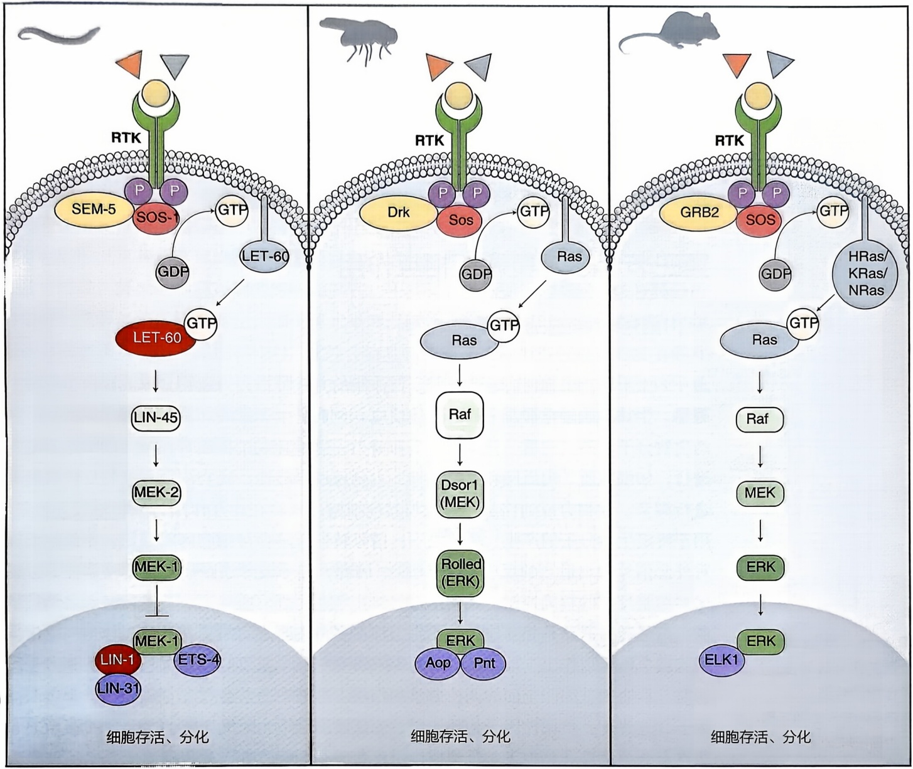

图9-15 线虫、果蝇和小鼠的Ras信号通路示意图

遗传上位分析是一种有效的工具，可以帮助确定通路中基因的上、下游相互作用关系，但它仅提供了一个需要进一步深入的细胞过程分析和分子机制研究的遗传模型（Huang et al., 2006）。上位分析的一个局限性在于它假设一个通路中不同基因间的作用是线性的，然而这并不适用于大多数基因。事实上，基因所处的通路是一个网络，往往存在多个平行的分支通路及多个输入信号，这会导致上位分析的复杂性和结果的不确定性。此外，同一通路中某些基因会体现出组织特异性调控的特点，这些特异调

左、中、右分别呈现线虫、果蝇以及小鼠的Ras信号通路中的关键基因，调控细胞存活与分化。其中箭头表示正调控，顿头表示负调控。

控的基因与通路中其他基因相比可能还会呈现额外的组织特异性表型，这也会导致在上位分析时，表型分析可能会出现复杂的情况。因此，仔细分析通路中基因的表型及组织调控特点，可帮助提高上位分析的准确性和可靠性。总之，遗传上位分析是解析基因如何发挥作用的起点，通常需要结合其他实验如生化分析等来确认和细化观察到的相互作用，进一步研究策略的选择取决于具体的研究问题、所研究系统的复杂性以及可用的技术和方法。

## 第三节 正、负调控相互作用

## 一、信号转导通路的调控作用

如上所述，细胞内的通路按照发挥作用的方式可以分为生物合成通路及信号转导通路。生物合成通路涉及一系列酶促反应，负责产生和组装细胞生长和功能维持所需的生物分子，如蛋白质、核酸、脂质和糖类。生物合成过程通常在特定的细胞区域内进行，如细胞质、内质网和线粒体等，主要通过酶活性、底物浓度和产物反馈机制来进行调节。生物合成通路虽然可能与其他细胞过程存在相互作用，但相对较为独立，用于特定生物分子的产生。相比之下，信号转导通路参与细胞间的通讯，使细胞能够对外部信号做出适当的反应（图9-16）。因此，信号转导通路需要被严格调控，以确保对细胞反应的精确控制，其调控过程涉及可逆的蛋白质修饰、反馈回路和负调控机制。信号转导通路是相互连接的网络，存在多个通路之间的交叉和相互作用，以保证细胞或个体可以作出全局性响应。遗传学研究中一个重要问题是构建完整的基因互作通路，以明确基因间全面的调控关系和作用。通路中通常会存在正调控因子及负调控因子，这些正、负调控因子相互作用，保证通路在适当时间以适当的强度被激活。本节重点介绍调控通路中正、负调控作用存在的必要性，并以酵母信息素响应通路作为示例解释信号传递和正、负调控如何进行，以及如何利用正、负调控帮助构建通路。

图9-16 以胰岛 $\beta$ 细胞为例的信号转导通路的调控作用示意图

胰岛 $\beta$ 细胞分泌胰岛素，其作为信号触发受体细胞的胰岛素信号转导通路，促进葡萄糖吸收，调节血糖水平。

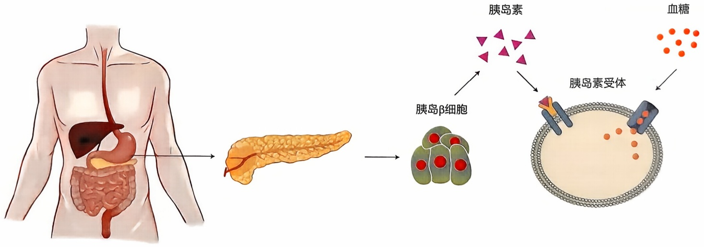

<details>
<summary>flowchart</summary>


</details>