信号转导通路在细胞内和细胞间通讯中起着关键作用，使细胞能够感知并响应各种胞内、外刺激。信号转导通路在细胞和生物体中具有非常重要的作用，具体如下:①参与细胞间的通讯和协调。信号转导通路使得细胞可以相互通讯并协调应答。它们使细胞能够对外部信号（如激素、生长因子或应激因子）做出响应，并传递信息以触发适当的细胞应答（见图9-16）。这种通讯对于组织、器官和生物个体正常功能的实现都至关重要。②参与对各种细胞过程的调控。信号转导通路在调节细胞生长、增殖、分化、迁移和凋亡等基本细胞过程中起着核心作用，确保这些过程受到严格调控，在个体发育和稳态维持中发挥关键作用。③调控发育过程和器官形成。信号转导通路在胚胎发育和器官形成过程中至关重要。胚胎发育由适当的信号触发，缺乏适当的信号转导，将无法形成正确的组织和器官。④参与对环境变化的响应。信号转导通路使细胞能够对外界环境变化，如营养水平和温度等，作出响应以维持稳态，确保细胞的存活和正常功能（见图9-16）。此外，信号转导通路失调与多种疾病的发生都有关系，如Ras信号通路的过度激活与约 $30\%$ 的肿瘤发生密切相关，解析信号转导通路的构成及调控机制可以帮助揭示疾病原因，为治疗干预提供潜在靶点。因此，理解信号转导通路的构成及调控过程非常重要。

## 二、正调控作用

信号转导通过一系列受调控的分子事件，将胞外信号传递到细胞内，从而引发特定的细胞响应。酵母信息素响应通路是较早研究的信号转导系统，它介导了酵母细胞对交配信息素的反应，经过精确调控的信号转导系统，控制酵母交配所需的细胞过程。对该通路组分及调控机制的理解，为酵母和其他真核生物的信号转导研究提供了重要思路（Fields，1990）。

下面以酵母信息素响应通路为示例，阐述信号转导的重要过程（图9-17）。①信号感知:信号通路开始于细胞表面或细胞内受体对胞内、外信号的识别。受体在与信号结合时经历构象变化，从而将配体水平的信号进行转导。在酵母信息素响应通路中，该通路的启动是由配子信息素与细胞表面G蛋白偶联受体Ste2和Ste3结合而触发的。②信号转导:一旦受体结合配体，它会通过一系列分子的相互作用来传递，通常涉及蛋白质修饰（如磷酸化、泛素化）和信号分子的激活或失活。在酵母信息素反应通路中，当与信息素结合后，信息素受体激活由Gα和Gβγ亚基组成的异源三聚体G蛋白，导致Gα从Gβγ中解离，并进一步激活下游的信号转导组分。③信号放大:信号通路通常包含级联放大步骤，从而产生足够强的信号激发细胞响应。在酵母信息素响应通路中，信号放大由促分裂原活化的蛋白激酶（mitogen-activated protein kinase，MAPK）级联反应介导，具体如下Gβγ亚基激活了丝裂原激活蛋白激酶（MAPK）级联反应，该级联依次包括三个激酶Stell（MAPKKK）、Ste7（MAPKK）和Fus3/Kss1（MAPK）。MAPK级联激活导致下游效应蛋白的磷酸化和活化。④细胞响应:信号转导通路的激活或抑制最终导致特定的细胞响应，如基因表达的改变、蛋白质活性的改变、细胞骨架的重组、细胞分裂、分化、迁移或凋亡。细胞如何响应取决于多种因素，如信号的性质、信号激活的强度及细胞类型。在信息素响应通路中，活化的MAPKs，即Fus3和Kss1，转位进入细胞核，并磷酸化转录因子，包括Ste12、Tec1和Dig1/Dig2。这些转录因子调控参与交配相关基因的表达，诱发相应的细胞变化。此外，当细胞同时接收多个信号后，还存在信号整合过程，通过整合这些不同的信号以协调细胞响应。值得注意的是，单一信号的输入也可能转化为多个不同信号通路的活性，从而形成细胞或个体的整体性反应，作出全局响应。酵母信息素响应通路可与细胞中其他信号转导途径相互作用，例如高渗甘油（high osmolarity glycerol，HOG）响应途径和应激诱导的MAP激酶途径，这些不同途径之间的交互作用为细胞反应增加了另一层次的调控和协调。

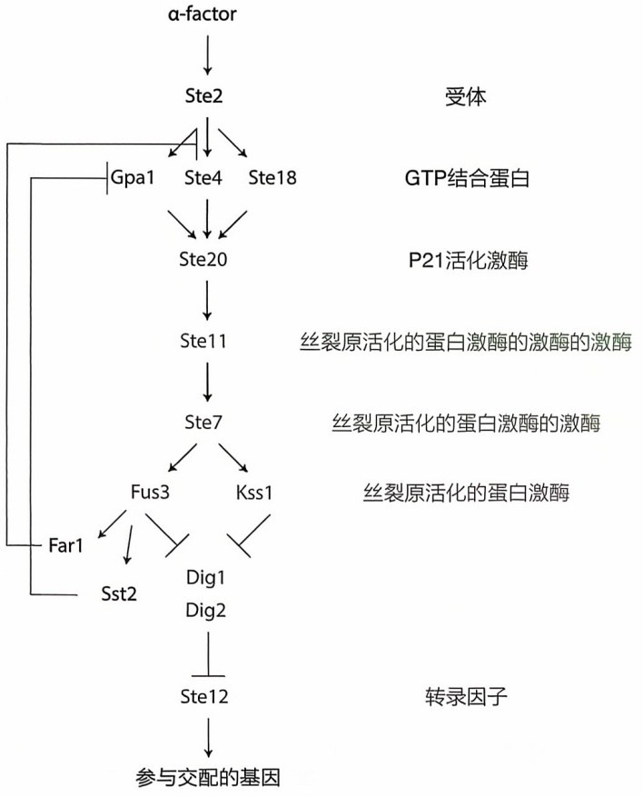

flowchart

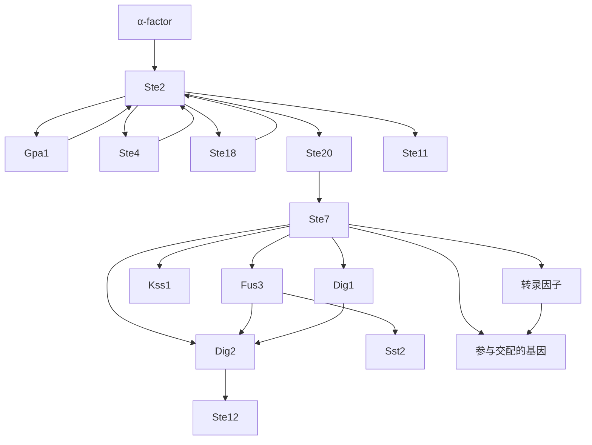

图9-17 酵母信息素响应通路

酵母信息素响应通路通过丝裂原活化的激酶级联反应介导信号放大，其中箭头指示正调控，顿头代表负调控。

## 三、负调控作用

除了包含信号触发和级联放大的正调控作用，信号转导通路中通常还具有负调控因子。Far1 和 Sst2 是酵母信息素响应通路中的两个负调控因子，在通路活性的精确调控和防止通路过度激活中发挥关键作用。Far1 可被激活的 MAPK（如 Fus3）诱导表达，继而阻断 Gβγ（Ste4）与信息素受体 Ste2 之间的相互作用，从而防止连续信号转导。Far1 作为负反馈调节因子，有助于限制信号转导通路的过度活化及终止信息应素反应。far1 失活突变导致酵母对信息素的反应变得异常敏感。sst2 是信息素响应通路中另一个负调控基因，其编码 GTP 酶激活蛋白（GAP），通过增强 Gα 的 GTP 酶活性使其进入与 GDP 结合的失活状态，导致 G 蛋白信号的终止。这种 G 蛋白信号的减弱有助于帮助信息素响应恢复到基础状态。同样的，sst2 基因的失活也会导致细胞对信息素产生过度反应。Far1 和 Sst2 通过在信号级联反应中的不同层面发挥抑制作用，在酵母信息素响应通路中作为关键的负反馈机制，防止通路的过度或持续激活，确保通路信号强度的适当调控以及适时终止响应。

## 四、正、负调控作用的功能

在一个通路中，负向和正向调控都至关重要，它们的有序协调确保细胞过程受到精确调控和动态响应。正、负协同调控在信号通路中的重要性，体现在如下几个方面:①保证信号强度的精准调节。正向调控可以放大信号，确保对刺激作出充分反应。负向调控则有助于减弱信号，防止通路被过度激活，保持信号稳态。正、负调控协同作用保证信号的激活处于最佳水平，避免过度活化或强度不足。②确保信号的活化在正确的时间发生，保证时间控制的准确性。正向调控可以实现信号通路的快速激活并启动下游事件，而负向调控提供反馈抑制机制，有助于在达到预期响应后或去除刺激后，终止或减弱信号级联。这种准确的时间控制对于各种细胞过程的正确协调至关重要。③实现信号的整合和交叉。在体内，细胞会同时接收多个信号，不同通路之间会发生相互交叉。正向调控使不同来源的信号进行整合，产生协同效应。而负向调控则有助于维持特异性，防止通路之间的不必要交叉反应，确保响应的特异性。④保证细胞对信号的适应性和敏感性。负向调控机制可以防止通路过度激活，维持细胞对信号的敏感性，确保通路对后续信号仍能保持响应。⑤负向调控可作为纠正异常活化信号的机制。负调控作用通过最小化背景信号和潜在的背景波动所造成的影响，确保在不同条件下准确可靠地进行信号传递。因此，负向和正向调控在信号通路中相互协调，精准控制通路活性，完成信号整合，确保细胞做出适当强度的反应，避免不利后果。正、负调控机制之间的平衡对于维持细胞稳态和确保生命活动过程的正常功能至关重要。

遗传上位分析时，呈现相反信号状态的突变基因可提供有效信息，帮助揭示基因间的功能关系。在负调控相互作用中，两个基因的失活突变会导致出现相反的信号状态。用这些突变基因进行遗传分析时，与双突变体呈现相同表型的单突变基因处于遗传上位，其在信号通路中位于相对下游的位置。在正调控通路中，由于相关基因的功能丧失突变体呈现相同或类似表型，因此无法用来确定这些基因间相互作用的顺序。此时，可结合分析一个基因的功能丧失型突变与另一个基因的功能获得型突变，由于它们赋予相反的信号状态和表型，因此可进行遗传上位分析。在正调控的信号通路中，处于遗传上位的基因，位于相对下游的位置。总之，分析通路的正、负调控机制对于理解细胞过程如何响应信号及不同通路间如何协调发挥作用非常重要，遗传分析时也需要关注相关调控作用的属性，以选择合适的突变体进行上位分析。

## 第四节 合成致死

## 一、合成致死的概念

合成致死（synthetic lethality）是指单独破坏其中任意一个基因不引发致死，但同时破坏两个或多个基因会导致细胞/个体丧失生存能力的现象。

假设基因 A 单突变体和基因 B 单突变体均可存活，但当基因 A 和 B 同时突变出现致死表型，则说明这两个基因突变具有合成致死效应（图 9-18）。合成致死表明存在遗传冗余（genetic redundancy），其潜在机制可能是生物体具有两个或多个能够执行类似或相同功能的冗余基因或冗余通路（图9-19），以确保生命活动过程的稳健性和可靠性。因此，一个基因的缺失可以被冗余的基因或信号通路所补偿，但冗余基因或通路的同时丧失会导致补偿机制的缺失或不足，从而引发合成致死。

flowchart

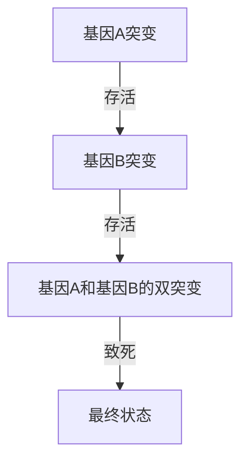

图9-18 合成致死示意图

基因 $A$ 或基因 $B$ 突变时，生物体能够存活，但基因 $A$ 和 $B$ 同时突变引发致死表型，该效应称为基因的合成致死。

图9-19 遗传冗余示意图左图为冗余基因示意图，基因编码产物A和基因编码产物B发挥相同或类似功能，其中任一基因突变时，另一基因可补偿相应的功能缺失，则基因A和基因B为冗余基因。右图为冗余通路模式图，冗余通路是指执行类似或重叠功能的通路，单独抑制任一通路，另一通路可补偿相应的功能缺失，如A-B-C通路与D-E-F通路的关系；或者抑制其中一条通路（如:D-E-F）可激活具有类似功能的反馈通路（如:G-H-I）。

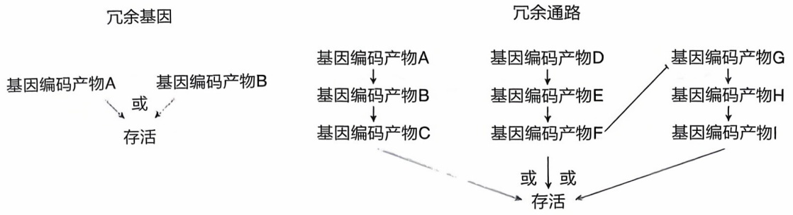

flowchart

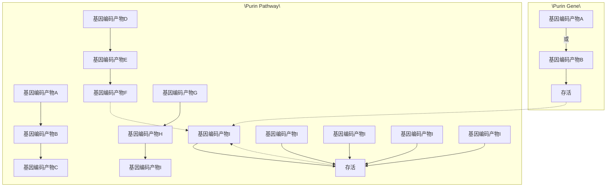

## 二、遗传冗余

基因复制是遗传冗余发生在基因水平上的一种主要机制，其可产生具有相似序列和功能的同源基因，为基因的功能缺失提供了补偿机制（图9-19）。在酵母中，cyc1和cyc7互为同源基因，编码细胞色素c，对于线粒体电子传递和细胞呼吸至关重要。当它们中一个基因发生功能缺失时，另一个基因的存在仍可保持酵母细胞中电子传递功能和支持线粒体呼吸，而当两个基因同时突变后，线粒体呼吸无法完成，导致细胞死亡（图9-20）。酵母Cyc1蛋白和Cyc7蛋白之间的冗余归因于它们编码的蛋白质具有类似功能，可以互相补偿。酵母hta1和hta2基因是基因冗余的另一个示例，这两个基因高度相似，它们编码的核心组蛋白H2A，用于染色质组装并调控基因表达。hta1突变体表现出一定程度的生长缓慢但仍然可以存活，而hta2突变体没有明显缺陷。但hta1和hta2双突变体则表现出严重的生长缺陷，呈现合成致死表型，凸显了这两个基因之间的冗余功能（图9-21）。

此外，基因冗余也可通过表型缓冲来实现，即由具有相似功能的其他基因表达上调来补偿另一基因的缺失。表型缓冲机制可以在遗传扰动的情况下，帮助保持细胞或机体的正常表型。例如，线虫 $hsp-3$ 和 $hsp-4$ 同时编码内质网分子伴侣 BiP。当 $hsp-3$ 突变时，$hsp-4$ 的表达上调可以帮助缓冲由于 $hsp-3$ 的缺失导致的 BiP 总体含量下降。冗余基因的存在是生物系统稳定性的重要保证，并为生物体提供了抵御遗传变异或环境压力的能力。

冗余通路指的是生物系统中可执行类似或重叠功能的通路，其中一个通路发生功能障碍时，另外通路会发挥补偿作用，确保细胞过程的稳定性和可靠性（图9-19）。并行通路是实现通路冗余的重要方式，它指多条执行相同或类似功能的通路可以并行存在，这些通路可能具有不同的组成蛋白及调控机制，但最终会汇合调控相同或类似功能。如果一个通路被破坏或抑制，冗余的并行通路仍然可以执行必要的功能。例如，丝裂原活化的蛋白激酶（MAPK）途径和磷脂酰肌醇3-激酶（PI3K）/Akt途径是两条平行的信号传导途径，可以被表皮生长因子（EGF）等配体激活（图9-22）。这两条途径在细胞存活、增殖和分化中扮演重要角色。当EGF与其受体结合时，它能同时激活MAPK途径和PI3K/Akt途径。MAPK途径通过一系列磷酸化事件，导致转录因子激活，进而调控基因表达并促进细胞增殖。另一方面，PI3K/Akt途径则会通过磷酸化下游靶点，最终也发挥促进细胞存活和生长并抑制凋亡的作用。尽管MAPK途径和PI3K/Akt途径具有不同的组成，但它们可以平行作用，在EGF刺激下做出类似的细胞响应，如促进细胞生长和存活。在特定生理情况下，激活其中一个通路可以补偿另一通路的缺失，维持细胞的存活和生长。这个示例展示了平行途径如何对特定刺激作出具有相似功能的响应以确保冗余性。内质网未折叠蛋白质反应是另一个典型的具有多条平行通路发挥遗传冗余功能的生命活动过程。在线虫中，IRE-1、PEK-1/PERK和ATF-6代表三条平行的内质网未折叠蛋白质响应通路，帮助维持内质网稳态，保证个体和细胞存活（见图9-12）。研究发现，这三条通路的单独缺失都不影响线虫存活，但同时敲除ire-1和atf-6或同时敲除ire-1和pek-1则会导致线虫发育停滞在二龄幼虫阶段。因此，atf-6所在通路及pek-1所在通路与ire-1通路呈现遗传冗余（见图9-12）。此外，通路冗余也可通过信号转导通路的交叉通讯形成反馈环路来实现（见图9-19）。交叉通讯可保证不同通路之间的协调通讯和反馈调控，实现功能补偿。例如，反馈环路可以在一个通路受扰动时通过反馈机制激活冗余通路，恢复稳态。

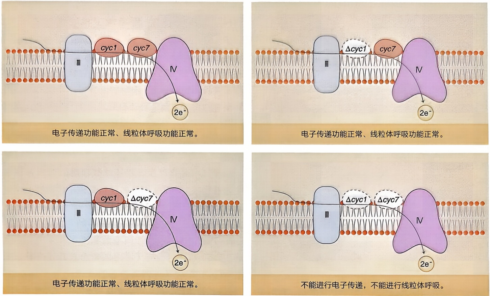

图9-20 酵母细胞中线粒体Cyc1和Cyc7呈现遗传冗余

图中呈现野生型酵母、cyc1功能缺失单突变体、cyc7功能缺失单突变体以及cyc1和cyc7同时缺失的双突变体的线粒体呼吸能力表型。虚线轮廓和 $\Delta$ 表示该基因缺失。

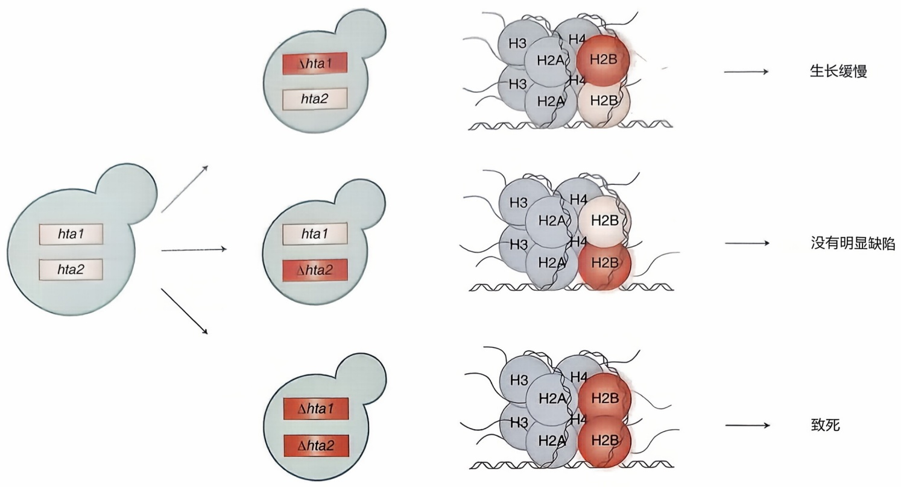

flowchart

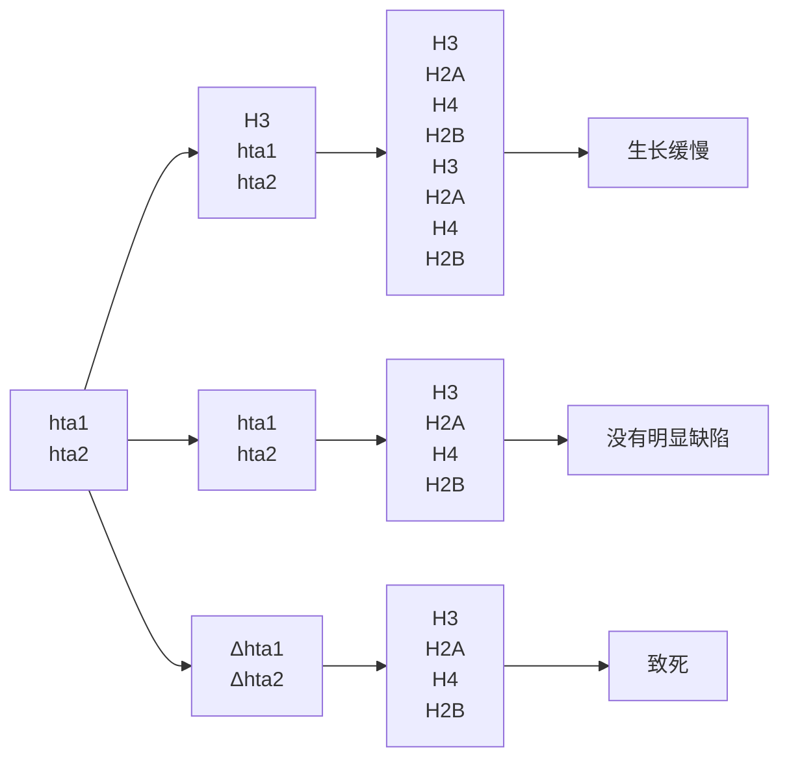

图9-21 酵母细胞中 hta1 和 hta2 基因遗传冗余酵母 hta1、hta2 单突变体以及双突变体所对应的核小体组成与生长发育情况，红色长框和 $\Delta$ 表示该基因缺失（中），红色圆球（右）表示其编码的组蛋白缺失。

需要注意的是:利用合成致死分析遗传冗余时，应尽量选择完全失活突变进行研究。同一通路两个基因的功能同时下降也可能出现合成致死的情况，因此使用功能部分缺失突变基因进行合成致死分析时可能无法判断两个基因是否来自于不同的冗余通路。

冗余通路的存在使生物系统能够抵御遗传扰动，增强细胞过程的可靠性，并确保系统的稳态。遗传冗余在进化上可能具有重要意义。首先，遗传冗余提供了备用系统或替代途径，可以在特定基因或途径的功能失调时进行补偿。这种冗余保证了即使存在遗传变异或环境压力，关键生命活动过程仍可进行。其次，遗传冗余使得基因变异并不一定会导致生命活动过程终止，因此它提供了对基因变异的缓冲，使生物体能够保留新的遗传突变从而适应不断变化的环境。此外，在进化过程中，冗余基因或通路的存在为基因在特定条件或组织中发挥特化作用提供了原材料和条件，从而增强某些生命活动过程的效率或特异性，实现基因功能的多样化，达到生物系统整体功能的优化。最后，遗传冗余在发育过程中起着关键作用，是发育过程稳健性（robustness）的重要机制，确保器官形成和组织分化的正常进行。通过将遗传扰动的负荷分布到冗余基因或途径上，遗传冗余机制为发育过程中应对可能发生的遗传变异或环境刺激提供稳健性。当一个基因或途径受到干扰，另一个可以进行补偿，以维持正常发育，防止缺陷。总之，遗传冗余是生物系统的一种基本特性、通过功能重叠和补偿机制使生物体稳健维持必需的功能，适应不断变化的环境，并抵御遗传变异的影响。

## 三、合成致死基因解析遗传冗余机制

鉴定合成致死基因是发现遗传冗余基因和通路的重要手段。设计合成致死遗传筛选策略的关键点在于:能在携带初始突变的细胞/个体进行随机突变诱导后，获得可产生双突变体的株系，并将其与单突变体区分，确定合成致死的存在。此处以酵母白色和红色菌落筛选作为示例，展示遗传筛选合成致死基因的策略（图9-23）（Ugolini et al., 1996）。首先，确定需要研究的细胞通路和基因，之后在ade-2和ade-3双突变酵母中引入要研究的基因 $x$ 突变，接着在这个三基因突变酵母中转化同时含有野生型ade-3和 $x$ 基因的质粒。这些酵母细胞在扩增时，会随机丢失转化质粒，产生的单克隆菌落同时含有红色酵母（ade-2突变体中有红色色素的积累）和白色酵母（ade-2和ade-3双突变株系无红色色素的积累）。红色酵母显示ade-2单突变表型，因此含有转化质粒，所以该酵母细胞中 $x$ 基因为野生型；而白色细胞显示ade-2和ade-3双突变表型，提示其为丢失了转化质粒的酵母细胞，因此 $x$ 基因为突变型。其次，诱导随机突变，挑选完全红色的菌落进行分析。菌落中只有红色酵母而没有白色酵母表明含有基因 $x$ 突变的白色酵母在携带另一基因突变后出现了生存缺陷，因此存在合成致死。最后，对挑选菌落进行遗传突变位点分析并结合独立突变品系重现合成致死表型，确定冗余机制。在该筛选策略中，酵母的白色和红色菌落提供了一个可视化和可选择标记系统，用于识别特定途径中的合成

致死相互作用关系。通过将 ade-2/ade-3 突变与目标通路内基因突变相结合，在细胞扩增过程中丢失质粒及由此产生的完全红色菌落的表型提示存在合成致死。总之，合成致死筛选设计的核心是利用可视化和可选择的标记系统同时区分单突变和双突变细胞 / 个体，从而鉴定引发合成致死的遗传相互作用。

## 四、合成致死在理解癌症机制及治疗中的应用

合成致死在包括癌症在内的许多疾病机制的理解和治疗中也被广泛应用（O'Neil et al., 2017）。目前，基于基因进行癌症治疗的主要靶标大都选择致癌基因，其原理是利用癌细胞的生存对于致癌基因或致癌信号通路的依赖。虽然针对致癌基因的小分子抑制剂和抗体在某些肿瘤上表现出良好疗效，但并非所有肿瘤都有可靶向的致癌基

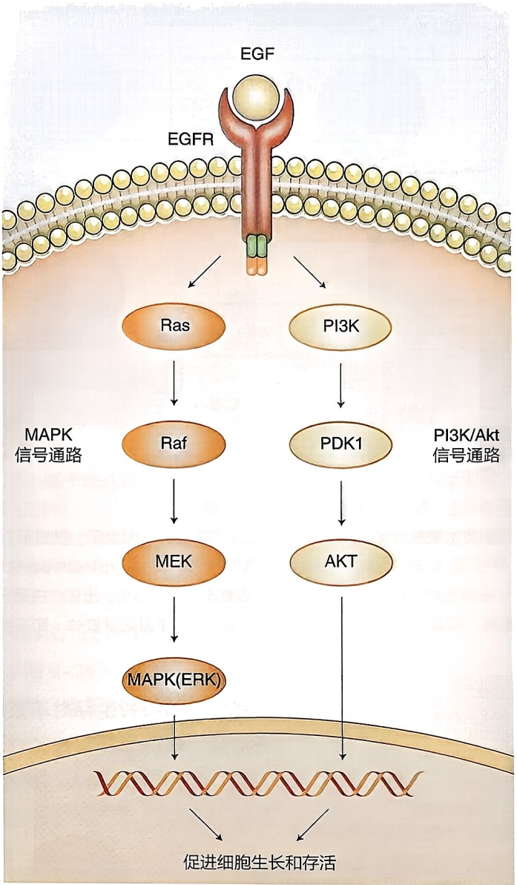

flowchart

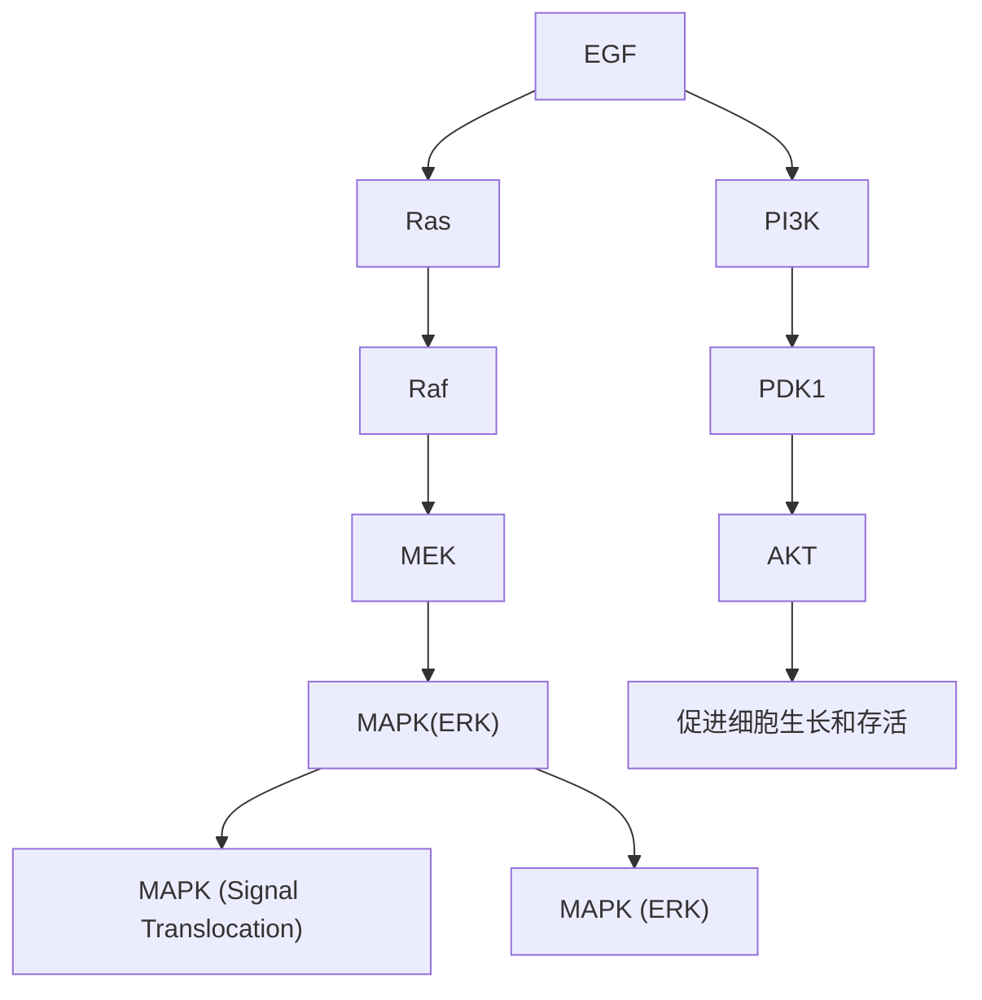

图9-22 MAPK和PI3K/Akt冗余调控细胞存活图中显示MAPK和PI3K/Akt信号通路冗余调控细胞存活，其中箭头表示正调控，顿头表示负调控。

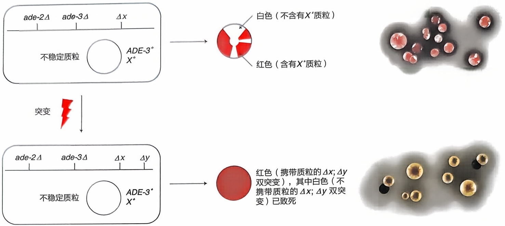

flowchart

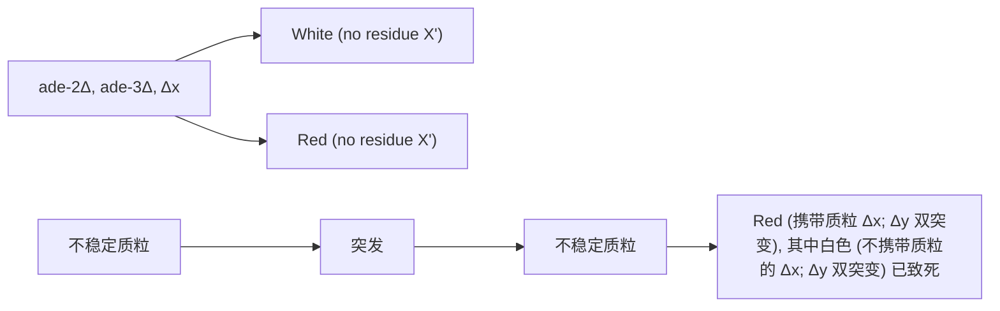

图 9-23 酵母遗传合成致死筛选策略

图示筛选策略为鉴定 $x$ 突变的合成致死基因。上图显示:携带质粒[野生型ADE-3（ADE-3$^*$）和野生型 $X(X^{+})$ ]的ade-24；ade34；$\Delta x$ 三基因突变酵母单克隆扩增后，随着质粒随机丢失，出现红白混合菌落，即含有携带质粒的红色菌落（ade-24单基因突变体）和不携

带质粒的白色菌落（ade-2Δ; ade3Δ; Δx三基因突变体）；下图显示:诱导随机突变后，如果出现了同时缺失基因x和y的合成致死表型，那么携带质粒（ADE-3⁺和X⁺）的ade-2Δ; ade3Δ; Δx; Δy四基因突变酵母（ade-2; ade3; Δx; Δy）扩增后只呈现红色，由于不携带质粒的酵母同时缺失基因x和y呈现致死。

因。癌细胞通常携带特定的遗传突变，使得其存活特别依赖于某些基因或通路的存在，因此癌细胞会在某些基因缺失后呈现出易感性。针对这些特性，可以诱导合成致死，选择性地杀死具有特定遗传突变的癌细胞，同时不影响缺乏这些突变的正常细胞（图9-24）。基于合成致死的功能基因组筛选为癌症新靶点的发现提供了强大的方法，通过使用基于CRISPR/Cas9等基因编辑技术在癌细胞中系统地筛选合成致死基因，可以在无法用药物靶向的致癌基因或肿瘤抑制基因等癌症中找到潜在药物靶点，推动新遗传靶点的发现和有效癌症药物的开发。

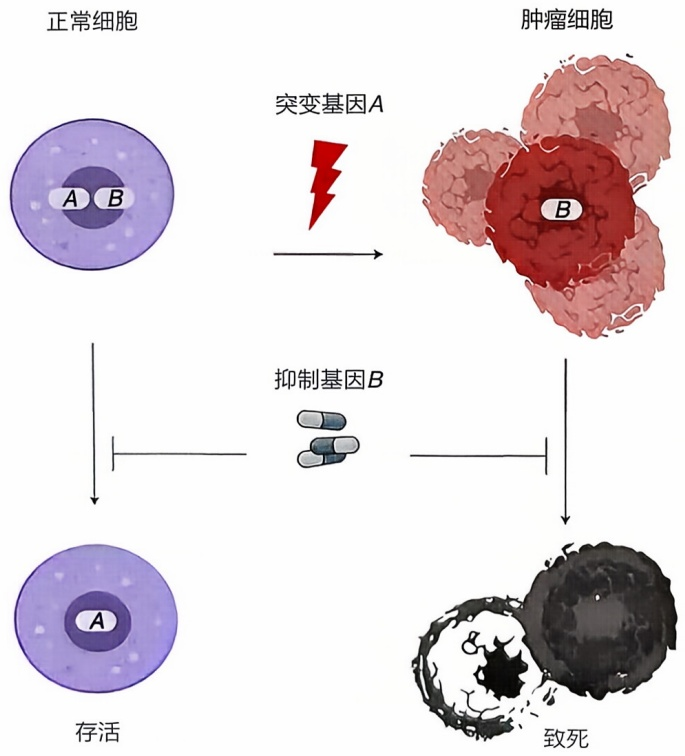

flowchart

图9-24 基于合成致死现象的癌症药物开发策略

正常细胞同时含有基因 A 和 B，含有基因 A 突变的肿瘤细胞高度依赖基因 B 才能存活，但抑制基因 B 的功能不影响正常细胞的功能。使用抑制基因 B 的靶向药物可以特异性杀死肿瘤细胞（基因 A 失活）而无法杀死正常细胞。箭头表示促进作用，顿头表示抑制作用。

通过鉴定与致癌基因呈现合成致死的基因或途径、理解肿瘤中的合成致死机制，设计相应干预方法以选择性地靶向具有特定基因变异的癌细胞，同时保护正常细胞，可以为利用次级靶点来开发相关药物创造机会。例如，MYC原癌基因其编码产物很难作为靶标设计药物，一种替代方案是找到高MYC水平的癌细胞所需要但低MYC水平的正常细胞不需要的基因作为靶标设计药物，通过诱导合成致死，抑制肿瘤生长（图9-25）。再如，DNA修复基因BRCA1或BRCA2突变的肿瘤高度依赖其他DNA修复通路。PARP抑制剂在这类肿瘤中对其补偿修复通路进行抑制可导致合成致死，从而选择性地诱导癌细胞死亡，而具有完整DNA修复通路的正常细胞受该抑制剂的影响较小。

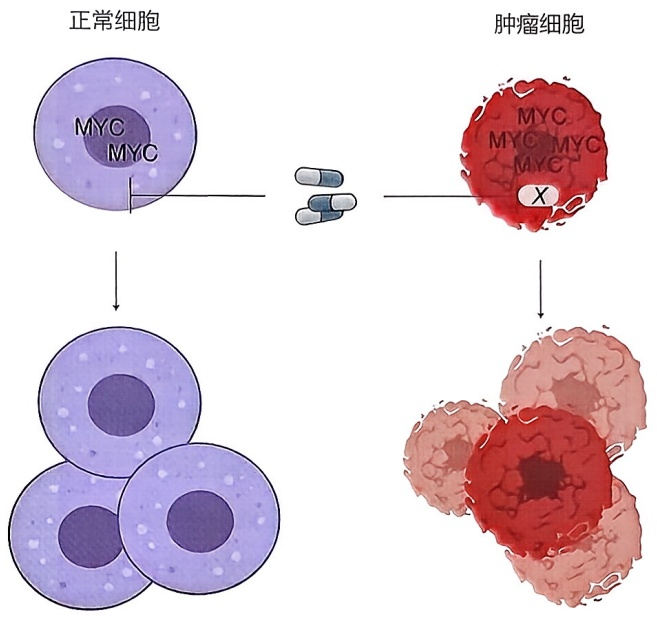

flowchart

```mermaid
graph TD
  A["正常细胞"] --> B["肿瘤细胞"]
  C["MYC"] --> D["肿瘤细胞"]
  E["MYC"] --> F["肿瘤细胞"]
  G["MYC"] --> H["肿瘤细胞"]
  I["MYC"] --> J["肿瘤细胞"]
  K["MYC"] --> L["肿瘤细胞"]
  M["MYC"] --> N["肿瘤细胞"]
  O["MYC"] --> P["肿瘤细胞"]
  Q["MYC"] --> R["肿瘤细胞"]
  S["MYC"] --> T["肿瘤细胞"]
  U["MYC"] --> V["肿瘤细胞"]
  W["MYC"] --> X["肿瘤细胞"]
  Y["MYC"] --> Z["肿瘤细胞"]
  AA["MYC"] --> AB["肿瘤细胞"]
  AC["MYC"] --> AD["肿瘤细胞"]
  AE["MYC"] --> AF["肿瘤细胞"]
  AG["MYC"] --> AH["肿瘤细胞"]
  AI["MYC"] --> AJ["肿瘤细胞"]
  AK["MYC"] --> AL["肿瘤细胞"]
  AM["MYC"] --> AN["肿瘤细胞"]
  AO["MYC"] --> AP["肿瘤细胞"]
  AQ["MYC"] --> AR["肿瘤细胞"]
  AS["MYC"] --> AT["肿瘤细胞"]
  AU["MYC"] --> AV["肿瘤细胞"]
  AW["MYC"] --> AX["肿瘤细胞"]
  A --> B
  B --> C
  C --> D
  D --> E
  D --> F
  D --> G
  D --> H
  D --> I
  D --> J
  D --> K
  D --> L
  D --> M
  D --> N
  D --> O
  D --> P
  D --> Q
  D --> R
  D --> S
  D --> T
  D --> U
  D --> V
  D --> W
  D --> X
  D --> Y
  D --> Z
  D --> AA
  D --> AB
  D --> AC
  D --> AD
  D --> AE
  D --> AF
  D --> AG
  D --> AH
  D --> AI
  D --> AJ
  D --> AK
  D --> AL
  D --> AM
  D --> AN
  D --> AO
  D --> AP
  D --> AQ
  D --> AR
  D --> AS
  D --> AT
  D --> AU
  D --> AV
  D --> AW
  D --> AX
  D --> AZ
  D --> BA
  D --> BC
  D --> BD
  D --> BE
  D --> BF
  D --> BG
  D --> BH
  D --> BI
  D --> BJ
  D --> BK
  D --> BL
  D --> BM
  D --> BN
  D --> BO
  D --> BP
  D --> BR
  D --> BC
  D --> BD
  D --> BE
  D --> BF
  D --> BG
  D --> BH
  D --> BI
  D --> BJ
  D --> BK
  D --> BL
  D --> BM
  D --> BN
  D --> BO
  D --> BP
  D --> BG
  D --> BH
  D --> BI
  D --> BJ
  D --> BK
  D --> BL
  D --> BM
  D --> BN
  D --> BO
  D --> BP
  D --> BG
  D --> BH
  D --> BI
  D --> BJ
  D --> BK
  D --> BL
  D --> BM
  D --> BN
  D --> BO
  D --> BX
  D --> BY
  D --> BB
  D --> BC
  D --> BD
```

图9-25 基于表达高水平MYC的肿瘤细胞对其他通路的依赖性开发靶标药物

图中显示针对表达高水平MYC的肿瘤细胞依赖于 $X$ 基因所属通路功能的特点，开发靶向药物。箭头表示促进作用，顿头表示抑制作用。

此外，合成致死还为个性化的癌症治疗提供

了可能性。通过鉴定每个患者肿瘤中特异的合成致死相互作用，设计个性化治疗策略，选择性清除癌细胞，提高对每个单独患者的治疗效果（图9-26）。因此，在癌症研究中，理解合成致死机制可以为无法用药物靶向的致癌基因、克服抗药机制、发现新的药物靶点和实现个性化癌症治疗提供有价值的线索。总之，合成致死是发现和解析遗传冗余机制的重要策略，并有助于揭示特定疾病的易感性，从而为开发相应治疗

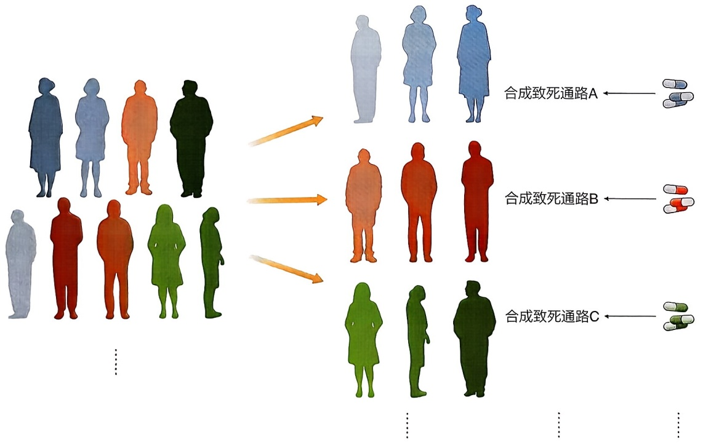

flowchart

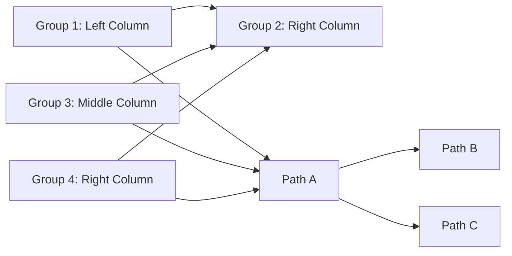

图9-26 基于遗传组成开发癌症个性化治疗方案示意图

相近颜色指示肿瘤患者具有相似遗传组成，可采用相近的治疗方案；而遗传背景不同的个体需要使用不同的治疗方案。

方案提供重要逻辑和思路。

## ※ 复习思考题

1. 双基因突变体分析如何有助于理解发育过程中的基因功能？
2. 双突变分析如何帮助理解疾病发生机制和治疗策略？
3. 如果两个基因在调控相同的生物活性过程中都具有正向作用，与单基因突变情况相比，双突变体的表型情况是怎样的？
4. 设计一个假设性实验，使用双突变分析来研究两个基因在特定生物过程中的功能关系，列出相应的对照，并阐释双突变体可能的表型情况。
5. 如果双基因突变体的表型比其对应的单基因突变体表型更严重，这两个基因之间可能的功能关系是什么？

## ※ 推荐阅读

1. HARTWELL L H, SZANKASI P, ROBERTS C J, et al. Integrating genetic approaches into the discovery of anticancer drugs [J]. Science, 1997, 278: 1064–1068.
2. HUANG L S, STERNBERG P W. Chapter 5 Genetic Dissection of Developmental Pathways//EPSTEIN H F, SHAKES D C. Methods in Cell Biology [M]. New York: Academic Press, 1995: 97–122.
3. KAELIN W G. The concept of synthetic lethality in the context of anticancer therapy [J]. Nature Reviews Cancer, 2005, 5: 689–698.
4. KOLCH W, HALASZ M, GRANOVSKAYA M, et al. The dynamic control of signal transduction networks in cancer cells [J]. Nature Reviews Cancer, 2015, 15: 515–527.
5. LAMAR K M, MCNALLY E M. Genetic modifiers for neuromuscular diseases [J]. J Neuromuscul Dis, 2014, 1: 3–13.
6. NADEAU J H. Modifier genes in mice and humans [J]. Nature Reviews Genetics, 2001, 2: 165–174.
7. NIJMAN S M. Synthetic lethality: general principles, utility and detection using genetic screens in human cewlls [J]. FEBS Lett, 2011, 585: 1–6.
8. PHILLIPS P C. Epistasis—the essential role of gene interactions in the structure and evolution of genetic systems [J]. Nat Rev Genet, 2008, 9: 855–867.
9. THOMAS J H. Thinking about genetic redundancy [J]. Trends in Genetics, 1993, 9: 395–399.

(编写:唐鸿云；审读；吴晓晖)

## 第十章

## 反向遗传学

经典遗传学源于对表型变化的观察与分析。通过对豌豆花、叶、植株形态的分析，孟德尔提出了遗传因子传递的分离和自由组合定律，开创了遗传学研究的先河。通过对果蝇眼、翅等器官形态结构的变化和传递规律的研究，摩尔根提出了遗传的染色体理论。在生命科学发展的历史上，人们正是先从生物性状和表型观察开始，在寻找性状和表型的决定因素及其代代相传规律的过程中发现了遗传规律、找到了遗传物质。这种从生物表型变化开始，确定调控表型的基因，进而剖析相应生命活动机制的研究策略，一般被称为正向遗传学（forward genetics）。

与正向遗传学研究策略相反，反向遗传学（reverse genetics）是通过研究确定的基因变异导致的表型变化，明确基因的功能和作用机制。反向遗传学研究策略的实施，依赖于明确的靶基因DNA序列，也依赖于能有效改变体内靶基因DNA序列的实验技术。人类基因组计划实施以来，人和各种模式生物的基因组测序都已完成，转基因、靶向基因诱变、基因和染色体编辑的新技术、新策略层出不穷。反向遗传学研究策略正以前所未有的速度改变着遗传学和发育生物学研究面貌。

本章将主要介绍转基因、靶向诱变等反向遗传学技术，以及这些技术对遗传学和基因功能研究的重要意义。

## 第一节 转基因技术

转基因既可以指向细胞、组织或生物体中导人的外源核酸（transgene），也可以指导入上述核酸的过程（transgenesis）。转基因过程可以是自然发生的，也可以是人工的。噬菌体侵染、病毒感染、细菌接合等过程都存在自然发生的转基因过程。本节重点介绍人工开发的转基因技术，也被称为基因递送（gene delivery）技术。这些技术的基本目标是导入具有特定功能的外源核酸，最好能实现稳定传代。

## 一、转化和转染

许多细菌在一定生存条件下，具有从环境中摄入游离 DNA，进而获得相关性状的能力，这一过程被称为转化（transformation，详见第二章第一节）。细菌可被转化的状态被称为感受态（competence）。大肠杆菌的感受态出现于对数生长后期。用冷的低渗  $CaCl_{2}$  溶液处理菌体，继之以短暂热击可以有效提高转化效率。研究表明  $Ca^{2+}$  可以中和 DNA 分子的负电荷，有助 DNA 被稳定吸附于大肠杆菌表面。在体外培养动物细胞时， $Ca^{2+}$  和 DNA 分子形成的 DNA-磷酸钙细小沉淀可以被细胞内吞摄入。利用阳离子脂质分子形成的囊泡，也能与细胞膜融合后将外源核酸引入细胞。这些技术常被称为转染（transfection）。进入真核细胞的 DNA 一般在细胞分裂时因核膜解体和重建而进入细胞核，但也有在蛋白质携带下经核孔进入细胞核的报道。使用阳离子脂质或可电离脂质，还可以与其他多种脂质一起组装成脂质纳米颗粒（lipid nanoparticle，LNP），携带 mRNA 分子进入体内细胞表达。这一技术已经被用于商业化疫苗生产。

## 二、电穿孔

电穿孔（electroporation）是将细胞置于电场内，通过改变电场强度提高细胞膜通透性，从而将DNA导入细胞的方法。一般认为，构成细胞膜的磷脂双分子层在合适的电场强度和变化频率下会首先形成跨膜孔洞，进而发展为更稳定的亲水孔洞，提供物质进入细胞的通道。亲水孔洞可在电场撤除后消失，使细胞得以继续生存。显然，跨膜孔洞的出现和维持取决于细胞膜脂质、蛋白质的构成及其与电场的相互作用，并会影响细胞后续存活。因此，不同种类的细胞需要不同的电场条件以提高实验后携带外源核酸的存活细胞数量。即使如此，电穿孔技术仍因其适用范围广、转基因效率高而受到欢迎，经常被用于从细菌、酵母到动物细胞的转基因操作。

## 三、基因枪

基因枪（gene gun）技术也称粒子轰击（particle bombardment），是利用核酸包被的金或钨粒子高速轰击细胞，将核酸导入细胞内的过程。这一技术最早用于植物细胞的转基因，因能有效用于各品种植物的各种组织细胞转基因而受到欢迎。作为一种物理方法，基因枪技术可同时导入多种转基因，也可用于将蛋白质等其他分子导入细胞。基因枪不能精确控制金属粒子的轰击靶标，不仅能输送转基因进入被轰击细胞的细胞质、也能将转基因运送到细胞核、线粒体、叶绿体等其他细胞内结构。目前，基因枪技术也被用于哺乳动物培养细胞和组织的转基因。

## 四、显微注射

显微注射（microinjection）是一类常见的转基因操作技术，适用于几乎所有多细胞模式生物。显微注射的基本做法是用玻璃毛细管拉制成注射针，将DNA溶液注射入细胞内。常见的转基因显微注射以注射细胞核为主，小鼠转基因采取的就是将DNA注射入受精卵单倍体原核的技术路线方案。线虫转基因注射的则是成虫性腺合胞体区域，以使DNA同时接触多个将要分裂的卵细胞核。显微注射需要逐个处置细胞、受精卵或个体，转基因成功率也较低。为减少鉴定转基因阳性个体的工作量，可以在注射目标转基因的同时共注射编码绿色荧光蛋白（green fluorescent protein，GFP）或其他易识别标记的转基因，通过识别标记转基因表达的信号遴选目标转基因的阳性候选个体。显微注射的另一个缺点是转基因DNA往往以头尾相连的多联体（concatemer）形式整合到染色体上，导致阳性个体转基因表达剂量不易精确调控。

## 五、病毒感染

利用改造的病毒可以携带转基因片段进入宿主细胞实现转基因。传统上，噬菌体介导的转基因也被称为转导（transduction）。常见的转基因病毒载体包括噬菌体、反转录病毒、腺病毒、单纯疱疹病毒等。它们将DNA包装在病毒颗粒中侵染细胞，在实际使用中存在包装容量的限制。例如，反转录病毒载体的包装容量一般不超过6 kb，腺病毒载体的包装容量不超过30 kb，单纯疱疹病毒可达40～150 kb。此外，使用病毒载体转基因还受到病毒所能感染细胞差异的影响。例如，反转录病毒只能感染分裂期的细胞，它的近亲慢病毒可以感染静息期的细胞，单纯疱疹病毒、狂犬病病毒和伪狂犬病病毒则对神经细胞更为偏好。狂犬病病毒和伪狂犬病病毒因而被大量用于神经回路分析。

## 六、转座因子

转座因子是一段可以在基因组内跳跃的DNA，最早由麦克林托克研究玉米时发现，她也因此获得了1983年诺贝尔生理学或医学奖。转座因子在基因组中跳跃改变位置的过程称为转座（transposition）。因不同转座机制可将转座因子分为反转录转座子(retrotransposon) 和 DNA 转座子（DNA transposon）两类。反转录转座子也称 I 型转座子，以“拷贝-粘贴”方式转座，即从原始拷贝转录一份 RNA，再反转录成 DNA 整合到基因组的新位点。DNA 转座子也称 II 型转座子，以“切离-粘贴”方式转座，即直接从原位切离并整合到新位点。DNA 转座子的两端是特征性的重复序列，它们被转座子编码的转座酶所识别，在转座酶的作用下带动转座子片段跳跃。如果将 DNA 转座子内的转座酶序列替换为转基因片段，即可在转座酶存在时实现转基因操作。

## 七、农杆菌介导转基因

农杆菌是土壤中广泛分布的根瘤菌科革兰氏阴性细菌，可分为根癌农杆菌（Agrobacterium tumefaciens）和发根农杆菌（Agrobacterium rhizogenes）。它们具有鞭毛，能通过侵染植物伤口进入细胞，将携带的Ti或Ri质粒上一段T-DNA序列整合到宿主基因组，引发植物冠瘿或无定形根。T-DNA长约 $24\mathrm{kb}$，由两侧各25bp长的正向重复序列（边界序列）和中间携带的基因组成。将野生型T-DNA中的基因片段替换成转基因，即可进行植物转基因。在转基因操作时，通常用携带转基因的农杆菌与植物的根、叶或愈伤组织一起培养，农杆菌就会把外源DNA传递进植物细胞。

## 知识窗10-1

## 哺乳动物转基因技术

根据实验对象、实验方法的不同，在小鼠等哺乳动物中目前有四种方案来实施转基因技术。

第一种是受精卵原核注射（pronuclei injection）转基因。通过显微注射把转基因DNA导入受精卵原核内，外源DNA就可能整合到染色体上。接受注射后的受精卵会被移植到代孕母体内完成胚胎发育（图10-1）。一般的，代孕母体需经激素处理以达到受孕状态，植入受精卵后有些动物也需要激素处理保障受精卵的正常发育。原核注射的转基因DNA可能迅速整合入基因组，也可能在后续几次细胞分裂过程中整合进染色体而形成遗传嵌合体。遗传嵌合体诞生以后，只有携带转基因DNA的细胞发育来的生殖细胞才能将转基因传递到下一代。因此，所有原核注射产生的个体都必须接受转基因检测，阳性的个体还必须和野生型交配，产生的下一代转基因阳性个体才能放心用于建立转基因品系。

第二种技术路线是胚胎干细胞（embryonic stem cell，ESC）介导转基因，这也是实现基因靶向诱变的经典方法。胚胎干细胞介导转基因首先通过转染、电穿孔、病毒感染等方式把转基因DNA导入体外培养的胚胎干细胞，根据转基因DNA携带的标记基因进行相应筛选后，将基因阳性胚胎干细胞注射进入动物囊胚，将囊胚移植到代孕母体的子宫内。在后续发育过程中，胚胎干细胞将与囊胚内细胞团细胞一起发育为下一代个体（图10-2）。这一技术路线获得的下一代个体全是嵌合体，且部分个体只含有胚胎干细胞来源的体细胞。因此，需将嵌合体后代与野生型个体交配，培育转基因阳

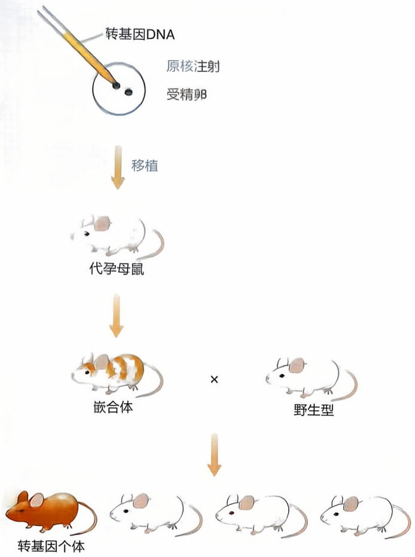

flowchart

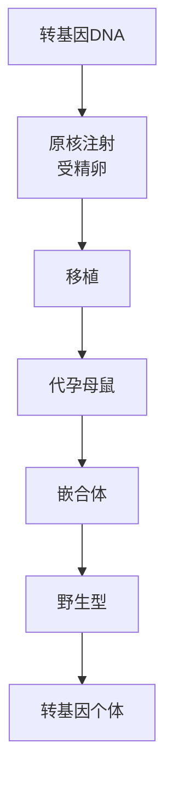

图10-1 原核注射转基因

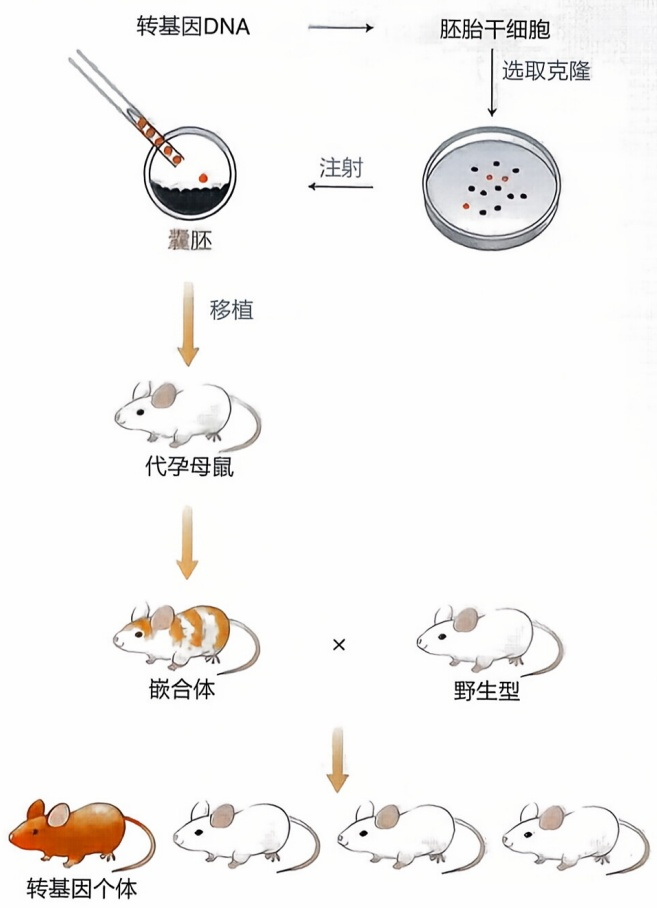

flowchart

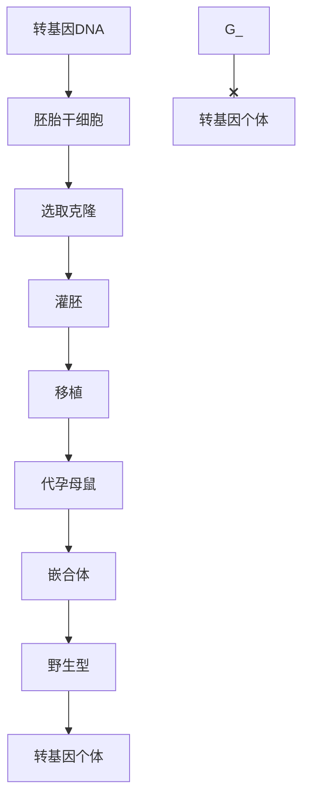

图 10-2 胚胎干细胞转基因

## 性品系。

第三种技术路线是细胞核移植（nuclear transfer）（图10-3）。这种技术常用体细胞的细胞核植入去除了细胞核的卵母细胞，再激活获得二倍体细胞核的卵母细胞，使其发育为下一代个体。下一代个体所有细胞的核基因组均来自于细胞核供体，线粒体基因组则主要来自于卵母细胞，遗传性状与细胞核供体往往高度相似。细胞核移植是动物克隆技术的核心，最早被伊恩·维尔穆特（Ian Wilmut，1944—2023）等人用于培育克隆羊“多莉”，此后在小鼠等实验动物和家畜、宠物中也获得成功应用。2018年，我国科研工作者孙强等首次报道了通过细胞核移植培育的克隆猴“中中”和“华华”。

第四种技术路线是卵周隙注射（perivitelline injection）转基因（图10-4）。卵周隙是透明带与卵母细胞膜之间的液态间隙，是受精和胚胎发育早期的重要信号传递区域。通过显微注射将携带转基因的慢病毒载体注射到卵周隙，病毒会感染受精卵或由其分裂产生的新细胞。因此，由受感染细胞发育形成的下一代个体可能是遗传嵌合体，需要与野生型交配再获得转基因阳性个体建立品系。

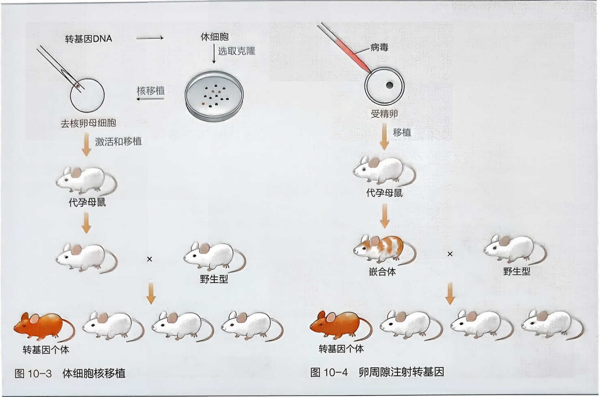

flowchart

This flowchart illustrates the biological process of converting a mouse into a cell, involving gene editing and gene expression to create an embryo, followed by intracellular migration to host mice, and finally gene expression.

表 10-1 常用的全身性表达启动子

| 生物 | 全身性表达启动子 |
| --- | --- |
| 酵母 | PGK1(phosphorglycerate kinase-1)启动子ADH1(alcohol dehydrogenase)启动子 |
| 果蝇 | 热激(heat shock,HS)启动子ubiquitin 启动子actin 5C 启动子 |
| 线虫 | 热激启动子 |
| 哺乳动物 | actin 5C 启动子CMV 启动子pgk 启动子SV40 启动子 |
| 植物 | CaMV 35S 启动子热激启动子 |

## 第二节 转基因表达

外源核酸片段导入个体或细胞后往往需要通过表达发挥作用。本节将讲述常见的外源基因表达系统及外源基因表达检测方法。

## 一、全身性表达系统

转基因载体通常携带的是 cDNA，需要在合适的启动子驱动下有效表达。不同模式生物常见的全身性表达启动子总结如表 10-1。这些启动子帮助转基因表达于各细胞，有的在个体发育和衰老各时期都能让转基因表达，有的只在热激等条件下驱动转基因表达。