## 二、组织特异性表达系统

不少基因全身性表达会显著影响健康或繁殖，严重时甚至导致死亡。因此，用全身性表达启动子驱动转基因很可能会给转基因品系建立和维持带来困难。组织特异性表达可以在一定程度上克服这些障碍。在一些实验室条件下生存或繁殖不必需的器官（如果蝇的复眼）中表达转基因，可以为基因功能研究带来更多便利。表10-2中列出了一些常用的果蝇组织特异性表达启动子。Jackson实验室网站可以找到小鼠组织特异性启动子的汇总列表。

表 10-2 常用的果蝇组织特异性启动子

| 细胞 | 启动子 |
| --- | --- |
| 眼原基分裂相细胞 | eyeless (ey) 启动子 |
| 眼原基形态发生沟后侧的分化相细胞 | pGMR 启动子 |
| 发育中的神经元 | Elav 启动子 |
| 发育中的部分光受体神经元 | Sev 启动子 |
| 迁移中的卵巢边界细胞 | slbo 启动子 |

## 三、诱导表达系统

持续表达转基因可能对细胞造成伤害，严重时危及细胞生存。基因诱导表达系统能更清晰地显示基因表达与否对细胞的影响，提高基因功能分析的可靠性。同时，基因诱导表达对分析基因在细胞或个体不同时期的不同功能也有重要意义。表10-3列出了一些模式生物常见的诱导表达启动子。

表 10-3 常用的诱导表达启动子

<table><tr><td>生物</td><td>诱导表达启动子</td><td>诱导方式</td></tr><tr><td>酵母</td><td>Gal 启动子</td><td>培养基添加半乳糖</td></tr><tr><td>线虫</td><td>热激启动子</td><td>35°C或 37°C热激</td></tr><tr><td rowspan="3">果蝇</td><td>热激启动子</td><td>37°C热激</td></tr><tr><td>金属硫蛋白(MT)启动子</td><td>细胞培养基存在铜离子</td></tr><tr><td>UAS/GAL 系统</td><td>UAS 启动子携带的转基因受 GAL4 蛋白驱动表达,被 GAL80 蛋白沉默</td></tr><tr><td>果蝇、哺乳动物</td><td>四环素调控表达系统</td><td>Tet 启动子携带的转基因在四环素存在时受 rTA 蛋白驱动表达,在四环素消失时受 tTA 蛋白驱动表达</td></tr><tr><td rowspan="3">植物</td><td>糖皮质激素诱导启动子</td><td>培养基添加地塞米松</td></tr><tr><td>植物光开关元件 PULSE</td><td>红光照射</td></tr><tr><td>热激启动子</td><td>37°C热激</td></tr></table>

许多诱导表达系统都是二元型的，需特定转录因子及其调控的启动子同时存在，才能打开或关闭转基因表达。例如，最早的四环素调控表达系统包括两个部分，其一表达由四环素阻遏蛋白DNA结合域和HSV病毒VP16蛋白转录激活域组成的反向激活因子tTA，其二为tTA识别的启动子tetO驱动的转基因。tTA可结合tetO以激活转基因表达，但会因结合四环素而无法再与tetO作用导致基因表达关闭。与tTA相反，对四环素阻遏蛋白诱变筛选发现的rtTA只有结合了四环素后才能让tetO序列驱动的转基因表达。

二元型的诱导表达系统不仅允许基因的诱导表达，还可以通过为转录因子添加组织特异性的启动子，实现组织特异的基因诱导表达。使用不同组织特异性表达的转录因子品系与同一启动子驱动的转基因交配，能快速培育不同组织器官中诱导表达转基因的品系，高效分析基因在不同组织器官中的不同功能。

## 四、转基因表达检测

转基因表达检测对基因功能研究具有重要意义。一方面，转基因携带的蛋白质编码序列在体内是否按预期表达、表达量有多高，是结合表型变化推断基因功能的必要条件。另一方面，显示转基因表达的时空图景，能有效帮助基因产物在发育和疾病中的作用分析。反转录PCR、Northern和Western印迹等常见的分子生物学技术可以定量检测基因表达，但通常不能显示转基因在器官、组织、细胞内表达的空间信息。因此，研究人员也常使用抗原表位标记和报告基因融合两种方法检测转基因在体内的时空表达。

抗原表位是蛋白质分子决定抗原特异性的特殊化学基团。将已有商业化抗体的抗原表位序列加入转基因蛋白序列形成融合蛋白，就可以用抗体检测转基因的表达，这一方法称为抗原表位标记（epitope tagging）。一般将抗原表位融合于转基因蛋白的末端，以尽可能减少对转基因蛋白功能和细胞内定位的影响。也可以将多个抗原表位序列串联提高检测灵敏度。有的抗原表位还可以用于转基因蛋白纯化（表10-4）。需要注意的是，融合了抗原表位的蛋白质并非总能如愿发挥作用。最可靠的验证需要用抗原表位标记转基因拯救基因失活突变的表型变化（详见本章第四节）。

表 10-4 常用的抗原表位标记

| 抗原表位 | 多肽序列 | 用途 | 备注 |
| --- | --- | --- | --- |
| Myc | EQKLISEEDL | 多用于检测(纯化需低pH条件洗脱,影响蛋白质活性) | 源自原癌基因cMyc |
| HA | YPYDVPDYA | 检测、纯化 | 源自流感病毒血凝素 |
| Flag | DYKDDDDK | 检测、纯化 | C端残基可被肠激酶去除 |
| His | HHHHHH | 检测、纯化 |  |
| V5 | GKPIPNPLLGLDST | 检测、纯化 | 源自副黏液病毒P/V蛋白 |

报告基因融合是将报告基因与转基因制成融合蛋白序列，或者单独将报告基因置于待检验的启动子之后，根据报告基因表达的信号检测转基因（或启动子）表达的时空分布。常见的报告基因有荧光蛋白和 $\beta-$ 半乳糖苷酶。从维多利亚多管水母中分离得到的绿色荧光蛋白（GFP）含238个氨基酸残基，可在蓝光或紫外光照射下产生绿色荧光。此后，由GFP改进或从其他海洋生物分离到的一系列荧光蛋白不仅具有不同颜色，还增强了对特定波长光的响应。这些荧光蛋白通常没有毒性，可用于活细胞或动物体内的实时检测。大肠杆菌lacZ基因编码的 $\beta-$ 半乳糖苷酶（$\beta-$gal）是同源四聚体蛋白，每个单体含1023个氨基酸残基。$\beta-$gal能水解无色底物X-Gal（5-溴-4-氯-3-吲哚-β-D-半乳糖苷），释放出的吲哚基团随即二聚化形成蓝色沉淀。$\beta-$gal可被戊二醛固定在细胞和组织中而不损失活性，因而可用X-Gal高分辨率检出表达位置。$\beta-$gal也能水解无色底物ONPG（邻硝基酚-β-D-半乳糖苷）产生有色的邻硝基苯酚，这一显色反应可用于定量检测培养细胞中的转基因表达。需要注意的是，报告基因分子越大，对融合蛋白结构、功能和细胞内定位的干扰可能性就越高。因此，需要根据不同研究目标审慎选择报告基因融合的具体技术路线。

## 第三节 转基因技术在遗传学研究中的应用

转基因技术可以将外源核酸片段导入细胞、组织或生物体并表达。随外源核酸来源的差异，转基因可分为同种转基因和异种转基因。同种转基因使用动植物本身的基因序列，主要用于目的基因的功能分析。异种转基因使用其他物种的基因序列，可用于基因功能的进化保守性研究。随目的基因进入体内表达部位的差异，转基因也可分为原位表达转基因和异位表达转基因。原位表达转基因常用于基因功能和作用机制分析。异位表达转基因可以用于标记细胞谱系，并可用于发现目的基因新的功能线索。除研究意义外，转基因技术在生产生活中也有重要应用价值。

## 一、通过转基因分析基因功能

许多遗传学研究都能发现表型变化和某一基因变异共存的个体。然而，即使是随机诱变筛选获得的表型突变个体，也可能携带不止一个基因突变。表型变化和某一基因变异，可能是因为该基因变异导致表型变化，也可能只是两者凑巧发生于同一个体。要确定基因突变与表型变化的因果关系，方法之一是将相应的野生型基因重新表达于基因突变的个体。如果野生型基因表达以后表型变化消失（即表型变化被转基因“拯救”），可以认为该基因变异的确是引起表型变化的原因。如果野生型基因表达以后表型变化依旧存在，那么这组基因变异和表型变化的共存只是巧合。在确认了基因变异与表型变化的因果关系之后，还可以进一步表达缺失某一结构域或突变某一位点的转基因，观察能否拯救表型变化，以明确该结构域或位点对基因功能的意义。

除了研究正常生理状态下的基因功能以外，转基因还可以用于传统正向遗传学较难进行探索的领域，获得新的基因功能知识。例如，过表达（overexpress）野生型转基因可以研究基因活性增加对生命活动的影响，帮助发现了超氧化物歧化酶基因SOD对果蝇寿命的促进作用（Orr and Sohal，1994）。又如，异位表达（ectopically express）野生型转基因可以探索基因对发育的调控作用，奠定了果蝇无眼（eyeless，ey）基因作为复眼发育主控基因（master control gene）的地位（知识窗10-2）（Halder et al., 1995）。再如，在一个物种表达另一个物种的同源转基因，可以比较不同生物同源基因的功能相似性。果蝇和哺乳类的Sod和Pax6同源基因都是通过这一策略被证实功能高度保守。

## 知识窗10-2

## 转基因研究发现眼形成的主控基因

转基因在基因功能研究中有特殊的价值。对难以通过自发突变或者遗传筛选发现的基因，通过基因序列分析、分子生物学操作，再用转基因技术导入体内开展研究，可以获得出乎正向遗传学研究意料的研究结果。眼发育主控基因的发现就是一个很有代表性的例子。

小鼠和人等哺乳动物的眼是单眼，每个眼球只有一套屈光和感光系统。研究人员早在20世纪30年代就报道过人类存在名为无虹膜症（aniridia，AN）的常染色体显性遗传病，患者眼球虹膜缺失、中央凹发育不良。60年代，半显性的小鼠小眼（small eye，Sey）突变被发现。Sey杂合子导致小鼠眼球晶状体等缩小变小、发育不良，纯合子造成小鼠眼球缺失（图10-5）。1991年，小鼠Sey和人AN基因得到克隆。研究人员发现它们都编码属于Pax转录因子家族的蛋白质PAX6。

小鼠小眼突变

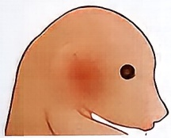

野生型

人无虹膜症

natural_image

Illustration of a human eye with black eyelashes and eyebrow (no text or symbols)

果蝇无眼突变

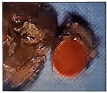

natural_image

Close-up of a red circular object on a textured blue surface, possibly a tool or object (no visible text or symbols)

野生型

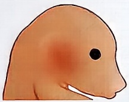

$Pax6^{-/+}$  小眼

natural_image

Illustration of a human eye with black eyelashes and eyebrow (no text or symbols)

$Pax6^{-/+}$  虹膜缺失

$Pax6^{-/-}$  无眼

natural_image

Close-up of a burning, smoky outdoor scene with flames and smoke (no visible text or symbols)

$ey^{-/-}$ 无眼

图 10-5 人、小鼠和果蝇的 Pax6 同源基因突变影响眼球发育

果蝇的一个复眼具有750～800个小眼，每个小眼都有一套独立的光通道和感光神经元。1915年，研究人员报道了果蝇的无眼突变，该突变可以导致果蝇复眼缺失（图10-5）。1994年，格林实验室克隆了果蝇ey基因，发现它也编码PAX6同源蛋白。这一结果提示从昆虫到哺乳类，不同物种的眼发育存在相似的遗传调控机制。同时，这些工作也表明Pax6基因是眼发育所必需的。

为进一步分析 Pax6 基因对眼发育的作用，格林设计了一系列大胆的实验。他鼓励学生将 ey 的编码序列置于表达于其他器官（触角、腿、翅）的启动子控制之下，再培育转基因果蝇进行表达（Halder et al., 1995）。结果，ey 基因表达的器官都长出了类似复眼的结构，并出现色素细胞、神经细胞等正常复眼的细胞类群。进一步，他们将小鼠 Pax6 也表达于这些器官，同样导致复眼在这些器官异位发育（图 10-6）。这些事实说明，Pax6 是眼发育的主控基因，它在不同组织器官表达，可以诱导这些部位启动眼发育。而且，Pax6 对眼发育的控制作用是物种间高度保守的。

格林的发现源自于早年对果蝇器官发育的研究积累。那时还没有分子生物学和转基因技术，他只能花许多时间切割发育中的果蝇器官原基（primordium）移植到另一果蝇体内，试图了解器官发育的命运决定。他当时发现，绝大多数移植后的腿原基还会发育成腿，但也有少量会发育成翅或眼。他在《胚胎学和实验形态学杂志》（Journal of Embryology and Experimental Morphology）上报道了这些工作，称改变发育命运的现象其为反式决定（trans-determination），但对其背后的原因一无所知。后来，基因逐渐成为生物学家关注的宠儿，格林也不例外。他猜想，可能存在控制器官原基发育命运的关键基因，它们的表达在移植前后发生了变化，使器官原基选择了不同的发育命运。他认为，这样的基因应该至少符合两个标准:一是如果基因失活，相应的器官就不会发育；二是基因可能编码转录因子，调控许多其他基因表达。PAX6基本符合这两条标准，它为眼发育所必需，又是一个转录因子，可能调控其他眼发育关键基因。最终，格林用转基因实验提供了关键证据，证明是PAX6打开了眼的发育命运。

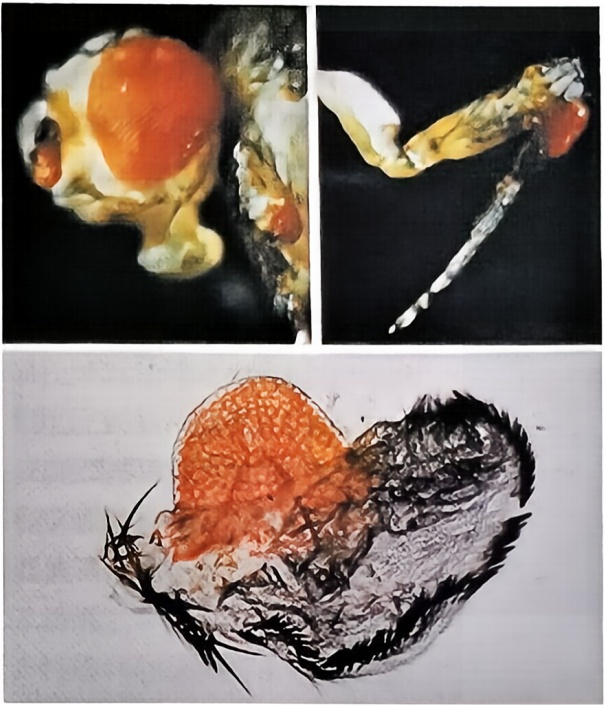

图10-6 Pax6是眼发育的主控基因

在触角、翅和腿上表达果蝇 Pax6 同源基因 ey，可以诱导复眼异位发育。

## 二、利用转基因探索作用机制

修饰基因筛选（详见第九章）是探查基因所在信号转导途径，研究基因作用机制的重要手段。修饰基因筛选需要在基因突变背景上进行，人工诱变可以获得基因突变用于修饰基因筛选、但突变基因的活性变化难以预测。转基因则大大加快了这一进程。例如，可以通过遗传工程方法制造一个基因的显性失活突变，再利用转基因在体内表达这一显性失活突变以抑制野生型基因功能，从而迅速获得该基因失活的遗传背景开展筛选。制造显性失活突变可以通过点突变失活催化活性位点，使得突变的酶可以结合底物但不能催化其转变，以竞争性抑制野生型酶蛋白的活性。类似地，可以制造一个只包含互作结构域的截短蛋白，使其结合互作分子后无法发挥其他活性，从而起到抑制野生型蛋白功能的结果。另一方面，可以通过去除蛋白质的负调控结构域或抑制性位点、或者通过点突变模拟磷酸化激活等方法提高转基因编码蛋白质的生化活性，获得基因持续激活的遗传背景开展筛选。相应的例子包括在 $c$-Src 基因编码序列中引入 Y527A 突变使其不再受抑制（Cooper et al., 1986），在 Neu 受体跨膜域序列引入突变使受体更易形成二聚体而激活（Weiner et al., 1989），等等。

除高效获得基因失活或持续激活的遗传背景外，转基因还可以用于改变基因的染色体位置，或在研究人员熟悉的组织器官中表达野生型或突变型基因，用于提高遗传分析的研究效率。例如，杰拉尔德·鲁宾（Gerald Mayer Rubin）实验室曾将果蝇X染色体上的sevenless基因（sev）温度敏感突变通过转基因置于常染色体，方便开展大规模修饰基因筛选，发现了一批果蝇Ras信号通路的关键基因。此后，他们用克隆的sev启动子驱动持续激活突变的Ras1基因表达，在眼中大规模筛选Ras信号下游分子，描绘了果蝇Ras信号通路的框架（Karim et al., 1996）。

## 三、转基因研究的局限

一般认为，伴随转基因产生的表型变化是转基因表达的结果，结合表型变化和转基因对野生型基因活性的影响，可以判断基因功能。但是，这一观点在实际研究中并非总是正确。例如，大多数转基因是让外源DNA整合到染色体上，而外源DNA的随机插入可能会影响内源基因的正常功能。据估计，有近 $10\%$ 的小鼠转基因对内源基因功能造成破坏（Palmiter and Brinster，1986）。又如，转基因表达往往受整合位点周围染色体序列，这常被称为转基因表达的“位置效应”。同一次转基因操作产生的不同后代中，转基因的表达量、表达区域和表达时间都可能有差异。有的转基因品系在传代过程中也会出现转基因表达的个体差异。因此，对转基因表型的分析不能仅依赖于少数个体或单个品系，而需要对多个品系进行综合判断。有时，转基因过表达强度过高也会造成有害影响，导致表型异常变化。转基因异位表达造成的表型变化，则可能与正常生理状态下的生物学过程无关。

## 第四节 基因靶向诱变

基因靶向诱变从基因序列出发，定点、定向改变基因功能。这既可以通过改变基因表达，也可以通过改变基因序列实现。例如，RNA干扰（RNAi）通过双链RNA引发细胞的抗病毒反应、从而降解具有相应序列的mRNA以抑制基因表达。又如，通过DNA同源重组可以将基因的正常序列置换为变异序列，从而改变基因功能。与转基因类似、基因靶向诱变也可以在生殖细胞或体细胞中进行。在部分体细胞中靶向诱变基因不仅适于分析突变致死的基因功能，也可以用于研究肿瘤等疾病的发生发展。基因靶向诱变技术近年发展迅速，本节将着重介绍被广泛使用的基因打靶（gene targeting）和基因编辑（gene editing）技术。

## 一、基因打靶

利用DNA同源重组实现基因片段代换或改造的基因打靶，长期占据反向遗传学研究主导地位。同源重组是由同源DNA序列引发的重组，多见于减数分裂和DNA修复。在常用的遗传学模式生物中，酵母细胞的同源重组功能最为发达。人类基因组 $1\%$ 重组率（1cM）约合1Mb，而在酿酒酵母和裂殖酵母基因组中仅分别相当于2500bp和6250bp。酿酒酵母和裂殖酵母仅分别需要DNA片段两端各存在40bp或60bp的同源序列，即足以引发同源重组。因此，可以根据酵母目的基因序列设计同

源序列，在同源序列间加入药物抗性或耐营养缺陷的标记基因，将其导入酵母细胞。在细胞完成同源重组后，酵母染色体上同源序列间的目的基因片段即被标记基因代换（图10-7）。此时，用相应的药物或营养缺陷环境进行筛选，可以方便地获得酵母基因被敲除（knock out）的细胞。据此原理，2002年完成的酵母基因组缺失计划（Saccharomyces Genome Deletion Project）培育了各基因失活的酵母品系，使酿酒酵母成为首个完成单基因系统敲除的真核生物。在敲除酵母基因时，该计划还在代换片段里加入了区分各菌株的序列“条形码”，使利用液体培养基筛选群体表型成为可能。

小鼠是首个实现基因打靶的模式动物。小鼠基因打靶技术使用 ES 细胞作为中介，将携带基因突变的 DNA 导入小鼠 ES 细胞，待同源重组发生后选择携带突变的 ES 细胞注射入小鼠囊胚，在植入代孕母鼠体内发育为部分细胞携带突变的嵌合体小鼠。嵌合体小鼠与野生型小鼠交配后即可获得携带基因突变的小鼠品系（见图 10-2）。

小鼠 ES 细胞的同源重组功能远不及酵母细胞发达。外源 DNA 导入小鼠 ES 细胞后，以多联体形式随机插入染色体的可能性较高。因此，小鼠基因打靶时一方面加长两侧的同源序列以提高重组效率，另一方面采用了正、负两套筛选标记帮助识别发生同源重组的细胞。两侧同源序列根据各自长度分别被称为长臂和短臂，长臂4\~10 kb，以促进同源重组发生；短臂0.8\~2 kb，在维持重组效率的同时方便PCR检测重组事件。正筛选标记常使用新霉素（neomycin）、嘌呤霉素（puromycin）、潮霉素（hygromycin）等药物抗性基因。这样，在DNA转染完成后可以通过培养基中添加相应种类的抗生素、筛选获得染色体上整合了外源DNA的细胞。负筛选标记常使用单纯疱疹病毒的胸苷激酶（HSV-Tk）基因或白喉毒素A链（DTA）基因。前者可以将添加在培养基中的核苷酸类似物更昔洛韦（GANC）或非阿尿苷（FIAU）转变为细胞毒性衍生物，后者可以阻断细胞蛋白质合成而导致细胞死亡。因此，外源DNA通过随机插入整合到染色体上后，就会因携带负筛选标记而杀死细胞（图10-8）。

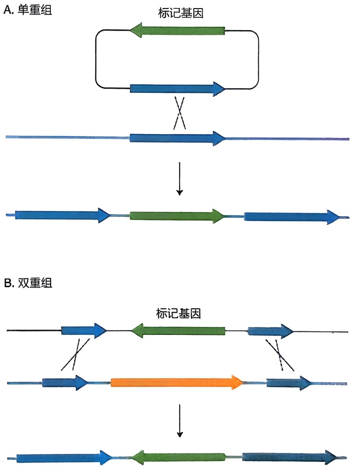

图10-7 同源重组导致插入或代换

基于 ES 细胞 DNA 同源重组的小鼠基因打靶技术，可以在两侧同源序列内放置各种序列组合以达到不同目的。只放置正筛选标记时，可以实现内源基因序列的敲除。除正筛选标记外再放入携带突变的内源基因序列，可以实现内源序列的突变敲入（knockin）。还可以放入两侧携带 loxP 或 FRT 重组位点的野生型基因，这样培育的小鼠可与组织特异表达 Cre 或 FLPe 重组酶的转基因小鼠交配，实现特定组织器官或发育时段的基因“条件性敲除”（conditional knock out）。首先分离培养小鼠 ES 细胞的马丁·埃文斯（Martin J. Evans）与在 ES 细胞里实现基因同源重组的奥利弗·史密斯（Oliver Smithies，1925—2017）和马里奥·卡佩奇（Mario R. Capecchi）因此分获 2007 年诺贝尔生理学或医学奖。

图10-8 用负筛选标记去除随机插入事件

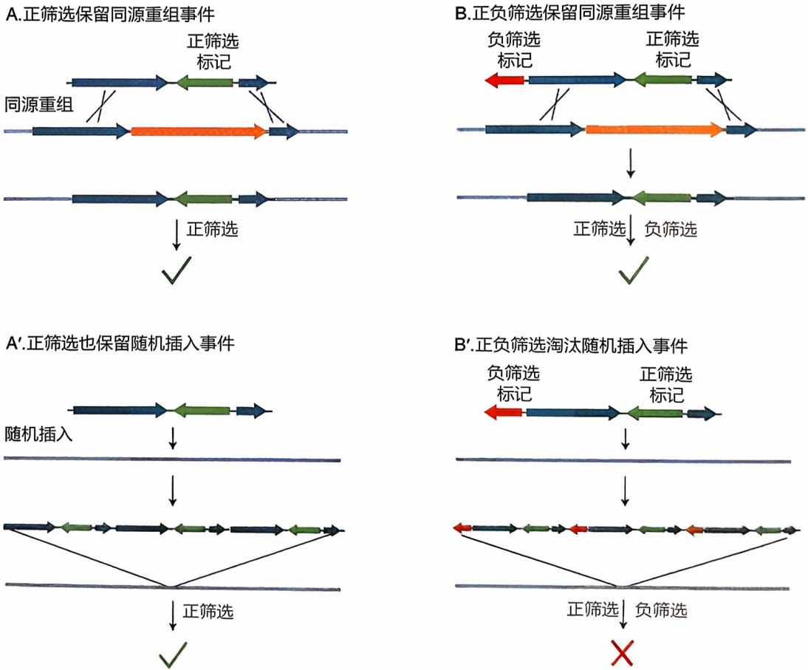

## 二、基因编辑

下文所述基因编辑，是指利用核酸酶定点切开染色体 DNA，进而实现序列损毁或突变导入的技术方法。基因编辑常用的核酸酶包括锌指核酸酶（zinc-finger nuclease, ZFN）、转录激活子样效应因子核酸酶（transcription activator-like effector nuclease, TALEN）和 Cas9 核酸酶等。

ZFN 是一组人工构建的融合蛋白，具有来自于转录因子的锌指结构域和来自于限制性核酸内切酶 Fok I 的 DNA 剪切结构域，以异源二聚体行使功能（图 10-9）。每个 ZFN 单体具有 3 个锌指结构域，每种锌指结构域能特异识别 3 个碱基。因此，一个二聚体可以在基因组中识别包含 18 个碱基的特定序列，并在相应位置导入 DNA 双链断裂。TALEN 原理上与 ZFN 类似，也是由转录激活子样效应因子（transcription activator-like effector，TALE）结构域和 Fok I 的 DNA 剪切结构域组成的融合蛋白，以异源二聚体行使功能（图 10-9）。TALE 源自黄单胞菌（Xanthomonas spp）的转录激活子样效应因子，可包含不同数目的氨基酸重复序列。每个重复包含 33～35 个氨基酸，可识别 1 个碱基。不同重复串联可以将 TALEN 导向基因组特定位置，切割形成 DNA 双链断裂。

ZFN或TALEN作用下形成的DNA双链断裂，可以被细胞通过需要同源序列模板的同源重组（homologous recombination，HR）、或通过不需要同源序列模板的非同源末端连接（non-homologous end joining，NHEJ）两种方式修复。同源重组修复将模板DNA序列导入原位、可用于基因敲除、敲入，或条件性敲除研究。非同源末端连接修复往往在断裂处留下数个碱基的缺失、插入、重复或突变，可用于获得各种突变基因（图10-9）。

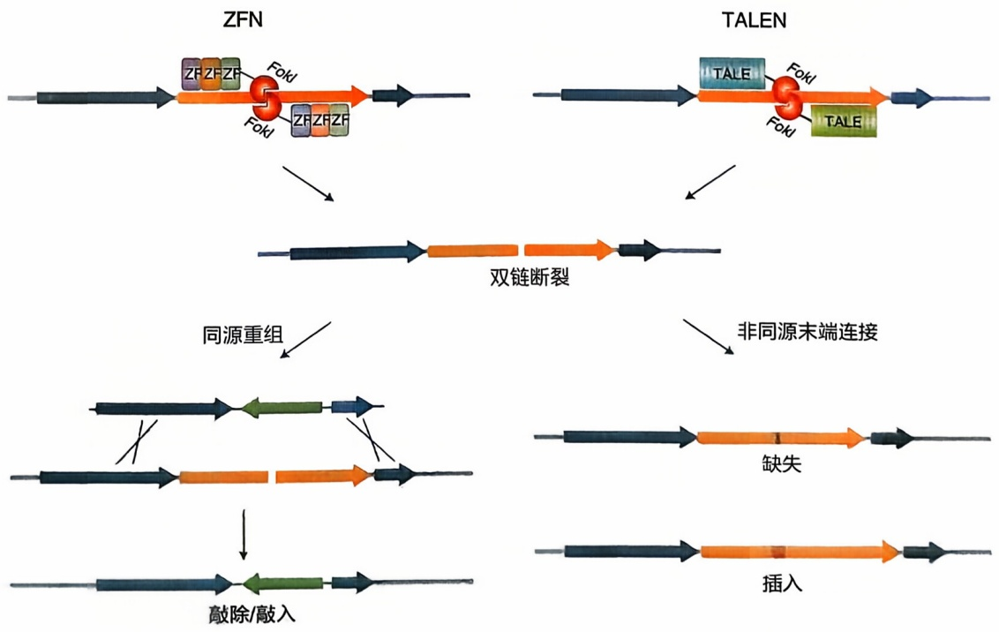

flowchart

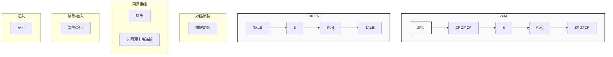

图10-9 ZFN和TALEN系统基因编辑原理

Cas9核酸酶发现于微生物获得性免疫研究。细菌和古菌基因组中存在由长度相似的间隔序列分隔的重复序列，被称为“成簇规则分散短回文序列”（clustered regulatory interspaced short palindromic repeat, CRISPR）。当细菌或古菌细胞内出现噬菌体等外源DNA时，宿主细胞会将外源DNA切成间隔序列大小的片段掺入CRISPR重复序列间，由此转录剪接形成名为CRISPR RNA（crRNA）的小RNA。crRNA能够与CRISPR相关（CRISPR-associated, cas）基因编码的Cas核酸酶等形成复合物，破坏相应序列的外源核酸，保护宿主细胞不受影响。

CRISPR/Cas 系统分为三型，其中 I 型和 III 型需要多个 Cas 蛋白形成的复合物以切割外源核酸，II 型则只需 Cas9 一个核酸酶即可切割 DNA。珍妮弗·杜德纳（Jennifer A. Doudna）和埃马纽埃尔·沙尔庞捷（Emmanuelle M. Charpentier）发现，Cas9 核

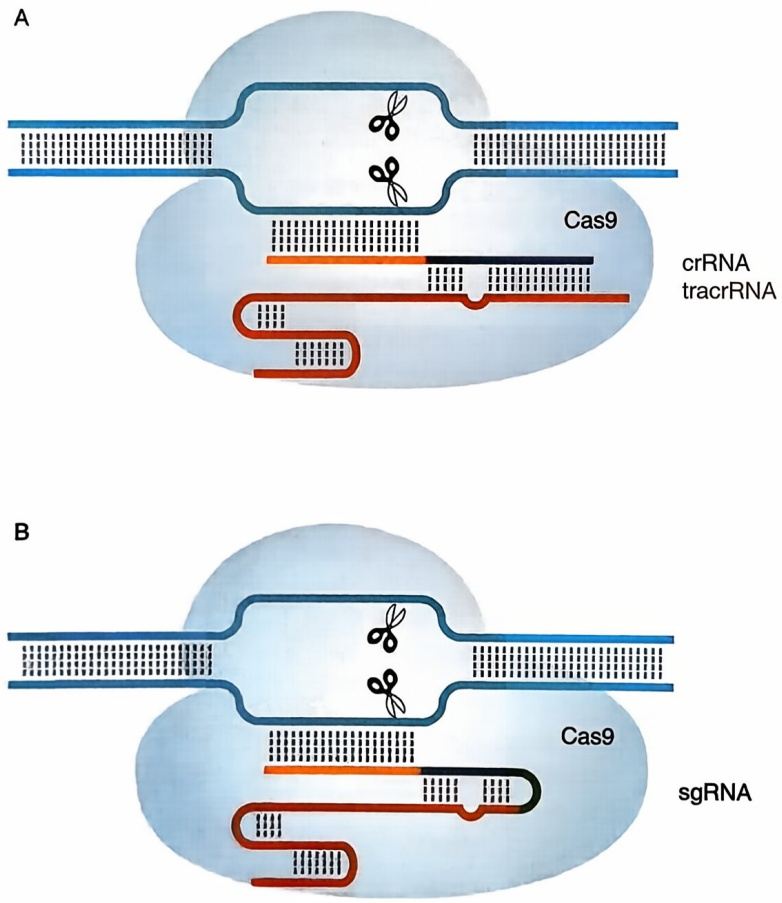

图10-10 CRISPR/Cas9系统基因编辑原理

细菌或古菌细胞内出现噬菌体等外源 DNA 时，会表达含相应序列的 crRNA。crRNA 与宿主 tracrRNA 形成双链，引导 Cas9 识别并切割与 crRNA 所含间隔序列对应的双链 DNA（A）。人工合成模拟这一双链构象的单分子引导 RNA（single-guide RNA，sgRNA）可以起到相同效果（B）。

酸酶结合crRNA与反式激活crRNA（trans-activating CRISPR RNA，tracrRNA）形成的双链RNA，受其引导切割与crRNA序列互补的DNA。她们还证明，能模拟crRNA与tracrRNA双链构象的单分子RNA也能引导Cas9核酸酶定点切割DNA（图10-10）。张锋（Feng Zhang）随后证明CRISPR/Cas9系统在小鼠和人细胞内也能发挥相同作用。Cas9切割DNA形成的双链断裂与ZFN或TALEN形成的双链断裂一样，可以被同源重组或非同源末端连接修复以实现各种基因靶向诱变操作。目前，CRISPR/Cas9系统已被用于酵母、线虫、果蝇、斑马鱼、小鼠、灵长类和拟南芥、烟草、高粱、水稻等动植物的遗传操作，基于该系统的基因编辑治疗产品已获批有条件上市。杜德纳和沙尔庞捷因发现该系统的贡献，分获2020年诺贝尔化学奖。

基因编辑技术面临的一大挑战是核酸酶的脱靶效应。它会导致预定位点以外的基因组DNA受到破坏。脱靶的可能性与核酸酶的表达量和作用时间正相关，使用mRNA短暂表达核酸酶或直接使用核酸酶蛋白，可以有效减少脱靶。脱靶效应在ZFN、TALEN和Cas9中都有报道，一般认为 TALEN 的脱靶效应相对最弱。

## 三、基因靶向诱变的局限

基因靶向诱变能在基因组预定位点按要求产生突变，可以用于在模式生物中失活基因、导入点突变或者导入抗原表位等外源序列以标记基因表达产物，也可以用于突变序列的纠正，对基因功能研究和人类疾病的基因治疗具有重要意义。但是，基因靶向诱变技术存在效率低、费用高的限制，用于全基因组范围的基因诱变筛选较为困难。传统基因打靶要在培养条件苛刻的ES细胞中进行，虽然使用了正负筛选技术，获得同源重组细胞克隆的概率也常徘徊于 $10\%$ 左右。通过囊胚注射ES细胞获得的是嵌合体小鼠，还需要与野生型小鼠交配以繁殖基因突变个体。基因编辑技术绕开了ES细胞，但该技术失活基因依赖于非同源末端连接修复，需要对修复产生的缺失、插入、重复或点突变个体进行筛选鉴定，以获得合适的失活突变。同时，基因编辑的脱靶效应也是将该技术用于疾病基因治疗时必须回答的问题。

## 第五节 插入诱变

使用转基因载体将外源DNA序列组件插入基因组，不仅可以破坏或干扰内源基因功能，也可以用于培育时空特异表达标记基因、转录因子、重组酶或转座酶的工具品系。在合适的转基因载体帮助下，全基因组高效插入诱变已被广泛用于各种模式生物的遗传学研究。

## 一、用于插入诱变的载体

反转录病毒、慢病毒或转座因子是常用的插入诱变载体。但是，野生型反转录病毒、慢病毒和反转录转座子能自我复制并整合到新的位点，从而不断增加插入突变的数量；野生型DNA转座子则能通过“剪切-粘贴”方式改变自己在染色体上的位置，导致插入位点的变化。为得到稳定遗传的插入突变，这些分子在作为插入诱变载体时都进行了相应改造:反转录病毒和慢病毒载体将病毒复制和包装所需的蛋白质编码序列移入辅助质粒，DNA转座子载体则将转座酶编码序列与载体分开。这样，携带外源DNA的病毒或转座子载体在整合到染色体上后，会因为缺乏辅助蛋白质或转座酶而稳定传代（图10-11）。

反转录病毒和慢病毒的长末端重复（long terminal repeat，LTR）序列和转座子的反向末端重复（inverted terminal repeat，ITR）序列对于它们插入染色体是必需的。利用这些末端重复序列和相邻载体序列，可以通过PCR和测序快速确定插入突变在染色体上的位置（图10-12）。因此，利用系统插入诱变所培育的突变体资源，不仅可以从突变表型出发筛选相应基因，也可以从突变基因出发研究其功能。能同时适应正向遗传学和反向遗传学研究的需要，使各种模式生物的插入诱变体库成为研究基因功能和生命机制的宝贵资源。

图10-11 用于插入诱变的反转录病毒和DNA转座子载体

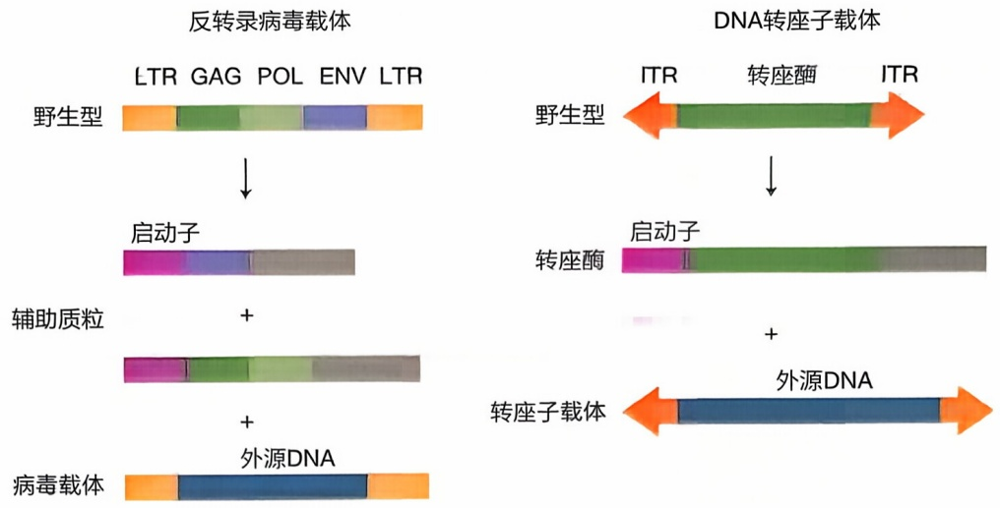

图10-12 从载体序列定位插入突变的两种方案

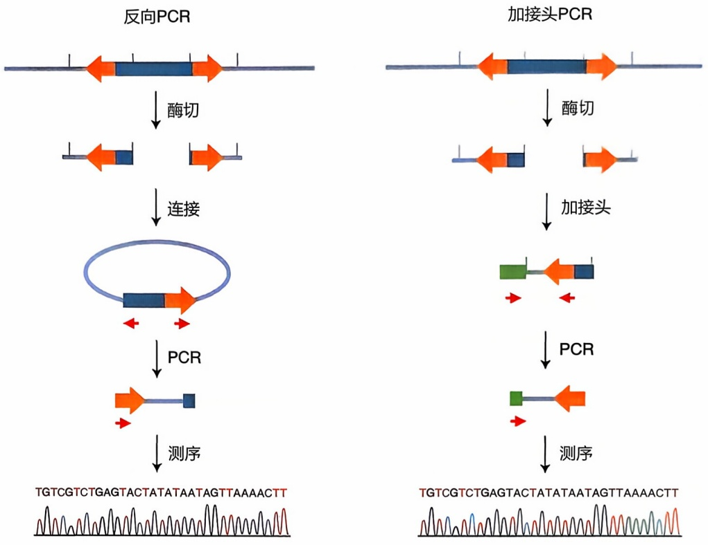

## 二、用于插入诱变的序列组件

插入诱变载体所携带的外源 DNA 序列组件，通常带有报告基因、选择标记基因、启动子、剪接信号、转录终止信号等功能序列，可以与基因组序列相作用，指示内源基因或转录调控序列的存在。这一策略也被称为基因捕获（gene trap）。

基因捕获兴起于20世纪80年代后期。当时，格林提出可以在真核生物基因组中插入弱启动子驱动的报告基因，如果插入位点附近存在表达调控序列，报告基因的表达将被增强而呈现特定样式。他将大肠杆菌lacZ基因置于果蝇 $P$ 因子启动子控制之下，用携带lacZ的 $P$ 因子培育转基因果蝇，发现高达 $70\%$ 的转基因品系在胚胎期出现各自不同的lacZ基因表达。这一策略后来被称为增强子捕获（enhancer trap）。经过多年发展，基因捕捉已经形成增强子/启动子捕获、外显子捕获和多腺苷酸捕获等三

## 知识窗10-3

## PB 转座子系统

哺乳动物基因组超过 $40\%$ 的序列由转座因子组成（Osmanski et al., 2023）。自然界中，转座因子与从小鼠毛色发育（A$^{y}$）到人肌营养不良（DMD）等多种发育和疾病过程有关。DNA转座子是遗传学研究的有用工具，它可以作为转基因载体携带基因整合到基因组，也可以用于插入基因导致突变。用转座子插入诱变基因具有诱变效率高、突变定位简单等许多优点。20世纪70年代，细菌转座子的应用推动了微生物遗传学的发展。80年代，鲁宾和艾伦·斯普拉丁（Allan C. Spradling）率先将 $P$ 因子用于果蝇转基因和诱变筛选，推动了果蝇分子遗传学的迅猛发展。此后20多年间，研究人员一直在寻找能高效作用于哺乳动物的DNA转座子。

2005年，复旦大学许田、吴晓晖等人首次报道了一种在哺乳动物中高效作用的DNA转座子——piggyBac（Ding et al., 2005）。他们受果蝇遗传学研究启发，将来自飞蛾的piggyBac转座子改造后用于小鼠和人细胞，成功实现转基因和基因诱变。野生型的piggyBac转座子全长约 $2.5\mathrm{kb}$，两侧为序列略有差异的ITR，中间的转录区域包含 $1.8\mathrm{kb}$ 长的转座酶编码序列。改造后的piggyBac转座子（PB）不表达转座酶（PBase），只在PBase存在时进行转座，撤除PBase后则稳定存在于整合位点。

PB在哺乳动物细胞中转座效率高，载体容量大，是理想的转基因工具。PB可以携带长达 $200\mathrm{kb}$ 的DNA片段单拷贝整合到染色体上，这一远高于其他转基因载体的容量使研究人员可以培育携带完整基因座的转基因个体，克服整合位点周围染色体序列对转基因表达的影响。单拷贝整合也比传统显微注射导致的多联体插入更好模拟内源基因的整合状态。因此，PB转基因载体特别适合哺乳动物转基因和基因组结构与功能研究。

PB在哺乳动物细胞中以“切离-粘贴”方式高效转座，在TTAA靶序列处形成单拷贝插入。这一特性便于研究人员从单拷贝插入品系出发培育新的单基因突变品系。PB插入后在转座子两侧形成TTAA重复，切离后又精确回复成原始序列，是目前已知唯一能在切离后真正形成回复突变体（revertant）的转座子系统，特别适合突变基因的功能验证研究（图10-13）。因此，PB可以充当高效便捷的插入诱变工具。复旦大学团队曾使用这一系统5年内成功培育单基因突变小鼠品系数千种。

PB的转座特性也使其成为有吸引力的基因治疗载体选择。一方面，高转座容量允许PB携带野生型基因座插入患者基因组，准确失活基因的正常表达与功能。另一方面，PB的精确切离又保证转基因导入时可能发生的多次插入和切离不造成背景突变，必要时还可以从染色体上无痕切除转基因，这些都提高了基因治疗操作的安全性。目前，已有多个以该系统为载体的基因治疗方法进入临床试验。

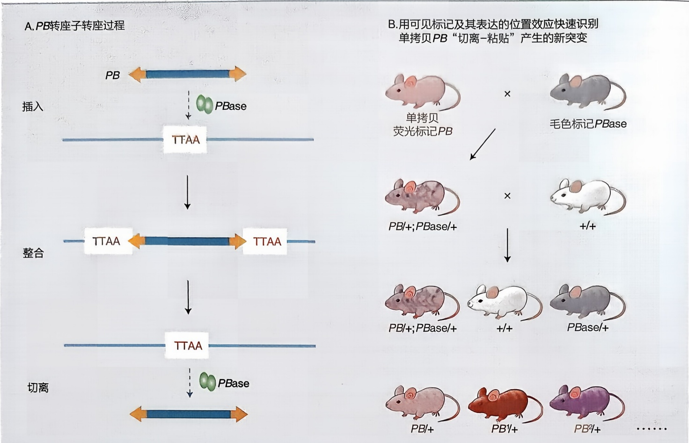

图10-13 $PB$ 转座子插入诱变

种基本策略，以及由它们交汇发展出的多种捕获组件设计（图10-14）。

增强子捕获组件主要包括携带弱启动子的报告基因和转录终止序列。当这一组件插入基因组的增强子附近时，报告基因的表达就会增强。如果组件中去除了弱启动子，报告基因需要插入内源启动子附近才能有效表达，这种作用方式被称为启动子捕获（promoter trap）。增强子/启动子捕获表达的报告基因可用于标记特定细胞和组织，可依据报告基因的表达样式鉴定重要基因。例如，可以通过鉴定特定脑区表达的增强子/启动子捕获品系，在捕获组件插入位点附近搜寻该脑区功能相关的候选基因，即使它们失活影响个体存活。如果将报告基因替换成GAL4等转录因子或Cre等重组酶，还可以实现组织或细胞特异表达或敲除基因，方便其功能和作用机制研究。

如果将报告基因序列前的启动子替换为 mRNA 剪接受体（splicing acceptor，SA）信号，就形成了外显子捕获（exon trap）组件。外显子捕获时，报告基因可插入内源基因的内含子，在内源基因转录时与上游外显子一起表达融合的 mRNA 分子。如上游外显子的读码框与报告基因一致，表达出含报告基因的融合蛋白。此时，可以通过检测报告基因确认表达内源基因的细胞，发现内源基因产物的细胞内定位线索。

如果在报告基因序列后加上 mRNA 剪接供体（splicing donor，SD）信号，用外源增强子和启动子驱动报告基因表达，就形成了多腺苷酸捕获（polyA trap）组件。这个组件可以在插入到内源基因的内含子后，与下游外显子一起表达携带内源基因多腺苷酸尾的融合mRNA分子。这种捕获组件多采用持续表达调控序列驱动报告基因表达，哪怕内源基因只在个别细胞表达也能被检测到，能用于研究内源基因相关的显性表型。

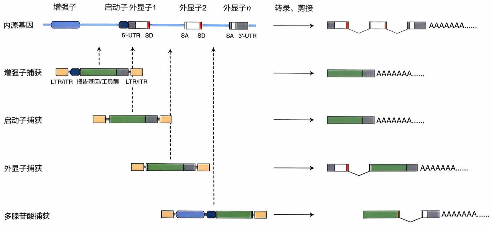

flowchart

This diagram illustrates the genomic structure and regulatory elements of a gene, showing how internal source genes are transcribed into various downstream components such as wild-type (5'-UTR), double-stranded (SD), and introns (SA).

基因捕获组件插入可以获得基因失活突变，也可以实现基因过表达或异位表达，还可以用于培育工具品系进行细胞标记或组织特异性遗传操作。在插入诱变载体容量允许的情况下，组合使用多种基因捕获组件，可以更高效地实现复杂研究目标。例如，可以将外显子捕获和多腺苷酸捕获联用，在各组件两端分别设置不同的位点专一重组序列。这样，可以先用携带正筛选标记的多腺苷酸捕获在胚胎干细胞中筛选获得插入基因内部的克隆，再通过翻转外显子捕获组件获得基因功能突变（图10-15）。又如，诺伯特·佩里蒙（Norbert Perrimon）用增强子捕获组件携带酵母Gal4转录因子

随机插入果蝇基因组，产生了大量在不同组织、器官和发育时段特异表达的 Gal4 品系，为果蝇基因过表达功能筛选准备了丰富资源（Brand and Perrimon, 1993）。

当然，基因捕获使用时也面临一些限制。例如:没有内含子或内含子过短的基因不容易被外显子捕获或多腺苷酸捕获发现；与基因有类似序列结构的假基因也能被捕获；增强子或外显子捕获与内源基因表达和读框相关；有时增强子捕获组件会受远处基因调控序列的影响，在插入位置附近找不到内源基因序列，等等。即便如此，兼有随机诱变对现有知识依赖小以及反向遗传学确定、操作基因突变序列容易优点的基因捕获仍成为全基因组高效插入诱变的主流，被广泛用于各种模式生物的遗传学和基因功能研究。

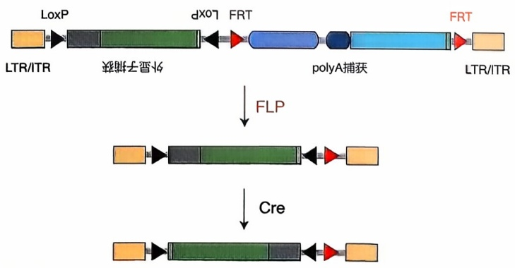

flowchart

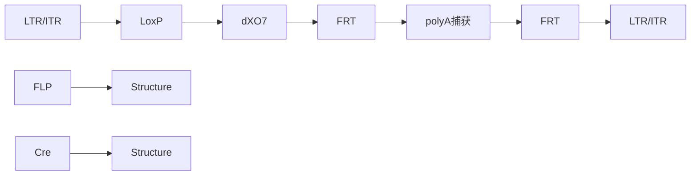

图10-15 基因捕获组件作用原理

图10-14 基因捕获组件作用原理

## 第六节 反向遗传学研究的价值

反向遗传学能以自发突变或传统诱变难以成功的方式改变基因功能，解答经典遗传学和传统遗传筛选无法回答的科学问题。通过改变基因的表达部位，能够证明基因对器官发育命运的决定性作用。通过在特定时间或组织“条件性”破坏基因表达，能够发现突变致死基因在后续生命活动中的功能。通过在基因组中导入特定功能的核酸序列，获得高精度的组织、器官和细胞标记，等等。

反向遗传学能更高效地开展特定生物学问题的研究。例如，对全基因组测序发现的大量未知功能基因，反向遗传学允许研究人员根据自己感兴趣的序列特征，培育一组基因的突变并开展功能研究。这不仅可以获得对基因家族功能的认识，也可以更高效地培育多个同源基因同时突变的个体，克服冗余（详见第七章第一节）对基因功能研究的影响。通过对特定位点的靶向诱变，研究人员不仅可以快速确定对基因功能有关键意义的结构域或氨基酸残基，也可以在模式动物中快速精准重现人类疾病基因突变，培育疾病动物模型。

最后，反向遗传学还是许多生物医学和生物技术研发的关键手段。灵长类和大型动物因为费用、伦理等的限制，不可能开展全基因组规模的遗传诱变筛选。如果需要使用灵长类检验人类疾病的治疗干预手段效果，将不得不依赖反向遗传学获得疾病基因突变的动物。同样，如果需要使用牲畜验证对经济性状有重要影响的基因功能，或者探索其作为器官移植供体的价值，反向遗传学策略也是开展这些工作的唯一选择。

## ※ 复习思考题

1. 什么是反向遗传学？它和正向遗传学的异同是什么？反向遗传学对生物学最重要的贡献在哪个或者哪些方面？
2. 什么是总控基因？举例说明。
3. 哺乳动物中目前有哪几种方案来实施转基因技术及其优缺点？
4. 外源基因表达系统有哪些?
5. 如何获得有用的突变基因？
6. 转基因表达检测有哪些方法？