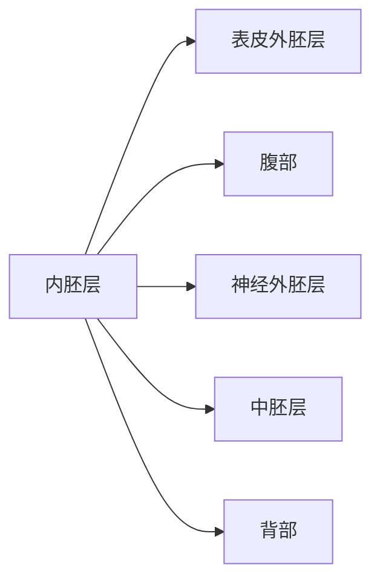
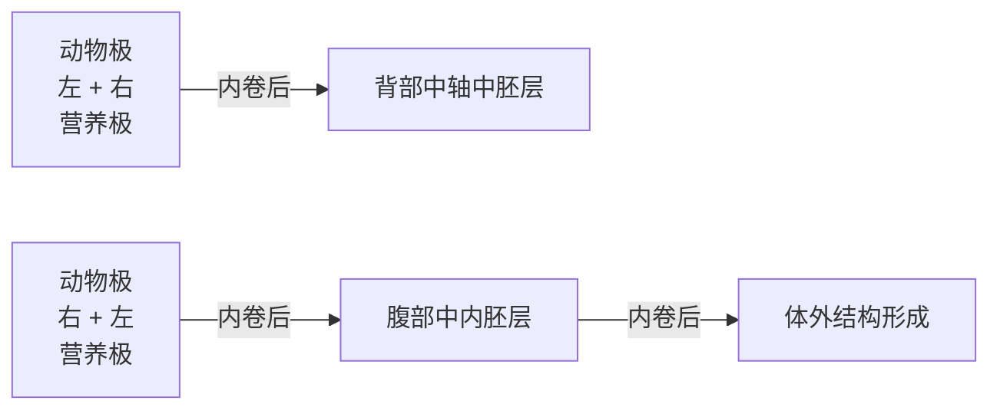

## ※ 推荐阅读

1. BRAND A H, PERRIMON N. Targeted gene expression as a means of altering cell fates and generating dominant phenotypes [J]. Development, 1993, 118: 401–415.
2. COOPER J A, GOULD K L, CARTWRIGHT C A, et al. Tyr527 is phosphorylated in pp60c-src: implications for regulation [J]. Science, 1986, 231: 1431–1434.
3. DING S, WU X, LI G, et al. Efficient transposition of the piggyBac(PB) transposon in mammalian cells and mice [J]. Cell, 2005, 122: 473–483.
4. HALDER G, CALLAERTS P, GEHRINGT W J. Induction of ectopic eyes by targeted expression of the eyeless gene in Drosophila [J]. Science, 1995, 267: 1788–1792.
5. KARIM F D, CHANG H C, THERRIEN M, et al. A screen for genes that function downstream of Ras1 during Drosophila eye development [J]. Genetics, 1996, 143: 315-329.
6. ORR W, SOHAL R. Extension of life-span by overexpression of superoxide dismutase and catalase in Drosophila melanogaster [J]. Science, 1994, 263: 1128–1130.
7. OSMANSKI A B, PAULAT N S, KORSTIAN J, et al. Insights into mammalian TE diversity through the curation of 248 genome assemblies [J]. Science, 2023, 380: eabn1430.
8. PALMITER R D, BRINSTER R L. Germ-line transformation of mice [J]. Annu Rev Genet, 1986, 20: 465-499.
9. WEINER D B, LIU J, GREENE M I.A point mutation in the neu oncogene mimics ligand induction of receptor aggregation [J]. Nature, 1989, 339: 230–231.

（编写:吴晓晖、孙璘、许田；审读:唐鸿云）

## 第十一章

# 动物胚胎早期发育及其遗传调控

对于有性繁殖的动物，受精卵是一个新的生命体的开始。受精卵的第一要务是通过快速的有丝分裂以产生多细胞组成的囊胚，然后再通过原肠作用在不同的空间形成外胚层、中胚层、外胚层，每个胚层特定区域的细胞将发育形成特定的组织器官。本章将介绍经典的模式动物（如果蝇、斑马鱼、爪蛙、鸡、小鼠）从受精卵到原肠作用的早期发育，对人类胚胎的早期发育也做简要介绍。胚胎的早期发育涉及未来三条体轴（即头尾轴、背腹轴、左右轴）的确定以及细胞命运的分化，这些事件由内在遗传程序控制，自动运行。因此，本章第三节还将介绍早期发育的关键事件的遗传调控机制。

## 第一节 发育生物学概述

一个生命体的组织结构是如何形成的，一直是人们好奇的问题。早在公元前三百多年，希腊哲学家亚里士多德就此提出了两种假设。一是先成论（preformation），假定生命体一开始就有各种组织结构，之后它们再逐渐生长、长大。二是后成论（epigenesis），假定生命体开始时并没有成年后的组织结构，这些组织结构是从无到有逐渐形成的。亚里士多德当时就认为后成论是更可能的，但到了17世纪后半叶，一些人利用新出现的显微镜观察动物胚胎的发育，认为生命体的组织结构是预先形成的，认同先成论。随着19世纪细胞学说的出现和发展，后成论逐渐得到科学界的普遍认可。

自19世纪20年代以后，对胚胎发育的研究越来越多，诞生了胚胎学（embryology），重点是描述不同物种的胚胎及胎儿的发育过程。20世纪50年代，在胚胎学的基础上发展出发育生物学（developmental biology）学科。近年来，学界越来越认识到，生命个体内的细胞增殖和分化行为并不限于胚胎发育和个体生长阶段，成年个体的组织器官仍然存在可增殖的多潜能细胞和前体细胞，它们参与组织器官的细胞更新换代、损伤修复等过程，在稳态维持方面发挥了不可替代的作用。因此，发育生物学是一门研究生命体从精子和卵子发生、受精、胚胎发育、个体生长到稳态维持和衰老的规律及分子调控机制的科学。

发育生物学已成为生命科学领域的基础性核心学科，与遗传学、细胞生物学、分子生物学等学科关系密切、互相渗透、互相促进。但与这些学科相比，发育生物学关注个体和组织器官结构形成的细胞机制和分子调控机制，强调细胞和分子机制在时间和空间上的变化，力求从个体系统水平理解组织器官之间、细胞类型之间的协同调控。发育生物学与医学的关系也日趋紧密。例如，配子的有无或功能是否正常关系着是否能够生育，胚胎发育异常将导致个体夭折或出生缺陷，近年来还认识到许多成年疾病源于配子或胚胎发育异常，因此发育生物学研究成果可以为人类不孕不育、出生缺陷，以及疾病的预防、诊断和治疗提供理论基础与新的技术手段。

动物，特别是脊椎动物，成年个体的组织结构在物种间有很大差异，但胚胎发育经历很多相似过程。一般来说，动物发育经历卵裂、囊胚形成、胚层形成、形态发生、组织器官形成等过程；组织器官稳态涉及结构和组分（包括细胞）的正常更新替换、损伤后修复甚至再生。发育生物学研究常常借助模式动物系统，经典的模式动物包括线虫、果蝇、斑马鱼、爪蛙、小鼠，其共同特点是遗传背景清楚、生活周期较短、繁殖力较强、易于饲养和实验操作。此外，不同的模式动物有不同的特点和特性，研究者往往根据要解答的科学问题，选用最合适的模式动物。利用不同的模式动物获得的研究结果，可帮助我们了解发育的一般规律，还可揭示一些物种特异性的发育规律。随着CRISPR/Cas9技术的出现，对经典模式动物以外的其他动物（如野生动物）进行遗传操作成为可能，增加了研究对象的选择范围，必将促进对发育进化规律的研究。

发育生物学研究已从早期的形态观察描述性研究，进入到当前的分子调控机制研究阶段。新兴生物学技术，如基因编辑技术、全基因组测序技术、单细胞组学技术、超高分辨显微成像技术、表观遗传分析技术等，均迅速应用于发育生物学研究。

## 第二节 胚胎的早期发育

## 一、卵裂与囊胚形成

## 1. 基本概念和规律

动物一个精子的头部与一个卵子的质膜结合后，其细胞核进入卵子的胞质中成为雄原核（male pronucleus），由此诱导卵子的雌核完成第二次减数分裂，雌核中两套染色体的一套和极少量的胞质形成第二极体（second polar body）并被排出到卵子外，雌核中剩下的一套染色体组成雌原核（female pronucleus）。含有卵子的绝大部分胞质和细胞器及雌原核和雄原核的部分称为合子（zygote）或受精卵（fertilized egg）。第二极体排出的位置是受精卵的动物极（animal pole），其对面端为营养极（也称植物极）（vegetal pole）。

受精卵的出现代表一个新的生命体的开始。多细胞生命体的受精卵的第一要务是进行有丝分裂以快速增加细胞数量，形成由数十个，或由上百个较小的细胞构成的无腔胚体，即早期囊胚（early blastula），该发育阶段称为卵裂期（cleavage period）。卵裂期的有丝分裂在习惯上称为卵裂（cleavage），产生的子代细胞称为卵裂球（blastomere）。卵裂沟与动物极-营养极轴平行的卵裂通常称为经线裂（meridional cleavage），而卵裂沟与之垂直的卵裂称为纬线裂（equatorial cleavage），受精卵的第一次卵裂一般都为经线裂。

不同物种的卵裂有一些共同特点。第一，卵裂速度一般较快，且无细胞周期的间期（G期）。第二，卵裂期胚胎的整体大小变化不大，而单个卵裂球的胞质容积缩小，细胞核体积基本不变，从而导致质核比下降。例如，海胆胚胎的质/核比由受精卵的550:1降至囊胚时6:1。第三，胚胎早期卵裂产生大小相近的子卵裂球，但之后可产生大小不同的子卵裂球。例如，海胆8细胞期胚胎的营养极的4个卵裂球，发生第4次卵裂后产生4个大卵裂球（macromeres）和4个微小卵裂球（micromeres）。第四，卵裂球之间很少穿梭运动。第五，早期卵裂球的基因组处于转录沉默状态。胚胎进入囊胚期后，细胞间的黏附更紧密，细胞周期延长，细胞增殖速度减缓，细胞增殖的非同步性增加。到晚期囊胚时，不同区域的细胞发育命运已确定。一些物种的囊胚含有囊胚腔，而有些物种的囊胚没有囊胚腔。第六，受精卵、甚至多细胞期的每个卵裂球均具有全能性（totipotency），即分开的单个卵裂球可以发育成一个包含各种组织器官和细胞类型的完整个体。通常，随着卵裂次数的增加，子细胞的发育潜能逐渐变窄。

## 2. 代表性动物的卵裂与囊胚形成

果蝇是无脊椎动物的经典模式动物，其受精卵在母体外发育。受精卵含有大量的卵黄，位于卵子的中间区域，主要提供营养物质，而不含卵黄的胞质位于卵黄与卵质膜之间的一个狭窄的区域内，细胞核处于卵黄中（图11-1A）。其受精卵的前13次有丝分裂只发生细胞核的分裂，这期间的胚胎称为多核胚（syncytial blastoderm），第10次卵裂后，所有细胞核都已迁入胞质区（图11-1B）。第14次卵裂时，细胞核分裂后，两个核之间的质膜内陷形成单个的完整细胞，此时的胚胎中间为卵黄，其外侧被细胞包围，无囊胚腔（图11-1C）。实际上，第9次卵裂时，位于胚胎尾端的几个细胞核首先细胞化，形成极细胞（pole cell），这些细胞是原始生殖细胞（primordial germ cell），将迁移到生殖器官中用于形成配子。约发育 $3\mathrm{h}$ 时，果蝇晚期囊胚表面为分布有约6000个上皮细胞的单层，内部为卵黄，中胚层（mesoderm）命运细胞位于腹部中间区（约占外周的 $20\%$ 和体长的 $70\%$ ）（图11-1D）。紧邻中胚层区的腹侧区为腹部外胚层（ventral ectoderm），又称神经外胚层（neuroectoderm），将分化出成神经细胞和表皮细胞；背部方向紧邻腹部外胚层的是侧翼外胚层（lateral ectoderm），其主要分化为表皮；最背部区域为背部外胚层（dorsal ectoderm），发育为羊浆膜（amnioserosa）。头端腹侧为前部中肠区（anterior midgut），其尾端紧邻的一狭窄的外胚层区为前肠区（foregut）；尾部靠近极细胞群的区域为后部中肠区（posterior midgut），其头端紧邻的一狭窄的外胚层区为后肠区（hindgut）。

斑马鱼是硬骨鱼的模式动物，其受精卵也在母体外发育。卵含有大量卵黄，受精后，卵黄间的胞质开始流向动物极，形成透明的凸起部，细胞核位于胞质中（图 11-2A）。第一次卵裂在受精后 40 min 完成，第 2～10 次卵裂每 20 min 发生一次，卵裂只发生在不含卵黄的动物极胞质区，形成的较透明的胚盘与不透明的卵黄是隔离的。前

图11-1 果蝇受精卵的卵裂与囊胚形成示意图（A）受精卵；（B）9次卵裂后的多核胚，原始生殖细胞（极细胞）已出现在后端；（C）14次卵裂时已细胞化的胚胎；（D）晚囊胚，不同区域的细胞有不同的发育命运。

5次卵裂均为经线裂（卵裂沟与动物极-营养极轴平行），产生的32个卵裂球呈单层分布于卵黄的动物极一面上；各卵裂球与卵黄接触处并不形成质膜，可允许生物活性分子在卵裂球与卵黄之间，以及卵裂球与卵裂球之间交流。随后，各卵裂球的分裂方向不一致，离卵黄较远的卵裂球有完整的质膜。随着细胞不断增多，胚盘逐渐增厚，受精后4 h的胚胎为球形期（sphere stage），整体呈圆形，胚盘约占30%，其与卵黄的接触面平坦，此时进入晚囊胚阶段（图11-2B）。随后，胚盘中部下方的卵黄向动物极凸起，胚盘细胞向营养极方向下包，使胚盘中部变薄（细胞层数减少）。约5.3 h时（50%外包期），胚盘边缘细胞位于球形胚胎的中部（类似赤道上），胚胎发育即将进入原肠作用（gastrulation）阶段。50%外包期时，胚盘由三层细胞组成，最外层为包被层（enveloping layer），起保护作用，将在2周后脱落；与卵黄接触的细胞已破裂，释放的细胞核贴在卵黄上成为卵黄多核层（yolk syncytial layer），它们主要提供营养和一些信号分子，可能也协助了胚盘边缘的包被层细胞向营养极的移动；介于以上两层之间的细胞为深层细胞（deep cell），它们将用于形成胚体组织（图11-2C）。斑马鱼囊胚没有囊胚腔。通过标记单个细胞，然后追踪其后代细胞的发育命运，已知晚期囊胚不同区域的细胞的发育命运不同（图11-2D）。胚盘边缘的几行细胞具有发育为中胚层和内胚层（endoderm）命运双潜能，因而称为中内胚层（mesendoderm），其沿背腹轴不同位置有不同的命运。中内胚层以外的区域为外胚层，靠近背部的区域为神经外胚层，将分化形成神经系统；而其余部分为表皮外胚层（epidermis ectoderm），分化形成表皮。

爪蛙是两栖动物的代表，卵母细胞动物极半球分布着色素，其受精卵在母体外发育。爪蛙受精时，受精卵中的皮质将向未来的背部方向逆时针转动 $30^{\circ}$，称为皮质旋转(cortical rotation)，因色素层的偏移而露出一月牙形的灰色区域，称为灰色新月（gray crescent）（图11-3A），其代表未来的背部方向。位于受精卵营养极的皮质颗粒中含有背部决定因子，因而皮质旋转后背部决定因子将不对称分布。蛙卵中的卵黄密度沿动物极-营养极轴由低到高分布，影响卵裂沟形成的速度和位置。第1次卵裂发生在受精后 $1.5\mathrm{h}$，产生的两个卵裂球因背部决定因子的不对称分布而获得不同的发育命运。以后每 $30\mathrm{min}$ 一次。第一、二次卵裂为经线裂，第三次为纬线裂（图11-3B），之后卵裂方向交替进行。由于卵黄的存在和沿动物极-植物极轴的卵黄密度差异，经线裂时卵裂沟从动物极开始向营养极延伸越来越慢，纬线裂时卵裂沟更偏向动物极一侧，因而各时期卵裂球的大小沿动物极-营养极轴由小变大。到128细胞期时，囊胚在动物极半球靠近动物极的位置形成一个囊胚腔（图11-3C）。像斑马鱼晚期囊胚一样，爪蛙晚期囊胚不同区域的发育命运已确定。位于囊胚腔下方的营养极半球为内胚层，赤道区为中胚层，剩余的动物极区域为外胚层（图11-3D）。

图11-2 斑马鱼受精卵的卵裂与囊胚形成示意图（A）受精卵，约受精后 $30\mathrm{min}$ （B）球形期，约受精后 $4\mathrm{h}$ （C）$50\%$ 外包期，约受精后$5.3\mathrm{h}$ ；（D）晚囊胚，约受精后 $6\mathrm{h}$，即将开始原肠作用，不同区域的细胞获得不同的发育命运。

A

text_image

动物极
营养极
灰色新月

B

text_image

Diagram of a globe with labeled regions I, II, and III, showing layered geological or structural features.

图11-3 爪蛙受精卵的卵裂与囊胚形成示意图（A）受精卵，已发生皮质旋转，露出的灰色新月区代表未来的背部方向；（B）前3次（I～Ⅲ）卵裂，第3次卵裂（经线裂）更靠近动物极；（C）已形成囊胚腔的胚胎，含100多个细胞；（D）中囊胚的细胞命运图。

C

text_image

囊胚腔

D

flowchart

鸡是鸟类的代表，刚排出的卵子含有大量的卵黄，尚未被清蛋白和壳包裹，抵达输卵管喇叭口时发生受精。受精卵动物极有一直径2\~3 mm的胞质区，卵裂只发生在该区内（图11-4A）。受精后约5 h开始第一次卵裂，前3次卵裂均为经线裂，形成单层细胞的胚盘，但细胞基部质膜尚未形成（图11-4B），细胞与卵黄仍直接连通。其后会发生不同角度的卵裂，细胞会形成完整的质膜，细胞层增多。到受精后15\~16 h时，已完成12\~14次卵裂，胚盘中央有5\~6层细胞，细胞从清蛋白吸取液体后导致中央细胞与卵黄分离，在卵黄表面形成了一个腔体，称为胚盘下腔（subgerminal cavity）。胚盘下腔使胚盘的中央区域有更高的透光性，看上去明亮一些，因而称为明区（area pellucida）；而边缘区的细胞仍与卵黄接触而不透明，称为暗区（area opaca）（图 11-4C）。到受精后 25 h 左右，卵（俗称“蛋”）排出母体，此时的胚胎已完成 15～16 次细胞分裂，细胞数达 5 万～6 万个，留在胚盘表面、位于胚盘下腔上方的一层细胞称为上胚层（epiblast），将用于形成胚体组织（图 11-4D）。明区边缘某处有多层细胞聚集，它的出现指示胚胎的后部，又称柯氏镰形区（Koller's sickle），紧邻该区后侧的相邻区将形成原条（primitive streak）。上胚层中的少量细胞掉入胚盘下腔，成为下胚层（hypoblast），它们仅用于形成部分胚外膜，产生胚外结构如卵黄囊柄和卵黄团与内胚层消化管的连接柄。

图11-4 鸡受精卵的卵裂与囊胚形成示意图（A）受精卵，圆圈内为将发生卵裂的区域；（B）已发生3次卵裂的胚胎，动物极观；（C）和（D）受精后 $15\sim 16\mathrm{h}$ 囊胚:（C）为动物极观，(D）为（C）的切面图。

小鼠是常用的哺乳动物模式。刚排出的小鼠成熟卵子（MⅡ）外围有一厚层的透明带（zona pellucida），其作用包括防止多精入卵以及防止胚胎细胞与母体其他组织的过早接触。受精发生在输卵管壶腹部，受精卵（图11-5A）在向子宫腔移动过程中发生卵裂。约在受精后24 h完成第一次卵裂，之后每次卵裂约需12 h。第一次卵裂为经线裂，但卵裂沟与动物极-营养极轴不完全平行，而有可变的角度。2细胞期的两个卵裂球的第二次卵裂不同步，其中一个卵裂球的分裂早于另一个卵裂球，两个卵裂球的卵裂面互为垂直。刚完成3次卵裂的8细胞期胚胎，卵裂球之间的接触面很小，呈多卵裂球松散排布状态（图11-5B）。随即卵裂球的侧翼相接处形成紧密连接（tight junction），胚胎最外侧卵裂球的缝隙消失，该过程称为致密化（compaction）。8细胞期后期（受精后第3天），完成致密化的胚胎外观类似桑葚（图11-5C），因此称为桑葚胚（morula），每个细胞具有极性（polarity），外侧为顶面，膜上分布大量微绒毛（microvilli）和顶面极性蛋白（如Pard6b），内侧为底面。随着细胞的继续增殖，部分细胞位于细胞内部。到第3天32～64细胞期，胚胎内部一侧出现一个充满液体的囊胚腔（blastocoel），此时的胚胎称为胚泡（blastocyst）。胚泡外围的单层细胞称为滋养外胚层（trophectoderm）或滋养层（trophoblast），在囊胚腔一端与滋养外胚层接触的一团细胞叫内细胞团（inner cell mass，ICM）（图11-5D）。与内细胞团接触的滋养外胚层称为极向滋养外胚层（polar trophectoderm），囊胚腔部分的滋养外胚层称为腔壁滋养外胚层（mural trophectoderm）。到64～128细胞期时，胚泡的囊胚腔已扩大，内细胞团中的部分细胞向囊胚腔移动到内细胞团边缘，形成单层细胞的原始内胚层（primitive endoderm），而内细胞团的其他细胞组成上胚层（epiblast）。原始内胚层细胞继续增殖、迁移，将铺盖在囊胚腔的滋养外胚层上，部分原始内胚层细胞将插入到上胚层和滋养外胚层之间。上胚层将用于发育出胚体，而滋养外胚层和原始内胚层将用于形成胚外组织。在第4.5天左右，胚泡腔壁滋养外胚层端的透明带被消化，胚泡从此处外迁侵入母体子宫壁，该过程叫做胚胎着床或植入（implantation）。侵入子宫壁的腔壁滋养外胚层细胞分化为滋养层巨细胞（trophoblast giant cells），它们将与一些子宫内膜细胞一起形成胎盘；极向滋养外胚层细胞增殖，形成外胎盘锥（ectoplacental cone）。上胚层细胞增殖，其靠近外胎盘锥的细胞形成胚外外胚层（extraembryonic ectoderm），用于形成胎盘；其余的上胚层细胞向囊胚腔扩增，中间产生一个腔体，成为前羊膜腔（proamniotic cavity），含前羊膜腔的上胚层细胞群看似悬挂在囊胚腔中的一个杯状体，因而也称为上胚层杯（epiblast cup）。原始内胚层细胞扩增，从内覆盖囊胚腔，覆盖在上胚层杯和胚外外胚层上的原始内胚层成为内脏内胚层（visceral endoderm），其余的原始内胚层细胞覆盖在囊胚腔滋养外胚层上，成为体壁内胚层(Parietal endoderm) (图 11-5E)。

A

text_image

第二极体
透明带
合子
受精卵

B

text_image

第二极体
未致密化
第二极体
已致密化
8细胞期

D

text_image

内细胞团
上胚层
原始内胚层
极向滋养层
囊胚腔
腔壁滋养层

E

text_image

外胎盘锥
胚外外胚层
内脏内胚层
体壁内胚层
上胚层杯
前羊膜腔
滋养层巨细胞

图11-5 小鼠受精卵的卵裂与囊胚形成示意图（A）受精卵；（B）和（C）8细胞期胚胎；（D）胚泡，约受精后第4天；（E）植入母体子宫壁后即将开始原肠作用的胚胎，约受精后5.5天。

人类受精卵（图 11-6A）也在输卵管中开始卵裂，前 3 次卵裂方式与小鼠胚胎类似，但各卵裂球的卵裂时间和致密化的不同步性更加明显，因此在一些时间点可以观察到大小不一的卵裂球（图 11-6B）。8 细胞期胚胎的个别卵裂球开始致密化，到 16 细胞期时（受精后第 4 天）才完成。人类第 5 天的胚胎已到达子宫，已形成囊胚腔，成为胚泡，其形态与小鼠胚泡类似（图 11-6C）。第 6\~7 天，胚泡的极向滋养外胚层端的透明带开孔，胚泡侵入母体子宫壁着床。极向滋养外胚层细胞分化为细胞滋养层（cytotrophoblast），进一步产生合体滋养层（cytotrophoblast），用于形成胎盘。第 8 天左右内细胞团开始分化，与囊胚腔接触的一层细胞分化为下胚层，它类似小鼠胚泡内细胞团的原始内胚层；胚胎靠近极向滋养外胚层的两层内细胞团细胞间出现缝隙，该缝隙逐渐扩大成为羊膜腔，与下胚层接触的单层细胞为上胚层，将用于产生胚胎组织（图 11-6D）。第 10 天左右下胚层细胞已覆盖整个囊胚腔壁（滋养层），此时的囊胚腔称为初级卵黄囊（primary yolk sac）（图 11-6E），这些下胚层细胞将分化出胚外中胚层和内胚层细胞。原肠作用即将开始时（14\~15 天），初级卵黄囊与滋养层分开而成为次级卵黄囊（secondary yolk sac），胚胎看似两层细胞（上胚层和下胚层）的圆盘将卵黄囊和羊膜腔分隔开，这两层细胞的胚盘类似鸟类胚胎。

## 二、原肠作用与形态发生

## 1. 基本概念与普遍规律

顾名思义，原肠作用是指原始肠管的形成过程。原肠作用过程中，最突出的细胞行为是细胞有规律的移动，使细胞重新排列，用来形成内胚层和中胚层器官的细胞迁入胚胎内部，而要形成外胚层的细胞铺展在胚胎表面。原肠期胚胎称为原肠胚（gastrula）。经历原肠作用后，胚胎的整体形态将发生显著的变化，躯体轮廓变得明显，更接近成体形态，组织器官原基已开始出现。

图11-6 人类受精卵的卵裂与囊胚形成示意图（A）受精卵；（B）3细胞期胚胎，2细胞胚胎的两个卵裂球中的一个先开始卵裂；（C）胚泡，约受精后5天）；（D）正在植入母体子宫壁的胚胎；（E）在子宫壁中发育的胚胎，受精后 $10\sim 11$ 天。

基于细胞的形态结构和运动特性，原肠期的细胞可以分为两类。一类是上皮细胞（epithelial cell），细胞与细胞间紧密连接成管状或片层状结构，局部或整个结构一起移动或行为，如哺乳动物胚泡的滋养层细胞和内细胞团的原始内胚层细胞；另一类是间质细胞（mesenchymal cell），细胞与细胞间无连接或松散相连，每个细胞为一个独立的行为（如移动或增殖）单元，如哺乳动物胚泡内细胞团的上皮细胞。原肠期细胞的运动通常涉及上皮细胞转变为间质细胞，而器官形成阶段通常涉及间质细胞转变为上皮细胞。

原肠期细胞移动的方式有多种。下包（epiboly）:表皮层作为一个整体向某一方向扩展，使胚胎的内层或卵黄被覆盖，如鱼类的外胚层命运细胞。内卷（involution）:指正在扩展（如下包）的外层细胞向内卷折，反向从内铺盖原来的外层细胞，如鱼类原肠胚胚盘边缘的中内胚层前体细胞、两栖类原肠胚赤道的中胚层命运细胞。汇聚伸展（convergent extension）:指细胞间相互插入，使所在组织变窄、变薄，并推动组织向某一轴线拉长，该运动方式是导致头尾体轴成形的主要驱动因素。内陷（invagination）:指胚胎的局部区域向内凹陷，进入胚胎内部，如海胆胚胎启动原肠作用时位于营养极的内胚层命运细胞向囊胚腔内折。内移（ingression）:指表层的单个细胞离开原来所在的区域，迁入胚胎的内部，如果蝇腹部外胚层中的神经命运细胞的向内移出。分层（delamination）:指一个细胞层分成两层或多或少平行的细胞层，如人类胚胎胚泡阶段下胚层的形成。

原肠期细胞的移动涉及细胞骨架的重排、胞外基质的降解与重构、细胞变形、细胞膜突出（如伪足）的产生和作用、细胞间的黏连与排斥、微环境信号梯度、定向机械力作用等等，其调控机制非常复杂。

## 2. 代表性动物胚胎的原肠运动

果蝇胚胎在  $25^{\circ}$ C 培养条件下，受精后约 3 h 开始原肠作用，持续约 2 h。原肠作用始于腹部的中胚层内陷（图 11-7A），在腹部中线产生一条沟，称为腹沟（ventral furrow）（图 11-7B）。内陷的中胚层形成管状结构，两侧的腹部外胚层向腹部中线合拢，然后中胚层细胞间质化迁移铺展在腹侧外胚层上。随后，前部中肠区和后部中肠区（以及黏附的极细胞）内陷，同时羊浆膜的收缩带动腹部中胚层和外胚层细胞从后部向背部头端迁移（图 11-7C，D），这些一起迁移的胚胎区域称为胚带（germ band），其在迁移过程中不断加长，使躯体变长；当前肠外胚层内陷后，胚带前端已迁移到离头端较近的位置，这时胚带再后退。当后肠外胚层退回到尾端时，其后前部中肠和后部中肠汇合，头部区域内卷进入内部，躯干部位的神经表皮外胚层中的神经祖细胞迁移出外胚层进入胚胎内部（图 11-7E）。

斑马鱼胚胎在 $28.5^{\circ} \mathrm{C}$ 培养条件下约受精后 $5.3 \mathrm{~h}$ 开始原肠作用, 这时胚盘继续向

图11-7 果蝇胚胎的原肠作用

(A)(C)(E) 胚胎纵向剖面图；(B) 和 (D) 为分别对应于 (A) 和 (C) 的胚胎中部横切面图；箭头所指为所在区域的细胞的运动方向。

text_image

A
背部
羊浆膜 侧翼外胚层
头部外胚层
前肠
原始生殖细胞
后肠
尾端
头部
前部中肠
卵黄
中胚层
腹部
后部中肠
腹部外胚层

text_image

B
背部
羊浆膜
侧翼外胚层
腹部外胚层
中胚层
腹沟
腹部

text_image

C
前肠
后肠
神经系统
表皮

text_image

D
表皮
中胚层
神经系统

text_image

E
头部
后肠
前肠
中肠
原始生殖细胞

营养极下包，边缘的中内胚层细胞内卷，使胚盘边缘出现明显可见的隆起，称为胚环（germ ring）。背部中内胚层细胞内卷后直接向动物极迁移，而两侧和腹部的中内胚层细胞内卷后则向动物极-背部中线方向迁移（即汇聚）（图11-8A，B，C）。最背部处中内胚层细胞的内卷和邻近内卷的中内胚层细胞向其汇聚，使该处形成一个较大的加厚区，称为胚盾（embryonic shield），它是背部组织者（dorsal organizer）（图11-8B），其动物极方向为体轴的头端，它向营养极下包成为体轴的后端。随着包括胚盾在内的胚盘继续下包、中内胚层细胞内卷和向背部的汇聚、汇聚细胞的相互穿插、以及细胞的增殖，背部中线区隆起和加长，成为躯干；相应地，腹部和侧翼的胚盘变薄。当胚盘下包到营养极时（100%外包期），胚环细胞聚集在一起成为尾芽（tailbud），它是后部躯干形成的组织者，这时的胚胎完成了原肠作用，处于尾芽期（图11-8D）。整个原肠作用持续约5 h。随后胚胎开始形成前脊索板、脊索、体节等组织。原肠作用过程中，从腹部到背部不同位置的中内胚层细胞离背部中线的距离由远到近，它们汇聚到背部所需时间也就由长到短，因此，原肠作用开始时位于腹部的细胞（如肾祖细胞）到躯干形成时处于躯干的腹部以形成腹部组织（如肾管）。

A

text_image

动物极
左 + 右
营养极
伸展
内卷和汇聚
下包

B

text_image

B
动物极
腹部
背部
营养极
包被层
神经外胚层
表皮外胚层
内卷
内卷
胚盾
腹部中内胚层
下包
下包

C

flowchart

D

text_image

前脑
前脊索板
中胚层
腹侧
中内胚层
包被层
表皮层
神经板
脊索
内胚层
尾芽

图11-8 斑马鱼胚胎的原肠作用

（A～C）原肠期初期阶段细胞的运动；（A）背面观，前头指示几种细胞的运动方向，浅蓝色虚线指示胚盘背部中线；（B）沿背部中线切面观；（C）背部中内胚层细胞（上）和腹部中内胚层细胞（下）内卷后的运动方向；（D）原肠期末胚胎剖面观。

非洲爪蛙胚胎在 $23^{\circ}\mathrm{C}$ 培养条件下约受精后 $9\mathrm{h}$ 左右开始原肠作用，最背部中胚层营养极侧的内胚层细胞变形为瓶状细胞（bottle cell）并内陷，使表面出现一个小沟，称为胚孔（blastopore）（图11-9A，B），囊胚腔下方背部内胚层命运细胞向动物极移动。胚孔的动物极侧的区域称为胚孔背唇（dorsal lip of blastopore），胚孔背唇是爪蛙胚胎的背部组织者，即施佩曼-曼戈尔德组织者（见图11-16）。同斑马鱼一样，该组织者的动物极方向为未来体轴的头端，其向营养极下包成为尾端。瓶状细胞将带动背部中胚层细胞内卷，内卷的中胚层和内胚层细胞沿囊胚腔壁向动物极迁移，内卷的单层内胚层细胞与未内卷的内胚层细胞之间存在缝隙并逐渐扩大，成为原肠（archenteron）。胚孔出现后，两侧和腹部的中胚层细胞也开始内卷，使胚孔看似向两侧扩展。这些内卷后的中胚层细胞向动物极-背部方向汇聚，类似于斑马鱼胚胎胚环内卷细胞的运动，使胚胎的形态发生改变（图11-9C，D）。另一方面，原肠作用开始后，外胚层细胞不断向营养极下包，直至将未内卷的内胚层细胞完全覆盖在内部。整个原肠作用大约需要 $5\mathrm{h}$ 。

小鼠胚胎的原肠作用开始于受精后6.25\~6.5天。原肠作用开始前，上胚层杯由单层上皮细胞构成。原肠作用开始时，与胚外外胚层接触的“杯”口一侧的几个上胚层上皮细胞发生间质细胞化，通过细胞重排和增殖形成一个加厚区（图11-10A），该区域的位置指示了胚胎的近端和尾端，其相反方向则分别为远端（“杯”底）和头端（“杯”的另一侧）。随后，该区相邻的上胚层上皮细胞沿近-远轴逐渐间质细胞化并

图11-9 爪蛙胚胎的原肠作用

(A)(B) 原肠作用启动，出现胚孔；(C) 原肠作用中后期，营养极观，卵黄塞明显可见；(D) 原肠作用中后期胚胎剖面图，黑色箭头指示外包运动，绿色箭头指示内卷运动，红色双向箭头指示伸展运动。

A

text_image

动物极
外胚层
中胚层
胚孔
内胚层
营养极

B

text_image

外胚层
胞体中胚层
内胚层
瓶状细胞
胚孔
腺胚腔

C

text_image

内卷
卵黄塞
背部
动物极
营养极
腹部

D

text_image

中轴中胚层
外胚层
原肠
囊胚腔
卵黄塞

增殖，成为原条，位于胚胎的尾部，但原条内不形成原沟。小鼠胚胎原条两侧的上胚层上皮细胞间质细胞化，穿过原条贴着内脏内胚层向两侧和头端移动，在上胚层与内脏内胚层之间形成中胚层；某些迁移的上胚层细胞将尾端内脏内胚层细胞挤开，成为永生胚胎内胚层（definitive embryonic endoderm）（图11-10B）。约7.5天时，原条的最前端已到达杯底（远端），这里的细胞浓缩形成原结（node），类似于鸡胚的亨氏结。之后穿过原结的细胞在杯底中心向头端迁移，形成前脊索板中胚层；在原结头端方向的上胚层细胞快速扩增形成头部神经板（图11-10C）。其后，原结后退，在中线形成脊索，两侧形成体节。如果将小鼠上胚层杯及覆盖在其外侧的内脏内胚层从原条对面切开、平展开，这样看上去就与鸡胚类似，内脏内胚层类似于鸡胚的下胚层。

鸡蛋在 $37.8^{\circ}\mathrm{C}$ 条件下孵化 $13\sim 15\mathrm{h}$，其内的胚胎开始原肠作用。原肠作用前，上胚层是单层的上皮细胞层，原肠作用过程中要迁移的上皮细胞将转变为间质细胞。原肠作用开始时，胚盘后部边缘区的上胚层细胞聚集加厚形成原条（图11-11A），其指向明区中央的一端代表未来体轴的头端。原条内会形成一个凹陷，称为原沟（primitive groove），是原肠作用过程中上胚层细胞进入囊胚腔的门户（图11-11B）。原条的头部末端是一个加厚层，称为亨氏结（Hensen's node）。最早从亨氏结内卷的细胞进入胚盘下腔，向头端迁移，将迁移路径中的下胚层细胞挤至明区头部方向形成生殖新月区（germinal crescent）（其含有原始生殖细胞），它们自身抵达头端成为前肠内胚层。随着原条向头部方向延伸，之后从亨氏结卷入囊胚腔的细胞在上胚层和内胚层之间向头部移动，形成头部中胚层和脊索中胚层。原条两侧的上胚层细胞将在原沟处内卷，一部分内卷的细胞在中线处与下胚层细胞接触后，将后者推向两侧，自身形成内胚层，用于生成内胚层器官和大部分胚外膜；其余内卷细胞在上胚层和新形成的内胚层之间向侧翼-头端方向移动，将形成中胚层组织和少量的胚外膜（图11-11C）；未进入原条的上胚层细胞增殖并进行下包运动。当亨氏结移至明区中央时（图11-11B），亨氏结和原条开始后退，位于亨氏结前端的中胚层开始形成脊索，轴旁中胚层形成体节（图11-11D）。当亨氏结退回到最尾端时，原肠作用即完成，整个过程持续约 $20\mathrm{h}$ 。

A

text_image

胚外外胚层
原条间质细胞
近端
前 后
远端
前羊膜腔
内脏内胚层
上胚层
前 后

B

text_image

原条间质细胞
胚外中胚层
胚胎内胚层
中轴中胚层

C

text_image

胚外组织
羊膜腔
前端
头部组织
后端
肠
中胚层
脊索
原结

图11-10 小鼠胚胎的原肠作用

（A）原肠作用开始，上胚层近端杯口的上皮细胞转变为间质细胞，右侧为上胚层杯口（虚线所指）的平面图；（B）原条中的上皮细胞继续间质细胞化并迁移和分化，右侧为上胚层杯口附近（虚线所指）的平面图，箭头指示细胞的运动方向；（C）约7.5天的胚胎，头部组织已开始形成。

人类胚胎由上胚层和下胚层构成的二胚层胚盘与鸡的盘状胚盘相似，因此人类胚胎的原肠作用也与鸡胚类似，也形成原条、原沟和原结（图11-11E）。上胚层细胞的迁移方式也与鸡胚类似。人类胚胎原肠作用一般从受精后第14天开始，到第21天结束。

图11-11 鸡和人类胚胎的原肠作用

(A\~D) 鸡胚的原肠作用, 箭头指示原条中的细胞的运动方向; (E) 人类胚胎的原肠作用, 箭头指示原条中的细胞的运动方向, 其与鸡胚的类似 (C)。

A

text_image

暗区
明区
后部加厚区

B

text_image

生殖新月区
亨氏结
原条
原沟

C

text_image

亨氏结
原条
上胚层
原沟
下胚层
中胚层
内胚层
胚盘下腔

D

text_image

前部神经外胚层
脊索
体节
原条

E

text_image

原结
原条
原沟
胚外中胚层
羊膜腔
上胚层
下胚层
内胚层
中胚层
卵黄囊

## 第三节 胚胎早期发育的遗传调控机制

胚胎早期发育是通过内在遗传程序的自我运行而实现的。基因表达产物和活性状态决定了细胞的微环境、细胞间的对话、细胞的运动、细胞的命运，从而调节胚胎的发育。表观遗传修饰、环境因素和机械力等也会影响胚胎的发育，下面将主要介绍一些重要发育事件的遗传调控机制。

## 一、母源因子决定果蝇体轴

动物个体的组织器官基本上按三条轴线有序排列，即头尾轴（anteroposterior axis）、背腹轴（dorsoventral axis）和左右轴（left-right axis）。在发育过程中，这些轴的方向性（即极性）是何时、如何确定的呢？

果蝇的头尾轴和背腹轴极性决定于卵子中的母源因子（maternal factor）。母源因子是指在卵子中储存的生物活性因子，主要是mRNA和蛋白质，其编码基因通常称为母源基因（maternal gene）。如果母体是纯合突变基因型，其与纯合正常基因型的雄性个体配种后产生的胚胎称为母源突变体（maternal mutant）。母源突变体的表型异常就完全是因为卵子中缺少对应的母源因子。果蝇上的重要母源因子都是通过观察母源突变体的表型而发现的。大部分母源因子是由卵母细胞自身基因的表达产物，而某些母源因子可由卵母细胞相邻的体细胞表达的基因产物转运而来，如果蝇卵母细胞中的