内胚层通过胚胎原肠胚形成过程中的内陷和细胞迁移而形成。

## 3. 中胚层

中胚层位于外胚层和内胚层之间，最终分化为肌肉、骨骼、心血管系统、泌尿系统和其他器官。中胚层分化为体壁中胚层和内脏中胚层，发育为不同的器官系统。

## 二、器官发育的关键阶段

器官发育是一个受到精密调控的动态过程，通常分为以下几个关键阶段。

## 1. 器官发育的启动（initiation of organogenesis）

原肠胚形成后，在特定器官的指定区域内，未分化的细胞开始发生特化（specification），即细胞的命运（fate）或谱系（lineage）被决定。这些细胞将来会分化为特定类型、特定功能或特定组织的细胞。细胞特化受到多种因素影响，如信号转导通路、转录因子和细胞间相互作用等。

## 2. 模式建成（patterning）

在胚层内，细胞被组织成特定的三维空间模式，决定了器官的未来结构和布局。遗传因子和信号转导通路在此过程中发挥关键作用。信号分子，如Wnt、Hh或BMP等，通常以浓度梯度的方式为细胞提供位置信息，指导细胞接受不同的身份并组织成特定的空间模式，从而为器官的结构奠定基础。

## 3. 细胞分化（cell differentiation）

根据其所处的空间位置、接收的胞外信号以及内在遗传信息，细胞逐渐获得特定的形态、特征和功能，转变为特定的细胞类型。细胞分化涉及细胞形态、基因表达和生理功能等多方面的变化，并受到信号通路、转录因子和表观遗传修饰等机制的严格调控。

## 4. 器官原基（organ primordium）的形成

在这一阶段，开始形成器官原基或芽（bud），是即将发展成特定器官的小细胞团。

## 5. 器官生长（organ growth）

器官原基通过细胞增殖（cell proliferation）增加细胞数量，从而扩大器官的体积，最终确保器官达到合适的大小。生长因子、激素和细胞周期等因素在器官生长过程中发挥着关键作用，通过严格调控细胞增殖，确保器官的正常生长。

## 6. 形态发生（morphogenesis）

将细胞和组织塑造成最终器官的三维结构，这一过程涉及细胞迁移（cell migration）、细胞凋亡（apoptosis）、细胞黏附（cell adhesion）和形态变化，最终形成具有特定功能的器官结构。

## 7. 器官成熟（organ maturation）

器官经历进一步的发育和特化，逐渐获得最终的三维结构。在此过程中，血管、神经和其他支持组织融入发展中的器官，以实现其最终的完整功能。

## 第二节 器官发育的遗传控制

## 一、器官发育遗传控制概述

器官发育过程的每一步，包括细胞的增殖、分化、生长、迁移和凋亡等，都受到遗传程序的严格调控，涉及转录因子、信号转导通路和表观遗传修饰等多方面的复杂调节和协同控制。

## 1. 转录因子

转录因子是一种能够结合特定 DNA 序列并调控目的基因转录的蛋白质。它们起开关的作用，控制着参与不同器官发育的各种基因的表达。在器官发育中，转录因子在控制细胞的命运决定和分化等方面发挥关键作用。分化特异性转录因子能够引导细胞朝着特定的谱系发展，并有助于形成不同的器官结构。

例如，MyoD属于成肌调节因子（myogenic regulatory factors，MRF）家族，该家族还包括Myf5、肌生成素（myogenin）和MRF4。这些因子是包含碱性螺旋-环-螺旋（basic helix-loop-helix，bHLH）结构的转录因子，在肌肉生成中起着关键作用。MyoD在肌肉发育的早期阶段被激活，既能诱导肌肉特异性基因的表达，如肌球蛋白重链（myosin heavy chain，MHC）、肌生成素、结蛋白（desmin）等，同时又能抑制参与其他细胞命运（如骨骼、脂肪等）的基因的表达。MyoD和Myf5在正常发育中具有功能冗余性，同时敲除MyoD和Myf5的小鼠完全缺失骨骼肌。在成纤维细胞（一种结缔组织细胞）中表达MyoD，足以诱导其转化为肌肉细胞，证明MyoD是一个决定肌肉细胞命运的转录因子。

## 2. 信号转导通路

信号转导通路负责将细胞外的信号传递到细胞核内，以调控基因表达。在器官发育过程中，诸如 Notch、Wnt、Hedgehog 和 BMP 等信号通路在细胞命运、形态、增殖和分化等方面发挥着重要作用。这些信号转导通路的异常可能导致发育障碍和器官畸形。

例如，在果蝇早期胚胎中，神经细胞从表皮细胞分化而来，这个分化过程需要Notch信号通路。在神经外胚层中，细胞最初都是等同的，具有潜在的神经或表皮细胞命运。随后，某些细胞开始表达Delta或Serrate配体，这些配体与相邻细胞的Notch受体结合，激活Notch信号通路。激活的Notch信号通路抑制神经细胞命运相关基因的表达，如神经母细胞特异性基因。最终，Notch信号较强的细胞会抑制其神经命运，分化为表皮细胞。而Notch信号较弱或没有的细胞，则会脱离表皮细胞命运，分化为神经母细胞，进一步发育成神经元。通过上述相邻细胞间的侧抑制（lateral inhibition），Notch信号通路有效地控制了神经细胞和表皮细胞的分化比例，确保果蝇胚胎的正常发育。哺乳动物的Notch信号通路以类似的机制调控神经和表皮细胞的分化，证明了Notch信号通路在进化中的功能保守性。

## 3. 基因调控元件

基因表达调控中的 DNA 调控元件，包括增强子、启动子和沉默子等，一般位于

DNA 的非编码区域，参与调节基因的表达。特别是增强子，在器官发育过程中能够激活或增强基因的表达。这些元件的精确时空调控对器官的准确发育至关重要，它们的突变或失调可导致器官的异常发育。

例如，Sonic Hedgehog（Shh）基因编码一个在多种发育过程中起关键作用的信号分子，如脊椎动物的肢体发育。Shh 在肢芽后部表达，从后往前形成 SHH 蛋白的浓度梯度，对于肢体的前后模式化非常重要。暴露于不同浓度 SHH 蛋白的细胞将分化成不同的结构，如手指和骨骼。极化活动区调节序列（zone of polarizing activity regulatory sequence，ZRS）是一个研究的比较透彻的 Shh 的增强子，位于 Shh 基因上游约 100 万碱基对的位置。ZRS 增强子包含在肢芽后部表达的各种转录因子的结合位点。这些转录因子与 ZRS 增强子结合，招募共激活因子和染色质重塑复合物，形成增强子-启动子的染色质环状结构，促进 Shh 在肢芽后部的特异性时空表达。ZRS 增强子的重复或突变可以通过改变 Shh 的空间表达导致多指症（额外的手指或脚趾）。因此，像 ZRS 这样的增强子在调控关键发育基因的表达中起着重要作用，确保基因在正确的时间、位置和水平表达，指导组织和器官的形成。

## 4. 表观遗传修饰

表观遗传修饰能够在不改变DNA序列的情况下改变基因表达。常见的表观遗传调控机制包括DNA甲基化、组蛋白修饰和非编码RNA等。在器官发育过程中，这些表观遗传修饰对于细胞的命运决定和分化，以及特异性基因表达模式至关重要。

例如，DNA甲基化是最常见的表观遗传修饰之一，主要发生在基因的启动子区域。DNA甲基化主要由DNA甲基化转移酶（DNMT）催化，包括DNMT1、DNMT3A和DNMT3B。DNMT1通常被称为“维持甲基化酶”，在DNA复制过程中保持甲基化模式的传递；而DNMT3A和DNMT3B则在新合成DNA的甲基化中起作用。因为甲基化可以阻碍转录因子与DNA的结合，从而抑制基因转录，所以甲基化通常与基因沉默相关联，即甲基化水平越高，基因的表达越受抑制。p53是最重要的抑癌基因之一，其失活与多种肿瘤相关。在癌症中，p53的启动子区域经常发生高甲基化，导致p53的表达被抑制，从而促进肿瘤的发展。

细胞选择一种命运主要出于内因，如转录因子的表达具有发育阶段、胚胎位置和表达水平（时、空、量）的特异性，还有表观遗传学层面的组蛋白修饰、染色质开放状态、非编码RNA功能等。此外，细胞命运也受到与内因相互作用的外因影响，如细胞所处环境中胞外信号分子的浓度、梯度、方向，胞外基质的物理化学性质，相邻细胞与其相互作用的模式和强度等。这些内因和外因共同作用决定了发育过程中细胞的命运，以及各个器官形成的方式。

## 二、器官发育的主控基因

## 1. 同源异形基因

同源异形基因编码一类转录因子，其突变往往会导致生物的一个身体形态结构转变为另一个形态结构。同源异形基因的名称源于英国科学家贝特森。他在1894年用同源异形变化（homeosis）来描述一个身体形态结构转变为另一个的现象，例如蜜蜂的腿（运动器官）转变为触角（嗅觉器官）。第一个被发现导致同源异形变化的果蝇突变体是Ultrabithorax（Ubx），由摩尔根的学生布里奇斯在1915年发现。在正常的果蝇中，第二胸节（T2）有一对翅膀，第三胸节（T3）长有一对平衡棒（haltere）。在Ubx突变体中，T3转变为

图12-2 野生型果蝇与 $Ubx$ 突变体果蝇

T2，原来的平衡棒变成了翅膀，导致突变果蝇长出了两对翅膀（图 12-2）。这个发现提示了 T3 可能是由 T2 复制演变而来的，而 Ubx 对于 T3 的属性决定是必需的。

随后，刘易斯等研究人员发现了更多类似突变，并将这些突变都归为同源异形突变（homeotic mutation），相应的基因则被称为同源异形基因（homeotic gene）。果蝇共有8个同源异形基因，分布于染色体上的两个位置，即Antennapedia复合体（ANT-C）和Bithorax复合体（BX-C）。ANT-C由5个基因组成，根据它们在染色体上的排列位置，分别是labial（lab）、proboscipedia（pb）、deformed（dfd）、sex combs reduced（scr）和Antennapedia（Antp）。这些基因参与胚胎前部的发育，形成头部和胸部的节段。而BX-C由3个基因组成，从前往后分别为Ultrabithorax（Ubx）、abdominal-A（abd-A）和Abdominal-B（Abd-B）。这些基因参与胚胎后部的发育，产生胸部的后段和腹部结构。有趣的是，同源异形基因在染色体上的排列顺序与它们在胚胎前后轴上的表达顺序，以及对应成体结构的前后位置呈现出一致性，展现出相互对应的关系（图12-3）。

1983 年，美国印第安纳大学的托马斯·考夫曼（Thomas Kaufman）实验室和瑞士巴塞尔大学的格林实验室分别克隆了 ANT-C 的基因。1984 年，格林实验室的威

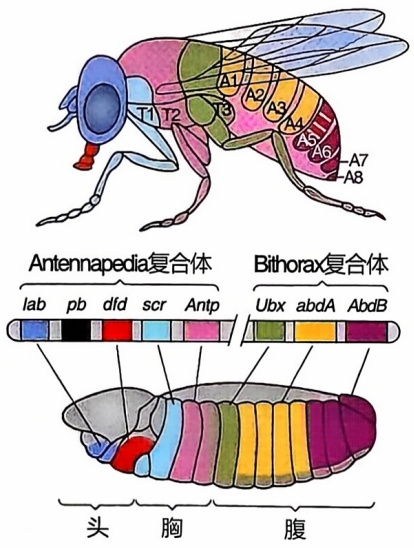

text_image

Antennapedia复合体
Bithorax复合体
lab pb dfd scr Antp
Ubx abdA AbdB
头 胸 腹

图12-3 同源异形基因在果蝇中的表达上为同源异形基因在成体果蝇中对应的结构，中为这些基因在染色体上的分布位置，下为这些基因在胚胎中的表达图谱。

廉·麦金尼斯（William McGinnis）等人最先报道了同源异形基因中存在一个高度保守的DNA序列，将其命名为同源异形框（homeobox，Hox）。它编码了一个包含约60个氨基酸的同源异形域（homeodomain，HD），是一个具有螺旋-转折-螺旋（helix-turn-helix）结构的DNA结合域（DNA binding domain）。同源异形基因的蛋白质产物是转录因子，通过调控特定基因的转录来影响体节的属性和器官的发育。

同源异形基因在生物界广泛存在，涵盖了真菌、植物和动物等。然而，这些物种在同源异形基因的数量上存在较大差异（图12-4）。在动物界，海绵只有1个同源异形基因，水螅通过复制产生了2个相邻的基因，而线虫则通过进一步复制产生5个串联的基因，构成一个复合体（complex）。在果蝇中，这个复合体分裂成两个部分——ANT-C和BX-C。而在哺乳动物和鸟类中，整个复合体重复复制，形成了4个复合体——HoxA、HoxB、HoxC和HoxD，分别位于不同的染色体上。每个复合体中的单基因在果蝇复合体中都有大致对应，而且果蝇同源异形基因突变体的表型可以通过引入哺乳动物对应基因得到挽救，证明同源异形基因的功能在进化过程中具有一定的保守性。

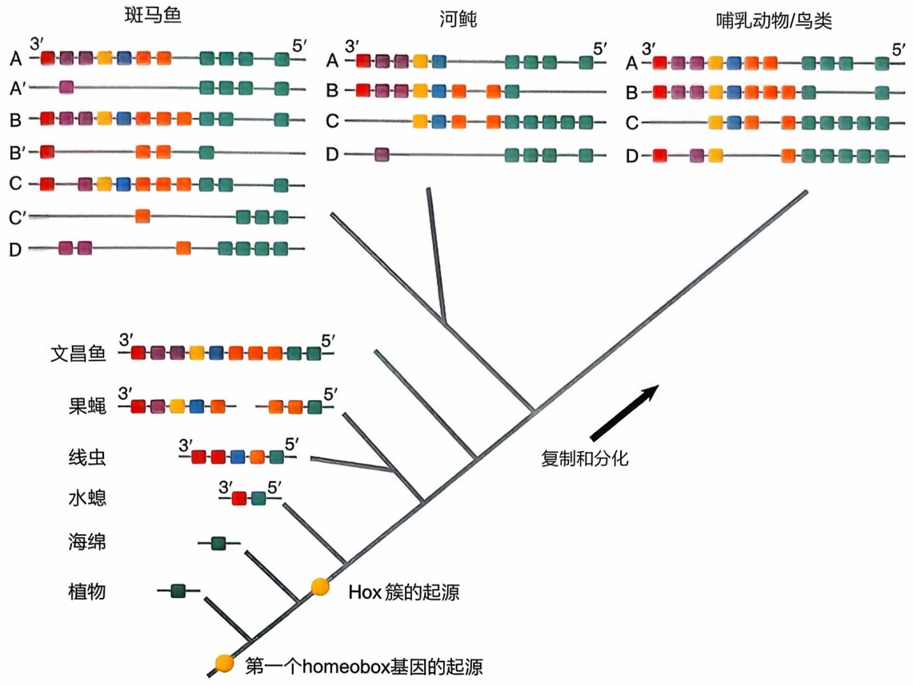

flowchart

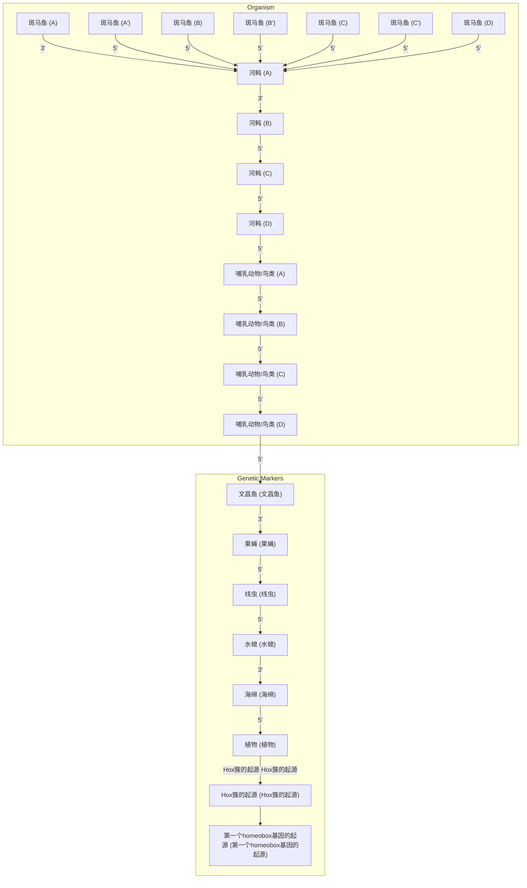

图12-4 同源异形基因及其复合体进化的代表性树状图

1987年，格林实验室利用热激法在果蝇全身表达Antp，观察到成虫的触角被转化为第二对腿（图12-5）。因为Antp的功能缺失会导致第二对腿变为触角，而其功能获得则将触角转变为第二对腿，证明Antp对第二对腿的形成是必要且充分的。基于这些发现，格林认为Antp是形成第二对腿的主控基因（master control gene）。但是，除了在原来的T2，Antp只能在头部诱导第二对腿的形成，提示Antp对特定器官（第二对腿）发育命运的控制能力是有限的。

## 2. eyeless/Pax6基因

在福尔哈德和维绍斯筛选出的控制果蝇早期胚胎发育的大批基因中，瑞士苏黎世大学的马库斯·诺尔（Markus Noll）实验室在20世纪80年代陆续克隆了paired(prd)、gooseberry(gsb)和gooseberry neuron(gsbn)等基因。他们发现这些基因都包含一段保守的DNA序列，遂将其命名为配对盒（paired box, Pax）。与配对盒对应的128个氨基酸基序被称为配对域（paired domain, PD），内含两个独立的DNA结合域。随后，诺尔实验室克隆了更多含有配对盒的基因，包括 pox neuro（poxn），pox meso（poxm）和 sparking（spa）等，并将它们统称为 Pax 基因。Pax 基因在进化过程中表现出高度保守性，哺乳动物至少有 9 个成员（Pax1 \~ Pax9）。在这些成员中，有些如 Pax1 和 Pax9 仅含配对盒，而另一些如 Pax3、Pax4、Pax6 和 Pax7 则同时具备配对盒和同源异形框。一个合理的解释是，最早的 Pax 基因只包含配对盒，在进化过程中通过复制产生了新的 Pax 基因。有些 Pax 基因发生了与 Hox 基因的交换或融合，从而同时拥有了配对盒和同源异形框。这种多样化且复杂的方式使得 Pax 基因编码的蛋白质产物具备多种结合 DNA 的方式，可以独立运用配对域或同源异形域，也可以通过这两者的协同作用来调控下游基因。这种多样性不仅拓展了 Pax 基因的调控范围（广度），还提高了调控的精确性（精度）。

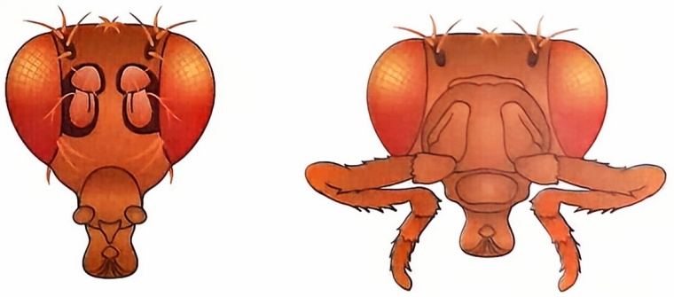

natural_image

Illustration of two insect heads with detailed wing patterns (no text or labels)

图12-5 野生型果蝇（左，头部长触角）和过表达Antp的果蝇（右，过表达Antp导致触角转变成腿）

1915年，摩尔根的学生米尔德里德·霍奇（Mildred Hoge，1885—1968）首次报告了位于果蝇第四号染色体的小眼突变。随后，摩尔根实验室获得了更多的小眼突变体，其中最严重的表型是眼完全缺失，故将该突变体命名为无眼（eyeless）。1994年，格林实验室成功克隆了eyeless基因，并发现它是哺乳动物Pax6的同源基因。有趣的是，eyeless/Pax6在果蝇和哺乳动物眼发育中的表达模式和功能均具有高度保守性。首先，eyeless/Pax6在各自物种的眼和神经系统中表达。其次，一个带有eyeless调控区的lacZ报告基因在小鼠中也能模拟Pax6在眼和神经系统的表达模式，说明调控eyeless/Pax6表达的转录因子是保守的。第三，Pax6的缺失会导致小鼠出现小眼表型，而在人类中则会导致眼中虹膜的缺失。最后，将Pax6引入果蝇中可以完全挽救eyeless的无眼表型，证明两者在功能上的保守性。

尽管果蝇的复眼和哺乳动物的单眼在形态和发育模式上存在显著差异，但上述研究结果证明了不同动物的眼或感光器官具有共同的遗传调控机制和进化途径，揭示了它们可能并非独立进化的结果。

1995年，格林实验室利用Gal4/UAS技术将eyeless或小鼠的Pax6表达到果蝇身体的其他部位，如触角、翅膀或腿，惊讶地发现这些部位都能形成眼（图12-6）。而且，这些异位的眼不仅具有正常的形态，还包含感光细胞、晶状体、视锥细胞和色素细胞，并且能记录到视网膜电流。研究团队随后发现，来自其他物种，如鱿鱼

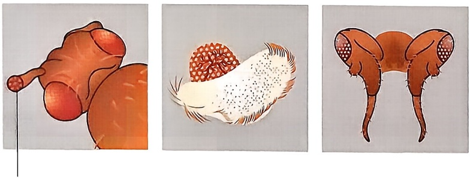

触角上的异位小眼

图12-6 在果蝇的触角（左）、翅膀（中）或腿（右）表达eyeless能诱导眼的形成

或小鼠的 Pax6 也能在果蝇的多个部位诱导眼的形成。已知果蝇眼的发育需要至少 2500 个基因的参与，而单独表达一个 eyeless 就足以诱导整个眼的形成，表明 eyeless 可能在调控所有参与眼发育的基因中扮演着极为重要的角色，类似于一个位于最上游的关键开关，决定眼的整个发育过程。这项研究不仅证明了 eyeless 是果蝇眼睛这个器官的主控基因，也为人工制造或再生哺乳动物的器官提供了宝贵的启示。

## 第三节 心脏的发育

心脏是哺乳动物生长发育过程中最先形成的功能性器官，承担着为胚胎提供必要氧气和营养的重要任务。随着胚胎的不断发育，通过简单的扩散方式已无法满足其日益增长的物质需求，此时，心血管系统的出现成为了必然。心血管系统通过心脏收缩泵送的方式，将这些生命所必需的物质输送到胚胎的各个部位，为其持续发育提供了至关重要的保障，同时也为成年后的个体生存提供了必要支持。

相比之下，节肢动物如苍蝇等的心血管系统相对简单，其主要由一个心管构成，能够在没有血管系统的辅助下完成体液的泵送。然而，哺乳动物的心血管系统则更为复杂，其拥有4个独立的心室，并通过肺循环和体循环完成氧气和二氧化碳的交换，从而为全身的营养物质、代谢物、激素以及免疫细胞的循环提供动力。尽管成年心脏在不同物种之间存在巨大差异，但其发育过程在动物界中却是高度保守的。

心脏中的绝大部分细胞，尤其是其中的最重要的功能性细胞——心肌细胞，是从原肠运动产生的中胚层衍生而来的。除了心脏之外，中胚层也会发育成骨骼肌、骨骼、血液以及其他组织。哪些中胚层细胞最终会形成心脏，它们的发育命运是在何时、何处决定的，心脏中不同位置细胞的命运又是在何时、何处，以及通过何种方式决定的，这些问题都是心脏发育学研究领域所关注的重点。本节将介绍心脏发育的基本知识，对其研究的历史，以及那些可以帮助我们理解其中关键问题的重要实验。

## 一、心脏的形态学发育

在探讨心脏发育过程中细胞命运决定的机制之前，让我们首先以小鼠的心脏发育为例，从形态学的角度简要介绍心脏发育所经历的过程。

在原肠运动的过程中，一部分细胞离开原条，形成了中胚层。其中分布于胚胎左右两侧的侧板中胚层中的一部分细胞从胚胎的后端向前端迁移，并在胚胎前端形成生心中胚层，在小鼠中，这个区域呈新月形或马蹄形，并以胚胎前后中线为轴呈基本左右对称分布。而在斑马鱼或爪蛙中，在胚胎左右两侧迁移形成的生心中胚层是互相分开的。

无论在小鼠还是斑马鱼中，生心中胚层由两侧向中间靠拢，并融合形成一条具有空腔的原始心管。最先形成心管的生心中胚层被称为第一心区，而在之后迁移进入心管的生心中胚层则被称为第二心区（图12-7）。此时心管内为一层心内膜前体细胞，而外层则是早期的心肌细胞。

随着时间的推移，生心中胚层中的心脏前体细胞不断从心管的两端向心管中迁移并产生更多心肌细胞，这使得心管相对于胚胎迅速变长，并如同过长的软管一样开始扭转，这个过程称为心管的环化。环化过程伴随着心管不同部位的膨胀、缩窄和扭曲，形成了动脉干、心球、原始心室、原始心房和静脉窦等连续的结构。

动脉干和心球形成心脏的流出道，并在内部产生螺旋状分隔，从而形成了之后的升主动脉和肺动脉干。与此同时，原始心室的厚度增加，逐渐由一层心肌细胞变为多层，并在心尖处向内形成一个包含心肌细胞的隆起，并不断生长，最终将心室区隔为两个部分——左心室和右心室。类似的区隔也发生在心房。

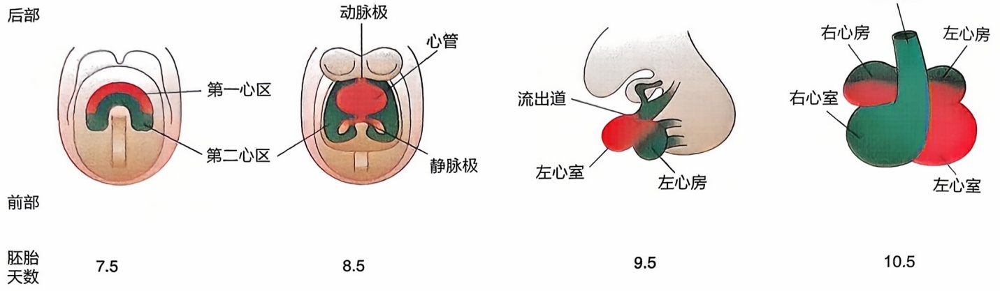

图12-7 小鼠心脏的形态发育

红色:第一心区及其衍生组织；绿色:第二心区及其衍生组织。

而在心室与流出道的连接处，心内膜与心肌细胞之间出现细胞外基质丰富的心内膜垫。它们逐渐形变重塑，与流出道的内部分隔对应，形成主动脉瓣和肺动脉瓣。而在心房心室之间的房室瓣膜也是以类似方式产生的。

## 二、细胞外信号诱导心脏前体细胞特化

由于心脏在心管开始环化的阶段就已经具备功能性的心肌细胞，并开始收缩，因此早期研究中确定早期心脏的位置及其形态变化相对简单。然而，中胚层的哪些细胞最终会成为心脏中的细胞，它们的命运是在哪个阶段决定的，又是通过哪些因素决定的，这些问题一直是发育生物学家关注的焦点。

在先进的遗传学工具被广泛用于研究心脏发育之前，科学家们主要通过在体外发育的胚胎中，如爪蛙、斑马鱼等，通过注射染料标记细胞以及细胞的移植来研究心脏发育。在通过标记确定了会形成心脏的中胚层细胞之后，Nascone等人发现如果去除前部内胚层，心脏便无法形成，而把前部内胚层移植到非生心中胚层附近，则会使这些本来不会成为心脏的中胚层细胞分化成心肌细胞。这表明与侧板中胚层临近的前部内胚层细胞对生心中胚层的特化具有重要的作用。

随后，Schneider等的研究发现，抑制Wnt信号也可以诱导非生心中胚层分化为心肌，而Wnt信号本身则抑制正常生心中胚层的特化。这从分子层面鉴定出了诱导生心中胚层特化的信号。之后的研究进一步发现，前部内胚层的确通过分泌多种Wnt信号抑制蛋白，如Dkk1和Cerberus等，确保其附近的侧板中胚层细胞可以特化为生心中胚层，而不会进入其他的分化命运。

与来自前部内胚层的 Wnt 抑制信号类似，来自脊索的 BMP 抑制信号则阻断了其周围的后端侧板中胚层选择心脏命运，而分化为体节。同时，中胚层自身分泌的 BMP 信号则对心脏前体细胞的特化是必需的。这些关键的实验结果表明，原肠运动后产生的各个部位的不同胚层细胞都是通过近距离的细胞外信号调控来影响自身和周围细胞的命运。细胞间相对空间位置关系和细胞特异性信号转导因子的表达、分泌与接收协调一致，确保各类细胞正常分化为特定的组织器官。

## 三、转录因子调控心脏前体细胞命运

通过注射染料标记细胞和细胞群体的移植无法对发育过程中各个不同类群的边界进行精确定义，而细胞类型和发育阶段特异性表达的转录因子，以及以它们为基础开发的各种遗传实验手段，则使我们能够更加精确地研究前体细胞的位置和命运变化。

第一个心肌特异性的转录因子是在果蝇中被发现的。随机突变筛选发现这个基因的功能缺失导致果蝇无法发育出心管，因此它被命名为“tinman”，意为铁皮人（童话小说《绿野仙踪》中没有心脏的角色）（图12-8）。果蝇的tinman基因特异性表达在心管的心肌细胞中，而它的表达和对心脏发育的重要性在动物中是高度保守的。在哺乳动物中，tinman的同源基因Nkx2-5在心脏前体细胞的特化过程和心脏早期发育中也起到了至关重要的作用。Nkx2-5的突变会导致心脏发育在心管阶段停滞。而激活心脏前体细胞特化的BMP信号则是激活Nkx2-5表达的重要信号。

A

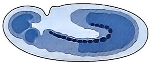

natural_image

Illustration of a biological cell or embryo with internal structures (no text or labels)

tinman

B

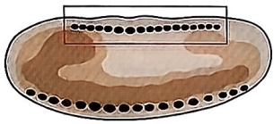

natural_image

Cross-sectional diagram of a biological tissue section with dark circular structures and a highlighted region (no text or labels)

野生型

C

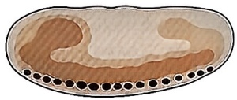

tinman突变

另一个比 Nkx2-5 表达稍早的侧板中胚层转录因子是 Mesp1。它在中胚层中被 Wnt 和 BMP 共同激活，和 Nkx2-5 共同促进一系列心脏前体细胞的基因表达，并形成共调控网络，稳定这些细胞向心肌方向分化（图 12-9）。然而，在已经特化的生心中胚层中，Mesp1 的表达则被 Wnt 的抑制信号迅速下调。因此，Mesp1 只短暂存在于从原肠运动后期到侧板中胚层的中胚层细胞中。Mesp1 对心脏的发育也是至关重要的，Mesp1 敲除的小鼠胚胎甚至无法形成新月形的生心中胚层。这些研究揭示了心脏发育过程中关键转录因子和信号通路的作用，为更深入地理解心脏发育机制提供了重要线索。

## 四、心脏前体细胞对心脏的贡献

随着技术的进步，基于Cre同源重组酶的遗传示踪技术在心脏发育领域被广泛使用。它可以通过同源重组的方式永久标记表达过一个特定基因的细胞及其所有后代，既其谱系，使我们可以看到这些细胞对器官的具体贡献，以及它们在发育过程中的命运决定。

图12-8 tinman对果蝇心脏发育是必需的（A）tinman在发育 $7.5\mathrm{h}$ 果蝇胚胎的心肌细胞中特异性表达；（B）发育 $14\mathrm{h}$ 野生型果蝇胚胎，框中为心肌细胞形成的心管；（C）tinman突变导致心管整体缺失。

图 12-9 BMP 激活 Nkx 2-5 和 Mesp1，共同调控心脏前体细胞的转录网络

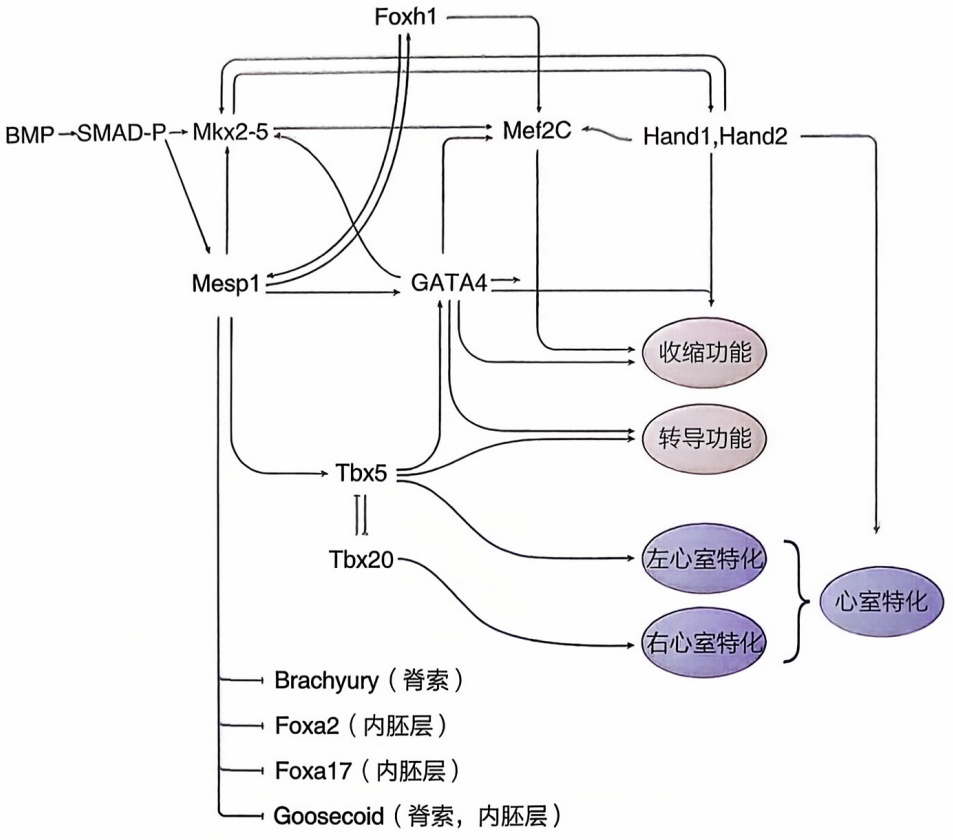

flowchart

```mermaid
graph TD
  Foxh1 -->|Transcription| Mekx25["Mekx2-5"]
  Foxh1 -->|Transcription| Mef2C
  Foxh1 -->|Transcription| Hand1
  Mekx25 -->|Transcription| Mesp1
  Mef2C -->|Transcription| Hand1
  Mef2C -->|Transcription| Hand2
  Hand1 -->|Transcription| Recycle1
  Hand2 -->|Transcription| Recycle2
  Recycle1["BMP→SMAD-P"] --> Mesp1
  Recycle2["Hand1, Hand2"] --> Recycle3
  Recycle3 -->|Transcription| Mef2C
  Recycle4["Mef2C"] --> GATA4
  Recycle5["Hand1, Hand2"] --> Recycle4
  Recycle6["Mef2C"] --> Recycle5
  Recycle7["Hand1, Hand2"] --> Recycle6
  Recycle8["Mef2C"] --> Recycle7
  Recycle9["Hand1, Hand2"] --> Recycle8
  Recycle10["Mef2C"] --> Recycle10
  Recycle11["Hand1, Hand2"] --> Recycle11
  Recycle12["Mef2C"] --> Recycle12
  Recycle13["Hand1, Hand2"] --> Recycle13
  Recycle14["Mef2C"] --> Recycle14
  Recycle15["Hand1, Hand2"] --> Recycle15
  Recycle16["Mef2C"] --> Recycle16
  Recycle17["Hand1, Hand2"] --> Recycle17
  Recycle18["Mef2C"] --> Recycle18
  Recycle19["Hand1, Hand2"] --> Recycle19
  Recycle20["Mef2C"] --> Recycle20
  Recycle21["Hand1, Hand2"] --> Recycle21
  Recycle22["Mef2C"] --> Recycle22
  Recycle23["Hand1, Hand2"] --> Recycle23
  Recycle24["Mef2C"] --> Recycle24
  Recycle25["Hand1, Hand2"] --> Recycle25
  Recycle26["Mef2C"] --> Recycle26
  Recycle27["Hand1, Hand2"] --> Recycle27
  Recycle28["Mef2C"] --> Recycle28
  Recycle29["Hand1, Hand2"] --> Recycle29
  Recycle30["Mef2C"] --> Recycle30
  Recycle31["Hand1, Hand2"] --> Recycle31
  Recycle32["Mef2C"] --> Recycle32
  Recycle33["Hand1, Hand2"] --> Recycle33
  Recycle34["Mef2C"] --> Recycle34
  Recycle35["Hand1, Hand2"] --> Recycle35
  Recycle36["Mef2C"] --> Recycle36
  Recycle37["Hand1, Hand2"] --> Recycle37
  Recycle38["Mef2C"] --> Recycle38
  Recycle39["Hand1, Hand2"] --> Recycle39
  Recycle40["Mef2C"] --> Recycle40
  Recycle41["Hand1, Hand2"] --> Recycle41
  Recycle42["Mef2C"] --> Recycle42
  Recycle43["Hand1, Hand2"] --> Recycle43
  Recycle44["Mef2C"] --> Recycle44
  Recycle45["Hand1, Hand2"] --> Recycle45
  Recycle46["Mef2C"] --> Recycle46
  Recycle47["Hand1, Hand2"] --> Recycle47
  Recycle48["Mef2C"] --> Recycle48
  Recycle49["Hand1, Hand2"] --> Recycle49
  Recycle50["Mef2C"] --> Recycle50
  Recycle51["Hand1, Hand2"] --> Recycle51
  Recycle52["Mef2C"] --> Recycle52
  Recycle53["Hand1, Hand2"] --> Recycle53
  Recycle54["Mef2C"] --> Recycle54
  Recycle55["Hand1, Hand2"] --> Recycle55
  Recycle56["Mef2C"] --> Recycle56
  Recycle57["Hand1, Hand2"] --> Recycle57
  Recycle58["Mef2C"] --> Recycle58
  Recycle59["Hand1, Hand2"] --> Recycle59
  Recycle60["Mef2C"] --> Recycle60
  Recycle61["Hand1, Hand2"] --> Recycle61
  Recycle62["Mef2C"] --> Recycle62
  Recycle63["Hand1, Hand2"] --> Recycle63
  Recycle64["Mef2C"] --> Recycle64
  Recycle65["Hand1, Hand2"] --> Recycle65
  Recycle66["Mef2C"] --> Recycle66
  Recycle67["Hand1, Hand2"] --> Recycle67
  Recycle68["Mef2C"] --> Recycle68
  Recycle69["Hand1, Hand2"] --> Recycle69
  Recycle70["Mef2C"] --> Recycle70
  Recycle71["Hand1, Hand2"] --> Recycle71
  Recycle72["Mef2C"] --> Recycle72
  Recycle73["Hand1, Hand2"] --> Recycle73
  Recycle74["Mef2C"] --> Recycle74
  Recycle75["Hand1, Hand2"] --> Recycle75
  Recycle76["Mef2C"] --> Recycle76
  Recycle77["Hand1, Hand2"] --> Recycle77
  Recycle78["Mef2C"] --> Recycle78
  Recycle79["Hand1, Hand2"] --> Recycle79
  Recycle80["Mef2C"] --> Recycle80
  Recycle81["Hand1, Hand2"] --> Recycle81
  Recycle82["Mef2C"] --> Recycle82
  Recycle83["Hand1, Hand2"] --> Recycle83
  Recycle84["Mef2C"] --> Recycle84
  Recycle85["Hand1, Hand2"] --> Recycle85
  Recycle86["Mef2C"] --> Recycle86
  Recycle87["Hand1, Hand2"] --> Recycle87
  Recycle88["Mef2C"] --> Recycle88
  Recycle89["Hand1, Hand2"] --> Recycle89
  Recycle90["Mef2C"] --> Recycle90
  Repetinases["Repeats"] -.-> Mesp1
  
  %% Transcription Connections from Mesp1 to Tbx5 and Tbx5/TrpX are shown as directed arrows indicating gene expression or transcriptional activity. 
  %% Transcription Connections from Tbx5/TrpX are shown as directed arrows indicating gene expression or transcriptional activity. 
  %% Transcription Connections from Tbx5/TrpX are shown as directed arrows indicating gene expression or transcriptional activity. 
  %% Transcription Connections from Tbx5/TrpX are shown as directed arrows indicating gene expression or transcriptional activity. 
  %% Transcription Connections from Tbx5/TrpX are shown as directed arrows indicating gene expression or transcriptional activities. 
  %% Transcription Connections from Tbx5/TrpX are shown as directed arrows indicating gene expression or transcriptional activity. 
  %% Transcription Connections from Tbx5/TrpX are shown as directed arrows indicating gene expression or transcriptional activity. 
  %% Transcription Connections from Tbx5/TrpX are shown as directed arrows indicating gene expression or transcriptional activity. 
  %% Transcription Connections from Tbx5/TrpX are shown as distributed branches connecting these genes. 
  %% Transcription Connections from Tbx5/TrpX are shown as distributed branches connecting specific genes like Brachyury and Foxa17. 
  %% Transcription Connections from Tbx5/TrpX are shown as distributed branches connecting additional genes like Goosecoid. <|caption_end|>
```

例如，虽然Mesp1的表达非常短暂，但基于Cre系统的遗传示踪工具发现，用调控Mesp1表达的元件控制的Cre标记所有曾经表达过Mesp1的中胚层细胞，胚胎后期心脏中的所有细胞都能够被标记上。这说明心脏中的细胞，尤其是心肌细胞，在发育过程中都曾经表达过Mesp1（图12-10）。

上述Mesp1、Nkx2-5，以及其他转录因子如Gata4等一起形成了心脏前体细胞基

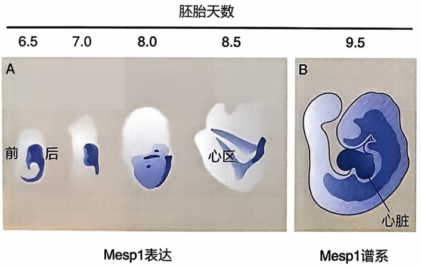

text_image

胚胎天数
6.5 7.0 8.0 8.5 9.5
A
前后 心区
Mesp1表达
B
心脏
Mesp1谱系

图12-10 Mesp1标记早期的心脏前体细胞

Mesp1 在小鼠胚胎第 6.5 到 9.5 天的表达。Mesp1 在胚胎后端的中胚层中表达，在其迁移到前端后迅速下调，而在形成生心中胚层心区的区域中没有表达（A）。但通过 Mesp1-Cre 和 loxp 介导的 lacZ 报告系统标记表达过 Mesp1 的细胞及其后代细胞，显示 Mesp1 谱系标记了所有心脏中的细胞（B）。

因表达的调控网络，这些前体细胞还会继续由于其自身和环境的区别进行差异化的命运选择。Mesp1阳性细胞是从胚胎的左右两侧从胚胎后端向前端移动的，在到达前端后它们会在胚胎中线融合形成生心中胚层的心区。而这个迁移和融合的过程依赖于临近的内胚层和相关的信号分子。多种内胚层的基因突变，可能通过影响内胚层-中胚层相互作用的形式，阻碍了生心中胚层在中线的融合。例如，在生心中胚层迁移路径上的内胚层早期前肠细胞中表达Foxp4基因，其突变会导致生心中胚层在胚胎左右两侧独立发育出两个心脏（图12-11）。这不仅说明内胚层对心脏发育的重要性，也说明部分心脏发育的内在程序不受中线融合的影响。多种突变会造成心脏前体细胞的融合缺陷，这一表型被称为心二分支（cardiac bifida）。

生心中胚层在中线融合并形成心管后，其环化的方向是固定的，即流出道向右下膨出，心室移向左侧，而心房则向后上方移动，进入心室左侧背上方。这一固定的环化方式是受胚胎的左右不对称信号引导的。在脊椎动物发育的原肠运动后期，左侧的侧板中胚层表达Nodal蛋白，激活转录因子Ptix2在左侧的特异性表达，决定了胚胎左侧与右侧细胞的区别。而最早决定Nodal左右不对称表达的因素，即胚胎左右对称性的破除，在不同的动物中机制不尽相同。在原条尾端原结结构中纤毛的定向转动可能是如Nodal等信号蛋白不对称分布的原因，而更低等的动物可能在合子阶段就已经建立了左右不对称。

奇妙的是，某些产生左右不对称缺陷的突变完全不影响心脏的整体发育，心脏环化和后续的发育除了方向与正常心脏相反，并没有别的功能性缺陷，而发育形成了右位心（dextrocardia）。这表明左右不对称的建立对心脏发育不是必需的。但是其他一些影用心室肌球蛋白反义 RNA 探针染色小鼠胚胎心脏，显示第 13.5 天野生型胚胎在中间偏左有一个心脏（A）。而缺失 Foxp4 的小鼠在左右两侧各发育出了独立的心脏（B）。

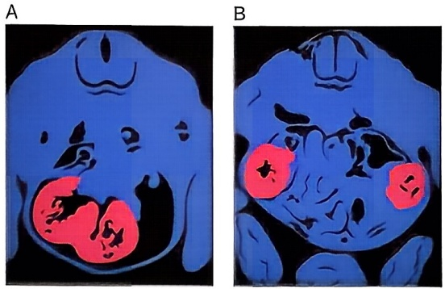

图12-11 Foxp4突变小鼠胚胎的心二分支表型

响左右不对称的突变则导致了心脏环化和后续发育的缺陷，以及多种先天性心脏病。这说明心脏发育与左右不对称之间有一些共同的分子和细胞机制，如细胞骨架和细胞的迁移等，它们的缺陷会同时影响心脏发育和左右不对称两种表型。

## 五、生心中胚层的不同心区

在前面提到的原始心管形成过程中，最先形成心管的生心中胚层被称为第一心区，而在之后迁移进入心管的生心中胚层被称为第二心区。这个形态上的区分也得到了分子生物学的验证。转录因子Isl1被发现特异性的表达在第二心区中，而其表达随着细胞迁移进入心管而消失。有趣的是，用调控Isl1表达的元件控制的Cre标记所有曾经表达过Isl1的中胚层细胞，发现第二心区的细胞在进入心管后，主要贡献给了右心室和流出道以及大部分的心房。相对而言，没有表达Isl1的第一心区细胞则主要贡献给了左心室和少部分的心房（见图12-7）。Isl1的敲除导致整个第二心区的缺失和心脏发育的早期停滞，表明它对第二心区细胞的命运是决定性的。

虽然整个第二心区都被Isl1标记，但从前部和后部进入心管的第二心区细胞命运也是不同的。从心管前端进入的细胞会分化为右心室和流出道，而从心管后端进入的细胞则会分化为心房。这一差异被认为主要是由胚胎后部中胚层产生的视黄酸引起的。接触到高浓度视黄酸的后部第二心区的命运特化为心房和静脉窦，而前部第二心区和第一心区细胞接触到视黄酸信号较弱，则分化为心室。

除了心区中的细胞分化为心房心室的心肌细胞，静脉窦位置的一部分细胞会迁移到发育中的心脏表面，逐渐形成覆盖整个心脏的单层上皮心外膜。部分心外膜细胞会经过上皮间充质转化（epithelial mesenchymal transformation，EMT）迁移至心肌细胞之间，并分化为心脏成纤维细胞和冠状动脉平滑肌细胞（图12-12）。还有另外一部分相对更远的细胞也参与了心脏发育:从背侧神经管形成过程中产生的迁移性神经嵴细

图12-12 心外膜的发育及其对心脏的贡献

（A）心外膜祖细胞（黄色）在静脉窦附近发生。（B）心外膜细胞移动到发育中的心脏（红色）表面。（C）心外膜细胞逐渐包裹整个心脏，形成心外膜，部分细胞开始通过EMT进入心肌层。（D，E）进入心肌层的心外膜来源细胞分化为成纤维细胞、冠状动脉平滑肌细胞等非心肌细胞。

A

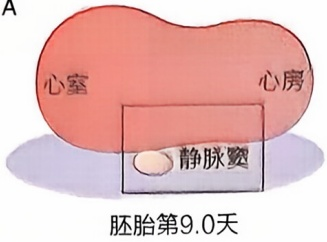

text_image

A
心室
心房
静脉窦
胚胎第9.0天

B

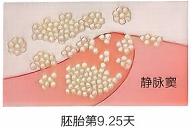

text_image

静脉窦
胚胎第9.25天

C

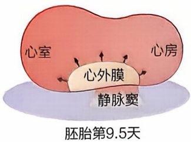

text_image

心室
心房
心外膜
静脉窦
胚胎第9.5天

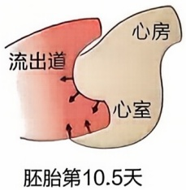

text_image

流出道
心房
心室
胚胎第10.5天

text_image

心外膜
心肌

D

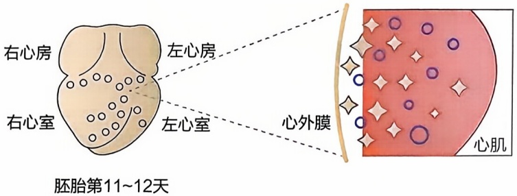

text_image

右心房
左心房
右心室
左心室
心外膜
胚胎第11~12天
心肌

E

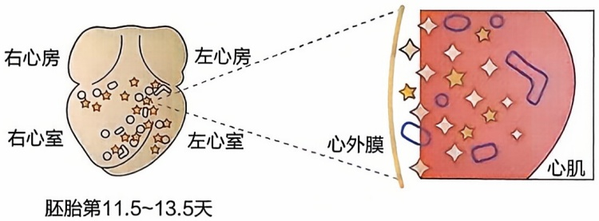

text_image

右心房
左心房
右心室
左心室
心外膜
胚胎第11.5~13.5天
心肌

胞，一部分会迁移至发育中的心管前部，融合入第二心区产生的流出道，分化为升主动脉的平滑肌细胞。

从原肠运动到心管形成阶段的哺乳动物胚胎非常小，其中与心脏相关的细胞数量并不多，以往的谱系示踪等技术最终还是需要通过染色成像等手段进行鉴定，分辨率不高。近年来，随着单细胞测序技术、高分辨率成像技术等先进实验手段的发展，我们可以在单个细胞的分辨率下检验发育过程中的细胞命运改变路径，从而可以在以往的较笼统的框架下添加更多细节。

如过去第一第二心区的划分依赖于数个特异性基因比如 Isll 的表达。然而，通过单细胞测序对标志物基因的差异表达分析和对细胞命运的追踪，一群在新月形心区边缘，位于胚胎和胚外中胚层的交汇处，被称为心周区（juxta-cardiac field，JCF）的祖细胞，被发现可以分化为心肌细胞和心外膜。这群细胞的出现要早于经典的第一、第

二心区，是已知最早的心外膜祖细胞。

## 六、心室的发育

心脏中主要行使泵血功能的是提供体循环动力的左心室和提供肺循环动力的右心室。当第一心区分化而来的左心室与第二心区分化而来的右心室还在一个心管内的时候，它们之间的边界就十分清晰。左心室的命运主要由转录因子Tbx5决定，它的缺失或全心脏的表达都会形成一个没有分隔的心室，而失去左右心室的区分。而Tbx5的这一功能十分保守，即使在基本没有分隔左右心室的爬行动物中，它也在心室的左侧表达。

在哺乳动物中，左右心室的边界处产生肌性突起，并向上通过增殖产生完全隔开左右心室的心室间隔。心肌细胞增殖的缺陷，可能导致心室间隔的生长不足以完全隔开左右心室，造成室间隔缺损（ventricular septal defect，VSD），使出生后体循环和肺循环的混合降低供血效率。而左右心房的分隔有更多细胞类型的参与，也更容易受到遗传和环境因素的影响造成心房间隔缺损（atrial septal defect，ASD）。

在心室形成过程中，靠内接近心内膜的心肌细胞形成短束状肌小梁，被心内膜细胞包裹，而靠外的心肌细胞则互相紧密连接，形成心室的致密层。肌小梁和致密层的心肌细胞也有不同的转录因子标志物。比如，转录因子Hey2特异性地表达在致密层，其敲除导致致密层表达肌小梁标志基因，并使心室壁变薄。Hey2的特异性表达和其他转录程序导致致密区心肌细胞增殖比肌小梁心肌细胞快，使心室壁逐渐增厚。而在胚胎发育晚期，部分肌小梁会与心室致密层融合，形成更厚的心室壁。这一过程如果受到影响，会导致心室致密化不全，出生后心脏残留过多肌小梁，阻碍心脏功能。

## 七、出生后心脏的成熟

哺乳动物与非哺乳动物很重要的一个区别是每个个体都需要经过出生的过程，虽然出生后的个体仍然可以继续发育。而心脏在出生后经历的发育，或者称为成熟的过程，包括各种与胚胎时期不同的巨大变化。这主要是由于肺循环在出生后才出现，而心脏需要在出生后迅速隔离体循环和肺循环，因此它在出生前后的功能和面对的环境存在巨大的差异，不亚于在出生后才行使功能的肺。

在小鼠中，绝大部分心肌细胞在一周内永久退出细胞周期，主要代谢方式由糖酵解转变为脂肪酸的氧化磷酸化，并进行多倍体化（在啮齿类中大部分心肌细胞有两个双倍体细胞核，在人类中则多为一个多倍体细胞核）。更大的变化是，出生后整个心脏的生长主要依赖心肌细胞的肥大性生长，即每个细胞变大而其数量并不变多。这一变化也伴随着行使收缩功能的肌节结构的高度组织化并充斥整个心肌细胞。而使心肌细胞快速感受电信号进行收缩的特殊结构——横管也在出生后逐渐形成。横管是心肌细胞质膜的规律性内陷，与肌节平行排列。它们通过拉近质膜与肌节的距离，使细胞膜的去极化可以在心肌细胞内的各处激活收缩需要的钙信号，使得巨大的心肌细胞可以同步高效收缩。

这些变化被认为受到出生后氧气浓度变化、身体对供氧和心脏泵血能力的需求改变、甲状腺素水平等因素的共同调控。这些外部变化通过体内的分泌因子、激素、机械力等方式影响了心肌细胞内的信号通路，并最终通过转录因子改变了心肌细胞的基因表达和随后的蛋白质翻译以及最终的细胞表型。例如，心肌细胞的代谢转变就是由母乳通过消化道进入新生动物血液的脂肪酸所激活的。介导脂肪酸激活脂肪酸氧化磷酸化的转录因子包括多种核受体以及激活线粒体生成的PPAR和PGC1α等。

## 八、心脏发育研究的新技术

单细胞测序技术可以以单细胞分辨率检验心脏发育过程中各种细胞的命运改变。而在单细胞测序的基础上，具有高空间分辨率的空间转录组测序加深了我们对发育中各种细胞的理解。与空间位置对应的单个细胞转录图谱不仅验证了过去几十年来发育生物学逐渐积累起来的知识，包括各种位置特异性和发育阶段特异性的基因表达，也揭示了更多之前未被发现的细胞类群特异性或位置特异性的基因。

遗传示踪工具如Cre/loxp系统，是发育生物学研究的重要工具。它们给我们展示了早期前体细胞的位置和特异性的基因表达，这决定了其在之后形成器官里的细胞位置和类型，对理解发育过程中细胞的命运决定是至关重要的。而这类系统非常依赖调控Cre表达的元件的特异性，而发育生物学的发展也依赖时空特异性更加完善的谱系示踪系统。更加先进的遗传示踪工具，如基于双同源重组酶系统的遗传谱系示踪技术等，可以同时检验不同细胞的谱系及其相互关系，可更加清晰地解析心脏发育过程中和其他发育系统中各种谱系的相互关系和细胞命运的决定性因素。

在遗传谱系示踪之外，哺乳动物胚胎的体外培养技术使得对其发育过程进行实时成像追踪成为可能，而先进的全胚胎活体荧光成像技术及图像数据分析技术使我们可以以前所未有的精确度观察心脏发育过程中每个细胞的行为，并发现之前未曾发现的现象。例如，心肌细胞增殖的方向在心脏不同位置完全不同，可能导致了致密层和肌小梁的命运差异。

综上，心脏的发育经历了从中胚层到生心中胚层、从心脏前体细胞到心肌细胞、从增殖的胚胎心肌细胞到多倍体成熟心肌细胞等变化过程，这些发育过程中细胞的命运由细胞的外因和内因（如细胞所处位置及其感受胞外信号的强度以及细胞特异性的转录程序）共同决定。虽然很多经典的信号、转录因子已经被发现，但是随着技术进步，如从胚层的切割移植到遗传示踪到单细胞组学，更多细节将被发现，我们将更清晰地解析心脏发育的分子机制和关键命运决定事件。而这些知识不仅可以帮助我们深入认识心脏的发育过程，也将帮助我们理解先天性心脏病以及部分成年心脏疾病的发病机制，以及寻找可能的治疗方法。

## 第四节 肾脏的发育

## 一、肾脏的基本结构

肾脏是动物个体维持水、离子平衡和酸碱平衡的核心器官，起着排出代谢废物和调节血压的功能。

肾脏由收集管（collecting duct）和肾单位（nephron）两部分组成，这两部分都是由中间中胚层发育而来的。其中肾单位是肾脏的基本功能单元，分为肾小球和肾小管。肾单位由后肾间充质发育而来。小鼠每个肾脏约有10万个肾单位，人类约100万个。肾单位主要位于肾脏皮质区，由肾小球和肾小管组成。

肾小球位于肾单位的最前端，是血液过滤的主要部位。肾小球中央是疏松多孔的毛细管丛，血液从血管依次经过肾小球基底膜、足细胞进入鲍曼囊和肾小管。肾小球基底膜结构非常致密，起屏障作用，保留高分子量的蛋白质和血细胞在血液中，同时允许水、糖和电解质等小分子进入肾单位。肾小管负责重吸收肾小球滤过液中的无机质、有机质和水。根据其形态可以进一步细分为不同的节段包括近曲小管、近直小管（髓袢降支粗段）、Henle环（髓袢细段）、远直小管（髓袢升支粗段）和远曲小管（图12-13）。肾小管不同的节段由不同形态的细胞组成，表达不同的离子转运蛋白，行使不同的功能。近端小管（包括近曲小管、近直小管）的主要功能是重吸收各种重要的无机盐和有机质如糖、氨基酸等。Henle环是重吸收水的主要节段，起浓缩滤过液的作用，这对于陆生动物非常重要。远端小管则调控钠、钙离子的重吸收。

## 二、后肾的发育

在羊膜动物（鸟类、爬行类和哺乳类）中，根据肾脏形成的位置和时间，可以分为前肾、中肾和后肾。在鱼类和两栖类胚胎中，前肾形成且发挥功能。而在哺乳动物中，前肾很快凋亡，并不发挥肾脏的滤过功能。中肾和后肾都是由中间中胚层分化而来的肾管（nephric duct）诱导附近的生肾间充质（nephric mesenchyme）生成。中肾并不是一个独立的、有完整包膜结构的器官，而是呈弥散的组织状。中肾在鱼类和两栖类中发挥着肾的功能，但在哺乳动物中可能并没有作为肾发挥功能，而是在胚胎期间作为造血干细胞的主要来源。后肾是羊膜动物的永久肾，是一个独立的、有完整包膜结构的器官。

后肾的形成来源于中间中胚层上皮细胞（肾管）和间充质细胞（生肾索）之间的一系列相互诱导。在小鼠中，肾管原基在胚胎发育第8.5天（E8.5）于躯体前部形成，并开始向尾部延伸。E10.5时，位于尾部靠近泄殖腔的肾管在后肾间充质的诱导作用下，形成输尿管芽并以萌芽形式向管外生长，进入后肾间充质。进入后肾间充质的输尿管芽在间充质细胞的诱导下不断形成分枝，并诱导后肾间充质细胞发生间充质向上皮转化，分化形成肾单位。最终，在输尿管芽上皮细胞和后肾间充质细胞的相互诱导

图12-13 哺乳动物肾脏及肾单元示意图

（A）肾脏示意图；（B）肾单位、收集管和血管示意图；（C）肾小球示意图。

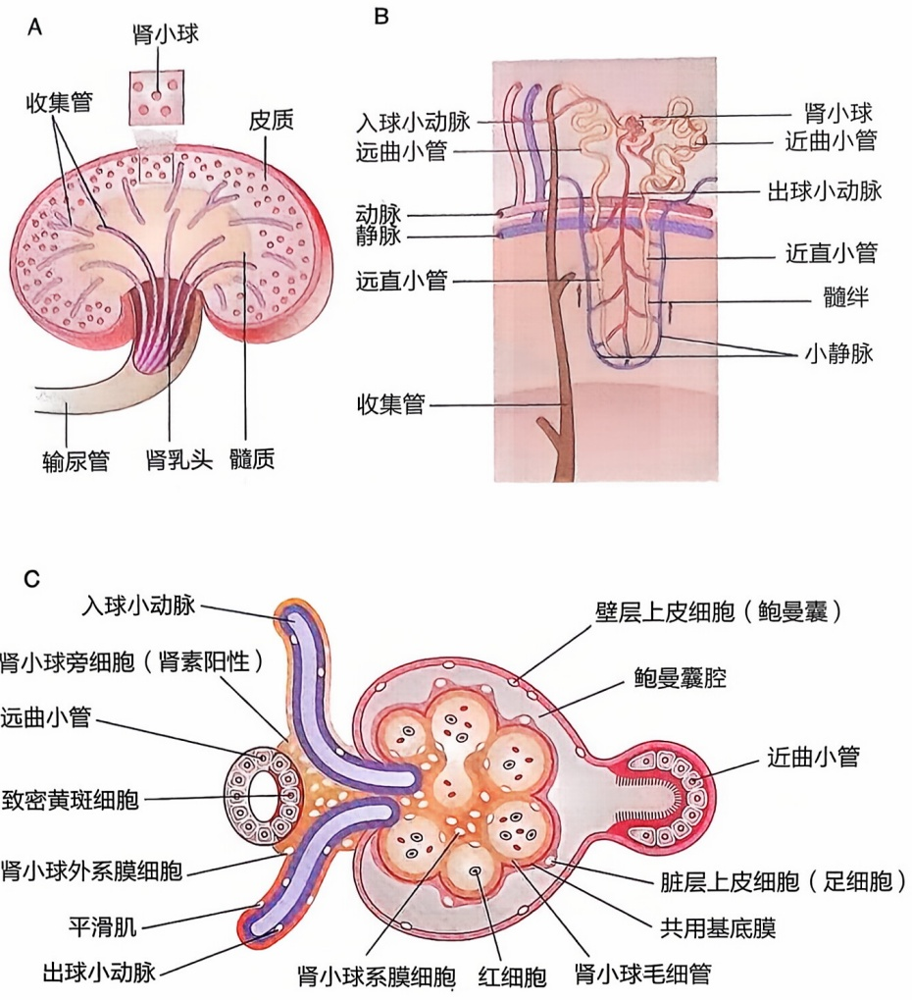

下，形成了后肾。

位于输尿管芽下方的肾管进一步向尾部延伸，并插入到由内胚层分化而来的膀胱中。由此，输尿管形成，将肾脏滤过形成的尿液输送到膀胱。随着胚胎的发育，躯干伸长，后肾在腹部发生旋转并上升。在人类胚胎中，后肾在第一至第二骶椎的位置形成，最终上升到第十二胸椎至第三腰椎处，完成肾脏的发育。

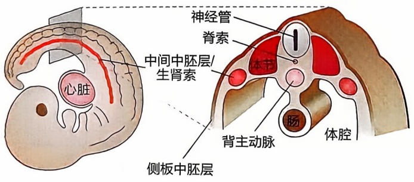

text_image

神经管
脊索
体节
背主动脉
肠
体腔
中间中胚层/生肾索
心脏
侧板中胚层

图12-14 肾脏来源于中间中胚层

左:小鼠胚胎侧面示意图，浅红色代表中间中胚层/生肾索；右:小鼠胚胎横截面示意图。

## 1. 中间中胚层的分化

在羊膜动物胚胎发育过程中，原肠胚期的胚胎发育分化为3个胚层，分别为外胚层、内胚层和处于两者之间的中胚层。外胚层进一步分化为皮肤和神经系统，内胚层则分化为呼吸系统和消化系统，而其他器官或者组织，包括血液循环系统、泌尿生殖系统以及肌肉骨骼，则都由中胚层分化而来。在发育过程中，中胚层并不是直接分化成这些组织器官，而是按照由背部到腹部或中间到两侧的位置先分化成中轴中胚层、轴旁中胚层、中间中胚层和侧板中胚层（图12-14）。