肾脏就是由中间中胚层进一步分化形成的。

在骨形态发生蛋白 4（Bone morphogenesis protein4, BMP4）梯度浓度作用下，中胚层沿着背腹轴进一步分化。分化出的中间中胚层，进一步向生肾索和肾管分化，这一过程需要轴旁中胚层的作用。在鸡胚中胚层分化之后，将轴旁中胚层和中间中胚层切割使其隔离，会导致中间中胚层不能表达肾的标记基因 Pax2，表明不能分化成肾。而在没有切割的另一侧，中间中胚层能够正常的分化成肾（图 12-15）。

同源异形框因子 Lim1（或称为 Lhx1）、Pax2 和 Pax8 对于中间中胚层向肾管的分化是非常重要的。Pax2 或 Pax8 对于肾管形成是必需的，而 Lim1 则对

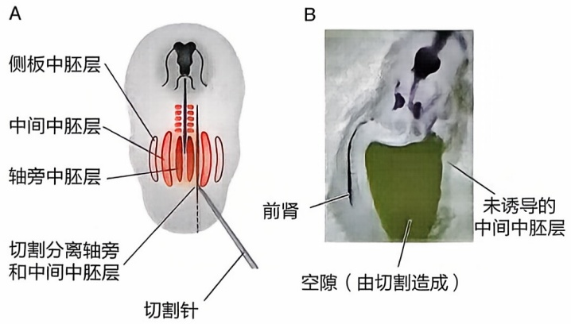

text_image

A
侧板中胚层
中间中胚层
轴旁中胚层
切割分离轴旁和中间中胚层
切割针
B
前肾
未诱导的
中间中胚层
空隙（由切割造成）

图12-15 轴旁中胚层诱导中间中胚层向肾分化（A）将鸡胚右侧轴旁中胚层和中间中胚层手术分开示意图；（B）Pax2阳性的前肾组织只在左侧形成，在右侧缺失。

于肾管向后端延伸是必需的。在鸡胚中，Pax2 表达在位于躯干部位的中间中胚层（即在前端不表达）。如果在轴旁中胚层的前体节板中过表达 Pax2，则会诱导该部分细胞转变为中间中胚层，表达 Lim1 并形成肾管，说明 Pax2 对于中间中胚层向肾管的分化是充分的。此外，如果在小鼠胚胎中敲除 Pax2，中间中胚层向肾管的转化就无法形成。因而，Pax2 对于中间中胚层向肾管的分化既是充分的也是必要的。

## 2. 收集管的形成

收集管不仅连通远曲小管和输尿管，将经过肾单位过滤和重吸收的血液滤过液输送到输尿管，而且进一步重吸收水和钠（陆生生物的重要特点）。收集管主要包含两类细胞——主细胞（principal cell）和闰细胞（intercalated cell）。数量较多的主细胞负责水的重吸收，而数量较少的闰细胞负责钠的重吸收。

收集管由来源于肾管的输尿管芽发育而来。在小鼠中，肾管在胚胎期E8.75时出现在前端体节处，并向尾部延伸。在E10.5，在后肢水平位置输尿管芽从肾管向两侧的后肾间充质萌出，并进入肾间充质。在E11.5，输尿管芽形成两个分支，呈T字形。之后，输尿管芽主要以一分为二的形式进行分支，形成复杂的二叉树结构。至小鼠出生后两天，其肾脏约包含3400个分支。

输尿管芽的萌出是胶质细胞源性神经营养因子（glial cell-derived neurotrophic factor, GDNF）和 Ret 受体共同作用的结果。其中，GDNF 来自于后肾间充质，而 Ret 来自于肾管。Ret 由周围细胞分泌的视黄酸（retinoic acid, RA）诱导。GDNF 或 Ret 基因敲除的小鼠在出生后不久就死于肾缺如。输尿管芽的萌出是一个受到严格调控的过程。正常情况下，一根肾管只萌出一个输尿管芽。输尿管芽无法萌出会导致肾缺如，而输尿管芽萌出多个也会导致形成的肾没有正常的功能。为了保证只萌出一个输尿管芽，GDNF 和 Ret 受到很多因子的负调控。在肾间充质中，GDNF 的表达受到转录因子 Foxc1/Foxc2 以及信号分子 Slit2/Robo2 的负调控；而在输尿管芽中，Ret 的表达受到酪氨酸激酶受体 Spry1 和骨骼形态发生素 BMP4 的负调控。

输尿管芽的分支是多个信号通路共同作用的结果，包括 Ret、Fgf、经典 Wnt、RA等信号通路（图12-16）。输尿管芽顶端是一群干细胞，保持输尿管芽分支的能力。RTK、Wnt和RA的下游基因在输尿管芽顶端中持续表达，也提示了这些信号通路在该过程中的重要作用。Ret是输尿管芽顶端干细胞所必需的。Ret和Fgf受体都属于

图12-16 输尿管芽萌出和分支及其分子机制示意图蓝色为输尿管和输尿管芽，粉色为生肾间充质，红色为发育中的肾单位。

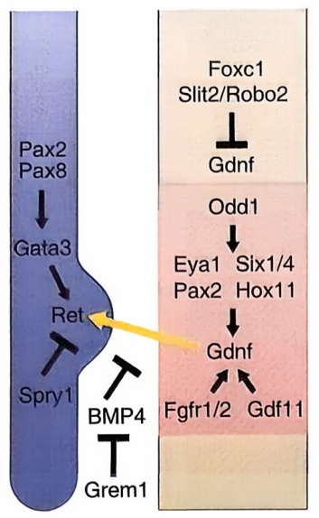

flowchart

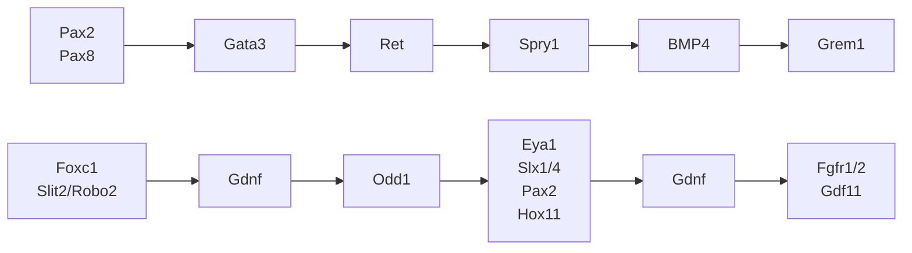

E10.5

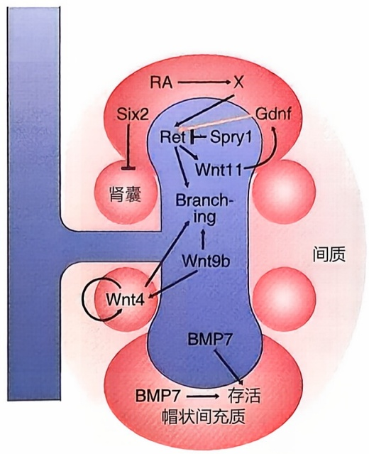

flowchart

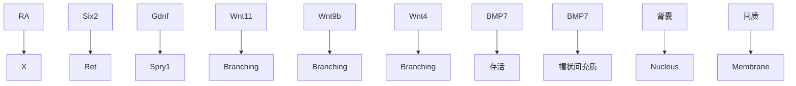

E11.5

RTK，共同调控两个包含EST功能域的转录因子Etv4和Etv5在输尿管芽顶端表达。而Etv4和Etv5对于输尿管芽的分支都是必需的。Wnt11也在输尿管芽顶端表达，它与后肾间充质细胞中分泌的GDNF相互诱导，共同保持输尿管芽的分支。

## 3. 肾单位的形成

与收集管不同，肾单位来源于肾间充质。如前所述，肾单位主要分为负责滤过血液的肾小球和负责重吸收的肾小管。肾小管包含不同形态和功能的节段。所有肾单位细胞都来源于 Six2+ 的前体细胞。在输尿管芽的顶端，Six2+ 的间充质细胞聚集在一起，形成帽状结构，因而这些间充质细胞也称为帽状间充质细胞（cap mesenchyme，CM）。帽状间充质细胞是肾单位前体细胞。来自输尿管芽顶端的 Wnt9b，通过经典 Wnt 信号通路，促进这些前体细胞的增殖和向肾上皮转化的潜能。再通过 Wnt9b 下游的 Fgf8 和 Wnt4 信号，这些前体细胞在输尿管芽的下方进一步分化成前小管聚集细胞（pre-tubular aggregate）以及肾囊（renal vesicle），完成了间充质到上皮细胞的转变。肾泡继续生长成为一个逗号形继而 S 形的管状结构，并与中空的输尿管芽连接。这个 S 形的中空结构继续发育，最后形成完整的肾单位，包括肾小球和肾小管各节段（图 12-17）。

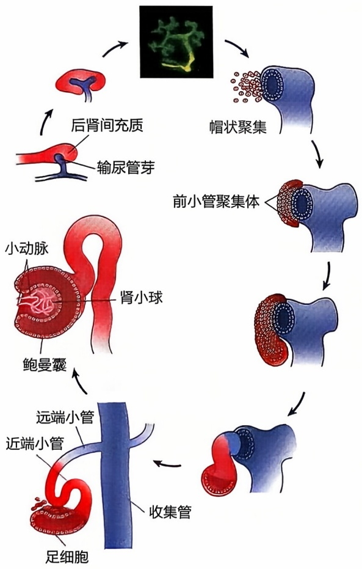

flowchart

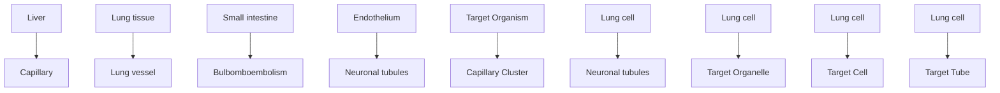

图12-17 肾单位形成示意图

## 4. 血管脉络丛的形成

后肾肾小球中的血管脉络丛分化自后肾间充质细胞。类似于帽状间充质，这类间充质细胞也分布在输尿管芽附近。这些间充质细胞向血管内皮细胞分化依赖足细胞。一方面，足细胞分泌的血管内皮生长因子 Vegfa 诱导这些细胞向血管内皮细胞分化。另一方面，足细胞与分化趋化因子 Cxcl12a 结合，并活化这些内皮细胞表达的趋化因子受体 Cxcr4。更详细的血管脉络丛形成机制还有待进一步研究。

## 三、肾脏类器官

虽然肾脏发育过程还存在各种未解决的问题，但是利用已有的肾脏发育知识可以培养肾脏类器官。通过胚胎组织、多能干细胞或者体细胞培养得到的肾脏类器官与胚胎肾脏具有类似的结构和细胞组成（图12-18），这为肾病的治疗提供了新的可能。

在器官发育过程中，许多重要的调控基因（Hox、Pax）和信号通路（Wnt、Notch、Hedgehog）在不同物种中的表达模式、分子功能和调控机制具有高度保守性，进一步证明了不同物种之间的进化关系，为进化论提供了有力的证据。

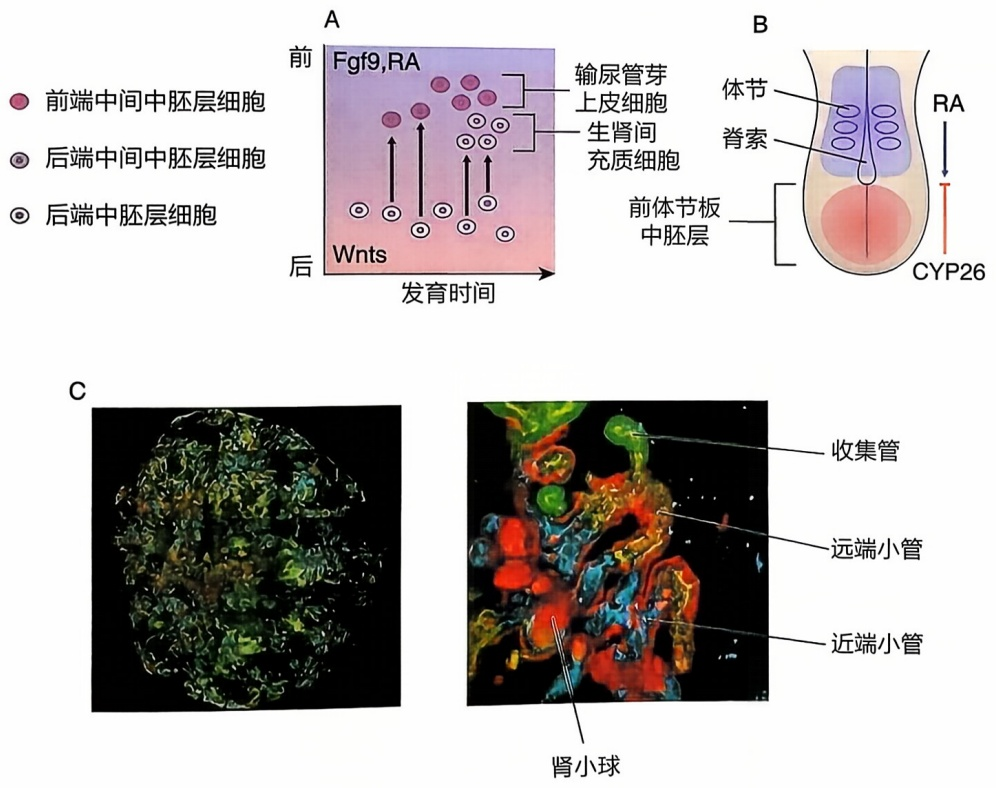

图12-18 利用诱导多能性干细胞产生肾脏类器官（A）中间中胚层前体细胞分化成输尿管芽上皮细胞和生肾间充质细胞的分子机制示意图。前体细胞从高Wnts表达的区域迁移到高Fgf9、RA表达的区域，分别先后分化成输尿管芽上皮细胞和生肾间充质细胞。（B）原条后期的RA信号。RA降解酶CYP26表达在躯干尾端前体节板区域，保护该区域前体细胞不受RA信号影响。（C）肾脏类器官免疫荧光显微照片。右侧图是左侧的放大图，显示分化出的肾脏类器官，包括肾小球、近端小管、远端小管和收集管。

## 第五节 器官再生

再生（regeneration），这一自然界中某些生物能够修复或重建身体受损或失去部分的能力，令人叹为观止，是生物界最为迷人的奥秘之一。从水螅、涡虫、蝾螈，到人类的肝脏，自然界中存在着众多令人惊叹的再生实例。探究这些动物再生现象的分子机制，不仅有助于推动再生医学的进步，实现人类组织器官的修复与重建，还为各类致残性疾病和损伤提供了新的治疗策略。

## 一、水螅的再生——无与伦比的生命力

水螅是一种小型淡水生物，属于刺胞动物门，以其超凡的再生能力和不朽的生命著称。水螅是一种双胚层动物，只有外胚层和内胚层，其中包含多种细胞类型，如上皮细胞、分泌细胞、配子、刺细胞、神经元和间质干细胞。水螅的独特之处在于，即便被切成许多片段，每一段都能重新组织并再生出一个完整的水螅，包括头、足、躯体和触手（图12-19）。这种令人难以置信的能力，源于内胚层和外胚层的上皮细胞，它们是不断分裂的单能祖细胞，能产生再生所需的上皮细胞，以及间质干细胞，它们可以分化为其他类型的细胞。

图12-19 水螅的再生在水螅的正常发育和再生过程中，头-足体轴的决定受控于形态素梯度，其中Wnt3是决定头部命运的形态素。在正常发育中，Wnt3在头部表达。在再生过程中，靠近头部的一端上调Wnt3的表达，指导头部的再生。

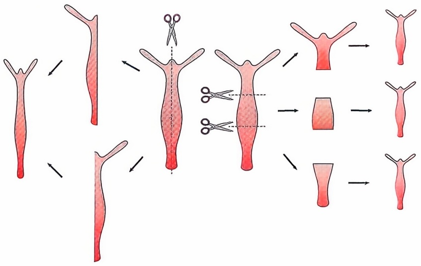

flowchart

## 二、涡虫的再生——扁形动物的神奇能力

涡虫是一种属于涡虫纲的扁形动物，以其惊人的再生能力而闻名。类似于水螅，即便涡虫被切成多个片段，每个片段依然能够再生出完整的个体。例如，当涡虫被切割成三段时，头部那段会从后部伤口处再生出尾部，而尾部那段则会再生出新的头部。至于中间那段，则会在前端长出头部，在后端长出尾部（图12-20）。这种强大的再生能力归功于一种特殊类型的干细胞，称为成体多能干细胞，分布在涡虫全身。

当涡虫遭受切割，成体多能干细胞便会迁移至伤口处，启动增殖过程，形成一个未分化细胞的团块，称为芽基。随着时间的推移，芽基内的细胞将分化为构成缺失组织所需的各种细胞类型。

有趣的是，在涡虫的正常发育和再生过程中，Wnt形态素也参与了头-尾极性的决定。然而，Wnt信号在涡虫的尾部表达，以尾部至头部的梯度形式，促进尾部发育，同时抑制头部的发育或再生。

## 三、蝾螈肢的再生——脊椎动物的再生典范

在脊椎动物中，蝾螈以其卓越的再生能力而著称。当蝾螈遭受截肢，伤口处会迅速被一层伤口表皮覆盖，随后形成一个芽基。这个芽基类似于涡虫的芽基，由未分化的细胞组成，将来会形成新的肢体。与涡虫利用成体多能干

细胞形成再生芽基不同，蝾螈断肢的再生芽基来源于去分化的成体细胞。不过，这些细胞并非均质且完全去分化，而是由伤口下方的骨细胞、软骨细胞、成纤维细胞和肌细胞共同参与形成。在芽基中，不同类型的细胞首先去分化，转变为更原始的、类似干细胞的祖细胞。随后，这些祖细胞通过增殖和再分化，重新变回其原本的细胞类型（图12-21）。因此，在蝾螈的再生肢中，新生成的肌细胞仅来源于原有的肌细胞，而新生的真皮细胞则来自原有的真皮细胞。这一精确的细胞再生过程展示了蝾螈再生能力的惊人之处。

当蝾螈被截肢后，它只能再生出截断处远端的组织，恢复缺失的结构，不会产生额外的部分。例如，当肢体在腕部被截断时，蝾螈会形成一个新的腕部和足部，但不会长出新的肘部。这表明，蝾螈的肢体能够“识别”近远轴上被截断的位置，并从该位置开始再生。在蝾螈肢体再生过程中，许多信号分子参与其中，包括Wnt、

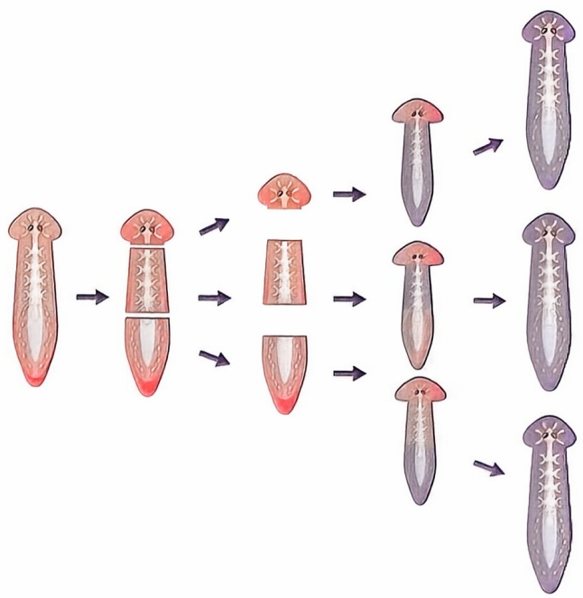

flowchart

图 12-20 涡虫的再生

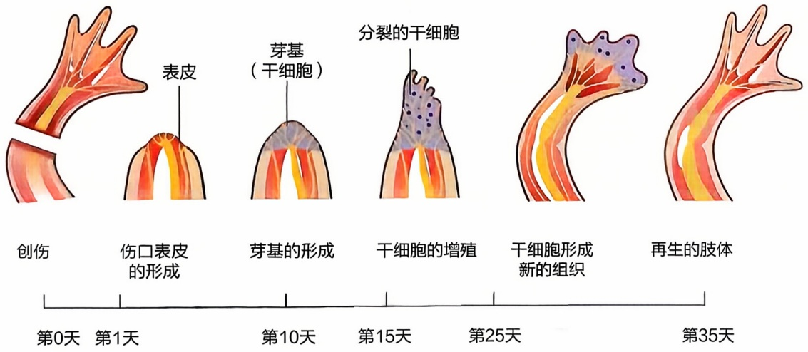

text_image

创伤
伤口表皮的形成
表皮
芽基的形成
分裂的干细胞
干细胞的增殖
干细胞形成新的组织
再生的肢体
第0天 第1天 第10天 第15天 第25天 第35天

图12-21 蝶螈肢的再生

BMP、Hedgehog 和 Notch 等。理解蝾螈肢体再生的分子和细胞机制，有望带来再生医学的革命性变化，为治疗人类严重损伤和退行性疾病提供潜在的解决方案。研究者特别感兴趣的是蝾螈避免瘢痕组织形成的能力，这是人类组织再生中的一个主要障碍。

## 四、哺乳动物肝脏的补偿性再生——生命的奇迹

在哺乳动物中，肝脏具有显著的再生能力，即使失去大量组织后，仍能通过剩余细胞的补偿性增殖实现自我修复。这一特性对于肝脏在解毒、代谢和消化中的功能至关重要。

肝脏的再生过程主要涉及现有肝细胞的增殖能力。成体肝脏中的主要细胞包括肝细胞、导管细胞、储脂细胞、内皮细胞和Kupffer巨噬细胞，这些细胞在正常情况下不会进行分裂。然而，一旦肝脏受到损伤，Wnt、Hippo以及肝细胞生长因子（HGF）等信号通路会在各类肝细胞中被激活，促使它们重新进入细胞周期，通过不断增殖来填补损失的部分。在遭受严重损伤时，原本处于休眠状态的肝脏祖细胞（也称卵圆细胞）会被激活，通过分化为肝细胞和胆管细胞来促进肝脏的再生。肝脏的这种再生能力对于治疗肝病和损伤具有重要意义。

## 五、对再生医学的启示——自然的礼物与未来的希望

虽然人类具有有限的再生能力，如肝脏再生和伤口愈合，但对复杂结构（如肢体或器官）的再生却无能为力。然而，对水螅、涡虫和蝾螈等模型生物再生能力的研究，为人类再生医学的进步提供了宝贵的启示。科学家们正通过识别和操作再生关键基因和信号通路，致力于开发能促进人类组织再生和修复的治疗方法，以期在器官损伤、退行性疾病和衰老相关疾病的治疗上取得重大突破。目前，干细胞治疗已成为再生医学领域发展最为迅速的方向之一。

干细胞是具有自我复制能力和分化潜能的未分化细胞，在器官再生中发挥着关键作用，因为它们可以增殖并替代受损的细胞。在再生医学中，主要有以下几类干细胞被广泛应用。

（1）胚胎干细胞（embryonic stem cells，ESCs）:源自早期胚胎，具有分化为任何细胞类型的能力。尽管其具有巨大的治疗潜力，但由于伦理问题，其应用受到严格的限制。
（2）成体干细胞（adult stem cells，ASCs）:存在于体内多种组织中，具有维持组织稳态和修复受损组织的能力。ASCs通常局限于它们所在的组织，且分化潜力有限。常见的例子包括造血干细胞、肠道干细胞和皮肤干细胞等。
（3）诱导多能性干细胞（inducing pluripotent stem cells, iPSCs）:通过表达特定的转录因子（如 Oct4、Sox2、Klf4 和 cMyc 等）对成体细胞进行重编程，使其成为类似

ESCs 的多能干细胞。

2014年，哈佛大学的道格拉斯·梅尔顿（Douglas Melton）团队成功利用人类ESCs和iPSCs，在体外制造出能分泌胰岛素的功能性胰岛细胞。2023年6月发布的临床试验结果更令人振奋:两名输入了这些胰岛细胞的1型糖尿病患者，基本恢复了正常的胰岛素分泌功能和血糖控制能力，从而摆脱了对注射胰岛素的依赖。在不久的将来，通过干细胞培养制造各种功能齐全的人体器官将有望成为现实。

## ※ 复习思考题

1. 举例说明信号转导通路在器官发育中的功能。
2. 举例说明器官发育的调控机制在进化中的保守性。
3. 评估干细胞技术在器官发育与再生医学中的应用潜力及潜在风险。
4. 讨论基因编辑技术在器官发育与再生领域的实际应用和面临的挑战。
5. 概述器官发育与再生领域近年来的重要研究进展、发现和突破。

## ※ 推荐阅读

1. GEHRING W J, KLOTER U, SUGA H. Evolution of the Hox gene complex from an evolutionary ground state [J]. Curr Top Dev Biol, 2009, 88: 35–61.
2. NOLL M. Evolution and role of Paxgenes [J]. CurrOpin Genet Dev, 1993, 3: 595–605.
3. GEHRING W J. The master control gene for morphogenesis and evolution of the eye [J]. Genes Cells, 1996, 1: 11–5.
4. HELMAN A, MELTON D A. A stem cell approach to cure type 1 diabetes [J]. Cold Spring Harb Perspect Biol, 2021, 13: a035741.
5. BARRESI M, GILBERT S. Developmental Biology [M]. 13th ed. Massachusetts: Sinauer Associates, 2023.

（编写:薛雷、魏珂、曹莹；审读:景乃禾）

# 第十三章

## 神经系统发育

神经系统是生物体感知、传递和响应刺激的复杂结构网络，主要分为中枢神经系统（包括脑和脊髓）和周围神经系统（包括所有的神经和神经节）。中枢神经系统负责处理和整合来自身体各部分的信息，并生成适当的响应。周围神经系统负责将信息从感觉器官传递到中枢神经系统，并将中枢神经系统发出的指令传递到身体的各个部分。

神经发育是指神经系统从胚胎发育到系统功能成熟的过程。成熟的神经系统由神经元和胶质细胞两类细胞组成，两者之间相互作用紧密。神经元利用轴突（axon）传送电信号，通过突触（synapse）与其他细胞通信。树突（dendrite）是神经元的一部分，主要负责接收来自其他神经元的信号和信息。神经元类型众多，各有特殊的形态和功能，其胞体（soma）直径从几微米到一百多微米不等，轴突最长能达到一米多，最短的只有几微米。胶质细胞同样具有多种不同类型。神经元和胶质细胞之间的相互作用非常精确，使神经系统有效运作。

早期胚胎细胞数量很少。随着胚胎发育，细胞数量越来越多，新的细胞与先前存在的细胞相互作用，以特定的方式分化，从而增加生物体的复杂性。在细胞分化过程中，神经元和胶质细胞同样有组织地获得其分子、结构和功能的多样性。神经系统具有丰富的细胞多样性和高度有序的组织结构，在生物体中发挥着重要的生理功能。在本章中，我们将对神经系统发育的过程进行阐述，包括:①神经干细胞和早期神经系统结构如何产生；②神经系统的区域性结构如何形成；③神经元和胶质细胞如何产生、迁移和成熟；④神经元之间如何形成神经网络。

本章阐述的重点是神经系统从发育成熟到行使功能的具体过程，尤其是控制神经细胞以正确的类型、数目和连接出现在正确的位置并发挥其正确功能的细胞和分子机制。

## 第一节 神经系统的解剖结构和神经发育研究的模式生物

神经系统的组织结构通常是基于三个轴来描述的。首先是背腹轴（dorsal-ventral axis），它从动物的背部到腹部延伸。然后是A/P轴（anterior-posterior axis），它描述了从动物的头部到尾部的位置。最后是内外轴（medial-lateral axis），它用于描述结构相对于主体的位置。这些轴将用于详细描述不同神经系统结构的位置和功能，从而为神经发育的深入研究提供基础。理解这些轴对于描述神经系统不同解剖结构的位置和定位至关重要（图13-1）。

神经系统的发育在各种生物中都有共通之处，学术界常用线虫、果蝇等非脊椎动物和爪蛙、斑马鱼、鸡、小鼠等脊椎动物为模型研究神经发育。这些动物在神经发育研究中各具独特优势。

线虫是一种小型透明生物，仅有约1000个细胞，其中包括302个神经元和56个胶质细胞。这些神经元组成了神经索（nerve cord），分布在动物的背部、腹部以及一些侧面。线虫因其迅速的发育、简单的结构和可重复的细胞分裂模式而成为理想的神经发育研究对象。科学家容易追踪神经元的发育和功能，从而深入研究神经环路的形成和神经信号传导的机制。此外，线虫的基因组已被完全解析，使得研究特定基因对神经发育的影响变得更加容易。

果蝇在昆虫研究中具有代表性，它的神经系统主要来自细胞在胚胎表皮的腹侧部分。神经发育始于成神经细胞（neuroblast）的分化和细胞迁移，最终形成完整的神经系统。果蝇的遗传工具和遗传多样性使得科学家能够研究特定基因对神经发育的影响，同时其相对简单的神经系统结构有助于解析神经环路的功能。

爪蛙和斑马鱼卵大型、外部受精以及胚胎透明等特点，使得实验操作和神经发育过程中对神经元迁移、突触形成等细胞行为的观察变得非常便捷。

鸡的卵非常易于获得和储存，孵化周期短，并且神经系统可在短时间内发育完善，还可以通过在蛋壳上开窗口相对容易地观察和操作。

小鼠与人类在神经结构和DNA层面存在高度相似性，为研究人员提供了一个理想的模型，以了解人类神经结构的发育。

通过比较不同物种的神经发育过程，我们能够识别出共同的分子机制和关键信号通路，这有助于揭示神经系统如何在不同生物中形成和发育。这些模式动物在神经科学领域的研究中起到了关键作用，为我们揭示了神经系统发育的奥秘，并为神经疾病治疗提供了有力的依据。

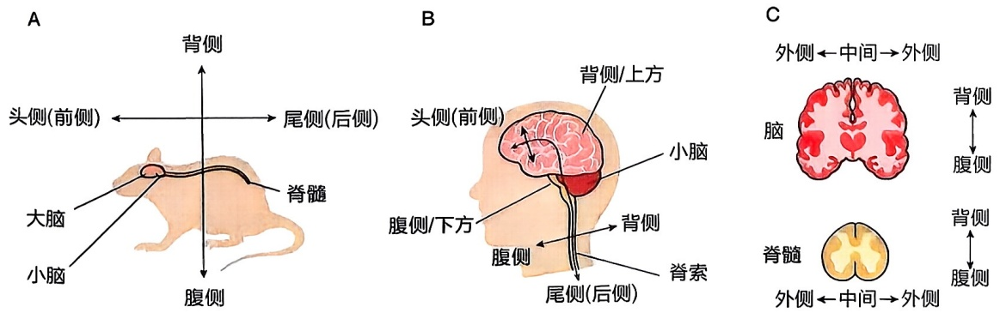

图13-1 神经系统不同解剖结构的位置和定位（A）成年小鼠中枢神经系统基本结构；（B）成年人神经系统基本结构；（C）成年人脑冠状切片及脊髓冠状切片。

## 第二节 神经诱导

神经系统高度有序地存在于生物体中。关于生物体如何系统构建神经系统一直以来都是十分重要的问题。尽管不同物种间的神经系统结构和功能存在多样性，但所遵循的基本发育规律是保守的。神经系统发育的第一步就是囊胚中某些细胞如何确定其神经发育走向。这一过程被称为神经诱导（neural induction）。囊胚发育中处于特定位

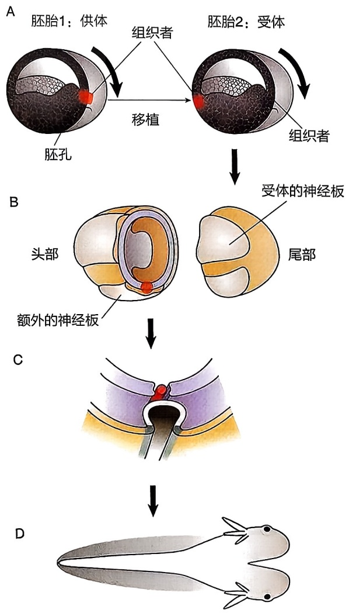

flowchart

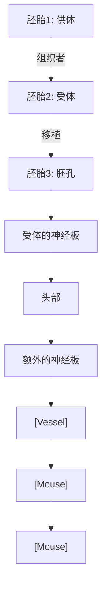

图13-2 移植实验表明两栖动物的胚孔背唇能够诱导神经组织的形成

施佩曼和曼戈尔德将有色素的 dorsal blastopore lip 细胞（红色）移植到无色素宿主胚胎的胚孔（A）。第二个身体轴在发育中产生，包括眼、脑、脊柱等（B～D）。

置的部分干细胞会在特定的时间段获得神经干细胞特性，开始神经系统发育。那么，神经干细胞是如何产生的？早期神经系统的结构是怎样的？调控此过程的分子机制是什么？不同物种神经系统发育的过程差异是如何的？我们将主要对脊椎动物的神经诱导过程提供一个简明的、有内在联系的阐述，与此同时，也有选择地对其他物种的神经诱导进行扼要介绍。

## 一、神经诱导的发现

德国科学家施佩曼和曼戈尔德最早发现囊胚中存在特定的细胞负责神经系统的发育。他们将蝾螈囊胚中某一特定细胞群移植到另一个囊胚上，胚胎随后就会发育出两套神经系统，重要的是，第二套神经系统中存在由受试胚胎发育出来的组织，这就表明这些特定细胞群可以诱导受试胚胎本来不具备神经发育特性的细胞具备神经发育特性。由于此细胞群在早期神经系统发育起重要的塑造作用，因此被称为“组织者”（organizer）。科学家们进一步将脊椎动物囊胚中的“组织者”称为施佩曼组织者（Spemann organizer），其他动物如鸟类、鱼类和哺乳类囊胚中也发现了类似的细胞群并被统称为原结或亨氏结（Hensen's node）（图13-2）。

## 二、神经诱导的具体过程

胚胎初期呈平圆盘状，由3层截然不同的细胞层组成，分别为内胚层、中胚层和外胚层。内胚层主要发育为内脏组织器官，中胚层发育为骨骼和肌肉，神经系统和表皮全部由外胚层发育而来。胚胎早期外胚层还只有一层薄薄的细胞。在外胚层特定位置具备神经系统初始发育特性的一群细胞被称神经干细胞（neural stem cell），它们组成的结构为神经板（neural plate），将发育成神经系统。神经板边缘增厚，形成神经褶（neural fold）。神经褶在中线融合、形成中空的神经管（neural tube）。神经管将发育为中枢神经系统（central nervous system），神经管唇的融合失败会在脊椎动物中导致脊柱裂和无脑畸形。神经褶唇部的部分细胞平行迁移到神经管和表皮外胚层的下方之间形成神经嵴（neural crest），以后将发育为周围神经系统（peripheral nervous system）（图13-3）。

## 三、BMP 分子调控神经诱导

骨形态发生蛋白（bone morphogenetic protein，BMP）在神经诱导中起着重要作用。正常的外胚层细胞具有BMP受体，这些受体对BMP做出反应并引导细胞发育成表皮。如果降低外胚层细胞的BMP受体数量或活性，或者通过将外胚层进行解离培养进而人为降低细胞周围的BMP浓度，外胚层细胞将发育成神经元而不是表皮。外胚层中的组织者会产生抑制BMP信号的分子来促进神经诱导，从而阻止其细胞命运向着表皮发育。那么，组织者的产生的诱导神经组织发育的分子是什么呢？noggin是最早发现的可以诱导神经发生的活性分子。

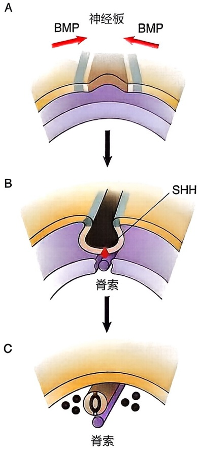

图13-3 神经管的形成神经板在神经嵴（浅红色）处闭合卷成一根神经管。与此同时，神经嵴细胞（亮红色）迁移融合到神经管下方，开始周围神经系统发育。

此后，chordin、follistatin和cerberus等组织者特有的神经发生诱导分子被相继发现。实验表明它们都能和BMP受体结合并抑制其活性，在非洲爪蛙胚胎中降低这些蛋白质的表达会使动物出现严重的神经板缺失（图13-4）。

## 四、调控神经诱导的信号通路及转录因子

除上文介绍的经典 BMP 分子可以调控神经诱导，还有其他信号分子参与了神经诱导。例如，在脊椎动物中，大量的证据表明，成纤维细胞生长因子（fibroblast growth factor，FGF）和 Wnt 信号通路可以调控神经诱导。有实验证实抑制 Wnt 信号或激活 FGF 信号可以在外胚层中产生神经诱导分子。另外，神经诱导分子 cerberus 不仅能拮抗 BMP，也可以拮抗 Wnt。有证据表明，FGF 不是直接的神经诱导因子，但是 BMP 拮抗剂产生的神经诱导需要 FGF 表达，通过调控 FGF 的表达可以改变细胞内 BMP 的水平而产生与 BMP 自身拮抗剂相似的效果。

转录因子在神经诱导的过程中起着重要的调控作用。例如，在进化上高度保守的转录因子Zic和Sox家族对脊椎动物和无脊椎动物胚胎的神经外胚层发育尤其重要。

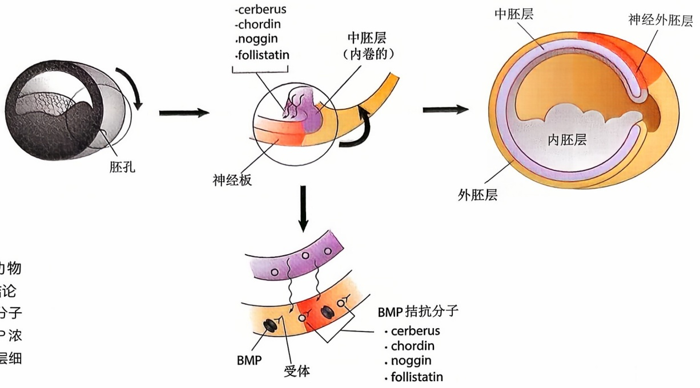

flowchart

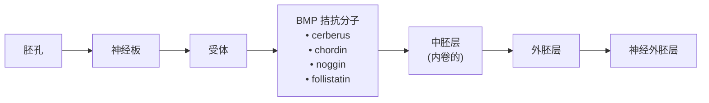

图13-4 基于两栖动物研究产生的神经诱导结论胚孔背部中胚层分泌的分子抑制部分外胚层中的BMP浓度，低浓度位置的外胚层细胞转化为神经干细胞。

我们可以观察到Zic和Sox基因在早期神经外胚层中高表达，而且能发育为神经细胞的外胚层细胞表达了许多Sox基因家族成员。Zic基因也在神经诱导早期激活表达。阻断BMP信号，就会诱导Zic基因的表达，显示Zic基因对神经诱导的促进作用。如果将Zic基因的功能阻断，将会抑制神经板中Sox2基因的表达，进而造成神经板发育的巨大缺陷。转录因子Churchill对鸡的神经诱导十分重要，它是神经板特化所必需的。研究发现对FGF产生应答的神经组织会表达Churchill，Churchill对于合成一些抑制中胚层基因表达的因子是必需的。

## 五、神经诱导过程的物种间保守性

在脊椎动物和无脊椎动物之间，神经诱导过程及相关因子可能都通过一种相似的机制起作用。BMP拮抗因子chordin在黑腹果蝇中的同源基因Sog（short gastrulation）表达在果蝇胚胎腹侧，将Sog显微注射到胚胎的非神经发生区域会导致该区域转变为神经发生，Sog的敲除则会导致成虫表皮扩张和神经来源性组织减少。之后的研究进一步发现，Sog可以直接拮抗果蝇具有BMP相似功能的转化生长因子β样蛋白质Dpp（decapentaplegic）。Dpp的功能缺失突变与Sog功能缺失结果相反，会导致果蝇神经源性组织的扩张和表皮系统的减少（图13-5）。这些证据表明无脊椎动物神经诱导的分子调控过程与脊椎动物调控机制类似。

脊椎动物神经系统的发育开始于早期胚胎背侧外胚层中神经板的形成。神经板通过卷曲形成神经管和神经嵴。随后，神经管发育成中枢神经系统，神经嵴发育成周围神经系统。神经板是外胚层特定区域细胞受到胞外因子影响产生，胞内信号通路与转录因子亦作用于此过程。BMP信号对神经板产生的抑制作用是最经典的神经诱导分子过程，FGF、Wnt信号通路和Zic、Sox等转录因子也共同参与了神经诱导的具体过程。脊椎动物与非脊椎动物的神经诱导遵循相似的分子调控机制。

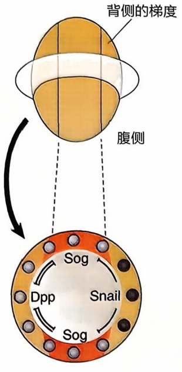

text_image

背侧的梯度
腹侧
Sog
Dpp Snail
Sog

A

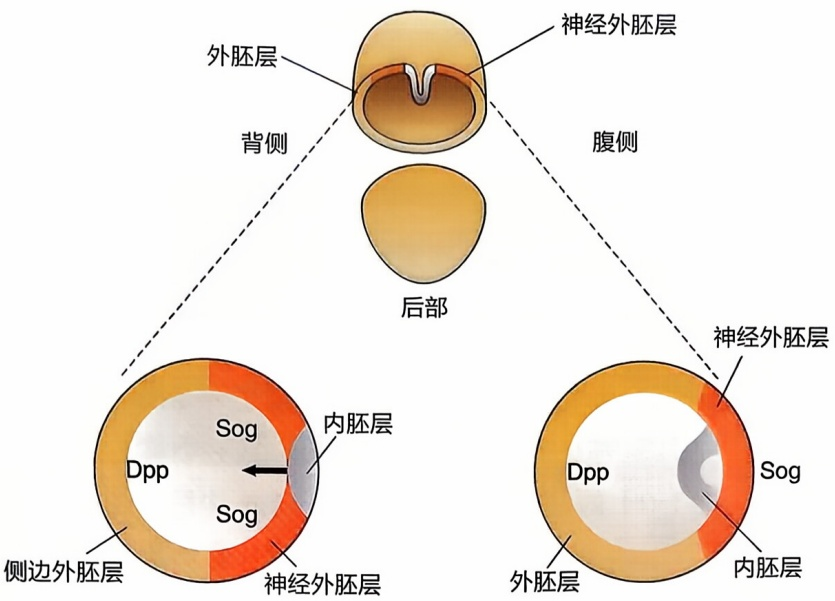

text_image

外胚层
神经外胚层
背侧
后部
腹侧
神经外胚层
Dpp
Sog
内胚层
Dpp
外胚层
神经外胚层
内胚层
侧边外胚层
Sog

B

C

图13-5 果蝇中的神经诱导

Dpp 表达在果蝇胚胎的外胚层背侧，Sog 表达在果蝇胚胎的外胚层腹侧，神经外胚层的 Sog 会拮抗 Dpp 的表达从而保证该区域顺利发育为果蝇神经系统。

## 第三节 神经外胚层的模式化

成熟的神经系统由不同的结构和功能组成。其中最显著的区别是它们沿着前后轴的分布，即大脑位于前端，而脊髓（脊椎动物）或神经索（无脊椎动物）位于后端。这些结构的胚胎起源可以追溯到神经外胚层的前后轴分化过程。这种分化始于早期的神经外胚层（脊椎动物中为神经板），并在随后的发育阶段中进一步细化。最初，分化的区域在外观上非常相似，只能通过基因表达差异来区分。随着时间推移和神经系统的发育，每个区域的细胞行为和形态差异逐渐显现和细化。总之，一旦神经外胚层建立起来，下一步就是将其分割成多个区域，为成熟神经系统结构的区域专门化奠定基础。这一过程被称为神经外胚层模式化。许多信号分子已被发现参与调控脊椎动物神经管沿其前后轴的闭合。这些信号分子相互作用，以确保只有在适当的发育时期特定区域的信号才是活跃的。

## 一、神经系统的区域性结构

随着细胞在神经管形成过程中的持续增殖，神经管不断向后延伸，并在特定区域收缩、扩张和弯曲，为未来的中枢神经系统建立早期的解剖结构和细胞边界。这些形态变化在神经管闭合后不久就会出现，并很快被确定为前脑、中脑和后脑。随着发育的进行，这三个主要脑区域进一步分化为五个次级脑区域。前脑分为端脑和间脑，后脑分为后脑和末脑。与脑发育中观察到的情况相比，脊髓区域在发育过程中的外观变化相对保持一致（图13-6）。脊髓水平上的差异更容易在背腹轴上观察到。

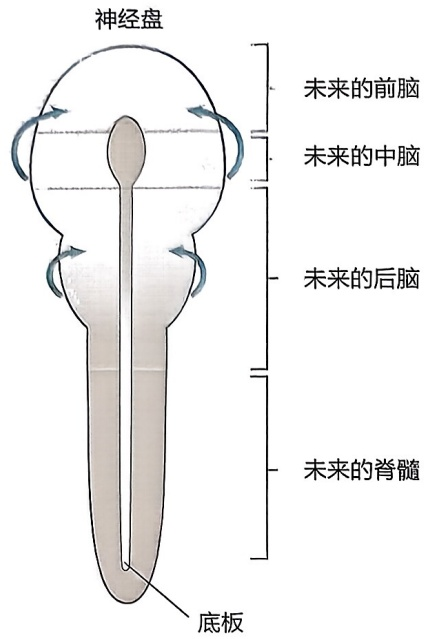

text_image

神经盘
未来的前脑
未来的中脑
未来的后脑
未来的脊髓
底板

图13-6 神经管分节成脑泡

脊椎动物神经系统的前后轴信号中心位于相邻的节段区域。例如，前神经脊（anterior neural ridge，ANR）位于最前部的信号中心，对前脑部分的发育产生影响。更靠后的是位于前脊索区和脊索区交界处的丘脑极性组织者（zone limitans intrathalamica，ZLI），被认为是调节前脑、间脑部分发育的信号中心。中脑-后脑边界（midbrain-hindbrain boundary，MHB）或峡部位于中脑和后脑之间，是一个称为峡部组织者（isthmic organizer, IsO）的信号中心位置，影响未来中脑、桥脑和小脑的发育。此外，脊索（notochord）沿着神经轴延伸，并在后脑和脊髓区域中提供模式信号的重要来源。脊索向中脑前方延伸，但被前脊索板（prechordal plate）所阻止，前脊索板是外胚层和中胚层紧密相连的区域（图13-7）。这些信号中心可以通过使用特定分子标记来进行识别，这些分子在不同的信号中心中具有特定的表达模式，从而帮助研究人员了解神经系统的发育和功能。

## 二、A/P 轴模式的建立需要依赖形态发生素

对 A/P 轴模式的研究表明，建立前脑、中脑和后脑区域所必需的激活、转化和拮抗信号之间存在复杂而精细的平衡。在很大程度上，模式的形成向细胞提供关于其在神经上皮内位置的长距离信号，即位置信息，涉及具有非常特殊性质的信号分子。据

图13-7 沿前后轴的早期边界形成

（A）沿前后（A/P）轴形成的扩张区域称为神经板；（B）提供局部发育线索的信号中心（箭头）位于A/P轴沿线。

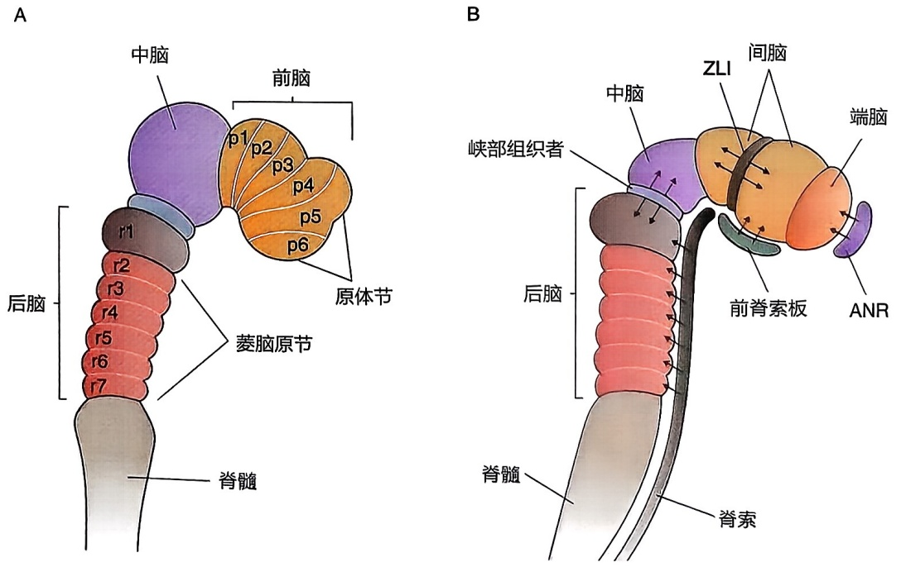

现有观察，神经诱导因子首先促进神经板中主要前组织样结构的形成，随后产生区域特异性信号，通过神经管的A/P轴对每个区域进行精细调节。某些信号能够将之前诱导的区域转变为新的区域，而其他信号则通过抑制（拮抗）这些信号来阻止转变。这些信号通常通过形态发生素建立的浓度梯度进行重叠和相互作用。形态发生素（morphogen）是一种可扩散的分子，其作用范围限定在一定距离内的细胞上。A/P轴上不同区域内的细胞对特定浓度的信号表现出最佳反应。正是这些信号与其他区域特异性线索的相互作用，使沿着神经系统的A/P轴建立了解剖结构上的特殊化。

20世纪60年代，刘易斯·沃尔珀特（Lewis Wolpert）用法国国旗类比了形态发生素在形态发生（morphogenesis）中的作用方式（图13-8）。在一群假定的上皮细胞中，形态发生素信号由细胞群体一侧的一组细胞（组织者）产生，扩散形成浓度梯度。细胞对这一信号水平做出反应，成为“蓝、

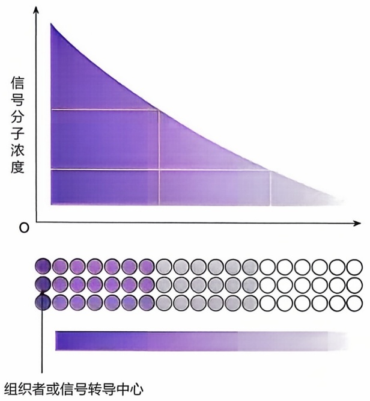

area

| Category | Value (Relative) |
| --- | --- |
| Signal Concentration Trend | Decreasing from High to Low |
| Distribution Center | Distributed across the range of values |

图13-8 形态发生素和位置信息的国旗模型

浅蓝或白”细胞类型。靠近信号源，细胞接收到高于最高阈值（黄线）的信号，并做出反应，成为“蓝色”细胞。除此之外，细胞对低剂量做出反应，变成“浅蓝色”细胞。此外，细胞没有接收到足够的信号来响应，默认变成了“白色”细胞。在没有任何信号的情况下（例如在突变体中），所有的细胞都会变成默认的“白色”细胞。

细胞对形态发生素的反应并不直接决定细胞命运。直接的反应是上皮内特定转录因子的表达。这些转录因子的表达作为形态发生梯度的一种解读，随后它们通过影响其他基因的表达来影响细胞的行为或命运。

接收形态发生素信号的细胞会根据各自此前的发育历史，对形态发生素梯度做出适当反应。因此，在发育中胚胎的另一部分，细胞可能会通过激活另一组基因响应同一形态发生的梯度。细胞对信号反应的环境依赖性是解释微小的信号变化是如何在神经发育过程中被反复使用并产生各种各样结果的关键。

## 三、A/P 轴模式中的基因和信号转导通路

A/P轴模式涉及许多基因和信号转导通路，这些通路在不同的动物中大体保守。尽管已经观察到一些信号机制的差异，这可能部分反映了大脑解剖结构的差异。此外，同一基因家族的不同成员可能在不同物种的特定A/P区域控制模式中发挥作用。以下，我们将重点讨论与脊椎动物神经轴特定区域模式相关的基因家族，而不是特定某个物种的家族成员。

前脑的发育是一个高度分区化过程，从毗邻中脑的前体1（p1）开始，向前延伸到端脑的前体6（p6）。这些前脑段的边界内已经确定了区域基因表达，其中包括Otx（颅侧同源框）、Pax（配对同源框）和Six（正弦同源框）家族的成员（图13-9）。这些分子在前脑模式中扮演直接作用的角色，是果蝇基因的同源物，果蝇同源基因通常在果蝇的发育过程中具有相似的模式功能。

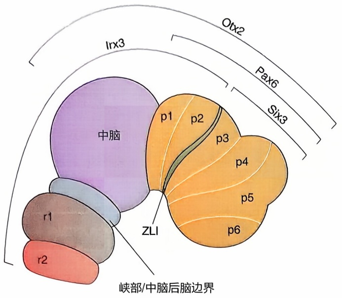

text_image

Otx2
Pax6
Six3
Irx3
中脑
p1 p2
p3
p4
p5
p6
ZLI
r1
r2
峡部/中脑后脑边界

图 13-9 基因表达的限制模式调控着前脑区域的发育

Pax 家族的基因在发育过程中在神经管中广泛表达，其中 Pax6 对前脑发育至关重要。Pax6 在间脑区域表达，这对于正常的眼和耳形成至关重要。Pax 基因缺失，会导致小鼠和人类胚胎眼球缩小或缺失。

从神经板阶段开始，ZLI 表达区域前部与 Six3 区域紧密相邻，而后部与 Irx3 区域相邻，Irx3 是 Iroquois 同源框基因家族的成员。与 Pax6 类似，Six3 也在指导前脑区域的发育中发挥作用（图 13-9）。Six3 和 Pax6 的作用受到限制，部分原因是受到来自中脑的抑制信号，如 Irx3 和 Wnt 的调控。

在许多 Wnt 信号通路中，已经鉴定出了一些 Wnt

抑制分子，包括 Cerberus、可溶性 Frizzled 家族成员和 Dickkopf。这些分子最初在组织者中表达，后来在 AVE 中被发现，这两个信号中心对神经轴前部区域的模式形成非常重要。

限制神经管前部区域 Wnt 活动的重要信号分子还包括在发育中的前脑中表达的同源异形框转录因子家族的成员。在正常胚胎中，平衡 Six3 在间脑后部和中脑中表达的 Irx 转录因子家族起着关键作用（图 13-9）。Six 和 Irx 家族成员的表达域受到彼此之间相互抑制的调控。此外，Irx3 的表达受到 Wnt 信号的调节。当 Wnt 信号缺失时，Irx3 的表达也会受到影响；而当 Wnt 水平增加时，Irx3 的表达会扩展到更多的前部区域。因此，Wnt 和 Irx 需要协调表达，以标记间脑后部区域，并将其与前脑中更多表达 Six3 的区域区分开来。

总之，从神经发育的早期阶段开始，神经管的前后轴就可以被观察到。从前脑到后脑区域，存在许多明显的结构标志。沿着神经管，有几个突起和收缩的区域，它们建立了早期的边界，限制了细胞的迁移，并提供局部信号，诱导特定区域的神经系统形成。通过多个信号通路的作用，首先诱导轴的形成，然后勾勒出各个区域，最终形成每个区域的特化。前脑、中脑和后脑区域产生了信号梯度，并且这些信号分子及其拮抗剂相互作用，沿着前后轴形成了特定的结构，称之为A/P轴模式化。关于A/P轴模式的形成，仍有许多有待发现的地方，揭示其复杂机制仍然是一个活跃的研究领域。

## 四、神经管背腹轴的形成

在发育的早期阶段，神经管背腹轴看起来相当均匀，但在成熟的脑和脊髓中，不同类型的神经元都处于特定的位置。例如，在脊髓中，运动神经元聚集在腹角，而感