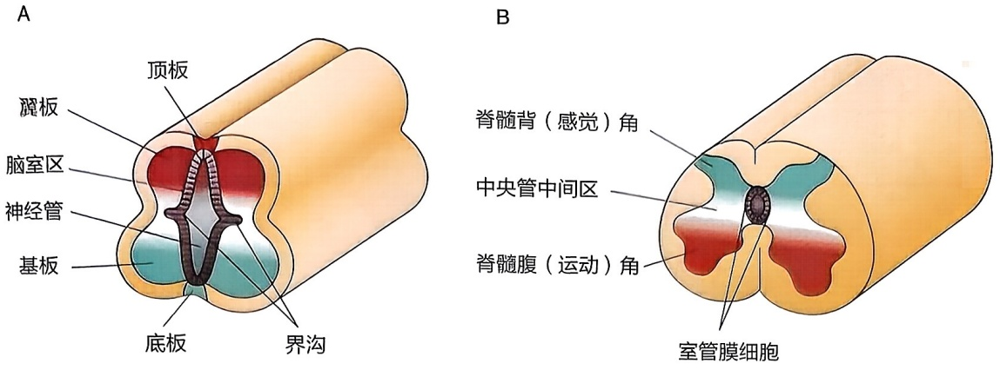

图13-10 界沟是发育中神经系统感觉神经元和运动神经元的分界线

（A）在胚胎神经系统的后部（尾部），沿神经管内表面很容易观察到一条纵沟，即界沟。（B）在成年的脊髓中，感觉和运动神经元之间的分界仍然存在，感觉中间神经元位于背角，运动神经元和相关中间神经元位于腹角。

觉神经元则集中在背角。那么，在发育过程中，神经管的背腹差异是如何产生的呢？

在神经管的早期发育阶段，我们可以观察到一系列关键事件决定了神经管的整体组织和背腹分化。这些事件包括神经管的背腹极性的形成，标志性事件是神经顶板（roofplate）、底板（floor plate）和界沟（sulcus limitans）的形成。首先，神经管的最腹部逐渐扁平化，形成了位于神经管腹部表面的底板。底板的形成是一个高度有序的过程，与后续的神经元分化密切相关。与此同时，神经管的最背部逐渐发育成为神经顶板。顶板在整个神经管背腹分化中起着关键作用，对不同类型的神经元分布和特化起到调节作用。此外，界沟沿着神经管的大部分长度分隔了背部和腹部。界沟的形成进一步加强了神经管的背腹极性，有助于将不同的神经元类型分隔开来（图13-10）。

总的来说，这些早期事件共同促使了神经管背腹极性的形成，为后续的神经元分化和整体神经管结构的形成奠定了基础。其中，神经顶板和底板在神经管的发育过程中扮演关键角色，通过释放信号分子来调控基因表达模式，从而诱导不同区域祖细胞分化出不同类型的神经细胞。

首先，让我们聚焦于神经管腹部模式化建成的过程。底板受到来自脊索的信号的影响。脊索最终会在大多数脊椎动物中融入脊柱中，但在此之前，它在胚胎发育中具有多重重要功能，包括产生诱导底板形成所需的蛋白质。同时底板也会释放信号分子，调控腹侧神经管中细胞的特化。几十年来，通过使用各种实验方法，人们已经证明了脊索对于底板和随后的运动神经元诱导的重要性。例如，1939年，两栖动物领域的经典研究由Johannes Holtfreter进行，他演示了手术切除脊索导致腹部结构（包括底板）的缺失。随后的研究表明，手术抑制或破坏脊索的形成导致腹侧神经管的细胞表达背侧神经管相关的基因。接下来，让我们聚焦于神经顶板的作用。神经顶板位于神经管的背部，并与表皮外胚层（epidermal ectoderm）之间建立联系。在胚胎发育的早期阶段，神经顶板的细胞会伸展并与表皮外胚层相互接触。随后，表皮外胚层会分离出神经管，同时神经嵴细胞（neural crest cell）也会从神经褶皱中分离出来。这些神经嵴细胞会按照特定的迁移路线分布到发育中的胚胎中，形成特定的外周神经元，其中包括位于脊髓背侧的感觉神经元。这些感觉神经元负责接收和处理来自身体的感觉信息，并与其他神经系统中的运动神经元相连接（图13-11）。

图13-11 神经管的形成导致沿背腹轴的特化（A）在神经板阶段，外侧边缘标志着与神经管背侧表面相关的结构将在此处出现。（B）神经板的侧缘开始向上弯曲，形成神经褶皱。（C，D）随着神经管开始成形，侧缘继续向上弯曲并相互靠近，从而形成明显的神经管背侧和腹侧区域。（E）当神经管的边缘向背侧靠拢时，一个特化细胞带——顶板清晰形成。

A

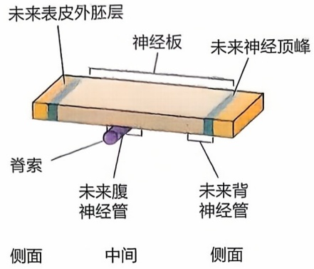

text_image

未来表皮外胚层
神经板
未来神经顶峰
脊索
未来腹神经管
未来背神经管
侧面 中间 侧面

B

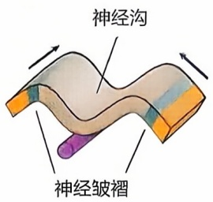

text_image

神经沟
神经皱褶

C

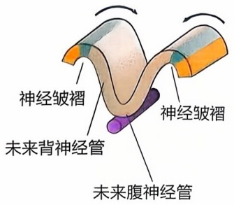

text_image

神经皱褶
未来背神经管
神经皱褶
未来腹神经管

D

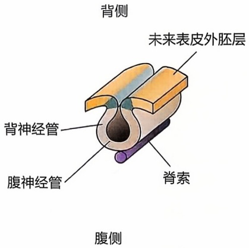

text_image

背侧
未来表皮外胚层
背神经管
脊索
腹神经管
腹侧

E

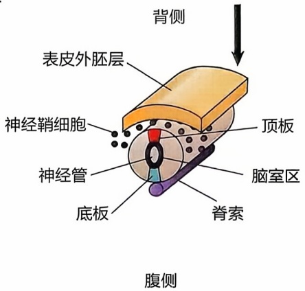

text_image

背侧
表皮外胚层
神经鞘细胞
神经管
底板
顶板
脑室区
脊索
腹侧

虽然神经顶板和底板等早期神经管结构相对容易识别，但是神经管背腹轴上各神经元的形态非常相似，难以区分不同细胞类型。20世纪末以来，研究人员通过识别和定位mRNA和蛋白质等分子标志物，在体内和体外有效区分了背部和腹部前体细胞的各种类型。例如，表达在背部神经管前体细胞中的分子标志物有Lxm1a、Gdf7、Pax3和Pax7等，而在腹部前体细胞中表达的分子标志物有Olig2、Nkx2.2、Nkx6.1、Nkx6.2和HNF3β/FoxA2等。此外，还有一些分子标志物位于中间区域，跨越腹背侧段，如Pax6、Dbx1、Dbx2和Irx3，它们标记了部分腹背侧段的细胞。对成熟神经元而言，背部区域的分子标志物包括Lbx1、Lhx1、Lhx2和Lhx9，而Isl-1和Isl-2则作为腹部区域的成熟神经元分子标志物（图13-12）。需要强调的是，这些不同神经元标志物的表达对于确定细胞的最终功能至关重要。神经管的背部和腹部信号中心通过调控每种细胞类型中特定转录因子的表达来影响基因的表达或抑制，进而有助于神经管背腹轴上神经细胞命运的特化。

## 五、神经管模式化的分子机制

脊索通过 Shh（sonic hedgehog）信号通路诱导不同类型神经元的形成。Shh 是一种信号分子，最早在脊索中表达，然后在底板中继续表达。为了确保不同类型的神经元在神经管内的正确分化和定位，Shh信号通过浓度梯度调控基因表达。Shh的浓度会激活或抑制在神经管腹侧部分运动神经元和中间神经元前体细胞内表达的基因。其中，包括编码ClassI和ClassII转录因子的基因，包括Dbx、Nkx、Irx和Pax家族的同源异形域蛋白质以及碱性螺旋-环-螺旋（bHLH）蛋白Olig2。ClassI转录因子，如Dbx1、Dbx2、Irx3和Pax6，在脊索的部分腹侧段表达，但会受到Shh信号的梯度依赖性抑制。例如，在V1和V0中间神经元区域，即最腹侧的中间神经元区域，低水平的Shh足以抑制这些基因。相反，在接近底板腹侧区域，需要更高浓度的Shh来抑制ClassI转录因子。与ClassI转录因子不同，ClassII转录因子是由神经管腹侧区域中更高浓度的Shh激活的。比如，Nkx2.2、Nkx6.1、Nkx6.2和Olig2是受到靠近底板处更高Shh浓度激活的ClassII转录因子（图13-13）。

A

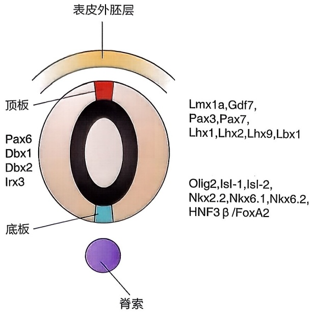

text_image

表皮外胚层
顶板
Lmx1a,Gdf7,
Pax3,Pax7,
Lhx1,Lhx2,Lhx9,Lbx1
Olig2,Isl-1,Isl-2,
Nkx2.2,Nkx6.1,Nkx6.2,
HNF3 β /FoxA2
Pax6
Dbx1
Dbx2
Irx3
底板
脊索

B

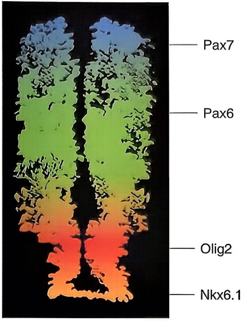

text_image

Pax7
Pax6
Olig2
Nkx6.1

图13-12 神经管背侧和腹侧部分分子标志物的分布

（A）背侧祖细胞和成熟中间神经元的标志性转录因子包括Lmx1a、Gdf7、Pax3、Pax7、Lbx1、Lhx1、Lhx2和Lhx9。腹侧分子标志物包括Olig2、Isl-1、Isl-2、Nkx2.2、Nkx6.1、Nkx6.2和HNF3β/FoxA2。一些转录因子（如Pax6、Dbx1、Dbx2和Irx3）横跨背侧和腹侧区域。（B）小鼠神经管中特定细胞标志物的表达提供了一个例证，说明不同的祖细胞群沿着背腹轴产生。

Shh 信号的浓度梯度是通过 Shh 蛋白的特殊加工来实现的。Shh 蛋白分解成两个片段，其中 Shh-N 片段负责调控底板的形成。这个 Shh-N 片段通过附着在脊索细胞表面的胆固醇分子，提供了高浓度的 Shh 信号。剩余的 Shh-N 片段可以扩散到远离产生地的地方，提供较低浓度的 Shh 信号，用于诱导不同类型的脊索神经元的形成。

在背侧模式化的过程中，BMP 家族成员发挥着关键作用。早期研究发现，在神经诱导过程中，BMP 家族成员通过抑制神经组织的形成来促进非神经的表皮外胚层的形成。然而，随着发育的进行，BMP 家族成员被用于表征不同类型的神经细胞，包括神经嵴细胞、背侧神经管的顶板细胞以及六个亚型的背侧中间神经元。

实验证明，在神经管上方的表皮外胚层中表达BMP-4和BMP-7会诱导顶板的形成，这些表皮BMP家族成员诱导了LIM同源异形域转录因子Lmx1a在顶板细胞中的表达，因此Lmx1a被用作顶板的标志物。

图13-13 Shh水平对ClassI和ClassII转录因子有不同的调节作用

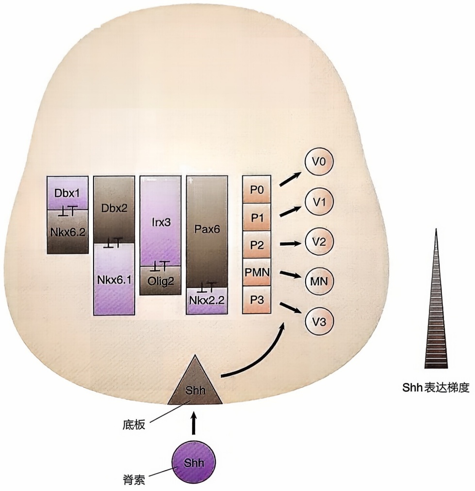

flowchart

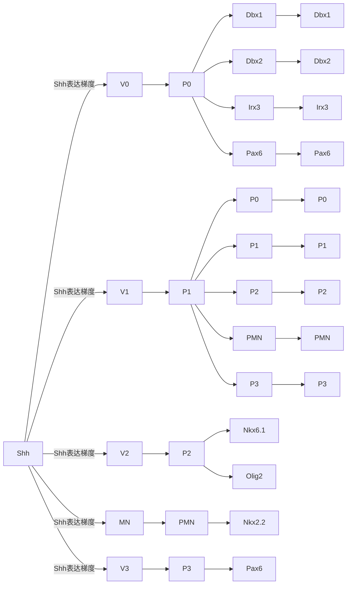

## 知识窗 13-1

## 眼发育

脊椎动物的眼发育起始于原肠胚形成（gastrulation）时期的胚胎眼区（eye field）。该区域位于前神经板（anterior neural plate）的间脑（diencephalon）边缘（图13-14A）。随后该区域两侧突出生成左、右两个视泡（optic vesicle）（图13-14B）。与此同时，体表外胚层在视泡的诱导下增厚，形成晶状体板（lens placode）。

视泡远端膨大，贴近体表外胚层，慢慢凹陷形成双层杯状结构，称视杯（optic cup）（图 13-15）。视泡近端变细，称视柄（optic stalk），与前脑中的间脑相连。随后晶状体板凹陷入视杯内，它逐渐开始与体表外胚层分离，发育成晶状体泡（lens vesicle）。间充质填充在视杯与晶状体泡之间，视杯周围及其与体表外胚层之间。眼的各部分就是由视杯与视柄、晶状体泡及它们周围的间充质进一步发育形成的。突出的视泡沿其近远（proximal-distal，P/D）轴进一步分化。与表面外胚层接触的视泡远端区域分化为神经视网膜（neural retina，NR），而近端区域分化为视网膜色素上皮（retinal pigment epithelium，RPE），两者之间的近端区域将形成视柄的背侧和腹侧部分。神经视网膜和视网膜色素上皮之间的边界称为睫状边缘区（ciliary marginal zone，

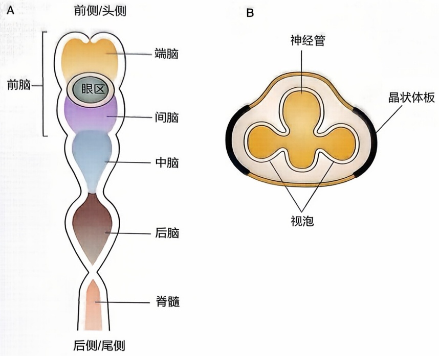

图 13-14 脊椎动物视泡示意图

(A) 胚胎眼区位于前脑的间脑边缘区域。

(B) 视泡从间脑的胚胎眼区起始发育, 向两侧突出形成。

CMZ)，该区域表达 Meis1、Meis2、Msx1 等转录因子，被认为是视网膜细胞终生更新的来源。

## 1. 视泡的近端-远端分化

在视泡发育过程中，近端细胞发育为视柄，而远端细胞则分化为神经视网膜和视网膜色素上皮。视柄的腹侧细胞受到来自腹侧中线 Shh 信号分子的影响（图 13-16）。Shh 基因突变会导致严重的眼发育缺陷，包括形成单一中线眼，或者缺乏视柄等。Shh 可以调控 Pax6 和 Pax2 的空间表达来决定视泡的远-近轴发育。Pax2 和 Pax6 在转录水平上相互抑制，Shh 的过表达导致Pax2（视柄分子标志物）表达区域增大，Pax6（视网膜分子标志物）阳性细胞数量减少，而没有Shh的情况则相反。Pax6基因对于形成远端晶状体组织也是必要的。Pax6基因的突变会影响晶状体和视泡的形成，最终导致无眼症。

## 2. 视杯的背腹分化

背侧的 BMP 信号和腹侧 Shh 的信号梯度共同决定视杯的背腹分化。在视杯的腹侧部分过度表达 BMP4 会抑制 Pax2 和 Vax1 的表达，并激活 Tbx5 的表达，Tbx5 是一种 T-box 类转录因子，通常只在视杯的背侧部分表达。视杯的背腹极化的转录调控在很大程度上依赖于位于视杯背侧的Tbx5的活性和位于视杯腹侧的Vax基因的活性。Tbx5的过度表达会导致视杯的背腹化，而Vax的过度表达会导致其腹侧化。ventroptin是一种BMP信号拮抗因子，主要在视杯腹侧中表达。在视杯的背侧强制表达ventroptin会降低BMP4的表达并扩展Vax基因的表达。

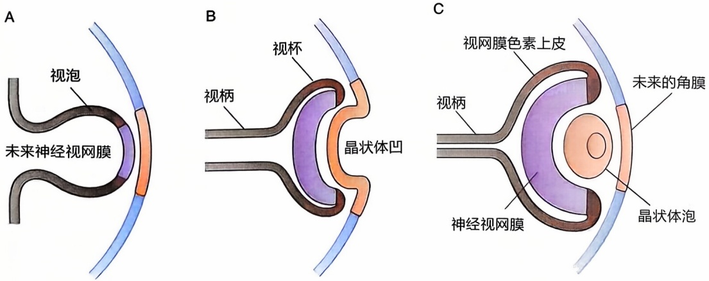

图13-15 脊椎动物眼发育示意图

（A）视泡的形成。（B）视泡远端凹陷成为视杯，近端变细成为视柄。（C）视杯分为内、外两层，其中外层分化为视网膜色素上皮（RPE），内层则增厚分化为视网膜。

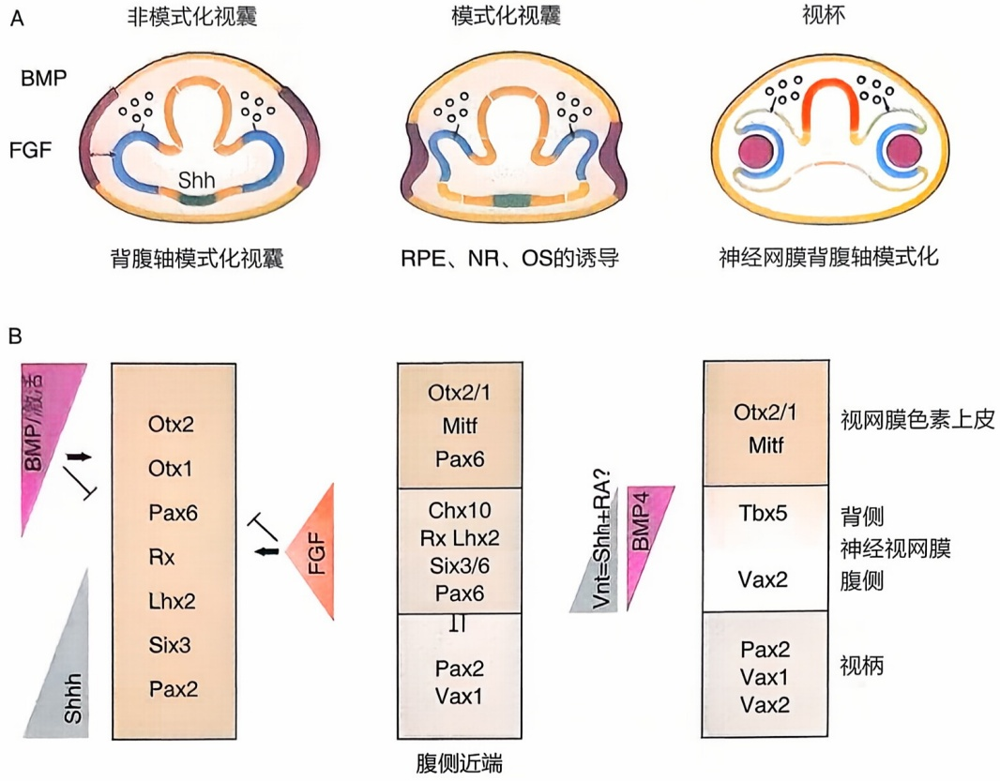

图 13-16 调控脊椎动物眼发育的信号通路（A）和重要转录因子（B）

一些典型的属于视杯腹侧的结构，如视裂（optic fissure）、玻璃体动脉和鸟类中的视网膜盘也依赖于BMP信号。在BMP7缺失的小鼠中，视裂不会形成。视黄酸（retinoic acid，RA）也参与建立视杯腹侧特性。RA处理可以上调斑马鱼胚胎眼中Pax2的表达，而在胚胎发育期间缺乏维生素A、RA受体失活或抑制RA合成都会导致胚胎腹侧视网膜缺陷。但是缺乏编码RA合成酶的Raldh1、Raldh2和Raldh3基因的胚胎仍然会形成具有正常背腹分化的视杯。

## 3. 神经视网膜和视网膜色素上皮质的形成

神经视网膜（NR）和视网膜色素上皮（RPE）的形成是由多种信号分子协同调控的。如果分离眼的表面外胚层，未来的NR细胞将获得RPE细胞的特性。这是因为外胚层分泌了FGF家族中的信号分子FGF1和FGF2，而未来视网膜表达FGFR1。相反，将未来的RPE暴露于FGF会赋予细胞NR特性。因此，FGF信号通常激活NR的形成，抑制RPE的形成。未来视网膜本身也表达其他FGF，如FGF3、FGF8、FGF9和FGF15，这些可能有助于维持视网膜的特性。

BMP4和BMP7在周围的眼周间充质和未来的RPE中表达。干扰这些分子的表达将阻止RPE的发展并诱导NR特异基因的表达，而它们的添加会激活整个视泡的RPE特性。因此，BMP和FGF信号在RPE和NR前体中起着拮抗作用。这两种信号的活性似乎会影响特定转录调节因子，如Vsx2、Otx2和Mitf的表达。FGF信号可激活视网膜中Vsx2的表达，但抑制RPE中Otx2和Mitf的表达，而对BMP信号的干扰则观察到相反的效应。

Six 家族的两个基因 Six3 和 Six6，最初在整个视泡中表达，但也很快只在未来的 NR 中表达。在鱼类胚胎中，这两个因子的过度表达会导致视网膜增大和视网膜样组织的异常形成。在小鼠中，Six3基因的缺失会导致前脑的完全丧失，而Six6基因缺失会影响视网膜的增殖和分化。将它们中的任何一个过度表达于RPE细胞会导致获得NR的表型。与Six3类似，Lhx2基本表达在未来的神经视网膜。Lhx2缺失的小鼠表现为无眼，类似于Pax6基因突变小鼠。

RPE 的形成至少与 4 种转录因子紧密相关，它们是 Otx1、Otx2、Mitf 和 Pax6，这些因子构成了建立 RPE特性的转录网络核心。Mitf、Otx1和Otx2基因失活会阻碍RPE的分化。相反，将这些基因转染到视网膜细胞中会使它们获得RPE表型并积累色素颗粒。尽管Pax6在未来RPE中的表达是短暂的，但它的功能（可能与Pax2的功能一起）似乎对于启动Mitf的表达至关重要。事实上，Pax6能够直接结合到Mitf启动子上，而在同时缺乏Pax2和Pax6的胚胎中，视泡变得较小，由Mitf阴性细胞组成，这些细胞反而共表达Otx2和NR标记Vax2。

## 第四节 神经发生

随着神经系统的发育，大量的神经元和胶质细胞必须由神经上皮细胞转化成的神经祖细胞（neural progenitor cell）产生。上述产生神经元的过程被称为神经发生。从胚胎的神经外胚层初始形成一直到胚胎出生之后，神经发生可以持续相当长的一段时间。一般来说，神经祖细胞会经历反复的细胞分裂（增殖）。这个过程中，一些子代细胞仍然保持着祖细胞的身份，可以继续进行分裂；而另一些则获得神经元或胶质细胞的身份。后者也被称为神经前体细胞，它们不再分裂并且最终分化为成熟的神经元或胶质细胞。

## 一、果蝇中的神经发生

在果蝇中，中枢神经系统和周围神经系统分别由成神经细胞和感觉器官前体细胞发育而来。外胚层细胞具有发育为神经细胞的潜力，但只有一小部分会成为成神经细胞或感觉器官前体细胞。前神经基因（proneuralgene）在已经具有神经特性的细胞中表达，这是启动神经发生的充分必要条件。

外胚层中表达前神经基因的细胞团被称为神经前簇。随着发育进程，前神经基因的表达只保留在神经前簇中的单个细胞内，该细胞会发育为成神经细胞或感觉器官前体细胞。一旦这个细胞获得了成神经细胞或感觉器官前体细胞的身份，便会通过抑制性的细胞内信号通路阻止其周围的细胞发育为成神经细胞或感觉器官前体细胞。具体而言，该细胞会在膜表面表达Notch信号通路的配体Delta，随后通过Delta结合神经前簇中存在于其他细胞表面的受体Notch。受体Notch的激活导致下游转录因子HES蛋白的升高表达，进而抑制了前神经基因的表达，使细胞丧失了成为神经细胞的潜力转而获得表皮细胞的命运。这种细胞命运决定的机制被称为侧向抑制（lateral

图13-17 相互抑制转变为侧向抑制

最初、神经前簇中所有细胞之间的 Notoh 信号通路导致相互抑制，前神经基因和抑制它的 HES 基因在这一阶段共同表达，使得所有细胞均保持神经特性。随后，侧向抑制发生。单个细胞逃离相互抑制，持续表达前神经基因成为 SOP、同时激活周围细胞 Notch 信号通路，抑制周围细胞表达前神经基因。

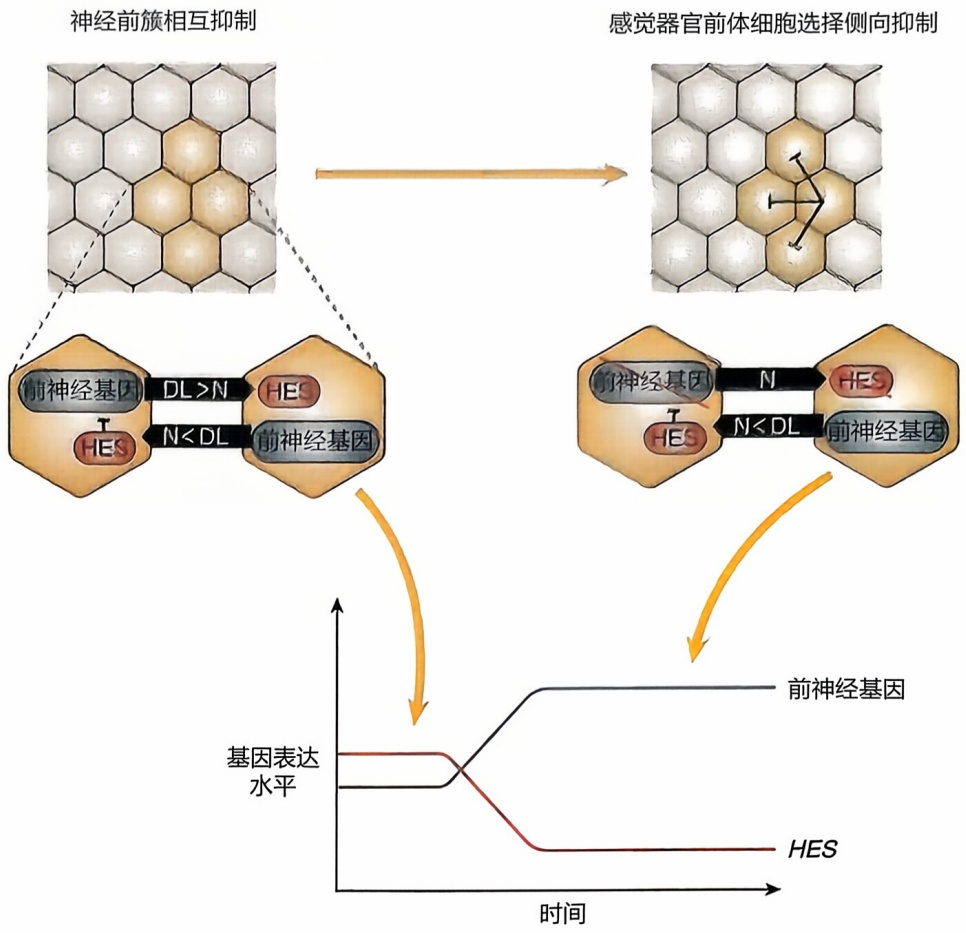

flowchart

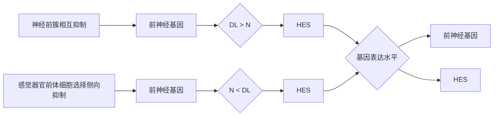

inhibition）。在神经前簇中，单一细胞确定成为神经祖细胞之前，所有细胞都会表达Delta，同时也被周围的细胞抑制。这种互相抑制（mutual inhibition）使得每个细胞都保持着成为神经细胞的潜力。随后，某个细胞率先逃脱该抑制状态，神经前簇中的互相抑制即转变为前述的侧向抑制（图13-17）。

## 二、脊椎动物中的神经发生

脊椎动物中枢神经系统的神经元发生过程与果蝇差异较大，可能更有利于其产生更多的神经元。脊椎动物的神经管由单层神经上皮细胞构成。神经上皮细胞发育形成的神经祖细胞也被称为放射状胶质细胞（radial neuroglia cell）。放射状胶质细胞位于神经管上皮的管腔内表面，一般被称为脑室区（ventricular zone）。放射状胶质细胞是神经干细胞，具有两个特征:①多能性。它们产生的子代细胞可以分化成一系列神经元和胶质细胞；②自我更新能力。尽管一些子代会退出细胞周期进行分化，但一部分子代细胞会保持神经干性，通过大量自我更新扩增神经祖细胞的数量。

在脊椎动物中，前神经基因通过调节 Notch 介导的侧向抑制和启动下游分化基因的表达来控制神经发生。但和果蝇不同之处在于，脊椎动物神经管中的 Notch 抑制并不会导致被抑制的细胞呈现出不同的非神经命运。相反，它们只是暂时被抑制，并保留了它们作为神经祖细胞的能力。因此，通过 Notch 抑制，维持了祖细胞的数量，以促进进一步的神经发生。

放射状胶质细胞中前神经基因和 Notch 相互作用的机制会导致基因表达的振荡，这由相互抑制的循环往复导致（图 13-18）。在脊椎动物的神经发生中，前神经基因随时间的动态表达对于协调祖细胞激活 Notch 信号极为重要。在确定神经前体细胞的命运后，前神经基因会触发细胞退出细胞周期，促进细胞分化和细胞迁移过程。

## 三、神经祖细胞的增殖及分裂方式

为了产生足够数量的神经元，神经祖细胞细胞周期的进入和退出过程受到了严格调控。这种调控的一个关键方面则是细胞分裂。在神经祖细胞增殖过程中，一个细胞通过对称分裂产生两个相同的子代细胞，或是通过不对称分裂产生

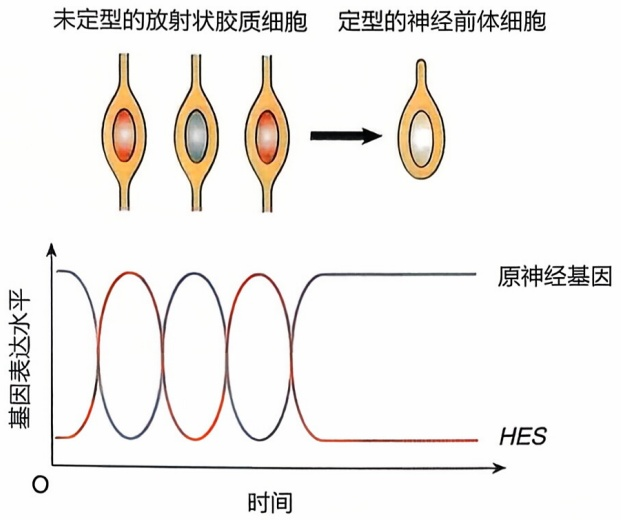

flowchart

图13-18 放射状胶质细胞转变为神经前体细胞放射状胶质细胞振荡表达前神经基因或HES，处于相互抑制状态。随着发育进程，一些细胞停止振荡，并持续性高表达前神经基因，从而成为神经前体细胞，退出细胞周期。

## 知识窗 13-2

## Notch 信号通路

受体 Notch 在所有的胚胎细胞中表达。Notch 是根据它的一种表型命名的，即编码该受体的基因突变时，果蝇会出现锯齿状翅膀。与其他信号通路不同，Notch 配体不是扩散性信号分子，而是信号细胞表面的跨膜蛋白质。因此，Notch 信号通路是一个通过细胞接触介导的信号通路。在定型的神经细胞中（信号细胞，如图 13-19），前神经基因的表达触发了 Notch 配体 Delta 的表达。Delta 出现在细胞膜表面与相邻细胞的 Notch 结合，通过早老素触发 Notch 分解。随后 Notch 的细胞内结构域移动到细胞核与称为 $SU(H)$（无毛抑制基因）的转录因子结合成复合体，该复合体激活 split 基因（HES 家族成员）的增强子，这个基因编码 bHLH 转录抑制因子，抑制前神经基因在感受细胞中表达，使该细胞丧失发育为神经组织的潜力。

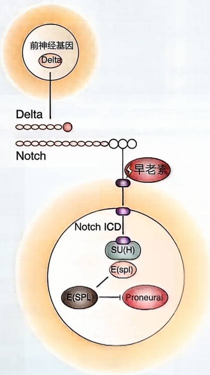

flowchart

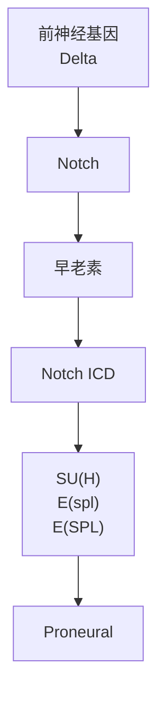

图13-19 Notch信号通路

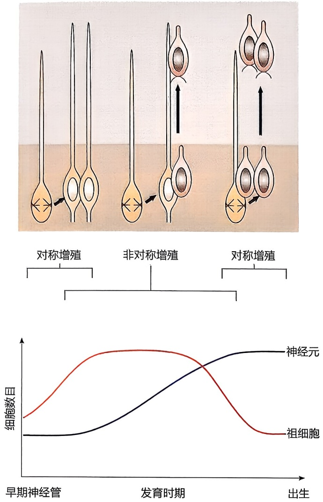

图13-20 神经元的产生速率与神经祖细胞随时间变化的分裂方式有关

在神经管中，神经元的产生速率与神经祖细胞随时间变化的分裂方式有关。首先是通过对称的增殖分裂来扩张神经祖细胞数量；其次，多数祖细胞进行不对称分裂，使得神经元稳定产生；最后，对称分裂的方式导致所有子代细胞成为神经元或胶质细胞，从而消耗祖细胞数量。

两个发育潜能不同的子代细胞。不对称分裂存在两种不同的形式。第一种形式里，两个子代细胞不具有增殖能力，朝着不同方向分化。例如，果蝇的感觉器官前体细胞经过不对称分裂产生感觉神经元和三种不同的支持细胞。而第二种形式里，一个子代细胞会分化为神经元，另一个子代细胞则保留了亲代细胞的增殖能力。

在脊椎动物大脑皮质中，神经祖细胞形成初期会以对称分裂的方式扩充祖细胞群体的数量，随后越来越多的神经祖细胞转而进行多轮不对称分裂来产生神经前体细胞。在神经发生晚期，神经祖细胞被认为会进一步转为对称分裂，产生两个有丝分裂后的神经前体细胞。这种对称分裂会消耗部分神经祖细胞（图13-20）。

处于分裂的放射状胶质细胞中，包括PAR和Numb在内的蛋白质复合物会定位于细胞顶端室侧的一个小的膜位点。该顶端复合物一定程度决定了细胞分裂的方向。大多数对称增殖分裂的神经祖细胞，其分裂面垂直于脑室表面，使得顶端复合物一分为二地被两个子代细胞继承。相反，进行不对称增殖分裂的神经祖细胞具有非垂直的分裂面，仅使得其中一个子代细胞继承顶端复合物。

## 四、神经发生的时序调控

神经发生的整个阶段中，神经管不同区域的神经祖细胞产生不同类型的神经元。例如，位于背侧端脑的祖细胞产生端脑的兴奋性神经元，而腹侧端脑的中间和后端神经隆起则产生皮质所有的抑制性神经元。同时，神经祖细胞所产生的神经细胞类型也随着时间推移而变

化。例如，在脊椎动物中枢神经系统发育阶段中，神经元逐渐停止产生之时，胶质细胞随之开始产生。神经发生的时序调控是神经祖细胞的内在机制，同时可以被外部环境所调节。

不同类型的神经细胞按照时间顺序产生会使得这些细胞具有特定的空间分布模式。成熟的哺乳动物大脑皮质具有6层结构，每层神经元具备特有的神经元形态和投射方式。例如，在处理感觉信息的皮质区域，第4层神经元接收来自丘脑的感觉信息输入并在局部投射轴突，而第5层和第6层的神经元将轴突投射至大脑其他区域。放射状胶质细胞通过不对称分裂产生神经前体细胞，这些细胞通过径向迁移远离脑室区。早期产生的神经元分布于皮质最深处，而随后产生的神经元迁移经过早期产生的神经元，形成新的、更浅的神经元层。因此，皮质的神经元随着时间推移以“由内而外”的方式分布（图13-21）。

## 第五节 神经元的迁移

神经发生会产生大量神经元，不同类型的神经元产生于神经系统的不同区域。许多神经元需要从出生地迁移到特定的区域行使功能。神经功能环路的正确组装依赖神经元在正确的时间迁移到正确的位置。我们可以通过观察活体胚胎中神经元的迁移和组织培养中神经元的迁移等方法直接或间接地记录、追踪神经元的迁移轨迹。一般来说，迁移是脊椎动物比无脊椎动物神经发育更显著的特征，主要涉及大量细胞的远距离迁移。但是，一些神经元迁移也是无脊椎动物中必不可少的。总之，为确保适当数目的细胞在适当的时间到达神经系统适当的区域，神经元的迁移受到严格的调控，即必须全方位地控制迁移的时间、方向、迁移距离和终点。

## 一、主要迁移模式

神经元迁移主要有三种模式。一些细胞在其他细胞提供的支架（scaffold）上迁移，大脑皮质中的许多放射状迁移神经元在放射状胶质细胞介导下移向软脑膜（pial），由于大脑皮质近似于一个半球，这种迁移方式被称为放射状迁移（radial migration）。另外一些细胞在被称为链迁移（chain migration）的过程中集体迁移，以这种方式迁移的神经元中，研究最多的是在嗅球中发现的嗅觉中间神经元（olfactory interneuron），嗅觉中间神经元来自腹侧端脑中的祖细胞，这些神经元从那里迁移到嗅球，在那里分化成神经元，并在功能上融入神经环路。第三类细胞明显独立于与其他细胞紧密接触的单独迁移，通常被称为个体迁移（individual migration），即细胞单独迁

移或协同迁移细胞来帮助其迁移，神经嵴细胞采用这种方式进行迁移。神经嵴细胞产生于神经管的背侧，这些神经嵴细胞从那里开始各自迁移到胚胎的各个不同区域。

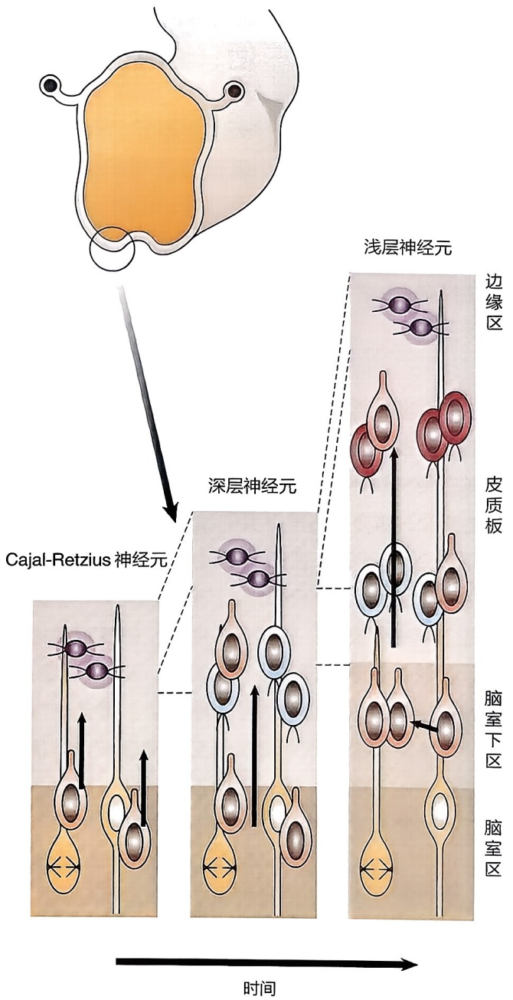

flowchart

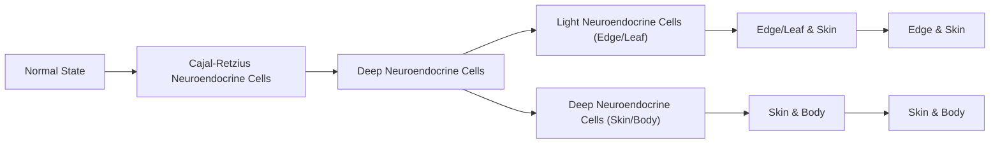

图13-21 端脑的神经发生形成了大脑皮质的神经元在大脑皮质神经发生过程中，形成的第一层细胞（Cajal-Retzius神经元）从其他位置迁移而来。VZ区的神经祖细胞分裂产生一系列神经前体细胞，这些细胞向外迁移，形成连续的神经元层。迁移的细胞首先分布在深层。在后期阶段，迁移的细胞分布形成浅层。

## 二、细胞迁移过程

神经元的迁移主要包括四个步骤。首先，细胞必须开始移动；其次，细胞必须受到适当的导向；再次，细胞通过局部移动来迁移；最后，细胞到达目的地后

## 知识窗 13-3

## 细胞骨架的组成分子

由蛋白质纤维构成的亚细胞网状结构组成细胞骨架，并在所有细胞形态的维持中起重要作用。细胞骨架在轴突和树突的形成和功能行使中也同样重要。细胞骨架纤维是蛋白质亚基的线型聚合物。微管由 $\alpha-$ 微管蛋白和 $\beta-$ 微管蛋白亚基组成。微丝（F-肌动蛋白）由肌动蛋白亚基聚合形成。这些聚合物的一个重要特征是它们具有极性。在某些条件下，微管和微丝能通过组装额外亚基来延长。在微管中，$\alpha-$ 微管蛋白和 $\beta-$ 微管蛋白异二聚体在“正”端组装。微丝可以通过在任一末端组装球状肌动蛋白亚基来延长，但优先结合到所谓的“倒钩”端。不论是微管还是微丝，游离的亚基和聚合状态的亚基都处于动态平衡中，而聚合状态稳定与否是控制神经突向外生长或回缩的主要机制（图 13-22）。

脊椎动物大脑皮质最为显著的特性是高度有序的六层板层结构，要形成如此特异的层状结构，大脑发育过程中神经元的正确迁移至关重要。神经元通过“由内到外”（inside-out）的模式进行迁移。早期产生的神经元形成大脑皮质的内层，晚期产生的神经元跨过早期的神经元迁移到大脑皮质的外层。由于不断地产生神经元以及新生神经元迁移至外皮质，最终形成大脑皮质。兴奋性神经元主要沿着放射状胶质细胞进行放射状迁移，而抑制性的中间神经元主要进行切向迁移（tangential migration）。

肌动蛋白亚基

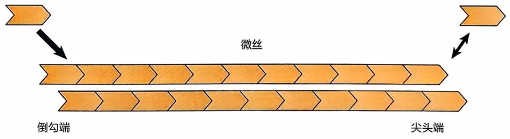

text_image

微丝
倒勾端
尖头端

$\alpha$ -微管蛋白 $+\beta$ -微管蛋白二聚体

微管

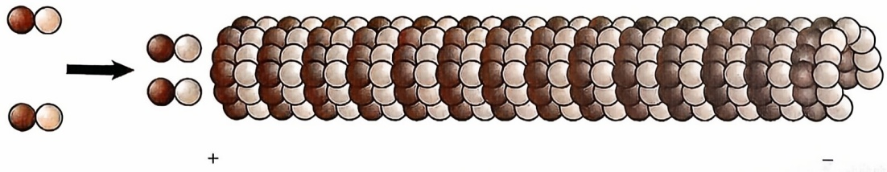

chemical

Diagram showing molecular structure transformation from two molecules to a complex with alternating brown and white spheres, labeled with + and - signs.

图 13-22 微丝和微管的组成分子

终止迁移。到目前为止，已经揭示的引导神经元迁移方向的机制主要有两种，即趋化性（chemotaxis）和胶质支架引导。在趋化作用中，细胞的运动由化学信号引导。细胞向信号移动，称为化学吸引（chemoattraction），或远离信号，称为化学排斥（chemorepulsion）。细胞运动或移动对于理解神经细胞迁移过程至关重要。在控制迁移神经元运动的细胞生物学过程方面，由放射状胶质细胞引导的皮质神经元的运动了解得最为清楚。细胞运动在很大程度上是由细胞骨架（cytoskeleton）的变化驱动的，细胞骨架是一种灵活且高度动态的细胞内网络结构，它控制细胞的形状和运动。微管（microtubule）组分是神经元迁移过程中细胞骨架最重要的部分。微管产生的一种称为中心体（centrosome）或微管组织中心的特殊结构，是控制细胞运动的关键因素。细胞运动过程可以分解为一系列的重复步骤。首先，前导突起（leading process）向迁移方向延伸；然后中心体向前移动，进入前导突起；之后，细胞核在被称为核运动（nucleokinesis）的过程中由连接微管向前牵引并向中心体移动；最后，尾突起重构，使其更接近细胞体。前导突起再次延伸，重新开始循环。神经元在到达目的地后需要终止迁移。尽管放射状迁移对发育中的大脑皮质有很大贡献，但是并非所有的皮质细胞都遵循这一路径。

## 三、放射迁移和切向迁移

放射状迁移是指神经元的胞体自室管膜区向脑膜方向自内而外的运动，这也是皮质神经元层状结构形成的主要方式。以这种方式迁移的神经细胞通常为简单的双极细胞，它们中大多数由放射状胶质细胞引导迁移至其目的地。放射状胶质细胞有着特殊的长突起，它们的胞体位于近脑室处，其长突起则向外延伸附着于脑膜，放射胶质细胞最后成为星状胶质细胞。根据具体的迁移特点，神经元的放射状迁移可以分为两种模式:胞体易位（somal translocation）和胶质细胞引导的迁移（glia-guided locomotion）。对于单个神经细胞来说，迁移模式并不是固定不变的，有些神经细胞以整体运动方式迁移至邻近大脑表层后会转换成胞体位移的方式进行迁移。

切线迁移是指神经元胞体沿脑膜切线方向进行迁移，这种迁移模式可以使大部分GABA（γ-氨基丁酸）源性的抑制性中间神经元穿越大脑皮质不同的区域进行长距离迁移。切线迁移的细胞主要有两条经典途径:①从内侧神经节隆起（MGE）分裂生成的中间神经元，平行于大脑皮质的表面进行切线迁移，最终迁入到大脑皮质和海马；②从外侧神经节隆起（LGE）产生的中间神经元通过切线迁移侵入嗅球，并持续到成年，这条通路被称为喙侧迁移流（rostral migratory stream）（图13-23）。

放射迁移和切线迁移对于单个神经元来说并不是绝对的，某些神经元可以通过这两种迁移方式到达目的地。例如，有 $40\%$ 的抑制性神经元先从MGE或LGE迁入脑室周围后再通过放射迁移迁入大脑皮质。在细胞迁移领域仍有许多悬而未决的问题。目前，在该领域，研究人员面临的一个主要挑战是使用培养的细胞和组织获得的分子机制有多大程度上适用于在体条件。

A

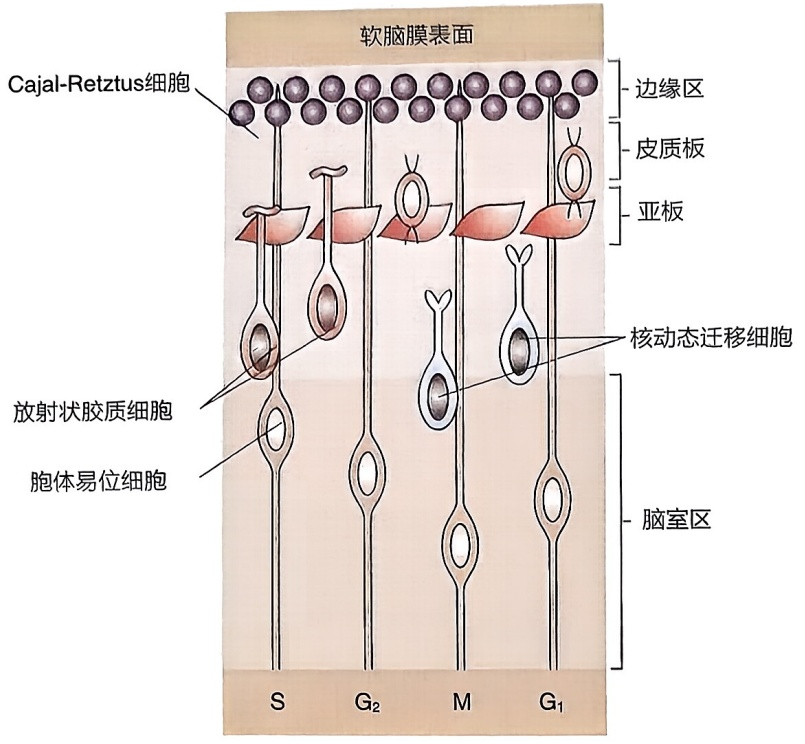

text_image

软脑膜表面
Cajal-Retztus细胞
边缘区
皮质板
亚板
放射状胶质细胞
胞体易位细胞
核动态迁移细胞
脑室区
S	G₂	M	G₁

图13-23 大脑皮质神经元的迁移

（A）投射神经元由脑室区（VZ）的放射状胶质细胞产生，并沿着放射状胶质细胞的引导纤维迁移到软脑膜，VZ产生的第一批迁移神经元组成前板层（preplate），随后陆续迁出的神经元将前板层分为两层:靠近软脑膜的边缘区（marginal zone）和深层的亚板层（subplate），边缘区主要由Cajal-Retzius细胞组成。投射神经元以

B

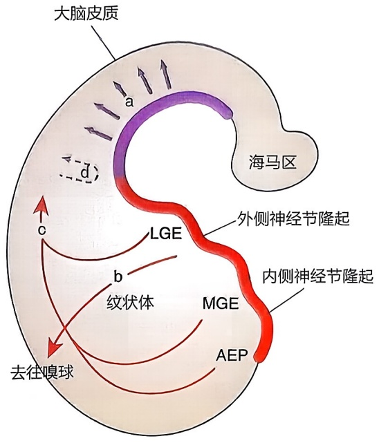

text_image

大脑皮质
海马区
外侧神经节隆起
LGE
b
纹状体
MGE
AEP
去往嗅球

胞体位移和细胞整体运动两种方式迁移到它们在皮质的最终位置。（B）主要的切线迁移路线。投射神经元从室管膜区放射状迁移到大脑皮质（a）；表达GABA源性的中间神经元从LGE、MGE和前脚内核区（AEP）切线状迁移到嗅球（b）和大脑皮质（c和d），神经元到达大脑皮质后一部分直接到达VZ，然后再以放射状方式迁移到皮质板。

## 第六节 神经元分化与轴突导向

当神经元迁移到目的地后，它们的细胞形态会进一步分化:轴突会从胞体伸展出去，在细胞和细胞外基质间穿行，最终与目标神经元分化出的树突连接在一起，由此神经信号便可顺着轴突投射的方向在神经元间传播、汇集。

当千万个神经元的轴突和树突以如此简单、精细的原理相互连接，它们就形成了神经环路，而神经环路在脑区间彼此交织又产生了神经网络，从此生命可以感知、运动、记忆。神经元和神经元的连接有时跨越脑区，外观上层峦叠嶂，但在发育过程中，神经元向远方投射的轴突却总能相对精准地从“迷宫”中走到目标神经元上，这意味着轴突可以像迁移中的胞体一样感知周围的环境。在本节中，你将了解到发育中的轴突和树突在脑内导向的机制。

## 一、神经元的极化

在成熟的神经元中，信号在树突中被接收并传输到胞体，然后在轴丘（axon hillock）进行整合。经过处理的信息以动作电位（action potential）的形式沿着轴突流向下一个神经元。神经元的整个分子结构，都反映了这种信息流向，这就是神经元的极性。神经元在开始分化时却既没有轴突也没有树突，而轴突和树突的形成即是神经元的极化。在发育过程中，极化诱因可以是内部产生的。在没有暴露在任何不对称外部环境的情况下，神经元仍能基于内部的不对称性——如中心体相对于细胞核的不对称或黏附受体分布的不对称而定向，并成功极化。一种常见的假设是，在极化过程中，微管会在细胞中肌动蛋白丝（actin filament）最薄弱分布的地方穿透到神经突（neurite）的远端区域，导致该神经突生长得更快、更稳定，最后那个神经突就变成了轴突。

而极化诱因也可以来自环境。在神经上皮基底的表面，有一层厚厚的细胞外基质，称为基底层（basal lamina）。基底层由几种互锁的分子组成，其中一个称为层粘连蛋白（laminin），是促进轴突生长的因子。例如，在视网膜神经节细胞的极化中，即使中心体在细胞的另一侧，轴突也会从细胞的基底面出现，生长方向朝向层粘连蛋白分子。这表明来自外部的诱因可以覆盖细胞内部的诱因。在皮质中，基底层与发育中的神经元相距甚远，层粘连蛋白分子不足以在长距离上提供极化诱因，所以如TGF-β和BDNF在顶基方向上的梯度促进了锥体神经元的顶侧有方向的轴突出现（图13-24）。

## 二、导航工具（上）:生长锥

在轴突和树突出现之后，轴突中的先行者——先锋轴突（pioneer axon）率先在大脑中爬行并开辟出道路，随行轴突（follower axon）则顺着先锋轴突铺设的道路朝着它们的目标前进，所以先锋轴突需要一个兼具移动和感知能力的头部，即生长锥（growth cone）。

生长锥是拉蒙·伊·卡哈尔（Ramón Y Cajal）最激动人心的发现之一。它的边缘突起具长而薄的丝状伪足（filopodia），上面布有大量的受体，用以接收来自环境的导航诱因。这些结构都是动态的，比如在当生长锥带领轴突来到这些关键的岔路口，它

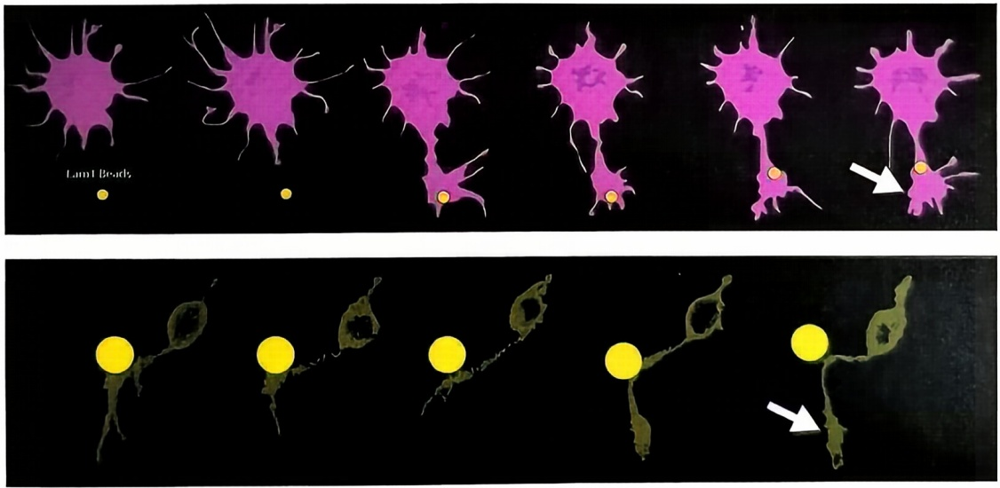

图13-24 离体斑马鱼视网膜神经节细胞

上图显示的是一个离体斑马鱼视网膜神经节细胞在几个小时内的连续图像，它接触到一个层膜包裹的bead，其中有一个新出现的神经突，然后成为轴突并发育出一个大的生长锥体；下图显示视网膜内层粘连蛋白被敲除的视网膜神经节细胞。在这些动物中，视网膜神经节细胞不能有效地极化。在这种情况下，层粘连蛋白包覆的珠状物帮助细胞长出轴突，然后轴突发育成生长锥。白色箭头指向轴突。

会变得更复杂，反之亦然；同样的诱因分子在不同的时间背景下，也会因为生长锥的动态产生截然不同的导向效果。跟随在先锋轴突后的轴突生长锥也会变得简单。先锋轴突的生长锥有几个活跃的丝状伪足和板状伪足（lamellipodia）。而跟随轴突的生长锥则倾向于呈子弹形，上面只有少量的突丝。

此外，生长锥向前爬行时，新材料被不断地装载到生长的轴突中以提供支撑。那些新材料是在头部——靠近生长锥处装配的——而非尾部的胞体。细胞骨架成分（如肌动蛋白丝和微管）的添加也发生在生长中的轴突的头部。在生长锥中，微管沿着轴突延伸到生长锥的中心区域，肌动蛋白丝则主要存在于生长锥的外围区域。在移动时，丝状伪足中的肌动蛋白丝束被蛋白质向后推动，同时它的末端会有新的肌动蛋白单位被加进来，从而驱动丝状伪足向远处延伸。生长锥在基质上的快速前进依赖于可以与黏附分子交互的跨膜受体。当受体抓住基质时，其下的运动信号通路会影响丝状伪足底部的肌球蛋白向后拖动生长中的肌动蛋白束。借此，单只丝状伪足能够通过缩短自身结构来引导整个生长锥。

除了微管和肌动蛋白丝之外，在生长锥中还存在许多与细胞骨架相关的蛋白质，它们执行各种任务，如将肌动蛋白和微管锚定到细胞膜或彼此之上，帮助组装或解组肌动蛋白和微管、或通过分子马达产生推力等（图13-25）。

图13-25 生长锥的结构

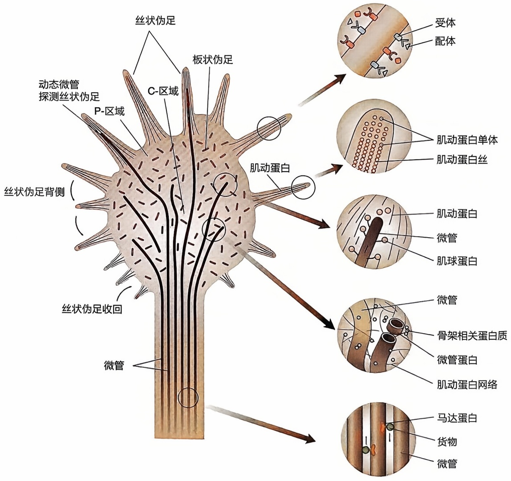

text_image

丝状伪足
C-区域
动态微管
探测丝状伪足
P-区域
丝状伪足背侧
微管
丝状伪足收回
微管
板状伪足
受体
配体
肌动蛋白单体
肌动蛋白丝
肌动蛋白
微管
肌球蛋白
微管
骨架相关蛋白质
微管蛋白
肌动蛋白网络
马达蛋白
货物
微管

