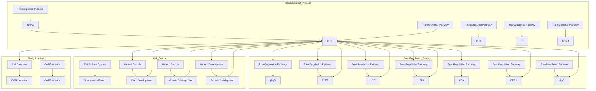
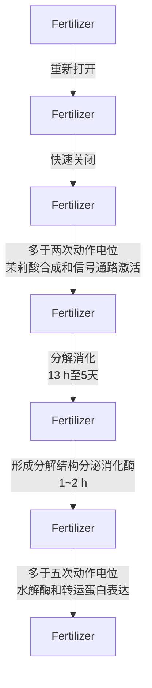
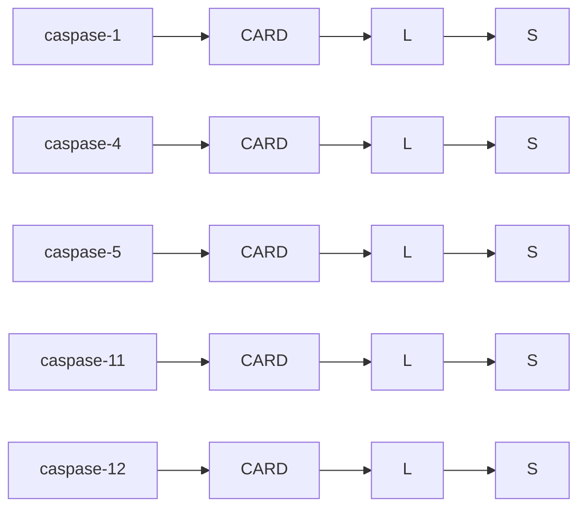
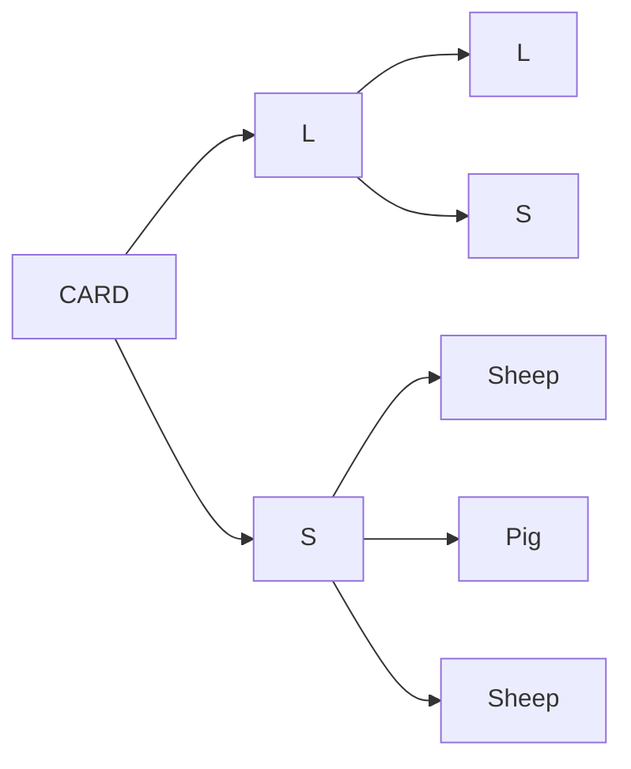

对于拟南芥来说，突然且剧烈的高温（高于 $40^{\circ}\mathrm{C}$ ）可能会导致植物的死亡；然而，预先适应较为温和的中等强度高温（低于 $37^{\circ}\mathrm{C}$ ）可以提高拟南芥的存活率。并且，略微升高的环境温度（一般为 $27^{\circ}\mathrm{C}$ 左右，不高于 $32^{\circ}\mathrm{C}$ ）可以诱导拟南芥在植物体结构上发生许多重大变化、完成重要生长发育阶段的过渡，而不会导致拟南芥死亡。植物这一对略微升高的环境温度做出的响应过程，被不同的分子机制精确感知和调控，这一调控机制与植物对极端高温的反应有很大不同。

在拟南芥中，高温诱导的形态建成发生在其生长发育的不同阶段，并体现在多个不同的组织器官中（图15-14）。在适宜的温度条件下发芽对于提高幼苗的生存率和适应程度非常重要，高温对于拟南芥种子萌发有抑制作用，被称为热抑制（thermoinhibition）。在种子萌发后，随着土壤或空气的环境温度升高，拟南芥下胚轴的变化尤其明显，28°C环境下生长的拟南芥幼苗相较于21°C环境中下胚轴明显伸长；对于成苗来说，高温环境下生长的拟南芥茎也会明显增长。

除此之外，拟南芥的叶柄在高温下会发生明显伸长，并且叶柄近地侧和远地侧的生长速度会发生差异，使得叶片被抬离地面。除了地上部分，地下部分的根也会受到土壤温度的影响，发生形态的改变，高温可以诱导拟南芥主根的伸长生长。除了植物的营养生长，植物成苗的生殖生长也受到高温的影响。在非诱导开花的短日照条件下，环境温度的升高可以诱导拟南芥向成花的过程发生转变。在拟南芥等十字花科植物中，环境温度的升高会使得其果荚裂开的过程提早发生。


<details>
<summary>text_image</summary>

果实开裂
21℃
28℃
种子萌发
21℃
30℃
下胚轴与叶柄的伸长
21℃
28℃
开花时间
21℃
28℃
根部伸长
21℃
28℃
叶片温度向性
21℃
28℃
</details>

图15-14 环境高温对植物结构与发育的影响

低温对于植物的影响可以被分为冰点以上的低温和冰点以下的低温。冰点以上的低温影响植物体内的分子运动和各种代谢反应的活性，并且可能导致细胞内的结构改变；冰点以下的低温还可以进一步通过结冰直接对植物造成机械性的细胞结构破坏。与高温相似，一定程度的低温也可以在不导致植物死亡的前提下，诱导植物生长和发育进程的改变或过渡。温带的各类植物在不同生长发育阶段对低温的适应性变化包括种子和芽的休眠、春化作用、温度导致的光周期敏感性变化等。

## 2. 植物的温度响应元件

植物温度形态建成的相关研究发现了多类对温度有所响应的元件，共同构成了植物的温度响应网络。根据植物受温度影响后内部作用方式的变化，温度形态建成中的细胞与分子响应可以分成10类，包括染色质重塑、RNA的可变剪接、分子的异构化、分子的二聚化、基因表达调控、非编码RNA、蛋白质的降解、亚细胞定位变化、转录因子与DNA的相互作用、激素的累积等。

转录因子 PIF4（phytochrome-interacting factor 4）在温度形态建成和调控网络中发挥核心作用。PIF4 整合了上游多种不同信号，将对温度的响应传递到下游，调控了多种生物学过程。温度升高诱导的幼苗下胚轴伸长、叶柄生长以及叶片的热感性生长都依赖于 PIF4。PIF4 通过调控自身结合生长素合成相关等下游基因启动子的能力，调控拟南芥茎干的生长。高温对于植物免疫的抑制也依赖于 PIF4，PIF4 在高温环境下生长与免疫反应的平衡中发挥关键作用。PIF4 可以结合成花过程的整合因子 FT 的启动子，与 22℃ 或 12℃ 相比，27℃ 时的 PIF4 与 FT 启动子的结合增加，从而促进了成花过程的转变，并且这一促进过程是通过温度升高诱导的 H2A.Z 类型核小体占有率的减少而达成的。在拟南芥中，高温可以通过减少表达 SPCH（Speechless）的细胞数量，从而抑制表皮细胞的气孔分化，从而减少叶片的气孔指数（单位面积上气孔数量占表皮细胞总数的比例）。高温可以促使 PIF4 积累在气孔前体细胞中 SPCH 的启动子上，从而抑制 SPCH 的表达。

PIF4 自身受温度诱导的调控发生在不同层面（图 15-15）。其上游的多种转录因子在不同温度下的蛋白质稳定性和活性变化，导致其结合及对 PIF4 的调控发生改变，影响了 PIF4 的转录；组蛋白质的去乙酰化过程也被发现可能在 PIF4 的表达调控中发挥作用。PIF4 的蛋白质稳定性同样受到温度调控，phyB 可以促进 PIF4 的磷酸化和降解，在遮荫反应或升高温度时，phyB 活性的降低导致 PIF4 的稳定性提高。除此之外，PIF4 作为转录因子的转录调控活性也受到温度的调控。DELLA 蛋白可以直接与 PIF4 蛋白的 DNA 结合区域相互作用从而抑制其转录调控的活性，高温可以减少 DELLA 从而解除其对 PIF4 活性的抑制。HFR1（long hypocotyl in far red 1）等蛋白质可以与 PIF4 蛋白形成异源二聚体，形成的二聚体使得 PIF4 无法结合 DNA，高温可以进一步增加 HFR1 的含量。转录因子 SEU（SEUSS）与 PIF4 可以发生直接相互作用并增强 PIF4 与靶基因的结合，这一过程在高温下被增强。

植物温度形态建成以及相应过程中参与的元件众多，涉及染色质的乙酰化以及甲基化、FLM（flowering locus M）的 mRNA 可变剪接、phyB 的分子构象转变、UVR8的二聚化、PIF4等基因的表达、FLINC（flowering long intergenic noncoding RNA）等的基因表达调控、PIF4等转录因子的降解、COP1（constitutive photomorphogenesis protein 1）等蛋白质的亚细胞定位、ELF3（early flowering 3）等与DNA的结合与解离以及生长素的累积。尽管涉及的元件众多，涵盖多个生物学反应过程，逐渐构成了整个热响应网络，但温度的直接感知机制尚还需进一步明确。近年来，植物中温度的受体被逐渐发现和报道，在植物的温度感知研究中取得了重要突破。


<details>
<summary>flowchart</summary>


</details>

图15-15 温度形态建成的核心转录因子PIF4

## 3. 植物中的温度感知受体

phyB 是重要的光受体之一，研究发现它也作为热响应元件参与植物对温度的响应。与野生型相比，phyB 突变体在 22～27°C 几乎未出现下胚轴的伸长。这一结果显示缺失 phyB 会导致植物体在该区间的温度形态建成功能缺失。通过模型构建，卡萨尔（Casal）等人发现温度会影响 phyB 在活化状态 Pfr 构象和非活化状态 Pr 构象之间的转化。全长的 phyB 蛋白以二聚体形式存在，由于其活化状态的不同存在 Pfr-Pfr、Pfr-Pr 和 Pr-Pr 三种二聚体形式；温度的升高会促使 phyB 从 Pfr-Pfr 先转化为 Pfr-Pr，再从 Pfr-Pr 转化为 Pr-Pr。Pfr 构象和 Pr 构象可通过红光和远红光调控转化，该过程被称为光逆转。构象转化也可以不依赖于光发生，该过程被称为暗逆转或热逆转（dark reversion/thermal reversion）。高温会促使 phyB 从 Pfr 构象转化为 Pr 构象并进一步驱动植物的温度形态建成，热逆转从Pfr-Pfr状态转化为Pfr-Pr状态的速率以及从Pfr-Pr状态转化为Pr-Pr状态的速率是不同的，后者几乎是前者的100倍。而光对phyB分子状态的影响取决于光质和光强，使得这两步转化的速率是相同的。这也从侧面说明温度和光调控的phyB构象转化机制存在差异。

真核生物细胞内存在大量类似于光小体（photobody）的无膜结构，近年来液-液相分离（liquid-liquid phase separation，LLPS）概念的引入使得研究人员对该类无膜结构有了更深入的理解。2022年的最新研究表明，phyB光小体的形成过程属于液-液相分离，并进一步明确了光小体的组装原则（图15-16A）。phyB的N端NTE（N-terminal extension）是一段固有无序序列，其C端OPM（output module）具有极强的寡聚化能力，可以进行自我聚集，这两段区域促使活化的phyB分子通过液-液相分离过程形成光小体。当phyB处于Pr构象时，NTE的一部分被包埋于GAF（cGMP phosphodiesterase, adenylate cyclase and FhlA）区域。由于构象折叠，整个N端对C端的寡聚能力产生抑制，此时无法形成光小体。而当光活化时phyB会发生构象的改变，NTE从GAF区域被释放出来，由于NTE具有固有无序序列的特性，可以与其他phyB分子的NTE发生弱多价相互作用，进一步解除N端对C端的抑制，使得C端暴露出

来并进一步寡聚化，形成光小体。

A


图15-16 植物通过液-液相分离机制整合植物对光与温度的感知

光和温度均能影响phyB光小体的形成与解离，但其机制存在区别。被锁定为Pfr形式的phyB形成光小体的过程不再受光调控，但温度仍会影响其形成与解离；而去除NTE后phyB仍具有形成凝集体的能力，但无法对温度变化做出响应。因此，NTE是phyB感受温度的特异序列，并且NTE对温度的特异性感知建立在形成光小体的基础上。此外，在植物开花的过程中，一个由ELF3/ELF4/LUX蛋白组成的复合体称为夜间复合体（evening complex），在温度调控开花的过程中也是通过液-液相分离机制感受温度变化来调控开花时间（图15-16B）。

水稻是我国重要的粮食作物，起源于热带和亚热带地区。温度是影响水稻品种形成和地域分布的主要环境因子，亚洲栽培稻主要分为粳稻和籼稻，粳稻低温耐受性较强，主要分布于我国北部和东北部，而籼稻低温耐受性较弱，主要分布于我国华南和淮河以南的热带/亚热带地区。粳稻的较强耐寒性是由一个重要基因COLD1决定的，其驯化选择的SNP2等位基因来自于中国野生稻。粳稻特异的SNP2影响了COLD1活性从而得以赋予粳稻耐寒性。包含粳稻COLD1基因的籼稻近等基因系以及过表达COLD1的粳稻材料都显著增强了耐寒性，而功能缺失突变体cold1-1或反义基因株系却对寒冷非常敏感。COLD1编码一个G蛋白的信号调节因子，具有9次跨膜结构域，定位于细胞膜和内质网上，可能作为离子通道或者离子通道的一部分调控细胞中 $\mathrm{Ca^{2+}}$ 浓度。低温处理时，COLD1与G蛋白 $\alpha$ 亚基RGA互作，参与依赖于G蛋白的信号转导，激活 $\mathrm{Ca^{2+}}$ 通道，触发下游耐寒防御反应，而后提高G蛋白的GTP酶活性以平衡G蛋白的动态活性，从而应对低温胁迫。

## 三、植物机械压力接触形态建成

## 1. 植物对机械压力的感知与响应

机械压力在植物的生长周期中广泛存在，例如土壤中的障碍物、昆虫啃食、攀缘生长、风吹雨打等，那么基于固着生长这一特征，植物能否对如此常见的机械刺激做出反应成为值得思考的问题。早在19世纪，达尔文便已发现植物的根系能够自发绕过障碍物，且攀缘生长的植物在感知到固体之后才会确定生长方向等。不仅如此，在植物中也同样存在较为敏感的类型，如含羞草、捕蝇草，这类在触碰反应下能够快速移动叶片的植物，被称为敏感植物。

以捕蝇草为例，在感知到“猎物”存在后，捕蝇夹快速关闭，进而分泌消化液分解“猎物”，那么在这个过程中，捕蝇草通过捕蝇夹内特化的“触摸毛”感知来自昆虫等的触碰，每当触摸毛被触碰一次，便会产生一个动作电位，而此时的捕蝇夹并不会立即关闭，当动作电位的数量达到两个及以上时，该信号便会介导茉莉酸（jasmonic acid）合成，在捕蝇夹关闭的同时产生消化酶。除此之外，在昆虫挣扎时，便会反复触碰触摸毛，刺激多个动作电位的产生，这也给捕蝇草一个“猎物”大小与种类的提示，使其能够根据动作电位的数量，产生相应量级的消化酶（图15-17）。捕蝇草的“捕猎”说明植物能够敏锐地感知触碰等机械压力刺激，并做出相应的反应。

而除了含羞草、捕蝇草等敏感植物外，大部分植物并不会表现出明显的即时触摸反应，在动物中，细胞之间的黏附作用造成的机械应力与早期胚胎发育过程中的形态发生密切相关。而早在20世纪80年代，人们便在植物中发现机械压力能够影响其生长发育。在自然界中风、雨等持续环境信号的刺激下，高等植物会逐渐发生一系列形态变化，这些变化不像含羞草与捕蝇草等敏感植物一样显著且迅速，但这些变化是累积增加的。如图15-18所示，当每天固定给予两次机械压力刺激后，拟南芥会出现非常明显的晚花与矮薹表现。这种机械压力刺激影响植物生长发育的现象，被称为接触形态建成。

为了深入了解植物的接触形态建成机制，人们从受体/感受器、植物激素、下游效应因子等多个方面进行探究，下文分别进行详细介绍。

## 2. 机械敏感的离子通道在受体层面发挥重要功能

捕蝇草的触碰反应机制提供了一个重要启示，电信号可在植物胁迫响应的早期阶段发挥重要功能。离子通道作为电信号产生的重要元件，在植物机械压力响应中同样具有重要作用。含羞草触摸反应便与叶柄细胞的钾离子、氯离子及水通道的开放密切相关。而目前多个机械敏感离子通道（mechanosensitive ion channel）被解析，它们在机械压力响应的受体层面发挥重要功能。

图15-17 捕蝇草捕获“猎物”反应示意图


<details>
<summary>flowchart</summary>


</details>


图15-18 拟南芥接触形态建成示意图

在细菌中存在一类感知渗透变化的机械敏感离子通道 MscS（mechanosensitive channel of small conductance），水稻存在 6 个 MscS 的同源基因 MSL（MscS-Like），拟南芥中同样发现了 MSL 蛋白家族。拟南芥 MSL 家族共有 10 个成员，其中 AtMSL2、AtMSL3 与绿藻中 MscS 家族的 MSC1 同源关系较近，也具有与 MSC1 类似的器官发生调控功能。为检验拟南芥 MSL 能否与 MscS 一样作为机械敏感的离子通道，研究人员对主要表达在根尖质膜上的 AtMSL9 与 AtMSL10 进行研究。根尖是植物感受机械压力较为敏感的组织，通过制备根部细胞的原生质体进行膜片钳检测，证实 AtMSL9/10 在机械压力刺激下能够通透钙离子，是机械敏感的钙离子通道，两者的双缺突变体会出现钙电流异常。这也是首次在植物中发现的机械敏感离子通道。

酵母 MID1 具有钙离子通道活性，其基因突变体 mid1 对拉伸不敏感。MID1 因此被认为是机械敏感的钙离子通道。在 mid1 酵母细胞中异源表达一个拟南芥基因能够回补其缺陷，该基因因此被命名为 MCA1（MID1-complementing activity1）。拟南芥 mca1 突变体根部穿透能力减弱，难以从低浓度琼脂培养基穿透到高浓度琼脂培养基中，说明了 MCA1 可能参与拟南芥根部对于机械压力的感知。后续膜片钳实验证实 MCA1 是质膜上可以被细胞拉伸形变激活的钙离子通道。通过基因组序列比对，具有高度相似的序列与结构特征，以及类似生理功能和突变表型的拟南芥 MCA2 也被发现（图 15-19）。

2021 年阿德姆·帕塔普蒂安（Ardem Patapoutian）教授因发现机械敏感的离子通道 Piezo 获得诺贝尔生理学或医学奖。Piezo 在希腊语中意为 “压力”，研究表明 Piezo1 参与血管发育、骨骼生长与修复、呼吸过程等，而 Piezo2 则帮助我们 “触摸世界”，与触觉感知密切相关。值得一提的是，Piezo1 在结构上具有三个 “螺旋桨片”，未受力情况下弯曲成碗状，当细胞受到机械压力刺激时，“螺旋桨片” 利用杠杆支撑原理延展成片状，带动中心孔道的打开。植物中同样存在 Piezo 同源蛋白，该蛋白质定位在液泡膜而非质膜上，能因液泡膜本身更大的运动自由度而更好地发挥功能。拟南芥 AtPiezo1 主要表达在根部及花粉粒中，作为阳离子通道在机械压力感知中发挥重要作用。此外，拟南芥中还发现了哺乳动物 TMEM16 同源的 OSCA 蛋白等更多机械敏感离子通道。这些研究逐渐揭开植物对于机械压力感知的面纱，为更好地了解植物自身发育及环境适应性提供更多线索。

图 15-19 拟南芥潜在的机械敏感离子通道示意图


<details>
<summary>flowchart</summary>

This diagram illustrates the cellular mechanism of calcium ion transport in a plant, showing how calcium is oxidized by various proteins (MSLs, CNGCs, MCAs, Piezo, TPK, GLRs) and subsequently released into cells.
</details>

## 3. 植物接触形态建成响应因子

前文提到，高等植物在受到风、雨等持续环境刺激下，会发生逐渐的形态变化，该变化随着机械压力刺激时间而逐渐积累，那么植物是如何通过体内信号转导将机械压力刺激转化为最终的形态学变化，是解析接触形态建成的重要内容。除却上文对植物机械压力感知层面进行的简要介绍，下游的响应因子同样发挥重要功能。

乙烯（ethylene）作为唯一已知的植物气体激素，在果实成熟、叶片以及下胚轴发育中发挥重要功能，而乙烯易于扩散的特征也提示其对于植物抗逆响应中的重要作用。当拟南芥幼苗受到乙烯处理时，会呈现十分典型的“三重反应”（triple response），分别是下胚轴与根的伸长受到抑制，下胚轴变粗以及顶端弯钩加剧，这些反应能够使植物在遇到刺激时合理地承受及规避伤害。

早期研究表明，豌豆幼苗在遭受机械压力刺激时，会产生乙烯，导致下胚轴变短变粗，以应对机械压力对植株造成的损伤，且机械压力刺激越强，该反应越明显。除此之外，植物根系的机械压力响应同样与乙烯信号密切相关。当拟南芥根部在穿透不同浓度的琼脂培养基时，若下层硬度增加，根部穿透过程中乙烯合成量明显增加。除此之外，当乙烯的合成量增多时，根部能够穿透上下层交界面进入下层培养基，而当乙烯合成量减少时，拟南芥根部倾向于在上下层交界面上弯曲打圈，无法向下穿透。在拟南芥中，EIN3（ethylene insensitive 3）是乙烯信号通路中重要的转录因子，当使用砂土模拟自然界的出土环境时，EIN3蛋白的表达水平随着覆土厚度的增加明显升高，该过程同样伴随着乙烯含量的升高，相应的，ein3 eil1突变体出土能力相较野生型有明显的减弱。这些结果都说明了乙烯信号通路在拟南芥幼苗机械压力响应上的作用。

细胞壁作为植物细胞特有的结构，其重要组分果胶的结构受到机械压力的调节，反复多次的机械压力刺激能够逐渐改变细胞壁的机械强度，最终使植物呈现出接触形态建成的表型。拟南芥中编码多聚半乳糖醛酸的PGX3（ploygalacturonase involved expansion 3）介导此过程，PGX3的表达受到机械压力的抑制，且野生型拟南芥幼苗在机械压力刺激下，细胞壁硬度明显提高，而pgx3突变体显示出组成型增强的表型，不仅如此，该过程是可逆的，只有当拟南芥幼苗持续受到机械压力刺激时，PGX3表达水平及酶活长时间处于抑制状态，下胚轴细胞的伸长才会呈现明显的抑制反应。进一步研究显示，在PGX3的上游，乙烯起到重要调控作用，EIN3蛋白能够直接结合PGX3的启动子区域，抑制PGX3转录。该机制揭示了植物在机械压力刺激下，如何进行细胞可塑性的调整，确保幼苗在生长和出土期间的适应性，实现幼苗出土存活（图15-20）。

除了乙烯信号对于拟南芥幼苗接触形态建成中的重要作用外，茉莉酸、赤霉素、生长素等植物激素在植物成苗接触形态建成反应中均发挥重要功能。植物激素茉莉酸在抗逆反应中常常被提及，在茉莉酸介导的损伤响应中，受到调控的标志基因与机械压力响应中的标志基因具有较大的重合，因而人们认为茉莉酸同样参与调控植物接触形态建成。其中机械压力响应标志基因 $TCH2/4$ （touch 2/4）同样在茉莉酸信号通路的下游，CAMTA1/2/3（calmodulin-binding transcriptional activator 1/2/3）作为茉莉酸介导的机械压力响应过程中的核心转录因子，能够直接结合在 $TCH2/4$ 的启动子区域，调控其表达，而 camta3 突变体基本缺失接触形态建成的表型，且在持续机械压力刺激下，未表现出明显的晚花。同样的，拟南芥茉莉酸合成相关酶 AOS（allene oxide synthase）突变体 aos 在受到持续机械压力刺激后，并未呈现出如野生型 gl-1 类似的晚花与矮薹表现，而过表达茉莉酸合成酶 OPR3（oxophytodienoate reductase 3）时，拟南芥成苗呈现出组成型激活的接触形态建成表型。以上内容均能够说明茉莉酸在拟南芥成苗的接触形态建成过程中发挥重要作用。此外，赤霉素与生长素含量在成苗接触形态建成过程中的分枝增加及腋芽活性增加也具有一定作用。因此，拟南芥等植物的确能够通过一系列反应对机械压力刺激作出响应，调整其生长发育，适应复杂多变的外界环境。


<details>
<summary>natural_image</summary>

Illustration of four seeds in a container with liquid, no text or symbols present
</details>

高皿 顶端无机械压力（D）


<details>
<summary>natural_image</summary>

Illustration of seedling structures with two curved arms and two brown seed pods (no text or labels)
</details>

D S

WT


<details>
<summary>natural_image</summary>

Illustration of seed pods with brown seeds and yellow caps, no text or symbols present
</details>

D S

pgx3

图 15-20 暗环境下生长的拟南芥幼苗的接触形态建成


<details>
<summary>natural_image</summary>

Illustration of four seeds suspended in a container with liquid, no text or symbols present
</details>

矮皿 顶端有机械压力（S）

## 名词窗 15-2

光形态建成（photomorphogenesis）:植物对光的最初反应，茎和根分生组织被激活，通过细胞分裂和扩张等一系列变化导致植物细胞的分化、结构和功能改变，最终表现为组织和器官的建成。

泛素（ubiquitin）:一种广泛存在于真核生物中的小蛋白质，由76个氨基酸组成，标记需要分解掉的蛋白质，最终被泛素标记的蛋白质会被26S蛋白酶体降解。

26S 蛋白酶体（26S proteasome）:真核细胞中负责调控蛋白质降解的主要蛋白质降解机器，因整个复合物的沉降系数是 26S 而得名，特异性地降解被泛素化标记的蛋白质。

受体（receptor）:能够直接感受外界环境变化并通过改变自身性质将外界变化传递给生物体内部其他组分的物质。

温度形态建成（thermomorphogenesis）；植物应对环境温度变化，在生长和发育方面发生特定形态改变的过程。

热抑制（thermolinhibition）:高温对拟南芥等植物种子萌发的抑制作用。

温度感受器 / 温度感知受体（thermosensor）:生物体内能够接收特定温度或温度变化的刺激，并将其转换为可识别分子信号的分子。

液-液相分离（liquid-liquid phase separation, LLPS）:二元或多元混合物在一定条件下可以分离为不同的相，这种物理化学现象被称为相分离（phase separation）；当互相分离的两种或多种相都是液体时，这种现象被称为液-液相分离。相分离是一种高度动态的现象，生物大分子的液-液相分离对于生物体中多种无膜结构等功能组分的组织形成与生理功能具有重要作用。

光转换（photoconversion）:光敏色素（phytochrome）存在活化状态的Pfr构象（远红光吸收型，far-red light-absorbing form）和非活化状态的Pr构象（红光吸收型，red light-absorbing form）两种构象，两种构象之间可以通过红光和远红光的调控发生转换。

暗逆转 / 热逆转（dark reversion/thermal reversion）:区别于依赖于光的光转换，光敏色素可以通过不依赖于光的过程从活化状态的 Pfr 构象失活为非活化状态的 Pr构象。光敏色素的 Pfr 构象在黑暗中仍然可以缓慢逆转失活为 Pr 构象，这个过程不依赖于光，因此被称为“暗逆转”，这一术语被广泛使用；而“热逆转”更准确地描述了不依赖于光但受温度调控的 Pfr 失活（或称松弛，relation）的过程，这种松弛过程不仅发生在黑暗中，也可以发生在光中。

光小体（photobody）:光敏色素从 Pr 状态活化为 Pfr 状态后，会发生从细胞质向细胞核的转移，并在细胞核内形成点状结构，这种点状结构的形成一般依赖于光，被称为光小体。

接触形态建成（thigmomorphogenesis）:机械刺激影响植物生长发育的现象。

机械敏感离子通道（mechanosensitive ion channel）:一类由膜整合蛋白组成的门控离子通道，能够将细胞外的牵张、压力、重力、渗透压变化、病原体入侵和细胞自身因细胞分裂和生长产生的机械力等信息转化为电化学信号。

乙烯（ethylene）:植物激素，由甲硫氨酸在供氧充足的条件下转化而成的有机化合物。

三重反应（triple response）:乙烯诱导的植物生物学效应，分别是下胚轴与根的伸长受到抑制，下胚轴变粗以及顶端弯钩加剧。

茉莉酸（jasmonic acid）:植物激素，脂肪酸衍生物，高等植物体内的内源生长调节物质。

## ※ 复习思考题

1. 植物的双受精有怎样的生物学意义？
2. 植物发育和动物发育有哪些差异？
3. 以叶片发育为例，思考基因表达如何改变细胞和器官形态？
4. 光敏色素 B 作为植物光照和温度的共受体，如何区分感知两种环境信号？
5. 如何利用遗传学的方法筛选鉴定植物机械压力信号通路的功能组分？

## ※ 推荐阅读

1. GE Z, BERGONCI T, ZHAO Y, et al. Arabidopsis pollen tube integrity and sperm release are regulated by RALF-mediated signaling [J]. Science, 2017(358): 1596–1600.
2. LIU J, WU M, LIU C. Cereal endosperms: development and storage product accumulation [J]. Annu. Rev. Plant Biol., 2022(73): 255–291.
3. REINHARDT D, MANDEL T, KUHLEMEIER C. Auxin regulates the initiation and radial position of plant lateral organs [J]. Plant Cell, 2000(12): 507–518.
4. COEN E, MEYEROWITZ E. The war of the whorls: genetic interactions controlling flower development [J]. Nature, 1991(353): 31–37.
5. KOINI M A, ALVEY L, ALLEN T, et al. High temperature-mediated adaptations in plant architecture require the bHLH transcription factor PIF4 [J]. Curr. Biol., 2009(19): 408-413.
6. SHI H, LYU M, LUO Y, et al. Genome-wide regulation of light-controlled seedling morphogenesis by three families of transcription factors [J]. Proc Natl Acad Sci U S A, 2018(115): 6482–6487.
7. WU Q, LI Y, LYU M, et al. Touch-induced seedling morphological changes are determined by ethylene-regulated pectin degradation [J]. Sci. Adv., 2020, 6: eabc9294.
8. WANG Z, WANG W, ZHAO D, et al. Light-induced remodeling of phytochrome B enables signal transduction by phytochrome-interacting factor [J]. Cell, 2024(187): 1–16.

（编写:邓兴旺、李磊、焦雨铃、钟上威、何光明；审读:王学路）

# 第十六章

# 细胞死亡的分子机制

细胞凋亡、程序性坏死和焦亡是3种由基因编程和调控的细胞死亡形式。这些分子机制的激活会导致不同形式的细胞死亡。半胱天冬酶（caspase）在调节3种细胞死亡形式中发挥着核心作用。在细胞凋亡中，半胱天冬酶家族的级联式激活介导了细胞自杀的全过程，包括信号转导、细胞损毁和凋亡小体的清除。在炎症情况下，半胱天冬酶剪切GSDM家族蛋白质，从而导致膜孔的形成以释放成熟的IL-1β。在某些外来病原入侵的情况下，这些GSDM家族蛋白质剪切后造成的大量膜孔可以介导细胞焦亡（一种坏死性细胞死亡）。此外，caspase-8可以直接剪切RIPK1来促进细胞凋亡并抑制程序性坏死。在半胱天冬酶缺乏的条件下，RIPK1的活化会促进和下游RIPK3的结合以及坏死小体的形成，RIPK3进而导致MLKL活化来介导细胞程序性坏死。除了激活细胞凋亡、程序性坏死或者焦亡而导致的细胞自杀之外，破坏细胞稳态可以直接造成细胞非自主死亡——“它杀”。细胞内存在着多种调控机制来维持细胞稳态，例如离子和氧化还原平衡、各种细胞膜和细胞器的完整性、溶酶体和蛋白酶体的稳定等。当细胞稳态受到破坏时可以直接导致细胞死亡，例如兴奋性毒性、铁死亡和溶酶体细胞死亡。因此，细胞也可以在存活机制被破坏时死亡，而无需调用基因编程和控制的细胞主动死亡机制。

细胞凋亡和坏死是两种形态学特征截然不同的细胞死亡类型。细胞凋亡的形态学特征是细胞膜保持完整性，同时细胞质和细胞核发生浓缩；而细胞坏死的形态学特征则是细胞膜的破坏和由于细胞膜破坏后造成的细胞质稀释。

细胞凋亡受进化中高度保守的遗传程序所调控。细胞凋亡的核心调控因子是在秀丽隐杆线虫 C. elegans 的研究中首先被发现，其中包括 Egl-1、Ced-9、Ced-3 和 Ced-4 等。这些细胞凋亡的核心调控因子在从无脊椎动物到脊椎动物的基因组中都是高度进化保守的。CED-3 是 C. elegans 中激活程序性细胞死亡所需的唯一半胱天冬酶，而高等生物的基因组编码了多种半胱天冬酶。例如哺乳动物小鼠基因组编码了 11 种半胱天冬酶，而人类基因组编码了 13 种半胱天冬酶（图 16-1）。哺乳动物基因组编码的 Bcl-2 是秀丽隐杆线虫 Ced-9 的同源基因产物。Bcl-2 的高表达可以通过促进细胞存活而不是细胞增殖来导致癌症的发生。

细胞坏死传统上被认为是一种被动且不受调控的细胞死亡形式。然而2005年以来的突破性发现表明，哺乳动物和高等脊椎动物基因组编码的一些关键基因产物，包括ripk1（receptor interacting protein kinase 1）、ripk3（receptor interacting protein kinase 3）和mlkl（mixed lineage kinase domain like pseudokinase），介导了一种称为程序性坏死（necroptosis）的细胞死亡。此外，研究还发现caspase不仅可以介导细胞凋亡，还可以介导一种称为焦亡（pyroptosis）的细胞坏死。

细胞凋亡、程序性坏死和焦亡是由细胞主动调控的死亡形式，因为其细胞死亡过


<details>
<summary>flowchart</summary>


</details>

下游效应caspases（细胞凋亡）


<details>
<summary>text_image</summary>

caspase-3
caspase-6
caspase-7
</details>

启动caspases（细胞凋亡，细胞焦亡）


<details>
<summary>text_image</summary>

caspase-2
CARD L S
caspase-8
DED DED L S
caspase-9
CARD L S
caspase-10
DED DED L S
●对细胞程序性坏死具有抑制作用
</details>

启动caspases（细胞凋亡，细胞焦亡）


<details>
<summary>flowchart</summary>


</details>

图16-1 caspase家族蛋白质

CARD
caspase募集结构域

DED
死亡效应结构域

L
大催化亚基

S
小催化亚基

caspase是根据其前结构域长度（短或长）和序列特征、caspase募集结构域（CARD）或死亡效应结构域（DED）以及功能（起动caspase或下游caspase）进行分类的。caspase-8对抑制细胞程序性坏死的发生具有重要作用。

程都需要激活特定的死亡基因及其调控的细胞死亡程序。此外，细胞也可以由于破坏关键存活机制而被动地死亡。这些关键存活机制的主要功能是调节细胞稳态，而不是调控细胞死亡。细胞质膜完整性的破坏、兴奋毒性、错误折叠蛋白质的累积、过度的氧化应激反应和细胞抗脂质过氧化机制失活而导致的铁死亡等，都是由于细胞稳态被破坏造成的细胞被动性死亡。因此，哺乳动物细胞死亡的发生可以通过激活基因编辑的程序性细胞死亡机制，包括细胞凋亡、程序性坏死和焦亡，或者由破坏细胞稳态和存活机制而导致的被动性死亡。

在本章中，我们将首先概述3种由死亡基因编程调控的细胞程序性死亡形式，包括caspase介导的细胞凋亡和焦亡，以及由RIPK1、RIPK3和MLKL介导的程序性坏死。然后我们将介绍由于破坏细胞稳态而导致的细胞被动性死亡的例子（如兴奋性毒性、铁死亡和溶酶体破裂造成的细胞死亡），以及这些细胞被动死亡形式与基因编程的细胞程序性死亡机制之间的联系。最后，我们将简要介绍不同细胞死亡模式在人类疾病中的作用。

## 第一节 基因编程的细胞死亡机制

在本节中，我们将描述3种不同类型的细胞程序性死亡形式:细胞凋亡、程序性坏死和焦亡。这3种死亡形式都是通过活化基因编程的细胞死亡机制来介导的细胞自杀。

## 一、细胞凋亡

哺乳动物的细胞凋亡（apoptosis）受 caspase 家族和 Bcl-2 家族蛋白质的调控。细胞凋亡可分为内源性细胞凋亡和外源性细胞凋亡，其不同之处在于细胞凋亡触发的方式。外源性细胞凋亡的触发是由位于细胞质膜上的死亡受体（TNFR1 死亡受体家族）的激活，而内源性细胞凋亡是在没有死亡受体参与的情况下触发的（图 16-2）。

## 1. 内源性细胞凋亡

内源性细胞凋亡（intrinsic apoptosis）可以在细胞损伤和某些应激条件下被激活，如DNA损伤、生长因子缺失或线粒体损伤等（图16-2）。Bcl-2蛋白家族是内源性细胞凋亡的关键上游调节因子。Bcl-2蛋白家族（包括促凋亡和抗凋亡家族成员）的显著性特征是含有1\~4个Bcl-2同源结构域（BH结构域）（图16-3）。Bcl-2抗凋亡蛋白的高表达会抑制内源性细胞凋亡通路的激活。抗凋亡蛋白Bcl-2、Bcl-xL或Mcl-1的基因敲除小鼠具有致病或致死的表型，提示内源性细胞凋亡途径在机体发育中的重要性。当细胞受到DNA损伤、氧化应激、营养剥夺等情况时，BH3-only蛋白（如BIM、BID和PUMA）会在转录和翻译水平上被激活，将上游促凋亡信号转导到线粒体上，并驱动线粒体外膜通透性（mitochondrial outer membrane permeability，MOMP）的改变（图16-2）。在这个过程中，BH3-only蛋白利用其BH3结构域来抑制抗凋亡外源性细胞凋亡是通过配体（如 TNFα、FasL 和 TRAIL）激活其对应的、定位于细胞质膜上的死亡受体（如 TNFR1、Fas 及 TRAIL 的受体 DR4 和 DR5）来介导的。内源性细胞凋亡则是由于生长因子缺失、线粒体损伤和 DNA 损伤而被激活的。Bcl-2 家族中 BH3-only 蛋白的激活，例如 Noxa 和 Puma 的转录诱导、Bad 和 Bim 的翻译后修饰以及 Bid 的剪切；通过灭活促生存的 Bcl-2 家族成员，例如 Bcl-2、Bcl-xL 和 Mcl-1，以及激活促凋亡 Bcl-2 家族成员，例如 Bax 和 Bak 来促进线粒体损伤。线粒体损伤导致细胞色素 c 和 SMAC/DIABLO 的释放，从而促进 APAF1 介导的 caspase-9 激活。激活的 caspase-9 依次剪切下游的 caspase（caspase-3 和 caspase-7）以介导内源性细胞凋亡的执行。激活的 caspase-3 和 caspase-7 可以反馈激活上游 caspase 进行，从而放大 caspase 级联反应。


<details>
<summary>flowchart</summary>

```mermaid
graph TD
  subgraph InternalSourceCellDeath
  A["Bim"] --> B["Bid"]
  C["Bcl-xL"] --> D["Bcl-w"]
  E["Bcl-2"] --> F["BH3 only"]
  G["Mcl-1"] --> H["Noxa"]
  I["Puma"] --> J["Bcl-2"]
  K["P53"] --> L["Bcl-2"]
  M["DNA损伤 (Etoposide)"] --> N["Bcl-2"]
  O["Bcl-2"] --> P["Bcl-2"]
  Q["Bcl-2"] --> R["Bcl-2"]
  S["Bcl-bak"] --> T["Bax/Bak"]
  U["Oligomerization"] --> V["Bax/Bak"]
  W["TRADD RIPK1"] --> X["FADD"]
  Y["IAPs"] --> Z["caspase-9"]
  AA["caspase-3/7"] --> AB["细胞凋亡"]
  end

  subgraph ExternalSourceCellDeath
  AC["Bid"] --> AD["tBid"]
  AE["TADD RIPK1"] --> AF["caspase-8"]
  AG["FADD"] --> AH["caspase-8"]
  AI["IAPs"] --> AJ["caspase-9"]
  AK["Caspase-3/7"] --> AL["caspase-9"]
  AM["Caspase-9"] --> AN["caspase-9"]
  AO["Caspase-9"] --> AP["Caspase-9"]
  AR["Caspase-9"] --> AS["Caspase-9"]
  AT["Caspase-9"] --> AU["Caspase-9"]
  AV["Caspase-9"] --> AW["Caspase-9"]
  AX["Caspase-9"] --> AZ["Caspase-9"]
  BA["Caspase-9"] --> AC
  BA --> AD
  BA --> AE
  BA --> AF
  BA --> AG
  BA --> AH
  BA --> AI
  BA --> AJ
  BA --> AK
  BA --> AL
  BA --> AM
  BA --> AN
  BA --> AU
  BA --> AV
  BA --> AW
  BA --> AX
  BA --> AY
  BA --> AZ
  BA --> AY
  BA --> AZ
  end

  subgraph InternalSourceCellDeath
    AC -.->|UV Taxol| Bim
    Bim -.->|生长因子缺失| Bld
    Bld -.->|UV Taxol| Bad
  end

  subgraph ExternalSourceCellDeath
    AE -.->|TRADD RIPK1| AF
    AF -.->|TRADD RIPK1| AF
    AF -.->|TRADD RIPK1| AF
  end

  subgraph InternalSourceCellDeath
    AY -.->|Anti-apoptotic| AF
    AY -.->|Anti-apoptotic| AF
    AY -.->|Anti-apoptotic| AF
  end

  subgraph ExternalSourceCellDeath
    AY -.->|Pro-apoptotic| AF
    AY -.->|Pro-apoptotic| AF
  end

  subgraph InternalSourceCellDeath
    Bcl-xL -.->|Anti-apoptotic| Bcl-xL
    Bcl-xL -.->|Anti-apoptotic| Bcl-xL
    Bcl-xL -.->|Anti-apoptotic| Bcl-xL
    Bcl-xL -.->|Anti-apoptotic| Bcl-xL
  end

  subgraph InternalSourceCellDeath
    Bcl-w -.->|Anti-apoptotic| Bcl-w
    Bcl-w -.->|Anti-apoptotic| Bcl-w
    Bcl-w -.->|Anti-apoptotic| Bcl-w
    Bcl-w -.->|Anti-apoptotic| Bcl-w
  end

  subgraph InternalSourceCellDeath
    Bcl-2 -.->|Anti-apoptotic| Bcl-2
    Bcl-2 -.->|Anti-apoptotic| Bcl-2
    Bcl-2 -.->|Anti-apoptotic| Bcl-2
  end

  subgraph InternalSourceCellDeath
    BH3 only -.-> Mcl-1
    BH3 only -.-> Mcl-1
    BH3 only -.-> Mcl-1
  end

  subgraph InternalSourceCellDeath
    SMAC/DIABLO -.-> Smac/DIABLO
    SMAC/DIABLO -.-> SMAC/DIABLO
  end

  subgraph InternalSourceCellDeath
    Cytochrome c. ..-> Pro-caspase-9 / APAF1
  end

  subgraph InternalSourceCellDeath
    Cytochrome c. ..-> Cytochrome c. ..-> Pro-caspase-9 / APAF1
  end

  subgraph InternalSourceCellDeath
    Cytochrome c. ..-> Cytochrome c. ..-> Pro-caspase-9 / APAF1
  end

  subgraph InternalSourceCellDeath
    Cytochrome c. ..-> Cytochrome c. ..-> Pro-caspase-9 / APAF1
  end

  subgraph InternalGroupCellDeath
    Cyp40_1_1_1_1_1_1_1_1_1_1_1_1_1_1_1_1_1_1_1_1_1_1_1_1_1_1_1_1_1_1_1_1_1_1_1_1_1_1_1_1_1_1_1_1_1_1_1_1_1_1_2
  end

  subgraph InternalGroupCellDeath
  Cyp40_2_2_2_2_2_2_2_2_2_2_2_2_2_2_2_2_2_2_2_2_2_2_2_2_2_2_2_2_2_2_2_2_2_2_2_2_2_2_2_2_2_2_2_2_2_2_2_2_2_2_3
  Cyp40_3_3_3_3_3_3_3_3_3_3_3_3_3_3_3_3_3_3_3_3_3_3_3_3_3_3_3_3_3_3_3_3_3_3_3_3_3_3_3_3_3_3_3(II)
  Cyp40_4_4_4_4_4_4_4_4_4_4_4_4_4_4_4(III)_II

  subgraph InternalGroupCellDeath
  Cyp40_Cap -- "DNA损伤 (Etoposide)" --> Cyp40_Cap -- "内质网" --> Cyp40_Cap -- "内质网" --> Cyp40_Cap -- "内质网" --> Cyp40_Cap -- "内质网" --> Cyp40_Cap -- "内质网" --> Cyp40_Cap -- "内质网" --> Cyp40_Cap -- "内质网" --> Cyp40_Cap -- "内质网" --> Cyp40_Cap --"内质网" --> Cyp40_Cap --"内质网" --> Cyp40_Cap --"内质网" --> Cyp40_Cap --"内质网" --> Cyp40_Cap --"内质网" --> Cyp40_Cap --"内质网" --> Cyp40_Cap --"内质网" --> Cyp40_Cap --"内质网" --> Cyp47_Cap --"内质网" --> Cyp47_Cap --"内质网" --> Cyp47_Cap --"内质网" --> Cyp47_Cap --"内质网" --> Cyp47_Cap --"内质网" --> Cyp47_Cap --"内质网" --> Cyp47_Cap --"内质网" --> Cyp47_Cap --"内质网"<nl>  Cyp47_Cap -- "内质网" --> Cyp47_Cap -- "内质网" --> Cyp47_Cap -- "内质网" --> Cyp47_Cap -- "内质网" --> Cyp47_Cap -- "内质网" --> Cyp47_Cap -- "内质网" --> Cyp47_Cap -- "内质网" --> Cyp47_Cap -- "内质网" --> Cyp47_Cap -- "内部网" --> Cyp47_Cap -- "内部网" --> Cyp47_Cap -- "内部网" --> Cyp47_Cap -- "内部网" --> Cyp47_Cap -- "内部网" --> Cyp47_Cap -- "内部网" --> Cyp47_Cap -- "内部网" --> Cyp47_Cap -- "内部网" --> Cyp47_Cap -- "内部网" --> NA["N/A"]
```
</details>

图 16-2 内源性和外源性细胞凋亡

TNFR1（TNF receptor 1）:TNF受体蛋白1；Fas（CD95）:肿瘤坏死因子家族的I型跨膜受体，可与其配体FasL（CD95L）结合；TRAIL:肿瘤坏死因子（TNF）相关的凋亡诱导配体，可与其受体DR4（死亡受体4）和DR5（死亡受体5）结合；BH3:Bcl-2 homology 3；Bcl-2:B-cell lymphoma 2；Mcl-1:myeloid leukemia 1；Noxa:latin for damage；Puma:p53 upregulated modulator of apoptosis；Bad:Bcl-2 associated agonist of cell death；Bak:Bcl-2 antagonist/killer 1；smac:second mitochondria-derived activator of caspase；DIABLO:direct inhibitor of apoptosis-binding protein with low pl。

的 Bcl-2 蛋白，并直接激活促凋亡的 Bax 和 Bak 蛋白，从而驱动线粒体外膜上寡聚孔的形成。线粒体外膜的破裂导致细胞色素 c 和 Smac/DIABLO 蛋白的释放，而 Smac/DIABLO 蛋白可以进一步促进 caspase 的活化。APAF1 是线虫 Ced-4 的哺乳动物同源蛋白，也是 NOD 家族的成员。APAF1 可以形成七聚的凋亡复合体来促进 caspase-9

图16-3 Bcl-2蛋白家族Bcl-2家族蛋白质根据其结构域（单个或多个BH3结构域）和功能（促凋亡或抗凋亡作用）进行分类。

BH3: Bcl-2 homology 3; TM: transmembrane.


<details>
<summary>text_image</summary>

抗细胞凋亡蛋白
Bcl-2
BH4 BH3 BH1 BH2 TM
Bcl-xL
BH4 BH3 BH1 BH2 TM
Mcl-1
BH4 BH3 BH1 BH2 TM
Bcl-W
BH4 BH3 BH1 BH2 TM
Bcl-2A1
Bax
Bak
Bok
多个结构域
促细胞凋亡蛋白
Bid
Bad
Bim
Bmf
Noxa
Puma
BH3 only
BH3
BH3
BH3
BH3
BH3
BH3
BH3
BH3
BH3
BH3
BH3
BH3
BH3
BH3
BH3
BH3
BH3
BH3
BH3
BH3
BH3
BH3
BH3
BH3
BH3
BH3
BH3
BH3
BH3
BH3
BH3
BH3
BH3
BH3
</details>

的激活，而 caspase-9 的激活会进一步剪切和激活其他下游 caspase，如 caspase-3 和 caspase-7，后者进而剪切数百种蛋白质底物，从而完成细胞死亡的级联反应过程。新的研究发现这种简单的上、下游 caspase 级联反应导致细胞死亡的观点也许是不完整的，因为 caspase-3 和 caspase-7 双基因敲除小鼠也可以延迟“上游”线粒体损伤和细胞死亡。因此，细胞凋亡是一种具有自我扩增能力的循环级联反应。

电离辐射或化疗药物（如依托泊苷 Etoposide）处理造成 DNA 损伤进而激活内源性细胞凋亡，是传统癌症放射治疗和化学治疗的基础。然而，过去 10 年的研究揭示了哺乳动物细胞中细胞死亡存在代偿机制。虽然细胞和小鼠中 Bax 和 Bak 的双基因敲除产生至今为止已知最强的细胞凋亡抵抗条件，但仍有一小部分 Bax/Bak 双突变小鼠可以出生并存活数月，这表明机体发育过程中当内源性细胞凋亡机能丧失之后，代偿性的细胞死亡机制可以被激活从而消除不需要的细胞。此外，DNA 损伤可以通过促进线粒体损伤和激活下游 caspase 来诱导细胞凋亡，但是 DNA 损伤诱导的细胞凋亡可能仅占细胞对 DNA 损伤的死亡反应的一部分，因为严重的 DNA 损伤还可以导致有丝分裂错乱诱导的细胞灾变性死亡（见下述章节）。因此，当哺乳动物细胞中由死亡基因编程的细胞死亡机制被阻断时，细胞死亡可能通过破坏某些细胞稳态机制来完成。

脱落性凋亡（anoikis）也是一种内源性凋亡。在很多细胞中，整合素（integrin）介导的细胞与细胞外基质的黏附作用对细胞的存活很重要，这种黏附作用的缺失会触发脱落性凋亡。