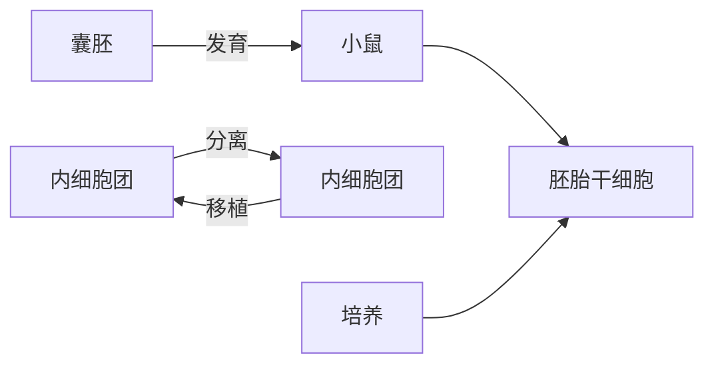
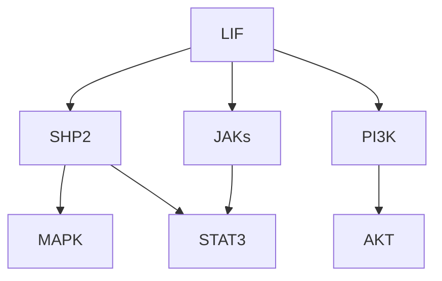
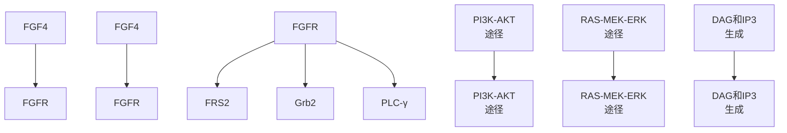
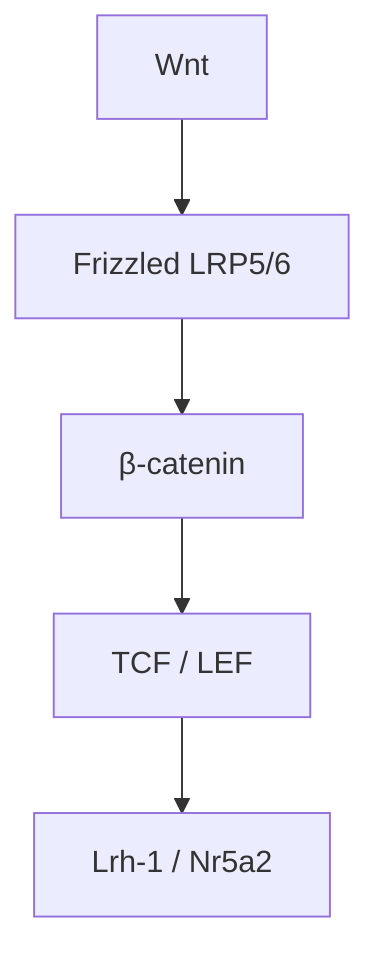
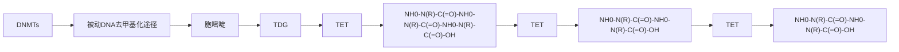
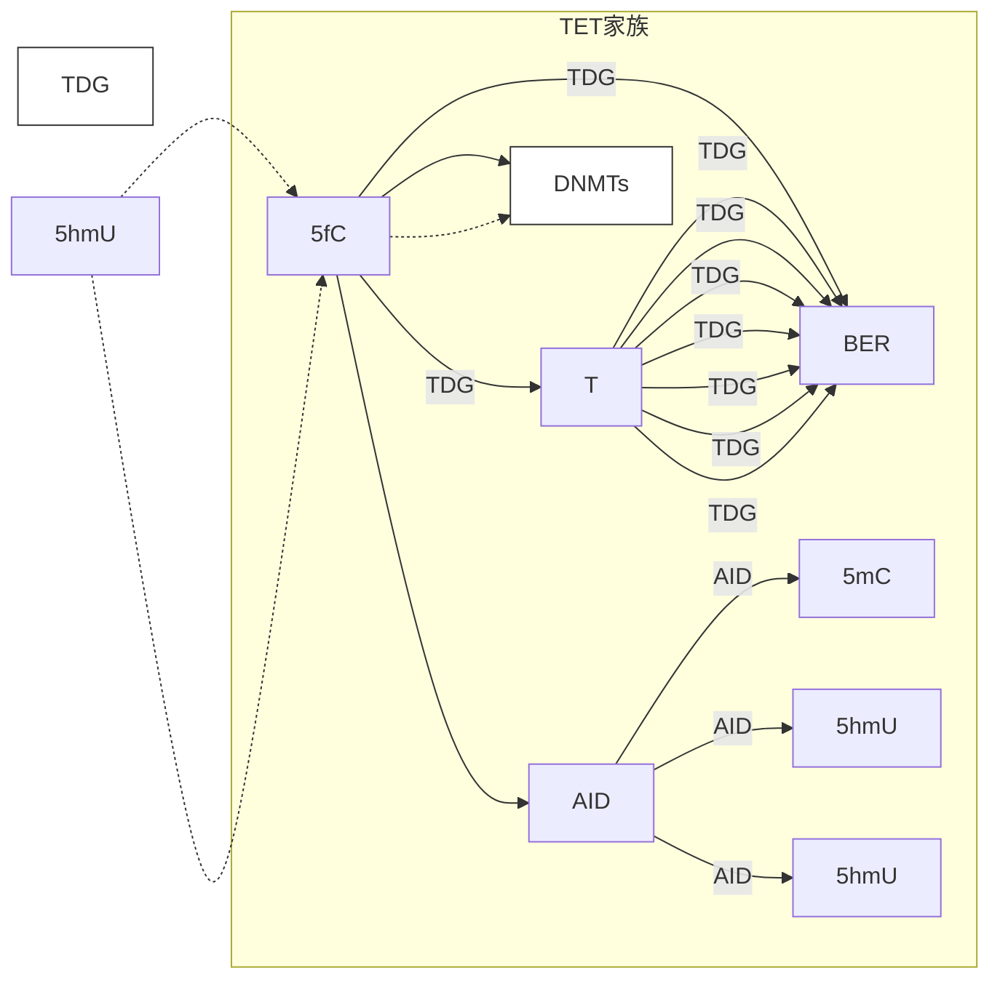
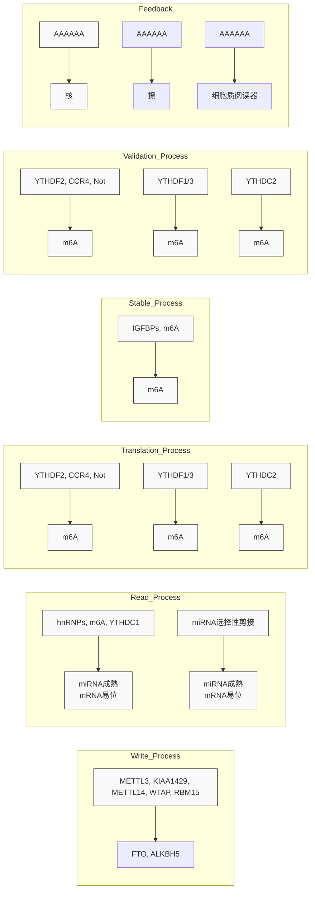

## 名词窗17-1

Hippo 信号通路（Hippo signaling pathway）:从果蝇到人类高度保守的信号转导通路，主要负责调控细胞增殖、器官大小、组织稳态和细胞命运决定等多种生理和病理活动。值得一提的是，许多 Hippo 通路成员均是首先在果蝇中被发现，然后在哺乳动物中得到验证。Hippo 通路的核心是一个激酶级联反应，在哺乳动物中，MST1/2 磷酸化 LATS1/2，后者进一步磷酸化下游转录共激活因子 YAP/TAZ，限制其进入细胞核，调控基因表达。当通路失活时，YAP/TAZ 促进细胞增殖并抑制凋亡，导致器官过度生长。

mTOR信号通路（mammalian target of rapamycin signaling pathway）:细胞内的一条重要信号转导通路，主要负责调控细胞生长、增殖、代谢、蛋白质合成和自噬等多种生物学过程。mTOR是一种丝氨酸/苏氨酸蛋白激酶（serine/threonine protein kinase），在进化上高度保守，广泛存在于从酵母到人类的细胞中。mTOR通路的异常激活与癌症、糖尿病、肥胖及多种神经退行性疾病发生发展相关。

雷帕霉素（rapamycin）:一种大环内酯类抗生素，最初发现于土壤细菌吸水链霉菌（Streptomyces hygroscopicus）的代谢产物中。它因其独特的免疫抑制和抗增殖作用被广泛用于医学及生物学研究，同时也是调控细胞生长的核心分子工具。

细胞竞争（cell competition）:多细胞生物中一种细胞间“优胜劣汰”的生物学现象，即细胞通过相互比较“适合度”（适应能力），主动筛选出更健康的细胞，淘汰功能较弱或异常的细胞，从而维持组织稳态或优化发育过程。

FLP/FRT 系统:遗传学研究中广泛使用的位点特异性重组技术，通过 FLP 重组酶（flipase）和其靶向的 frt 位点（Flp recognition target），实现 DNA 片段的精准切割与重组。该系统最初来源于酵母的 2μ 质粒，后被改造为模式生物如果蝇、小鼠等基因操作的核心工具。

MARCM（mosaic analysis with a repressible cell marker）系统:果蝇遗传学研究中用于追踪单细胞及其后代的经典技术，通过诱导特定细胞的基因型与周围细胞不同（基因嵌合体），结合可调控的标记表达，实现细胞谱系分析和基因功能的细胞自主性研究。

肿瘤内异质性（intratumoral heterogeneity）:指同一肿瘤内部不同细胞之间在基因型、表型、功能或微环境适应性上的多样性。这种异质性是癌症进化、治疗抵抗和复发的重要驱动因素，体现了肿瘤细胞在克隆进化过程中的动态复杂性。

水平低于生长抑制阈值来调节前后轴上翅的生长，而 Wg 则通过抵消 pangolin（pan）作为转录抑制因子的活性来调节近远轴（proximal-distal axis）上翅的生长。这项研究证明了具有不同表达模式的形态发生素可以相互协同来实现器官大小的最终调节。

## ※ 复习思考题

1. 如何利用果蝇作为研究对象并利用遗传学手段筛选调控器官大小的基因？
2. 细胞数量如何影响器官的最终尺寸？请举例说明细胞增殖调控在器官大小调控中的具体机制。
3. 细胞大小如何影响器官的最终尺寸？请解释细胞大小调控的分子机制，并举例说

明其在器官发育中的作用。

4. 细胞间通讯如何调控器官的生长与增殖？请举例说明几种主要的细胞间通讯机制及其在器官大小调控中的作用。
5. 器官组织中心在器官大小调控中起到什么作用？请举例说明器官组织中心的功能及其调控机制。

## ※ 推荐阅读

1. GERLINGER M, ROWAN A J, HORSWELL S, et al. Intratumor heterogeneity and branched evolution revealed by multiregion sequencing [J]. N Engl J Med, 2012, 366: 883–892.
2. HEITMAN J, MOVVA N R, HALL M N. Targets for cell cycle arrest by the immunosuppressant rapamycin in yeast[J]. Science, 1991, 253: 905–909.
3. HUANG J, WU S, BARRERA J, et al. The Hippo signaling pathway coordinately regulates cell proliferation and apoptosis by inactivating Yorkie, the Drosophila homolog of YAP [J]. Cell, 2005, 122: 421–434.
4. INOKI K, LI Y, XU T, et al. Rheb GTPase is a direct target of TSC2 GAP activity and regulates mTOR signaling [J]. Genes Dev, 2003, 17: 1829–1834.
5. INOKI K, ZHU T, GUAN K L. TSC2 mediates cellular energy response to control cell growth and survival [J]. Cell, 2003, 115: 577–590.
6. LEE T, LUO L. Mosaic analysis with a repressible cell marker for studies of gene function in neuronal morphogenesis [J]. Neuron, 1999, 22: 451–461.
7. TWITTY V C S, SCHWIND J L. The growth of eyes and limbs transplanted heteroplastically between two species of Amblystoma [J]. Jour. Exp. Zool., 1931, 59: 61–86.
8. WU M, PASTOR-PAREJA J C, XU T. Interaction between Ras (V12) and scribbled clones induces tumour growth and invasion [J]. Nature, 2010, 463: 545-548.
9. XU T, RUBIN G M. Analysis of genetic mosaics in developing and adult Drosophila tissues [J]. Development, 1993, 117: 1223–1237.
10. XU T, WANG W, ZHANG S, et al. Identifying tumor suppressors in genetic mosaics: the Drosophila lats gene encodes a putative protein kinase [J]. Development, 1995, 121: 1053–1063.

（编写:马仙珏、许田；审读:薛雷）

## 第十八章

## 干细胞

生命是这个宇宙中的奇迹。从受精卵到胎儿，从婴儿到成年人，再到衰老和死亡，每一个生命都经历了复杂而精妙的发展过程。在这个过程中，干细胞扮演着至关重要的角色。它们就像一个生命的“种子”，可以不断分裂产生新的细胞，并分化成各种不同类型的细胞，最终形成组织和器官。干细胞的这种特性使得它们成为生物体生长、发育和修复损伤的关键因素。

干细胞研究的核心在于探索细胞分化的遗传和发育机制。其中基因是细胞功能的蓝图，控制着细胞分化的过程。表观遗传调控则在不改变基因序列的情况下，通过修饰基因或染色质，来影响基因的表达。染色质并非简单的线状结构，而是呈现出复杂的三维结构。三维基因组结构影响着基因的表达，并参与细胞分化和发育的过程。而信号通路是细胞内、外的信息传递系统，通过调节细胞内的信号分子，影响细胞分化和发育。

干细胞研究不仅有助于我们理解生命的起源和发育机制，也为治疗多种疾病和开发新型药物提供了新的思路和方法；再生医学可以利用干细胞分化成特定类型的细胞，修复受损的组织和器官；利用干细胞构建疾病模型，可以研究疾病的发生机制和开发新型药物；还可以用干细胞进行药物筛选，提高药物研发的效率和安全性。

本章重点介绍了胚胎干细胞（包括全能性和全能性干细胞）、诱导多能性干细胞和成体干细胞的定义、特性、来源、遗传特性、表观遗传特性以及应用价值等。希望读者可以通过本章的学习深入理解干细胞在遗传与发育研究中的重要地位，并展望干细胞研究在生物医药领域的广阔应用前景。

干细胞是一个非常广泛的概念，动物、植物和昆虫中都存在干细胞，在这里我们主要讨论哺乳动物的干细胞。

干细胞（哺乳动物）是一类能够自我更新（self-renewal）并有能力分化（differentiation）为其他细胞类型的细胞。干细胞是胚胎正常生长发育的关键，在成年生物体中也不可或缺的组成，可以为几乎每一种成熟、分化的细胞类型提供细胞补充来源。干细胞存在于多细胞生物中，是生长和再生的最终驱动因素。

所有干细胞都来源于受精卵（fertilized egg），受精卵本身就是一种干细胞。在胚胎发育（development）的过程中，不同发育阶段可以产生各种具有不同谱系（lineage）特性的干细胞类型，这些干细胞可以产生不同分化程度的细胞类型，最终发育成特定谱系的组织和器官。随着胚胎发育的过程，这些干细胞的干性（stemness）逐渐减弱，多能性（pluripotency）的程度也逐渐降低。当胚胎成熟，还有一些不同发育阶段的干细胞会继续存在于机体内，成为成体干细胞（adult stem cell），它们在一定条件下可以继续分化，补充机体所需或者修复受损组织。干细胞在胚胎发育和成人组织维持中发挥着至关重要的作用。

在机体的生长发育过程中，随着遗传因素的积累，有一些细胞也会发生异化，成为肿瘤干细胞（cancer stem cell）。肿瘤干细胞是肿瘤中具有自我更新能力并能产生异质性肿瘤细胞的细胞。

值得注意的是，机体内干细胞的出现、转化和消失是一个动态过程，从机体中分离出来或者体外诱导出来的干细胞要么具有很强的异质性，要么只能反映出机体内相应干细胞的部分时段或部分特征，并不能与机体内的干细胞完全对等。

## 第一节 胚胎干细胞

## 一、胚胎干细胞概述

胚胎干细胞（embryonic stem cell）是从早期胚胎的囊胚（blastocyst）中分离出来的一类干细胞，在合适的培养条件下具有无限增殖、自我更新和多向分化的特性。一般认为它们可以被诱导分化为除了胚外组织以外所有的细胞类型。

在胚胎发育的最早期，细胞先是呈放射状极化形成桑葚胚（morula），然后空化形成囊胚。此时（小鼠胚胎3.5天）卵裂球的分化潜力逐渐受限，形成不同的细胞谱系:上胚层（epiblast，EPI）、原始内胚层（primitive endoderm，PrE）和滋养外胚层（trophectoderm，TE）。其中上胚层位于囊胚内部细胞团（inner cell mass，ICM），实验室中常用的多能性干细胞即胚胎干细胞就是从这里分离出来的；滋养外胚层可以形成胎盘（placenta）；原始内胚层则形成卵黄囊（yolk sac）。植入（implantation）后，上胚层的细胞通过形态发生运动通过原始条纹（primitive streak）重新排列，形成三个胚层——外胚层（ectoderm）、中胚层（mesoderm）和定性内胚层（definitive endoderm）（图18-1）。

图18-1 人与鼠的早期胚胎发育，从受精卵到三胚层，以及分离全能性胚胎干细胞和多能性胚胎干细胞的时段

最早的真正意义上的胚胎干细胞是小鼠胚胎干细胞，它是从小鼠囊胚的内细胞团中分离出来的、具有体外分化以及在裸鼠中形成胚胎体和畸胎瘤的能力（Evans, 1981；Martin, 1981）。1995年詹姆斯·汤姆森（James Thomson）等人第一次分离出了灵长类生物（恒河猴）的胚胎干细胞（Thomson, 1995），1998年他们用类似的方法又分离出了人类的胚胎干细胞（Thomson, 1998）。除此之外，还有多种其他动物的胚胎干细胞也被分离出来，如:大鼠、猪、牛、羊、水貂和雪豹等。

除了胚胎干细胞，还有两类细胞也具有自我更新和多向分化的能力，它们就是胚胎癌细胞（embryonic carcinoma cell）和生殖系干细胞（germline stem cell）。胚胎癌是一类发生于原始生殖细胞的未分化癌，由于它的特殊生物学特点，人们认为它的形成在一定程度上可以反映早期的胚胎发育。胚胎癌细胞与胚胎早期未分化的干细胞类似，具有自我更新和多向分化的特性。生殖系干细胞是一类来源于胚胎（小鼠胚胎8～10天时）原始生殖脊的原始生殖细胞的干细胞，也具有自我更新能力，并且可以分化成三个胚层的细胞。

1981 年，英国剑桥的埃文斯带领着他的团队，探索胚胎发育最早期的细胞培养（图 18-2）。他们利用丝裂霉素 C 抑制滋养层细胞的增殖，然后通过胰蛋白酶处理，将滋养层细胞与内细胞团细胞分离。经过反复筛选和培养，他们终于从小鼠胚胎中分离出了第一株胚胎干细胞。这些细胞拥有无限增殖和分化成各种细胞类型的潜力，为医学研究带来了无限可能。与此同时在加州大学，盖尔·马丁（Gail Martin）同样在使用免疫外科技术分离小鼠胚胎干细胞。

但一开始只有细胞生物学家们对此欢欣鼓舞，直到遗传学家们注意到了这个工作。他们发现，胚胎干细胞的成功分离不仅仅是为发育学研究提供了强大的工具，而且人们还可以通过观察胚胎干细胞向不同细胞类型的分化过程，研究基因表达调控和细胞命运决定的机制，从而深入了解胚胎发育的奥秘。人们进一步还可以将遗传物质导入胚胎干细胞中，研究基因功能，探索基因突变与疾病之间的关系，为遗传疾病的

诊断和治疗提供新的思路。

到了 1995 年，汤姆森带领他的团队在美国加州大学也取得了突破。他使用免疫外科技术，分离出了一批猕猴的胚胎干细胞。之后在 1998 年，他们又用同样的方法成功分离出了一批人类的胚胎干细胞。

随着胚胎干细胞研究的深入，人们发现，这些细胞不仅仅是发育生物学和遗传学研究的工具，它们还具有重要的治疗价值。可以利用胚胎干细胞分化成特定类型的细胞，用于治疗各种疾病，例如帕金森病、糖尿病等。

2007 年，因为他们在基因打靶和胚胎干细胞技术方面的卓越贡献，埃文斯、卡佩奇和史密斯三位科学家共同获得了诺贝尔生理学或医学奖。埃文斯被英国女王封爵，成为了马丁·埃文斯爵士。

flowchart

图 18-2 胚胎干细胞的分离

## 二、胚胎干细胞的特性

## 1. 形态学

胚胎干细胞与早期胚胎细胞相似，细胞核较大，核内有较明显且比较大的核仁，细胞质内胞浆较少，结构比较简单，胞质内有较多折光性强的脂滴。在生长过程中细胞排列比较紧密，并呈集落状生长，细胞集落（克隆）与周围存在明显界限，但克隆之间彼此界限不清。细胞克隆的形态多种多样，多数呈岛状或圆盘状，但不同物种之间差异很大，同一株细胞在不同培养条件下也会有所变化。不同物种之间细胞大小的差异也很大，基于异时性（heterochrony）原理，一般与动物体型有关，体型大的动物细胞也较大（图18-3）。

## 2. 表面标志物

表面标志物是覆盖在细胞表面一类专门的蛋白质，是可以在不破坏细胞膜的情况下识别胚胎干细胞的重要标记类型。从胚胎干细胞诞生以来，鉴别出了很多表面标志物，其中最重要的是 SSEA-3、SSEA-4、TRA-1-60 和 TRA-1-81。其中 SSEA-3 和 SSEA-4 都是碳水化合物相关分子（carbohydrate-associated molecules），TRA-1-60 和 TRA-1-81 则是表面抗原（surface antigen）。SSEA-3 和 SSEA-4 是在卵子发生过程中合成的，存在于卵母细胞、受精卵和早期卵裂期胚胎的膜中，是人类胚胎干细胞的标志物，但不是小鼠的。TRA-1-60 和 TRA-1-81 则人、鼠都有。

除此之外还有分化抗原簇（cluster of differentiation antigens），如E-Cadherin、Thy-1、CD326、CD9、β1 integrin、HAS、Protectin、PECAM-1和Integrin α6等。表面标志如:Frizzled5、SCF和TDGF-1等，也都是实验室常用的表面标志物。

## 3. 胚胎干细胞的遗传特性

## (1) 转录因子 (transcription factors, TF)

在小鼠和人类的胚胎干细胞中，有一组关键的转录因子，其中包括Oct4、Sox2和Nanog，它们构成了维持干细胞多能性的核心调控网络。Oct4，又称作Pou5f1，是由

图18-3 各种不同类型的细胞

图片由中国科学院广州生物医药与健康研究院郭琳提供。

natural_image

Microscopic view of cellular or particulate structures with circular voids, showing three distinct views (no text or symbols)

小鼠胚胎干细胞（OG2-mESC）

海拉（HeLa）细胞

人类胚胎干细胞（H1）

Pou5f1基因编码的一种转录因子，它在胚胎干细胞和原始生殖细胞中表达，并在细胞分化过程中逐渐减少。Oct4不仅作为一个“多能性守门员”，控制着干细胞的多能性状态，而且它的表达水平需要精确调控，以确保干细胞不会过早地向特定方向分化(Smith, 1998)。

Sox2 是另一个重要的转录因子，属于 Sox 家族，它含有高迁移率族（HMG）DNA 结合结构域，并且在胚胎发育的多个阶段都有表达。Sox2 对于维持胚胎干细胞的自我更新能力和多能性是不可或缺的，它与 Oct4 协同工作，通过形成复合物来调节基因表达（Yuan，1995）。

Nanog 是一种同源框转录因子，虽然在某些研究中发现并非绝对必要，但它对于维持干细胞的多能性和自我更新仍然非常重要。Nanog 可以直接作用于一系列多能性相关的基因，并通过与其他转录因子的相互作用来稳定干细胞的状态（Chambers, 2003；Yamanaka, 2003）。

除了这三种核心转录因子之外，还有许多其他转录因子也在胚胎干细胞的功能中发挥重要作用。例如，Klf4、SFRP2、WLS、SIP1、c-JUN、c-Myc、Tbx3、GCNF、Klf17、Klf5和STAT3等都参与了干细胞状态的维持和分化过程的调控。这些转录因子通过各种机制相互协作，包括直接的蛋白质-蛋白质相互作用、间接的信号通路调控以及染色质的修饰，共同构建了一个复杂而精细的调控网络，确保了胚胎干细胞能够在适当的时间和地点执行正确的生物学功能。

总的来说，转录因子在胚胎干细胞的生命周期中起到了“指挥官”的作用，它们通过精确调控基因表达，决定了干细胞如何保持其多能性、何时开始分化以及分化为何种类型的细胞。这一系列复杂的调控过程对于我们理解生命的发生和发展，以及开发新的治疗方法具有重要的科学意义和应用价值。

## (2) 信号通路 (signaling pathway)

识别参与胚胎干细胞命运决定的信号通路及其下游效应物具有重要的意义，通过应用不同的培养条件来控制胚胎干细胞的自我更新和分化，就可以操纵它们的命运，使其应用于各种生物学和医学领域。现在已被报道的多能性相关的信号通路，包括LIF/STAT3、Wnt/β-catenin、FGF/ERK、TGF/SMAD和PKC信号通路。

## ① LIF/JAK/STAT3 信号通路

白血病抑制因子（leukemia inhibitory factor，LIF）是一种重要的细胞因子，它对于维持小鼠胚胎干细胞的自我更新和多能性具有重要作用。当小鼠 ESCs 缺乏 LIF 时，它们会迅速分化为包括中胚层和内胚层在内的多种细胞类型。然而，值得注意的是，LIF 并非仅限于胚胎干细胞特异的信号分子，它实际上属于白细胞介素 -6（interleukin-6，IL-6）细胞因子家族的一部分。

在小鼠胚胎干细胞中，LIF 能够激活多条信号转导途径（图 18-4），其中包括:

JAK/STAT3 通路:LIF 通过与 LIF 受体（LIF receptor，LIFR）和 gp130 组成的异源二聚体相互作用，进而激活 Janus 激酶（Janus kinases，JAKs），后者进一步招募并磷酸化信号转导子和转录活化子 3（signal transducer and activator of transcription 3,

flowchart

图 18-4 LIF/JAK/STAT3

信号通路

STAT3)。磷酸化的 STAT3 形成二聚体进入细胞核，从而激活特定基因的表达。特别是，STAT3 的 Tyr705 位点的磷酸化对于维持 ESCs 的自我更新过程至关重要，而其 Ser727 位点的磷酸化则有助于提高 STAT3 的转录活性，促进细胞增殖和保持最佳的细胞多能性。

PI3K/AKT 途径:这一途径涉及磷脂酰肌醇 3- 激酶（phosphoinositide 3-kinase, PI3K）及其下游效应器 AKT 的激活，虽然关于其在 ESCs 中的具体作用尚不完全清楚，但它可能参与调节细胞存活和生长等生物学功能。

SHP2/MAPK 途径:在这一途径中，含 SH2 结构域的酪氨酸磷酸酶 2（SH2 domain-containing tyrosine phosphatase 2, SHP2）与丝裂原活化蛋白激酶（mitogen-activated protein kinase, MAPK）级联反应有关，尽管它在 ESCs 中的作用也尚未完全阐明。

此外，需要指出的是，LIF/STAT3信号似乎不足以支持人类胚胎干细胞的自我更新能力。这种差异可能与小鼠和人类胚胎干细胞所处的不同发育阶段有关。小鼠ESCs通常被认为是处于一种“原始”（naive）状态，而人类胚胎干细胞则更多地表现出“启动”（primed）状态，这与小鼠的内胚层来源干细胞（epiblast-derived stem cells，EpiSCs）更为相似。有趣的是，即使在原始状态下的人类胚胎干细胞中也观察到较高的LIF/STAT3表达水平。

综上所述，LIF作为一种关键的细胞因子，通过复杂的信号网络调控着小鼠ESCs的自我更新和多能性。然而，在不同物种间，这些信号的精确机制和效果可能存在显著差异，尤其是在人类胚胎干细胞的研究和应用中。

## ② FGF/MEK/ERK 信号通路

成纤维细胞生长因子（FGF）信号通路在胚胎发育、组织再生、伤口愈合和新陈代谢平衡等多种细胞功能中发挥着重要作用。其中，FGF4和FGF2对维持小鼠和人类干细胞的干性具有高度相关性（图18-5）。

FGF4是在小鼠早期胚胎发育过程中表达的重要生长因子之一，从1细胞期到原始条纹时期都有表达，可调节小鼠囊胚的早期分化。FGF4也是从E3.5囊胚中衍生和维持滋养层细胞所必需的。

FGF与受体FGFR结合后，FGFR磷酸化激活下游胞内途径:成纤维细胞生长因子受体底物2（fibroblast growth factor receptor substrate 2，FRS2）、Grb2和磷脂酰肌醇磷脂酶C（phosphoinositide phospholipase C，PLC-γ），前二者又进一步分别激活PI3K-AKT和RAS-MEK-ERK途径。MEK抑制剂PD0325901是小鼠胚胎干细胞培养中重要的小分子化合物。

在外源性 FGF4 存在下培养囊胚或分离的 ICM 会导致壁内胚层样细胞（parietal endoderm-like cell）数量增加。FGF4 的下游效应物 H-RAS 的过度表达诱导胚胎干细胞向原始内胚层分化。将 FGF 受体与 MEK-ERK 途径偶联基因 Grb2 的消融会导致囊胚缺乏低成纤维细胞（原始内胚层）。在缺乏 FGF/MEK/ERK 的情况下，整个 ICM 可以获得多能性。MEK 活性的阻断导致小鼠 ESCs 中许多多能性相关基因的表达增加，如 Nanog、Tfcp2l1 和 Klf4。

人胚胎干细胞在培养条件下与小鼠胚胎干细胞的不同之处在于，人胚胎干细胞需要FGF2来支持自我更新。

FGF2在人类胚胎干细胞（hESCs）的维持和生长中发挥着复杂的多层次作用。基于不同的选择性剪切，FGF-2被分为内源性和分泌型两种，内源性FGF2分子量较大，可维持hESCs的多能性基因表达，并且定位于细胞核，影响细胞命运决定。分泌型 FGF2 则可以通过促进细胞黏附和生存来维持 hESCs 的多能性，还可刺激细胞黏附，帮助 hESCs 形成紧密且形状规则的集落，减少边缘分化，并促进细胞存活，增强 hESCs 在冷冻保存后的存活率。

图18-5 FGF/MEK/ERK信号通路

flowchart

FGF 已被证明与激活素 /SMAD2/3 信号合作，在人类胚胎干细胞中维持高水平的 Nanog 表达，同时激活 PI3K/AKT 信号通路，以增强人类胚胎干细胞的繁殖和存活。MEK 抑制剂 PD98059 和 U0126 可以严重损害人类胚胎干细胞的自我更新能力。PI3K/AKT 抑制剂 LY294002 则会增加凋亡和减少细胞增殖。

③ Wnt/β-catenin 信号通路

β-catenin（β-连环素）是果蝇 armadilo（arm）蛋白的同源物，可通过 α-catenin 将 E-cadheri 转移到肌动蛋白骨架上，参与细胞的黏着连接。

β-catenin 是经典 Wnt 信号通路的重要组成部分（图 18-6），如果未被磷酸化而降解，细胞质中的 β-catenin 可以入核，与转录因子的 T 细胞因子（T cell factor）/淋巴增强因子（lymphoid enhancer factor）（TCF/LEF）家族成员相互作用，并与共有基序 AGATCAAGG 结合，以激活靶基因如 Axin2、Cdx1 和 T 等谱系特异性基因的转录。稳定的 β-catenin 通过刺激 TCF3 降解直接消除 TCF3 介导的转录抑制，TCF3 是多能干因子高表达的限制因子，包括 Oct4、Nanog、Tfcp2l1 和 Esrrb。β-catenin/TCF3 还直接激活孤儿核受体 Lrh-1/Nr5a2 转录，并以 Nr5a2 依赖的方式稳定 Oct4、Nanog 和 Tbx3 的表达。

FGF/ERK的小分子抑制剂SU5402和PD184352，或单独的PD0325901可以在LIF退出后的几个世代中维持小鼠胚胎干细胞的自我更新，抑制分化。糖原合成酶激酶-3（glycogen synthase kinase-3，GSK3）抑制剂CHIR99021通过稳定细胞质$\beta$-catenin，增强代谢和生物合成能力，从而增强小鼠胚胎干细胞的整体生存能力来巩固多能性。CHIR10021 和 PD0325901 共同构成了胚胎干细胞培养中著名的 2i（Smith，2008）。

flowchart

图18-6 Wnt/ $\beta$ -catenin信号通路

经典 Wnt/β-catenin 通路在人 ESCs 中的确切功能尚不清楚。Wnt3A 或 GSK3 抑制剂 BIO 激活 Wnt/β-catenin 途径，可以短暂维持人类 ESC 的自我更新；抑制 Porcupine 以抑制 Wnt 配体分泌或稳定 Axin1/2 来阻止 β- 连环素核转位，也可以改善人类胚胎干细胞的自我更新和繁殖。似乎 Wnt/β-catenin/TCF 轴在啮齿类动物和人类胚胎干细胞的自我更新调节中起着相反的作用:在小鼠 / 大鼠胚胎干细胞中，β-catenin/TCF 结合和转录激活是维持多能性所必需的；在人类胚胎干细胞中，只有当转录活性被阻断时，才能实现自我更新作用，尽管机制细节尚不清楚。

④ TGF- $\beta$ /SMAD 信号通路

生长因子 TGF-β 超家族分为两个亚组:TGF-β/Activin/Nodal 途径和骨形成蛋白（bone morphogenetic protein）BMP/GDF/MIS 途径。在两种途径中 TGF-β 都会与细胞表面的跨膜 I 型和 II 型受体的配体结合，I 型受体（ALK1-7）细胞内结构域的丝氨酸 / 苏氨酸激酶活性磷酸化 SMAD 蛋白（SMAD1、2、3、5 和 8），磷酸化的 SMAD 进行三聚（homo-trimerization），并与共调节的 SMAD 分子 SMAD4 形成杂聚复合物，复合物转运到细胞核中，在那里它们以序列特异性的方式与 DNA 结合，以控制靶基因的转录。SMAD1 与核心多能因子 Oct4、Sox2 和 Nanog 有许多共同的靶点（图 18-7）。

BMP 作为抗神经因子通过 SMAD1/5/8 激活诱导分化抑制剂（Id）家族成员的表达，通过抑制前神经碱性螺旋-环-螺旋（bHLH）因子来抑制神经分化，阻止小鼠胚胎干细胞的神经分化。MEF 饲养细胞产生的 BMP4，通过抑制 ERK 和 p38 丝裂原活化蛋白维持小鼠胚胎干细胞的多能性。BMP4 定位于 DUSP9 基因的启动子区，并通过 SMAD1/5 激活上调其表达，进而导致 ERK 磷酸化降低。DUSP9 的强制表达提高了 BMP 抑制早期神经分化的作用，并可取代 BMP4 促进 ESC 的自我更新。

图18-7 TGF- $\beta$ /SMAD信号通路

flowchart

This diagram illustrates the signaling pathway of SMAD2/3 in TGF-β cells, showing how phosphorylation of SMAD2/3 affects the activation of SMAD4 and its subsequent effect on the phosphorylated SMAD2/3 complex.

人类胚胎干细胞依赖 Activin /Nodal/SMAD2/3 信号通路进行自我更新，使用激活素受体抑制剂 SB431542 抑制 SMAD2/3 的信号会导致多能性和快速分化的丧失。SMAD2/3 与 Nanog 的近端启动子区结合，并直接上调其在人胚胎干细胞中的表达。反过来，Nanog 阻止 SMAD2/3 诱导的内胚层分化，以增强多能性。ChIP-seq 分析显示，SMAD2/3 参与了包括 Oct4 和 Myc 在内的许多多能性因子的控制。在人类胚胎干细胞中，BMP 导致中胚层和滋养层诱导，BMP 拮抗剂 Noggin 可使人类胚胎干细胞保持未分化状态。SMAD7 被发现也与胚胎干细胞多能性的维持相关。

⑤ 蛋白激酶 C（protein kinase c，PKC）信号通路

在胚胎干细胞中，早期研究表明，PKC通路的激活与PI3K/AKT和MAPK信号一起促进细胞增殖。一些研究表明可以通过FGF激活的PKC信号转导促进胚胎干细胞分化。非典型PKC亚型PKCζ磷酸化NFκB，并在ESC分化中发挥重要作用，而选择性PKC抑制剂Go6983可以消除NFκB活性，并能够缓解血清条件下胚胎干细胞的LIF依赖性或N2B27培养基中的2i依赖性。在人类胚胎干细胞中，PKCδ激活导致上皮间充质转化，从而导致胚胎外内胚层分化，而PKC抑制与FGF2协同作用，促进自我更新（图18-8）。

PKC的抑制剂（PKCi）可以通过H3K27me3和H3K9me3修饰调节基因表达，从而维持干细胞的自我更新能力。在小鼠中抑制PKCζ可以使DNA甲基转移酶3B（DNMT3B）及其磷酸化水平可逆性丧失，可以帮助多能性连续体（DiSCo）处于发育中的不同时期。PKC 的抑制剂 Go6983 抑制了从头甲基转移酶（Dnmt3a 和 Dnmt3b）及其调节因子 Dnmt3l 的表达，导致小鼠胚胎干细胞中 DNA 的整体低甲基化。导致 Prdm14 启动子处 H3K9 的二甲基化和三甲基化富集减少，RNA 聚合酶Ⅱ结合亲和力增加，促进胚胎干细胞的自我更新。

flowchart

图18-8 蛋白激酶C信号通路

这些信号通路并非完全独立，它们之间存在交叉或相互关系，共同维持胚胎干细胞的命运。

LIF 可以通过激活 JAK/STAT3 信号通路间接影响 FGF 受体的表达和活性，从而间接影响 MEK/ERK 通路。FGF 受体与 MEK 激酶存在相互作用，两者可以共同激活下游信号通路。LIF 还可以激活 PI3K/AKT 信号通路，而 AKT 可以抑制 GSK3，进而稳定 β-catenin。β-catenin 可以与 TCF/LEF 转录因子结合，影响下游基因的表达，间接影响 LIF/STAT3 通路相关基因的表达。LIF 可以激活 STAT3，而 STAT3 可以与 SMAD 蛋白相互作用，影响下游基因的表达，例如 Oct4 和 Nanog。

FGF受体与 $\beta$-catenin存在相互作用，影响 $\beta$-catenin的稳定性和活性。FGF受体还可以激活MAPK信号通路，而MAPK可以影响 $\beta$-catenin的活性，MAPK还可以与SMAD蛋白相互作用，或影响PKC的活性，影响下游基因的表达。FGF受体可以激活PI3K，而PI3K可以激活PKC。

β-catenin 可以与 SMAD 蛋白相互作用，影响下游基因的表达。Wnt 信号通路可以影响 BMP 信号通路，而 BMP 信号通路可以与 SMAD 蛋白相互作用。β-catenin 可以激活 PKC，Wnt 信号通路也可以影响 PKC 的活性。

TGF-β 可以激活 SMAD 蛋白，使 SMAD 蛋白与 PKC 相互作用。PKC 可以影响 MAPK 和 β-catenin 的活性。

需要注意的是，这些交叉或相互关系并非简单的线性关系，而是复杂的网络结构。不同信号通路之间的相互作用受到多种因素的影响，例如细胞类型、细胞环境、信号通路状态等。

## 4. 胚胎干细胞的表观遗传特性

动物体的各种组织和细胞都具有相同的基因组 DNA 序列，但是却存在不同的功能和状态，这些特异性的功能和状态有赖于不同种类细胞的基因时空表达调控。其中，表观遗传是基因转录表达调控的重要方式之一。表观遗传主要包括 DNA 甲基化和组蛋白修饰。基因组水平的表观遗传修饰状态被称为表观基因组。在哺乳动物胚胎发育的早期，会经历广泛而深刻的表观重编程过程，而对应这个时期的胚胎干细胞的表观遗传特性（epigenetic properties），也相应的非常重要。

## (1) DNA 去甲基化 (DNA demethylation)

DNA 甲基化是指在 DNA 甲基化转移酶（DNA methyltransferase，DNMT）的作用下，在基因组 CpG 二核苷酸的胞嘧啶 5 号碳位共价键结合一个甲基基团，形成 5-甲基胞嘧啶（5mC）的过程。5mC 可以通过在启动子区域阻止转录子的结合来使基因表达沉默。DNA 甲基化能引起 DNA 与蛋白质相互作用方式、DNA 稳定性、DNA 构象及染色质结构的改变，从而控制基因表达。

flowchart

图18-9 被动去甲基化过程

DNA 去甲基化（DNA demethylation）有两种模式，一种是被动去甲基化，通过 DNMT 家族成员的含量下降或活性降低来减少甲基化的位点（图 18-9）；另一种是主动去甲基化，通过 TET 家族一步一步催化完成，从 5-羟基胞嘧啶（5hmC）到 5-醛基胞嘧啶（5-formylcytosine，5fC）再到 5-羧基胞嘧啶（5-carboxylcytosine，5caC）。此后要么通过由胸腺嘧啶-DNA 糖基化酶（thymine-DNA glycosylase，TDG）介导的碱基切除修复机制（base excision repair，BER）切除碱基，产生无碱基位点，最终修复成正常胞嘧啶；要么通过活化诱导脱氨酶（activation-induced deaminase，AID）将 5hmC 去氨基化，生成 5-羟甲基尿嘧啶（5-hydroxymethyluracil，5hmU），然后经过 BER 机制复原为未修饰胞嘧啶（图 18-10）。TETs 催化 α-酮戊二酸氧化脱羧酶，将 5-甲基胞嘧啶转化为 5-羟基甲基胞嘧啶，从而触发 DNA 中去甲基化 GpC 位点。人体必需的营养

物质维生素 C 作为 TETs 和含有 Jumonji C 结构域的组蛋白赖氨酸脱甲基酶的辅酶，参与表观遗传去甲基化的调控。Tet1 则可以作用于 Oct4 基因座，促进 5mC 到 5hmC 的转化。

DNA去甲基化主要发生在胚胎发育的过程中，在受精卵中父系基因组在第一次DNA复制之前经历了快速的去甲基化，而母系基因组的去甲基化则发生于随后的卵裂期。父系DNA可以直接招募TET3并介导其去甲基化，而母系基因组则通过其特有的组蛋白双甲基化H3K9me2招募Dppa3，从而阻止DNMT1的募集。

## (2) RNA 修饰

目前已经发现了超过100种RNA修饰（RNA modification），其中m6A的修饰可以由甲基化酶来“写”，去甲基化酶去“擦”而由甲基识别蛋白来“读”，形成一个可逆的闭环过程，介导RNA的翻译、降解、剪接等代谢活动。m6A修饰可影响RNA的代谢，如pre-RNA的可变剪接、RNA的结构、RNA的降解、mRNA的出核、miRNA的成熟以及X染色体的失活（图18-11）。

flowchart

图18-10 主动去甲基化过程

在胚胎发育的早期直到4\~8细胞期，受精卵的基因组转录沉默，这个阶段的胚胎发育完全依赖卵母细胞生长阶段所积累的母源mRNA及蛋白质产物。此后母源mRNA逐渐降解，合子基因组激活（zygotic genome activation，ZGA），这一转变被称为母源到合子的过渡（maternal-to-zygotic transition，MZT）。卵母细胞中异常的m6A修饰会以表观转录组调节的形式影响早期胚胎发育。而父系m6A修饰的异常也有可能与胚胎发育不良有关。

m6A 修饰对胚胎干细胞（ESC）的影响取决于 ESC 的状态（幼稚或启动）和 m6A 修饰所处的位置。m6A 修饰在维持 ESC 多能性和促进 ESC 分化中都发挥着重要作用。一些研究表明，m6A 修饰在维持 ESC 的多能性状态中起着关键作用。敲除 METTL3 或 METTL14 会导致 ESC 中一些发育调控基因，如 c-MYC、BCL2 和 PTEN 等的稳定性降低，进而影响 ESC 的自我更新能力，并导致 ESC 分化受到抑制。RBM15 和 RBM15B 可以结合到 mRNA 转录物上，并通过 m6A 甲基化修饰来调节其稳定性。在哺乳动物雌性发育过程中，Xist 基因会被转录并沉默 X 染色体。RBM15 和 RBM15B

图 18-11 RNA 修饰

flowchart

