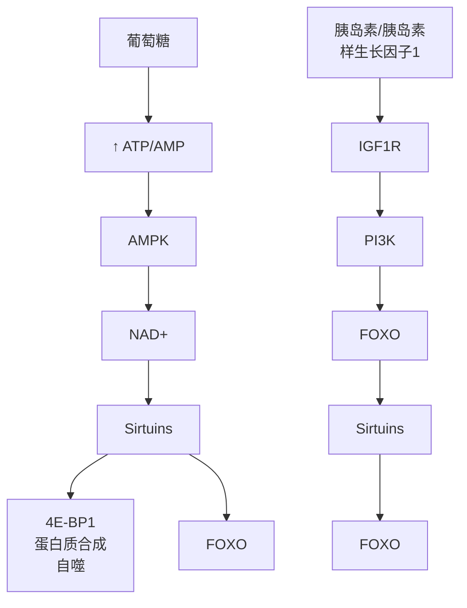

表 18-1 造血的发育、维持与衰老各期的特性

|  | 胚胎期 | 成人期 | 衰老期 |
| --- | --- | --- | --- |
| 造血器官 | 造血主要发生在胚胎的卵黄囊、肝和主动脉-性腺-中肾(AGM)区、涉及多种过渡性造血细胞。 | 造血主要发生在骨髓,由造血干细胞(HSCs)和间充质干细胞(MSCs)共同调控。 | 造血器官功能逐渐下降,骨髓脂肪化,HSCs数量和功能减少,MSCs老化,造血微环境功能受损。 |
| 造血干细胞 | HSCs在AGM区形成,但数量较少、功能不成熟。 | HSCs数量较少,但功能成熟,大部分处于休眠状态,负责维持血液细胞的平衡生产。 | HSCs数量减少,功能下降,增殖和分化能力减弱,更容易发生DNA损伤和突变,导致克隆性造血和血液系统疾病。 |
| 间充质干细胞 | MSCs与HSCs共同存在于AGM区,数量较少,功能不成熟。 | MSCs主要存在于骨髓微环境中,数量较多,功能成熟,负责维护HSCs功能和造血微环境。 | MSCs数量减少,功能下降,更容易发生衰老和凋亡,导致骨髓微环境功能受损,影响HSCs功能。 |
| 造血微环境 | 造血微环境主要由血管内皮细胞和间充质细胞组成,为HSCs提供支持和调控。 | 造血微环境更加复杂,包含多种细胞类型,如MSCs、脂肪细胞、成骨细胞、破骨细胞、巨核细胞和神经细胞等,共同调控HSCs功能。 | 造血微环境功能受损,MSCs老化,血管密度和通透性降低,巨核细胞数量增加,导致HSCs功能下降和克隆性造血。 |
| 造血过程 | 造血过程主要通过血管内皮细胞向造血细胞转变(EHT)实现。 | 造血过程主要通过HSCs的自我更新和分化实现。 | 造血过程效率下降,克隆性造血和寡克隆造血成为主要特征。 |

胞。使用衰老清除剂（senolytics）如一种潜在的衰老清除剂ABT26，可以延缓小鼠的造血系统衰老，选择性地杀死衰老细胞，从而清除其对造血系统的负面影响。

② 抑制Cdc42活性:Cdc42是一种小GTPase，其活性过高会导致HSCs极性丧失和衰老。因此，抑制Cdc42的活性可能是恢复HSCs功能的一种策略。体外实验已经证明，短期使用Cdc42抑制剂可以延长老年小鼠的寿命，这表明抑制Cdc42可能部分恢复了微环境的功能。
③ 激活 CMA: CMA 是一种自噬途径, 其活性下降会导致衰老。激活 CMA 可以帮助清除受损的细胞器和蛋白质, 恢复衰老造血干细胞的活力, 从而延缓衰老。自噬是维持 HSCs 功能的重要机制之一。
④ 激活SIRT1:SIRT1是一种去乙酰化酶，其活性下降会导致衰老。激活SIRT1可以改善线粒体功能，从而延缓衰老。SIRT1的激活剂如SRT1720和白藜芦醇，可以改善衰老造血干细胞的活力。SIRT1可以保护MSC免受衰老，并维持其分化潜能。
⑤ 供体细胞移植:将年轻的 HSCs 或 MSCs 移植到老年人体内，可能有助于恢复造血系统的活力。研究表明，年轻的 HSCs 在移植到年轻小鼠体内后，其归巢效率并没有降低，这表明它们可能具有恢复衰老造血系统活力的潜力。
⑥ 靶向 JAK2 激酶:JAK2 激酶突变与某些血液疾病有关，如 JAK2 激酶 V671F 突变与真性红细胞增多症相关。抑制 JAK2 激酶可以减少血液细胞的增殖，从而改善造血功能。JAK2 抑制剂，如芦可替尼和费达替尼，已被用于治疗真性红细胞增多症，并取得了良好的效果。
⑦ 调节 DNA 甲基化和组蛋白修饰:DNA 甲基化和组蛋白修饰是调控基因表达的重要机制，它们在 HSCs 的功能和衰老中起着重要作用。通过靶向 DNA 甲基化酶或组蛋白修饰酶，可以调节 HSCs 的基因表达，从而延缓衰老。DNA 甲基化在 HSCs 分化过程中起着重要作用，并且 DNA 甲基化酶和组蛋白修饰酶的突变与克隆性造血有关。

⑧ 优化微环境:骨髓微环境对 HSCs 的功能至关重要。优化微环境，例如增加 MSC 数量和活性，可以改善 HSCs 的活力。MSC 在维持 HSCs 功能中起着重要作用。

需要注意的是，以上策略仍处于研究阶段，其有效性和安全性仍需进一步验证。造血系统复兴是一个充满挑战但也充满希望的领域。随着研究的不断深入，未来可能会有更多有效的策略来延缓或逆转造血系统的衰老，从而改善老年人的健康状况。

## 3. 造血干细胞的代谢体系

HSCs 具有特殊的代谢体系，其特点主要体现在其静止期和分化期的不同代谢模式上。代谢是维持 HSCs 稳态的最重要的因素。

在 HSCs 的静止期，HSC 主要依赖厌氧糖酵解来产生能量。这是因为 HSC 定居于骨髓微环境，该环境缺氧，限制了氧化磷酸化（oxidative phosphorylation，OXPHOS）的进行。HSC 表达高水平的丙酮酸脱氢酶激酶（pyruvate dehydrogenase kinase，PDK），抑制丙酮酸脱氢酶（pyruvate dehydrogenase，PDH）的活性，从而阻止糖酵解代谢物进入线粒体进行氧化磷酸化。HSC 通过抑制氧化磷酸化和表达抗氧化酶来维持低活性氧（ROS）水平，避免活性氧损伤 DNA 和蛋白质，维持其干细胞特性，从而保证其自我更新和多能分化能力。HSC 维持低代谢状态，避免过早耗竭，保证其长期维持，从而能够持续地产生新的血细胞，维持血液系统的稳态。

尽管 HSCs 主要依赖糖酵解，但它们仍维持一定水平的线粒体活性。HSCs 具有较高的线粒体膜电位（ $\Delta\Psi_{m}$ ），这支持干细胞功能的维持。线粒体呼吸链（electron transport chain，ETC）在 HSC 维持中发挥重要作用，ETC 复合体Ⅱ的表达和活性高于 ETC 复合体 V，这有助于维持较高的线粒体膜电位。RISP 和 SdhD 等蛋白质对于 HSC 静止和维持至关重要。线粒体形态和数量通过线粒体融合、分裂和自噬等过程进行动态调节。这些过程对于维持 HSC 的代谢稳态和功能至关重要。

当造血干细胞分化时，糖酵解降低，转向线粒体氧化磷酸化产生更多能量，满足细胞增殖和分化需求。糖酵解产生的丙酮酸进入线粒体参与三羧酸循环和氧化磷酸化，产生大量ATP以满足分化过程中对能量的需求。此时氧化应激增加，氧化磷酸化产生大量活性氧，这些活性氧可能会损害细胞并导致干细胞功能丧失。降低活性氧水平需要抗氧化酶，例如超氧化物歧化酶（SOD2）和谷胱甘肽转移酶1（Mgst1），以及调节代谢途径，例如将葡萄糖代谢物引导进入磷酸戊糖途径（PPP），以减少活性氧的产生。

在HSCs中还有一些其他代谢途径，如氨基酸代谢，谷氨酰胺和支链氨基酸（branched-chain amino acid，BCAA）等氨基酸代谢产物为三羧酸循环提供燃料，影响HSC自我更新和分化。脂肪酸代谢如脂肪酸氧化（fatty acid oxidation，FAO）为三羧酸循环提供燃料，维持HSC功能。维生素C、A和 $\mathrm{B}_3$ 等维生素参与HSC的表观遗传调控和转录调控，影响HSC功能。

HSC 具有代谢适应性，可以根据微环境中的营养物质和氧气水平调节其代谢模式，例如在缺氧环境中增加糖酵解，在富含氨基酸的环境中增加氨基酸代谢。线粒体不仅是能量生产中心，也是细胞信号转导中心，参与活性氧产生、钙信号转导、细胞凋亡、蛋白质稳态和血红素合成等细胞信号转导过程，这些信号转导过程影响 HSC 的命运决定。HSC 在损伤和压力条件下，可以发生代谢重编程，例如增加糖酵解或脂肪酸氧化来满足能量需求，从而增强其再生能力。线粒体还可以自噬清除受损线粒体、维持线粒体功能，从而增强 HSC 对损伤和压力的抵抗力。

## 4. 造血干细胞的基因调控

HSCs 是血液系统发育和维持的关键，其产生和功能受到多种转录因子和信号通路的精密调控。深入了解这些调控机制对于理解血液系统疾病的发生机制，并开发新的治疗方法至关重要。

在HSCs的调控中有一些转录因子起着重要的作用。Scl（TAL1）和Runx1(AML1)是HSCs产生的早期关键因子。Scl在成血管细胞中表达，对主动脉和HSCs的发育至关重要。Runx1在所有胚胎HSCs中表达，并保证造血特性的获得。Gata2在主动脉和HSCs簇中表达，对HSCs的生存和维持非常重要。Gata2a和Gata2b通过调控Runx1表达，促进生血内皮特化Gata2b受Gata2a调控。

在HSCs的发育中更为重要的是信号通路的作用。BMP信号通路在HSCs产生的早期阶段发挥重要作用，BMP4诱导腹侧中胚层形成，为HSCs的产生提供环境。Smad1/5调控ERK信号通路，Smad4在内皮细胞中抑制造血，BMP信号通路可能直接调控造血基因表达。

ERK 信号通路在动脉分化过程中是必需的，动脉分化完成后需要下调以保证 HSCs 产生。BMP 信号通路通过 Smad1/5 下调 ERK 信号，内皮细胞 BMP4 可非 Smad 依赖性激活 ERK 信号。

Notch 信号通路在 HSCs 发育过程中发挥重要作用，Notch 信号缺失导致动脉血管分化异常，影响 HSCs 产生。Notch 信号对 HSCs 产生发挥细胞自主性调控作用，不同 Notch 配体介导不同强度的信号，Jagged1 和 Dll4 分别维持低强度和高强度 Notch 信号，调控 HSCs 和动脉分化。Notch 信号通路需要精确调控，以保证动脉内皮的分化及 HSCs 的产生。多种因素可以激活 Notch 信号，包括脊索分泌的 Hedgehog 信号、炎性信号以及内皮细胞内的初级纤毛发生。同时，Notch 信号的下降也受到严密调控，包括转录水平上的 NcoR2 和 m6A 修饰，以及蛋白质水平上的 Gpr183 和 Rab5c 等。

Wnt 信号通路在胚胎早期发育和干细胞自我更新中发挥重要作用。Wnt 信号通路可以和 BMP 信号通路共同激活 Cdx-Hox，进而调控造血过程。Wnt 信号通路对 HSCs 产生的作用也是动态变化的，在内皮-造血转化发生之前，β-catenin 在内皮细胞中的激活可以促进 HSCs 的产生，一旦造血的命运决定完成之后 β-catenin 的活性就会下调。Wnt 信号通路还可以通过非 β-catenin 依赖性方式调控造血发育，例如 Wnt16 促进 Notch 配体表达，Notch3 信号促进生骨节和 HSCs 特化。

mTOR 信号通路在调节 HSCs 的三个关键功能方面发挥着重要作用。

当HSC静止时，mTORC1作为负调节因子，激活mTORC1会诱导静止的HSC退出静止状态，进入细胞周期，开始自我更新和分化。DEK蛋白和TSC1等蛋白质通过抑制mTORC1活化来维持HSC的静止状态。在HSC的自我更新中，mTORC1作为负调节因子，与静止状态类似，激活mTORC1会抑制HSC的自我更新。Rheb1缺失会导致HSC体外和体内扩增，说明mTORC1活化抑制HSC的自我更新。当HSC分化时，mTORC1作为正调节因子，mTORC1活化会促进HSC的分化。Raptor缺失会导致HSC分化受损，说明mTORC1在HSC分化中起着重要作用。

HSCs 发育受到多种转录因子和信号通路的精密调控，这些因子和通路之间存在着复杂的相互作用。Scl 和 Runx1 是 HSCs 产生的早期关键因子，GATA2 对 HSCs 的生存和维持非常重要。BMP、ERK、Notch 和 Wnt 信号通路在 HSCs 发育的不同阶段发挥着重要作用。mTOR 信号通路在调节 HSCs 静止、自我更新和分化方面发挥着重要作用。深入了解这些调控机制将为血液系统疾病的诊断、治疗和预防提供重要的理论基础。

## 5. 造血干细胞的表观遗传

## (1) 造血干细胞的异质性

HSCs 在单细胞水平上存在异质性，单个 HSC 在功能和行为上的差异表现为不同的谱系偏倚，不同的 HSCs 倾向于产生不同的谱系，例如髓系细胞或淋巴系细胞。谱系偏倚可以是稳定的、可遗传的，并且可以影响 HSCs 的再生能力和免疫反应。不同的 HSCs 在自我更新能力和分化潜能方面存在差异（Jacobsen，2013）。一些 HSCs 具有较高的自我更新能力，可以长期维持 HSCs 池；而另一些 HSCs 则更倾向于分化成成熟的血细胞。不同的 HSCs 在染色质结构、DNA 甲基化和组蛋白修饰等方面存在差异。这些表观遗传差异可以影响 HSCs 的基因表达和功能。不同的生理状态也会影响 HSCs 的衰老、炎症和感染等生理状态会影响 HSCs 的异质性。

HSC 异质性是造血系统正常功能的基础，它确保了血细胞的持续产生和更新。HSC 异质性也可能与某些疾病的发生和发展有关，例如白血病和克隆性造血。研究 HSC 异质性的机制对于开发新的治疗方法具有重要意义。

## (2) HSCs 的表观遗传调控

HSCs 的表观遗传调控首先是 DNA 甲基化，DNMT3A 和 DNMT3B 执行从头甲基化，对 HSC 命运有至关重要的影响，二者的功能既重叠又有不同。DNMT1 可以维持现有 DNA 甲基化模式，在 DNA 复制过程中发挥作用。缺失 DNMT1 功能会导致 HSC 向髓系-红系谱系分化，随后淋巴细胞减少。TET 酶可以将 5mC 氧化成 5hmC，导致 DNA 去甲基化。Tet2 缺失的 HSC 会偏向于单核细胞分化。

组蛋白修饰在HSCs的表观遗传调控中也起着重要作用，组蛋白乙酰化和组蛋白磷酸化与转录激活相关，组蛋白甲基化则具有不同的影响，例如H3K4me3与转录激活相关，而H3K27me3与基因抑制相关。过度的乙酰化或去乙酰化都会导致HSC功能异常。组蛋白甲基转移酶和去甲基化酶的活性可以影响特定基因的表达，进而影响HSC向不同谱系细胞分化。随着年龄增长，HSC中某些组蛋白修饰的水平会发生改变，导致 HSC 的自我更新和多能性下降，以及谱系分化能力的改变。染色质重塑可以通过重新定位、去除或重构核小体来改变染色质结构，从而调节基因表达。

此外还有表观遗传记忆，免疫挑战可以导致HSCs群体发生稳定的变化，从而增强对类似病原体的后续免疫反应。免疫挑战可以诱导HSCs发生稳定的表观遗传改变，从而增强对类似病原体的免疫反应，也称为训练免疫。诸如BCG、$\beta-$ 葡聚糖和LPS等微生物抗原可以诱导HSCs中的训练免疫，促进髓系细胞生成并抑制淋巴系细胞生成。训练免疫的形成依赖于C/EBPβ等转录因子调控的表观遗传标记。

人类造血系统中，衰老常伴随着HSC克隆的选择性扩张，称为克隆性造血。克隆性造血与DNMT3A和TET2的基因突变密切相关，这些突变增强了HSC的适应性，使其在衰老环境中更具竞争优势。克隆性造血与感染和败血症风险增加相关，表明CH衍生的免疫细胞功能可能受损。而年龄相关的克隆性造血与DNMT3A和TET2突变高度相关，导致HSC增殖能力和对炎症信号的抗凋亡能力增强。

染色质可及性可以识别HSC的谱系特异性顺式调控元件，这些元件在相应目标启动子启动基因表达之前就获得了可及性。与染色质可及性增加和Runx家族转录因子（尤其是Runx3）的占位增加相关。

## 6. HSC 非依赖性造血

过去认为HSC是胚胎和成年期造血的唯一来源，但HSC非依赖性造血的存在表明，造血系统发育是一个更加复杂和动态的过程。HSC非依赖性造血揭示了造血细胞发育的早期阶段，为体外诱导HSC提供了新的靶点。研究HSC非依赖性造血机制，有助于开发更加高效和安全的HSC诱导方法。

哺乳动物胚胎发育过程中，造血过程呈现出多波次的特点，并非单一依赖HSCs。①原始波次:发生在卵黄囊中，不依赖HSCs。可以为胚胎早期提供氧气和营养。可以产生去核红细胞。如果缺失会导致胚胎早期死亡。②红髓系祖细胞（erythromyeloid progenitors，EMPs）波次:发生在卵黄囊中，不依赖HSCs。可以产生红细胞、巨核细胞和髓系细胞。当EMPs迁移到胎儿肝并分化为多种细胞类型，包括巨噬细胞和粒细胞。一些EMP衍生的组织驻留巨噬细胞在成年后仍存在。缺失会导致胚胎中期死亡。③淋髓系祖细胞（lympho-myeloid progenitors，LMPs）波次:发生在卵黄囊中，不依赖HSCs。可以产生淋巴细胞和髓系细胞，为胚胎提供B细胞和T细胞。如果缺失会导致淋巴细胞发育障碍。④HSCs波次:这个波次主要发生在胚胎主动脉-性腺-中肾区（AGM），然后迁移到胎儿肝。可以产生所有类型的血细胞。使得HSCs得以在胎儿肝中增殖并逐渐取代EMPs和EMP衍生的细胞。HSCs在成年后仍存在并维持血细胞的生成。⑤其他HSCs独立祖细胞波次:比如产生多能祖细胞（multipotent progenitor，MPP）、通用髓系祖细胞（common myeloid progenitor，CMP）和粒细胞/单核细胞祖细胞（granulocyte/monocyte progenitor，GMP）的通路，这些祖细胞直接来源于内皮细胞，而不是HSCs。它们在成年后仍存在并参与血细胞的生成。

EMPs 和 LMPs 是胚胎期特有的造血祖细胞，它们在造血系统的建立和发展中发挥着重要作用。二者都是在内皮到造血转变中由胚胎卵黄囊的血管内皮细胞产生的，

EMPs 表达 c-Kit、CD41、CD16/32 等细胞表面标记，产生早期血小板和单核细胞，在胚胎期后期能够分化成红细胞和巨噬细胞。这些巨噬细胞可以长期存在于成体组织中，如皮肤、肺、肝、肾、睾丸和心脏等。LMPs 表达 Lin-Kit+Flt3+IL7Rα+ 等细胞表面标记。产生 B 细胞、T 细胞、巨噬细胞、粒细胞和单核细胞等。在胚胎期后期，LMPs 衍生的细胞可以长期存在于成体骨髓中，并参与成年后的造血。随着 HSCs 的产生和发育，EMPs 和 LMPs 的作用逐渐减弱，最终由 HSCs 及其后代祖细胞接管造血功能。

在哺乳细胞体内存在一些长期的 HSC 非依赖性祖细胞，主要有胚胎期来源的多能祖细胞（MPPs）和短寿命 HSCs（ST-HSCs）。MPPs 是通过谱系追踪技术发现胚胎期来源的 MPPs 可以在成体骨髓中存活至少 2 年，并参与成年后的造血。在标记的胎肝中的 HSCs 会在出生后会消失，但把这些 HSCs 移植到辐照成体小鼠中时，则可在体内存活较长时间，这些 HSCs 后来被发现是 ST-HSCs。

MPPs缺乏重建成体造血系统的能力，在成体骨髓中可以存活至少2年，并参与成年后的造血。在成年后，MPPs可以参与维持成体造血系统的稳定，并响应各种应激刺激，产生下游祖细胞。ST-HSCs能够重建成体造血系统，但寿命较短，在成体骨髓中可以存活较长时间。在需要时，ST-HSCs可以分化成长期HSCs（LT-HSCs），以维持成体造血系统的长期功能。

长期存在的 HSC 非依赖性祖细胞的发现挑战了传统上认为 HSCs 是成体造血系统唯一来源的观点。这些祖细胞在胚胎期和成年后都发挥着重要作用，参与维持成体造血系统的稳定和功能（表 18-2）。

HSC非依赖性造血揭示了造血系统发育的复杂性，表明并非所有造血细胞都来源于HSC。胚胎期存在多个波次的造血过程，包括不依赖HSC的原始波次、EMPs波次和LMPs波次，它们为胚胎早期发育提供了必要的血细胞。此外，哺乳动物体内还存在一些长期存在的HSC非依赖性祖细胞，如MPPs和ST-HSCs，它们在成年后仍参与维持造血系统的稳定和功能。HSC非依赖性造血的存在挑战了传统观点，并为造血系统发育和疾病治疗提供了新的思路。

表 18-2 HSC 依赖性和 HSC 非依赖性祖细胞比较

|  | HSC 依赖性祖细胞 | HSC 非依赖性祖细胞 |
| --- | --- | --- |
| 产生 | 主要由 HSC 通过自我更新和分化产生,在胚胎期主要产生于主动脉-生殖腺-中肾区。在成年后,HSC 主要产生于骨髓。 | 主要由血管内皮细胞通过内皮-造血转变直接产生,而不需要 HSC 的参与。在胚胎期主要产生于卵黄囊和胚胎内血管。在成年后主要存在于成体组织中的组织驻留巨噬细胞。 |
| 特征 | 具有自我更新能力,可以维持造血系统的长期功能。具有多向分化能力,可以分化成红细胞、白细胞和血小板等所有类型的血细胞。 | 缺乏自我更新能力,但可以分化成特定类型的血细胞。在胚胎期主要分化成红细胞、巨噬细胞、中性粒细胞和血小板等。在成年后,主要分化成组织驻留巨噬细胞。 |
| 功能 | 负责维持成体造血系统的长期功能和稳定性。在需要时,可以响应各种应激刺激,产生更多类型的血细胞。 | 为胚胎期提供各种血细胞,维持胚胎的发育和存活。在成年后,主要参与维持组织稳态和免疫防御。 |

HSCs 作为血液系统发育和维持的关键，一直是科学研究的热点。我们从 HSC 的发育、维持、衰老和复兴策略等多方面进行了深入的探讨，揭示了 HSC 在血液系统中的重要作用及其与多种疾病的关系。

HSC 的异质性、代谢调控、基因表达调控和表观遗传调控等研究进展，不仅加深了我们对 HSC 本身的认识，也为治疗血液系统疾病和其他疾病提供了新的思路和策略。例如，通过靶向 HSC 的异质性，可以开发针对特定亚群的个性化治疗策略；通过调节 HSC 的代谢途径，可以延缓其衰老并改善其功能；通过靶向 HSC 的基因调控机制，可以开发新的治疗方法；通过靶向 HSC 的表观遗传调控因子，可以调节 HSC 的基因表达和功能。

HSC非依赖性造血的发现更是颠覆了传统观点，揭示了造血系统发育的复杂性。这为治疗血液系统疾病和其他疾病提供了新思路，例如可以利用HSC非依赖性祖细胞进行细胞治疗，或开发针对HSC非依赖性造血的靶向治疗药物。

科学研究的道路永无止境。未来，随着HSC研究的不断发展，我们将更加深入地了解HSC的功能和调控机制，并将其应用于临床实践，为治疗血液系统疾病和其他疾病提供更加有效和安全的治疗方案。例如，HSC的再生医学应用可以用于修复受损的组织和器官；HSC的基因治疗可以治疗多种遗传性疾病；HSC的个性化治疗可以针对特定亚群提高治疗效果。

经过本章的深入探讨，我们对于干细胞的发育与遗传有了更为全面的认识。从胚胎干细胞、全能性干细胞到诱导多能性干细胞、成体干细胞，各种干细胞在基因表达调控和表观遗传调控方面的机制逐渐清晰。在此，我们对本章内容进行简要总结，并对未来的研究方向进行展望。

首先，胚胎干细胞作为早期胚胎发育过程中的关键细胞类型，具有极高的研究和应用价值。通过深入了解胚胎干细胞的遗传特性，我们得以揭示生命起源的奥秘，为再生医学、胚胎工程等领域提供了理论基础。此外，全能性干细胞的研究使我们进一步认识到生命过程中细胞分化的复杂性，为揭示细胞命运决定机制提供了重要线索。

诱导多能性干细胞技术的出现，为干细胞研究与应用带来了革命性的变革。通过基因重编程，我们可以在一定程度上逆转细胞命运，实现成熟细胞向干细胞状态的转变。这一技术不仅为疾病模型构建、药物筛选等领域提供了新方法，还为实现个体化医疗提供了可能。

成体干细胞作为机体稳态维持和损伤修复的关键因素，其遗传特性及调控机制的研究具有重要意义。本章对成体干细胞的来源、特点、产生过程进行了详细描述，为深入探究成体干细胞在组织再生、疾病治疗等方面的应用奠定了基础。

干细胞研究仍面临诸多挑战。尽管我们对干细胞基因表达调控和表观遗传调控有了初步了解，但调控网络的具体机制尚不完全清楚。未来研究应着重解析干细胞调控网络的关键节点和信号通路，为干细胞定向分化提供理论依据。不同个体、不同组织来源的干细胞具有独特的遗传特性。深入研究干细胞来源的多样性，有助于我们更好地理解干细胞在生长发育、疾病发生中的作用。干细胞治疗在临床应用中取得了显著成果，但安全性问题不容忽视。如何确保干细胞治疗的安全性和有效性，是未来研究的重要方向。

## ※ 复习思考题

1. 为什么在进化上越高级的动物其再生能力越低？如何通过干细胞的遗传机制研究进化？
2. “一花—世界，一叶—菩提”，严格的说每一个细胞都是不同的，我们需要如何去定义每一种干细胞，又如何去发现新的干细胞种类？
3. 实验室中培养的各种干细胞往往与体内对应的细胞存在各种各样的不同，如何解决这个问题？

## ※ 推荐阅读

1. EVANS M J, KAUFMAN M H. Establishment in culture of pluripotential cells from mouse embryos [J]. Nature, 1981, 292(5819): 154–156.
2. THOMSON J A, ITSKOVITZ-ELDOR J, SHAPIRO S S, et al. Embryonic stem cell lines derived from human blastocysts [J]. Science, 1998, 282(5391): 1145–1147.
3. TARKOWSKI A K. Experiments on the development of isolated blastomers of mouse eggs [J]. Nature, 1959, 184: 1286–1287.
4. ABDUL MAZID M, WARD C, LUO Z W, et al. Rolling back human pluripotent stem cells to an eight-cell embryo-like stage [J]. Nature, 2022, 605(7909): 315–324.
5. TAKAHASHI K, YAMANAKA S. Induction of pluripotent stem cells from mouse embryonic and adult fibroblast cultures by defined factors [J]. Cell, 2006, 126(4): 663–676.
6. TAKAHASHI K, TANABE K, OHNUKI M, et al. Induction of pluripotent stem cells from adult human fibroblasts by defined factors [J]. Cell, 2007, 131(5): 861–872.
7. YU J Y, VODYANIK M A, SMUGA-OTTO K, et al. Induced pluripotent stem cell lines derived from human somatic cells [J]. Science, 2007, 318(5858): 1917–1920.
8. HOU P P, LI Y Q, ZHANG X, et al. Pluripotent stem cells induced from mouse somatic cells by small-molecule compounds [J]. Science, 2013, 341(6146): 651-654.
9. GUAN J Y, WANG G, WANG J L, et al. Chemical reprogramming of human somatic cells to pluripotent stem cells [J]. Nature, 2022, 605(7909): 325–331.
10. REYNOLDS B A, WEISS S. Generation of neurons and astrocytes from isolated

cells of the adult mammalian central nervous system [J]. Science, 1992, 255(5052): 1707–1710.

11. JACOBSON L O, SIMMONS E L, MARKS E K, et al. Recovery from radiation injury [J]. Science, 1951, 113(2940): 510–511.
12. FORD C E, HAMERTON J L, BARNES D W, et al. Cytological identification of radiation-chimaeras [J]. Nature, 1956, 177(4506): 452–454.

（编写:裴端卿、朱洁滢；审读:潘鹤龄）

## 第十九章

## 衰老

随着科技进步和社会发展，人类平均寿命持续延长，全球正逐步迈入老龄化社会。近20年来，我国老龄人口的数量与占比均呈现显著上升趋势。深入理解衰老机制，探索健康长寿的奥秘，对于增进人类健康福祉具有深远而重要的意义。人类对于衰老的研究有着悠久历史，早在1300多年前的隋唐时期，中国著名医药学家孙思邈在《备急千金要方》中专设〈养老大例〉篇，并在其中论述了〈养老食疗〉，系统总结了老年人养生与饮食调摄的原则。到了明代，《本草纲目》更是收录了多种据称能够延年益寿的药物，显示了自古以来人类对长寿追求的不懈努力。当今社会，随着医学和生物技术的发展，人们对“寿命”（lifespan）这一概念有了更为深刻的认识。尽管人类平均寿命不断延长，如何在有限的生命中保持长久的健康状态依然是一项挑战。衰老，作为个体成年后随时间推移而发生的自然现象，导致各组织器官的功能衰退，机体对环境的适应力下降，罹患多种慢性疾病的风险增加。因此，开展衰老的基础和转化研究至关重要，这不仅能够助力提高老年人的生活质量，还能为全社会的健康和可持续发展做出贡献。

近年来，衰老研究领域取得了诸多重要突破。人类基因组计划等项目的实施，深化了对基因组与衰老之间关联的认识。与此同时，生命组学技术的广泛应用，使得不同组织与器官在衰老过程中的全景图谱得以系统绘制，揭示了各组织器官在衰老响应上的异质性。此外，比较生物老年学通过研究多种生物的衰老过程，揭示了衰老的生物学本质，为促进人类健康长寿提供了新的研究思路和潜在干预途径。本章旨在探讨“衰老”的基本概念、研究进展及其对未来医学发展的启示。通过对衰老机制的深入了解，我们或许能够找到延缓衰老和防治衰老相关疾病的新方法，进而延长人类的健康寿命，并提升其生命质量。

## 第一节 衰老研究的历史与遗传学模型

## 一、衰老研究的历史

随着生活水平与医疗条件的跃升，中国人均寿命显著延长，老龄化日益凸显。衰老研究随之升温，成为公众与学界共同关注的焦点。然而，这一领域并非新生事物，而是历经百年的深厚学科。回溯其历程，诸多里程碑式发现层层揭开衰老的奥秘，为今日之热潮奠定基石（图19-1）。

1939年，热量限制首次在小鼠（Mus musculus）与大鼠（Rattus norvegicus）中被证实可延寿并遏制老年病，为“衰老的可塑性”奠定实验根基。1952年，彼得·梅达瓦（Peter B. Medawar，1915—1987）提出衰老的“突变累积理论”（mutation accumulation theory）。该理论认为，自然选择的强度在生物达到繁殖年龄后会逐渐减弱，因此那些在生命晚期才表现出有害影响的突变不会被淘汰，反而会在种群中逐渐累积。这种现象被称为“选择阴影”（selection shadow），即自然选择对晚年特征的“忽视”导致了衰老的发生。聚焦更微观的细胞层面，1961年，伦纳德·海弗里克（Leonard Hayflick，1928—2024）发现:胚胎成纤维细胞传代约50次即步入衰退和死亡，成体来源的成纤维细胞则 $15\sim 30$ 代便告终结，且物种寿数越长、其细胞可分裂次数越多，年龄越大、分裂潜能越低——“Hayflick极限”由此成为细胞衰老的经典坐标。

随着分子生物学技术的进步，衰老研究逐渐从现象观察和理论推演走向基因与信号通路的精细解析。自20世纪80年代起，一系列关键基因的发现进一步揭示了衰老在遗传与表观遗传层面的复杂调控机制。1988年，科学家在模式生物秀丽隐杆线虫中首次鉴定出age-1基因。该基因发生单碱基突变即可显著延长线虫寿命达$40\% \sim 60\%$ ，这一发现具有里程碑意义。研究首次证明，寿命的长短可能由单基因参与调控，从而为衰老的分子机制研究提供了关键实验依据，也开启了通过遗传途径干预衰老过程的科学探索。1993年，曼努埃尔·塞拉诺·马鲁甘（Manuel Serrano Marugán）等人利用酵母双杂交系统（yeast two-hybrid system）筛选与CDK4相互作用的蛋白质，从而克隆出了一个与细胞周期调控相关的基因，该基因编码的蛋白质即被命名为 $\mathrm{p16^{INK4a}}$ 。随后的研究中，其在细胞衰老中的关键作用被逐步揭示:2001年，研究发现衰老的成纤维细胞中其编码基因启动子区的调控元件表现出过度活化，从而导致 $\mathrm{p16^{INK4a}}$ 表达升高；至2011年， $\mathrm{p16^{INK4a}}$ 被确认为细胞衰老的重要生物标志物之一。值得一提的是，我国科学家童坦君（1934—2022）自20世纪80年代起便致力于衰老机制研究，其团队较早阐述了 $\mathrm{p16^{INK4a}}$ 与端粒及细胞寿命之间的调控关系，为理解细胞衰老的分子机制作出了重要贡献。

在衰老相关基因研究的另一脉络中，一系列关键发现逐步揭示了遗传与表观遗传机制对寿命的精密调控。1993年，辛西娅·肯扬（Cynthia Kenyon）等人在线虫模型中发现daf-2基因可通过延长幼年期显著延长寿命。1995年，一项系统性基因筛查鉴定出一类表观遗传“沉默”因子（如某些组蛋白去乙酰化酶HDACs）为长寿相关基因。这类因子通过调控染色质结构、抑制异常基因表达及维持基因组稳定性，从而促进寿命延长。该进展深化了对衰老机制的理解，表明寿命不仅由DNA序列决定，还受到表观遗传水平的动态调控，为针对表观遗传过程的抗衰老干预策略奠定了理论基础。此外，作为 Sirtuin 家族最早被发现的成员，Sir2 不仅参与异染色质区域的转录沉默调控，还被证实直接调节酿酒酵母的复制寿命。1999 年，Sir2 被鉴定为在酵母中调控寿命的保守因子，进一步从进化角度强调了表观遗传机制在衰老过程中的核心作用与广泛重要性。

图19-1 衰老研究的历史

state_timeline

| Year | Milestone |
| --- | --- |
| 1939 | 热量限制延长小鼠和大鼠寿命 |
| 1952 | 衰老的“突变累积理论” |
| 1961 | Hayflick极限假说 |
| 1980 | 揭示p16INK4a与端粒及细胞寿命的因果关系 |
| 1988 | 发现首个秀丽隐杆线虫寿命决定基因age-1 |
| 1993 | 发现DAT-2可延长秀丽隐杆线虫寿命 |
| 1995 | 证明SIR2基因的拷贝数与酵母复制寿命直接相关 |
| 2003 | Sirtuin激动剂延长酵母寿命 |
| 2004 | 发现热量限制延寿效应由TOR信号通路介导 |
| 2007 | 提出老年科学概念 |
| 2008 | 提出衰老相关分泌表型（SASP） |
| 2009 | 热量限制延长猕猴的寿命和健康寿命 |
| 2011 | 建立人类儿童早衰症干细胞研究模型 |
| 2013 | 二甲双胍延长小鼠的寿命和健康寿命 |
| 2015 | 提出衰老细胞清除剂（Senolytics）概念；以衰老为靶点的临床试验（TAME）首次获FDA批准 |
| 2019 | 抗衰老药物第一次临床试验 |
| 2021 | 抗衰老疫苗延长小鼠寿命和健康寿命 |
| 2023 | 揭示人类基因组古病毒复活驱动衰老 |
| 2024 | 二甲双胍延缓灵长类多器官衰老 |

进入 21 世纪，衰老研究从机制探索逐步转向主动干预，多项突破性进展为延长健康寿命提供了新策略。2002 年，美国国家衰老研究所（National Institute on Aging, NIA）启动干预测试项目（interventions testing program, ITP），系统筛选可延缓小鼠衰老的化合物，标志着衰老干预研究进入规模化阶段。2003 年，研究发现激活 Sirtuin 蛋白可延长酵母寿命。该类蛋白质作为细胞能量与代谢调控的“中枢”，在热量限制条件下被激活，显著增强细胞应激能力，从而将饮食、代谢与衰老机制联系起来。

在此背景下，衰老干预研究的路径日趋多元。2004年，潘凯·卡帕西（Pankaj Kapahi）等发现热量限制能通过抑制TOR信号通路延长果蝇的寿命，进一步揭示了营养感应通路在衰老中的核心地位。随着机制不断累积，理论框架也逐步完善:2007年，“老年科学”（geroscience）概念被提出，强调衰老通路是多种年龄相关疾病的共同基础；次年，朱迪思·坎皮西（Judith Campisi，1948—2024）团队提出“衰老相关分泌表型”（senescence-associated secretory phenotype，SASP），阐明衰老细胞通过分泌炎性因子破坏组织稳态的机制。同年，FOXO3基因被证实与百岁老人长寿显著相关，该基因调控抗氧化、DNA修复和凋亡等过程，扮演细胞“生存指挥官”的角色。2009年，针对非人灵长类动物的系统性热量限制研究取得了重要成果，为热量限制能够延缓哺乳动物衰老的观点进一步提供了有力的证据。

2011年，刘光慧等人构建了首个人类儿童早衰症的干细胞模型，为机制研究和药物筛选提供了重要平台。2015年，研究揭示异染色质结构性失序是驱动人类干细胞衰老的关键机制之一。随着机制研究的深入，药物干预成果也不断涌现:2013年，二甲双胍被证明可增强小鼠抗氧化能力并延长健康寿命；2024年，二甲双胍又在灵长类模型中显示出多器官保护与认知改善作用，提示其跨物种抗衰老潜力。

与此同时，新型衰老干预策略迅速发展。2015年，詹姆斯·柯克兰（James Kirkland）团队联合使用达沙替尼（Dasatinib，D）和槲皮素（Quercetin，Q）选择性清除衰老细胞，开创“衰老细胞清除法”（Senolytics）。2019年，梅奥诊所首次通过临床试验证实抗衰老药物可有效清除人体衰老细胞，实现从动物模型向人类应用的关键转化。2021年，研究者开发出靶向衰老细胞表面蛋白GPNMB的抗衰老疫苗，成功在小鼠中改善机能退化并延长寿命。2023年，刘光慧等人发现内源性反转录病毒（endogenous retrovirus，ERV）在衰老过程中被激活，提出衰老具有“程序性与传染性”的新概念，并据此开发出相应干预策略，为衰老生物学研究开辟了新的方向。

尽管生命科学研究已有400余年历史，但对衰老的系统性探索仅始于过去七八十年。在这短暂而高效的进程中，科学家逐步揭示了衰老在基因、表观遗传、细胞和系统层面的调控机制，开发出包括药物干预、基因治疗、衰老疫苗、主动健康等多维策略。从长寿基因发现到衰老程序理论提出，从单一通路解析到整体机体调控、人类正以前所未有的精度迈向衰老干预的新时代，为实现健康老龄化开辟了新的科学路径。

## 二、衰老研究的遗传学模型

寿命是一种具有显著遗传特性的复杂性状，不同物种之间寿命差异巨大，从数天到数十年不等。这一现象引发了生物学家对衰老遗传机制的深入探索。从进化视角看，英国科学家梅达瓦于1952年提出的“突变积累假说”为理解衰老的起源提供了关键理论框架。该假说认为，自然选择的作用随个体年龄增长而减弱，特别是在繁殖期后，晚期表达的有害突变难以被有效清除，逐渐在群体中积累，最终导致机体功能衰退和衰老。

在理论推演的基础上，科学家通过果蝇人工选育实验为自然选择与寿命的关系提供了实验证据。该实验设置“早育组”与“晚育组”果蝇，经过多代选育后，晚育组果蝇不仅寿命显著延长，还表现出更优的生理维持能力和抗逆性。这一结果明确显示，延迟繁殖可增强自然选择对晚期表达性状的筛选效率，从而间接促进长寿相关基因型的富集。

基因层面的衰老机制研究最早在模式生物线虫中取得重大突破。1988年，Age-1基因突变的发现首次证明单基因可显著延长寿命，开创了衰老遗传学研究的新纪元。至今，已有超过800个基因被确认参与调控线虫寿命，它们通过胰岛素信号通路、自噬、应激响应和代谢调控等多种机制发挥作用。这些基因构成一个高度复杂的遗传网络，体现了寿命调控的可塑性和多层次性。

当前，衰老研究仍主要依赖于细胞和模式生物模型系统。细胞模型包括原代细胞、永生化细胞系和诱导多能干细胞及衍生细胞模型，可用于模拟人类早衰症等疾病及探索衰老相关分子事件。模式生物则覆盖从低等到高等的多个物种:线虫生命周期短、遗传操作简便，适于大规模遗传筛选；果蝇具备丰富的遗传工具和完整的基因组数据，常用于基因功能解析；啮齿类动物（小鼠、大鼠）在生理结构、代谢和遗传背景上与人类高度相似，是开展机制研究和干预验证的核心模型；非人灵长类则因与人类极高的进化亲缘关系，成为研究复杂衰老过程及干预手段的重要平台。

尽管人体样本和临床数据在验证关键发现中具有重要作用，但这些研究往往受限于伦理规范、样本可获得性与实验可控性。目前，绝大多数机制研究仍建立在细胞和模式生物基础之上。这些模型系统共同构成一个从基因到表型、从简单到复杂的衰老研究体系，为系统揭示衰老的生物学机制和开发延缓衰老的策略提供了不可或缺的科学基础。

## 知识窗 19- 1

## 儿童早衰症与成人早衰症

儿童早衰症（哈钦森-吉尔福德早衰综合征，Hutchinson-Gilford progeria syndrome，HGPS），亦称“早年衰老综合征”，是一种极其罕见的常染色体显性遗传病（图19-2）。该病由乔纳森·赫钦森（Jonathan Hutchinson，1828—1913）于1886年首次报道，发病率约为1/800万。患儿在婴儿期即可出现发育迟缓及退行性表现，机体衰老过程显著加速。HGPS与LMNA基因突变密切相关:2003年研究发现，在20例典型患者中，18例携带同一新生突变c.1824C>T（p.G608G）。该突变激活一个隐匿剪接位点，导致核纤层蛋白A羧基端缺失50个氨基酸。免疫荧光实验进一步显示，HGPS患者的成纤维细胞存在明显核膜异常。

natural_image

Illustration of an elderly man with a smiling face, wearing a blue shirt (no text or symbols)

图 19-2 儿童早衰症患者

成人早衰症（Werner syndrome，WS）是一种常染色体隐性遗传病，由德国学者奥托·维尔纳（Otto Werner，1860—1939）于1904年首次描述。患者通常在青春期前发育正常，之后出现多系统加速老化表现。早期常见青春期发育迟缓；至20～30岁逐渐出现皮肤萎缩、肌肉减少、头发灰白及脱发等衰老体征；40岁左右可发生双侧白内障、糖脂代谢异常、性腺功能减退、皮肤溃疡、骨骼畸形，以及脂肪肝、骨质疏松和跟腱钙化等并发症。WS患者易患多种恶性肿瘤，尤其是软组织肉瘤和骨肉瘤，主要死因常为癌症与心肌梗死，平均死亡年龄约47岁。该病病因是位于8号染色体短臂的WRN基因（又称RECQL2）发生突变。WRN基因编码一种属于RecQ解旋酶家族的核蛋白，参与DNA复制、修复、端粒维持及转录调控。其失活突变（如无义突变、剪接位点突变或移码突变）会导致DNA解旋酶功能丧失，引起基因组稳定性下降，构成WS全身性加速衰老和肿瘤易感性的分子基础。

研究早衰症具有重要的科学意义。HGPS 和 WS 均显著增加衰老相关疾病的风险，因而被广泛视为研究人类生理性衰老的关键疾病模型。尽管二者分子起源不同，但他们最终汇聚于相似的衰老生物学通路。对其临床表型与分子机制的深入研究，为揭示衰老的共同生物学规律提供了宝贵视角。

## 名词窗 19-1

衰老相关分泌表型（senescence-associated secretory phenotype，SASP）是指衰老细胞所表现出的分泌功能异常增强的现象。该表型主要表现为大量分泌包括细胞因子、趋化因子、生长因子和蛋白酶等多种生物活性分子，这些因子可通过旁分泌作用机制对周围细胞的存活、增殖、分化和免疫功能起到重要调节作用。

## 第二节 遗传与衰老

《淮南子》有云:“鹤寿千岁，以极其游；蜉蝣朝生而暮死，而尽其乐。”自然界中物种寿命的差异令人惊叹——弓头鲸（bowhead whale）可以存活200余年，而蜉蝣（mayfly）的最长寿命则不足48小时。值得注意的是，同一物种在稳定环境条件下的衰老速率呈现高度遗传保守性，这表明寿命是一种可遗传的性状，暗示了遗传因素在衰老调控中具有关键作用。那么，衰老是否受遗传程序调控？遗传调控衰老的分子机制是什么？为揭示这些关键的科学问题，生物学家在遗传与衰老领域展开了一系列深入研究。

1952年，梅达瓦提出，衰老是繁殖后自然选择力下降的结果。随后，越来越多的研究揭示了遗传因素在衰老调控中扮演重要角色。研究发现，较晚繁殖的果蝇的寿命几乎是较早繁殖的果蝇的两倍，并且这些差异是可遗传的。该研究阐明了遗传因素在衰老调控中的重要作用。1988年，研究人员首次发现了age-1基因能够影响秀丽隐杆线虫的平均寿命。实验表明，age-1突变线虫的寿命增加了 $40\% \sim 60\%$ 。age-1基因的发现是遗传因素能够调控机体衰老的有力证据。此后科研人员进一步鉴定出一系列生物体衰老的关键调控因子，它们之间往往通过相互作用形成复杂且有序的信号转导（signal transduction）网络，共同参与机体的衰老调控。目前，已有多种衰老调控的关键通路被鉴定出来，包括胰岛素/胰岛素样生长因子1信号通路、mTOR信号通路和Sirtuins等（图19-3）。这些信号转导途径通过感测营养物质或代谢产物浓度

变化，介导了胞内信号通路的级联传递，进而共同构建了衰老相关的复杂调控网络。

flowchart

图19-3 衰老相关的信号通路

## 一、胰岛素 / 胰岛素样生长因子 1 信号通路

胰岛素/胰岛素样生长因子1信号（insulin/insulin-like growth factor-1 signaling，IIS）通路的发现是衰老遗传研究的重要里程碑。1993年，研究人员发现秀丽隐杆线虫的daf-2基因突变体的平均寿命几乎是野生型线虫寿命的两倍。该实验揭示了daf-2基因在衰老调控方面的重要作用。现在我们知道，daf-2基因编码的蛋白质是一种胰岛素/胰岛素样生长因子1（IGF-1）受体，在哺乳动物中的同源蛋白为IGF1R。进一步研究发现，AGE-1（同源于哺乳动物PI3K）是DAF-2信号通路下游的关键组分，在衰老调控中发挥关键作用。具体来说，DAF-2蛋白与多种胰岛素样肽（ILPs）结合后被激活，招募并激活AGE-1蛋白，进而启动下游激酶级联反应（signaling cascade），并通过抑制转录因子DAF-16