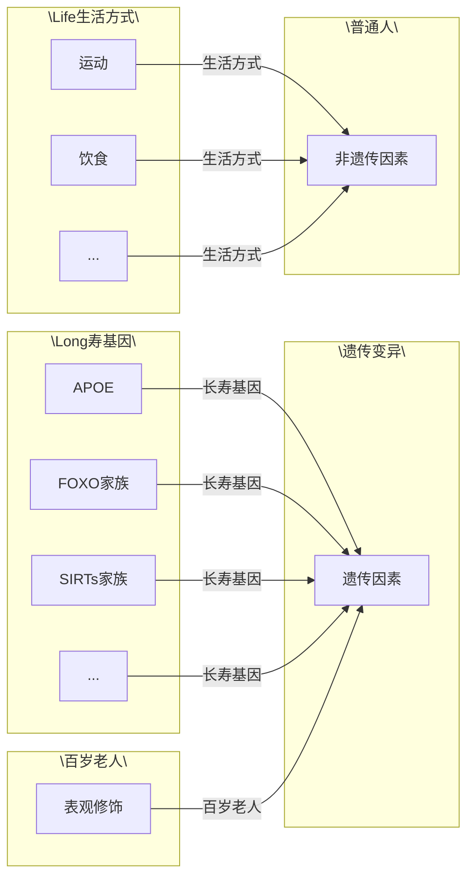
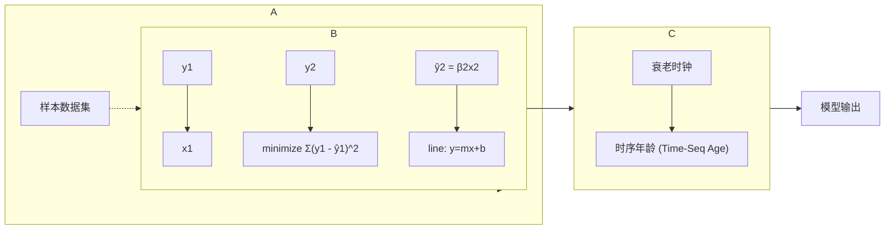
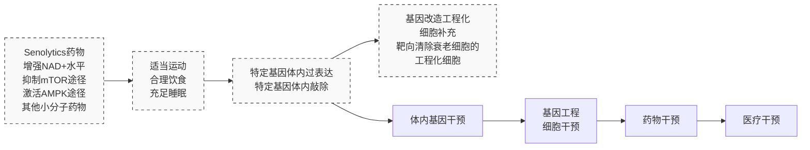

## 知识窗 19-6

## 帕金森综合征

帕金森综合征的临床特征表现为强直性震颤、静止性震颤，以及由于神经肌肉功能障碍而导致的运动幅度和速度变化。在帕金森综合征中，黑质中的神经元丢失往往导致纹状体多巴胺减少，同时黑质中残存的神经元胞质内会出现含有 $\alpha-$ 突触核蛋白聚集物的包涵体。所有的帕金森综合征患者体内均可检测到 $\alpha-$ 突触核蛋白。在帕金森综合征患者中，可溶性 $\alpha-$ 突触核蛋白单体首先形成低聚物，随后这些低聚物再结合形成不溶性的  $\alpha-$  突触核蛋白纤维，这些纤维与具有神经毒性的细胞质包涵体路易小体有关。路易小体是帕金森综合征的主要病理学特征之一。帕金森综合征的分子发病机制涉及多种途径和机制，包括  $\alpha-$  突触核蛋白平衡、氧化应激、线粒体功能、钙稳态、轴突运输和神经炎症等多个方面。

## 二、心血管疾病

年龄与心血管健康息息相关。预计到2030年，中国65岁及以上的人口将占总人口的 $20\%$ 左右，心血管疾病预期将占老年人死亡因素的 $40\%$ ，居于老年人死亡原因之首。随着年龄增长，心血管系统稳态逐渐失衡，出现血管硬化和纤维化，以及左心室壁厚度增加，这将导致组织适应性增强和应激耐受能力降低。其病理表现为心肌肥厚，左心室的舒张功能和收缩能力均有所减退，同时伴随动脉僵硬度增加和内皮功能障碍。临床上，这些变化将导致收缩压升高，并成为动脉粥样硬化（知识窗19-7）、高血压（知识窗19-8）和心力衰竭（知识窗19-9）的主要危险因素。心血管疾病过程中主要涉及过度的氧化应激和慢性炎症，同时也与细胞衰老、应激抵抗力降低、基因组不稳定性、端粒损耗等相关。

## 知识窗 19-7

## 动脉粥样硬化

动脉粥样硬化是血管内炎症、脂质氧化和斑块共同作用的结果。动脉粥样硬化起始于内皮细胞的损伤，导致含胆固醇的低密度脂蛋白在动脉壁内堆积。随后，这些脂蛋白容易被氧化，并激发持续的炎症反应。先天性和适应性免疫的激活也在动脉粥样硬化的发生发展中发挥重要作用。单核细胞进入动脉内膜并转化为巨噬细胞，最终在脂质坏死核心中形成泡沫细胞。泡沫细胞是一种充满脂肪的细胞，它是动脉粥样硬化形成的关键，并可能诱发心脏疾病和脑梗。在硬化的环境中，胆固醇以及其他损伤性分子刺激巨噬细胞，激活其内部的炎症小体，从而释放IL-1β、IL-18等促炎性细胞因子。这些因子对其他炎症相关细胞（如T细胞和B细胞）具有趋化作用，共同推动了动脉粥样硬化的进程。晚期动脉粥样硬化的特征是大量细胞凋亡和具有衰老特征的细胞聚集，这导致促炎状态和坏死核心的形成，最终引发斑块硬化和破裂、血栓形成和急性血管阻塞。

## 知识窗 19-8

## 高血压

高血压是与衰老密切相关的疾病，50%的老年人都会患有高血压，其是导致脑卒中、冠心病、心力衰竭等疾病的重要危险因素。血管老化与血压水平直接相关，

一般当收缩压 $\geqslant 140\mathrm{mmHg}$，或舒张压 $\geqslant 90\mathrm{mmHg}$ 时，即为高血压。炎症、氧化应激等都与高血压的发生相关。

## 知识窗19-9

## 心力衰竭

心力衰竭患病率在老年人中急剧上升。心力衰竭的总患病率为 $2.2\%$ ，其中在45～54岁的人群中患病率为$0.7\%$ ，而在75岁及以上的人群中高达 $8.4\%$ 。心力衰竭往往是由心脏结构功能性异常引起，同时伴随利钠肽水平升高，以及出现肺源性心脏病或淤血。心力衰竭的临床症状为胸闷、乏力、活动耐量下降、端坐呼吸、阵发性夜间呼吸困难、下肢浮肿等。

## 三、骨骼疾病

随着年龄增长，全身骨骼会出现不同程度的骨量减少而导致骨质疏松（知识窗19-10）。骨关节炎主要特征是关节软骨的退化和异常骨重塑，会导致产生疼痛，其发生局限于关节部位（知识窗19-11）。年龄是骨质疏松和骨关节炎的重要诱因之一。骨质疏松也可能会促进骨关节炎的发生。因为骨质疏松会影响骨关节周围骨的结构或者引起骨的质量下降，再加上关节本身受到长期磨损、退变等因素的影响，因此更容易发生骨关节炎。

## 知识窗19-10

## 骨质疏松

骨质疏松一种慢性骨骼疾病，其特征是骨量低，骨组织微结构衰退，导致骨脆性和骨折风险增加。骨质疏松会导致椎体和髋部骨折，以及慢性疼痛和残疾。骨质疏松主要归因于衰老和性甾体缺乏，这在细胞水平上导致破骨细胞骨吸收增加，成骨细胞骨形成减少。骨质疏松潜在致病机制包括衰老细胞的积累、DNA损伤等。

## 知识窗19-11

## 骨关节炎

骨关节炎作为最常见的关节炎类型，也是导致65岁以上一半人口产生严重疼痛和残疾的主要原因。骨关节炎是一种以软骨退化和骨质增生、软骨下骨增厚为特征的软骨退化疾病，其包括关节软骨、软骨下骨、韧带、关节囊、滑膜和关节周围肌肉的结构改变，疼痛是主要症状。骨关节炎的进行性发展，最终导致衰弱性疼痛和活动能力的丧失。骨关节炎的复杂发病机制涉及细胞衰老、炎症和代谢因素等，最终会导致滑膜关节的结构破坏和功能衰竭。

## 四、肌少症

随着年龄增长，肌肉质量往往由于运动神经元的逐渐丧失而减少，这与肌肉纤维数量和大小的减少有关。同时肌肉功能也逐渐下降，因为随着运动神经元的进行性丧失，剩余神经元对肌纤维的侧枝再神经支配终将耗尽代偿潜力，最终无法弥补功能缺失。肌肉功能和质量的下降会导致肌少症的发生，严重影响人们的生活质量。

衰老过程中肌肉质量和功能下降的过程被称为肌少症。肌少症患者常因肌肉力量的衰退和行动受限，导致其生活质量降低。这使患者更易遭受跌倒、骨折和新陈代谢相关疾病，从而增加了发病和死亡的风险。肌少症的发生与激素（如IGF-1和胰岛素）功能变化、肌纤维的组成变化和神经肌肉功能衰退、骨骼肌卫星细胞分化能力和增殖潜能受损、炎症发生以及蛋白质抑制和线粒体功能有关。

## 五、代谢相关疾病

衰老会引起身体不同组成部分发生许多生理变化，最终导致代谢相关疾病的发生，如内脏脂肪和非脂肪组织（包括肝和骨骼肌）中过量脂肪的积累是肥胖相关代谢疾病发病的重要因素。代谢相关疾病症状包括高血糖、肥胖、血脂异常等，并且会增加2型糖尿病的发生风险。2型糖尿病与衰老之间存在很强的相关性，目前全球每11人中就有1人被诊断患有糖尿病，而65岁以上的老年人占现在所有诊断为糖尿病的成年人的近一半，其中约 $90\%$ 是2型糖尿病。2型糖尿病的特点是血糖水平高、胰岛素抵抗和胰岛素分泌不足，而年龄增长是胰岛素抵抗和葡萄糖耐受不良的重要影响因素（知识窗19-12）。

## 知识窗 19-12

## 2 型糖尿病

2型糖尿病的特征是高血糖，这是胰岛 $\beta$ 细胞功能逐渐恶化的结果，同时常常伴有不同程度的胰岛素抵抗。胰岛素抵抗本身不足以引发2型糖尿病，因为胰腺最初可以通过增加胰岛素分泌来补偿。但长期高胰岛素血症会对 $\beta$ 细胞产生压力，破坏其对血糖刺激的急性胰岛素分泌反应，并最终损害后期胰岛素反应。因此，胰岛素分泌不足是大多数2型糖尿病患者的主要致病因素。衰老会促进2型糖尿病的发病机制，可以通过直接影响β细胞功能而抑制胰岛素分泌，或间接通过肥胖和其他危险因素增加胰岛素抵抗。例如β细胞衰老和衰老期间β细胞对葡萄糖的敏感性降低，将导致胰岛素抵抗补偿增加不足而增加2型糖尿病的易感性。2型糖尿病的发生发展与氧化应激、炎症和内质网应激等有关。

## 第六节 衰老与长寿

寿命是一种受多因素影响的复杂生活史性状，在人群中存在诸多差异。翻开人类历史，自有文字记载以来，人类从未停止对拥有更长久、健康寿命的向往。随着科技发展、现代医学进步以及社会福利体系的建立，古人“人生七十”的愿景已悄然实现。据国家卫生健康委2025年最新发布的数据显示，我国人均预期寿命已经达到79岁，百岁以上长寿老人的比例持续增长，这为社会保障和公共卫生体系带来了诸多挑战，也为衰老科学的研究带来了前所未有的机遇，揭示健康衰老乃至长寿背后影响因素的研究势在必行且刻不容缓。本节主要从遗传因素和非遗传因素两个角度分别阐述目前衰老领域内对寿命影响因素的认识以及最新的研究进展（图19-15）。

图19-15 寿命的影响因素

flowchart

## 一、影响寿命的遗传因素

生物学家们很早就认识到寿命具有可遗传特性，“朝菌不知晦朔，蟪蛄不知春秋”，不同物种的寿命从几天到几十年不等，跨度极大。最早对寿命遗传基础的研究起源于20世纪以模式生物为对象的观测，21世纪以来基于人群队列的遗传学研究规模逐渐扩大。

## 1. 基于模式生物的遗传学研究

托马斯·约翰逊（Tom Johnson）是利用模式生物研究寿命遗传因素的先驱，他将秀丽隐杆线虫中寿命长短不同的个体区分成不同组别，并在实验室可控的环境条件下进行杂交培养。对杂交后代的分析发现线虫寿命的变异是可遗传的，遗传率（heritability）为 $20\% \sim 50\%$ 。后续研究发现携带 age-1 基因突变的线虫平均寿命可增加 $50\%$ 左右。

这一里程碑式的发现极大地激发了生物学家在模式生物上进行长寿遗传因素研究的热情。目前已经在酵母、线虫、小鼠乃至非人灵长类等模式生物上发现了多个可能会影响寿命的关键生物学通路，如胰岛素/胰岛素样生长因子1信号通路、mTOR信号通路等，以及通路中的关键蛋白质编码基因，如FOXO蛋白家族、Sirtuins蛋白家族等。这部分内容已在“遗传与衰老”部分详细描述，本节不再赘述。

## 2. 基于人群队列的遗传学研究

由于模式生物在遗传背景上的局限性，在人群队列中进行寿命遗传基础的研究显得尤为重要。为了确定遗传因素对人群中寿命变异产生的影响，在人群队列的研究中往往会采用三种常见的试验设计。第一种方法是构建长寿人群的兄弟姐妹生存曲线，并将其生存曲线与出生在同一地域人群的生存曲线进行比较，对荷兰、意大利等地长寿人群的研究表明与普通人群相比，长寿人群的兄弟姐妹在任何年龄阶段都具有明显的生存优势。第二种方法进一步排除了家庭因素的影响，即比较长寿家族中血缘亲属与非血缘亲属的生存曲线，意大利的一项研究发现长寿人群的兄弟姐妹的生存优势并不被他们没有血缘关系的亲属所共享。第三种方法是比较同卵双胞胎和异卵双胞胎的死亡年龄来分析人类寿命中遗传因素所占的比重，对丹麦、荷兰等地双胞胎人群的研究已估算出寿命在个体间的差异约有 $25\%$ 可归因于遗传因素，并提示这一比重随年龄的增长而增长，且在男性中比在女性中更为重要。

随着近些年高通量测序技术和计算模型的发展，在人群队列中进行高通量、大规模的全基因组测序，并通过全基因组关联分析（GWAS）寻找调节人类寿命的遗传变异已成为现实。

GWAS研究已经确定了许多与寿命呈正相关的遗传变异和蛋白质编码基因，如对欧洲长寿人群进行的GWAS研究证明了FOXO3和APOE的基因多态性与人类长寿密切相关，并在近年来面向不同地域人群队列的多个独立GWAS研究中多次重复。但需要注意的是，人群中的每一种遗传变异只能解释寿命变异的一小部分，而且只有极少数的基因（如 FOXO3 和 APOE）可以在不同研究和不同人群队列中反复证明与寿命相关。

## 二、影响寿命的非遗传因素

在过去的一个世纪里，大多数国家的平均预期寿命大幅增加，从50岁左右增加到75～80岁。在进化的时间尺度上观测，预期寿命的增加显得过于迅速，而事实上，人类的极限寿命自有据可查的历史以来并没有明显的变化，一直保持在120岁左右。这些数据表明非遗传因素在预期寿命的增长中起到了重要作用。影响寿命的非遗传因素具体可以包括个人的生活方式和社会因素两个层次。

## 1. 影响寿命的生活方式

来自中国、美国等地基于大规模人群的长期随访研究（follow-up study）均发现，采取健康生活方式可大幅降低死亡风险，并延长寿命。影响寿命的生活方式包括且不限于运动、饮食、睡眠、社交等多个方面，但这些生活方式调控寿命的分子机制，还有待进一步的揭示。

就目前的研究结果而言，运动大概率是一种真正有效的长寿生活方式。坎皮西等人认为对于缺乏适当治疗手段的老年功能障碍，运动是唯一具有显著效果的干预手段，它可以降低衰老相关疾病的发生率，提高生活质量，延长寿命。在美国加州，对于不同运动频率人群进行了长达21年的随访研究，通过问卷调查评估了受试人群的身体状况和健康水平，发现即使是少量运动也可对健康寿命的延长产生有益影响，有运动习惯的中老年人群会获得明显的生存优势。目前对于运动影响寿命作用机制的研究较少，且多集中在模式生物（如小鼠）上，但这些研究提示了维持氧化还原平衡，以及保证节律基因调控网络稳态可能是运动在分子层次产生的主要影响。

饮食可能是对健康和寿命影响最大的生活方式之一，也是衰老领域的热门研究方向之一。长寿饮食方案包括:①热量限制，即减少总热量摄入，一般为正常水平的 $70\%$ ；②禁食，即在固定时间段停止食物摄入，包括间歇性禁食、周期性禁食和禁食模拟饮食等不同的禁食方案；③选择性减少或提高特定营养成分的摄入，包括生酮饮食、蛋氨酸限制等特定饮食方案。长寿饮食方案对衰老进程的延缓与代谢物循环增加、自噬和翻译过程减少、蛋白质周转以及抗氧化和其他应激反应通路相关的修复增强有关，影响的通路主要是胰岛素/胰岛素样生长因子1信号通路和mTOR信号通路，而且这些机制具有物种保守性。2022年，一些研究者提出了具有普适性的长寿饮食方案，即糖类摄入量中等到高，蛋白质摄入量较低但足够满足日常所需，且多食入植物性和鱼类来源的蛋白质。这是日本冲绳、意大利撒丁岛和美国洛马林达等地区的传统饮食习惯，这些地区的百岁老人比例和平均寿命明显高于其他地区。

需要注意的是，生活方式并不会直接导致遗传信息的改变，而是主要通过影响表观遗传的方式参与寿命调节的过程，这也是未来研究的重点方向。

## 2. 影响寿命的社会因素

影响寿命的社会因素包括现代医疗卫生条件的进步和社会福利体系的建立等。以

## 名词窗 19-5

遗传率（heritability）:群体中某一性状的变异程度受遗传调控的比例。

全基因组关联分析（genome-wide association study, gwas）:利用统计学手段对不同个体间、全基因组范围内的遗传变异进行观测，在群体水平确定是否存在任何变异与目标性状相关。研究寿命影响因素的 GWAS 研究多采用“病例-对照”方法，通过比较长寿人群和普通人群对照组中多态性的频率，寻找长寿人群中高频出现的、有利于生存的等位基因。

随访研究（follow-up study）:在不同时间对同一人群的生活方式、健康状况和其他卫生事件进行调查，观测该人群的某种特征（如死亡率）随时间的动态变化情况。

line

| 年份 | 世界 (岁) | 中国 (岁) |
| --- | --- | --- |
| 1950 | ~46.5 | ~40.0 |
| 1955 | ~50.0 | ~43.8 |
| 1960 | ~47.5 | ~44.2 |
| 1965 | ~53.5 | ~44.2 |
| 1970 | ~56.0 | ~55.0 |
| 1975 | ~58.0 | ~61.2 |
| 1980 | ~60.0 | ~65.0 |
| 1985 | ~61.8 | ~67.2 |
| 1990 | ~63.5 | ~68.2 |
| 1995 | ~64.2 | ~68.5 |
| 2000 | ~65.8 | ~69.8 |
| 2005 | ~67.5 | ~71.5 |
| 2010 | ~69.2 | ~72.8 |
| 2015 | ~70.8 | ~74.2 |
| 2020 | ~71.0 | ~75.8 |

图19-16 中国历年人均预期寿命的变化

我国为例，新中国成立以来我国的人均预期寿命从1949年的35岁上升到2021年的78岁（图19-16）。同样，长寿人群也在不断增加，百岁老人的数量从1951年的3384人增加到2022年的118866人。在近几十年中，由于社会因素趋于稳定，预期寿命的延长也逐渐放缓。过去20年间人均预期寿命增加了6.6年，过去10年增加了3.4年，这可能要主要归功于对衰老相关疾病，特别是心血管疾病和癌症治疗策略的发展。

## 第七节 衰老的度量

衰老相关疾病的治疗与健康寿命的延长离不开针对衰老过程本身进行深入研究，但衰老并非一个匀速、同步的进程，时序年龄相同个体的生理功能和组织器官的老化程度可能存在一定差异，因此，时序年龄并不能准确反映人体的衰老程度。在衰老的过程中有大量随衰老变化的生物标志物，这些标志物大到明显的外表特征如变白的头发，小到细微的分子变化如细胞端粒长度，可用于了解和度量衰老过程。得益于高通量组学技术的发展，借助表观基因组、转录组、蛋白质组和代谢组等多组学方法定量数千种表观遗传标记、转录物、蛋白质和代谢物，在分子水平上测量生物年龄和衰老速度，从而准确度量衰老，已成为可能（图19-17）。

图19-17 衰老时钟（aging clock）的基本概念学习分子特征（例如蛋白质的表达水平）与因变量（年龄）之间的关系，构建模型来预测年龄，实际年龄和预测年龄之间的残差可以与特定表型关联。

flowchart

## 一、使用衰老时钟度量衰老

## 1. 甲基化时钟

甲基化时钟（DNA methylation clock）这一概念首先由格雷格·汉纳姆（Gregory Hannum）等人提出，史蒂夫·霍瓦斯（Steve Horvath）团队在此基础上构建了能准确预测不同组织年龄的时钟。将模型与生物衰老的重要特征直接联系起来，能够识别衰老中功能更相关的分子变化，PhenoAge时钟能够预测基于实际年龄和与死亡风险相关的9个临床参数构建的复合生物学年龄，但甲基化变化和衰老变化的因果关系难以阐述，仍是发挥这些模型潜力的障碍。

## 2. 转录组时钟

首个转录组时钟基于多个大型队列的外周血单核细胞基因表达构建而成。在后续的研究中，研究人员应用神经网络限制输入数据与已知生物途径关联，从而提高转录组时钟（transcriptomic clock）模型的可解释性。转录组时钟与衰老相关的多种因素相关，如死亡风险、心脏病、身体机能和认知，但仍需进一步实验验证。

## 3. 蛋白质组时钟

蛋白质组时钟可基于不同来源的生物样本（如脑脊液或血浆）构建。托尼·威斯-科雷（Tony Wyss-Coray）团队基于血浆蛋白组构建了衰老时钟，该时钟模型在后续研究中被证实与衰老疾病及健康寿命存在关联。随着蛋白质组学技术的进步，对蛋白质组学衰老的更多和更大规模研究可能会促进蛋白质组时钟（proteomics clock）进一步发展。

## 4. 代谢组时钟

基于血浆中 56 种代谢物构建的代谢组时钟研究表明，代谢组学年龄与实际年龄的差异值与心血管危险因素、心血管疾病风险及全因死亡风险显著有关。虽然代谢组学技术限制了代谢组时钟（metabolomics clock）的应用，但代谢与衰老间的紧密联系仍然是代谢组时钟的一大优势。

## 5. 影像学时钟

影像学时钟可基于人工智能技术构建，北京大学韩敬东团队构建通过识别面部特征实现了准确的年龄预测；亦有研究利用 CT 影像（如脑部 CT）预测器官年龄。随着人工智能技术的发展，未来可能会有更精准、更便捷的影像学时钟（imaging clock）出现。

## 6. 复合时钟

中国科学院动物研究所刘光慧团队利用多组学结合人工智能方法，系统挖掘多个维度的衰老生物标志物，并构建复合时钟（composite clock）（图 19-18），利用该时钟揭示衰老的动态变化规律以及激素替代疗法对于女性衰老的潜在干预效果。也有研究报道，通过机器学习方法，利用甲基化和转录组生物标志物构建了多模态衰老时钟，可能对药物靶标的发现具有一定帮助。

text_image

Circular diagram illustrating scientific concepts around a clock, featuring icons for human, brain, liver, kidney, spinal cord, and molecular structures.

图 19-18 衰老的复合时钟

## 二、衰老时钟与衰老的特征

衰老时钟预测年龄与实际年龄的差距与个体表型之间存在一定相关性。不同类型的衰老时钟对不同衰老表型敏感，如甲基化时钟对死亡率敏感，转录组、代谢组和蛋白组时钟则对衰老相关疾病敏感。此外，通过将额外的特定老化表型或衰老生物学特征纳入模型，可以将实际年龄与对应生物学特征相结合，提高其对特定表型的预测能力。

## 三、衰老时钟的未来发展

衰老时钟有望成为深入了解衰老背后的生物过程，指导未来衰老治疗应用的潜在临床工具。面对衰老的复杂性，衰老时钟需要更具针对性，根据它们要测量的内容（细胞、组织或生物体年龄和功能）进行定制。

当前的衰老时钟绝大多数都是基于机器学习方法构建的数学模型，无法提供对衰老的因果见解。特别是对于表观遗传时钟来说，目前关于甲基化位点的改变如何影响基因表达和衰老相关生理学的下游变化知之甚少，未来研究还需深度融合更先进的人工智能技术，整合多组学数据以解析复杂的因果链条，从而揭示衰老时钟背后的核心分子机制。

## 名词窗 19-6

甲基化时钟（DNA methylation clock）:利用衰老过程中变化的甲基化生物标志物构建的年龄预测模型。表观遗传改变是衰老的标志之一，特定位点的甲基化变化不仅与某些疾病（如心血管疾病）和生活方式（如吸烟）有关，还可能与年龄呈线性关系。

转录组时钟（transcriptomic clock）:利用衰老过程中变化的转录组学生物标志物构建的年龄预测模型。通过转录组学技术可以捕获个体基因的表达谱，以及这些基因在特定组织，不同年龄之间的差异，根据基因表达水平来开发衰老时钟，能够将衰老与基因表达变化更直接联系，从而提高衰老时钟的可解释性和可验证性，但目前转录组学测序数据使用的平台不同，不同批次数据存在一定噪声，仍是限制转录组时钟使用的一大障碍。

蛋白质组时钟（proteomics clock）:利用衰老过程中变化的蛋白质生物标志物构建的年龄预测模型。人血浆和脑脊液中存在数千种蛋白质随着年龄的增长而变化，蛋白质组学技术的快速发展使对单个样品中的数千种蛋白质进行精确定量和构建蛋白质组学时钟成为可能。蛋白质组学的优势在于与器官功能的直接联系，血浆中含有来自几乎所有器官和细胞类型的蛋白质，可以研究衰老在不同组织和细胞类型间的差异，使得开发专注于特定组织衰老生物学的时钟成为可能。

代谢组时钟（metabolomics clock）:利用衰老过程中变化的代谢组生物标志物构建的年龄预测模型。新陈代谢与衰老之间具有紧密的联系，先进的质谱和核磁共振方法可以鉴定人血浆和尿液中的数千种代谢物，从而生成代谢组学时钟。但由于代谢组学的技术限制，代谢组学数据存在一定噪声，限制了其目前在衰老时钟研究中的应用，代谢组学时钟的年龄预测准确性也低于其他组学数据类型。

影像学时钟（imaging clock）:捕获衰老过程中生理结构变化的图像构建的年龄预测模型。衰老涉及许多明显的生理结构变化，如白发产生、皱纹增多、大脑萎缩等。通过影像学方法捕获衰老过程中发生的生理结构变化，利用深度学习和计算机视觉技术，根据影像学信息（如面部特征、大脑CT图像等），可以实现较为精确的年龄预测。这种时钟所依赖的生物标志物可以通过非侵入性方法快速获取，相对于其他时钟更为便捷。

复合时钟（composite clock）:利用多种类型衰老生物标志物构建的年龄预测模型（见图19-18）。由于衰老的复杂性，基于单一衰老生物标志物的时钟不能反映整个衰老过程，通过有目的地选择特征并将不同性质的生物标志物组合到一个模型，有助于提高模型的可解释性，且比单一标志物衰老指标更为可靠。但是，增加预测变量的种类不可避免地会增加测量成本，而且简单地将更多的生物标志物整合到一个模型中也并不一定能保证其性能的提高。

衰老时钟（aging clock）:是一类从整个生命周期中随年龄变化的特征（如面部特征、基因表达水平、代谢物、表观遗传修饰等）中选择重要特征来预测个体年龄的机器学习模型（见图19-17）。衰老时钟的预测年龄可以作为衡量生物年龄的指标，因此，衰老时钟可以作为度量个体、器官乃至细胞年龄的工具，检验、支持或反驳分子老年科学中的其他观察结果，为深入了解衰老背后的生物过程及未来衰老治疗及干预研究提供帮助。

## 第八节 衰老的干预

自有历史记载以来，人类一直没有停下找寻延缓衰老方法的脚步。随着老龄化社会的逐步到来，以延缓衰老为目标的衰老干预研究如雨后春笋般出现，并取得了一定成果。在本章前面部分已探讨“机体为什么会老？机体究竟有多老？”，本节重点介绍如何延缓衰老？虽然我们不能从根本上逆转衰老，但是可以通过延缓衰老的措施，预防和治疗衰老相关疾病，提高老年人生活质量，进而实现健康长寿。当前延缓衰老的策略主要包括小分子及药物、主动健康、体内基因干预和基因工程细胞干预（图19-19）。

## 一、小分子及药物干预

## 1. 选择性消除衰老细胞药物

衰老细胞在机体衰老进程及多种年龄相关疾病发生发展中逐渐累积，靶向清除衰老细胞是衰老干预的有效手段。Senolytics是选择性清除衰老细胞的药物，显示出良好的衰老干预效果。例如，达沙替尼与槲皮素（Dasatinib + Quercetin, D+Q）、漆黄素属于两种Senolytics药物。研究发现D+Q联合给药可降低老年小鼠死亡风险，延长健康寿命。在老年小鼠中喂食与槲皮素同属类黄酮的漆黄素，可延长中位寿命和最大寿命。ABT263（抗凋亡蛋白BCL-2和BCL-xL的特异性抑制剂）是另一种Senolytics药物，小鼠经口服给药后可选择性清除衰老细胞，恢复衰老组织中的干细胞活力。衰老细胞的SA-β-gal活性广泛增加，基于此设计的前体药物衰老特异性杀伤化合物1（SSK1）可选择性地清除衰老细胞，降低老年小鼠慢性炎症水平并改善身体机能。

图19-19 衰老的干预

flowchart

除 Senolytics 药物外，新兴 Senolytics 疗法聚焦在抗衰老疫苗，也是清除衰老细胞延缓衰老的策略之一。例如，糖蛋白非转移性黑色素瘤蛋白 B（GPNMB）在衰老细胞膜表面富集，针对 GPNMB 开发的抗衰老疫苗能够改善小鼠衰老相关的症状，延长早衰小鼠寿命。

## 2. 增强 $\mathrm{NAD}^{+}$ 水平

在多种模式生物衰老过程中，组织和细胞中的烟酰胺腺嘌呤二核苷酸（nicotinamide adenine dinucleotide，$\mathrm{NAD^{+}}$）水平逐渐下降，并且 $\mathrm{NAD^{+}}$ 水平的降低与多种衰老相关疾病存在因果关系。$\mathrm{NAD^{+}}$ 也被称为辅酶I，是能量代谢的核心分子。它在细胞代谢、能量合成、DNA修复和细胞衰老等多种生物学过程发挥作用。目前的研究发现许多提高机体 $\mathrm{NAD^{+}}$ 水平以进行衰老干预和预防年龄相关疾病的有效策略，包括补充 $\mathrm{NAD^{+}}$ 的前体物质如烟酰胺核糖（NR）、烟酰胺单核苷酸（NMN）和烟酰胺（NAM），调节 $\mathrm{NAD^{+}}$ 生物合成酶以及抑制 $\mathrm{NAD^{+}}$ 降解相关酶的方法。

NAMPT 和 NMNAT 是参与  $NAD^{+}$  合成的关键酶，针对它们的活化剂被认为是增加  $NAD^{+}$  水平的潜在策略。小分子化合物 P7C3 可以增强 NAMPT 的活性，在年龄相关的疾病（如神经变性）方面具有潜在的功能性治疗作用。ACMSD 是限制  $NAD^{+}$  从头合成途径的酶，TES-991 和 TES-102524 的靶向抑制可以提高小鼠肝脏、肾脏和脑组织中  $NAD^{+}$  水平。此外，抑制  $NAD^{+}$  降解相关酶 PARP、CD38、CD157 和 SARM 有效地提高机体  $NAD^{+}$  水平，在治疗与  $NAD^{+}$  水平下降相关的年龄相关疾病方面具有巨大潜力。

## 3. 抑制 mTOR 途径

mTOR 整合营养、能量及生长因子等多种胞外信号，参与调节细胞的生长、增殖、凋亡、自噬和代谢等生物学过程，与多种疾病密切相关。越来越多的证据表明，mTOR 的激活是衰老的主要驱动因素，在包括酵母、秀丽隐杆线虫、果蝇和小鼠在内的模式生物中，mTOR 信号的减少能够延长其寿命。雷帕霉素是 mTOR 抑制剂，研究发现雷帕霉素的治疗能够延长小鼠寿命，同时，雷帕霉素还可预防及治疗多种年龄相关疾病，包括神经退行性疾病、代谢性疾病、年龄依赖性肥胖、心脏肥大、心肌病等。

## 4. 激活 AMPK 途径

AMPK 通路主要在细胞营养感知、能量代谢过程发挥作用，维持细胞能量稳态。研究表明，激活 AMPK 足以延长不同模式生物寿命。例如，二甲双胍通过改变细胞中的 AMP/ADP 间接激活 AMPK，可以延长秀丽隐杆线虫寿命。对中年小鼠长期进行二甲双胍给药，发现饮食中适量的二甲双胍添加可以延长小鼠寿命。同时，研究表明二甲双胍施用对灵长类全身多组织器官具有衰老保护效果。阿司匹林通过代谢为水杨酸参与到 AMPK 的激活，被证明可以延长线虫和雄性小鼠寿命，降低癌症风险。

## 5. 其他小分子药物

内源性反转录病毒（ERV）元件是数百万年前远古反转录病毒入侵整合到人类基因组的遗迹，占据人类基因组序列的 $8\%$ 左右。在胚胎后发育阶段，受表观遗传调控等因素影响，ERV处于转录沉默状态。然而，在某些特定的条件下（例如胚胎发育早期，癌症或神经退行性疾病等病理条件），休眠的反转录病毒元件可以被唤醒。聚焦ERV，中国科学院动物研究所刘光慧研究员及其团队发现ERV的复活是衰老的生物标志物和驱动因素，而靶向反转录酶的小分子抑制药物可以延缓细胞，组织的衰老。同时，研究发现维生素C、没食子酸、低剂量氯喹等处理衰老的人类间充质祖细胞，可增加异染色质相关水平，延缓细胞或组织衰老。

## 二、主动健康

## 1. 适当运动

长期久坐不动的生活方式会导致一系列健康问题出现，增加死亡风险。相反，定期进行体育锻炼和适度增加运动可以降低许多疾病风险，提高生活质量，甚至增加人类的平均和最大寿命。运动可以显著改变骨骼肌全基因组或特定位点的DNA甲基化模式。在平均年龄为37.5岁的男性中，持续16个月的定期运动使得骨骼肌的DNA甲基化模式朝着更好的方向发展，包括促进肌肉生长、分化和代谢等特征性变化。在小鼠中，长期规律的运动被发现可以延缓衰老进程，降低慢性疾病的易感性，同时研究发现长期运动对人具有潜在的衰老保护作用。

## 2. 合理饮食

饮食可能是对健康和衰老影响最重要的因素之一。暴饮暴食和伴随的肥胖会缩短人体的健康寿命，而合理饮食（包括限食、间歇饮食、生酮饮食等）与预期寿命的延长以及各种慢性病患病风险的降低有关。例如，生酮饮食，以产生高水平内源性酮体β-羟基丁酸（β-OHB）为特征，被发现可以延长小鼠健康寿命。其中一个原因可能是β-羟基丁酸通过调节表观遗传调控因子组蛋白去乙酰化酶活性，从而激活长寿基因FOXO3的表达。

## 3. 充足睡眠

昼夜节律的逐渐丧失和昼夜节律基因表达的抑制是衰老的常见特征之一，急性睡眠缺失会导致时钟基因发生表观遗传变化，这些基因在机体组织内调节着昼夜节律。因此，睡眠具有不可替代的功能，保持规律且充足的睡眠有助于延缓衰老，预防年龄相关疾病的发生和发展。

## 三、体内基因干预

随着基因编辑技术的发展，通过定点添加、敲除或改变基因碱基序列来改变基因表达和功能已经成为可能，这也为延缓衰老的基因疗法提供了机会。衰老细胞作为衰老干预的重要靶点受到广泛研究。例如，端粒酶反转录酶（Tert）对染色质末端端粒区域的复制至关重要。在1或2岁龄小鼠中，通过尾静脉一次性注射AAV9-Tert可以延长 $24\%$ 或 $13\%$ 寿命。衰老细胞产生SASP因子，促进相邻细胞衰老。NF- $\kappa \mathrm{B}$ 在细胞炎症反应中扮演重要角色，通过向小鼠下丘脑注射显性阴性 IκBα 慢病毒来抑制 NF-κB 的激活，可以延长约 10% 最大寿命。在小鼠关节内注射编码 YAP 或 FOXD1 的慢病毒载体，可以减轻骨关节炎的发展。同样，多能性因子 OSKM（OCT4、SOX2、KLF4 和 MYC）的表达也可以不同程度地回拨表观时钟，延长早衰小鼠寿命。

除了体内特定基因的回补策略外，一些针对基因敲除的方法在延缓衰老中也发挥作用。基于全基因组CRISPR筛选技术，最近的研究发现KAT7是一个新的衰老促进靶点。通过尾静脉单剂量注射Cas9/sg-Kat7的慢病毒载体，可以减缓肝脏衰老，并将生理性衰老和早衰小鼠的中位寿命分别延长 $25\%$ 和 $34\%$ 。

## 四、基因工程细胞干预

随着机体衰老，组织器官的再生与修复能力显著降低。其中，干细胞的耗竭和功能下降是主要原因之一。除了在体内进行基因操作以实现衰老干预外，通过外源补充干细胞来逆转这一过程也是一种衰老干预方法。然而，考虑到衰老微环境的负面影响，干细胞需要经过基因改造才能在衰老微环境中正常发挥功能。例如，经过FOXO3基因改造的人类胚胎干细胞派生的血管细胞表现出更强的氧化应激抵抗能力和延缓衰老的能力，增强了血管的再生和修复能力。更进一步，聚焦长寿基因通路进行基因重编程，研究人员构建了具有抗衰老、抗应激、抗恶性转化的工程化人类抗衰型间充质祖细胞（SRC），并证实SRC可以作为通用型细胞治疗载体显著延缓灵长类动物多器官衰老进程。另外一项研究报道，在18个月大的小鼠体内移植基因工程化下丘脑干细胞表达显性阴性 $\mathrm{I}\kappa \mathrm{B}\alpha$ 后，其寿命延长近 $10\%$ 。

衰老细胞随年龄增长在各种组织和器官中积累，它们分泌多种细胞因子和趋化因子，反过来促进或维持衰老。与外源补充基因工程化干细胞不同，另一种衰老干预策略是清除机体中的衰老细胞。例如，$\mathrm{P16}^{\mathrm{Ink4a}}$ 是一个经典的衰老生物标志物，其在衰老细胞中表达增加。研究表明，在转基因INK-ATTAC早衰小鼠中诱导清除 $\mathrm{P16}^{\mathrm{Ink4a}}$ 阳性衰老细胞，可以延缓衰老相关疾病的发生发展。此外，经过设计的针对尿激酶型纤溶酶原激动剂受体（uPAR）的CAR-T细胞可清除衰老细胞。通过腹腔注射这些CAR-T细胞，可以延长接受诱导衰老药物治疗的肺腺癌小鼠存活率，并恢复化学治疗或饮食诱导的肝纤维化小鼠体内的组织稳态。

## ※ 复习思考题

1. 什么是衰老？
2. 衰老与疾病之间的联系与区别是什么？
3. 衰老研究有哪些常用的遗传学方法？这些方法各有哪些优势？
4. 衰老的特征有哪些？这些特征之间是否存在关联？
5. 常见的衰老相关疾病有哪些？其主要特征包括哪些？

6. 常见的早衰症有哪些？其发病机制是什么？
7. 如何理解非遗传因素对于预期寿命的影响？
8. 什么是衰老时钟？
9. 如何实现衰老的科学度量？
10. 衰老干预的策略都有哪些？

## ※ 推荐阅读

1. HE S, SHARPLESS N E. Senescence in health and disease [J]. Cell, 2017, 169(6): 1000–1011.
2. CAMPISI J, KAPAHI P, LITHGOW G J, et al. From discoveries in ageing research to therapeutics for healthy ageing [J]. Nature, 2019, 571(7764): 183–192.
3. PARTRIDGE L, FUENTEALBA M, KENNEDY B K. The quest to slow ageing through drug discovery [J]. Nature Reviews Drug Discovery, 2020, 19(8): 513–532.
4. LOPEZ-OTIN C, BLASCO M A, PARTRIDGE L, et al. Hallmarks of aging: An expanding universe [J]. Cell, 2023, 186(2): 243-278.
5. BENZING T, SCHUMACHER B. Chronic kidney disease promotes ageing in a multiorgan disease network [J]. Nat Rev Nephrol, 2023, 19(9): 542–543.
6. HOU Y, DAN X, BABBAR M, et al. Ageing as a risk factor for neurodegenerative disease [J]. Nat Rev Neurol, 2019, 15(10): 565–581.
7. MELZER D, PILLING L C, FERRUCCI L. The genetics of human ageing [J]. Nature reviews Genetics, 2020, 21(2): 88–101.
8. RUTLEDGE J, OH H, WYSS-CORAY T. Measuring biological age using omics data [J]. Nature Reviews Genetics, 2022, 23(12): 715–727.
9. PARTRIDGE L, DEELEN J, SLAGBOOM P E. Facing up to the global challenges of ageing [J]. Nature, 2018, 561(7721): 45–56.

（编写:刘光慧、宋默识、张维绮；审读:王堃、李永鑫）

## 第二十章

## 进化和发育

多姿多彩的生命形态，无疑是自然界最为引人入胜的画卷之一，它们是生物体历经漫长进化历程，将遗传变异信息精妙地通过个体发育过程逐一展现的辉煌成果。“种瓜得瓜，种豆得豆”，每一个物种，无论其形态如何繁复多变，最终发育成的模样总是遵循着某种内在的规律，展现出相对固定的特征。这种规律性在彰显生命多样性的同时，也揭示了遗传信息在塑造生命形态中的决定性作用。这些深藏于物种生殖细胞中的遗传信息，如同生命的蓝图，不仅决定了生物体的基本构造，还指引着其发育的每一步进程。它们在不同物种之间的差异，以及如何在个体发育中精准地表达和展现，构成了进化发育生物学（evolutionary developmental biology, Evo-Devo）研究的核心议题。这一领域致力于探索生命形态在进化长河中的演变轨迹，以及这一演变背后所隐藏的发育机制。通过深入研究，科学家们试图揭开生命形态多样性与遗传信息变化之间的神秘面纱，理解发育过程是如何在进化的推动下不断形成和演变的。当然，在同一物种内部，不同个体之间也会展现出形态上的差异，这些差异虽然同样受到遗传和环境因素的双重影响，但相较于物种间的显著差异，它们更多地被视为个体变异的体现。这些个体间的形态差异，更多地被遗传学或发育生物学关注，用于探索基因表达、环境适应等更为微观层面的生命现象。因此，进化发育生物学作为一门融合了进化生物学与发育生物学的交叉学科，其独特之处在于它致力于从宏观与微观相结合的角度，解析生物体在进化过程中形态结构的深刻变化与发育机制的内在逻辑。它不仅关注生命形态的多样性，更致力于揭示这一多样性背后所蕴含的进化动因与发育奥秘，为我们理解生命的本质，探索生命未来的发展轨迹，甚至人工改造生命，提供了独特的视角和方向。