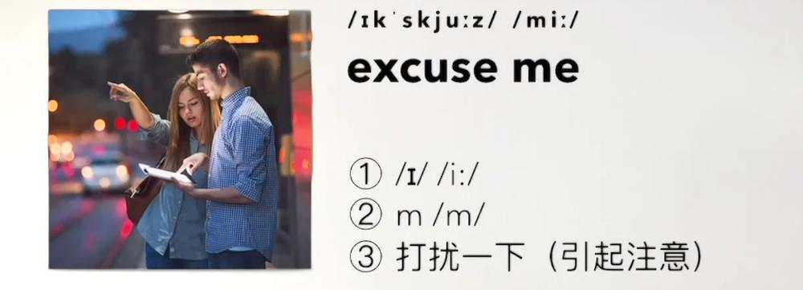
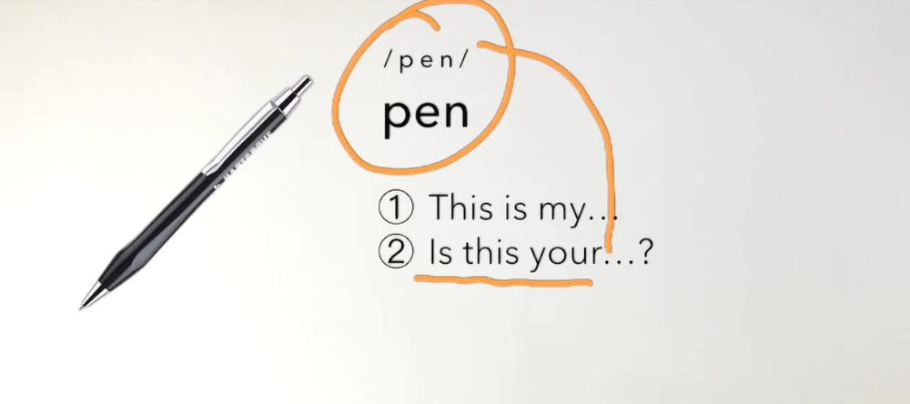
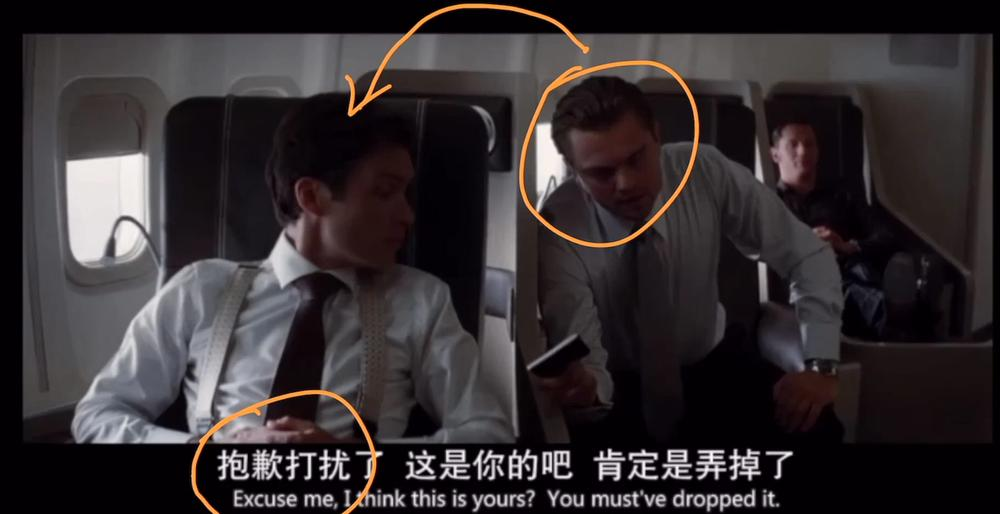
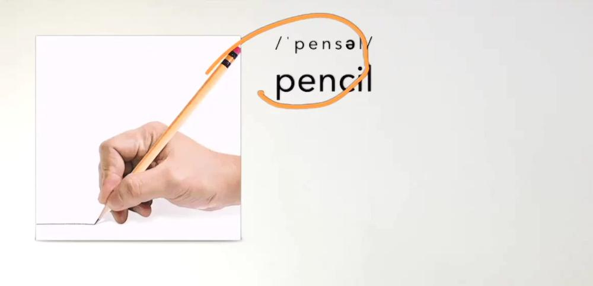

# 15张样卡

来源为三课已通过完整来源试点的实际Anki渲染；包含四张带图样例。整套其余课仍未完成全量来源独审。

## 1 · 新概念英语第一册::L001 · NCE-词汇

正面：

excuse

/ɪkˈskjuːz/

背面：

excuse

/ɪkˈskjuːz/

v. 原谅；宽恕

搭配

excuse me：打扰一下；借过

Excuse me! 打扰一下！

讲解

动词末尾读/z/；本课以excuse me表示打扰前的礼貌表达。  <small>问路图帮助理解excuse me引起注意；音标及/m/文字与讲解对应。</small>

第一册 L001 · 单词 · 00:32 <a href="https://www.bilibili.com/video/BV1xa411J7jJ?p=3&t=32">B站回看</a>

## 2 · 新概念英语第一册::L001 · NCE-词汇

正面：

原谅；宽恕

v. · 根据句子写出本课单词

_____ me! <small>（目标词以e开头，共6个字母）</small>

背面：

excuse

/ɪkˈskjuːz/

v. 原谅；宽恕

搭配

excuse me：打扰一下；借过

Excuse me! 打扰一下！

讲解

动词末尾读/z/；本课以excuse me表示打扰前的礼貌表达。  <small>问路图帮助理解excuse me引起注意；音标及/m/文字与讲解对应。</small>

第一册 L001 · 单词 · 00:32 <a href="https://www.bilibili.com/video/BV1xa411J7jJ?p=3&t=32">B站回看</a>

## 3 · 新概念英语第一册::L001 · NCE-词汇

正面：

me

/miː/

背面：

me

/miː/

pron. 我（宾格）

搭配

excuse me

Excuse me! 打扰一下！

讲解

教材OCR的/mɪː/已按视觉笔记/miː/纠正。  <small>问路图帮助理解excuse me引起注意；音标及/m/文字与讲解对应。</small>

第一册 L021文字补充（待独审）
<b>例句</b>：Give me a pen. <b>例句译文</b>：给我一支笔。

第一册 L001 · 单词 · 00:32 <a href="https://www.bilibili.com/video/BV1xa411J7jJ?p=3&t=32">B站回看</a> 第一册 L021 · 021 单词 语法 文章 · 02:39 <a href="https://www.bilibili.com/video/BV1xa411J7jJ?p=30&t=159">B站回看</a>

## 4 · 新概念英语第一册::L001 · NCE-词汇

正面：

我（宾格）

pron. · 根据句子写出本课单词

Excuse _____! <small>（目标词以m开头，共2个字母）</small>

背面：

me

/miː/

pron. 我（宾格）

搭配

excuse me

Excuse me! 打扰一下！

讲解

教材OCR的/mɪː/已按视觉笔记/miː/纠正。  <small>问路图帮助理解excuse me引起注意；音标及/m/文字与讲解对应。</small>

第一册 L021文字补充（待独审）
<b>例句</b>：Give me a pen. <b>例句译文</b>：给我一支笔。

第一册 L001 · 单词 · 00:32 <a href="https://www.bilibili.com/video/BV1xa411J7jJ?p=3&t=32">B站回看</a> 第一册 L021 · 021 单词 语法 文章 · 02:39 <a href="https://www.bilibili.com/video/BV1xa411J7jJ?p=30&t=159">B站回看</a>

## 5 · 新概念英语第一册::L002 · NCE-词汇

正面：

pen

/pen/

背面：

pen

/pen/

n. 钢笔

搭配

my pen；your pen

This is my pen. 这是我的钢笔。

讲解

本课先说肯定句，再把名词填入Is this your...?练口语。  <small>钢笔插图、pen圈画及指向句型空位的弯箭头说明名词替换。</small>

第一册 L002 · 单词 练习 · 01:11 <a href="https://www.bilibili.com/video/BV1xa411J7jJ?p=5&t=71">B站回看</a>

## 6 · 新概念英语第一册::L002 · NCE-问答

正面：

本课说怎样把“懂语法”练成“张嘴就说”？

背面：

本课说怎样把“懂语法”练成“张嘴就说”？

反复做句型替换和口头练习。

讲解

把名词填入熟悉句型，减少每次开口逐条想规则；不把“大脑拒绝语法”当成严格科学结论。

第一册 L002 · 单词 练习 · 01:01 <a href="https://www.bilibili.com/video/BV1xa411J7jJ?p=5&t=61">B站回看</a>

## 7 · 新概念英语第一册::L002 · NCE-填空

正面：

想夸对方外套好看，本课的简洁表达：[n开头的四字母形容词] coat!

背面：

想夸对方外套好看，本课的简洁表达：Nice coat!

讲解

Nice + 要夸的事物，可作为轻松闲聊的开场。

第一册 L002 · 单词 练习 · 04:57 <a href="https://www.bilibili.com/video/BV1xa411J7jJ?p=5&t=297">B站回看</a>

## 8 · 新概念英语第一册::L002 · NCE-词汇

正面：

钢笔

n. · 根据句子写出本课单词

This is my _____. <small>（目标词以p开头，共3个字母）</small>

背面：

pen

/pen/

n. 钢笔

搭配

my pen；your pen

This is my pen. 这是我的钢笔。

讲解

本课先说肯定句，再把名词填入Is this your...?练口语。  <small>钢笔插图、pen圈画及指向句型空位的弯箭头说明名词替换。</small>

第一册 L002 · 单词 练习 · 01:11 <a href="https://www.bilibili.com/video/BV1xa411J7jJ?p=5&t=71">B站回看</a>

## 9 · 新概念英语第一册::L001 · NCE-问答

正面：

excuse me中的/ɪ/与/iː/，哪一个是长元音？

背面：

excuse me中的/ɪ/与/iː/，哪一个是长元音？

/iː/

讲解

课上对比/ɪ/与/iː/；长音符号ː写在元音后面。  <small>问路图帮助理解excuse me引起注意；音标及/m/文字与讲解对应。</small>

第一册 L001 · 单词 · 00:39 <a href="https://www.bilibili.com/video/BV1xa411J7jJ?p=3&t=39">B站回看</a>

## 10 · 新概念英语第一册::L002 · NCE-问答

正面：

新概念第一册的偶数课，紧接奇数课主要练什么？

背面：

新概念第一册的偶数课，紧接奇数课主要练什么？

把前一课的语法用于替换和口头练习。

讲解

本课以L001的一般疑问句为例；练习时需要张开嘴回答。

第一册 L002 · 单词 练习 · 01:13 <a href="https://www.bilibili.com/video/BV1xa411J7jJ?p=5&t=73">B站回看</a>

## 11 · 新概念英语第一册::L001 · NCE-问答

正面：

me中的字母m通常对应哪个辅音？

背面：

me中的字母m通常对应哪个辅音？

/m/

讲解

闭上双唇，气流从鼻腔通过；是鼻音。  <small>问路图帮助理解excuse me引起注意；音标及/m/文字与讲解对应。</small>

第一册 L001 · 单词 · 01:14 <a href="https://www.bilibili.com/video/BV1xa411J7jJ?p=3&t=74">B站回看</a>

## 12 · 新概念英语第一册::L002 · NCE-问答

正面：

把学到的物品名词填入本课哪个句型，可练“这是你的吗”？

背面：

把学到的物品名词填入本课哪个句型，可练“这是你的吗”？

Is this your ...?

讲解

your后面接名词；前一课已单独讲过is提前规则，此处考本课替换操作。  <small>钢笔插图、pen圈画及指向句型空位的弯箭头说明名词替换。</small>

第一册 L002 · 单词 练习 · 01:53 <a href="https://www.bilibili.com/video/BV1xa411J7jJ?p=5&t=113">B站回看</a>

## 13 · 新概念英语第一册::L001 · NCE-问答

正面：

想引起陌生人的注意、先打扰一下，用什么表达？

背面：

想引起陌生人的注意、先打扰一下，用什么表达？

Excuse me.

讲解

本课第一个开场问题。问路或打断前先用礼貌表达。  <small>问路图帮助理解excuse me引起注意；音标及/m/文字与讲解对应。</small>  <small>原电影图的橙色圈画和箭头强调说话者引起听者注意。</small>

第一册 L001 · 单词 · 01:28 <a href="https://www.bilibili.com/video/BV1xa411J7jJ?p=3&t=88">B站回看</a>

## 14 · 新概念英语第一册::L002 · NCE-词汇

正面：

pencil

/ˈpensəl/

背面：

pencil

/ˈpensəl/

n. 铅笔

搭配

my pencil；your pencil

This is my pencil. 这是我的铅笔。

讲解

课上给肯定句和一般疑问句练习。  <small>手持铅笔插图与pencil词形、音标对应。</small>

第一册 L002 · 单词 练习 · 02:22 <a href="https://www.bilibili.com/video/BV1xa411J7jJ?p=5&t=142">B站回看</a>

## 15 · 新概念英语第一册::L002 · NCE-词汇

正面：

铅笔

n. · 根据句子写出本课单词

This is my _____. <small>（目标词以p开头，共6个字母）</small>

背面：

pencil

/ˈpensəl/

n. 铅笔

搭配

my pencil；your pencil

This is my pencil. 这是我的铅笔。

讲解

课上给肯定句和一般疑问句练习。  <small>手持铅笔插图与pencil词形、音标对应。</small>

第一册 L002 · 单词 练习 · 02:22 <a href="https://www.bilibili.com/video/BV1xa411J7jJ?p=5&t=142">B站回看</a>

