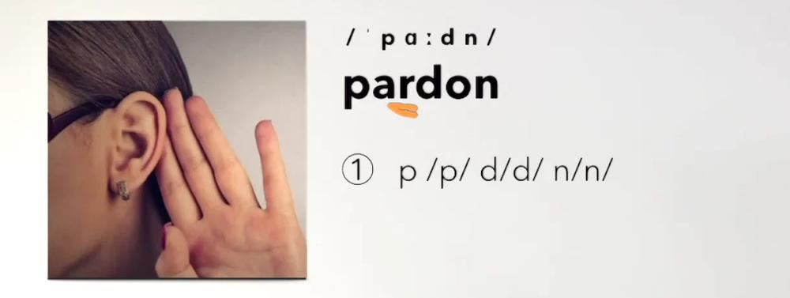
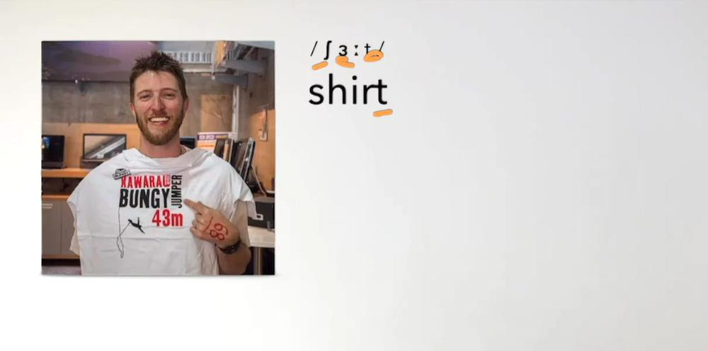
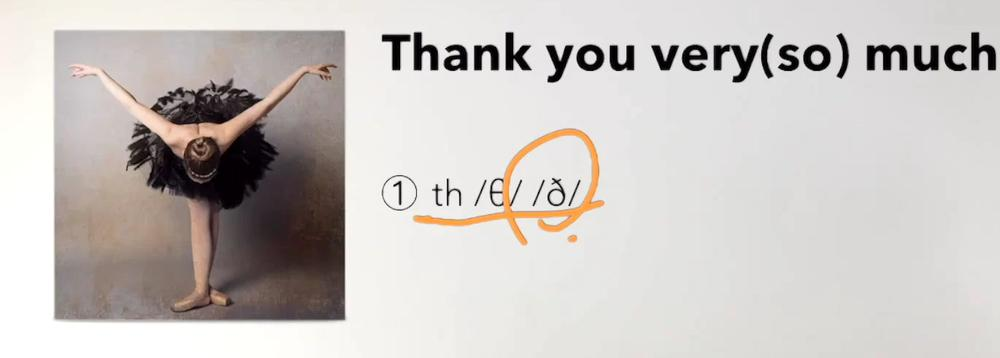
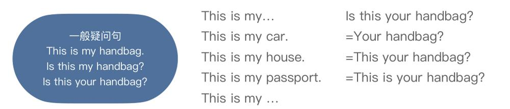
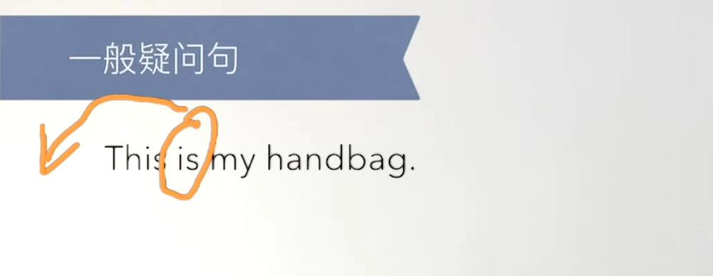
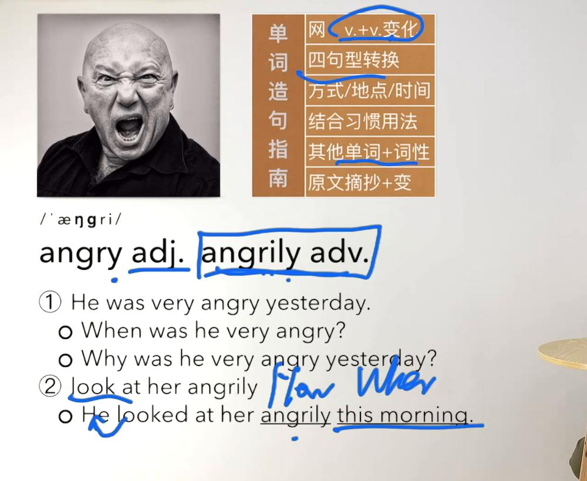

# 三课试点：15 张样卡

状态：草稿；技术导入通过，内容与画面覆盖仍在审计。

以下正反面来自官方 Anki 后端的实际渲染。TTS 按钮在文档中只作标记；导入 Anki 后使用设备英语语音。

## 1. 新概念英语第一册::L001 · NCE-词汇 · B1-L001-006

**正面**

没听清楚时：请再说一遍

int. · 根据句子写出本课单词

_____? <small>（目标词以p开头，共6个字母）</small>

**背面**

pardon

/ˈpɑːdn/

int. 没听清楚时：请再说一遍

搭配

Pardon?；I beg your pardon.

Pardon? 请再说一遍？

讲解

Pardon?是I beg your pardon.的省略形式（教材注释）；用升调请求重复。  <small>手放耳边的倾听图辅助Pardon?请求重复，旁列本词辅音提示。</small>

第一册 L001 · 单词 · 09:11 <a href="https://www.bilibili.com/video/BV1xa411J7jJ?p=3&t=551">B站回看</a>

## 2. 新概念英语第一册::L002 · NCE-问答 · B1-L002-038

**正面**

shirt与T-shirt在本课分别指什么？

**背面**

shirt与T-shirt在本课分别指什么？

衬衫；T恤。

讲解

按衣服种类区分。 本课教材shirt取衬衫义，原配图人物实穿T恤，仅作穿衣场景；T-shirt更具体指T恤，不以该图做看图说shirt。  <small>原照片人物实际穿T恤，shirt在教材中取衬衫义；不以该照片严格示范看图说shirt。</small>

第一册 L002 · 单词 练习 · 10:02 <a href="https://www.bilibili.com/video/BV1xa411J7jJ?p=5&t=602">B站回看</a>

## 3. 新概念英语第一册::L001 · NCE-填空 · B1-L001-044

**正面**

非常感谢你：Thank you [s开头的两字母程度词] much.

**背面**

非常感谢你：Thank you so much.

讲解

本课给出的另一种加强感谢表达；提示只限定拼写，不直接给出答案。  <small>鞠躬图辅助感谢语境；原图圈画/θ/与/ð/的发音对照，正文用规范IPA。</small>

第一册 L001 · 单词 · 13:40 <a href="https://www.bilibili.com/video/BV1xa411J7jJ?p=3&t=820">B站回看</a>

## 4. 新概念英语第一册::L002 · NCE-问答 · B1-L002-024

**正面**

shirt中的sh在本词中读什么辅音？

**背面**

shirt中的sh在本词中读什么辅音？

/ʃ/

讲解

记录本词对应音值，不把单词中一次出现概括成无例外的拼读规律。  <small>原照片人物实际穿T恤，shirt在教材中取衬衫义；不以该照片严格示范看图说shirt。</small>

第一册 L002 · 单词 练习 · 09:46 <a href="https://www.bilibili.com/video/BV1xa411J7jJ?p=5&t=586">B站回看</a>

## 5. 新概念英语第一册::L000 开篇与课前准备 · NCE-问答 · B1-L000-001

**正面**

开篇指定的逐句跟读怎样进行？

**背面**

开篇指定的逐句跟读怎样进行？

播放一句，暂停，短暂回想后尽量模仿；不满意就倒回再听再读。

讲解

不是必须与录音同步不停说，也不是听完全文才从头读。

第一册 L000 · 开篇 · 07:30 <a href="https://www.bilibili.com/video/BV1xa411J7jJ?p=1&t=450">B站回看</a>

## 6. 新概念英语第一册::L041 · NCE-词汇 · B1-L041-010

**正面**

奶酪；干酪

n. · 根据句子写出本课单词

There is some _____ on the table. <small>（以c开头，共6字母）</small>

**背面**

cheese

/tʃiːz/

n. 奶酪；干酪

There is some cheese on the table. 桌上有一些奶酪。

讲解

按本课材料／物质义作为不可数名词；完整存在句为补充例句。

第二册 L006文字补充（待独审）
<b>搭配</b>：a piece of cheese <b>例句</b>：He put a piece of cheese in his pocket. <b>例句译文</b>：他把一块奶酪放进口袋。

第一册 L041 · 041 语法 单词 文章 · 07:00 <a href="https://www.bilibili.com/video/BV1xa411J7jJ?p=55&t=420">B站回看</a> 第二册 L006 · L006 文章 · 03:40 <a href="https://www.bilibili.com/video/BV1cu411r7pw?p=22&t=220">B站回看</a>

## 7. 新概念英语第一册::L069 · NCE-填空 · B1-L069-025

**正面**

获胜词形：动词win；获胜者[w开头，共6字母]（双写n）；Who is the winner?；an exciting finish。

**背面**

获胜词形：动词win；获胜者winner（双写n）；Who is the winner?；an exciting finish。

讲解

名词finish在此比赛结尾，不逐字当完成这个动词。

第一册 L069 · 069 语法 单词 · 11:31 <a href="https://www.bilibili.com/video/BV1xa411J7jJ?p=92&t=691">B站回看</a>

## 8. 新概念英语第一册::L119 · NCE-问答 · B1-L119-014

**正面**

在示例“This thief is taller than that one.”中，thief表示什么？

**背面**

在示例“This thief is taller than that one.”中，thief表示什么？

小偷；贼

讲解

<b>音标</b>：/θiːf/ <b>词性</b>：n. <b>讲解</b>：单数thief /θiːf/，复数thieves /θiːvz/。

This thief is taller than that one. 这个小偷比那个高。

第一册 L119 · 119 单词 语法 · 15:37 <a href="https://www.bilibili.com/video/BV1xa411J7jJ?p=164&t=937">B站回看</a>

## 9. 新概念英语第一册::L001 · NCE-填空 · B1-L001-050

**正面**

把This is my handbag.改为一般疑问句：[...] this my handbag?

**背面**

把This is my handbag.改为一般疑问句：Is this my handbag?

讲解

本句把be动词is移到主语this前面，句首大写，末尾问号。   <small>橙圈标出is，弯箭头指向句首，示意be提前；my是否换your仍由语境决定。</small>

第一册 L001 · 语法 文章 · 02:51 <a href="https://www.bilibili.com/video/BV1xa411J7jJ?p=4&t=171">B站回看</a>

## 10. 新概念英语第一册::L121 · NCE-问答 · B1-L121-017

**正面**

定语从句的核心作用是什么？

**背面**

定语从句的核心作用是什么？

用一个从句修饰／限定人或事物的名词。

讲解

与宾语从句充当宾语、时间从句说明时间相区分。

第一册 L121 · 121 123 语法 · 05:18 <a href="https://www.bilibili.com/video/BV1xa411J7jJ?p=168&t=318">B站回看</a>

## 11. 新概念英语第一册::L002 · NCE-词汇 · B1-L002-009

**正面**

shirt

/ʃɜːt/

🔊

**背面**

shirt

/ʃɜːt/

n. 衬衣；衬衫

搭配

my shirt；your shirt

This is my shirt. 这是我的衬衫。

讲解

不要与T-shirt（T恤）混淆。 本课教材shirt取衬衫义，原配图人物实穿T恤，仅作穿衣场景；T-shirt更具体指T恤，不以该图做看图说shirt。  <small>原照片人物实际穿T恤，shirt在教材中取衬衫义；不以该照片严格示范看图说shirt。</small>

第一册 L002 · 单词 练习 · 09:44 <a href="https://www.bilibili.com/video/BV1xa411J7jJ?p=5&t=584">B站回看</a>

## 12. 新概念英语第一册::L046 · NCE-词汇 · B1-L046-015

**正面**

thousand

/ˈθauznd/

🔊

**背面**

thousand

/ˈθauznd/

num. 千

There are a thousand books. 有一千本书。

讲解

教材数量标注；完整句为补充例句。

第一册 L046 · 教材 · 页[]（视频仅对应本课，未定位精确时间） <a href="https://www.bilibili.com/video/BV1xa411J7jJ?p=61">B站回看</a>

## 13. 新概念英语第二册::L000 开篇与课前准备 · NCE-问答 · B2-L000-001

**正面**

本课所说的习惯用法除俚语外，还包括什么？

**背面**

本课所说的习惯用法除俚语外，还包括什么？

固定搭配、常用表达及经常一起出现的词组。

讲解

学习词汇时把这些组合连同使用情境一起练。

第二册 L000 · 开篇 · 03:00 <a href="https://www.bilibili.com/video/BV1cu411r7pw?p=1&t=180">B站回看</a>

## 14. 新概念英语第二册::L001 · NCE-词汇 · B2-L001-009

**正面**

angrily

/ˈæŋɡrɪli/

🔊

**背面**

angrily

/ˈæŋɡrɪli/

adv. 愤怒地

搭配

look at her angrily

He looked at her angrily this morning. 他今天早晨愤怒地看着她。

讲解

由angry变y为i再加ly；不是所有形容词都按此方式变副词。音标补核ECDICT。  <small>愤怒人物图对应angry；蓝框区分angrily副词，手写How/When分别对方式angrily和时间this morning提问。</small>

第二册 L001 · 单词讲解造句 · 14:11 <a href="https://www.bilibili.com/video/BV1cu411r7pw?p=3&t=851">B站回看</a>

## 15. 新概念英语第二册::L071 · NCE-词汇 · B2-L071-005

**正面**

天文台；观测站

n. · 根据句子写出本课单词

He is planning to visit the _____ tonight. <small>（以o开头，共11字母）</small>

**背面**

observatory

/әbˈzәːvәtәri/

n. 天文台；观测站

He is planning to visit the observatory tonight. 他计划今晚参观天文台。

第二册 L071 · 071 单词 · 09:04 <a href="https://www.bilibili.com/video/BV1XA4y1o72C?p=87&t=544">B站回看</a>

