# 第2章 细胞生物学研究方法 · 第三节 细胞培养与细胞工程

[返回本章](../README.md) · [中文本章原文](../中文原文.md)

<!-- BEGIN CN CN02-S03 -->
## 第三节 细胞培养与细胞工程

## 一、细胞培养

细胞培养是当前细胞生物学乃至整个生命科学研究与生物工程中最基本的实验技术。干细胞生物学的发展及其应用在很大程度上基于细胞培养技术的发展。细胞培养包括原核生物细胞（如大肠杆菌）、真核单细胞（如酵母菌、四膜虫）、植物细胞与动物细胞的培养以及与此密切相关的病毒的培养。本节扼要介绍动植物细胞培养技术以及与细胞培养直接相关的一些技术。

## （一）动物细胞培养

体外培养的动物细胞可分为原代细胞（primary culture cell）与传代细胞（subculture cell）。原代细胞是指从机体取出后立即培养的细胞，进行传代培养后的细胞即称为传代细胞。也有人把传至10代以内的细胞统称为原代细胞培养。适应在体外培养条件下持续传代培养的细胞称为传代细胞。

任何动物细胞的培养均需从原代细胞培养做起。动物很多组织的细胞，如幼年动物的肾、肺、卵巢、精巢、肌肉及肿瘤等组织的细胞较易培养，而神经细胞等则较难培养。原代细胞培养步骤如下：首先取出健康动物的组织块，剪碎，用浓度与活性适中的胰酶或胶原酶与EDTA（螯合剂）等将细胞连接处消化使其分散，给予良好的营养液与无菌的培养环境（接近体温与体内pH），在培养中进行静置或慢速转动培养。但不论用何种培养液一般都要加一定量的小牛（或胎牛）血清，这样细胞才能很好地贴壁生长与分裂（图2-28A）。

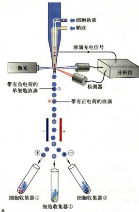

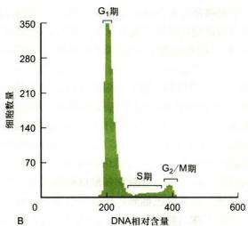  
图2-27 流式细胞仪的工作原理  
A. 流式细胞仪分选原理示意图。B. 显示流式细胞仪分析处在不同时相的 HeLa 细胞的实验结果。(B 图由杜立颖惠赠)

分散的细胞悬液在培养瓶中很快（在几十分钟至数小时内）就贴附在瓶壁上，称为细胞贴壁。分散呈圆球形的细胞一经贴壁就迅速铺展并开始有丝分裂，逐渐形成致密的细胞单层，称为单层细胞（single layer cell），这种培养方法称为单层细胞培养。

原代培养的细胞一般传至10代左右就不易传下去了，细胞生长出现停滞，大部分细胞衰老死亡，但有极少数细胞可能渡过“危机”而传下去。这些存活的细胞一般又可顺利地传40\~50代次，并且仍保持原来染色体的二倍体数量及接触抑制的行为，很多学者把这种传代细胞称作细胞系（cell line）。一般情况下（胚胎干细胞等除外），当细胞传至50代以后又要出现“危机”，难以再传下去。这种传代次数有限的体外培养细胞通常称为有限细胞系（finite cell line）。但在传代过程中如有部分细胞发生了遗传突变，并使其带有癌细胞的特点，有可能在培养条件下无限制地传代培养下去，这种传代细胞称为永生细胞系（infinite cell line），或连续细胞系（continuous cell line）。该细胞系细胞的根本特点是染色体明显改变，一般呈亚二倍体或非整倍体，失去接触抑制，容易传代培养。HeLa细胞系（来自宫颈瘤细胞）、BHK21（baby hamster kidney）细胞系与CHO（Chinese hamster ovany）细胞系等都是常用的连续细胞系（图2-28B、C）。依靠这些细胞系做了大量卓有成效的研究工作。

用单细胞克隆培养或通过药物筛选的方法从某一细胞系中分离出单个细胞，并由此增殖形成的、具有基本相同的遗传性状的细胞群体称为细胞克隆。该细胞群体经过生物学鉴定，如具有特殊的遗传标记或性质，这样的细胞系可以称为细胞株（cell strain）。

体外培养的细胞，不论是原代细胞还是传代细胞，一般不能保持体内原有的细胞形态。但大体可以分为两种基本形态：成纤维样细胞（fibroblast like cell）与上皮样细胞（epithelial like cell）。此外还有一些可移动的游走细胞。

某些传代细胞还可用悬浮方法培养。其培养条件比较复杂，悬浮培养的最大优点是在有限的培养液中获得大量细胞。

## （二）植物细胞培养

目前植物细胞培养主要有两种类型：

（1）细胞培养 常用单倍体细胞培养，这种培养方法主要用花药在人工培养基上进行培养。可以从小孢子（雄性生殖细胞）直接发育成胚状体，然后长成单倍体植株。单倍体细胞培养在植物育种中已取得了很大成就。

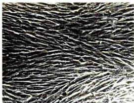

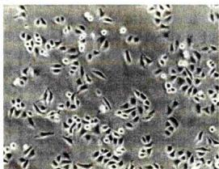

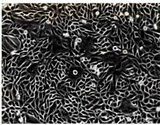  
图2-28 体外培养的细胞  
A. 长满单层的牛肾原代细胞。B. 正在生长分裂的 HeLa 细胞。C. 长满单层的 CHO 原代细胞。（任显辉博士和邱殷庆博士惠赠）

(2) 原生质体培养 一般用植物的体细胞（二倍体细胞），先经纤维素酶处理去掉细胞壁，去壁的细胞称为原生质体（protoplast）。原生质体在无菌培养基中可以生长与分裂，经过诱导分化最终可长成植株。也可以用不同植物的原生质体进行融合与体细胞杂交，由此而获得体细胞杂交的植株。转基因植物细胞的培养与分化的研究是植物基因工程的基础。

目前在植物无性繁殖中常采用植物组织培养，即分离出小块的植物体，又称外殖体（explant），在体外无菌条件下进行培养，形成愈伤组织（callus），即植物创面的新生组织。在一定条件下，诱导分化最终长成植株。

## 二、细胞工程

细胞工程是生物工程的重要领域之一。细胞工程所涉及的主要技术包括细胞培养、细胞分化的定向诱导、细胞融合和显微注射等。通过细胞融合技术发展起来的单克隆抗体技术已取得了重大成就。细胞工程与基因工程结合，前景尤为广阔。

## （一）细胞融合与单克隆抗体技术

两个或多个细胞融合成一个双核或多核细胞的现象称为细胞融合（cell fusion）。介导动物细胞融合常用的促融剂有灭活的病毒（如仙台病毒）或化学物质（如聚乙二醇，PEG）；植物细胞融合时，要先用纤维素酶去掉细胞壁，然后才便于原生质体融合。20世纪80年代又发明了电融合技术（electrofusion method）。将悬浮细胞在低压交流电场中聚集成串珠状细胞群，或对相互接触的单层培养细胞，再施加高压电脉冲处理使其融合。

1975年，英国科学家C. Milstein和G.J.F.Köhler将产生抗体的淋巴细胞同肿瘤细胞融合，成功地建立了B.淋巴细胞杂交瘤技术（B-lymphocyte hybridoma technique）用于制备单克隆抗体（monoclonal antibody），他们因此而获得1984年的诺贝尔生理学或医学奖。动物受到外界抗原刺激后可激发B.淋巴细胞活化，产生相应的抗体，但B.淋巴细胞在体外难以增殖，而一些骨髓瘤细胞[TK（胸苷激酶）或HGPRT（次黄嘌呤鸟嘌呤磷酸核糖）缺陷型]不分泌抗体，但在体外培养条件下可以无限传代。为了大量制备纯一的单克隆抗体，Milstein和Köhler把小鼠骨髓瘤细胞与经绵羊红细胞免疫过的小鼠脾细胞（B淋巴细胞）在聚乙二醇或灭活的病毒的介导下发生融合。融合后的杂交瘤细胞具有两种亲本细胞的特性，一方面可分泌抗绵羊红细胞的抗体，另一方面像肿瘤细胞一样，可在体外培养条件下或移植到体内无限增殖。由于骨髓瘤细胞缺乏TK或HGPRT，在含氨基蝶呤的培养液内不能成活。只有融合细胞才能在含HAT（次黄嘌呤、氨基蝶呤和胸腺嘧啶核苷）的培养液内通过旁路合成核酸而得以生存。通过HAT选择培养和细胞克隆，可以获得能大量分泌单克隆抗体的杂交瘤细胞株。单克隆抗体的制备过程如图2-29所示。

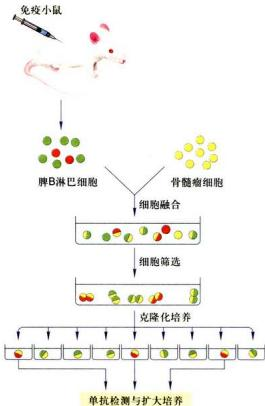  
图2-29 单克隆抗体制备过程示意图

单克隆抗体技术最主要的优点是可以用混合性的异质抗原制备出针对某单一性抗原分子上特异决定簇的同质性单克隆抗体。单克隆抗体技术与基因克隆技术相结合为分离和鉴定新的蛋白质和基因开辟了一条广阔途径。而且在临床诊断与肿瘤等疾病的治疗中也具有重要作用。

## （二）显微操作技术与动物的克隆

真核细胞是由细胞核和细胞质两大部分组成的，为了探明核质相互作用的机制，科学家们创建了细胞拆合技术。所谓细胞拆合，就是把细胞核与细胞质分离开来，然后把不同来源的胞质体（cytoplast）和核质体（karyoplast）相互组合，形成核质杂交细胞。

细胞拆合可以分为物理法和化学法两种类型。物理法就是用机械方法或短波光把细胞核去掉或使之失活，然后用微吸管吸取其他细胞的核，注入去核的细胞质中，组成新的杂交细胞。这种核移植必须用显微操纵仪进行操作。化学法是用细胞松弛素B（cytochalasin B）处理细胞，细胞出现排核现象，再结合离心技术，将细胞拆分为核质体和胞质体两部分。显微操作（micromanipulation）技术是早期建立的一种实验胚胎学技术，即在显微镜下，用显微操作装置对细胞进行解剖和微量注射（microinjection）的技术。现在显微操作装置的设计愈来愈精密，不仅用于核移植，而且亦可对细胞核进行解剖和向核内注入基因（图2-30）。

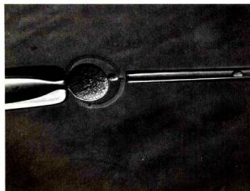  
图2-30 应用显微注射技术进行细胞核移植（邓宏魁博士提供）

细胞拆合、显微注射与现代分子生物学技术相结合使这些经典的胚胎学技术展现出极大的潜力，它不仅成为核质关系、细胞内某种 mRNA 或蛋白质功能等基础研究的重要手段，而且在转基因动物、高等动物的克隆方面的理论与实践研究中取得了重大的突破。

<!-- END CN CN02-S03 -->

---

## 对应英文内容

### 英文补充：细胞培养、细胞系与杂交瘤单克隆抗体

> 对应中文板块：细胞培养、细胞系与杂交瘤单克隆抗体。英文来源：Molecular Biology of the Cell，第7版，第8章；[本章完整原文](../../来源/英文教材/08_Analyzing_Cells_Molecules_and_Systems/chapter.md)。物理PDF页码范围：514–601（整章范围）。

<!-- BEGIN EN EN08-H000-H006 -->
WAYS OF WORKING WITH CELLS

#### Analyzing Cells, Molecules, and Systems

Progress in science is often driven by advances in technology. The entire field of cell biology, for example, came into being when optical craftsmen learned to grind small lenses of sufficiently high quality to observe cells and their substructures. Innovations in lens grinding, rather than any conceptual or philosophical advance, allowed Hooke and van Leeuwenhoek to discover a previously unseen cellular world, where tiny creatures tumble and twirl in a droplet of water (**Figure 8–1**).

The twenty-first century is a particularly exciting time for biology. New methods for analyzing cells, proteins, DNA, and RNA are fueling an information explosion and allowing scientists to study cells and their macromolecules in previously unimagined ways. We now have access to the sequences of many billions of nucleotides, providing the complete molecular blueprints for hundreds of organisms—from microbes and mustard weeds to worms, flies, mice, dogs, chimpanzees, and humans. And powerful new techniques are helping us to decipher that information, allowing us not only to compile huge, detailed catalogs of genes and proteins but also to begin to unravel how these components work together to form functional cells and organisms. The long-range goal is nothing short of obtaining a complete understanding of what takes place inside a cell as it responds to its environment and interacts with its neighbors.

In this and the following chapter, we present some of the principal methods used to study cells and their molecular components. Chapter 9 describes the remarkable advances in microscopy that have helped fuel our understanding of the structure and function of cells. In this chapter, we first discuss the rapidly developing methods for analysis of the molecules and genes that drive cell behavior. We present the techniques used to determine protein structure, function, and interactions, and we discuss the breakthroughs in DNA technology that continue to revolutionize our understanding of cell function. We end the chapter with an overview of some of the mathematical approaches that are helping us understand the enormous complexity of cells. By considering cells as dynamic systems with many moving parts, mathematical approaches can reveal hidden insights into

C HAP T E R

#### IN THIS CHAPTER

Isolating Cells and Growing Them in Culture

Purifying Proteins

Analyzing Proteins

Analyzing and Manipulating DNA

Studying Gene Function and Expression

Mathematical Analysis of Cell Function

how the many components of cells work together to produce the special qualities of life.

#### ISOLATING CELLS AND GROWING THEM IN CULTURE

As described in Chapter 1, numerous model organisms are used by researchers to unravel the molecular basis of cell biology. In the first section of this chapter, we concern ourselves with the organisms and cells best suited for biochemical studies of proteins in the cell. Typically, we gain access to these proteins by obtaining large numbers of cells and physically breaking them open. Unicellular organisms, such as bacteria and yeast, are easy to produce in large amounts in the laboratory and are rich sources of the proteins involved in fundamental cell processes. But a deep understanding of human proteins in specific cell types requires human cells, or at the very least cells from a mammal. Specific animal tissues can be a useful solution, but these tend to be composed of a heterogeneous mixture of cell types. To obtain as much information as possible about specific cell types in a tissue, biologists have developed ways of dissociating cells from tissues and separating them according to type. These manipulations result in a relatively homogeneous population of cells that can then be analyzed—either directly or after their number has been greatly increased by allowing the cells to proliferate in culture.

#### Cells Can Be Isolated from Tissues and Grown in Culture

Intact tissues provide the most realistic source of material, as they represent the actual cells found within the body. For some biochemical preparations, the protein of interest can be obtained in sufficient quantity without having to separate the tissue or organ into cell types. Examples include the preparation of histones from calf thymus, actin from rabbit muscle, or tubulin from cow brain. For the majority of proteins, however, tissues are not an ideal source and it is preferable to use specific cell types grown in culture. Cultured cells provide a more homogeneous population of cells from which to extract material, and they are also much more convenient to work with in the laboratory. Given appropriate surroundings, most animal cells can live, multiply, and even express differentiated properties in a culture dish. The cells can be watched continually under the microscope or analyzed biochemically, and the effects of adding or removing specific molecules, such as hormones or growth factors, can be systematically explored.

Experiments performed on cultured cells are sometimes said to be carried out in vitro (literally, “in glass”) to contrast them with experiments using intact organisms, which are said to be carried out in vivo (literally, “in the living organism”). These terms can be confusing, however, because they are often used in a very different sense by biochemists. In the biochemistry lab, in vitro refers to reactions carried out in a test tube in the absence of living cells, whereas in vivo refers to any reaction taking place inside a living cell, even if that cell is growing in culture.

Tissue culture began in 1907 with an experiment designed to settle a controversy in neurobiology. The hypothesis under examination was known as the neuronal doctrine, which proposed that each nerve fiber is the outgrowth of a single nerve cell and not the product of the fusion of many cells. To test this contention, small pieces of spinal cord were placed in lymphatic fluid in a warm, moist chamber and observed at regular intervals under the microscope. After a day or so, individual nerve cells could be seen extending long, thin filaments (axons) into the clot. Thus, the neuronal doctrine received strong support, and the foundation was laid for the cell-culture revolution.

These original experiments on nerve fibers used cultures of small tissue fragments called explants. Today, cultures are more commonly made from suspensions of cells dissociated from tissues. The first step in isolating individual cells is to disrupt the extracellular matrix and cell–cell junctions that hold the cells together. For this purpose, a tissue sample is typically treated with proteolytic enzymes (such as trypsin and collagenase) to digest proteins in the extracellular matrix and with agents (such as ethylenediaminetetraacetic acid, or EDTA) that bind, or chelate, the $\mathrm { C a ^ { 2 + } }$ on which cell–cell adhesion depends. The tissue can then be teased apart into single cells by gentle agitation.

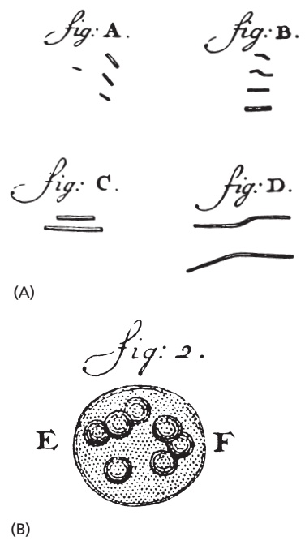

Figure 8–1 Microscopic life. A sample of “diverse animalcules” seen by van Leeuwenhoek using his simple microscope. (A) Bacteria seen in material he excavated from between his teeth. Those in fig. B he described as “swimming first forward and then backwards” (1692). (B) The eukaryotic green alga Volvox (1700). (Courtesy of the John Innes Foundation.)

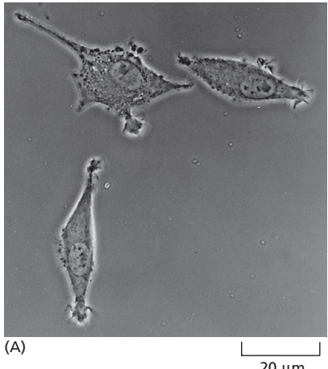

20 µm

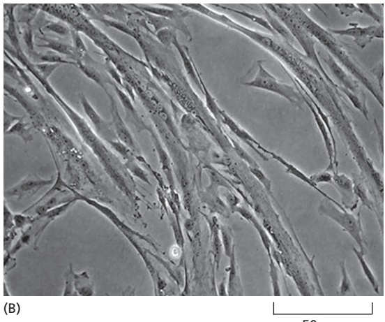

50 µm

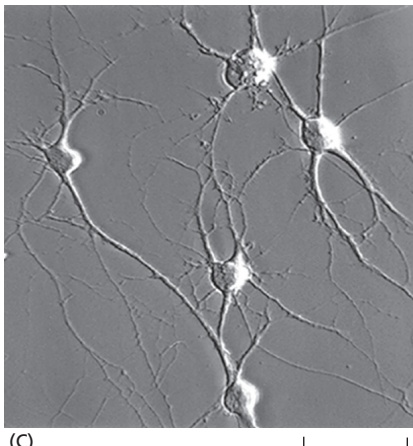

(C)

50 µm

Figure 8-2 Light micrographs of cells in culture. (A) Mouse fibroblasts. (B) Chick myoblasts fusing to form multinucleate muscle cells. (C) Purified rat retinal ganglion nerve cells. (D) Tobacco cells in liquid culture. (A, courtesy of Daniel Zicha; B, courtesy of Rosalind Zalin; C, from A. Meyer-Franke et al., Neuron 15:805–819, 1995. With permission from Elsevier; D, courtesy of Gethin Roberts.)

Unlike yeast, most tissue cells are not adapted to living suspended in fluid and require a solid surface on which to grow and divide. For cell cultures, this support is usually provided by the surface of a plastic culture dish. Cells vary in their requirements, however, and many do not proliferate or differentiate unless the culture dish is coated with materials that cells adhere to, such as polylysine or extracellular matrix components.

Cultures prepared directly from the tissues of an organism are called primary cultures. These can be made with or without an initial fractionation step to separate different cell types. In most cases, cells in primary cultures can be removed from the culture dish and recultured repeatedly in so-called secondary cultures; in this way, they can be repeatedly subcultured (passaged) for weeks or months. Such cells often display many of the differentiated properties appropriate to their origin (**Figure 8–2**): fibroblasts continue to secrete collagen; cells derived from embryonic skeletal muscle fuse to form muscle fibers that contract spontaneously in the culture dish; nerve cells extend axons that are electrically excitable and make synapses with other nerve cells; and epithelial cells form extensive sheets with many of the properties of an intact epithelium. Because these properties are maintained in culture, they are accessible to study in ways that are often not possible in intact tissues.

Cell culture is not limited to animal cells. When a piece of plant tissue is cultured in a sterile medium containing nutrients and appropriate growth regulators, many of the cells are stimulated to proliferate indefinitely in a disorganized manner, producing a mass of relatively undifferentiated cells called a callus. If the nutrients and growth regulators are carefully manipulated, one can induce the formation of a shoot and then root apical meristems within the callus, and,

Embryonic stem cells are an important cell type isolated from the early mammalian embryo. As described in Chapter 22, these cells are pluripotent; that is, they have the potential to differentiate into any cell type in the body. When cultured in the presence of the appropriate extracellular signaling factors and nutrients, stem cells can be directed to differentiate into a wide range of specific cell types. Under some conditions, it is even possible to stimulate these cells to assemble into three-dimensional multicellular structures that are miniature versions of certain organs, such as the gut. These organoids provide a powerful tool for the analysis of tissue function (see Chapter 22).

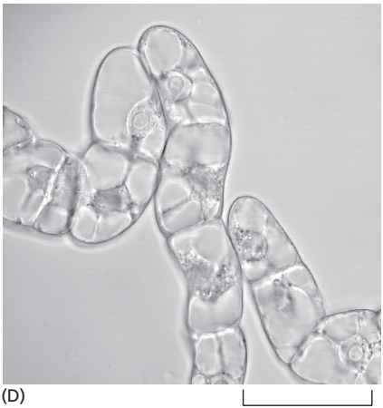

50 µm

\*Many of these cell lines were derived from tumors. All of them are capable of indefinite replication in culture and express at least some of the special characteristics of their cells of origin.

in many species, regenerate a whole new plant. Similar to animal cells, callus cultures can be dissociated into single cells, which will grow and divide as a suspension culture (see Figure 8–2D).

#### Eukaryotic Cell Lines Are a Widely Used Source of Homogeneous Cells

The cell cultures obtained by disrupting tissues tend to suffer from a problem— eventually the cells die. Most vertebrate cells stop dividing after a finite number of cell divisions in culture, a process called replicative cell senescence (discussed in Chapter 17). Normal human fibroblasts, for example, typically divide only 25–40 times in culture before they stop. In these cells, the limited proliferation capacity reflects a progressive shortening and uncapping of the cell’s telomeres, the repetitive DNA sequences and associated proteins that cap the ends of each chromosome (discussed in Chapter 5). Human somatic cells in the body have turned off production of the enzyme, called telomerase, that normally maintains the telomeres, which is why their telomeres shorten with each cell division. Human fibroblasts can often be coaxed to proliferate indefinitely by providing them with the gene that encodes the catalytic subunit of telomerase; in this case, they can be propagated as an immortalized cell line.

Some human cells, however, cannot be immortalized by this trick. Although their telomeres remain long, they still stop dividing after a limited number of divisions because culture conditions cause excessive stimulation of cell proliferation, which activates a poorly understood protective mechanism that stops cell division—a process sometimes called culture shock. To immortalize these cells, one has to do more than introduce telomerase. One must also inactivate the protective mechanisms, which can be done by introducing certain cancerpromoting oncogenes (discussed in Chapter 20).

Unlike human cells, most rodent cells do not turn off production of telomerase, and therefore their telomeres do not shorten with each cell division. Therefore, if culture shock can be avoided, some rodent cell types will divide indefinitely in culture. In addition, rodent cells often undergo spontaneous genetic changes in culture that inactivate their protective mechanisms, thereby producing immortalized cell lines.

Cell lines can often be most easily generated from cancer cells, but these cultures—referred to as transformed cell lines—differ from those prepared from normal cells in several ways. Transformed cell lines often grow without attaching to a surface, for example, and they can proliferate to a much higher density in a culture dish. Similar properties can be induced experimentally in normal cells by transforming them with a tumor-inducing virus or chemical. The resulting transformed cell lines can usually cause tumors if injected into a susceptible animal.

Transformed and nontransformed cell lines are extremely useful in cell research as sources of very large numbers of cells of a uniform type, especially because they can be stored in liquid nitrogen at –196°C for an indefinite period and retain their viability when thawed. It is important to keep in mind, however, that cell lines nearly always differ in important ways from their normal progenitors in the tissues from which they were derived.

Some widely used cell lines are listed in **Table 8–1**. Different lines have different advantages; for example, the PtK epithelial cell lines derived from the rat kangaroo remain flat during mitosis (unlike many other cell types), allowing the mitotic apparatus to be readily observed in action.

#### Hybridoma Cell Lines Are Factories That Produce Monoclonal Antibodies

As we see in this chapter and throughout this book, antibodies are particularly useful tools for cell biology. Their great specificity allows precise detection of selected proteins among the many thousands that each cell typically produces.

<table><tbody><tr><td colspan="2">TABLE 8-1 Some Commonly Used Cell Lines</td></tr><tr><td>Cell line*</td><td>Cell type and origin</td></tr><tr><td>NIH-3T3</td><td>Fibroblast (mouse)</td></tr><tr><td>MDCK</td><td>Kidney epithelial cell (dog)</td></tr><tr><td>HeLa</td><td>Cervical epithelial cell (human)</td></tr><tr><td>PtK</td><td>Kidney epithelial cell (rat kangaroo)</td></tr><tr><td>L6</td><td>Myoblast (rat)</td></tr><tr><td>PC12</td><td>Chromaffin cell (rat)</td></tr><tr><td>COS</td><td>Kidney fibroblast (monkey)</td></tr><tr><td>HEK293</td><td>Kidney epithelial cell (human)</td></tr><tr><td>CHO</td><td>Ovary epithelial cell (Chinese hamster)</td></tr><tr><td>RPE</td><td>Retinal pigment epithelial cell (human)</td></tr><tr><td>Vero</td><td>Kidney epithelial cell (African green monkey)</td></tr><tr><td>Jurkat</td><td>White blood cell (human)</td></tr></tbody></table>

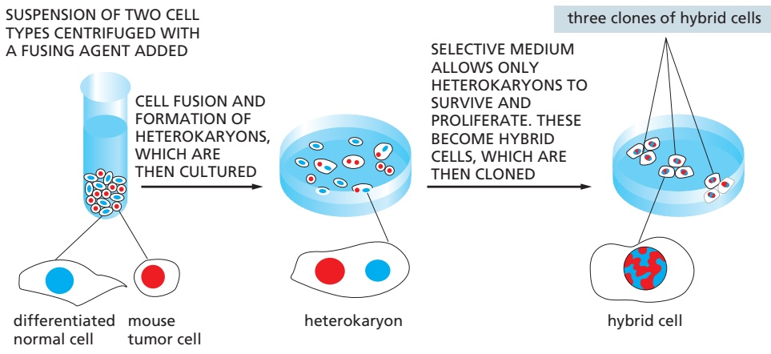

Figure 8–3 The production of hybrid cells. It is possible to fuse one cell with another to form a heterokaryon, a combined cell with two separate nuclei. Typically, a suspension of cells is treated with certain inactivated viruses or with polyethylene glycol, each of which alters the plasma membranes of cells in a way that induces them to fuse. Eventually, a heterokaryon proceeds to mitosis and produces a hybrid cell in which the two separate nuclear envelopes have been disassembled, allowing all the chromosomes to be brought together in a single large nucleus. Such hybrid cells can give rise to immortal hybrid cell lines. If one of the parent cells was from a tumor cell line, the hybrid cell is called a hybridoma.

Antibodies are often produced by inoculating animals with the protein of interest and subsequently isolating the antibodies specific to that protein from the serum of the animal. However, only limited quantities of antibodies can be obtained from a single inoculated animal, and the polyclonal antibodies produced will be a heterogeneous mixture of antibodies that recognize a variety of different antigenic. / . sites on the protein. Moreover, antibodies specific for the antigen will constitute only a fraction of the antibodies found in the serum. An alternative technology, which allows the production of an unlimited quantity of identical antibodies and greatly increases the specificity and convenience of antibody-based methods, is the production of monoclonal antibodies by hybridoma cell lines.

This procedure involves propagating a clone of cells from a single antibodysecreting B lymphocyte to obtain a homogeneous preparation of antibodies in large quantities. B lymphocytes normally have a limited life span in culture, but individual antibody-producing B lymphocytes from an immunized mouse, when fused with cells derived from a transformed B lymphocyte cell line, can give rise to hybrids that have both the ability to make a particular antibody and the ability to multiply indefinitely in culture (**Figure 8–3**). These **hybridomas** are propagated as individual clones, each of which provides a permanent and stable source of a single type of **monoclonal antibody**. Each type of monoclonal antibody recognizes a single type of antigenic site; for example, a particular cluster of five or six amino acid side chains on the surface of a protein. Their uniform specificity makes monoclonal antibodies much more useful than conventional antisera for many purposes.

An important advantage of the hybridoma technique is that monoclonal anti-bodies can be made against molecules that constitute only a minor component of a complex mixture. In an ordinary antiserum made against such a mixture, the proportion of antibody molecules that recognize the minor component would be too small to be useful. But if the B lymphocytes that produce the various components of this antiserum are made into hybridomas, it becomes possible to screen individual hybridoma clones from the large mixture to select one that produces the desired type of monoclonal antibody and to propagate the selected hybridoma indefinitely so as to produce that antibody in unlimited quantities. In principle, therefore, a monoclonal antibody can be made against any protein in a biological sample. Once an antibody has been made, it can be used to localize the protein in cells and tissues, to follow its movement, and to purify the protein to study its structure and function.

Monoclonal antibodies are not just useful research tools but are valuable as treatments for a number of human diseases. Certain cancers, for example, can be treated by intravenous infusion of monoclonal antibodies that bind and inhibit signaling receptors on the cancer cell surface, thereby reducing proliferation of the tumor cells. In other cases, monoclonal antibodies that bind specific cell-surface immune regulators can promote immunological attack of cancer cells. Monoclonal antibodies that bind and inhibit specific immunestimulatory molecules provide useful therapies in autoimmune diseases such as rheumatoid arthritis. Monoclonal antibodies against specific viral proteins can reduce infection. Given their exquisite specificity, it is likely that monoclonal antibodies will continue to be developed as effective therapies for these and other diseases.

#### Summary

Tissues can be dissociated into their component cells, from which individual cell types can be purified and used for biochemical analysis or for the establishment of cell cultures. Many animal and plant cells survive and proliferate in a culture dish if they are provided with a suitable culture medium containing nutrients and appropriate signal molecules. Although many animal cells stop dividing after a finite number of cell divisions, cells that have been immortalized through spontaneous mutations or genetic manipulation can be maintained indefinitely as cell lines. Hybridoma cells are widely employed to produce unlimited quantities of uniform monoclonal antibodies, which are used to detect and purify cell proteins, as well as to diagnose and treat diseases.

<!-- END EN EN08-H000-H006 -->

## 跨章相关英文内容

- 基因组工程和基因编辑：[EN第8章 · 遗传筛选、CRISPR、RNA干扰与功能基因组学](05_第五节%20模式生物与功能基因组的研究.md#EN08-H042-H072)。
- 核移植与克隆：[EN第22章 · 再生修复、胚胎干细胞、iPSC与谱系重编程](../../14_细胞分化与干细胞/小节/02_第二节%20干细胞.md#EN22-H018-H035)。
- 单克隆抗体与免疫球蛋白背景：[EN第24章 · 适应性免疫、B细胞、抗体、T细胞与MHC](../../补充专题/免疫系统.md#EN24-H010-H032)。

<!-- BEGIN NEW_SOURCES -->
---
## 新增教材补充

## 实验教程：操作材料

### 实验39 植物组织培养技术
> 补充目的：在已有原理和机制材料上补齐教材实验的目的、试剂、器材、步骤、判读、注意事项及思考题（按该实验原文所含栏目）。
> 来源：细胞生物学实验教程（第2版） / 08_细胞和组织培养技术；[原解析正文](../../来源/实验教程/08_细胞和组织培养技术/正文.md) · [完整分页](../../来源/实验教程/08_细胞和组织培养技术/完整分页.md) · [原页PDF](https://github.com/kazewwk/test/blob/105df226e50395012449b4bad83f589769277174/%E7%BB%86%E8%83%9E%E7%94%9F%E7%89%A9%E5%AD%A6%E5%AE%9E%E9%AA%8C%E6%95%99%E7%A8%8B_%E7%AC%AC2%E7%89%88/08_%E7%BB%86%E8%83%9E%E5%92%8C%E7%BB%84%E7%BB%87%E5%9F%B9%E5%85%BB%E6%8A%80%E6%9C%AF/%E5%8E%9F%E5%A7%8B%E9%A1%B5%E9%9D%A2.pdf)；编号 `LAB-E039`。

<!-- BEGIN LAB LAB-E039 -->
#### 实验 39 植物组织培养技术

【实验目的】

(1) 了解和掌握植物组织培养的方法及其要点。

(2) 将胡萝卜贮藏根培养成为愈伤组织。

(3) 将菊花花瓣培养成为完整小植株。

#### 【实验原理】

植物组织培养的理论依据是植物细胞具有全能性，所谓细胞全能性是指植物体任何一个细胞都携带着一套能发育成完整植株的全部遗传信息，在离体培养情况下，这些信息可以表达，产生出完整植株。要使细胞所具有的全能性表达出来，除了生长以外，还要经过脱分化和再分化等过程。分化了的植物根、茎、叶细胞，通过脱分化培养可以产生愈伤组织。愈伤组织是一种能迅速增殖的无特定结构和功能的细胞团。愈伤组织经过进一步的分化培养，在提供不同的营养和激素成分的条件下，又可再生出完整的小植株。植物组织培养技术，不仅具有重大的理论意义，而且在生产实践中已显示出了广泛的应用前景。

【实验仪器、材料和试剂】

(1) 仪器、用具: 分析天平、超净工作台、高压灭菌锅、培养箱或培养室、剪刀、镊子、手术刀、电炉、烧杯、试剂瓶、培养瓶、酒精灯、精密 pH 试纸。

(2) 材料:胡萝卜块根、菊花花瓣。

（3）试剂:6-苄基氨基嘌呤（6-BA）、2,4-D、NAA、1mol/L NaOH、1mol/L HCl、0.1%升汞（HgCl₂）、乙醇、蔗糖、琼脂。

#### 【方法与步骤】

#### （一）胡萝卜块根的脱分化培养

#### 1. 母液的配制

在配制培养基时，为了使用方便，避免每次配制称量的麻烦，通常将各种成分配成比培养基需要量大（10～100）×的母液（以 MS 为例，配制方法见表 8-1）。

表 8-1 MS 培养基配方

<table><tr><td>类型</td><td>成分</td><td>培养基中工作液浓度/(mg/L)</td><td>配制母液称取量/mg</td><td>母液体积/ml</td><td>配1L培养基的吸取量/ml</td><td>扩大倍数</td></tr><tr><td rowspan="5">大量元素</td><td> $KNO_3$ </td><td>1900</td><td>19000</td><td></td><td></td><td></td></tr><tr><td> $NH_4NO_3$ </td><td>1650</td><td>16500</td><td></td><td></td><td></td></tr><tr><td> $MgSO_4·7H_2O$ </td><td>370</td><td>3700</td><td>1000</td><td>100</td><td>10</td></tr><tr><td> $KH_2PO_4$ </td><td>170</td><td>1700</td><td></td><td></td><td></td></tr><tr><td> $CaCl_2·2H_2O$ </td><td>440</td><td>4400</td><td></td><td></td><td></td></tr><tr><td rowspan="7">微量元素</td><td> $MnSO_4·4H_2O$ </td><td>22.3</td><td>2230</td><td></td><td></td><td></td></tr><tr><td> $ZnSO_4·7H_2O$ </td><td>8.6</td><td>860</td><td></td><td></td><td></td></tr><tr><td> $H_3BO_3$ </td><td>6.2</td><td>620</td><td></td><td></td><td></td></tr><tr><td>KI</td><td>0.83</td><td>83</td><td>1000</td><td>10</td><td>100</td></tr><tr><td> $Na_2MoO_4·2H_2O$ </td><td>0.25</td><td>25</td><td></td><td></td><td></td></tr><tr><td> $CuSO_4·5H_2O$ </td><td>0.025</td><td>2.5</td><td></td><td></td><td></td></tr><tr><td> $CoCl_2·6H_2O$ </td><td>0.025</td><td>2.5</td><td></td><td></td><td></td></tr><tr><td rowspan="2">铁盐</td><td> $Na_2-EDTA$ </td><td>37.3</td><td>3730</td><td>1000</td><td>10</td><td>100</td></tr><tr><td> $FeSO_4·7H_2O$ </td><td>27.8</td><td>2780</td><td></td><td></td><td></td></tr><tr><td rowspan="5">有机物质</td><td>甘氨酸</td><td>2.0</td><td>100</td><td></td><td></td><td></td></tr><tr><td>盐酸硫胺素</td><td>0.4</td><td>20</td><td></td><td></td><td></td></tr><tr><td>盐酸吡哆素</td><td>0.5</td><td>25</td><td>500</td><td>10</td><td>50</td></tr><tr><td>烟酸</td><td>0.5</td><td>25</td><td></td><td></td><td></td></tr><tr><td>肌醇</td><td>100</td><td>5000</td><td></td><td></td><td></td></tr></table>

配制母液时必须要注意，各种化学物质必须一一充分溶解后才能混合，以避免药物间出现化学反应产生沉淀。某些生长素，如2,4-D、IAA、NAA等，应先用少量95%乙醇溶解，最后再加水定容。Kt、6-BA、2ip、ZT等细胞分裂素，应先用少量1mol/L

HCl 或 NaOH 溶解，最后再加水定容。配好的母液要标记好配制日期及药物的浓度。

#### 2. 培养基的配制

把母液按编号顺序排列好，取大烧杯一个，先加入约 300ml 蒸馏水，按设计好的培养基分别吸取母液，最后定容到所需的量。调 pH 至 5.8，每升培养基中加入 6.5g 琼脂粉和 30g 蔗糖煮溶。分装到培养瓶中，封好瓶口。

基本培养基种类和附加成分是根据培养材料和目的来确定的。下列培养基及附加成分可作为组织培养实验的参考依据。MS 培养基附加 2,4-D 2mg/L 和 6-BA 0.2mg/L，适合胡萝卜块根愈伤组织的诱导。Miller 或  $N_{6}$  培养基附加 2,4-D 0.5mg/L，适合水稻花药愈伤组织诱导；而附加 NAA 0.5～2mg/L 和 6-BA 3mg/L 则适合水稻花药愈伤组织分化为单倍体植株。MS 培养基附加 NAA 0.1mg/L 和 6-BA 3mg/L 适合菊花花瓣诱导分化。MS 培养基附加 NAA 0.5mg/L 适合多种花卉植物的根分化。

#### 3. 灭菌

把分装好的培养基及接种用具放入高压消毒锅进行灭菌消毒。当压力升到 $0.5\mathrm{kg/cm}^2$ 时，打开放气阀，放气 $5\mathrm{min}$ 后，再把放气阀关上；当压力升到 $1.1\mathrm{kg/cm}^2$ 或 $0.11\mathrm{MPa}$ 时，开始计时，维持 $0.11\mathrm{MPa}$ 压力灭菌 $15\sim 20\mathrm{min}$ 。灭菌后应把培养基放在干净处冷却待用。

#### 4. 取材与消毒

在自来水中反复冲洗干净胡萝卜块根，切取中间长约 50mm 一段，在超净工作台上，放入无菌烧杯中，经 70% 乙醇浸泡 5min 后，再用饱和漂白粉液消毒 20～30min。倒去消毒液，用无菌水洗 3～5 次。

#### 5. 接种

在超净工作台上，用经高压消毒的镊子和解剖刀把材料两端厚约10mm的部分切去不用，中间的一段切成厚约5mm的圆片，最后把圆片切成 $5mm^{3}$ 的组织块（注意每块都应带有形成层），接种在MS+2,4-D 2mg/L+6-BA 0.2mg/L的培养基中。接种后，要在包头纸上写清楚材料名称、培养基代号、接种日期、姓名等。

#### 6. 培养

接种后的材料放在 26～28℃ 条件下黑暗培养 2～3 周，即可出现愈伤组织，培养 4～6 周，愈伤组织达到高峰。每隔一周观察记录培养物的形态变化。

#### （二）菊花花瓣的分化培养

#### 1. 配制培养基

适合菊花花瓣分化培养的培养基为 MS+6-BA 3mg/L+NAA 0.1mg/L+糖 3%+琼脂 0.7%，pH5.8。

#### 2. 外植体的灭菌消毒

选取新鲜的菊花花瓣，用洗衣粉洗净表面，自来水冲洗30min，再用吸水纸吸干水分。然后移入超净工作台，用70%乙醇消毒30s，接着用饱和漂白粉液消毒20min或0.1%  $HgCl_{2}$  溶液消毒10min。最后用无菌水洗5或6次，灭菌过的滤纸吸干水分。

#### 3. 接种培养

用灭菌的剪刀把花瓣头尾剪去，剪成一或两段，接种在 MS+6-BA 3mg/L+NAA 0.1mg/L 的培养基中，经 26\~28℃，光照强度 1000\~2000lx，每天光照 12h，培养 14 天左右，就可诱导出愈伤组织，再培养 10\~15 天便可分化出不定芽。当芽长到 1\~2cm 时，分割芽转入 MS+NAA 0.5mg/L 生根培养基中，继续培养 10 天左右，就可以长出白根，形成完整的植株。

#### 【注意事项】

（1）接种用的工具、器皿、培养基必须要经过高压灭菌。

（2）接种前要用紫外线消毒接种室 20min，接种者要用肥皂洗干净双手，然后用沾以 70%乙醇的棉球把手和指尖消毒 1 次。

(3) 严格按照无菌操作的要求进行操作，尽量减少污染。

#### 【作业】

（1）接种后1周，观察记录培养物有无污染。

（2）每隔1周观察记录培养物的生长情况。

(何炎明)

<!-- END LAB LAB-E039 -->

### 实验40 原生质体的分离和培养
> 补充目的：在已有原理和机制材料上补齐教材实验的目的、试剂、器材、步骤、判读、注意事项及思考题（按该实验原文所含栏目）。
> 来源：细胞生物学实验教程（第2版） / 08_细胞和组织培养技术；[原解析正文](../../来源/实验教程/08_细胞和组织培养技术/正文.md) · [完整分页](../../来源/实验教程/08_细胞和组织培养技术/完整分页.md) · [原页PDF](https://github.com/kazewwk/test/blob/105df226e50395012449b4bad83f589769277174/%E7%BB%86%E8%83%9E%E7%94%9F%E7%89%A9%E5%AD%A6%E5%AE%9E%E9%AA%8C%E6%95%99%E7%A8%8B_%E7%AC%AC2%E7%89%88/08_%E7%BB%86%E8%83%9E%E5%92%8C%E7%BB%84%E7%BB%87%E5%9F%B9%E5%85%BB%E6%8A%80%E6%9C%AF/%E5%8E%9F%E5%A7%8B%E9%A1%B5%E9%9D%A2.pdf)；编号 `LAB-E040`。

<!-- BEGIN LAB LAB-E040 -->
#### 实验 40 原生质体的分离和培养

#### 【实验目的】

掌握植物原生质体的分离、提纯和培养技术，观察原生质体再生壁和细胞分裂过程。

#### 【实验原理】

植物原生质体是去除了细胞壁的裸露的细胞。原生质体可从培养的单细胞、愈伤组织和植物器官（叶、下胚轴等）中获得。但一般认为从叶肉组织分离到的原生质体是理想的材料，其优点是材料来源方便，供应及时，而且遗传性较为一致。而从单细胞和愈伤组织分离到的原生质体，由于受培养条件和继代培养的影响，细胞间易发生遗传和生理差异。所以，从培养的单细胞和愈伤组织中获得的原生质体不是十分理想的材料。原生质体的分离通常采用酶解法，对细胞壁成分进行降解后分离得到。在适宜的培养条件下，分离的原生质体，又可重新合成新的细胞壁，经过细胞分裂并再生成完整的植株。原生质体培养的条件和对营养的要求与组织、细胞培养相似。但由于原生质体去除了细胞壁，所以培养基中用一定浓度的渗透压稳定剂来保持原生质体的稳定。常用的渗透压稳定剂包括甘露醇、山梨醇、蔗糖等。培养基中添加的生长素、细胞分裂素也是必需的。

高等植物原生质体除了用于细胞融合的研究以外，还能通过它们裸露的质膜摄入外

源 DNA、细胞器、细菌或病毒颗粒。原生质体的这些特性与植物细胞的全能性结合在一起，已经在遗传工程和体细胞遗传学中开辟了一个理论和应用研究的崭新领域。

#### 【实验仪器、材料和试剂】

（1）仪器、用具:超净工作台、低速离心机、倒置显微镜、高压灭菌锅、白细胞计数板、带盖离心管、细菌过滤器、300目镍丝网、解剖刀、镊子、注射器（2ml、5ml）、刻度吸管、培养皿、烧杯等。

(2) 材料:烟草叶片。

#### (3) 试剂

1）洗涤液:甘露醇 0.6mol/L， $CaCl_{2} \cdot 2H_{2}O$  3.5mmol/L， $KH_{2}PO_{4}$  0.7mmol/L (pH5.6)，可高压灭菌。

2）混合酶液:2%纤维素酶、1%果胶酶溶于洗涤液中（pH5.6），需过滤除菌。

3）DPD培养基（表8-2）。

表 8-2 DPD 培养基配方

| 成分 | 含量/(mg/L) | 成分 | 含量/(mg/L) |
| --- | --- | --- | --- |
| $NH_4NO_3$ | 270 | KI | 0.25 |
| $KNO_3$ | 1480 | 烟酸 | 4 |
| $MgSO_4·7H_2O$ | 340 | 盐酸吡哆素 | 0.7 |
| $CaCl_2·2H_2O$ | 570 | 盐酸硫胺素 | 4 |
| $KH_2PO_4$ | 80 | 肌醇 | 100 |
| $FeSO_4·7H_2O$ | 27.8 | 叶酸 | 0.4 |
| $Na_2-EDTA$ | 37.3 | 甘氨酸 | 1.4 |
| $MnSO_4·H_2O$ | 5 | 生物素 | 0.04 |
| $Na_2MoO_4·2H_2O$ | 0.1 | 蔗糖 | 2000 |
| $H_3BO_3$ | 2 | 甘露醇 | 0.3mol/L |
| $ZnSO_4·7H_2O$ | 2 | 2,4-D | 1 |
| $CuSO_4·7H_2O$ | 0.015 | 激动素 | 0.5 |
| $CoCl_2·6H_2O$ | 0.01 | pH | 5.8 |

注:培养基需过滤除菌。

#### 【方法与步骤】

（1）取 $60\sim 100$ 天苗龄的烟草叶片，用自来水洗净。

(2) 70%乙醇浸30s。

(3) 0.3%次氯酸钠灭菌15min，无菌水洗5次。

(4) 无菌叶片用消毒镊子小心撕去下表皮，叶片剪成 $1 \mathrm{~cm}^{2}$ 。

（5）置于混合酶液中，25℃酶解3～4h。然后在无菌条件下，吸一滴酶液于载玻片上，在显微镜下检查原生质体分离情况。

(6) 将酶解后的原生质体悬液, 用 300 目镍丝网过滤到小烧杯中, 以除去未酶解完全的组织。

（7）将滤液分装在刻度离心管中（离心管需带盖），用 600r/min 的速度离心 5min，使完整的原生质体沉淀。

(8) 用吸管除去上层酶液, 加入洗涤液, 小心将原生质体悬浮起来, 待悬液充分混匀后, 再一次离心。这样反复操作洗涤 2 或 3 次, 洗净酶液与残余的细胞碎片。

(9) 加入适量（如 4ml）的原生质体培养基，小心将原生质体悬浮起来，取少量用血球计数板计数，计算血细胞计数板上四角的四大格内的细胞总数，按下列公式即可算出每毫升悬浮液中的细胞数。

$$
\mathrm{细胞数} / \mathrm{ml} = \frac {\mathrm{四大格的细胞总数}}{4} \times 1 0 0 0 0 \times \mathrm{稀释倍数}
$$

离心去掉上述加入的培养基，再按计数结果加入相应量的培养基，使培养基中悬浮原生质体的密度为  $10^{5}$  个/ml。

（10）用吸管将原生质体悬液转入灭过菌的培养皿内，控制液体的厚度在 1mm 左右，并用封口膜封住培养皿，置 26℃ 恒温培养。

(11) 培养 10 天左右，在倒置显微镜下统计原生质体再生分裂的频率。

（12）当大部分原生质体再生了细胞壁并有部分发育成愈伤组织（2周左右）时，添加含0.2mol/L甘露醇的新鲜培养基。

（13）培养一个月左右，出现瘤状愈伤组织时，将其转入MS培养基附加NAA 0.2mg/L，6-BA 3mg/L的固体培养基上，诱导芽的分化。

#### 【注意事项】

所分离到的原生质体是否健康和具有活力，是以后培养成功的关键因素之一。下面两种方法可用于测定原生质体的活力。

方法一:染色法。用荧光素双乙酸盐（fluorescein diacetate，FDA）、酚藏花红、伊文思蓝等染料对原生质体染色后，显微镜检查原生质体的活力。FDA 染色后，在荧光显微镜下检查，活的原生质体发出黄绿色的荧光。0.01%酚藏花红染色后，光学显微镜检查，活的原生质体被染成红色。用 0.25%伊文思蓝染色，被染成蓝色的原生质体无活力。

方法二:胞质环流法。在显微镜下观察，凡具有胞质环流者，为代谢旺盛的原生质体。

原生质体的产量和活力与所用酶的质量和处理时间有关。每克材料大约加 10ml 酶液。

原生质体培养的密度是影响培养成功的重要因素。起始密度一般为 $10^{4} \sim 10^{5}$ 个/ml。

#### 【作业】

记录分析原生质体培养的生长发育情况。

(何炎明)

<!-- END LAB LAB-E040 -->

### 实验41 细胞计数
> 补充目的：在已有原理和机制材料上补齐教材实验的目的、试剂、器材、步骤、判读、注意事项及思考题（按该实验原文所含栏目）。
> 来源：细胞生物学实验教程（第2版） / 08_细胞和组织培养技术；[原解析正文](../../来源/实验教程/08_细胞和组织培养技术/正文.md) · [完整分页](../../来源/实验教程/08_细胞和组织培养技术/完整分页.md) · [原页PDF](https://github.com/kazewwk/test/blob/105df226e50395012449b4bad83f589769277174/%E7%BB%86%E8%83%9E%E7%94%9F%E7%89%A9%E5%AD%A6%E5%AE%9E%E9%AA%8C%E6%95%99%E7%A8%8B_%E7%AC%AC2%E7%89%88/08_%E7%BB%86%E8%83%9E%E5%92%8C%E7%BB%84%E7%BB%87%E5%9F%B9%E5%85%BB%E6%8A%80%E6%9C%AF/%E5%8E%9F%E5%A7%8B%E9%A1%B5%E9%9D%A2.pdf)；编号 `LAB-E041`。

<!-- BEGIN LAB LAB-E041 -->
#### 实验41 细胞计数

#### 【实验目的】

掌握细胞培养过程的细胞计数和存活率计算方法。

#### 【实验原理】

细胞培养是培养连续细胞系或者离体正常组织或肿瘤细胞的技术，而细胞计数不仅能够体现细胞培养的状态，同时也是细胞继代培养及判断实验处理对细胞培养的影响所必需的。细胞计数的结果可以用每毫升培养基（液体悬浮培养）或每平方厘米（固体单层培养）的细胞数来表示。

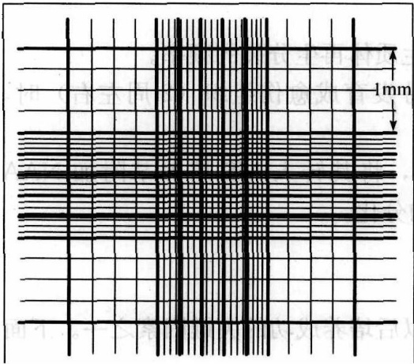

图8-1 血细胞计数器一个计数

细胞计数的方法可以分为三大类:①运用光学显微镜和血细胞计数器对细胞进行直接计数，又称直接视觉方法；②运用光学显微镜和血细胞计数器对细胞核进行计数，又称间接视觉计数；③运用电子系统自动进行视觉计数。悬浮培养的或可转换进入悬浮液体的细胞的计数通常采用直接视觉方法，图8-1是血细胞计数器一个计数区的示意图。血细胞计数器是精密的玻璃仪器，具有两个可以计数的区室，每个计数区由9个亚区构成，每个亚区的面积为 $1mm^{2}$ ，同时血细胞计数器具有一个厚度一定的玻璃盖片，保证了计数区与盖片之间的距离为0.100mm。当盖片放置

区的示意图（Celis，2006）

正确, 每个亚区之上的体积为 $0.1 \mathrm{~mm}^{3}$ 或 $1 \times 10^{-4} \mathrm{ml}$ 。统计两个计数区中的角亚区和中央亚区中的细胞数目为 $N$, 这时统计的体积为 $1 \times 10^{-3} \mathrm{ml}$ 。如果在准备的过程中, 缓冲液和染液对细胞的稀释倍数为 $D$, 那么样品的细胞密度 $C = N \times D \times 10^{3} \text{个/ml}$ 。

运用血细胞计数器进行细胞活力的测定时常涉及染色阻止实验，它主要是根据活细胞能阻止特定的染料（如台盼蓝）穿过细胞膜而阻止被染色，而死细胞则会吸收染料而被染色的原理进行的。

#### 【实验仪器、材料和试剂】

(1) 仪器、用具: 显微镜、血细胞计数板、统计计数器、巴氏吸管、试管。

(2) 材料:培养的细胞悬液。

#### (3) 试剂

1）杜尔贝科磷酸缓冲液（DPBS）。

2）0.4%台盼蓝染液。

3）RPMI 1640 培养液、小牛血清、0.25%胰蛋白酶液等。

#### 【方法与步骤】

#### 1. 细胞悬浮液的稀释

(1) 取 0.3ml 的 DPBS 加入体积不小于 1.0ml 的聚丙烯试管中。

（2）用移液管吹打细胞悬浮液 2～5 次至均匀，然后取 0.1ml 的样品加入试管中，再吹打 2～5 次，使细胞液与 DPBS 混合均匀。

(3) 加入 0.1ml 0.4% 的台盼蓝染液，用移液管吹打 2\~5 次混匀，备用。

#### 2. 血细胞计数器的使用和细胞计数

（1）将血细胞计数器及其盖片从 $70\%$ 乙醇槽中取出，晾干后正确装配。用巴氏吸管吸取足量已处理悬浮液，加入V形填补槽中，使液体充满计数器。

（2）将计数板放在显微镜载物台上，低倍镜下（10×10）分别对每个亚区中已染色细胞（死细胞）和未染色细胞（活细胞）进行计数。计数的亚区为每个计数区中的4个外角亚区和中央亚区（9个中的5个）。

(3) 将细胞液移出，清洗计数器，放回乙醇槽。

#### 3. 细胞计数的计算

（1）运用公式 $C = N \times D \times 10^{3}$ 计算样品中活细胞的密度，其中 $N$ 表示统计得到的活细胞数目。

（2）计算活细胞在细胞中所占的比例， $V = N / T \times 100\%$，$V$ 表示活细胞的比例， $N$ 表示活细胞的数目， $T$ 表示所有细胞的数目。

#### 【注意事项】

（1）计数区的正确加样。计数区必须在没有溢流的情况下通过毛细作用进行加样，移液管和血细胞计数器都必须非常洁净。

（2）台盼蓝与血清蛋白的亲和力比与细胞蛋白的活性高，因此在运用台盼蓝作为阻碍染液时，细胞需要在 DPBS 或其他无血清的培养基中维持悬浮状态；同时在细胞计数之前需要将细胞液与其混匀并维持 5～10min。

(3) 计数时, 如果有细胞位于线上, 只计左边线和上边线上的细胞, 不计右边线和下边线上的细胞。

#### 【作业】

根据观察结果，计算每毫升细胞悬液中的细胞数和细胞存活率。

(何炎明)

<!-- END LAB LAB-E041 -->

### 实验42 动物细胞原代培养
> 补充目的：在已有原理和机制材料上补齐教材实验的目的、试剂、器材、步骤、判读、注意事项及思考题（按该实验原文所含栏目）。
> 来源：细胞生物学实验教程（第2版） / 08_细胞和组织培养技术；[原解析正文](../../来源/实验教程/08_细胞和组织培养技术/正文.md) · [完整分页](../../来源/实验教程/08_细胞和组织培养技术/完整分页.md) · [原页PDF](https://github.com/kazewwk/test/blob/105df226e50395012449b4bad83f589769277174/%E7%BB%86%E8%83%9E%E7%94%9F%E7%89%A9%E5%AD%A6%E5%AE%9E%E9%AA%8C%E6%95%99%E7%A8%8B_%E7%AC%AC2%E7%89%88/08_%E7%BB%86%E8%83%9E%E5%92%8C%E7%BB%84%E7%BB%87%E5%9F%B9%E5%85%BB%E6%8A%80%E6%9C%AF/%E5%8E%9F%E5%A7%8B%E9%A1%B5%E9%9D%A2.pdf)；编号 `LAB-E042`。

<!-- BEGIN LAB LAB-E042 -->
#### 实验 42 动物细胞原代培养

#### 【实验目的】

(1) 了解细胞原代培养的基本方法和操作过程。

(2) 熟悉原代培养细胞观察方法。

#### 【实验原理】

直接从机体获取的细胞进行的培养称为原代培养。这种培养过程主要是采用无菌操作的方法，把组织（或器官）从动物体内取出，经酶消化处理，使其分散成单个细胞，然后在人工条件下培养，使其不断地生长和繁殖。原代培养是建立各种细胞系的第一步。由于原代培养的细胞刚从活体组织中分离出来，所以在一定程度上能反映生物体内的生活状态。利用原代培养技术可以在体外进行各种类型细胞的增殖、遗传、变异、分化和脱分化、恶变与去恶变等研究。原代培养可分为组织块培养法和消化法两种。

#### 【实验仪器、材料和试剂】

（1）仪器、用具:$\mathrm{CO}_{2}$ 培养箱、倒置显微镜、超净工作台、高压锅、恒温水浴箱、离心机、解剖剪、解剖镊、眼科剪、眼科镊、蜡盘、血细胞计数板、离心管、培养瓶、纱布、培养皿、微量加样器、吸管、移液管、酒精灯、酒精棉球、试管架等。

(2) 材料:新生乳鼠或孕鼠。

#### (3) 试剂

1）RPMI 1640 培养基每 100ml 培养液中含 90% RPMI 1640、10% 小牛血清、双抗（青霉素、链霉素）100U/ml，用 7.4% NaHCO₃ 调 pH 至 6.8～7.0，培养液需过滤灭菌。

2）D-Hank液（无钙、镁离子的Hank液）。

3）0.25%胰蛋白酶液:称0.25g胰蛋白酶干粉，加D-Hank液100ml，溶解后过滤灭菌，调pH至7.4，密封置4℃冰箱保存。

#### 【方法与步骤】

（1）处死动物:将出生2～3天乳鼠，用拉颈椎方法处死，用自来水浸湿背部被毛，将动物背部向上钉在蜡盘中，用碘酒棉球擦拭腰部两侧的被毛，再用酒精棉球擦拭碘酒擦过的部位。

（2）取肾:在腰部的后缘，用解剖镊提起皮肤，然后用解剖剪剪开皮肤，将剪开的皮肤拉向两侧。此时可进入无菌室或在超净工作台操作，再用碘酒与酒精棉球在暴露的肌肉上擦拭消毒，再换一把无菌的解剖剪及解剖镊，剪开背部的肌肉，暴露出腹腔，即可见肾脏。一般右肾略低于左肾，用弯头眼科镊取出肾脏，置于无菌培养皿中。

(3) 剪肾: 用眼科剪及眼科镊, 将肾膜剪破, 剥向肾门, 剪去肾膜和脂肪, 并用 D-Hank 液洗涤一次, 放入另一培养皿内, 另换一把灭菌的眼科剪及镊, 纵向剪开肾脏, 去掉肾盂部分, 将肾剪成数块。用 D-Hank 液洗涤一次, 把肾块移入无菌的青霉素瓶 (或小烧杯) 中。用弯头眼科剪将肾剪成 $1 \mathrm{~mm}^{3}$ 大小的块, 再用 D-Hank 液洗 2 或 3 次, 直到液体澄清为止。

（4）消化及分散组织块:向上述清洗过的组织内加入5～6倍量的0.25%胰蛋白酶液（pH为7.4～7.6），置于37℃水浴中消化。消化时间为20～40min，每隔10min摇动一次青霉素瓶，以便组织块散开，一直消化至组织块变得疏松、黏稠状，并且颜色略变为白色为止。此时，由水浴中取出青霉素瓶，在超净台中吸去胰蛋白酶液，加入5ml培养液，用吸管反复吹打组织块，直到大部分组织块分散成混淆的细胞悬液为止。分散的细胞悬液可经两层灭菌的纱布（或不锈钢网）过滤至另一烧杯中。

（5）计数与稀释:从过滤的细胞悬液中取出 1ml 细胞液滴在血细胞计数板上，按白细胞计数法进行计数，计数后用培养液稀释。稀释后的浓度一般以每毫升含 30 万～50 万个细胞为宜。

(6) 分装与培养: 将稀释好的细胞悬液分装于培养瓶中 (一般 $5 \mathrm{ml} /$ 小方瓶, $1 \mathrm{ml} /$ 青霉素瓶), 塞紧瓶塞, 在培养瓶上做好标记, 置于 $37^{\circ} \mathrm{C} \mathrm{CO}_{2}$ 培养箱培养。

（7）观察:逐日检查培养物是否污染，观察细胞生长情况。培养物为紫红色，显示细胞生长不好；培养物为橘红色，显示细胞生长良好。经1～2天培养后，若生长较差或培养液变红，则应在无菌操作下倒去原培养液，加入新的培养液或维持液（与培养液完全相同，只不过所用的血清量为5%）。此后，每隔3～4天更换一些维持液。待细胞已基本长成致密单层时，即可进行传代培养。

#### 【注意事项】

(1) 培养液的配制要用三蒸水, 经过滤灭菌后, 密封置 $4^{\circ} \mathrm{C}$ 冰箱保存。

(2) 培养材料的选择，应尽量选取胚胎或幼小的生物体组织或者繁殖能力较强的组织。

（3）实验过程要严格无菌操作，用具、器皿要高压灭菌。

#### 【作业】

（1）观察、记录培养细胞的结果。

（2）如何提高原代细胞培养的成功率。

(何炎明)

<!-- END LAB LAB-E042 -->

### 实验43 果蝇胚胎细胞的原代培养
> 补充目的：在已有原理和机制材料上补齐教材实验的目的、试剂、器材、步骤、判读、注意事项及思考题（按该实验原文所含栏目）。
> 来源：细胞生物学实验教程（第2版） / 08_细胞和组织培养技术；[原解析正文](../../来源/实验教程/08_细胞和组织培养技术/正文.md) · [完整分页](../../来源/实验教程/08_细胞和组织培养技术/完整分页.md) · [原页PDF](https://github.com/kazewwk/test/blob/105df226e50395012449b4bad83f589769277174/%E7%BB%86%E8%83%9E%E7%94%9F%E7%89%A9%E5%AD%A6%E5%AE%9E%E9%AA%8C%E6%95%99%E7%A8%8B_%E7%AC%AC2%E7%89%88/08_%E7%BB%86%E8%83%9E%E5%92%8C%E7%BB%84%E7%BB%87%E5%9F%B9%E5%85%BB%E6%8A%80%E6%9C%AF/%E5%8E%9F%E5%A7%8B%E9%A1%B5%E9%9D%A2.pdf)；编号 `LAB-E043`。

<!-- BEGIN LAB LAB-E043 -->
#### 实验 43 果蝇胚胎细胞的原代培养

#### 【实验目的】

通过果蝇胚胎细胞的原代培养来研究未分化细胞分化成各种类型细胞的过程。

#### 【实验原理】

果蝇胚胎细胞的原代培养为研究未分化细胞分化成各种类型细胞提供了一个独特的系统。加上果蝇作为经典遗传学和分子遗传学研究的模式生物这一优越条件，果蝇胚胎细胞的体外分化分析将使我们对发育有更深入的了解。原代胚胎细胞培养在 Seecof、Shields 和 Sang 等的实验基础上已独立研究出来了。培养过程在技术上并不复杂且可以用于解决一系列生物学问题。

培养是从胚胎细胞原肠胚早期开始，我们能观察从特定的前体到最终分化为不同类型细胞的发育过程。在培养中分化的细胞类型主要是神经细胞和多核肌纤维，但是其他表皮和中胚层的衍生物也存在。培养形成一系列具有神经传递素系统、离子通道、轴突专一化，甚至有功能的神经肌肉连接和突触活动等高度分化表型的神经细胞。

#### 【实验仪器、材料和试剂】

（1）仪器、用具:塑料广口瓶、尼龙筛（25～100μm孔径）、刮铲、漏斗、滤纸、镊子、血球计、15ml玻璃匀浆器、35mm塑料培养皿、圆玻璃盖玻片等。

(2) 材料:果蝇（Drosophila melanogaster）。

（3）试剂:青霉素、链霉素、胰岛素、带有谷氨酸盐的  $1 \times$  Schneider 果蝇培养基（购自 GIBCO）、灭活的胎牛血清对羟基苯甲酸甲酯。

1）青霉素-链霉素贮存液:每升培养基用 10ml 青霉素-链霉素溶液（10 000U/ml）（最后浓度为青霉素 100U/ml，链霉素 100μg/ml）。

2）胰岛素贮存液:把胰岛素溶入0.05mol/L HCl，使得浓度为2mg/ml。过滤消毒后存放在4℃（可以稳定储存1年）。最后在培养基中的浓度为0.2μg/ml。

3）Schneider 含有谷氨酸盐、胰岛素和 5% 灭活胎牛血清的果蝇培养基:加 10ml 消毒过的青霉素-链霉素贮存液，0.1ml 胰岛素贮存液和 50ml 灭活胎牛血清（最后血清浓度为 5%）到 1L 含有谷氨酸盐的 Schneider 培养基中。培养基可以在 4℃ 下保持良好稳定状态长达 1 个月。

4）次氯酸钠-乙醇溶液:把 10ml 95%乙醇和 10ml 3%次氯酸钠在一个小烧杯中混匀。该溶液可以把胚胎浆膜去掉和对胚胎消毒。

#### 【方法与步骤】

（一）卵子采集和生长到原肠胚期前阶段

（1）葡萄汁琼脂卵子收集皿的制备:将 160ml 水、160ml 葡萄汁和 6.4g 琼脂在 1L 的烧瓶中混合。用微波炉溶解琼脂，小心不要让溶液沸腾而溢出。从微波炉取出后，加入 0.8g 对羟基苯甲酸甲酯，混合均匀后倒入 12 个大的培养皿（14cm）中。

(2) 从 $8 \sim 12$ 个普通培养瓶中转移 1.5 个星期大的成年果蝇到新的食物上铺有干酵母的培养瓶中。让果蝇在 $25^{\circ} \mathrm{C}$ 潮湿的空间内适应 $1 \sim 2$ 天，在将要进行胚胎培养当天，把成年蝇转移到一个胚胎采集瓶中。图 8-2 展示了一个自制的采集瓶或者可以购买到类似的采集瓶。通常每个产卵群体用大约 3000 个成年蝇。为了方便，建议房间用倒置的白天和黑夜，这样采集工作就可以在早晨进行。将干酵母溶于 $2 \%$ 丙酸中，取少量涂在一小片滤纸上，把滤纸放在一个大的葡萄汁琼脂卵子收集皿（$14 \mathrm{~cm}$）的中间，来吸引雌蝇产卵。

(3) 把胚胎采集瓶倒置在食物盘上 1\~2h 来采集卵子。

(4) 如果时间如期望一样控制得很好，可以提前 $30\mathrm{min} \sim 1\mathrm{h}$ 进行预采集，并且可

图8-2 用于胚胎采集的大的塑料广口瓶（Celis，2006）

左边的广口瓶是空的，右边的有一个葡萄汁琼脂胚胎采集板套在底部，装有约3000只成年蝇。在广口瓶边上穿了很多孔并用尼龙布盖上，使得空气可以有效流动

以舍去盘子。这对于诱导已经长时间储存卵子的雌蝇产卵是必要的。

(5) 把卵子采集皿移开胚胎采集瓶, 盖上盖子, 胚胎在 $25^{\circ} \mathrm{C}$ 下培养 $3 \mathrm{~h}$, 生长到原肠胚早期。

#### （二）胚胎的获取

(1) 胚胎应该在 $3.5 \mathrm{~h}$ 的生长周期前 $5 \sim 10 \mathrm{~min}$ 收集, 这样使得培养可以在正 $3.5 \mathrm{~h}$ 开始。

(2) 去掉有酵母混合物的滤纸。

(3) 用去离子水轻柔地把器皿中成年果蝇和其他碎片洗掉。

(4) 放一些水到器皿上, 然后用毛刷轻轻地把胚胎拨松。

(5) 把悬浮的胚胎倒进尼龙筛，然后冲洗和收集其他食物皿。

（6）继续冲洗掉大的食物粒子和其他碎片，必要时可以用镊子去除。

(7) 把有胚胎的尼龙筛转移到一个消毒过的培养罩上。

#### （三）胚胎培养

(1) 按平常组织培养的步骤, 先用乙醇清洁超净工作台。以下的全部步骤都在无菌的条件下进行。

(2) 用刮铲把胚胎转移到装有次氯酸钠-乙醇溶液的烧杯中, 轻轻搅拌 $1 \sim 2 \mathrm{~min}$ 。时间可以稍有变化但搅拌时间不要超过 $3 \mathrm{~min}$ 。时间长短根据次氯酸盐的新鲜度和对产量及灭菌程度的要求不同而不同。较短时间可以得到更多的产物, 而如果希望完全去除酵母污染物就需要相对长一点时间。

(3) 把胚胎倒入一个有尼龙网滤纸的小漏斗, 用大约 $500 \mathrm{ml}$ 的灭菌蒸馏水粗略地

冲洗一下。

（4）把胚胎转移到一个含有 6ml 培养基的 15ml 匀浆器中，3 次旋转上下冲程来轻轻地分离细胞。

（5）用 $25\sim 100\mu \mathrm{m}$ 尼龙网来过滤解离细胞，尼龙网松散地放在一个直径 $5\mathrm{cm}$ 的玻璃漏斗中，或者可以把漏斗放在 $3.5\mathrm{cm}$ 的金属圈上。通过过滤把那些未分离的小块和其他大的碎片除去。

（6）把滤液收集到一个 15ml 的离心管中，在 1400r/min 下离心 4min。在 6ml 培养基中洗细胞一次，然后再重复上述离心步骤，最后制得 10ml 培养基悬浮液。

(7) 取适量悬液到血球计中, 把圆形、完整、中等大小的细胞和细胞群数出来, 得到细胞数量。

（8）计算细胞的密度，加入足够的培养基，使得最终细胞浓度为  $8 \times 10^{5}$  个/ml。把大约  $1.6 \times 10^{6}$  个细胞放到 35mm 培养皿中（也就是每皿 2ml 细胞悬浮液）。

(9) 在一个 $25^{\circ} \mathrm{C}$ 潮湿的培养箱中培养细胞（不需要 $\mathrm{CO}_{2}$）。细胞在几个小时内开始分化，在大约 $24 \mathrm{~h}$ 后充分发育。细胞可以培养几天才换培养基，可以连续培养一年以上。

#### 【注意事项】

预筛选适合果蝇胚胎培养的小牛血清是很重要的，因为有些小牛血清不能支持细胞分化，甚至还有毒性。

#### 【作业】

记录并分析体外分化两天的果蝇原肠胚细胞培养物。

(冯冬茹)

<!-- END LAB LAB-E043 -->

### 实验44 传代细胞培养
> 补充目的：在已有原理和机制材料上补齐教材实验的目的、试剂、器材、步骤、判读、注意事项及思考题（按该实验原文所含栏目）。
> 来源：细胞生物学实验教程（第2版） / 08_细胞和组织培养技术；[原解析正文](../../来源/实验教程/08_细胞和组织培养技术/正文.md) · [完整分页](../../来源/实验教程/08_细胞和组织培养技术/完整分页.md) · [原页PDF](https://github.com/kazewwk/test/blob/105df226e50395012449b4bad83f589769277174/%E7%BB%86%E8%83%9E%E7%94%9F%E7%89%A9%E5%AD%A6%E5%AE%9E%E9%AA%8C%E6%95%99%E7%A8%8B_%E7%AC%AC2%E7%89%88/08_%E7%BB%86%E8%83%9E%E5%92%8C%E7%BB%84%E7%BB%87%E5%9F%B9%E5%85%BB%E6%8A%80%E6%9C%AF/%E5%8E%9F%E5%A7%8B%E9%A1%B5%E9%9D%A2.pdf)；编号 `LAB-E044`。

<!-- BEGIN LAB LAB-E044 -->
#### 实验44 传代细胞培养

#### 【实验目的】

（1）熟练掌握贴壁细胞传代的培养方法。

(2) 观察传代细胞贴壁、生长和繁殖过程中细胞形态的变化。

#### 【实验原理】

离体培养的细胞群体增殖达到一定密度时，细胞的生长和分裂速度就会减慢甚至停止，如不及时分离、传代培养，细胞将逐渐衰老死亡。传代培养是指细胞从一个培养瓶以1∶2或其他比率转移，接种到另一培养瓶的培养。贴壁培养细胞的传代通常是采用胰蛋白酶消化，把细胞分散成单细胞再传代，而悬浮型生长细胞的传代则用直接法传代或离心法传代。

#### 【实验仪器、材料和试剂】

(1) 仪器、用具: $\mathrm{CO}_{2}$ 培养箱、倒置显微镜、超净工作台、高压锅、水浴箱、离心机、血细胞计数板、离心管、培养瓶、微量加样器、吸管、移液管、酒精灯、酒精棉球、试管架等。

(2) 材料:HeLa 细胞或原代培养细胞。

(3) 试剂: RPMI 1640 培养基、小牛血清、0.25%胰蛋白酶、D-Hank 液、台盼蓝。

#### 【方法与步骤】

#### （一）贴壁细胞——HeLa 细胞的传代培养

（1）选取生长良好的 HeLa 细胞一瓶，在超净工作台的酒精灯旁，倒去瓶中的旧培养液，加入 2\~3ml 的 D-Hank 液，轻轻振荡漂洗细胞 1 次，以除去悬浮在细胞表面的碎片。

(2) 加入 2 滴管 0.25% 胰蛋白酶消化液, $37^{\circ} \mathrm{C}$ 消化 $2 \sim 3 \mathrm{~min}$, 倒置显微镜下观察细胞, 待细胞单层收缩突起出现空隙时, 便倒去酶消化液 (如消化程度不够可延长时间)。

（3）用 D-Hank 液洗一次，加入 1 或 2 滴培养液，反复吹打细胞，使其成为细胞悬液。

如果发现消化过头，细胞已自行脱落时，则不能倒去消化液，可加少量培养液以中止消化，用吸管反复吹打成细胞悬液并转移到离心管离心（1000r/min，3～5min）后用培养液再悬浮。

(4) 接种细胞: HeLa 细胞一般以 1:2 或 1:3 进行分装, 即一瓶细胞可传为 2\~3 瓶。

(5) 分装好的细胞, 应在培养瓶上做好标记, 注明代号、日期, 轻轻摇匀, 置 $37^{\circ} \mathrm{C} \mathrm{CO}_{2}$ 培养箱培养。

(6) 观察: 细胞培养 24h 后, 即可观察培养液的颜色及细胞的生长情况, 也可用 $0.5\%$ 台盼蓝染色, 以确定死、活细胞的比例。台盼蓝染液可特异性地使死细胞被染成蓝色, 而活细胞不被染色。

#### （二）悬浮细胞的传代培养

因悬浮细胞不贴壁，所以要经离心收集细胞后再传代。其过程如下:

(1) 取生长良好的细胞，在超净工作台用无菌吸管把培养瓶中的细胞吹打均匀。

(2) 转移到无菌的离心管中, 盖紧胶盖, 平衡后离心 (1000r/min) 5min。

(3) 在超净台中去上清液, 加入适量新培养液, 用吸管吹打细胞, 制成悬液。

（4）以 $1:2$ 或 $1:3$ 进行分装，并在培养瓶上做好标记，注明代号、日期，轻轻摇匀，置 $37^{\circ}\mathrm{C} \mathrm{CO}_{2}$ 培养箱中培养。

（5）观察:细胞培养 24h 后，即可进行观察，形态上的观察一般可用相差显微镜进行，生长良好的细胞，透明度大，细胞内颗粒少，没有空泡，胞膜清晰，培养液中看不到碎片。

#### 【注意事项】

传代培养时要严格无菌操作并防止细胞之间交叉污染。

#### 【作业】

(1) 贴壁细胞和悬浮细胞传代方法上有什么不同?

(2) 为什么培养细胞长成致密单层后必须要进行传代培养?

(3) 判断健康细胞的标准是什么?

(何炎明)

<!-- END LAB LAB-E044 -->

### 实验45 细胞的冻存与复苏
> 补充目的：在已有原理和机制材料上补齐教材实验的目的、试剂、器材、步骤、判读、注意事项及思考题（按该实验原文所含栏目）。
> 来源：细胞生物学实验教程（第2版） / 08_细胞和组织培养技术；[原解析正文](../../来源/实验教程/08_细胞和组织培养技术/正文.md) · [完整分页](../../来源/实验教程/08_细胞和组织培养技术/完整分页.md) · [原页PDF](https://github.com/kazewwk/test/blob/105df226e50395012449b4bad83f589769277174/%E7%BB%86%E8%83%9E%E7%94%9F%E7%89%A9%E5%AD%A6%E5%AE%9E%E9%AA%8C%E6%95%99%E7%A8%8B_%E7%AC%AC2%E7%89%88/08_%E7%BB%86%E8%83%9E%E5%92%8C%E7%BB%84%E7%BB%87%E5%9F%B9%E5%85%BB%E6%8A%80%E6%9C%AF/%E5%8E%9F%E5%A7%8B%E9%A1%B5%E9%9D%A2.pdf)；编号 `LAB-E045`。

<!-- BEGIN LAB LAB-E045 -->
#### 实验 45 细胞的冻存与复苏

#### 【实验目的】

(1) 了解细胞冷冻保存的原理和意义。

(2) 掌握细胞冻存和复苏方法，观察复苏细胞的成活情况。

#### 【实验原理】

细胞冻存是细胞保存的主要方法之一。在细胞培养过程中，为防止细胞株不断传代引起的细胞老化、支原体污染、染色体和基因的变异等现象的发生，可以通过冻存技术保存细胞，以便在利用时，可快速繁殖，也有利于国际和国内进行种质交换。

在不加任何保护条件直接冻存细胞时，细胞内外环境中的水会形成冰晶，导致细胞内发生一系列变化，如机械损伤、电解质浓度升高、渗透压改变、脱水、pH改变、蛋白质变性等。大的冰晶也会导致细胞膜、细胞器的损伤和破裂，最终导致细胞死亡。但如果在培养基中加入冰冻保护剂甘油或二甲基亚砜（DMSO），可使溶液冰点降低，加之在缓慢冻结条件下，细胞内水分透出，减少了冰晶形成，从而避免细胞受损。当前常使用的冰冻保护剂甘油或二甲基亚砜（DMSO）具有对细胞无毒性、分子质量小、溶解度大、易穿透细胞等特点。使用的浓度范围为5%\~15%，常用10%。

细胞的冻存与复苏，一般的原则是采用慢冻快融的方法，这样可以较好地保证细胞的存活率。标准的冷冻速度开始为 $-2\sim -1^{\circ}\mathrm{C / min}$，当温度低于 $-25^{\circ}\mathrm{C}$ 时可加速，下降率可增至 $-10\sim -5^{\circ}\mathrm{C / min}$，到 $-80^{\circ}\mathrm{C}$ 之后可直接投入液氮内。液氮是最理想和适用的冷冻剂，它的沸点是 $-196^{\circ}\mathrm{C}$，在此温度下，既无化学也无物理变化发生，对标本 $\mathsf{pH}$ 无影响，汽化时又不留沉淀，细胞在液氮中可长期保存。复苏细胞时则直接将装有细胞的冻存管投入到 $40^{\circ}\mathrm{C}$ 热水中快速解冻，以防止小冰晶转变为大冰晶而对细胞造成损害。

【实验仪器、材料和试剂】

(1) 仪器、用具: $\mathrm{CO}_{2}$ 培养箱、倒置显微镜、超净工作台、高压锅、水浴箱、离心机、液氮罐、离心管、培养瓶、微量加样器、吸管、移液管、酒精灯、酒精棉球、无菌冻存管、线绳和标记用小牌等。

(2) 材料:HeLa 细胞或其他细胞株（系）。

(3) 试剂: RPMI 1640 (或 DMEM) 培养基、小牛血清、0.25%胰蛋白酶、甘油或二甲基亚砜 (DMSO)、Hank 液、液氮、台盼蓝。

#### 【方法与步骤】

#### （一）细胞冻存

(1) 选择细胞形态良好, 单层致密理想的细胞 (对数生长期), 在超净台中弃培养液, 加入预温的 $37^{\circ} \mathrm{C} 0.25 \%$ 胰蛋白酶, 消化分散细胞。

(2) 弃消化液，加入新鲜培养液中止消化。

(3) 用吸管吹打分散细胞, 移入灭菌的带盖离心管, $800 \mathrm{r} / \mathrm{min}$ 离心 $5 \mathrm{~min}$, 弃上清液。

（4）加入适量冻存液（10%甘油+90%培养基或10%DMSO+90%培养基）制成细胞悬液。细胞密度为 $3 \times 10^{6}$ 个/ml左右。

（5）将细胞悬液装入冻存管中，每管1～1.5ml，旋紧管盖，并在管上标明细胞株名称、冻存日期，最后放入纱布小袋中冻存。纱布袋的一端系以线绳，末端扎有小牌，注明细胞名称、冻存日期以便日后查找。

(6) 冻存管在 $4^{\circ} \mathrm{C}$ 下存放 $30 \mathrm{~min}$, 转入 $-20^{\circ} \mathrm{C} 1.5 \sim 2 \mathrm{~h}$, 再转入 $-70^{\circ} \mathrm{C} 4 \sim 12 \mathrm{~h}$ 后即可转移到液氮内 $(-196^{\circ} \mathrm{C})$ 。

#### （二）细胞复苏

(1) 从液氮罐中取出冻存管, 立即投入 $40^{\circ} \mathrm{C}$ 水浴中, 使细胞在 $1 \mathrm{~min}$ 之内融化。

（2）用 $75\%$ 乙醇擦拭消毒冻存管外壁，打开管塞，用吸管吸出悬液，注入离心管中，加入适量培养液，混匀后离心（$1000\mathrm{r / min}$）$5\mathrm{min}$。

(3) 弃上清液, 加入 $5 \mathrm{ml}$ 新鲜培养基, 并用吸管轻轻吹打悬浮细胞。

（4）将细胞悬液装入培养瓶，37℃静止培养，取少量细胞悬液后细胞计数，以计算冻存细胞存活率。

(5) 待细胞贴壁后 (4\~6h)，换液再培养。细胞长满后可进行传代培养。

#### 【注意事项】

因 DMSO 在室温状态下易损伤细胞，所以在细胞加入 DMSO 冻存液后，应尽快放入  $4^{\circ}$ C 环境中。

#### 【作业】

（1）简述细胞冻存与复苏的原理，细胞的冻存与复苏应注意哪些关键步骤？

（2）观察冻存细胞的生长情况，计算细胞存活率。

(何炎明)
<!-- END LAB LAB-E045 -->

### 实验61 细胞融合
> 补充目的：在已有原理和机制材料上补齐教材实验的目的、试剂、器材、步骤、判读、注意事项及思考题（按该实验原文所含栏目）。
> 来源：细胞生物学实验教程（第2版） / 11_细胞工程技术；[原解析正文](../../来源/实验教程/11_细胞工程技术/正文.md) · [完整分页](../../来源/实验教程/11_细胞工程技术/完整分页.md) · [原页PDF](https://github.com/kazewwk/test/blob/105df226e50395012449b4bad83f589769277174/%E7%BB%86%E8%83%9E%E7%94%9F%E7%89%A9%E5%AD%A6%E5%AE%9E%E9%AA%8C%E6%95%99%E7%A8%8B_%E7%AC%AC2%E7%89%88/11_%E7%BB%86%E8%83%9E%E5%B7%A5%E7%A8%8B%E6%8A%80%E6%9C%AF/%E5%8E%9F%E5%A7%8B%E9%A1%B5%E9%9D%A2.pdf)；编号 `LAB-E061`。

<!-- BEGIN LAB LAB-E061 -->
#### 实验 61 细胞融合

#### 【实验目的】

(1) 了解聚乙二醇（PEG）诱导细胞融合的基本原理。

(2) 掌握细胞融合的基本方法。

#### 【实验原理】

细胞融合（cell fusion）又称体细胞杂交，是指用人工方法使两个或两个以上的体细胞融合成异核体细胞，随后，异核体细胞同步进入有丝分裂，核膜崩溃，来自两个亲本细胞的基因组合在一起形成只含有一个细胞核的杂种细胞（hybrid cell）。PEG，又名聚乙二醇，是目前应用最多的一种化学促融剂。其优点是使用方便，活性稳定，容易制备和控制。PEG用于细胞融合至少包括两个方面的作用:一是可促使细胞凝聚；二是可改变细胞的膜结构，使两细胞接触点处的细胞膜磷脂双分子层的脂类分子发生疏散和重组，引起细胞融合。

利用 PEG 介导细胞融合，其融合效果受以下几种因素的影响。①PEG 的相对分子质量与浓度:细胞融合效果与 PEG 的相对分子质量及其浓度成正比；但 PEG 的相对分子质量越大，浓度越高，对细胞的毒性也就越大。为了兼顾二者，通常采用的 PEG 相对分子质量一般为 1000～4000，浓度一般为 40%～60%。②PEG 的处理时间:处理时间越长，融合效果越好，但对细胞的毒害也就越大。本实验中细胞融合后无需继续培养，故处理时间可适当放宽至数分钟。③融合时的温度:由于生物膜的流动性与温度成正比，故细胞的融合效果也与温度成正比。因此，为了获得更好的融合效果，在细胞可能承受的温度范围内可适当提高处理的温度。对于哺乳动物的细胞，一般采用的温度为  $38 \sim 40^{\circ}C$ 。

细胞融合技术在研究细胞遗传、基因定位、基因表达产物、细胞免疫以及肿瘤的诊断和治疗中有着广泛的应用前景。

#### 【实验仪器、材料和试剂】

（1）仪器、用具:注射器、刻度离心管、离心机、血细胞计数板、水浴锅、滴管、显微镜、烧杯、容量瓶、凹面载玻片、盖玻片、酒精灯等。

(2) 材料:成年家鸡。

(3) 试剂

1）0.85%生理盐水。

2）GKN液:NaCl 8.0g，KCl 0.4g， $Na_{2}HPO_{4}\cdot2H_{2}O$  1.77g， $NaH_{2}PO_{4}\cdot H_{2}O$  0.69g，葡萄糖 2.0g，酚红 0.01g，溶于 1000ml 双蒸水中。

#### 3）$50\%$（m/V）PEG溶液

配制方法是:①称取 50g PEG（相对分子质量=4000）放入 100ml 瓶中，高压灭菌 20min；②让 PEG 冷却至 50～60℃，勿让其凝固；③加入 50ml 预热至 50℃ 的 GKN 液，混匀，置 37℃ 备用。

#### 4）Hank原液（ $10\times$ ）

| NaCl | 80.0g |
| --- | --- |
| $Na_{2}HPO_{4} \cdot 12H_{2}O$ | 1.2g |
| KCl | 4.0g |
| $KH_{2}PO_{4}$ | 0.6g |
| $MgSO_{4} \cdot 7H_{2}O$ | 2.0g |
| 葡萄糖 | 10.0g |
| $CaCl_{2}$ | 1.4g |

配制方法是:①称取 1.4g 的  $CaCl_{2}$ ，溶于 30～50ml 的双蒸水中。②取 1000ml 的烧杯及容量瓶各一个，先放双蒸水 800ml 于烧杯中，然后按上述配方顺序，逐一称取药品。必须在前一药品完全溶解后，方可加入下一药品，直到葡萄糖完全溶解后，再将已溶解的  $CaCl_{2}$  溶液加入，最后加水至 1000ml。

#### 5) Hank 液

| Hank 原液 | 100ml |
| --- | --- |
| 双蒸水 | 896ml |
| 0.5%酚红 | 4ml |

配好的 Hank 液，分装包扎好贴上标签，经过灭菌后，4℃保存。

6) Janus green 染液

#### 【方法与步骤】

(1) 从鸡翅下静脉用注射器采血, 注入试管后, 迅速加入肝素 (100U 肝素/5ml 全血) 混合, 制成抗凝全血。

(2) 在抗凝全血的试管加入 4 倍体积的 $0.85\%$ 生理盐水, 制成红细胞贮备液, 置于 $4^{\circ} \mathrm{C}$ 冰箱内可供 1 周内使用。

（3）取鸡血细胞贮备液 1ml，加入 4ml 0.85% 生理盐水，混匀后，1000r/min 离心 5min，弃去上清液，再加入 5ml 0.85% 生理盐水，按上述条件离心一次。最后，弃去上清液，加入 GKN 液（体积比 1:9），制成 10% 的细胞悬液。

（4）取以上细胞悬液，在血细胞计数板上计数。若细胞浓度过大，用 GKN 溶液稀释至 $1 \times 10^{7}$ 个/ml 左右。

（5）取 1ml 以上细胞悬液放入离心管中，加入 4ml Hank 液混匀，1000r/min 离心 5min。弃去上清液，用手指轻弹离心管底部，使沉淀的血细胞团块松散。

(6) 吸取 $0.5 \mathrm{ml} 37^{\circ} \mathrm{C}$ 的 $50 \%$ PEG 溶液, 沿离心管壁慢慢逐滴加入, 边加边轻摇离心管, 使 PEG 与细胞混匀, 然后在 $37^{\circ} \mathrm{C}$ 水浴中静置 $2 \mathrm{~min}$ 。

(7) 缓慢加入 5ml Hank 液，轻轻吹打混匀，于 37℃ 水浴中静置 5min。

（8）用吸管轻轻吹打细胞团数次使细胞团分散，1000r/min 离心 5min，使细胞完全沉降。弃去上清液，然后加入 5ml Hank 液，再离心一次，弃上清，加少许 Hank 液，混匀。

(9) 吸取细胞悬液, 在凹面载玻片上滴一滴, 加入 Janus green 染液, 用牙签搅匀,染色 $3 \mathrm{~min}$ 后盖上盖玻片, 在显微镜下观察细胞融合情况。经 PEG 处理后, 在显微镜下可观察到未融合的单核细胞、融合后的双核细胞和融合后的多核细胞。

(10) 计算细胞融合率。

细胞融合率是指在显微镜的视野内，已发生融合的细胞其细胞核总数与该视野内所有细胞（包括已融合细胞）的细胞核总数之比，通常以百分比表示，而且要进行多个视野测定，进行统计分析。

【注意事项】

（1）本实验中，用 $0.85\%$ 生理盐水代替了Alsver液。实验证实，用Alsver液保存的红细胞时间较短，而改用生理盐水则明显延长红细胞的保存时间且不影响细胞融合率。

（2）融合的频率和活力与所用 PEG 的分子质量、浓度、作用时间、细胞的生理状态与密度等有关。

【作业】

(1) 画出观察到的融合细胞，并计算融合率。

(2) 试说明细胞融合的关键。

(何炎明)

<!-- END LAB LAB-E061 -->

### 实验62 植物体细胞杂交——原生质体的融合
> 补充目的：在已有原理和机制材料上补齐教材实验的目的、试剂、器材、步骤、判读、注意事项及思考题（按该实验原文所含栏目）。
> 来源：细胞生物学实验教程（第2版） / 11_细胞工程技术；[原解析正文](../../来源/实验教程/11_细胞工程技术/正文.md) · [完整分页](../../来源/实验教程/11_细胞工程技术/完整分页.md) · [原页PDF](https://github.com/kazewwk/test/blob/105df226e50395012449b4bad83f589769277174/%E7%BB%86%E8%83%9E%E7%94%9F%E7%89%A9%E5%AD%A6%E5%AE%9E%E9%AA%8C%E6%95%99%E7%A8%8B_%E7%AC%AC2%E7%89%88/11_%E7%BB%86%E8%83%9E%E5%B7%A5%E7%A8%8B%E6%8A%80%E6%9C%AF/%E5%8E%9F%E5%A7%8B%E9%A1%B5%E9%9D%A2.pdf)；编号 `LAB-E062`。

<!-- BEGIN LAB LAB-E062 -->
#### 实验 62 植物体细胞杂交——原生质体的融合【实验目的】

在分离植物细胞原生质体的基础上，了解和掌握细胞融合的原理和方法。

#### 【实验原理】

植物原生质体的融合又称体细胞杂交技术。是以原生质体培养技术为基础，借助动物细胞融合方法发展和完善的一门新型生物技术。两种异源（种、属）原生质体，在诱导剂诱发下相互接触，从而发生膜融合，胞质融合和核融合并形成杂种细胞，进一步发育成杂种植物体。通过细胞融合技术可以克服种、属以上植物有性杂交不亲和性障碍，为广泛重组遗传物质开辟了新途径，也为携带外源遗传物质（信息）的大分子渗入细胞创造条件，从而更进一步扩大了遗传物质的重组范围。

#### 【实验仪器、材料和试剂】

（1）仪器、用具:超净工作台、手摇离心机、倒置显微镜、高压灭菌锅、白细胞计数板、带盖离心管、细菌过滤器、300目镍丝网、解剖刀、镊子、注射器（2ml、5ml）、刻度吸管、培养皿、烧杯等。

#### (2) 材料

1）拟南芥培养细胞中分离的原生质体。

2）白菜型油菜的叶肉细胞中分离的原生质体。

#### (3) 试剂

1）高 pH 高钙洗涤-稀释液:0.1mol/L  $CaCl_{2} \cdot 2H_{2}O$ 、0.1mol/L 山梨醇、0.05mol/L Tris，pH 调至 10.5。

2）PEG液:取分子质量为 $6000\mathrm{u}$ （ $\mathrm{MW} = 6000$ ）的聚乙二醇，配成 $40\%$ 水溶液。

3）DPD 培养基（配方见原生质体的分离培养实验）

#### 【方法与步骤】

（1）将两种来源的原生质体悬液等量混合。

（2）用刻度吸管将混合的原生质体悬液滴在直径为 $60\mathrm{mm}$ 的培养皿中，每皿滴7或8滴，每滴约 $0.1\mathrm{ml}$，静置 $15\mathrm{min}$，使原生质体贴在皿底上。

（3）用吸管吸取 PEG 溶液，等体积缓慢地加在原生质体液滴上，再静置 10～15min。在倒置显微镜下观察原生质体的粘连情况。

（4）用吸管向原生质体液滴慢慢加入高 pH 高钙洗涤-稀释液，第一次加 0.5ml，第二次加 1ml，第三、第四次各 2ml，每次间隔 5min。

(5) 将培养皿稍微倾斜, 吸去上清液, 再缓慢加入 $4 \mathrm{ml}$ 稀释液, $5 \mathrm{~min}$ 后再倾斜培养皿, 吸去上清液时, 勿使原生质体漂浮起来。

(6) 用 DPD 培养基如上法换洗两次，每次 $5 \mathrm{~min}$。

在培养皿中加培养基 2ml，用蜡膜密封培养皿，置  $26^{\circ}$ C 进行 24h 暗培养，然后再转到弱光下培养。

#### (7) 细胞学观察

1）细胞壁再生观察:在倒置显微镜下，观察原生质体的融合过程。一般脱壁后24h可以观察到再生的细胞壁。方法:取一滴原生质体悬浮液放在载片上，加一滴

0.1%荧光增白剂，在荧光显微镜下以366nm的紫外线照射细胞壁部位发出绿色荧光。培养2周后，可能发展成细胞团。这时应向培养物添加等量新鲜培养基（渗透压减半），以促进细胞团增殖。

2）细胞融合观察:培养 24h 后，可在倒置显微镜下，观察到融合的异核体。为了进一步证实是异核细胞，可用改良苯酚品红，对融合产物进行染色，因为不同植物的细胞核染色程度不同。根据颜色特征可统计异源融合频率。

#### 【作业】

（1）观察记录两种原生质体的粘连情况。

(2) 观察统计异源融合频率。

(何炎明)

<!-- END LAB LAB-E062 -->

### 实验63 单克隆抗体的制备
> 补充目的：在已有原理和机制材料上补齐教材实验的目的、试剂、器材、步骤、判读、注意事项及思考题（按该实验原文所含栏目）。
> 来源：细胞生物学实验教程（第2版） / 11_细胞工程技术；[原解析正文](../../来源/实验教程/11_细胞工程技术/正文.md) · [完整分页](../../来源/实验教程/11_细胞工程技术/完整分页.md) · [原页PDF](https://github.com/kazewwk/test/blob/105df226e50395012449b4bad83f589769277174/%E7%BB%86%E8%83%9E%E7%94%9F%E7%89%A9%E5%AD%A6%E5%AE%9E%E9%AA%8C%E6%95%99%E7%A8%8B_%E7%AC%AC2%E7%89%88/11_%E7%BB%86%E8%83%9E%E5%B7%A5%E7%A8%8B%E6%8A%80%E6%9C%AF/%E5%8E%9F%E5%A7%8B%E9%A1%B5%E9%9D%A2.pdf)；编号 `LAB-E063`。

<!-- BEGIN LAB LAB-E063 -->
#### 实验 63 单克隆抗体的制备

#### 【实验目的】

熟悉和掌握单克隆抗体的制备的技术。

#### 【实验原理】

1975 年，Kohler 和 Milstein 报道了将分泌抗体的小鼠脾细胞与小鼠骨髓瘤细胞成功融合的实验结果，融合细胞兼具骨髓瘤细胞的生长特性与脾细胞产生抗体的能力。经过不断发展，单克隆抗体技术已经广泛应用于各种研究领域以及实验诊断技术中。

#### 【实验仪器、材料和试剂】

（1）仪器、用具:超净工作台、小型台式离心机、液氮储存罐、37℃水浴锅、 $CO_{2}$ 恒温培养箱、倒置显微镜、24孔培养板、96孔培养板、 $25cm^{2}$ 细胞培养瓶、 $80cm^{2}$ 细胞培养瓶、冻存管、10ml移液管、培养皿、V形底30ml管、连续可调式移液器、无菌枪头、Hamilton 500μl路厄氏注射器、无菌镊子、剪刀。

(2) 材料:P3X63Ag8.653 骨髓瘤细胞（无支原体污染）。

(3) 试剂

1) RPMI 1640 (10×500ml)。

2）PSG×100（青霉素 10 000U/链霉素 10 000μg、L-谷氨酸 29.2mg）。

3）HAT×100（10mmol/L次黄嘌呤钠盐、40μmol/L氨基蝶呤、1.6mmol/L脱氧胸苷）。

4）HT×100（10mmol/L钠-次黄嘌呤、1.6mmol/L脱氧胸苷）。

5）胎牛血清（需选择杂交瘤专用级别的型号）。

6）弗氏完全佐剂（CFA）与不完全弗氏佐剂（IFA）。

7）杂交瘤克隆添加剂（HFCS，hybridoma fusion cloning supplement）。

8）聚乙二醇 1500 溶于 75mmol/L HEPES（灭菌并经过融合诱导效率检测）。

9）红细胞裂解液（8.3g/L  $NH_{4}Cl$  溶于 0.01mol/L Tris-HCl 中）。

10）台盼蓝溶液。

11）二甲基亚砜（DMSO）。

12）基于ELISA的同型分析试剂盒。

所有试剂按照厂商推荐的方法保存。在以后的实验步骤中具体介绍各种溶液的配制方法。

#### 【方法与步骤】

单克隆抗体制备实验要求详尽的规划以及合理的时间安排，可分为两个阶段（表11-1）。第1阶段主要包括免疫、检测方法的建立、骨髓瘤细胞的生长和最后的融合。第2阶段包括检测、克隆化培养和冻存。单克隆抗体制备实验成功的关键在于检测方法的选择，必须在开始免疫动物之前就确定检测方法。一些常用的小鼠免疫及检测方案列于表11-2。

表 11-1 单克隆抗体制备实验安排表

<table><tr><td colspan="2">阶段1</td></tr><tr><td colspan="2">准备抗原,确定抗体检测方案</td></tr><tr><td>免疫动物</td><td>4~8周</td></tr><tr><td>血液抗体效价检测</td><td>第7周</td></tr><tr><td>复苏骨髓瘤细胞</td><td>第4或第8周</td></tr><tr><td>脾细胞与骨髓瘤细胞融合,HAT培养基筛选</td><td>1天</td></tr><tr><td>HT培养基培养</td><td>7天</td></tr><tr><td>HT培养基培养</td><td>14天</td></tr><tr><td>细胞群落可见,开始抗体效价检测</td><td>14~32天</td></tr><tr><td colspan="2">阶段2</td></tr><tr><td>按要求筛选培养板各孔</td><td>21天一个循环</td></tr><tr><td>克隆化、冷冻、培养、检测</td><td>21天一个循环</td></tr><tr><td>重复克隆化、冷冻、培养、检测</td><td>21天一个循环</td></tr><tr><td colspan="2">阶段3</td></tr><tr><td colspan="2">分型及扩大培养</td></tr><tr><td colspan="2">特化</td></tr><tr><td colspan="2">抗体纯化、标记等</td></tr><tr><td colspan="2">冷冻贮存</td></tr></table>

表 11-2 常用免疫与抗体检测方案

| 免疫原 | 浓度 | 注射方式 | 抗体鉴定检测 |
| --- | --- | --- | --- |
| 细胞、细菌、病毒、线虫 | $5 \times 10^{6} \sim 5 \times 10^{7}$ | 腹膜内(200μl盐水) | 流式细胞、ELISA、点印记、免疫组织化学 |
| 质粒 DNA | 50μg 质粒 | 腿部肌肉内(单点注射 50μl) | ELISA |
| 糖蛋白多肽/载体蛋白 | 2~50μg | 皮下(单点注射 100μl,CFA,IFA)或腹膜内(200μl盐水) | Western blot、ELISA |

#### （一）抗原准备与免疫

需要注意的是，对以下两类抗原，经免疫的小鼠可能无法正常产生抗体:与小鼠自身成分高度相似的抗体；小分子抗原物质。因此小分子抗原通常与一个载体（carrier）蛋白结合才可被动物免疫系统识别（半抗原-载体蛋白）。选择载体蛋白种类时，需要考虑兰斯泰讷氏（Landsteiner's）法则，即半抗原的抗原决定簇基团应尽量远离载体蛋白。

常用的载体蛋白包括钥孔（蛾）血蓝蛋白（KLH）和牛血清白蛋白（BSA）。如果采用 ELISA 检测单克隆抗体，则应从 KLH 与 BSA 中选择一种作为载体用于免疫，而选择另一种蛋白质用于检测抗体的特异性。将肽链结合到载体蛋白的方案取决于多肽的氨基酸序列与抗原决定簇的特征。

如制备高亲和的 IgG 单克隆抗体，则需 T 细胞辅助的免疫机制参与，应采用佐剂以及一些免疫加强措施。

常用的蛋白质抗原免疫流程见表11-3。抗原通常与佐剂一起进行免疫注射，完全弗氏佐剂（CFA）效率高但毒副作用较大。CFA只在第一次皮下注射时使用，加强注射时应使用不完全弗氏佐剂。

表 11-3 应用于蛋白质抗原的免疫时间表

| 初次免疫 | 第0天 |
| --- | --- |
| 第一次加强 | 第14天 |
| 第二次加强 | 第28天 |
| 血清抗体检测 | 第35天 |
| 第三次加强 | 第42天 |
| 进入融合步骤 | 第45天 |

CFA 可诱发小鼠的炎症反应与肉芽肿，并对人体造成严重伤害，需谨慎使用，特别避免接触眼睛与伤口。

由于融合使用的骨髓瘤细胞来自BALB/c系小鼠，因此免疫首选动物是6周龄大的雌性BALB/c小鼠。通常选用6只小鼠进行免疫，以2只为一组，按时间顺序进行分组注射——每组之间的注射时间间隔为2周。

#### （二）免疫

操作时须佩戴护目用具。

(1) 将等体积的抗原溶液与 CFA 分别吸入 Hamilton $500\mu \mathrm{l}$ 玻璃路厄氏注射器。

(2) 将两只注射器连接于三向活塞，抽吸混合使注射液乳化。

(3) 检查乳化效果: 取一滴混合液置于水上, 液滴悬浮并不分散就表示乳化成功。

（4）将 $100\mu \mathrm{l}$ 乳液注射于小鼠的尾部及颈部背皮下。

#### （三）血液检测

免疫的效果可通过血清学检测，如抗体未生成或抗体滴度很低，则需要进行再次免

疫。一般从小鼠尾部侧边静脉采血，取血量控制为动物体重的 $1\%$ 以内，$100 \sim 200 \mu \mathrm{l}$。

注意:如需采集大量血液样品，可在处死免疫小鼠取脾脏时同时进行，小鼠血清抗体可作为后续单克隆抗体检测实验的阳性对照。

#### （四）骨髓瘤细胞的准备

在细胞融合步骤之前，提前约1周的时间将细胞解冻复苏。

骨髓瘤细胞必须已知种系来源，应避免支原体污染。

#### （五）细胞复苏培养

（1）将细胞转移至24孔培养板，细胞浓度大约 $2\times10^{5}$ 个/孔，每天进行细胞记数，当细胞数量翻倍时，转移至 $25cm^{2}$ 培养瓶扩大培养，之后再转移至含有 $50ml^{+}RF10$ 的 $80cm^{2}$ 培养瓶。

（2）在扩大培养的阶段要保持旺盛的生长速率。在融合的前一天，需要对骨髓瘤细胞进行一对一分裂，以使其在融合时处于指数生长期。

(3) 骨髓瘤细胞的数量取决于脾细胞的量。典型的融合比例是脾细胞:骨髓瘤细胞为 $10: 1$ 。一般每只 BALB/c 小鼠的脾脏可产生 $10^{8}$ 个白细胞，因此一只脾脏需对应 $10^{7}$ 个骨髓瘤细胞。

（4）在融合当天，处死动物之前，还需认真检查骨髓瘤细胞，确认培养物没有受到污染。

#### （六）细胞融合实验

#### 1. 溶液配制

(1) RF10 培养基:在 500ml RPMI 1640 中加入 50ml FBS 和 5ml 100×PSG。在 4℃保存（14 天以内），14 天后需更换 PSG，使用前 37℃水浴加热。

（2）HAT 选择培养基:将  $100 \times HAT$  冻干添加剂溶于 10ml 无菌水中，分装每管 1ml， $4^{\circ}C$  避光保存。在 100ml RF10 培养基中加入 1ml HAT 和 2ml HFCS。使用前  $37^{\circ}C$  水浴保持恒温。

(3) HT 培养基:在 500ml RF10 培养基中加入 5ml HT。在使用之前 $37^{\circ}\mathrm{C}$ 水浴加热。

(4) HT 培养基 +2% HFCS: 在 100ml HT 培养基中加入 2ml HFCS。在使用之前 37℃ 水浴加热。

HAT 培养基用于融合之后杂种细胞的筛选。氨基蝶呤（A）成分通过阻断 DNA 生物合成的主要途径，将未融合的骨髓瘤细胞与同种融合的骨髓瘤细胞筛选剔除。未融合的脾细胞在培养过程中缺乏生存能力，几天之后会自行死亡。而融合的杂种细胞，可利用次黄嘌呤（H）和胸苷（T），通过补救途径合成 DNA。

在选择压力下细胞通常需要添加某些特殊物质来维持生长。在一些单克隆抗体制备方案中，这些物质由饲喂细胞提供，通常采用小鼠胸腺细胞或者腹膜冲洗下来的细胞。本实验中，用 HFCS 代替饲喂细胞的作用，使用更为方便、有效及人道。

#### 2. 方法步骤

#### (1) 融合方案

1）以 1 只小鼠的脾脏为例，需准备 1ml 分装的 PEG 混合物、一份 3ml 和一份 7ml 的 RF 10，置于 37℃ 水浴。

2）处死小鼠，将小鼠浸泡于 $70\%$ 乙醇中几分钟，进行动物表面消毒。

3）将动物右侧位放置，用无菌镊子捏住胸腔后部的皮肤，切开一个小口，剪开皮肤，但不要穿透皮下筋膜。用两把镊子，捏住切口两侧的皮肤，将皮肤撕除，露出皮下筋膜。用70%乙醇冲洗，去除漂浮的毛发。用镊子和剪刀，沿皮下筋膜剪开，露出腹膜腔，找到脾脏的位置，将与脾脏相连的组织剪断，取出脾脏。

4）将脾脏放置于含有约 15ml RF 10 的培养皿中（大量采血可在这步同时进行，打开胸腔，快速穿刺心脏收集血液）。

5）用2个10ml注射器在培养皿中吸取RF 10，吸到大约半满刻度的位置，将培养基慢慢注入脾脏中，使脾脏分散。要缓慢地注入，一次注入一点。可观察到细胞团流入培养基中，脾脏的颜色逐渐变浅。最后，当脾脏变得中空柔软时，用针头和扁平镊子轻轻撕开脾脏，除去残留细胞。将结缔组织丢弃。

6）温和地吹打细胞悬液，小心分散细胞团块，将悬液转移至一30ml V形底管中，静置V形底管5min。

7）将细胞悬液转移至另一30ml V形底管，弃去沉在管底的碎片和结缔组织。

8）$400g$ 离心 $5\mathrm{min}$，收集脾细胞。

9）将细胞沉淀悬浮于 5ml 红细胞裂解液中，保持 5min，加入培养基，400g 离心 5min 收集沉淀。

10）将细胞沉淀悬浮于 5ml 培养基中并进行细胞计数。一只小鼠脾脏可产生  $10^{8}$  个左右白细胞。

11）洗涤并计数骨髓瘤细胞。对于 $10^{8}$ 个脾细胞，需准备 $10^{7}$ 个骨髓瘤细胞。

12）按照脾细胞与骨髓瘤细胞 $10:1$ 的比例，在脾细胞悬浮液中加入骨髓瘤细胞。

注意:以下约 $20\mathrm{min}$ 的操作步骤是细胞融合的关键阶段。

13）离心收集细胞（400g，5min），去除所有浮在表面的物质。

14）轻弹离心管，使细胞松散。

15）用宽口移液管加入 1ml PEG（每个脾脏）。缓慢吹打 10s 以温和混匀 PEG，之后再轻弹 V 形底管 50s 以上，以混匀细胞。

16）取 3ml 的 RF 10，缓慢逐滴加入细胞液中，持续 10min 左右，同时轻弹 V 形底管以混匀两者。用左手拇指和食指（对于惯用右手的人）拿住 V 形底管，用第二或第三只手指轻轻拍击 V 形底管（随实验人的习惯），右手持移液管加入 RF 10 样品。可预先练习，以熟练掌握滴入的速度。

17）加入 3ml RF 10 后，再取 7ml RF 10，加入以上的细胞液中，持续 10min 左右。

18）离心收集细胞（400g，5min），然后重悬于10ml RF 10中；将细胞置于 $CO_{2}$ 培养箱内1h左右，适度拧松V形底管的盖子，让 $CO_{2}$ 交换流通。

19）离心收集细胞（400g，5min）。

20）温和地将细胞沉淀重悬于少量的HAT选择培养基中。

21）将上述悬浮液加入HAT选择培养基中，每融合 $10^{7}$ 个骨髓瘤细胞需要50ml HAT选择培养基。

22）在 24 孔培养板中每孔加入约 1ml 细胞悬液，每孔大约  $2 \times 10^{5}$  个骨髓瘤细胞。与 96 孔板相比，24 孔板中每孔的容量较大，可以减低培养基的蒸发效应，并且可提供更多的上清液用于筛选化验。

#### 23）贴好标签，将培养板放入细胞培养箱。

除去 1h 的孵育时间，整个融合过程应该在 2～3h 之内。

#### (2) 杂交细胞的培养

融合步骤完成后，每天用倒置显微镜检查培养板中的细胞。注意:培养板取出培养箱不能超过10min，否则培养基变冷，pH可能会改变。视野中可观察到很多死亡细胞，这是正常现象（可能还会观察到正在移动的小泡，这是细胞碎片进行布朗运动，而不是受到细菌污染）。

培养 7 天后，培养板中需添加新的培养基，同时稀释 HAT 培养基中的氨基蝶呤。每孔加入 1ml HT 培养基与 2% HFCS。培养基需缓慢加入，最好避免破坏完整的细胞群落。

从这步开始，密切注意细胞群的生长状态与培养基 pH 的变化，因为抗体筛选实验要求培养基为黄色（酸性），并且细胞汇合程度为 25%。以 7 天为周期，继续培养基的添加步骤（使用 HT 培养基 +1% HFCS）。

#### (3) 鉴定与克隆化

在鉴定抗体质量时，必须确保使用合适的阴性对照（阳性对照可以用处死动物时收集的血液或血清）。在使用ELISA筛选时，如果出现针对培养器皿的“抗塑料成分”假阳性反应，会对实验造成干扰，可使用无抗原性的培养板作为对照将这些假阳性剔除。

鉴定为阳性的细胞需尽快克隆化，并保存在液氮中。克隆化可得到大量的单克隆细胞，并有利于稳定细胞群，剔除那些不能产生抗体的细胞（群体细胞中不产生抗体的细胞通常比分泌抗体的细胞长得更快，并且将很快超过抗体生成细胞的数量）。

通常克隆时依据每孔3个细胞的标准，如果观察到培养板中大约2/3的孔有细胞生长，那么这个结果近似于每孔有单个细胞概率的泊松分布。如果观察到有细胞生长的孔多于2/3的比例，则需采用更低的细胞稀释浓度，达到每孔1或0.5个细胞。

#### (4) 克隆

1）将鉴定为阳性细胞的培养物在相应的孔中轻柔吹打悬浮，注意避免产生气泡。将细胞转移到一个新的24孔培养板中。

2）对细胞计数，细胞液以 $1:2$ 的比例稀释于台盼蓝溶液中，确定细胞浓度。

3）为获得3个/孔的细胞浓度，必须进行一系列梯度稀释:以 $6 \times 10^{5}$ 个细胞/ml为例，$1 / 1000$ 稀释 $= 600$ 个细胞/ml；在 $10\mathrm{ml}$ HT培养基中加入 $10\mu \mathrm{l}$ 细胞。以此进行$1 / 20$ 稀释 $= 30$ 个细胞/ml或3个细胞/ $100\mu \mathrm{l}$ 。

4）从1/1000稀释的细胞液中取出 $500\mu \mathrm{l}$，加入到9.5ml HT培养基 $+2\%$ HFCS中，可以方便地制出这种稀释浓度。这样得到的10ml细胞液，足够用于 $100\mu \mathrm{l}/$ 每孔的分装量。

5）使用连续可调分液器，在每个96孔平底培养板中加入 $100\mu \mathrm{l}$ 细胞悬液。在新的培养板上贴上标签，并注明日期、孔标号和培养板的来源等，如P1D3代表1号培养基D排3号孔。

6）定期检查克隆细胞的培养板，至少7天补充一次HT培养基与 $2\%$ HFCS，如果发现培养基蒸发减少的情况，就需立即补充。

7）检查培养孔，看细胞是否如期生长，重复进行克隆，并冷冻保存阳性培养孔的细胞。最少进行3轮克隆以达到单克隆的目的。

#### (5) 分型鉴定以及杂交瘤细胞的扩大培养

单克隆抗体的分型鉴定可使用商业化的ELISA试剂盒，这样可以更好地保证单克隆性，并且有助于确定抗体纯化的方案。

从培养孔到培养瓶的扩大培养过程需要特别小心，在转移前应先确定细胞的生长稳定性:将细胞分装到一些24孔板的孔中，至少4个培养孔中确保稳定生长，才将细胞转移至 $25\mathrm{cm}^2$ 培养瓶。

#### (6) 液氮保存方法

#### - 细胞冷冻方法

#### 溶液:

1）溶液 A:温和混合 10ml RF 10（杂交瘤细胞为 HT 培养基）和 10ml FBS。使用前 37℃水浴加热。

2）溶液 B:在 14ml RF 10 中加入 6ml DMSO。混合时产生放热效应，可无菌保存于 4℃。使用前 37℃水浴加热。

#### 步骤:

1）将细胞悬浮于溶液A中。

2）在上述悬浮液中加入等量的溶液 B。温和混合，分装到贴有标签的无菌冻存管中。

3）将管密封，置于 Nunc 冷冻箱或泡沫保温盒中。

4）将冷冻箱放入 $-80^{\circ}\mathrm{C}$ 冷冻室中 $24\mathrm{h}$，之后将管转移至液氮中保存。管的位置和内容需要仔细标注。

#### - 细胞解冻方法

建议从液氮中取出细胞时戴上保护面具。

1）用镊子和防冻手套取出小瓶。

2）马上将小瓶转移到防爆容器中。

3）用大口杯，取  $37^{\circ}$ C 水浴锅中的温水，倒入容器中。防爆容器的使用可以避免冻存管接触温水时意外爆炸造成伤害，虽然这种情况很少发生，但可能造成严重事故。

4）几分钟之后，管中的内含物解冻，用乙醇冲洗小瓶。

5）用移液管移出细胞，置于一个无菌的 30ml 管中。

6）逐滴缓慢加入等体积的 RF 10 培养基。

7) 静置 5min。

8）加入 10ml RF 10，再静置 5min。

9）400g 离心 5min，然后重新悬浮于培养基（杂交瘤细胞是 HT 培养基，骨髓瘤细胞是 RF 10 培养基）。

10）通常的细胞起始生长细胞浓度大约为 $2 \times 10^{5}$ 个/孔，加入 $1\%$ HFCS 可以加速细胞的生长。不要让细胞过度生长并蔓延到其他孔中。

#### 【注意事项】

(1) 冷冻管做标记的墨水必须不溶于乙醇。

(2) 其他注意事项见各步骤中的“注意”。

#### 【作业】

思考单克隆抗体技术的原理、方法及其应用。

(刘兵)

<!-- END LAB LAB-E063 -->

## 对应的跨章补充入口

- [实验29 细胞毒和细胞生长测定](../../13_细胞增殖调控与癌细胞/小节/01_第一节%20细胞增殖调控.md#LAB-E029)（`LAB-E029`；全文归属见链接）
- [实验33 人体外周血淋巴细胞培养与染色体标本制备](../../09_细胞核与染色质/小节/04_第四节%20染色体.md#LAB-E033)（`LAB-E033`；全文归属见链接）
- [实验60 酵母中 cDNA 表达](05_第五节%20模式生物与功能基因组的研究.md#LAB-E060)（`LAB-E060`；全文归属见链接）
- [实验64 产细胞克隆测定](../../13_细胞增殖调控与癌细胞/小节/01_第一节%20细胞增殖调控.md#LAB-E064)（`LAB-E064`；全文归属见链接）
- [实验常用换算、缓冲液、试剂、仪器保养与培养基](../../补充专题/实验常用配方与换算.md#LAB-APPENDIX)（`LAB-APPENDIX`；全文归属见链接）
<!-- END NEW_SOURCES -->
