# 第9章 细胞核与染色质 · 第一节 核被膜

[返回本章](../README.md) · [中文本章原文](../中文原文.md)

<!-- BEGIN CN CN09-S01 -->
## 第一节 核被膜

核被膜 (nuclear envelope) 位于细胞核的最外层，是细胞核与细胞质之间的界膜。特殊的位置决定了它具有两方面的功能。一方面，核被膜构成了核、质之间的天然选择性屏障，将细胞分成核与质两大结构和功能区域，使得 DNA 复制。RNA 转录与加工在核内进行，而蛋白质翻译则局限在细胞质中。这样既避免了核质间彼此相互干扰，使细胞的生命活动秩序更加井然，同时还能保护核内的 DNA 分子免受损伤。另一方面，核被膜调控细胞核内外的物质交换和信息交流。核被膜并不是完全封闭的，核质之间进行着频繁的物质交换与信息交流。这些物质交换与信息交流主要是通过核被膜上的核孔复合体进行的。

核被膜在普通光学显微镜下难以分辨；在相差显微镜下，由于细胞核与细胞质的折光率不同，可以看出核被膜的界限；只有在电子显微镜下才能看清核被膜的细微结构。核被膜主要有三种结构组分：双层核膜、核孔复合体与核纤层（图9-1）。核纤层（nuclear lamina）紧贴内层核膜下，是一层由纤维蛋白构成的网络结构，它与胞质中间丝、核基质有密切联系。当真核细胞用非离子去垢剂、核酸酶及高盐溶液等分级抽提后，核纤层往往与核孔复合体、胞质中间丝、核基质一起被保存下来，成为贯穿于细胞核与细胞质的骨架结构体系。

## 一、核膜

## （一）核膜结构

核膜由内外两层平行但不连续的单位膜构成。面向核质的一层膜称作内（层）核膜（inner nuclear membrane），而面向胞质的另一层膜称为外（层）核膜（outer nuclear membrane）。两层膜厚度相同，约为7.5 nm。两层膜之间有20\~40 nm的透明空隙，称为核周间隙（perinuclear space）或核周池（perinuclear cisternae）。核周间隙宽度随细胞种类不同而异，并随细胞的功能状态而改变。内、外核膜各有特点：①外核膜表面常附有核糖体颗粒，且常常与糙面内质网相连，使核周间隙与内质网腔彼此相通。从这种结构上的联系出发，外核膜可以被看做是糙面内质网的一个特化区域。② 内核膜表面光滑，无核糖体颗粒附着，但紧贴其内表面有一层致密的纤维网络结构，即核纤层。内核膜上有一些特有的蛋白质成分，如核纤层蛋白 B 受体（lamin B receptor, LBR）。

双层核膜互相平行但并不连续，内外核膜常常在某些部位相互融合形成环状开口，称为核孔（nuclear pore）。在核孔上镶嵌着一种复杂的结构，叫做核孔复合体（nuclear pore complex, NPC）。核孔周围的核膜特称为孔膜区（pore membrane domain），它也有一些特有的蛋白质成分，如核孔复合体特有的跨膜糖蛋白gp210、Pom121等。

## （二）核膜的崩解与组装

在真核细胞中，核膜伴随着细胞周期的进行有规律地解体与重建。在分裂期，双层核膜崩解成单层膜泡，核孔复合体解体，核纤层解聚；到分裂末期，核被膜开始围绕染色体重新形成。那么，子细胞的核被膜是来源于旧核被膜碎片，还是来自其他膜结构？对此一直存在两种意见。通过对变形虫的研究，很多人支持第一种说法，即新核膜来自旧核膜。将变形虫培养在含有 $^{3}$ H-胆碱的培养基中， $^{3}$ H-胆碱掺入到膜脂的磷脂酰胆碱中，这样核膜便被 $^{3}$ H标记。将带有放射性标记的核取出，移植到正常的去核变形虫中，追踪观察一个细胞周期，结果发现子代细胞形成后，原有的放射性标记全部平均分配到子细胞的核被膜中，说明旧核膜参与了新核膜的构建。

对于核膜组装的机制及其与核孔复合体、核纤层的关系，目前尚无定论。一种以非洲爪蟾（Xenopus laevis）卵提取物为基础的非细胞核组装体系（cell-free nuclear assembly system）为研究该问题提供了很好的实验模型。非洲爪蟾的成熟卵母细胞处于第二次减数分裂中期。此时的卵母细胞体积很大，直径可达1 mm，其中储存了大量的营养物质，为受精后快速卵裂做准备。一个成熟的卵母细胞所储备的原料可供形成 $10^{3}\sim10^{4}$ 个细胞核。现已设法用这种卵提取物在体外成功地模拟出细胞核的构建及解体过程。目前越来越多的证据表明，一种直径200 nm左右的单层小膜泡直接参与了核膜的形成。它们首先附着到染色质表面，在染色质表面排列并相互融合形成双层核膜，同时在膜上的某些部位内外膜相互融合并形成核孔复合体结构。对HeLa细胞有丝分裂过程的研究发现，核被膜在细胞周期中发生有序的去组装与重组装。从处于分裂期的HeLa细胞中可以分离出两种膜泡组分：一组富含LBR，另一组富含gp210。这说明核被膜的去组装不是随机的，而是具有区域特异性（domain-specific）。在有丝分裂后期核被膜重新组装时，富含LBR的膜泡首先与染色质结合，而富含gp210的膜泡与染色质结合较晚。近期的研究工作发现，Ran GTP酶及其结合蛋白参与了核被膜的组装调控。这些蛋白质不仅调控膜泡在染色质表面的募集，也参与膜泡的融合和核孔复合体组装。此外，核被膜的去组装、重组装变化受细胞周期调控因子的调节，这种调节作用可能通过对核纤层蛋白、核孔复合体蛋白等进行磷酸化与去磷酸化修饰来实现。

## 二、核孔复合体

1949—1950年间，H.G.Callan与S.G.Tomlin在用透射电子显微镜观察两栖类卵母细胞的核被膜时发现了核孔。随后人们逐渐认识到核孔并不是一个简单的孔洞，而是一个相对独立的复杂结构。1959年M.L.Watson将这种结构命名为核孔复合体。迄今已知的所有真核细胞，从酵母到人，其间期细胞核普遍存在核孔复合体。核孔复合体在核被膜上的数量、分布密度与分布形式随细胞类型、细胞核的功能状态的不同而有很大的差异。一般来说，转录功能活跃的细胞，其核孔复合体数量较多。一个典型的哺乳动物细胞核被膜上的核孔复合体总数为3000\~4000个，相当于10\~20个/ $\mu m^{2}$ 。

## （一）结构模型

核孔复合体镶嵌在内外核膜融合形成的核孔上。核孔的直径为80～120 nm，而核孔复合体稍大一些，直径为120～150 nm，因为它有一部分结构嵌入核被膜内。有关核孔复合体的结构一直是一个令人感兴趣的问题。自从被发现以来，不断有新的结构模型提出，但至今并不完善，仍有一些关键性的问题有待阐明。这主要是因为分离纯化核孔复合体的方法还不够完善，并且还受到电镜制样技术与观察方法的限制。研究核孔复合体形态结构的经典方法主要有三种：树脂包埋超薄切片技术、负染色技术和冷冻蚀刻技术。20世纪80年代以来，计算机图像处理技术应用于电镜的图像分析，高分辨率场发射扫描电镜技术（HR-FESEM）和快速冷冻－冷冻干燥制样技术的发展，使人们对核孔复合体的形态结构有了更深入的了解（图9-2）。综合已有的资料人们提出了一个最新的核孔复合体结构模型（图9-3）。

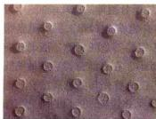

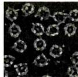

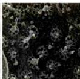  
图9-2 用冷冻蚀刻电镜技术（A）和高分辨率扫描电镜（B）显示的核孔复合体  
（A图由Bechara Kachar博士惠赠；B图由任合博士和张传茂博士提供）

对于这个模型的结构组成目前有两种理解：①从横向上看，核孔复合体由周边向核孔中心依次可分为环、辐、栓三种结构亚基。②从纵向上看，核孔复合体由核外（胞质面）向核内（核质面）依次可分为胞质环、辐（+栓）、核质环三种结构亚基，形成“三明治”(sandwich)式的结构。综合起来，核孔复合体主要有以下4种结构组分：①胞质环（cytoplasmic ring）：位于核孔边缘的胞质面一侧，又称外环。环上有8条短纤维对称分布并伸向胞质。②核质环（nuclear ring）：位于核孔边缘的核质面一侧，又称内环。内环比外环结构复杂，环上也对称地连有8条细长的纤维，向核内伸入50\~70 nm。在纤维的末端形成一个直径为60 nm的小环，小环由8个颗粒构成。这样整个核质环就像一个“捕鱼笼”（fish-trap）样的结构，也有人称之为核篮（nuclear basket）结构。③辐（spoke）：由核孔边缘伸向中心，呈辐射状八重对称。它的结构也比较复杂，可进一步分为三个结构域：主要的区域位于核孔边缘，连接内、外环，起支撑作用，称作“柱状亚基”（column subunit）；在这个结构域之外，接触核膜部分的区域称为“腔内亚基”（luminal subunit），它穿过核膜伸入双层核膜的核周间隙；在“柱状亚基”之内，靠近核孔复合体中心的部分称作“环带亚基”（annular subunit），由8个颗粒状结构环绕形成核孔复合体核质交换的道路。④栓：或称中央栓（central plug），位于核孔的中心，呈颗粒状或棒状，所以又称为中央颗粒（central granule）。由于推测它在核质交换中起一定的作用，所以也把它叫做“transporter”。不过不是在所有的核孔复合体中都能观察到这种结构，因此有人认为它不是核孔复合体的结构组分，而只是正在通过核孔复合体的被转运的物质。由上述结构模型可见，核孔复合体相对于垂直于核膜通过核孔中心的轴呈辐射状八重对称结构，而相对于平行于核膜的平面则是不对称的，即核孔复合体在核质面与胞质面两侧的结构明显不对称，这与其在功能上的不对称性是一致的。

Ris 与 M. Malecki 运用 HR-FESEM 观察非洲瓜瓣卵母细胞核膜上的核孔复合体，发现 “捕鱼笼” 并非中断且游离在核质中，而是与一种称为 “cable” 的网络通道相连通。这种 cable 由与 “捕鱼笼” 类似的结构单位串联而成，看上去像是 “捕鱼笼” 上的纤维与小环在核质中的周期性重复与延续。从 “捕鱼笼” 末端小环的 8 个颗粒上又发出 8 条细长的纤维，在纤维上周期性地间隔有 8 个颗粒构成的环状结构。不同的 “捕鱼笼” 发出的 cable 相互交叉，使 cable 成为一个遍布核质、相互贯通的复杂的网络。这种与 “捕鱼笼” 相连、结构相似的 cable 有何功能尚不清楚，推测它很可能与核孔复合体的核质转运功能有关。

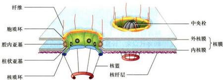  
图9-3 核孔复合体结构模型

表 9-1 已知的脊椎动物核孔复合体的蛋白质成分简表

<table><tr><td>蛋白质名称</td><td>对应的 NPC 结构</td><td>功能与特性</td></tr><tr><td>gp210</td><td>孔膜区,跨膜蛋白</td><td>能与 ConA 结合;N 端位于膜周间隙,C 端将 NPC 锚定在核膜上</td></tr><tr><td>Pom121</td><td>孔膜区,跨膜蛋白</td><td>能与 WGA 结合;C 端有 FXFG 重复序列</td></tr><tr><td>Nup153</td><td>“捕鱼笼”</td><td>能与 WGA 结合;N 端有 FXFG 重复序列;具有锌指结构,能够结合 DNA (在体外)</td></tr><tr><td>Nup180</td><td>胞质环及其纤维</td><td>不能与 WGA 结合;其抗体对核质交换没有抑制作用;介导 NPC 与胞质骨架的联系</td></tr><tr><td>Nup155</td><td>核质面与胞质面</td><td>不能与 WGA 结合</td></tr><tr><td>p62</td><td>中央颗粒</td><td>能与 WGA 结合;具有 FXFG 重复序列;其抗体对核质交换有抑制作用;能与 p58,p54,p45 形成 p62 复合体;与酵母的 Nsp1p 同源</td></tr><tr><td>p58</td><td></td><td>具有 FG 重复序列;与酵母的 Nup49p 同源</td></tr><tr><td>p54</td><td></td><td>具有 FG 重复序列;与酵母的 Nup57p 同源</td></tr><tr><td>p45</td><td></td><td>具有 FG 重复序列</td></tr><tr><td>Nup84(大鼠)或 Nup88(人)</td><td>胞质环纤维</td><td>与 Nup214/CAN 结合,并将其连接到核孔复合体上</td></tr><tr><td>Nup214/CAN</td><td>胞质环纤维</td><td>能与 WGA 结合</td></tr><tr><td>Nup107</td><td></td><td>与酵母的 Nup84p 同源</td></tr><tr><td>Nup98</td><td></td><td>具有 GLFG 重复序列;与酵母的 Nup116p 同源</td></tr><tr><td>Nup155</td><td></td><td>与酵母的 Nup170 同源</td></tr><tr><td>p260/Tpr</td><td>胞质环纤维</td><td>不能与 WGA 结合</td></tr></table>

## （二）组成成分

核孔复合体主要由蛋白质构成，其总分子质量约为125 MDA，新近推测可能含有30余种不同的多肽，共1 000多个蛋白质分子。通过生化与遗传学技术相结合，在酵母中已鉴定出30余种与核孔复合体有关的蛋白质成分。迄今已鉴定的脊椎动物的核孔复合体蛋白质成分也已达到10多种（表9-1），其中gp210与p62是最具有代表性的两个成分，它们分别代表着核孔复合体蛋白的两种类型。实际上，核孔复合体的整个结构在演化上是高度保守的。gp210与p62这两类蛋白质成分在从酵母到人的多种生物中都已被发现证实，它们在不同的物种中有很强的同源性。目前人们倾向于把所有的核孔复合体蛋白统一命名为“核孔蛋白”（nucleoporin, Nup）。

gp210 代表一类结构性跨膜蛋白，是第一个被鉴定出来的核孔复合体蛋白，分子质量为 210 kDa，位于核膜的“孔膜区”，故认为它在锚定核孔复合体的结构上起重要作用。目前认为 gp210 主要有三方面的功能：① 介导核孔复合体与核膜的连接，将核孔复合体锚定在“孔膜区”，从而为核孔复合体组装提供一个起始位点。② 在内、外核膜融合形成核孔中起重要作用。

③ 在核孔复合体的核质交换功能活动中起一定作用，如 gp210 核周间隙内肽段的抗体能够降低蛋白质入核转运的速度。

p62 代表一类功能性的核孔复合体蛋白。脊椎动物的 p62 分子主要分为两个结构域：① 疏水性 N 端区：具有 FXFG（F；苯丙氨酸；X；任意氨基酸；G；甘氨酸）形式的重复序列，这个区域可能在核孔复合体功能活动中直接参与核质交换。② C 端区：具有疏水性的七肽重复序列，类似一些纤维蛋白（如中间丝蛋白、核纤层蛋白）的杆状区，适合形成 α 螺旋。这个区域可能通过卷曲螺旋与其他核孔复合体蛋白成分相互作用，从而将 p62 分子稳定到核孔复合体上，为其 N 端进行核质交换活动提供支持。p62 对核孔复合体行使正常的功能非常重要。目前，这一类核孔复合体蛋白成分已有很多被鉴定出来，其中有些像 p62 一样带有 O-连接 GlcNac 类型的糖基化修饰，并且含有一些重复序列，如 Nup153 中的 FXFG，Nup98 中的 GLFG（L：亮氨酸），也有些没有任何糖基化修饰或类似的重复序列。

## （三）功能

从功能上讲，核孔复合体可以看做是一种特殊的跨膜运输蛋白复合体，并且是一个双功能、双向性的亲水性核质交换通道。双功能表现在它有两种运输方式：被动扩散与主动运输。双向性表现在既介导蛋白质的入核转运，又介导RNA、核糖核蛋白颗粒（RNP）的出核转运（图9-4）。

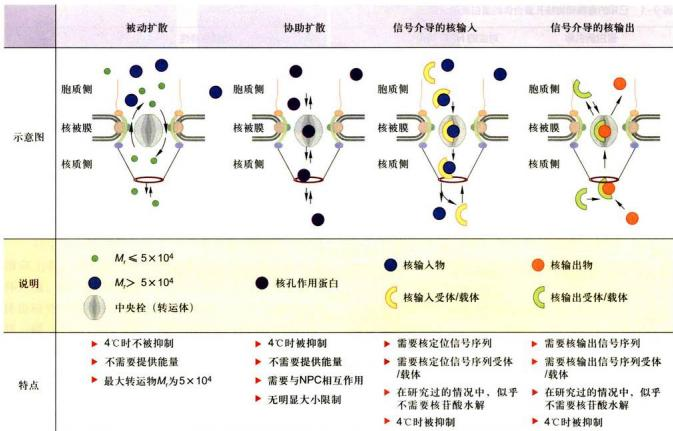  
图9-4 通过核孔复合体物质运输的功能示意图

## 1. 通过核孔复合体的被动扩散

核孔复合体作为被动扩散的亲水通道，其有效直径为9\~10 nm，有的可达12.5 nm，即离子、小分子以及直径在10 nm以下的物质原则上可以自由通过。对于球形蛋白质，这种有效直径相当于允许分子质量在40\~60 kDa的蛋白质分子自由穿过核孔。但实际上并不是所有符合这个条件的蛋白质都可以随意出入细胞核。有许多小分子的蛋白质，如组蛋白H1，其分子质量虽只有21 kDa，但由于它本身带有具信号功能的氨基酸序列，所以是通过主动运输进入细胞核的；有的小分子蛋白质本身虽然没有信号序列，但可以与其他有信号序列的成分结合，一起被主动运输到核内。因此，核孔复合体的这种被动扩散通道并不意味着所有10 nm以下的小分子在核被膜两侧就一定均匀分布。有些小分子蛋白质可能会因为与其他大分子相结合，或与一些不溶性结构成分（如中间丝、核基质）结合而被限制在细胞质或细胞核内。

## 2. 核孔复合体的主动运输

生物大分子的核质分配如亲核蛋白的核输入，RNA 分子及核糖核蛋白颗粒（RNP）的核输出，在细胞核功能活性的控制中起非常重要的作用。对于真核细胞来说，典型的哺乳类细胞的核被膜上有 3 000～4 000 个核孔（10～20 个/μm²）。如果细胞正在合成 DNA，为了确保染色质包装，则需要每 3 min 从细胞质向核内输入 $10^{6}$ 个组蛋白分子，这意味着每个核孔每分钟要运进 100 个组蛋白分子。如果细胞在迅速生长，则需要每个核孔每分钟从细胞核向细胞质输出 3 对核糖体大小亚基，以确保蛋白质合成的需要。现在已知，这种大分子的核质分配主要是通过核孔复合体的主动运输完成的，具有高度的选择性，并且是双向的。其主动运输的选择性表现在以下三个方面：① 对运输颗粒大小的限制。主动运输的功能直径比被动运输大，为 10～20 nm，甚至可达 26 nm。像核糖体亚基那样大的 RNP 也可以通过核孔复合体从核内运输到细胞质中，表明核孔复合体的有效直径的大小是可调节的。②通过核孔复合体的主动运输是一个信号识别与载体介导的过程，需要消耗ATP能量，并表现出饱和动力学特征。③通过核孔复合体的主动运输具有双向性，即核输入与核输出，它既能把复制、转录、染色体构建和核糖体亚基组装等所需要的各种因子如DNA聚合酶、RNA聚合酶、组蛋白、核糖体蛋白等运输到核内；同时又能将翻译所需的RNA、组装好的核糖体亚基从核内运送到细胞质。有些蛋白质或RNA分子甚至两次或多次穿越核孔复合体，如核糖体蛋白、snRNA。

近期对于亲核蛋白的入核转运机制的研究进展较快。亲核蛋白（karyophilic protein）是指在细胞质内合成后，需要或能够进入细胞核内发挥功能的一类蛋白质。大多数的亲核蛋白往往在一个细胞周期中一次性地被转运到核内，并一直停留在核内行使功能，典型的如组蛋白、核纤层蛋白；但也有一些亲核蛋白需要穿梭于核质之间进行功能活动，如核输入蛋白（importin）。通过研究核质蛋白（nucleoplasmmin）的入核转运，人们逐步发现了指导亲核蛋白入核的信号。亲核蛋白一般都含有特殊的氨基酸序列，这些内含的特殊短肽保证了整个蛋白质能够通过核孔复合体被转运到细胞核内。这段具有“定向”“定位”作用的序列被命名为核定位序列（nuclear localization sequence）或核定位信号（nuclear localization signal, NLS）。第一个被确定序列的NLS来自猴肾病毒（SV40）的T抗原（分子质量92 kDa）。这个NLS由7个氨基酸残基构成：Pro-Lys-Lys-Lys-Arg-Lys-Val。其中仅一个氨基酸残基的突变就会导致该蛋白在胞质内不正常积累。如果将这段NLS序列连接到非亲核蛋白上，则非亲核蛋白就会被转运到核内。此后，又陆续鉴定出一些其他亲核蛋白的NLS。目前认为NLS是存在于亲核蛋白内的一些短的氨基酸序列片段，富含碱性氨基酸残基，如Lys、Arg，此外还常常含有Pro。这些氨基酸残基片段可以是一段连续的序列，如上述SV40T抗原的NLS；也有分成两段存在于亲核蛋白的氨基酸序列中，两段之间往往间隔约10个氨基酸残基，如核质蛋白的NLS。在不同的NLS之间尚未发现共有的特征序列。与指导蛋白质跨膜运输的信号肽不同，NLS序列可存在于亲核蛋白的不同部位，并且在指导亲核蛋白完成核输入后并不被切除。

亲核蛋白通过核孔复合体的转运是分步进行的，根据整个过程对能量的需求可粗略分为两步：结合（binding）与转移(translocation）。亲核蛋白首先结合到核孔复合体的胞质面，这一步不需要能量，但依赖正常的NLS；随后的转移步骤则需要GTP水解供能。亲核蛋白除了本身具有NLS外，其入核转运还需要一些胞质蛋白因子的帮助。目前比较确定的因子有importin- $\alpha$ 、importin- $\beta$ 、Ran和NTF2等。在它们的参与下，亲核蛋白的入核转运可分为如下几个步骤（图9-5）：①亲核蛋白通过NLS识别importin- $\alpha$ ，与可溶性NLS受体importin- $\alpha$ /improtin- $\beta$ 异二聚体结合，形成转运复合物。②在importin- $\beta$ 的介导下，转运复合物与核孔复合体的胞质纤维结合。③转运复合物通过改变构象的核孔复合体从胞质面被转移到核质面。④转运复合物在核质面与Ran-GTP结合，并导致复合物解离，亲核蛋白释放。⑤受体的亚基与结合的Ran返回胞质，在胞质内Ran-GTP水解形成Ran-GDP并与importin- $\beta$ 解离，Ran-GDP返回核内再转换成Ran-GTP状态。

对于 RNA 及核糖体亚基的出核转运机制了解得较少。真核细胞中RNA一般要经过转录后加工、修饰成为成熟的RNA分子后才能被转运出核。①由RNA聚合酶I转录的rRNA分子，总是在核仁中与从胞质中转运进来的核糖体蛋白结合形成核糖体亚基，以RNP的形式离开细胞核，转运过程需要能量。②由RNA聚合酶Ⅲ转录的5S rRNA与tRNA的转运是一种由蛋白质介导的过程。③由RNA聚合酶Ⅱ转录的核内异质RNA(heterogeneous nuclear RNA, hnRNA)，首先需要在核内进行5'端加帽和3'端附加多腺苷酸序列(polyA)以及剪接等加工过程，然后形成成熟的mRNA出核，出核转运也是一个需要载体的主动运输过程。真核细胞的snRNA、mRNA与tRNA，无论在细胞质还是细胞核中，都是与相关的蛋白质结合在一起，即以各种RNP的形式存在的。所谓RNA的出核转运实际上是RNA-蛋白质复合体的转运，即RNA的核输出离不开特殊的蛋白质因子的参与，这些蛋白质因子本身含有出核信号。目前人们正致力于寻找在RNA分子与核孔复合体之间起桥梁作用的信号与载体。现已发现一些与RNA共同出核的蛋白因子，如HIV病毒的Rev蛋白、转录因子TFⅢA、蛋白激酶A抑制因子PKI等，含有对它们的出核转运起决定作用的氨基酸序列，命名为核输出信号(nuclear export signal, NES)。此外，有迹象表明入核转运与出核转运之间可能有某种联系，如它们可能需要某些共同的因子。

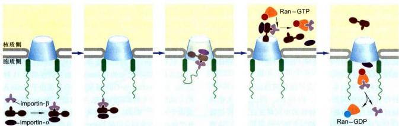  
图9-5 亲核蛋白从细胞质向细胞核输入的过程示意图

## 三、核纤层

哺乳动物体细胞的核纤层主要由三种核纤层蛋白构成，它们分别是lamin A、lamin B和lamin C。其中，lamin A和lamin C是同一个基因的不同拼接体（splicing variant），前566个氨基酸完全相同，但是C端的序列是不一样的。lamin A/C的表达具有组织与发育时期的特异性，但lamin B则在哺乳动物的所有细胞中表达。在早期小鼠胚胎中，lamin A核纤层蛋白不表达，所以它们被认为可能与细胞的分化有关。lamin B缺失的小鼠成纤维细胞的细胞核变形、细胞分化异常、染色体倍数增加以及过早地衰老。

核纤层蛋白本身形成纤维状网络结构（图9-6）。纤维直径与中间丝类似，约 $10\mathrm{nm}$ 。所以，有人也将核纤层蛋白认为是一类特殊的中间丝蛋白。核纤层蛋白与其他蛋白质存在结构与功能上的相互关系。这些蛋白质主要包括一些核被膜内膜蛋白（INM protein），如 SUN1（Sad1-Unc84）、LAP（lamin-associated polypeptide）；核孔复合体蛋白；细胞骨架结合蛋白，如 Nesprin；核基质与染色质结合蛋白，如 BAF（barrier-to-autointegration factor）。

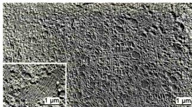  
图9-6 冷冻蚀刻电镜技术显示核纤层的纤维结构（UeliAebi博士惠赠）

核纤层的功能主要包括以下几个方面：①结构支撑功能。核纤层蛋白形成骨架结构支撑于核被膜的内侧，使得核被膜能起到细胞核与细胞质之间的隔离与信息交换功能。核纤层的骨架功能还得以使细胞核维持正常的形状与大小。②调节基因表达。果蝇细胞中基因组范围的研究结果表明，沉默基因更倾向于分布于核纤层附近，异染色质更易与核纤层结合，而且核纤层附近染色质的乙酰化水平较低。然而，在酵母细胞中活跃转录的基因也分布于核纤层附近，它们常与核孔复合体结合。所以，核纤层与基因表达的确切关系还不是非常清楚。很可能在不同物种的细胞中，甚至不同组织的细胞中情况不一样。③调节DNA修复。研究表明，lamin A核纤层蛋白是双链DNA断裂修复必需的。核纤层蛋白功能异常患者细胞中的基因组变得不稳定，DNA修复反应滞后，端粒变短。④与细胞周期的关系。细胞分裂过程中，核纤层蛋白解聚成可溶的单体或与崩解后的核被膜相结合。新核形成时，核被膜与染色质结合的同时，核纤层也最后重新形成。

核纤层蛋白基因的突变导致的核纤层功能丧失会引起多种疾病。已知的与lamin A相关的疾病有11种之多。如Hutchinson-Gilford早老综合征是由于lamin A的C端的50个氨基酸的缺失，非典型性Werner综合征是由于A57P、R133L和L140R的氨基酸改变等。lamin B受体功能改变则会引起Pelger-Huët综合征。

<!-- END CN CN09-S01 -->

---

## 对应英文内容

### 英文补充：核孔、核定位信号、Ran与核质运输

> 对应中文板块：核孔、核定位信号、Ran与核质运输。英文来源：Molecular Biology of the Cell，第7版，第12章；[本章完整原文](../../来源/英文教材/12_Intracellular_Organization_and_Protein_Sorting/chapter.md)。物理PDF页码范围：722–787（整章范围）。

<!-- BEGIN EN EN12-H042-H050 -->
#### THE TRANSPORT OF MOLECULES BETWEEN THE NUCLEUS AND THE CYTOSOL

The **nuclear envelope** encloses the DNA and defines the nuclear compartment. This envelope consists of two concentric membranes, which are perforated by nuclear pore complexes (**Figure 12–54**). Although the inner and outer nuclear membranes are continuous, they maintain distinct protein compositions. The **inner nuclear membrane** contains proteins that act as binding sites for the **nuclear lamina**, a meshwork of polymerized protein subunits called **nuclear lamins**. The lamin proteins are members of the intermediate filament family of cytoskeletal proteins (see Chapter 16). The lamina provides structural support for

(A)

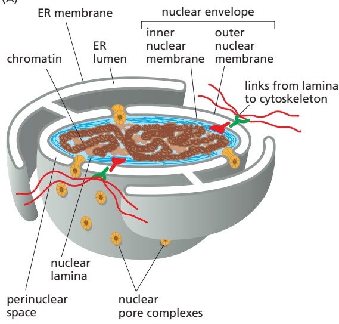

(B)

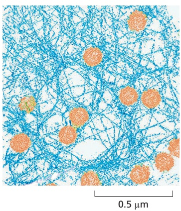

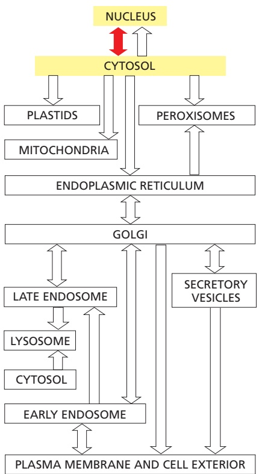

Figure 12–54 The nuclear envelope. (A) The double membrane of the nuclear envelope is penetrated by nuclear pore complexes. Transmembrane proteins in the inner and outer nuclear membranes link the nuclear lamina to the cytosolic cytoskeleton. The outer nuclear membrane is continuous with the endoplasmic reticulum (ER). The ribosomes that are normally bound to the cytosolic surface of the ER membrane and outer nuclear membrane are not shown. (B) The nuclear lamina is a fibrous protein meshwork underlying the inner membrane. Nuclear pores are seen in light brown. (B, from Y. Turgay et al., Nature 543:261–264, 2017.)

the nuclear envelope and acts as an anchoring site for chromosomes and nuclear pore complexes. The lamina is also connected to the cytoplasmic cytoskeleton via protein complexes that span the nuclear envelope, thereby providing structural links between the DNA, nuclear envelope, and cytoskeleton. The **outer nuclear membrane** is continuous with the membrane of the ER and is studded with ribosomes engaged in protein synthesis (see Figure 12–15). The proteins made on these ribosomes are transported into the space between the inner and outer nuclear membranes (the perinuclear space), which is continuous with the ER lumen.

Nuclear pores conduct extensive bidirectional traffic between the cytosol and the nucleus. The many proteins that function in the nucleus—including histones, DNA polymerases, RNA polymerases, transcriptional regulators, and RNA-processing proteins—are selectively imported into the nuclear compartment from the cytosol, where they are made. At the same time, all RNAs that function in the cytosol—including mRNAs, rRNAs, tRNAs, and miRNAs—are exported after they are synthesized and processed in the nucleus. Like the import process, the export process is selective; mRNAs, for example, are exported only after they have been properly modified by RNA-processing reactions in the nucleus. In some cases, multiple selective transport steps are needed to assemble a complex structure. Ribosomes, for instance, are made from proteins that are synthesized in the cytosol, imported into the nucleus, and exported back to the cytosol only after their assembly with newly made ribosomal RNA. These pre-ribosomal particles then complete their assembly into functional ribosomes in the cytosol, with certain assembly and transport factors returning to the nucleus to help assemble the next ribosome.

#### Nuclear Pore Complexes Perforate the Nuclear Envelope

Large and elaborate **nuclear pore complexes (NPCs)** perforate the nuclear envelope in all eukaryotes. Each NPC is composed of a set of approximately 30 different proteins, or **nucleoporins**. NPCs display eightfold rotational symmetry, with axial symmetry of the central core. Hence, each nucleoporin is present in multiple copies, resulting in 500–1000 protein molecules in the fully assembled NPC, with an estimated mass of 66 million daltons in yeast and 125 million daltons in vertebrates (**Figure 12–55**). Most nucleoporins are composed of repetitive protein domains of only a few different types, which have evolved through extensive gene duplication. Some of the scaffold nucleoporins that abut the membrane (see Figure 12–55) are evolutionarily and structurally related to vesicle coat protein complexes, such as clathrin and the COPII coat (discussed in Chapter 13), which shape transport vesicles. One protein is even used as a common building block in both NPCs and vesicle coats. It appears that an ancestral membrane-bending protein that helped shape the elaborate membrane systems of eukaryotic cells evolved into a family of proteins that stabilize the sharp membrane bends at nuclear pores and budding transport vesicles.

The nuclear envelope of a typical mammalian cell contains 3000–4000 NPCs, although that number varies widely, from a few hundred in glial cells to almost 20,000 in Purkinje neurons. Each NPC can transport a staggering 1000 macromolecules per second and can transport in both directions at the same time. The internal diameter of each NPC is ∼40 nm, large enough to accommodate ribosomal subunits and even viral particles. However, this enormous pore is not empty; instead, it is filled with unstructured protein regions contributed by the channel nucleoporins.

These unstructured domains contain numerous repeats of phenylalanine– glycine (FG) motifs whose weak affinity for each other creates a gel-like mesh inside the NPC. This mesh acts as a sieve that restricts the diffusion of large macromolecules while allowing smaller molecules to pass. Researchers have determined the effective size of the sieve by injecting labeled water-soluble molecules of different sizes into the cytosol and then measuring their rate of diffusion into the nucleus. Small molecules (5000 daltons or less) diffuse in so fast that we can consider the nuclear envelope freely permeable to them. The barrier is progressively restrictive to larger molecules such that proteins greater than ∼40,000 daltons or ∼5 nm in diameter cannot enter by passive diffusion.

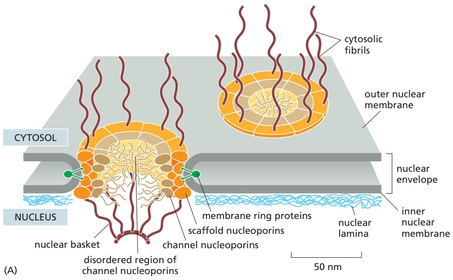

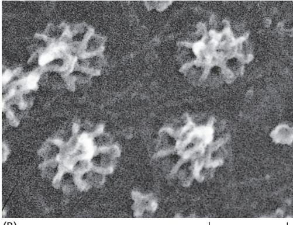

(B)

0.1 µm

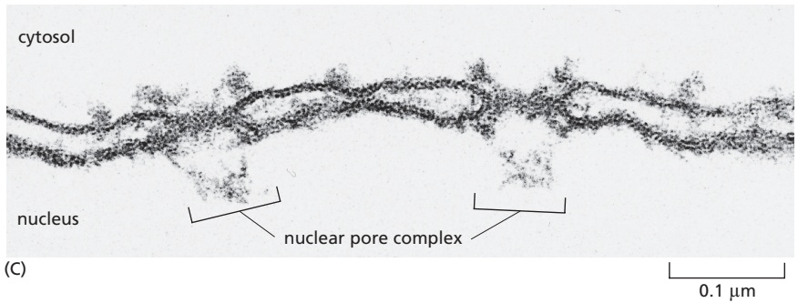

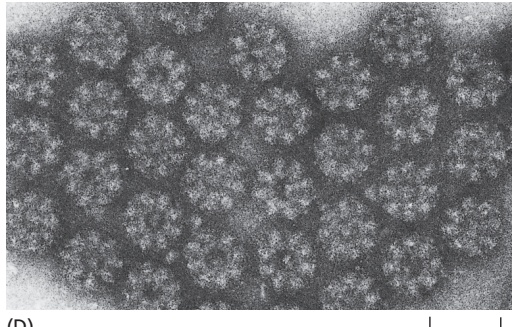

(D)

Figure 12–55 The arrangement of NPCs in the nuclear envelope. (A) In a vertebrate NPC, nucleoporins are arranged with striking eightfold rotational symmetry. In addition, immunoelectron microscope studies show that the proteins that make up the central portion of the NPC are oriented symmetrically across the nuclear envelope, so that the nuclear and cytosolic sides look identical. The eightfold rotational and twofold transverse symmetry explains how such a huge structure can be formed from only about 30 different proteins: many of the nucleoporins are present in 8, 16, or 32 copies. On the basis of their approximate localization in the central portion of the NPC, nucleoporins can be classified into (1) transmembrane ring proteins that span the nuclear envelope and anchor the NPC to the envelope; (2) scaffold nucleoporins that form layered ring structures (some scaffold nucleoporins are membrane-bending proteins that stabilize the sharp membrane curvature where the nuclear envelope is penetrated); and (3) channel nucleoporins that line a central pore. In addition to folded domains that anchor the proteins in specific places, many channel nucleoporins contain extensive unstructured regions, where the polypeptide chains are intrinsically disordered. The central pore is filled with a high concentration of these disordered domains whose weak interactions with each other form a gel that blocks the passive diffusion of large macromolecules. The disordered regions contain a large number of phenylalanine–glycine (FG) repeats. Fibrils protrude from both the cytosolic and the nuclear sides of the NPC. By contrast to the twofold transverse symmetry of the NPC core, the fibrils facing the cytosol and nucleus are different: on the nuclear side, the fibrils converge at their distal end to form a basketlike structure. The precise arrangement of individual nucleoporins in the assembled NPC is still a matter of intense debate, because atomic resolution analyses have been hindered by the sheer size and flexible nature of the NPC and by difficulties in purifying sufficient amounts of homogeneous material. A combination of electron microscopy, computational analyses, and crystal structures of nucleoporin subcomplexes has been used to develop the current models of the NPC architecture. (B) A scanning electron micrograph of the nuclear side of the nuclear envelope of an oocyte, showing NPCs with their basketlike fibrils. (C) An electron micrograph showing a side view of two NPCs (brackets); note that the inner and outer nuclear membranes are continuous at the edges of the pore. (D) An electron micrograph showing face-on views of negatively stained NPCs. The membrane has been removed by detergent extraction. Note that some of the NPCs contain material in their center, which is thought to be trapped macromolecules in transit through these NPCs. (A, adapted from A. Hoelz et al., Annu. Rev. Biochem. 80:613–643, 2011. B, © 1992 M.W. Goldberg and T.D. Allen. Originally published in J. Cell Biol. https://doi.org/10.1083/jcb.119.6.1429. With permission from Rockefeller University Press. $\mathrm { C } ,$ courtesy of Werner Franke and Ulrich Scheer. D, courtesy of Ron Milligan.)

Because many cell proteins are too large to diffuse passively through the NPCs, the nuclear compartment and the cytosol can maintain different protein compositions. Mature cytosolic ribosomes, for example, are about 30 nm in diameter and thus cannot diffuse through the NPC, confining protein synthesis to the cytosol. But how does the nucleus export newly made ribosomal subunits or import large molecules, such as DNA polymerases and RNA polymerases, which have subunitMBoC7 m12.09/12.56 molecular masses of 100,000–200,000 daltons? As we discuss next, these and most other transported protein and RNA molecules bind to specific receptor proteins that ferry large molecules through NPCs. Even small proteins such as histones frequently use receptor-mediated mechanisms to cross the NPC, thereby increasing transport efficiency.

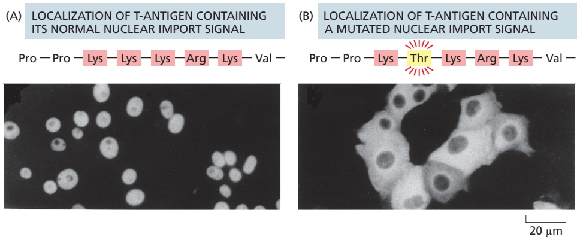

Figure 12–56 The function of a nuclear localization signal. Immunofluorescence micrographs showing the cell location of SV40 virus T-antigen containing or lacking a short sequence that serves as a nuclear localization signal. (A) The normal T-antigen protein contains the lysinerich sequence indicated and is imported to its site of action in the nucleus, as indicated by immunofluorescence staining with antibodies against the T-antigen. (B) T-antigen with an altered nuclear localization signal (a threonine replacing a lysine) remains in the cytosol. (From D. Kalderon et al., Cell 39:499–509, 1984. With permission from Elsevier.)

#### Nuclear Localization Signals Direct Proteins to the Nucleus

When proteins are experimentally extracted from the nucleus and reintroduced into the cytosol, even the very large ones reaccumulate efficiently in the nucleus. Sorting signals called **nuclear localization signals (NLSs)** are responsible for the selectivity of this active nuclear import process. The signals have been precisely defined by using recombinant DNA technology for numerous proteins that are imported into the nucleus (**Figure 12–56**). The most commonly used signal consists of one or two short sequences that are rich in the positively charged amino acids lysine and arginine (see Figure 12–13), with the precise sequence varying for different proteins. Some nuclear proteins contain different types of signals, some of which are not yet characterized.

NLSs can be located almost anywhere in the amino acid sequence and are thought to form loops or patches on the protein surface. Many NLSs function even when linked as short peptides to the surface of a cytosolic protein, suggesting that the precise location of the signal within the amino acid sequence of a nuclear protein is not important. Moreover, as long as one of the protein subunits of a multicomponent complex displays a nuclear localization signal, the entire complex will be imported into the nucleus.

Macromolecular transport across NPCs differs fundamentally from the transport of proteins across the membranes of other organelles: NPC transport occurs through a large, constitutively open, mesh-filled pore, rather than through a much smaller protein translocator whose aqueous pore is typically gated by the protein being transported. For this reason, fully folded proteins and large multiprotein complexes can be transported in either direction through the nuclear pore. By contrast, transport through organellar protein translocators of the ER, mitochondria, and chloroplasts is unidirectional and usually requires the protein to be extensively unfolded.

One can visualize the transport of nuclear proteins through NPCs by coating tiny colloidal gold particles with a nuclear localization signal, injecting the particles into the cytosol, and then following their fate by electron microscopy (**Figure 12–57**). The particles first arrive at the tentacle-like fibrils that extend from the scaffold nucleoporins at the rim of the NPC into the cytosol, and then proceed through the center of the NPC. This observation illustrates that NLSs impart the ability of large particles to navigate through the otherwise impermeable diffusion barrier posed by the disordered mesh inside the nuclear pore.

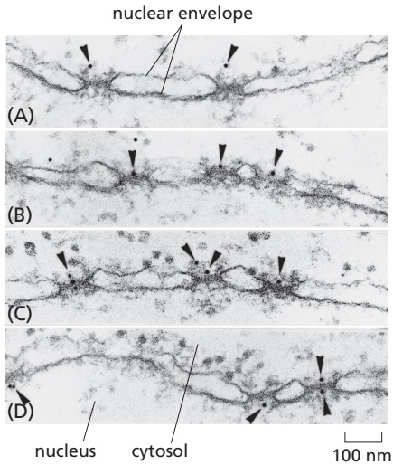

Figure 12–57 Visualizing active import through NPCs. This series of electron micrographs shows 5- to 10-nm-diameter colloidal gold spheres (arrowheads) coated with peptides containing nuclear localization signals entering the nucleus through NPCs. The gold particles were injected into the cytosol of living cells, which then were fixed and prepared for electron microscopy at various times after injection. (A) Gold particles are first seen in proximity to the cytosolic fibrils of the NPCs. (B, C) They are then seen at the center of the NPCs, exclusively on the cytosolic face. (D) They then appear on the nuclear face. These gold particles have much larger diameters than those of the diffusion channels in the NPC and are imported by active transport. (From N. Panté and U. Aebi, Science 273:1729–1732, 1996. With permission from AAAS.)

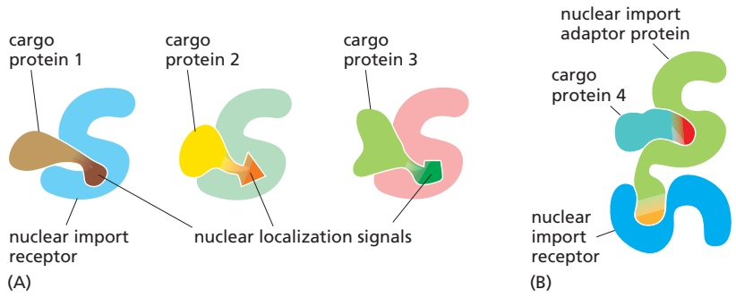

Figure 12–58 Nuclear import receptors. (A) Different nuclear import receptors bind different nuclear localization signals and thereby different cargo proteins. (B) Cargo protein 4 requires an adaptor protein to bind to its nuclear import receptor. The adaptors are structurally related to nuclear import receptors and recognize nuclear localization signals on cargo proteins. They also contain a nuclear localization signal that binds them to an import receptor, but this signal only becomes exposed when they are loaded with a cargo protein.

#### Nuclear Import Receptors Bind to Both Nuclear Localization Signals and NPC Proteins

To initiate nuclear import, nuclear localization signals must be recognized by **nuclear transport receptors**. Most of these receptors are part of a largeMBoC7 m12.11/12.58 family of proteins called karyopherins. In yeast, there are 14 genes encoding karyopherins; in animal cells, the number is significantly larger. Karyopherin family members that mediate nuclear import are called **nuclear import receptors**, while those for nuclear export (discussed later) are called **nuclear export receptors**. Each import receptor can bind and transport the subset of cargo proteins containing the appropriate nuclear localization signal (**Figure 12–58A**). Nuclear import receptors sometimes use adaptor proteins that form a bridge between the import receptors and the nuclear localization signals on the proteins to be transported (**Figure 12–58B**). Some adaptor proteins are structurally related to nuclear import receptors, suggesting a common evolutionary origin. By using a variety of import receptors and adaptors, cells are able to recognize the broad repertoire of nuclear localization signals that are displayed on nuclear proteins.

The import receptors are soluble cytosolic proteins that contain multiple low-affinity binding sites for the FG repeats found in the unstructured domains of several nucleoporins. The FG repeats in the fibrils of cytosol-facing nucleoporins serve to initially recruit import receptors and their bound cargo proteins to NPCs. The import receptors can then bind the FG repeats that form the mesh inside the nuclear pore to disrupt interactions between the repeats. In this way, the receptor–cargo complex locally dissolves the gel-like mesh and can diffuse into and within the NPC pore (**Figure 12–59**).

It is possible to re-create in a test tube a gel consisting of unstructured polypeptides containing FG repeats. This gel displays restricted diffusion of inert cargoes in a size-dependent manner similar to diffusion through NPCs. Diffusion into this artificial gel is more than 1000-fold faster for cargoes bound to an import receptor. At this rate, a cargo in complex with an import receptor could traverse the distance across an NPC in a few milliseconds, consistent with the rate

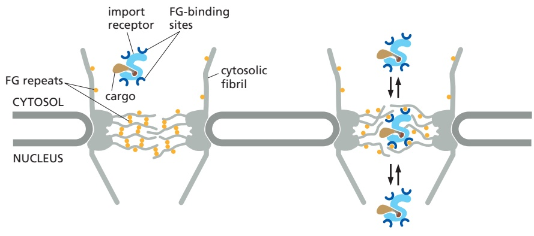

Figure 12–59 Interaction of nuclear import receptors with FG repeats. Left: Nuclear import receptors contain various low-affinity FG repeat–binding sites on their surface. This facilitates their initial recruitment to NPCs because of interactions with FG repeats found on the cytosolic fibrils of the NPCs. The interior of the NPC is filled with a mesh of FG repeat–containing proteins whose weak interactions with each other restrict nonspecific diffusion of proteins and other macromolecules through the pore. Right: Cargo receptors can rapidly partition into the FG repeat mesh by interacting with the FG repeats and locally melting the mesh. This partitioning into and out of the mesh substantially accelerates diffusion of the cargo receptor (and its bound cargo) through the NPC. Proteins without surface FG repeat–binding sites cannot melt the mesh, and their diffusion through the NPC is comparatively slow.

of transport observed in cells. It is important to realize that in this model, diffusion is not directional; instead, the import receptor simply accelerates diffusion to provide cargo access to the nuclear compartment. As we will see, it is the selective dissociation of cargo only on the nuclear side of the NPC that confers directionality to the import process. The import receptor then returns back to the cytosol for transport of the next cargo.

#### The Ran GTPase Imposes Directionality on Nuclear Import Through NPCs

The import of nuclear proteins through NPCs concentrates specific proteins in the nucleus and thereby increases order in the cell. The cell fuels this ordering process by harnessing the energy of GTP hydrolysis by the GTPase **Ran**, which is required for both nuclear import and export.

Like other GTPases, Ran is a molecular switch that can exist in two conformational states, depending on whether GDP or GTP is bound (Figure 3–63). Two Ran-specific regulatory proteins trigger the conversion between the two states: a cytosolic GTPase-activating protein (GAP) triggers GTP hydrolysis and thus converts Ran-GTP to Ran-GDP, and a nuclear guanine nucleotide exchange factor (GEF) promotes the exchange of GDP for GTP and thus converts Ran-GDP to Ran-GTP. Because Ran GAP is located in the cytosol and Ran GEF is located in the nucleus, the cytosol contains mainly Ran-GDP, and the nucleus contains mainly Ran-GTP (**Figure 12–60A**). The partitioning of the GAP and GEF between the cytosol and nucleus in a cell is due to their preferential association with the cytosolic cytoskeleton and nuclear chromatin, respectively.

The gradient of the two conformational forms of Ran drives nuclear transport in the appropriate direction. Import receptors, facilitated by FG-repeat binding, accelerate diffusion through the mesh inside the NPC channel. When an import receptor reaches the nuclear side of the pore complex, Ran-GTP binds to it and causes the receptor to release its cargo (**Figure 12–60B**). Because this occurs only on the nuclear side of the pore where the Ran-GTP concentration is high, the import process becomes rectified (that is, unidirectional), even though diffusion of the cargo–import receptor complex through the pore is governed by random back-and-forth diffusion.

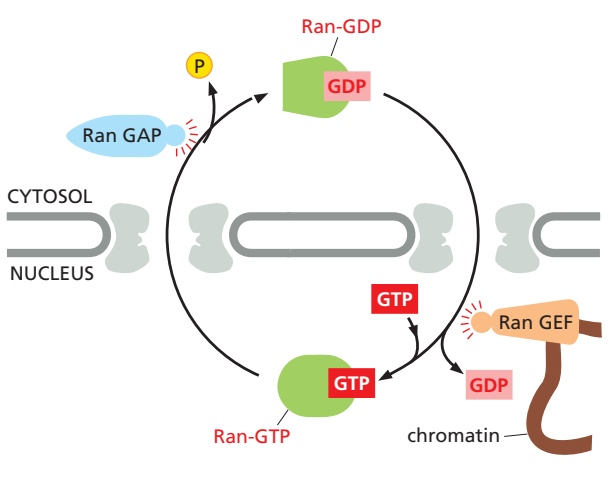

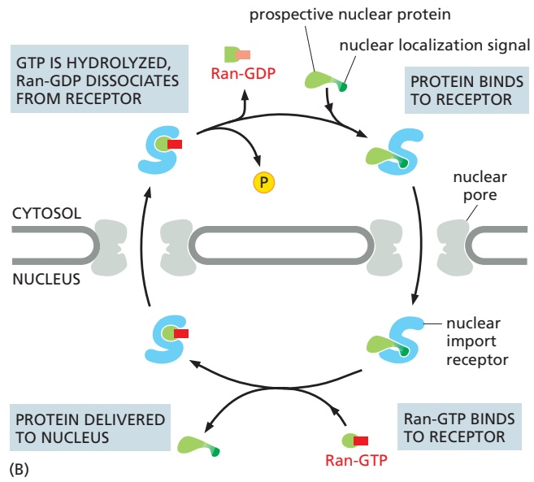

(A)

Figure 12–60 The compartmentalization of Ran-GDP and Ran-GTP provides directionality to nuclear transport. (A) Localization $\cot \mathsf { R a n - } \dot { \mathsf { G D P } }$ in the cytosol and Ran-GTP in the nucleus results from the localization of two Ran regulatory proteins: Ran GTPase-activating protein (Ran GAP) is located in the cytosol, and Ran guanine nucleotide exchange factor (Ran GEF) binds to chromatin and is therefore located in the nucleus. Ran-GDP is imported into the nucleus by its own import receptor (not shown), which is specific for the GDP-bound conformation of Ran. The Ran-GDP receptor is structurally unrelated to the main family of nuclear transport receptors. However, it also binds to FG repeats in NPC channel nucleoporins. (B) The interaction between a nuclear import receptor and its cargo is reversed by Ran-GTP. This means the receptor–cargo interaction is favored in the cytosol but disfavored in the nucleus. This results in net cargo transport from the cytosol to the nucleus.

Having discharged its cargo in the nucleus, the empty import receptor with Ran-GTP bound is transported back through the pore complex by the same mechanism of facilitated diffusion. When the complex of Ran-GTP and the import receptor reaches the cytosol, Ran GAP triggers Ran-GTP to hydrolyze its bound GTP. The resulting Ran-GDP lacks affinity for the import receptor, releasing it for another cycle of nuclear import. Thus, Ran-GDP permits cargo binding in the cytosol, while Ran-GTP stimulates cargo discharge in the nucleus, thereby imparting directionality to the import process.

#### Nuclear Export Works Like Nuclear Import, but in Reverse

The nuclear export of large molecules, such as new ribosomal subunits and RNA molecules, occurs through NPCs and also depends on a selective transport system. The transport system relies on **nuclear export signals** on the macromolecules to be exported. Export receptors bind to both the export signal, either directly or via an adaptor, and to NPC proteins to guide their cargo to the cytosol. As might be expected from the structural and evolutionary similarity of import receptors and export receptors, the import and export transport systems work in similar ways but in opposite directions: the import receptors bind their cargo molecules in the cytosol, release them in the nucleus, and are then exported to the cytosol for reuse, while the export receptors function in the opposite fashion (**Figure 12–61**).

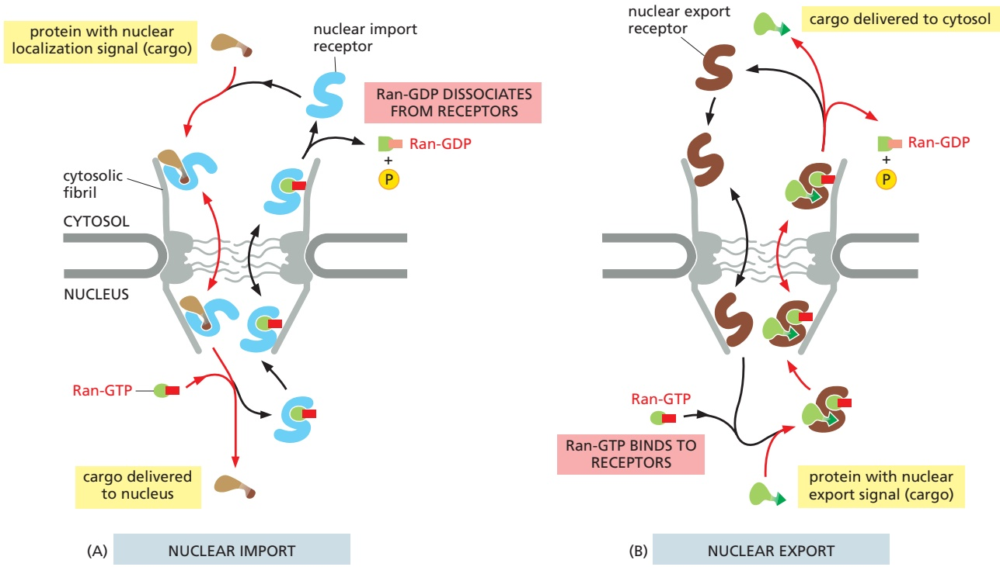

Figure 12–61 Nuclear import and nuclear export both use the Ran GTPase cycle. Movement through the NPC of loaded nuclear transport receptors occurs along the FG repeats displayed by certain NPC proteins. The differential localization of Ran-GTP in the nucleus and Ran-GDP in the cytosol provides directionality (red arrows) to both nuclear import (A) and nuclear export (B). Ran GAP stimulates the hydrolysis of GTP to produce Ran-GDP on the cytosolic side of the NPC (see Figure 12–60A). The critical difference between Ran-mediated nuclear import and nuclear export is the nature of cargoMBoC7 m12.13/12.61 binding by the cargo receptor. In nuclear import, cargo binding is mutually exclusive of Ran-GTP; in nuclear export, cargo binding requires Ran-GTP. Thus, the locations where cargo is picked up and released are exactly reversed in nuclear export compared to nuclear import.

The ability of export receptors to work in reverse derives from the way they interact with the Ran GTPase. Ran-GTP in the nucleus promotes cargo binding to the export receptor, rather than promoting cargo dissociation as in the case of import receptors. Once the export receptor moves through the pore to the cytosol, it encounters Ran GAP, which induces the receptor to hydrolyze its GTP to GDP. As a result, the export receptor flips its conformation and releases both its cargo and Ran-GDP in the cytosol. Free export receptors and free Ran-GDP use the nuclear import pathway to enter the nucleus and complete the cycle.

As we discuss in detail in Chapter 6, cells control the export of RNAs from the nucleus. snRNAs, miRNAs, and tRNAs bind to nuclear export receptors, and they use the Ran-GTP gradient to fuel the transport process. By contrast, the export of mRNAs out of the nucleus uses a different mechanism that does not use export receptors or the Ran GTPase system. Instead, the spliced and processed mRNA is assembled with several nuclear RNA-binding proteins, some of which can bind the nuclear side of NPCs and others that bind FG repeats (see Figure 6–40). This export-competent mRNA ribonucleoprotein (mRNP) complex can then navigate through the FG repeat mesh within the NPC. A helicase complex that resides on the cytosolic side of NPCs uses the energy of ATP hydrolysis to strip several proteins from the mRNP, including the FG repeat–binding protein. This prevents the exported mRNA from reentering the NPC, making the export process unidirectional. The stripped RNA-binding proteins are rapidly imported back to the nucleus (using the import receptor and Ran GTPase system) for another round of transport.

#### Transport Through NPCs Can Be Regulated by Controlling Access to the Transport Machinery

Some proteins continually shuttle back and forth between the nucleus and the cytosol. This can happen if a protein is small enough to diffuse through the nuclear pore but contains an import or export signal that constantly retrieves it to the nucleus or cytosol. Other proteins contain both nuclear localization signals and nuclear export signals. The relative rates of their import and export determine the steady-state localization of such shuttling proteins: if the rate of import exceeds the rate of export, a protein will be located mainly in the nucleus; conversely, if the rate of export exceeds the rate of import, a protein will be located mainly in the cytosol. Thus, changing the rate of import, export, or both, can change the location of a protein.

As discussed in Chapter 7, cells control the activity of some transcription regulators by keeping them out of the nucleus until they are needed there (**Figure 12–62**); similarly, cells can control the translation of certain mRNAs by retaining them in the nucleus until their protein products are needed. In many cases, cells control transport by regulating nuclear localization and export signals—turning them on or off, often by phosphorylation of amino acids close to the signal sequences (**Figure 12–63**). Other transcription regulators are bound to inhibitory cytosolic proteins that either anchor them in the cytosol (through interactions with the cytoskeleton or specific organelles) or mask their nuclear localization signals so that they cannot interact with nuclear import receptors. An appropriate stimulus releases the transcription regulatory protein from its cytosolic anchor or mask, and it is then transported into the nucleus.

One important example is the latent transcription regulatory protein that controls the transcription of genes involved in cholesterol metabolism. The protein is made and stored in an inactive form as a transmembrane protein in the ER. When a cell is deprived of cholesterol, the protein is transported from the ER to the Golgi apparatus where it encounters specific proteases that cleave off the cytosolic domain, releasing it into the cytosol. This domain is then imported into the nucleus, where it activates the transcription of genes required for both cholesterol uptake and synthesis (**Figure 12–64**). Earlier in this chapter, we discussed a similar mechanism that controls the activation of the ATF6 arm of the unfolded protein response (see Figure 12–36).

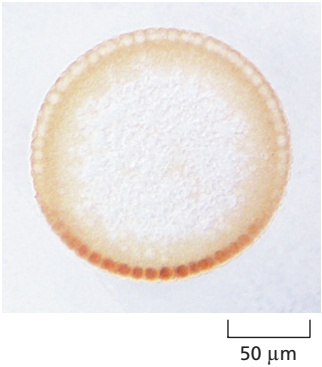

Figure 12–62 The control of nuclear transport in the early Drosophila embryo. The embryo at this stage is a syncytium, shown here in cross section, with many nuclei in a common cytoplasm, arranged around the periphery, just beneath the plasma membrane. The transcription regulatory protein Dorsal is produced uniformly throughout the peripheral cytoplasm, but it can act only when inside the nuclei. The Dorsal protein has been stained with an enzyme-coupled antibody that yields a brown product, MBoC7 m12.14/12.62revealing that Dorsal is excluded from the nuclei at the dorsal side (top) of the embryo but is concentrated in the nuclei toward the ventral side (bottom) of the embryo. The regulated traffic of Dorsal into the nuclei controls the differential development between the back and belly of the animal. (Courtesy of Siegfried Roth.)

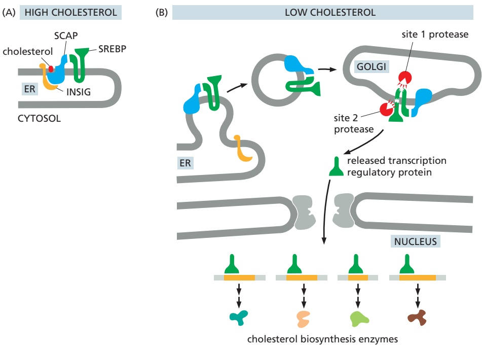

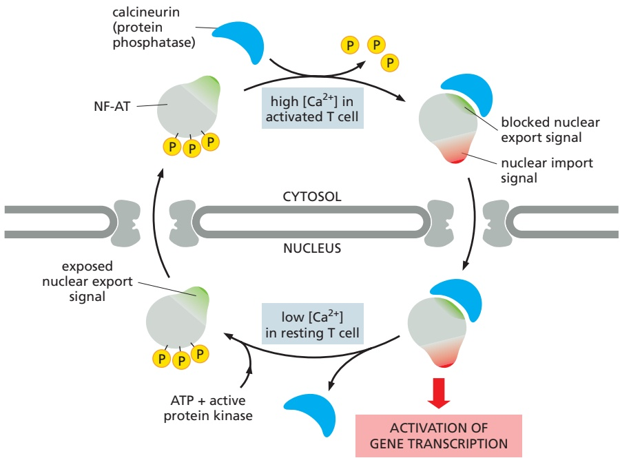

#### The Nuclear Envelope Disassembles and Reassembles During Mitosis

In animal cells, the nuclear envelope is dismantled during mitosis so that microtubules can access the replicated chromosomes for segregation between theMBoC7 m12.15/12.63 two daughter cells (discussed in Chapter 17). At the end of mitosis, the nuclear envelope reassembles, and the asymmetrical distribution of cellular contents between the cytosol and nucleus is reestablished. The major structures that must be reversibly disassembled are the nuclear lamina, the NPCs, and the membranes of the nuclear envelope.

The dismantling process is initiated by the cyclin-dependent kinase (Cdk) that is activated at the onset of mitosis (discussed in Chapter 17). Cdk

Figure 12–63 The control of nuclear import during T cell activation. The nuclear factor of activated T cells (NF-AT) is a transcription regulatory protein that, in the resting T cell, is found in the cytosol in a phosphorylated state. When T cells are activated by foreign antigen (discussed in Chapter 24), the intracellular $\mathrm { C a ^ { 2 + } }$ concentration increases. At high concentrations of $\mathrm { C a ^ { 2 + } }$ , the protein phosphatase calcineurin binds to NF-AT and dephosphorylates it. The dephosphorylation exposes nuclear import signals and blocks a nuclear export signal. The complex of NF-AT and calcineurin is therefore imported into the nucleus, where NF-AT activates the transcription of numerous genes required for T cell activation. The response shuts off when Ca2+ levels decrease, releasing NF-AT from calcineurin. Rephosphorylation of NF-AT inactivates the nuclear import signals and reexposes the nuclear export signal, causing NF-AT to relocate to the cytosol. Some of the most potent immunosuppressive drugs, including cyclosporin A and FK506, inhibit the ability of calcineurin to dephosphorylate NF-AT and thereby block the nuclear accumulation of NF-AT and T cell activation (Movie 12.6).

Figure 12–64 Feedback regulation of cholesterol biosynthesis. (A) SREBP (sterol response element binding protein), a latent transcription regulator that controls expression of cholesterol biosynthetic enzymes, is initially synthesized as an ER membrane protein. It is anchored in the ER if there is sufficient cholesterol in the membrane by interaction with a membrane protein complex composed of the proteins INSIG and SCAP (SREBP cleavage activation protein), which binds cholesterol. (B) If the cholesterolbinding site on SCAP is empty (at low cholesterol concentrations), SCAP changes conformation and dissociates from INSIG. Dissociation from INSIG frees the SCAP–SREBP complex so it can be packaged together into transport vesicles that are delivered to the Golgi apparatus. In the Golgi apparatus, two Golgi-resident proteases cleave SREBP to free its cytosolic domain from the membrane. The cytosolic domain, which is a transcription regulatory protein, then moves into the nucleus, where it binds to the promoters of genes that encode proteins involved in cholesterol biosynthesis and activates their transcription. In this way, more cholesterol is made when its concentration falls below a threshold.

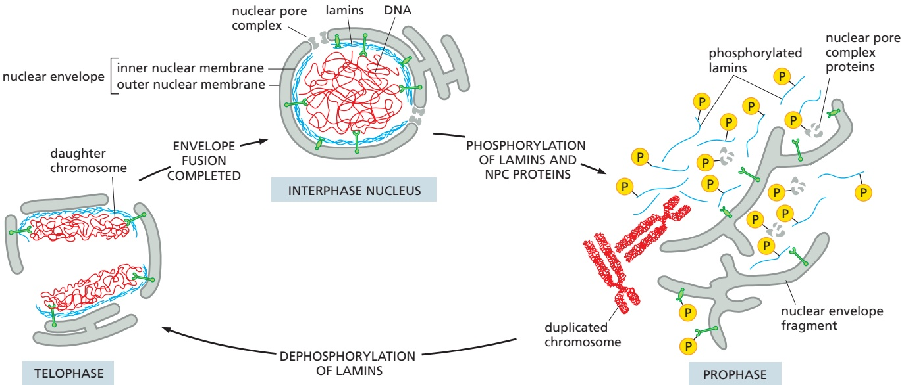

Figure 12–65 The breakdown and re-formation of the nuclear envelope and lamina during mitosis. Phosphorylation of the lamins triggers the disassembly of the nuclear lamina, which initiates the breakup of the nuclear envelope. Dephosphorylation of the lamins reverses the process. An analogous phosphorylation and dephosphorylation cycle occurs for some nucleoporins and proteins of the inner nuclear membrane, and some of these dephosphorylation events are also involved in the reassembly process. The lamin network beings to re-form around regions of individual decondensing daughter chromosomes. The lamins recruit membranes that contain interacting lamin receptors that were in the inner nuclear membrane. Eventually, as decondensation progresses, these membrane structures fuse to form a single complete nucleus. Mitotic breakdown of the nuclear envelope occurs in all metazoan cells. However, in many other species, such as yeasts, the nuclear envelope remains intact during mitosis, and the nucleus divides by fission.

phosphorylates nucleoporins, lamins, and inner nuclear membrane proteins to disrupt their interactions with each other and with chromatin. During this process, some NPC proteins become bound to nuclear import receptors, which play an important part in the reassembly of NPCs at the end of mitosis. Nuclear envelope membrane proteins—no longer tethered to the pore complexes, lamina, or chromatin—disperse throughout the ER membrane. The dynein motor protein, which moves along microtubules (discussed in Chapter 16), is recruited to the outer nuclear membrane early in mitosis and exerts a pulling force. Transmembrane proteins that tether the outer nuclear membrane to the inner nuclear membrane and lamina help transduce this force and pull the nuclear envelope off the chromatin. Together, these processes break down the barriers that normally separate the nucleus and cytosol, and the nuclear proteins that are not bound to membranes or chromosomes intermix completely with the proteins of the cytosol (**Figure 12–65**).

One protein that remains bound to chromatin even after the nuclear enve-MBoC7 m12.18/12.65lope breaks down is Ran GEF. This means Ran molecules close to chromatin are mainly in their GTP-bound conformation. By contrast, Ran molecules further away are in their GDP-bound conformation because of the action of cytosolic Ran GAP. As a result, the chromosomes in mitotic cells are surrounded by a cloud of Ran-GTP, which is important for assembling the mitotic spindle that segregates chromosome into the newly forming daughter cells (discussed in Chapter 17). After chromosome segregation, Cdk is inactivated, allowing dephosphorylation of nucleoporins, lamins, and nuclear membrane proteins. This triggers reassembly of the nuclear envelope on the surface of the complete set of chromosomes in each daughter cell. The positional marker for recruitment of nuclear envelope components to chromosomes is the surrounding cloud of Ran-GTP.

Ran-GTP releases the NPC proteins from nuclear import receptors in proximity to the chromosomes. The free NPC proteins attach to the chromosome surface, where they assemble into new NPCs. At the same time, dephosphorylated lamins bind again to chromatin and recruit ER membranes via the inner nuclear membrane proteins that reside within them. The ER progressively wraps around the entire group of chromosomes until the ER forms a sealed nuclear envelope, engulfing the chromosomes and proteins bound to them (**Movie 12.7**). The newly formed inner nuclear envelope is closely applied to the surface of the chromosomes, is enriched for inner nuclear membrane proteins, and excludes all proteins except those initially bound to the mitotic chromosomes, thus conferring a high level of selectivity to the engulfment process. Because Ran-GTP is inside the nucleus and Ran-GDP remains outside, unidirectional import of proteins that contain nuclear localization signals can occur through NPCs. In this way, the nuclear protein content is replenished, while all other large proteins, including ribosomes, are kept out of the newly assembled nucleus.

#### Summary

The nuclear envelope consists of an inner and an outer nuclear membrane that are connected with each other at perforations formed by nuclear pore complexes (NPCs). The outer nuclear membrane is continuous with the ER membrane, and the space between the inner and outer nuclear membranes is continuous with the ER lumen. RNA molecules, which are made in the nucleus, and ribosomal subunits, which are assembled there, are exported to the cytosol; in contrast, all the proteins that function in the nucleus are synthesized in the cytosol and are then imported. The extensive traffic of materials between the nucleus and cytosol occurs through NPCs, which provide a direct passageway across the nuclear envelope. The interior of NPCs contains a mesh of unstructured proteins that allows passage of small molecules but imposes a diffusion barrier that requires large macromolecules to be actively transported.

Nuclear localization signals and nuclear export signals on proteins to be transported through NPCs are recognized by corresponding nuclear transport receptors. These receptors function by binding their cargoes selectively on one side of the nuclear envelope, increasing the diffusion rate through NPCs, and releasing cargoes selectively on the other side. The free energy of GTP hydrolysis by the monomeric GTPase Ran is harnessed to provide the directionality for nuclear transport. Messenger RNAs are exported from the nucleus through NPCs as parts of large ribonucleoprotein complexes; they use a different transport route that uses ATP hydrolysis to remodel the complexes at the cytosolic side of NPCs. Cells regulate the transport of nuclear proteins and RNA molecules through the NPCs by controlling the access of these molecules to the transport machinery. Because nuclear localization signals are not removed, nuclear proteins can be imported repeatedly, as is required each time that the nucleus reassembles after mitosis.

<!-- END EN EN12-H042-H050 -->

## 跨章相关英文内容

- 连接核被膜和细胞骨架的结构：[EN第16章 · 中间丝、骨架连接与其他骨架聚合物](../../08_细胞骨架/小节/03_第三节%20中间丝.md#EN16-H063-H069)。

<!-- BEGIN NEW_SOURCES -->
---
## 新增教材补充

## 实验教程：操作材料

### 实验23 核质穿梭测定法
> 补充目的：在已有原理和机制材料上补齐教材实验的目的、试剂、器材、步骤、判读、注意事项及思考题（按该实验原文所含栏目）。
> 来源：细胞生物学实验教程（第2版） / 05_细胞生理；[原解析正文](../../来源/实验教程/05_细胞生理/正文.md) · [完整分页](../../来源/实验教程/05_细胞生理/完整分页.md) · [原页PDF](https://github.com/kazewwk/test/blob/105df226e50395012449b4bad83f589769277174/%E7%BB%86%E8%83%9E%E7%94%9F%E7%89%A9%E5%AD%A6%E5%AE%9E%E9%AA%8C%E6%95%99%E7%A8%8B_%E7%AC%AC2%E7%89%88/05_%E7%BB%86%E8%83%9E%E7%94%9F%E7%90%86/%E5%8E%9F%E5%A7%8B%E9%A1%B5%E9%9D%A2.pdf)；编号 `LAB-E023`。

<!-- BEGIN LAB LAB-E023 -->
#### 实验 23 核质穿梭测定法

#### 【实验目的】

掌握穿梭蛋白的检测方法，了解穿梭蛋白在细胞中的活动情况。

#### 【实验原理】

穿梭蛋白是一类可以在细胞核与细胞质中穿梭往返的蛋白质。目前发现的穿梭蛋白都为多功能蛋白，它们进行核/质穿梭的主要生物学功能是在胞核及胞质之间充当运输载体及进行信号传递，对于在细胞质中发生的反应起到重要调节作用。

核穿梭蛋白可以用几种方法检验，如利用酵母检验穿梭到细胞质的核蛋白，可以用温度敏感型入核的突变细胞株。这种方法，只要细胞处于限定的温度下，目标蛋白就会在细胞质中积累，即表明了穿梭运动的存在。在高等真核动物中，Goldstein 在 1958 年第一次用 $^{35}$ S 甲硫氨酸标记细胞，研究穿梭于细胞质和细胞核的核蛋白，结果来自 $^{35}$ S 甲硫氨酸标记细胞的细胞核被转移到另外一个没有被标记的细胞中。1989 年，Borer 等发展了抗体显微注射和种间异核体测定法。

其中，种间异核体成为应用最广泛的穿梭测定方法。它包括至少两个来自不同种类的细胞核杂交细胞的形成。在一个种间异核体中，一个包含目标蛋白的细胞系（供体细胞）和来自不同种类、含有不同蛋白质的另一个细胞系（受体细胞）融合。在受体细胞核中，用荧光显微镜能检测到原本只存在于供体细胞核的目标蛋白。这种方法在转运抑制物的存在下进行，抑制剂能确保入核的蛋白质并没有在细胞质中被新合成，而是从供

体细胞核中出核的（图5-1）。

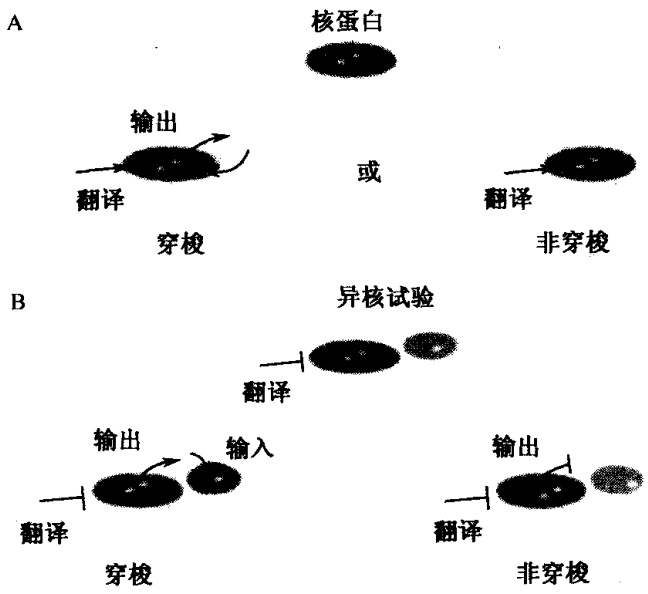

图5-1 异核体测定法（Celis，2006）

A. 单向入核通路会导致蛋白质在细胞核内的累积（非穿梭核蛋白）。或许蛋白质会被人核和出核通路同时标记，造成在细胞核和细胞质之间的动态循环（穿梭）；B. 异核体测定法可以区分穿梭和非穿梭的核蛋白。如果存在于供体细胞核内的一个蛋白质可以穿梭，那么它就会在受体细胞核中出现。非穿梭的蛋白质不会从供体细胞中出核，也不会在受体细胞核中被发现。测定法一定要在蛋白质合成抑制剂存在的情况下执行

异核体测定法经常用人类的 HeLa 细胞和鼠类的 NIH 3T3 细胞系。鼠类的细胞核容易区别典型的异染色质染色图案。

当一个穿梭蛋白被鉴定时，异核体测定法更可以被用于解释转运中的途径和信号。最近，异核体测定法被用于描述新入核蛋白质在细胞核内的通道（Leung and Lamond, 2002）。这个实验是一个转染了细胞核的穿梭蛋白的供体细胞系被作为蛋白质标记的资源，并从这些蛋白质进入受体细胞核之后开始计时，因为受体细胞核不含有这种蛋白质，所以入核之后的细胞核内通路会持续到核仁重现。

#### 【实验仪器、材料和试剂】

（1）仪器、用具:荧光显微镜、 $CO_{2}$ 培养箱、 $35mm\times10mm$ 组织培养皿、 $10mm\times10mm$ 玻璃盖玻片、镊子。

(2) 材料:人 HeLa 细胞，鼠类 NIH 3T3 和（或）D. melanogaster SL2 细胞。

(3) 试剂

1）加有 Glutamax-I 的（MEM）和非必需氨基酸的（MEM）培养基。

2) Dulbeco's modified eagle medium (D-MEM).

3）胎牛血清（FBS）。

4）保存在  $37^{\circ}C$ 、 $5\% CO_{2}$  和  $29^{\circ}C$ 、 $5\% CO_{2}$ （只用于 HeLa×SL2 异核体）保温箱中的基本组织培养基。

5）转染试剂:脂质体或者Fugene。

6）蛋白质合成抑制剂:茴香霉素、放线菌酮。

7）聚乙二醇（PEG）1500。

8）人类蛋白质或者真核动物中表达的带有绿色荧光蛋白或者氨基酸同位素标记的融合蛋白初级抗体（如 Ha、FLAG、His）和抗标记初级抗体。

9）抗 hnRNP C mAb 4F4 和抗 hnRNP A1 9H10mAb。

10) DAPI。

11）荧光共轭次级抗体（Jackson 实验室）。

#### 【方法与步骤】

#### (一) HeLa×SL2 异质核

#### 1. 细胞培养

（1）把细胞培养于加入了非必需氨基酸和 $10\%$ FBS的MEM培养基中，并置于$37^{\circ}\mathrm{C}$ 、 $5\% \mathrm{CO}_{2}$ 的培养箱中。

（2）在加入了 $12\% \mathrm{FBS}$ 和 $2\mathrm{mmol / L}$ 谷氨酰胺的施耐德（Schneider）培养基中培育D.melanogaster SL2细胞，并置于 $25^{\circ}C$ 没有 $\mathrm{CO}_{2}$ 的培养箱中（可以使用实验室中干净的抽屉）。这是一种悬浮生长的细胞系，它们可以在没有血清的情况下黏附在盖玻片上。

（3）异核体培养基:$\mathrm{HeLa} \times \mathrm{SL2}$ 异核体应该加入非必需氨基酸和 $12\%$ FBS 的 MEM 培养基中，置于 $29^{\circ}\mathrm{C}$ 、$5\% \mathrm{CO}_{2}$ 的培养箱中培养。

#### 2. 溶液配制

（1）蛋白质合成抑制剂:50%乙醇稀释的10mg/ml溶液，储备在-20℃中。最后浓度应依照不同的细胞系决定。环己米特、茴香霉素最广泛使用的浓度范围是20～100μg/ml，依米丁的浓度是0.5～20μg/ml。

(2) 磷酸盐溶液缓冲的含盐 PBS: 137mmol/L NaCl, 2.68mmol/L KCl, 8.06mmol/L $\mathrm{Na}_{2}\mathrm{HPO}_{4}$, 1.47mmol/L $\mathrm{KH}_{2}\mathrm{PO}_{4}$, 即 1L 溶液需要称 $8\mathrm{gNaCl}$、0.2g KCl、1.14g $\mathrm{Na}_{2}\mathrm{HPO}_{4}$ 和 $0.2\mathrm{g}\mathrm{KH}_{2}\mathrm{PO}_{4}$, 高压灭菌。

#### 3. 实验步骤

(1) 所有步骤都应该在超净工作台中进行，并且要使用灭菌的培养材料和试剂。

(2) HeLa 细胞应培养至铺满 $10\mathrm{mm} \times 10\mathrm{mm}$ 的盖玻片的 $75\%$ 左右，每个 $35\mathrm{mm} \times 10\mathrm{mm}$ 的培养皿可容纳 4 个这样大小的盖玻片。

（3）用不含血清的 HeLa 培养基悬浮培养指数生长期的 D. melanogaster SL2 细胞，使浓度为  $3 \times 10^{7} \sim 4 \times 10^{7}$  细胞/ml。

（4）去掉 HeLa 细胞培养基，把其中  $500\mu l$  的 SL2 悬浮液盖上盖玻片。在  $29^{\circ}C$ 、 $5\% CO_{2}$  培养箱中培养 20min，让 SL2 细胞贴壁。

(5) 更换培养基, 加入 $1.5 \mathrm{ml}$ 异核体培养基, 并且加入蛋白质合成抑制剂。把细胞置于 $29^{\circ} \mathrm{C} 、 5 \% \mathrm{CO}_{2}$ 培养箱至少 $3 \mathrm{~h}$, 以抑制蛋白质的合成。另外做一个对照试验, 用相同体积的 $50 \%$ 乙醇代替蛋白质合成抑制剂。

(6) 融合步骤，在无菌培养皿中的每一个盖玻片上加 $50\mu \mathrm{l}$ 预热至 $29^{\circ}C$ 的PEG

1500。

(7) 从培养箱中去除 HeLa/SL2 共培养基，并且用预热至 $29^{\circ}\mathrm{C}$ 的 PBS 洗 2 次。

(8) 用灭菌的镊子移开盖玻片, 在 PEG 滴剂中倒置 $2 \mathrm{~min}$ (细胞面朝下)。然后,把盖玻片 (细胞面朝上) 放置在新的 P35 培养皿上, 用预热至 $29^{\circ} \mathrm{C}$ 的 PBS 漂洗 2 次。用加入了蛋白质合成抑制剂的 $1.5 \mathrm{ml}$ 预热的异核体培养基代替 PBS, 在进行穿梭的时候把异核体放入培养箱中 (通常 $6 \mathrm{~h}$ 或者更久)。

(9) 根据 $1 \mathrm{~h}$ 间隔的时间进程, 用通常的方法固定并染色细胞。阳性和阴性对照试验应该使用单克隆抗体直接抗人类 hnRNPA 1 (一种穿梭于细胞核和细胞质的蛋白质) 和人类 hnRNPC (一种不穿梭的蛋白质), 见图 5-2。

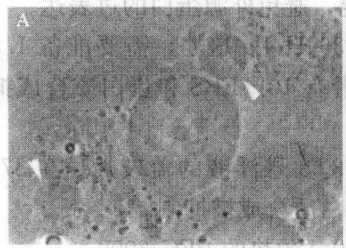

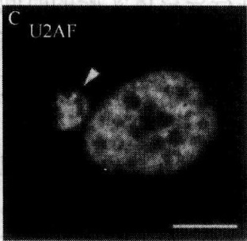

图5-2 HeLa×SL2异核体（Celis，2006）

直接抗人类蛋白质的单克隆抗体通常都不能和存在于果蝇中的同源物反应。在这种情况中，外源人类蛋白质的穿梭可以在 HeLa×SL2 异核体中得到分析。A. HeLa×SL2 异核体的阶段对照图，箭头标志了来自于 HeLa 细胞质融合的细胞的小 SL2 细胞核；B. 在 A 中显示的异核体被人类非穿梭蛋白质 hnRNPC 的专一性单克隆抗体免疫染色，显示出异核体在蛋白质合成抑制剂（20μg/ml 依米丁）存在的情况下，被限制在 HeLa 细胞核内，箭头指出了 SL2 细胞核的位置；C. 用对人类 U2AF$^{65}$专一的单克隆抗体对 HeLa×SL2 异核体

进行免疫染色，显示出在 SL2 细胞核（箭头处）内的人类蛋白质，表明这个蛋白质具有穿梭的能力

#### （二）$\mathrm{HeLa} \times 3\mathrm{T}3$ 异核体

#### 1. 细胞培养

(1) 持续培养 HeLa 细胞于加入非必需氨基酸和 10% FBS 的 MEM 培养基中, 置于 $37^{\circ} \mathrm{C} 、 5 \% \mathrm{CO}_{2}$ 培养箱中。在进行异核体穿梭法和转染前 2 天, 应该把细胞分装到无菌的培养皿中。

(2)在加有10%FBS的D-MEM培养基中培养老鼠3T3细胞，培养箱设置37℃、5%CO₂。

(3) 异核体培养基:HeLa×3T3 异核体细胞的培养方法和 3T3 细胞的相同。

#### 2. 溶液配制

(1) PBS: $137 \mathrm{mmol} / \mathrm{L} \mathrm{NaCl}, 2.68 \mathrm{mmol} / \mathrm{L} \mathrm{KCl}, 8.06 \mathrm{mmol} / \mathrm{L} \mathrm{Na}_{2} \mathrm{HPO}_{4}, 1.47 \mathrm{mmol} / \mathrm{L} \mathrm{KH}_{2} \mathrm{PO}_{4}$ 。即 $1 \mathrm{~L}$ 溶液需要称 $8 \mathrm{~g} \mathrm{NaCl}, 0.2 \mathrm{~g} \mathrm{KCl}, 1.14 \mathrm{~g} \mathrm{Na}_{2} \mathrm{HPO}_{4}$ 和 $0.2 \mathrm{~g} \mathrm{KH}_{2} \mathrm{PO}_{4}$, 高压灭菌。

(2) DAPI: 避光贮备 $1 \mathrm{mg} / \mathrm{ml}$ 的溶液并贮存在 $-20^{\circ} \mathrm{C}$; 染色溶剂: 用 PBS 稀释贮存液至 $1 \mu \mathrm{g} / \mathrm{ml}$, 避光保存在 $4^{\circ} \mathrm{C}$ 几个星期。

(3) 蛋白质合成抑制剂: 准备 $10 \mathrm{mg} / \mathrm{ml}$ 的存储溶液, 用 $50 \%$ 的乙醇溶解。保存于 $-20^{\circ} \mathrm{C}$ 中。最终的浓度根据不同的细胞系决定; 环己米特、茴香霉素使用最广泛的浓度范围是 $20 \sim 100 \mu \mathrm{g} / \mathrm{ml}$, 依米丁的浓度是 $0.5 \sim 20 \mu \mathrm{g} / \mathrm{ml}$ 。

#### 3. 实验步骤

（1）所有步骤都应该在超净工作台中进行，并且要使用灭菌的培养材料和试剂。

(2) 在进行实验的前一天晚上, HeLa 细胞应该用目的重组物质转染, 并且继续在 $10 \mathrm{~mm} \times 10 \mathrm{~mm}$ 的盖玻片上生长至 $75 \%$ 左右的密度 (subconfluent density)。一个 $35 \mathrm{~mm} \times 10 \mathrm{~mm}$ 的组织培养无菌培养皿可以放置 4 个这样的盖玻片。普通的转染试剂, 如 Lipo-fectin 或者 Fugene, 在这个实验中非常有用, 可以依据它们附带的说明直接使用。转染和进行异核体实验的时间间隔应该根据不同的情况而定, 避免外源蛋白的过表达。

(3) 胰蛋白酶解和计数 3T3 细胞。对于每一个 P35 HeLa 培养, 需要准备 $1.5 \mathrm{ml}$ 3T3 的悬浮液, 该悬浮液浓度应为 $1 \times 10^{6} \text {细胞/ml}$, 带有 $10 \%$ FBS 和蛋白质合成抑制剂的 D-MEM。

(4) 除去 HeLa 细胞培养中的培养基, 盖上带有 3T3 悬浮液的盖玻片。在 $37^{\circ} \mathrm{C}$、$5 \% \mathrm{CO}_{2}$ 的培养箱中培养, 直到 3T3 细胞可以贴壁及蛋白质合成被抑制。

(5) 在灭菌的有盖培养皿中的每一个盖玻片上滴  $50 \mu l$  预热的 PEG 2000。

(6) 从培养箱中去除 HeLa/SL2 共培养基，并且用预热的 PBS 洗 2 次。

(7) 用灭菌的镊子移开盖玻片, 在 PEG 滴剂中倒置 $2 \mathrm{~min}$ (细胞面朝下)。然后, 把盖玻片 (细胞面朝上) 放置在新的 P35 培养皿上, 用预热的 PBS 漂洗 2 次。用加入了蛋白质合成抑制剂的 $1.5 \mathrm{ml}$ 预热的异核体培养基代替 PBS, 在进行穿梭的时候把异核体放入培养箱中 (通常 $1 \sim 5 \mathrm{~h}$)。

(8) 根据 $1 \mathrm{~h}$ 间隔的时间进程, 用常用的方法固定并染色细胞。另外还有一个检测外源蛋白所必需的实验, 细胞要用 DAPI 染色, 这样才能检测到异核体细胞核。阳性和阴性对照试验应该使用单克隆抗体直接抗人类 hnRNPA 1 (一种穿梭于细胞核和细胞质的蛋白质) 和人类 hnRNPC (一种不穿梭的蛋白质), 见图 5-3。

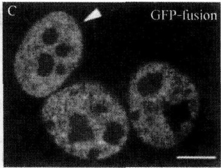

图5-3 $\mathrm{HeLa}\times 3\mathrm{T}3$ 异核体（Celis，2006）

HeLa 细胞被编码 GFP-U2AF65 的载体短暂感染，再在  $20 \mu g/ml$  依米丁存在的情况下和鼠类的 NIH 3T3 细胞融合。图中指出一个带有 DAPI（A）标记的单异核体，抗 hnRNPC mAb（B）和 GFP（C）。A. DAPI 染色的 HeLa×3T3 异核体。鼠类细胞很容易被分辨出，因为它所在的地方会出现光亮的斑和周围出现异质染色体（箭头处）。B. 在 A 中出现的异核体是用对非穿梭的人类 hnRNP C 蛋白专一的抗体染色的。hnRNP C 被困于 HeLa 细胞核内，确定了蛋白质合成受到了有效的抑制。C. 在 HeLa×3T3 中检测出 GFP，说明了原

来在 HeLa 细胞中的融合蛋白穿梭于细胞质和细胞核之间。标尺 = 10μm

#### 【实验结果分析】

不同蛋白质的穿梭速率存在很大差异，一些很慢（如核仁素要用16h才能被细胞核的受体检测到），有一些很快（如运输受体在融合后的几分钟就能被核受体检测到）。因此，使用穿梭检测法最理想的时间应该是根据不同蛋白质所需的时间来决定。作为一个普遍的规律，蛋白质在HeLa×3T3异核体细胞核受体的检测，包括外源蛋白短暂地表达，它远远比HeLa×SL2中表达内源蛋白快。例如，相同的蛋白质、相同的供体和受体细胞核，在第一种方法中可能90min就可以完成，而第二种要用7h。

要正确地解释用异核体方法得到的结果，需要运用足够的控制。无论什么时候，穿梭运动应该在内源和外源表达蛋白中都存在，因为有时候氨基酸标记和蛋白质过量表达会影响结果。当检测内源蛋白穿梭运动时，一定要注意抗体的专一性。蛋白质合成抑制剂的效率一定要能被正确地控制，因为不同的细胞在对蛋白质合成抑制剂的敏感度上可能会有很大的差异性。关于转录抑制的效率的表示，应该使用对人类细胞核非穿梭蛋白专一的单克隆抗体染色的异核体。如果细胞质中的蛋白质继续合成，这些蛋白质就能被细胞核的受体检测到。任何时候，异核体都应该对目标蛋白和 hnRNPC 双重染色。或者，当目标蛋白同样也用 mAb 标记时，再做一个平行实验，而在这个实验中用抗 hnRNPC 的抗体来标记异核体。

如果一个穿梭蛋白被检验出来，那判断它是从细胞核孔中扩散出去的还是被细胞核通过受体调控通道运输出核就会变得方便了。为了这个目的，供体细胞应该放置于4℃，且时间要和异核体测定法在培养基中的时间一样，这种培养基加入了蛋白质合成抑制剂和20mmol/L的HEPES。随后进行目的蛋白的免疫染色。在低温中，受体调控的细胞核出入核运动是不会发生的。所以，如果蛋白质通过受体调控通道出核，它应该保留在细胞核中。相反，如果蛋白质可以被动地渗漏出细胞孔，它就会在细胞质中积累。如果转录没有被抑制，新合成的蛋白质就会在细胞质中积累，使测定无效。当根据短暂转染进行穿梭分析时，非常重要的一点是，要注意在细胞高水平表达蛋白质时，细胞质中积累外源蛋白和蛋白质被动扩散出核是一个普遍的事件。所以，外源蛋白的分析应该总是用低蛋白质表达量的细胞进行。另外，需要一个对照实验，说明外源蛋白渗漏至细胞质的程度（如低温改变的实验）。

在短暂转染中，种间异核体的应用，使利用蛋白突变体分析参与出核的蛋白质结构域变得可能。但是，这种分析只能用于保留全部核定位信号的突变体，对于渗漏到细胞质的小片段缺失的突变体应该要小心检测。

#### 【注意事项】

（1）HeLa 细胞的融合是所有步骤中很重要的一步。如果培养基的浓度太低，形成的异核体的数目就会减少。如果细胞已经融合，那么 SL2 或者 3T3 就会没有空位黏附，而且它们的细胞核通常都会在 HeLa 的细胞核上方，使得结果无法分析。我们应该逐个检查 HeLa 细胞的盖玻片，选出其中浓度达到聚合前期的为好。

(2) 通常在融合期间, 细胞会大量损失。这可能是在盖玻片被翻转、PEG 液滴被吸取时产生的剪切力所致。为了避免这种情况，直接在盖玻片下方吸取 PBS，使之漂浮，然后用镊子把它捡起。蛋白质合成抑制剂能诱导培养基中高密度的细胞凋亡，一些细胞群可能对这些抑制剂的浓度高度敏感。这些细胞群在对别的细胞没有作用的抑制剂浓度下，就可以产生反应。所以，抑制剂的类型和浓度应谨慎选择。环乙酰亚胺是使用最广泛的抑制剂，虽然一些细胞系对于它会比对依米丁更敏感。在一些例子中，蛋白质合成抑制剂可能很难达到目标的效果，因为在培养基中发现了很多新翻译的蛋白质。为了防止这些蛋白质妨碍测定法的进行，通常会对异核体用抗 hn-RNPC 和抗 4F4mAb 进行双标记，只有在异核体中这种蛋白质才会被限制在人类细胞核中。

（3）在准备阶段找到 HeLa×3T3 异核体是一件困难的事，因为在细胞质中对比度不强，以致不能形成清晰的视野。最好的方法是去寻找两个靠近的细胞核，这通过 DAPI 染色就能找到。对鼠类细胞核进行鉴定同样也需要一定的 DAPI 的染色。对 4F4mAb 进行染色可以作为辅助的手段，因为当翻译被抑制时，它只标记人类细胞。

（4）当分析一个短暂转染蛋白的穿梭能力时，用低表达量的细胞是很重要的。一个好的荧光显微镜对于检测低表达蛋白是必需的。通常，会形成多核的异核体。他们也应该被考虑到穿梭检测法中，因为很难同时检测到供体细胞核和达到蛋白质的原始表达水平（因为蛋白质会扩散到其他细胞核中）。

#### 【作业】

（1）细胞的融合是实验的重要环节，在细胞融合过程中，应如何调节培养基的浓度？

(2) 全面分析实验结果，描述不同蛋白质穿梭速率的差异，以及穿梭蛋白的运动情况。

(戚康标)

<!-- END LAB LAB-E023 -->

## 对应的跨章补充入口

- [实验46 细胞核与线粒体的分级分离](../../02_细胞生物学研究方法/小节/02_第二节%20细胞及其组分的分析方法.md#LAB-E046)（`LAB-E046`；全文归属见链接）
<!-- END NEW_SOURCES -->
