# 第9章 细胞核与染色质 · 第四节 染色体

[返回本章](../README.md) · [中文本章原文](../中文原文.md)

<!-- BEGIN CN CN09-S04 -->
## 第四节 染色体

染色体是细胞在有丝分裂（或减数分裂）时遗传物质存在的特定形式，是间期细胞染色质结构紧密组装的结果。不同生物的细胞中含有不同数目的染色体（表9-6）。所有单倍染色体组包含的DNA组成该生物基因组。

表 9-6 不同生物的基因组大小和染色体数目

<table><tr><td>物种</td><td>基因组大小 /Mb</td><td>染色体数目</td></tr><tr><td>芽殖酵母(Saccharomyces pastorianus)</td><td>12</td><td>16</td></tr><tr><td>黏葡萄(Dictyostelium)</td><td>70</td><td>7</td></tr><tr><td>拟南芥(Arabidopsis thaliana)</td><td>125</td><td>5</td></tr><tr><td>秀丽隐杆线虫(Caenorhabditis elegans)</td><td>97</td><td>6</td></tr><tr><td>果蝇(Drosophila melanogaster)</td><td>180</td><td>4</td></tr><tr><td>非洲爪蟾(Xenopus laevis)</td><td>3 000</td><td>18</td></tr><tr><td>玉米(Zea mays)</td><td>5 000</td><td>10</td></tr><tr><td>洋葱(Allium cepa)</td><td>15 000</td><td>8</td></tr><tr><td>百合(Lilium brownii)</td><td>50 000</td><td>12</td></tr><tr><td>肺鱼(Neoceratodus forsteri)</td><td>50 000</td><td>17</td></tr><tr><td>鸡(Gallus gallus)</td><td>1 200</td><td>39</td></tr><tr><td>小鼠(Mus musculus)</td><td>3 000</td><td>20</td></tr><tr><td>牛(Bos taurus)</td><td>3 000</td><td>30</td></tr><tr><td>狗(Canis lupus)</td><td>3 000</td><td>39</td></tr><tr><td>人(Homo sapiens)</td><td>3 000</td><td>23</td></tr></table>

基因组大小和染色体数目都源自单倍体。

## 一、染色体的形态结构

中期染色体具有比较稳定的形态，它由两条相同的姐妹染色单体（chromatid）构成，彼此以着丝粒（centromere）相连。根据着丝粒在染色体上所处的位置，可将中期染色体分为4种类型（图9-23，表9-7）：中着丝粒染色体（metacentric chromosome），两臂长度相等或大致相等；亚中着丝粒染色体（submetacentric chromosome）；亚端着丝粒染色体（subtelocentric chromosome），具有微小短臂；端着丝粒染色体（telocentric chromosome）。

染色体各部的主要结构如下：

## （一）着丝粒与动粒

着丝粒连接两条染色单体，并将染色单体分为两臂：短臂（p）和长臂（q）。由于着丝粒区浅染内缢，所以也叫主缢痕（primary constriction）。近年来的研究表明，着丝粒是一种高度有序的整合结构，在结构和组成上都是非均一的，至少包括三种不同的结构域：

(1) 沿着着丝粒外表面的动粒结构域（kinetochoredomain）哺乳类动粒（又称着丝点，kinetochore）超微结构可分为三个区域（图9-24）：一是与着丝粒中央结构域相联系的内板（inner plate）；二是中间间隙（middle space），电子密度低，呈半透明区；三是外板（outer plate）。在没有动粒微管结合时，覆盖在外板上的第4个区称为纤维冠（fibrouscorona），由微管蛋白构成。动粒微管与内外板相连，并沿纤维冠相互作用，与内板相联系的染色质是与微管相互作用的位点。已有证据表明，动粒结构域的化学组成包括与动粒结构与功能相关的两类蛋白质以及着丝粒DNA，但是目前关于动粒的结构模型尚无定论。

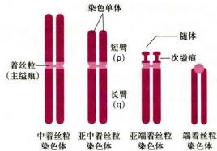  
图9-23 根据着丝粒位置进行的染色体分类图示

表 9-7 根据着丝粒位置进行的染色体分类

<table><tr><td>着丝粒位置</td><td>染色体符号</td><td>着丝粒比*</td><td>着丝粒指数**</td></tr><tr><td>中着丝粒</td><td>m</td><td>1.00~1.67</td><td>0.500~0.375</td></tr><tr><td>亚中着丝粒</td><td>sm</td><td>1.68~3.00</td><td>0.373~0.250</td></tr><tr><td>亚端着丝粒</td><td>st</td><td>3.01~7.00</td><td>0.249~0.125</td></tr><tr><td>端着丝粒</td><td>t</td><td>7.01~∞</td><td>0.125~0.000</td></tr></table>

\*长臂长度 / 短臂长度; \*\*短臂长度 / 染色体总长度。(Levan et al., 1964; Green et al., 1980)

(2) 中央结构域 (central domain) 这是着丝粒区的主体，由串联重复的卫星 DNA 组成。这些重复序列大部分是物种专一的。人染色体的着丝粒 DNA 由 α 卫星 DNA 组成，重复单位 17 bp，每一着丝粒串联重复 2 000～30 000 次，可达 250 kb 至 400 kb，但不同染色体着丝粒的 α 卫星 DNA 序列存在差别。其中一个亚类含有 17 bp 的 DNA 模式（5'-CTTCGTTGGAAACGGGA-3'），能与动粒蛋白 CENP-B 结合，这一 DNA 模式被称为 CENP-B 框。通过免疫印迹分析，在哺乳类染色体着丝粒区已发现 CENP-A、B、C、E 和 F 五种动粒蛋白，这些动粒蛋白和细胞分裂及其调控有密切关系，因而也是极为保守的。

(3) 配对结构域（pairing domain）位于着丝粒内表面的配对结构域。代表中期姐妹染色单体相互作用的位点。已经发现有两类蛋白：一类是内部着丝粒蛋白 INCENP (inner centromere protein)，另一类是染色单体连接蛋白 CLIPS (chromatid linking protein)，两者与染色单体配对有关。

虽然三种结构域具有不同的功能，但它们并不能独自发挥作用。正是三种结构域的整合功能，才确保细胞在有丝分裂中染色体与纺锤体整合，发生有序的染色体分离。

## （二）次缢痕

除主缢痕外，染色体上其他的浅染缢缩部位称次缢痕（secondary constriction）。它的数目、位置和大小是某些染色体所特有的形态特征，因此也可以作为鉴定染色体的标记。

## （三）核仁组织区

核仁组织区（nucleolar organizing region, NOR）位于染色体的次缢痕部位，但并非所有次缢痕都是NOR。染色体NOR是rRNA基因所在部位（5S rRNA基因除外），与间期细胞核仁形成有关。

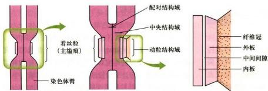  
图9-24 着丝粒的结构域组织

## （四）随体

随体（satellite）指位于染色体末端的球形染色体节段，通过次缢痕区与染色体主体部分相连。它是识别染色体的重要形态特征之一，有随体的染色体称为 sat 染色体。

## （五）端粒

端粒（telomere）是染色体两个端部特化结构。端粒通常由富含鸟嘌呤核苷酸（G）的短的串联重复序列DNA组成（TEL DNA），伸展到染色体的3'端。一个基因组内的所有端粒都是由相同的重复序列组成，但不同物种的端粒的重复序列是不同的（表9-8）。哺乳类和其他脊椎动物端粒的重复序列中的保守序列是TTAGGG，串联重复500\~3000次，序列长度在2 kb到20 kb之间不等。端粒的长度与细胞及生物个体的寿命有关。端粒的生物学作用在于维持染色体的完整性和独立性，可能还与染色体在核内的空间排布等有关。

## 二、染色体的功能元件

在细胞世代中确保染色体的复制和稳定遗传，染色体起码应具备三种功能元件（functional element）（图9-25）：至少一个DNA复制起点，确保染色体在细胞周期中能够自我复制，维持染色体在细胞世代传递中的连续性；一个着丝粒，使细胞分裂时已完成复制的染色体能平均分配到子细胞中；最后，在染色体的两个末端必须有端粒，保持染色体的独立性和稳定性。构成染色体DNA的这三种关键序列（key sequence）称为染色体

表 9-8 不同生物中端粒 DNA 序列比较

<table><tr><td>物种</td><td>端粒 DNA 重复序列</td></tr><tr><td colspan="2">酵母</td></tr><tr><td>芽殖酵母</td><td> ${\mathrm{G}}_{1 - 3}\mathrm{\;T}$ </td></tr><tr><td>裂殖酵母</td><td> ${\mathrm{G}}_{2 - 8}\mathrm{{TTAC}}$ </td></tr><tr><td colspan="2">原生动物</td></tr><tr><td>四膜虫</td><td>GGGGTT</td></tr><tr><td>黏霉菌</td><td> ${\mathrm{G}}_{1 - 3}\mathrm{\;A}$ </td></tr><tr><td colspan="2">植物</td></tr><tr><td>拟南芥</td><td>AGGGTTT</td></tr><tr><td colspan="2">哺乳动物</td></tr><tr><td>人</td><td>TTAGGG</td></tr></table>

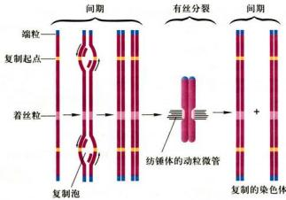  
图9-25 真核细胞染色体的三种功能元件示意图

DNA 的功能元件。近年来采用分子克隆技术把真核细胞染色体的复制起点、着丝粒和端粒这三种 DNA 关键序列分别克隆成功，并把它们互相搭配或改造而构成所谓 “人造微小染色体”（artificial minichromosome）。

## （一）自主复制 DNA 序列

应用 DNA 重组技术，将带有正常酵母亮氨酸合成酶的 Leu 基因的 DNA 限制酶片段重组到大肠杆菌的质粒中。用这种重组质粒去转化亮氨酸合成代谢缺陷型酵母细胞，发现单纯质粒不能转化酵母细胞，而重组质粒能在酵母细胞中复制、表达和遗传。可见该酵母 DNA 插入片段除含有 Leu 的基因外，还含有一段酵母染色体自主复制 DNA 序列 (autonomously replicating DNA sequence, ARS)。该序列首先在酵母基因组 DNA 序列中发现，它能使含有这一序列的重组质粒高效转化酵母细胞，并能在酵母中独立于宿主染色体而存在。根据不同来源的 ARS 的 DNA 序列分析，发现它们都具有一段 11～14 bp 的同源性很高的富含 AT 的共有序列 (consensus sequence)，同时证明这段共有序列及其上下游各 200 bp 另右的区域是维持 ARS 功能所必需的。现在已利用双向电泳定位复制起点的技术，直接证明了 ARS 在质粒以及酵母染色体上与复制起点 (replication origin) 共定位的现象。绝大多数真核细胞的染色体含有多个复制起点，以确保全染色体快速复制。现在还没有确定真核生物的复制起点的 DNA 序列是否具有固定模式，但大多包含一个富含 AT 的序列。

## （二）着丝粒 DNA 序列

上述插入 ARS 的重组质粒，虽然能在酵母细胞中复制和表达，但由于它缺少着丝粒，因此不能在酵母细胞有丝分裂时平均分配到子细胞中去。当把酵母染色体上的着丝粒 DNA 序列（centromere DNA sequence, CEN）插入到这个含 ARS 的重组质粒中，这种新的插有酵母染色体的 ARS 和 CEN 序列的重组质粒，在有丝分裂中便表现出与正常染色体相似的复制与分离行为。根据不同来源的 CEN 序列分析，发现它们的共同特点是有两个彼此相邻的核心区，一个是 80\~90 bp 的 AT 辟，另一个是 11 bp 的保守区。通过 CEN 缺失损伤试验或插入突变试验，发现一旦伤及这两个核心区序列，CEN 即丧失其生物学功能。

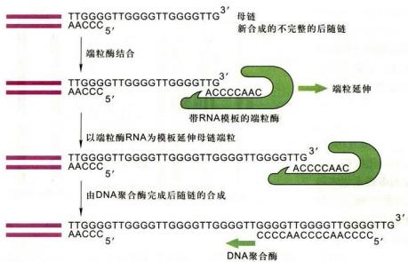  
图9-26 端粒酶的作用示意图

## （三）端粒 DNA 序列

将插入 ARS 和 CEN 序列的环状重组质粒 DNA 在单一位点切开，形成一个具有两个游离端的线性 DNA 分子。虽然这段线性 DNA 可以在酵母细胞中复制并附着到有丝分裂的纺锤体上，但最终将从子细胞中丢失，结果细胞无法生长。如果在切开的线性 DNA 两端加上端粒 DNA 序列（telomere DNA sequence, TEL），则转染细胞生长。这是因为环状 DNA 变成线性 DNA 分子以后无法解决“末端复制问题”，即新合成的 DNA 链 5' 末端 RNA 引物被切除后变短的问题。真核细胞染色体端粒的重复序列不是染色体 DNA 复制时连续合成的，而是由端粒酶（telomerase）合成后添加到染色体末端。端粒酶是一种核糖核蛋白复合物，具有反转录酶的性质，由物种特异的内在 RNA 作模板，把合成的端粒重复序列再加到染色体的3'端（图9-26）。人的生殖细胞染色体末端比体细胞染色体末端长几千个碱基对，这是因为迄今为止只发现在生殖细胞和部分干细胞里有端粒酶活性，而在所有体细胞里则尚未发现端粒酶的活性。端粒起到细胞分裂计时器的作用。不管是体内还是体外，体细胞每分裂一次，端粒重复序列就缩短一些。表明端粒重复序列的长度与细胞分裂次数和细胞的衰老有关。肿瘤细胞具有表达端粒酶活性的能力，使癌细胞得以无限制地增殖。

除了端粒酶能维持端粒的长度外，另外一个端粒变长的途径是ALT（alternative lengthening of telomere），这一途径不依赖于端粒酶的存在。3'端突出的端粒DNA最终与5\~10 kb之外的另一条链上的TTAGG同源序列配对形成一个D形环（或T形环），以稳定端粒末端结构。这一过程由TRF2催化完成。

## 三、染色体带型

核型（karyotype）一词首先由苏联学者G.A. Levitsky等人在20世纪20年代提出。核型分析的发展有三项技术起了很重要的促进作用：一是1952年美籍华人细胞学家徐道觉发现的低渗处理技术，使中期细胞的染色体分散良好，便于观察；二是秋水仙素的应用便于富集中期细胞分裂相；三是植物凝集素（PHA）刺激血淋巴细胞转化、分裂，使以血培养方法观察动物及人的染色体成为可能。

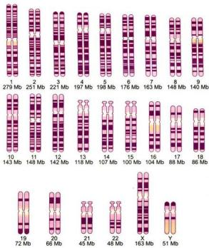  
图9-27 人类细胞中期染色体显带及染色体大小示意图

核型是指染色体组在有丝分裂中期的表型，是染色体数目、大小、形态特征的总和。核型分析是在对染色体进行测量计算的基础上，进行分组、排队、配对并进行形态分析的过程。核型分析对于探讨人类遗传病的机制、物种亲缘关系、远缘杂种的鉴定等都有重要意义。将一个染色体组的全部染色体逐个按其特征绘制下来，再按长短、形态等特征排列起来的图像称为核型模式图(idiogram)，它代表该物种的核型模式（图9-27）。

在染色体显带技术发展之前，核型分析主要是根据染色体形态和着丝粒位置的差别来进行的，因此有时对染色体仍不易精确识别和区分。1968年由瑞典细胞学家Casperson首先建立的染色体Q带技术及其以后的发展，为核型研究提供了有力的工具。Q带技术即喹吖因(Quinacrine)荧光染色技术，显示中期染色体经氮芥喹吖因或双盐酸喹吖因染色以后，在紫外线照射下所呈现的荧光亮带和暗带。一般富含AT碱基的DNA区段表现为亮带，富含GC碱基的DNA区段表现为暗带。G带即吉姆萨(Giemsa）带，是将中期染色体制片经胰酶或碱、热、尿素、去垢剂等处理后再用吉姆萨染料染色后所呈现的染色体区带。一般来说，G带与Q带相符，但也有例外，如Q带显示的人Y染色体的特异荧光，在G带带型上并不出现。R带是指中期染色体经磷酸盐缓冲液保温处理，以吖啶橙或吉姆萨染色，结果所显示的带型和G带明暗相间带型正好相反，所以又称反带(reverse band)。C带主要显示着丝粒结构异染色质及其他染色体区段的异染色质部分。T带又称末端带(terminal band)，是染色体端粒部位经吖啶橙染色后所呈现的区带，在分析染色体末端结构畸变时有用。N带又称Ag-As染色带，主要用于染核仁组织者区的酸性蛋白质。1975年以来，美国细胞遗传学家J.J.Yunis等建立了染色体高分辨显带技术，用氨甲蝶呤使培养的细胞同步化后，再用秋水仙胺短暂处理，获得大量晚期前期和早中期分裂相，这些时期的染色体比典型中期染色体长，显带后可得到更多更细的带纹。如在人体细胞晚期染色体组中可以分辨出843～1256条带，而中期染色体只能观察到320～550条带，因而更有助于发现细微的染色体异常。

染色体显带技术最重要的应用就是明确鉴别一个核型中的任何一条染色体，乃至某一个易位片段。同时显带技术也用于染色体基因定位和染色体重构，如染色体着丝粒的罗伯逊式融合（Robertsonian fusion）与染色体着丝粒的罗伯逊式裂解（Robertsonian fission）。

从果蝇到人，有丝分裂的染色体普遍存在特殊的带型。一个物种某一条染色体上的标准带型是非常稳定的并是特征性的。这就提示，染色体带作为更大范围的结构域对细胞的功能可能是重要的。有人估计，即使最细的带纹也应含有30个或更多的环状结构域，并且已知富含AT的带和富含GC的带都含有基因。近年来发展的显带染色体显微切割和分子微克隆技术，已有可能研究染色体某几个带纹的DNA性质，这是联系细胞遗传学与分子遗传学之间的重要桥梁。

## 四、特殊染色体

在某些生物的细胞中，特别是在发育的某些阶段，可以观察到一些特殊的体积很大的染色体，包括多线染色体（polytene chromosome）和灯刷染色体（lampbrush chromosome），这两种染色体总称为巨大染色体（giant chromosome）。

## （一）多线染色体

多线染色体是1881年由意大利细胞学家E.G.Balbiani首先在双翅目摇蚊幼虫的唾腺细胞中发现的，它也存在于双翅目昆虫的幼虫组织细胞内，如唾腺、气管、肠和马氏管（Malpighian tube）。此外，在不同植物的不同类型的细胞中，如胚珠细胞（胚乳、胚柄和反足细胞）也发现多线染色体。

多线染色体来源于核内有丝分裂（endomitosis），即核内DNA多次复制而细胞不分裂。产生的子染色体并行排列，且体细胞内同源染色体配对，紧密结合在一起从而阻止染色质纤维进一步聚缩，形成体积很大的多线染色体。多线化的细胞处于永久间期，并且体积也相应增大。同种生物的不同组织以及不同生物的同种组织的多线化程度各不相同。在果蝇唾腺细胞中，染色体进行10次DNA复制，因而形成 $2^{10}=1024$ 条同源DNA拷贝，形成的多线染色体比同种有丝分裂染色体长200倍以上，4条配对的染色体全长可达2 mm。配对染色体的着丝粒部位结合在一起形成染色中心（图9-28）。

早期遗传学分析认为，果蝇多线染色体一条带代表一个基因，一个基因编码一种基本蛋白质。B. Bossy 等（1984）在果蝇基因组中克隆出一段 315 kb 的连续 DNA 序列，以该 DNA 为探针检测该区段 DNA 所转录的 mRNA，结果发现 mRNA 的种类是被鉴定带数目的 3 倍。所以把每条带看做一个特异的基因组区更为恰当。最近的研究表明，多线染色体的带和间带都含有基因，有可能 “持家” 基因（housekeeping gene）位于间带，而有细胞类型特异性的 “奢侈” 基因（luxury gene）位于带上。

## （二）灯刷染色体

灯刷染色体在 1882 年由 Flemming 在研究美西螈卵巢切片时首次报道，但由于其形态特殊而未能肯定。1892年，J. Rückert研究鲨鱼卵母细胞时，给灯刷染色体以正式命名。现已知道，灯刷染色体几乎普遍存在于动物界的卵母细胞中，其中两栖类卵母细胞的灯刷染色体最典型，也研究得最深入。在植物界，也有关于灯刷染色体的报道。如垂花葱（Allium cernuum）和玉米雄性配子减数分裂中出现不很典型的灯刷染色体，而大型的单细胞藻类地中海伞藻（Acetabularia mediterranea）却有典型的灯刷染色体。

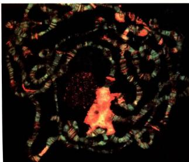  
图9-28 果蝇唾腺细胞全套多线染色体  
图中红色信号表示异染色质蛋白HP1在多线染色体上的分布，绿色是dCAF1-p180蛋白的分布。（黄海博士和焦仁杰博士提供）

灯刷染色体是卵母细胞进行减数分裂第一次分裂时停留在双线期的染色体。它是一个二价体，包含4条染色单体。此时同源染色体尚未完全解除联会，因此可见到几处交叉。这一状态在卵母细胞中可维持数月或数年之久。

灯刷染色体轴由染色粒轴丝构成，每条染色体轴长约 $400\mu \mathrm{m}$ （多数有丝分裂染色体小于 $10\mu \mathrm{m}$ ）。从染色粒向两侧伸出两个相类似的侧环，每个环相当于一个袢环结构域，一个平均大小的环约含 $100\mathrm{kb}$ DNA。两栖类一套灯刷染色体约含10000个这样的染色质侧环，不同的侧环有各自的特异DNA序列，每个环在细胞中有4个拷贝。

灯刷染色体的形态与卵子发生过程中营养物储备是密切相关的。大部分 DNA 以染色粒形式存在，没有转录活性，而侧环是 RNA 活跃转录的区域，一个侧环往往是一个大的转录单位或几个转录单位组合构成的。转录的 RNA 副本 3' 端借助 RNA 聚合酶固定在侧环染色质轴丝上，游离的 5' 端捕获大量蛋白质形成核糖核蛋白复合物，组成环周围的基质。环的粗细变化表示基质的厚薄和转录 RNA 的长短。转录起始点 RNA 短，随着 RNA 聚合酶读码而逐渐延长。用 RNase 和蛋白酶可将基质消化，侧环轴丝保留。改用 DNase 消化，侧环轴丝解体消失，说明基质由 RNP 组成，轴丝由 DNA 组成。灯刷染色体合成的 RNA 主要为前体 mRNA，有些类型的 mRNA 可翻译成蛋白质，有些 mRNA 与蛋白质结合，暂不翻译而储存在卵母细胞中。

<!-- END CN CN09-S04 -->

---

## 对应英文内容

### 英文补充：染色体环与特殊染色体

> 对应中文板块：染色体环与特殊染色体。英文来源：Molecular Biology of the Cell，第7版，第4章；[本章完整原文](../../来源/英文教材/04_DNA_Chromosomes_and_Genomes/chapter.md)。物理PDF页码范围：222–291（整章范围）。

<!-- BEGIN EN EN04-H034-H037 -->
#### THE GLOBAL STRUCTURE OF CHROMOSOMES

Having discussed the DNA and protein molecules from which the chromatin fiber is made, we now turn to the organization of the chromosome on a more global scale and the way in which its various domains are arranged in space. Packaged into nucleosomes, a typical human chromosome would be able to span the nucleus thousands of times. Thus, a higher level of folding is required, even in interphase chromosomes. As we shall see, this higher-order packaging involves the folding of each chromosome into a series of large loops through a process catalyzed by ring-shaped SMC (structural maintenance of chromosomes) protein complexes.

We begin this section by describing some unusual chromosomes that can be easily visualized. Exceptional though they are, these special cases reveal features that are relevant for all eukaryotic chromosomes. Next, we describe how the interphase chromosomes are arranged in the mammalian cell nucleus. Finally, we discuss the mechanisms that cause a special compaction of chromosomes during their passage from interphase to mitosis.

#### Chromosomes Are Folded into Large Loops of Chromatin

An early insight into the structure of the chromosomes in interphase cells came from studies of the stiff and enormously extended chromosomes in growing amphibian oocytes (immature eggs). These very unusual **lampbrush chromosomes** (the largest chromosomes known), paired in preparation for meiosis, are clearly visible in the light microscope, where they are seen to contain a series of large chromatin loops emanating from a linear chromosomal axis (**Figure 4–45**).

(B)

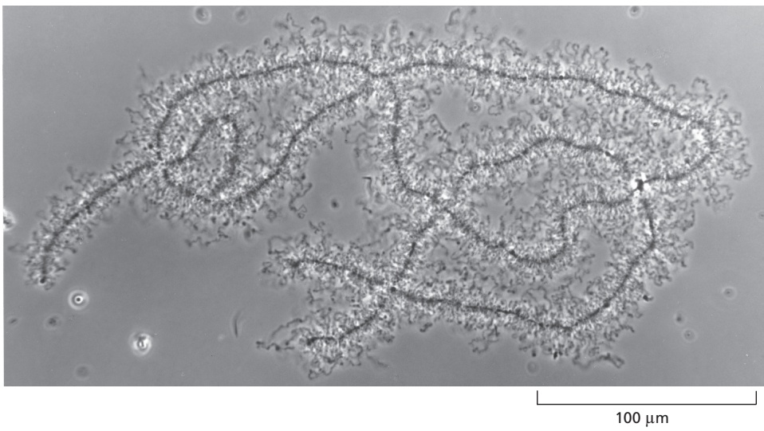

Figure 4–45 A light micrograph of lampbrush chromosomes in an amphibian oocyte. Early in oocyte differentiation, each chromosome replicates to begin meiosis, and the homologous replicated chromosomes pair to form this highly extended structure. Each lampbrush chromosome consists of two aligned sets of paired sister chromatids, with large chromatin loops as a prominent feature. The chromosome set contains thousands of loops, each containing a particular DNA sequence that remains extended in the same manner as the oocyte grows, producing huge amounts of RNA for storage in the oocyte. The lampbrush chromosome stage persists for months or years, while the oocyte builds up a supply of materials required for its ultimate development into a new individual. These chromosomes were first described in 1878. (Courtesy of Joseph G. Gall.)

**Figure 4–46** summarizes lampbrush chromosome structure. Each chromosome is formed by a very long DNA helix packed into chromatin, and it is joined to a sister DNA helix, called a sister chromatid. Most of the DNA is located near the junction of the two chromatids, and it is highly condensed and transcriptionally inert; this DNA serves to organize each chromatid along a linear chromosome axis. In contrast, the highly transcribed regions of the DNA extend from the axis. / . as large loops, which range in length from tens of thousands to hundreds of thousands of nucleotide pairs.

Meiotic chromosomes are found to adopt the lampbrush chromosome state in the growing oocytes of all vertebrates, except for mammals. However, if incubated in amphibian oocyte cytoplasm, human sperm chromosomes will form lampbrush chromosomes. This reveals that chromosomes are highly dynamic structures that can restructure in different environments.

#### Polytene Chromosomes Are Uniquely Useful for Visualizing Chromatin Structures

Further early insight into the structure of interphase chromosomes came from a second unusual type of cell—the polytene cells of flies, such as the fruit fly Drosophila. Some special cells, in many organisms, grow abnormally large through

extended chromatin in transcriptionally active looped domain

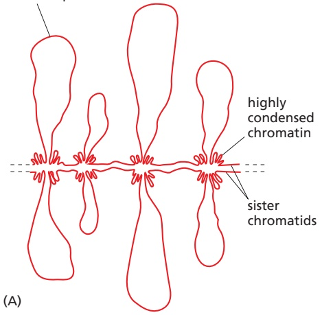

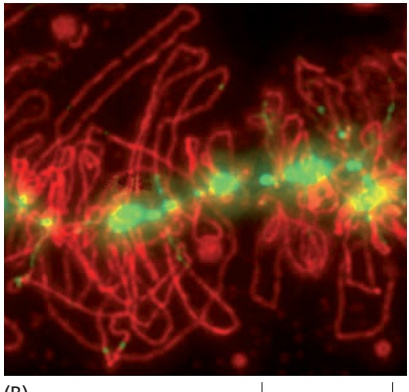

10 µm

Figure 4–46 The structure of lampbrush chromosomes. (A) Model for a small portion of one pair of sister chromatids. Two identical DNA double helices are aligned side by side, packaged into different types of chromatin (see Figure 4–45). (B) Merged light micrographs of the lampbrush chromosomes in an axolotl (a type of salamander), stained for transcriptionally active (RNA polymerase, red) and inactive (DNA containing 5-methyl C, green) chromatin regions. The loops are stiff and extended because they are being unusually highly transcribed, with RNA polymerases spaced only about 100 nucleotide pairs apart. Most of the rest of the DNA in each chromosome (the great majority) remains condensed and is located close to the chromatid axis. (B, from G.T. Morgan et al., Chromosome Res. 20:925–942, 2012. Reproduced with permission of SNCSC.)

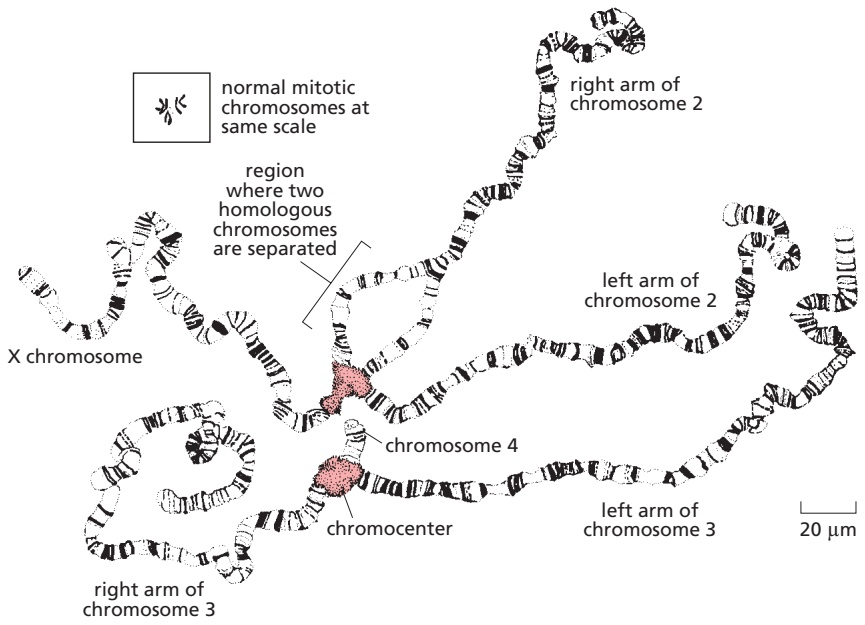

multiple cycles of DNA synthesis without cell division. Such cells, containing increased numbers of standard chromosomes, are said to be polyploid. In the salivary glands of fly larvae, this process is taken to an extreme degree, creating huge cells that contain hundreds or thousands of copies of the genome.MBoC7 m4.50/4.47 Moreover, in this case, all the copies of each chromosome are aligned side by side in exact register, like drinking straws in a box, to create giant **polytene chromosomes**. These chromosomes allow features to be detected that are thought to be shared with ordinary interphase chromosomes but are normally hard to see.

Figure 4–47 The entire set of polytene chromosomes in one Drosophila salivary cell. In this drawing of a light micrograph, the giant chromosomes have been spread out for viewing by squashing them against a microscope slide. Drosophila has four chromosomes, and there are four different chromosome pairs present. But each chromosome is tightly paired with its homolog (so that each pair appears as a single structure), which is not true in most nuclei (except in meiosis). Each chromosome has undergone multiple rounds of replication, and the homologs and all their duplicates have remained in exact register with each other, resulting in huge chromatin cables many DNA strands thick.

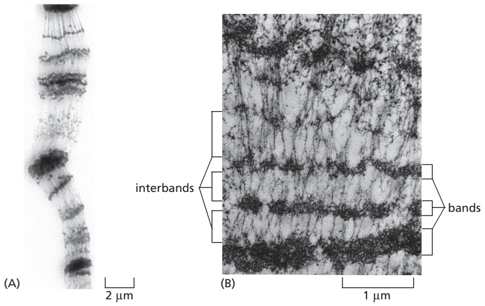

When polytene chromosomes from a fly’s salivary glands are viewed in the light microscope, distinct alternating dark bands and light interbands are visible (**Figure 4–47**), each formed from a thousand identical DNA sequences arranged side by side in register. About 95% of the DNA in polytene chromosomes is in bands, and 5% is in interbands. A very thin band can contain 3000 nucleotide pairs, while a thick band may contain 200,000 nucleotide pairs in each of its chromatin strands. The chromatin in each band appears dark because the DNA is more condensed than the DNA in interbands; it may also contain a higher concentration of proteins (**Figure 4–48**).

The four polytene chromosomes are normally linked together by heterochromatic regions near their centromeres that aggregate to create a single large chromocenter (pink region). In this preparation, however, the chromocenter has been split into two halves by the squashing procedure used. (Adapted from T.S. Painter, J. Hered. 25:465–476, 1934. With permission from Oxford University Press.)

Figure 4–48 Micrographs of polytene chromosomes from Drosophila salivary glands. (A) Light micrograph of a portion of a chromosome. The DNA has been stained with a fluorescent dye, but a reverse image is presented here that renders the DNA black rather than white; the bands are clearly seen to be regions of increased DNA concentration. This chromosome has been processed by a high-pressure treatment so as to show its distinct pattern of bands and interbands more clearly. (B) An electron micrograph of a small section of a Drosophila polytene chromosome seen in thin section. Bands of very different thickness can be readily distinguished, separated by interbands, which contain less condensed chromatin. (A, adapted from D.V. Novikov et al., Nat. Methods 4:483–485, published 2007 by Nature Publishing Group. Reproduced with permission of SNCSC; B, courtesy of Veikko Sorsa.)

There are approximately 3700 bands and 3700 interbands in the complete set of Drosophila polytene chromosomes, a number that should be compared to the 14,000 genes in this fruit fly (see Table 1–2, p. 29). The bands can be recognized by their different thicknesses and spacings, and each one has been given a number to generate a chromosome “map” that has been indexed to the finished genome sequence of Drosophila.

The Drosophila polytene chromosomes provide a good starting point for examining how chromatin is organized on a large scale. In the previous section, we saw that there can be many forms of chromatin, each of which contains nucleosomes with a different combination of modified histones. Specific sets of non-histone proteins assemble on these nucleosomes to affect biological function in different ways. Recruitment of some of these non-histone proteins can spread for long distances along the DNA, imparting a similar chromatin structure to broad tracts of the genome (see Figure 4–39A). At low resolution, the interphase chromosome can therefore be considered as a mosaic of chromatin structures, each containing particular nucleosome modifications associated with a particular set of non-histone proteins.

Polytene chromosomes allow us to see details of this mosaic of domains in the light microscope and to observe some of the changes associated with gene expression. For example, by staining Drosophila polytene chromosomes with antibodies and using ChIP (chromatin immunoprecipitation) analysis (see Chapter 8), the locations of specific histone modifications and non-histone proteins in chromatin can be mapped across the entire Drosophila DNA sequence. These results suggest that three types of repressive chromatin predominate in this organism, along with two types of chromatin on actively transcribed genes, and that each type is associated with a different complex of non-histone proteins. In addition to these five major chromatin types, other more minor forms of chromatin appear to be present, each of which may be differently regulated and have distinct roles in the cell. Much remains to be learned about the molecular structures that underlie these findings.

#### Chromosome Loops Decondense When the Genes Within Them Are Expressed

When an organism containing polytene chromosomes progresses from one developmental stage to another, distinctive chromosome puffs arise and old puffs recede in its polytene chromosomes as new genes become expressed and old ones are turned off (**Figure 4–49**). From inspection of each puff when it is relatively small and the banding pattern is still discernible, it seems that most puffs arise from the decondensation of a single chromosome band.

The individual chromatin fibers that make up a puff can be visualized with an electron microscope. In favorable cases, loops are seen. When genes in the loop are not expressed, the loop assumes a thickened, condensed structure, but when gene expression is occurring, the loop becomes more extended—resembling the loops seen in lampbrush chromosomes. This again demonstrates that chromosome structures are dynamic, as we had concluded from lampbrush experiments.

<!-- END EN EN04-H034-H037 -->

### 英文补充：有丝分裂染色体的高度凝缩

> 对应中文板块：有丝分裂染色体的高度凝缩。英文来源：Molecular Biology of the Cell，第7版，第4章；[本章完整原文](../../来源/英文教材/04_DNA_Chromosomes_and_Genomes/chapter.md)。物理PDF页码范围：222–291（整章范围）。

<!-- BEGIN EN EN04-H042-H043 -->
#### Mitotic Chromosomes Are Highly Condensed

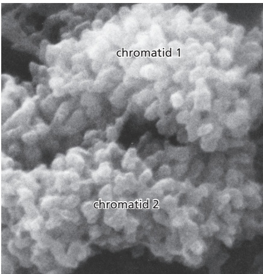

Having discussed the dynamic structure of interphase chromosomes, we now turn to **mitotic chromosomes**. The chromosomes from nearly all eukaryotic cells become readily visible by light microscopy during mitosis, when they coil up to form highly condensed structures. This condensation reduces the length of a typical interphase chromosome by about tenfold, and it produces a dramatic change in chromosome appearance.

A typical mitotic chromosome at the metaphase stage of mitosis was shown in Figure 4–18 (for the stages of mitosis, see Panel 17–1, pp. 1048–1049). The two DNA molecules produced by DNA replication during interphase of the celldivision cycle are separately folded to produce two sister chromatids held together at their centromeres. These chromosomes are normally covered with a variety of molecules, including large amounts of RNA–protein complexes. Once this covering has been stripped away, each chromatid can be seen in electron micrographs to be organized into loops of chromatin emanating from a central scaffolding (**Figure 4–60**).

Recent experiments have begun to decipher how interphase chromosomes condense to form mitotic chromosomes. The process is intimately connected with the progression of the cell cycle that will be the focus of Chapter 17. It begins in early M phase when gene expression shuts down, and specific modifications are made to histones that may help to reorganize the chromatin. Most of the ring-shaped cohesin proteins that organize the interphase chromosomes make way for their **condensin** relatives, whose ATP-driven movements—aided by the DNA cutting-and-rejoining enzyme topoisomerase II—drive the compaction and form a linear chromosome axis (**Figure 4–61**). This axis is highly enriched in both condensin II and topoisomerase II, and it is the combined action of these two enzymes that is believed to separate each chromosome into two sister chromatids.

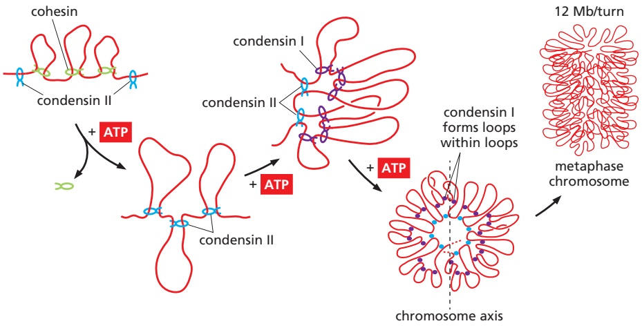

Figure 4–60 A scanning electron micrograph of a region near one end of a typical mitotic chromosome. Each knoblike projection is believed to represent the tip of a separate looped domain. Note that the two identical paired chromatids MBoC7 m4.60/4.60can be clearly distinguished. (From M.P. Marsden and U.K. Laemmli, Cell 17:849–858, 1979. With permission from Elsevier.)

Figure 4–61 How chromosomes fold in M phase. There are two types of condensins in mammalian cells, designated as condensins I and II. As cells enter mitosis, the interphase organization of the chromatin loops that is created by cohesin (see Figure 4–57) is lost within minutes. A different SMC protein, condensin II, now begins to form very large new chromatin loops by a similar ATP-driven mechanism. These new loops are organized radially by a central chromosome axis, and as the condensin II loops grow ever larger in size, a second set of loops is formed by condensin I inside them. This “loops within loops” organization, when combined with an ever-tighter winding of the chromatin loops around the mitotic chromosome axis, creates the compact chromatin that is observed in the final metaphase chromosome. Not shown are the special cohesin molecules that hold the two sister chromatids together; as described in Chapter 17, these cohesins are released only at anaphase. (Adapted from J.H. Gibcus et al., Science 359:eaao6135, 2018.)

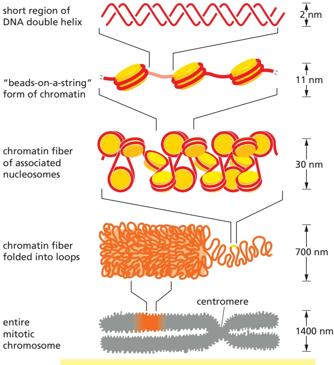

Figure 4–62 Chromosome organization. This model shows some of the levels of chromatin packaging that give rise to the highly condensed mitotic chromosome.

NET RESULT: EACH DNA MOLECULE HAS BEEN PACKAGED INTO A MITOTIC CHROMOSOME THAT IS 10,000-FOLD SHORTER THAN ITS FULLY EXTENDED LENGTH

Mitotic chromosome condensation can be thought of as the final level in a hierarchy of chromosome packaging (**Figure 4–62**). This final DNA folding serves at least two important purposes. First, when condensation is complete (in metaphase), sister chromatids have been disentangled from each other and lie side by side. Thus, the sister chromatids can easily separate when the mitotic apparatus begins pulling them apart. Second, the compaction of chromosomes protects the relatively fragile DNA molecules from being broken as they are pulled to separate daughter cells by the mitotic spindle. These and other critical details of mitosis will be fully discussed in Chapter 17.

#### Summary

Chromosomes are generally decondensed during interphase, so that the details of their structure are difficult to visualize. Notable exceptions are the specialized lampbrush chromosomes of vertebrate oocytes and the polytene chromosomes in the giant secretory cells of insects. Studies of these two types of interphase chromosomes reveal that each long DNA molecule in a chromosome is divided into a large number of discrete domains organized as long loops of chromatin that are compacted by further folding. When genes contained in a loop are expressed, the loop unfolds and allows the cell’s machinery access to the DNA. New studies using sensitive biochemical techniques show that the interphase chromosomes in a wide range of eukaryotes are also folded into a series of looped domains, and they reveal a central folding role for ring-shaped, cohesin protein complexes.

Interphase chromosomes occupy discrete territories in the cell nucleus; that is, they are not extensively intertwined. Much of the chromatin in interphase exists as loosely folded fibers of nucleosomes. However, this open chromatin is interrupted by stretches of heterochromatin, in which the nucleosomes are subjected to additional packing that renders the DNA resistant to gene expression. Heterochromatin has the important property that its type of nucleosome packing can be directly inherited during chromosome replication, thereby generating an epigenetic form of cell memory. Two major classes of heterochromatin contain different covalent histone marks propagated by distinct reader–writer enzyme complexes. Constitutive heterochromatin is formed on repeated DNA sequences; marked by H3K9me3, it is found in large blocks that remain unchanged in and around centromeres and near telomeres. This heterochromatin blocks both gene expression and genetic recombination. Facultative heterochromatin is present at many other positions on chromosomes, where its presence can be controlled so as to have a critical role in regulating genes. H3K27me3 heterochromatin is always facultative; in contrast, only some of the H3K9me3 heterochromatin is facultative, depending on its location.

The interior of the nucleus is highly dynamic, with heterochromatin often positioned near the nuclear envelope and loops of chromatin moving away from their chromosome territory when genes are very highly expressed. This reflects the existence of nuclear subcompartments, where different sets of biochemical reactions are facilitated by an increased concentration of selected proteins and RNAs.

During mitosis, gene expression shuts down and all chromosomes adopt a highly condensed, organized conformation in a process that begins early in M phase. This condensation packages the two DNA molecules of each replicated chromosome as two separately folded chromatids, and it is catalyzed by the ATP-driven movements of ring-shaped, condensin protein complexes.

<!-- END EN EN04-H042-H043 -->

### 英文补充：端粒、端粒酶与染色体末端保护

> 对应中文板块：端粒、端粒酶与染色体末端保护。英文来源：Molecular Biology of the Cell，第7版，第5章；[本章完整原文](../../来源/英文教材/05_DNA_Replication_Repair_and_Recombination/chapter.md)。物理PDF页码范围：292–359（整章范围）。

<!-- BEGIN EN EN05-H031-H033 -->
#### Telomerase Replicates the Ends of Chromosomes

We saw earlier in the chapter that synthesis of the lagging strand at a replication fork must occur discontinuously through a backstitching mechanism that produces short DNA fragments attached to RNA primers. The final RNA primer synthesized on the lagging-strand template cannot be replaced by DNA because there is no primer ahead of it to provide a 3′-OH end for the repair polymerase. Without a mechanism to deal with this problem, DNA would be lost from the ends of all chromosomes each time a cell divides.

Bacteria avoid this “end-replication” problem by having circular DNA molecules as chromosomes, as we have seen. Eukaryotes solve it in a different way: they have specialized nucleotide sequences at the ends of their chromosomes that are incorporated into structures called telomeres (discussed in Chapter 4). Telomeres contain many tandem repeats of a short sequence that is similar in organisms as diverse as protozoa, fungi, plants, and mammals. In humans, the sequence of the repeat unit is GGGTTA, and it is repeated roughly a thousand times at each telomere.

Telomere DNA sequences are recognized by sequence-specific DNA-binding proteins that attract an enzyme, called **telomerase**, that replenishes these sequences each time a cell divides. Telomerase recognizes the tip of an existing telomere DNA repeat sequence and elongates it in the 5′-to-3′ direction, using an RNA template that is a component of the enzyme itself to synthesize new DNA copies of the repeat (**Figure 5–33**). The enzymatic portion of telomerase resembles other reverse transcriptases, proteins that synthesize DNA using an RNA template, although, in this case, the telomerase RNA also contributes to the active site and is essential for efficient catalysis. After extension of the parent DNA strand by telomerase, replication of the lagging strand at the chromosome end can be completed by the conventional DNA polymerases, using these extensions as a template to synthesize the complementary strand (**Figure 5–34**).

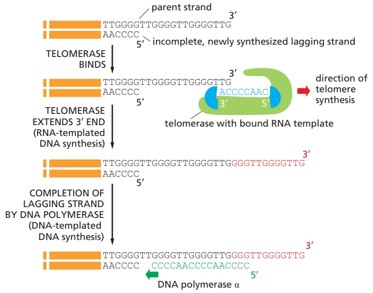

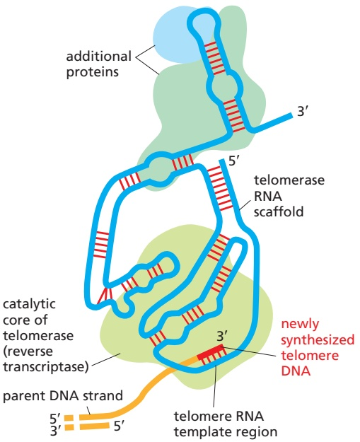

Figure 5–33 Schematic structure of human telomerase. This large enzyme is composed of 10 protein subunits and an RNA of 451 nucleotides. The RNA forms the scaffold of the complex, provides the template for synthesizing new DNA telomere repeats, and helps form the active site. The synthesis reaction itself is carried out by the reverse transcriptase domain of the protein, shown in light green, in conjunction with the RNA. A reverse transcriptase is a special form of polymerase enzyme that uses an RNA template to make a DNA strand; telomerase is unique in carrying its own RNA template with it. Telomerase also contains several additional protein complexes (some of which are shown in dark green and blue) that are needed to assemble the enzyme and, for many organisms but not humans, to bring it to the ends of chromosomes. (Modified from T.H.D. Nguyen et al., Nature 557: 190–195, 2018.)

Figure 5–34 Telomere replication. Shown here is the reaction that synthesizes the repeating sequences that form the ends of the chromosomes (telomeres) of eukaryotes. The 3′ end of the parent lagging-strand template is extended by RNA-templated DNA synthesis; this allows the incomplete daughter DNA strand that is paired with it to be synthesized to the end of the chromosome. The synthesis of the final bit of lagging strand is carried out by DNA polymerase α, which carries a DNA primase as one of its subunits (Movie 5.6). DNA polymerase α is the same enzyme used to begin the synthesis of each Okazaki fragment on the lagging strand; it begins its synthesis with RNA (not shown) and continues with DNA (green). The telomere sequence illustrated is that of the ciliate Tetrahymena, in which these reactions were first discovered.

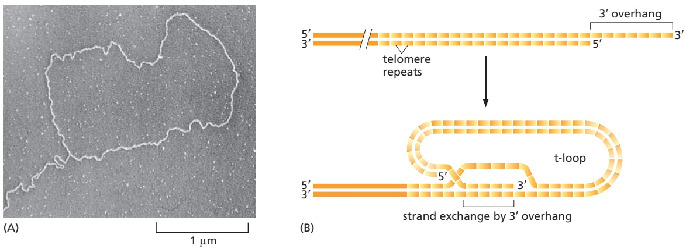

Figure 5–35 A t-loop at the end of a mammalian chromosome. (A) Electron micrograph of the DNA at the end of an interphase human chromosome. The chromosome was fixed, deproteinated, and artificially thickened before viewing. The loop seen here is approximately 15,000 nucleotide pairs in length. (B) Schematic diagram of t-loop formation. (A, from J.D. Griffith et al., Cell 97:503–514, 1999. With permission from Elsevier.)

#### Telomeres Are Packaged into Specialized Structures That Protect the Ends of Chromosomes

The ends of chromosomes present cells with an additional problem. As we will see in the next part of this chapter, when a chromosome is accidently broken into two pieces, the break is rapidly repaired. Telomeres must clearly be distinguished from these accidental breaks; otherwise, the cell will attempt to “repair”MBoC7 m5.35/5.35 telomeres, generating chromosome fusions and other genetic abnormalities. Telomeres have several features to prevent this from happening.

A specialized nuclease chews back the 5′ end of a telomere leaving a protruding, single-strand 3′ end. This protruding end—in combination with the GGGTTA repeats in telomeres—attracts a group of proteins that form a protective chromosome cap known as shelterin. In particular, shelterin protects telomeres from being treated as damaged DNA. Another feature of telomeres may offer additional protection. When human telomeres are artificially cross-linked and viewed by electron microscopy, structures known as “t-loops” can be observed in which the protruding single-strand end of the telomere loops back and tucks itself into the duplex DNA of the telomere repeat sequence (**Figure 5–35**). An attractive idea is that t-loops are orchestrated by shelterin to help “hide” the very ends of chromosomes.

#### Telomere Length Is Regulated by Cells and Organisms

Because the processes that grow and shrink each telomere sequence are only approximately balanced, chromosome ends contain variable numbers of telomeric repeats. Not surprisingly, many cells, including stem cells and germ cells, have homeostatic mechanisms that maintain the number of these repeats within a limited range (**Figure 5–36**).

In most of the dividing somatic cells of humans, however, telomeres gradually shorten, and it has been proposed that this provides a counting mechanism that helps prevent the unlimited proliferation of wayward cells in adult tissues. In its simplest form, this idea holds that our somatic cells start off in the embryo with a full complement of telomeric repeats. These are then eroded to different extents in different cell types. Some stem cells, notably those in tissues that must be replenished at a high rate throughout life—bone marrow or gut lining, for example—retain full telomerase activity. However, in many other types of cells, the level of telomerase is reduced so that the enzyme cannot quite keep up with chromosome duplication. Such cells lose 100–200 nucleotides from each telomere every time they divide. After many cell generations, the descendant cells will inherit chromosomes that lack functioning telomeres, and, as a result of this defect, activate a DNA-damage response causing them to withdraw permanently from the cell cycle and cease dividing—a process called replicative cell senescence (discussed in Chapters 17 and 20). In theory, such a mechanism could provide a

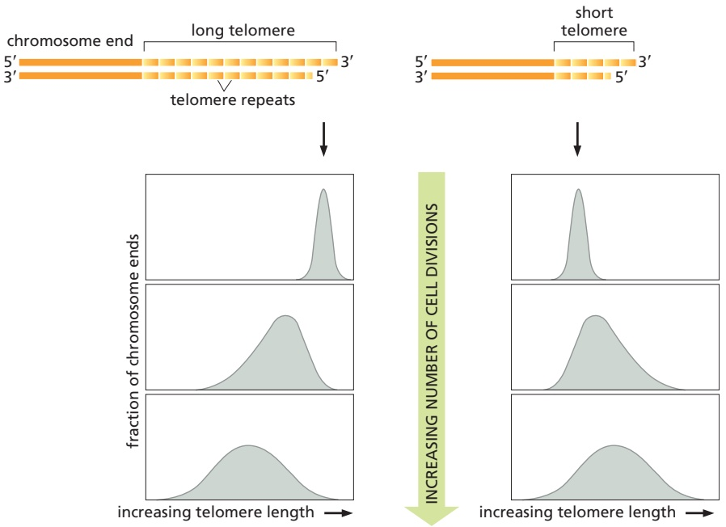

Figure 5–36 A demonstration that yeast cells control the length of their telomeres. In this experiment, the telomere at one end of a particular chromosome is artificially made either longer (left) or shorter (right) than average. After many cell divisions, the chromosome recovers, showing an average telomere length and a length distribution that is typical of the other chromosomes in the yeast cell. A similar feedback mechanism for controlling telomere length has been proposed for the germ-line cells and stem cells of mammals.

safeguard against the uncontrolled cell proliferation of abnormal cells in somatic tissues, thereby helping to protect us from cancer.

The idea that telomere length acts as a “measuring stick” to count cell divisions and thereby regulate the lifetime of the cell lineage has been tested in several ways. For certain types of human cells grown in tissue culture, theMBoC7 m5.36/5.36 experimental results support such a theory. Human fibroblasts normally proliferate for about 60 cell divisions in culture before undergoing replicative cell senescence. Like most other somatic cells in humans, fibroblasts produce only low levels of telomerase, and their telomeres gradually shorten each time they divide. When telomerase is provided to the fibroblasts by inserting a fully active telomerase gene, telomere length is maintained and many of the cells now continue to proliferate indefinitely. Also consistent with these ideas is the observation that, in approximately 90% of cancer cells, the telomerase gene has become reactivated, thereby circumventing the normal safety mechanism (see pp. 1073–1074).

It has been proposed that this type of control on cell proliferation may contribute to the aging of animals like ourselves. These ideas have been tested by producing transgenic mice that lack telomerase entirely. The telomeres in mouse chromosomes are about five times longer than human telomeres, and the mice must therefore be bred through three or more generations before their telomeres have shrunk to the normal human length. It is therefore perhaps not surprising that the first generations of mice develop normally. However, the mice in later generations develop progressively more defects in some of their highly proliferative tissues. In addition, these mice show signs of premature aging and have a pronounced tendency to develop tumors. In these and other respects, these mice resemble humans with the genetic disease dyskeratosis congenita. Individuals afflicted with this disease carry one functional and one nonfunctional copy of the telomerase RNA gene; they have prematurely shortened telomeres and typically die of progressive bone marrow failure. These individuals also develop lung scarring and liver cirrhosis and show abnormalities in various epidermal structures including skin, hair follicles, and nails.

The above observations demonstrate that controlling cell proliferation by telomere shortening poses a risk to an organism, because not all of the cells that begin losing the ends of their chromosomes will stop dividing. Some apparently become genetically unstable, but continue to divide, giving rise to variant cells that can lead to cancer. As discussed above, many of these variant cells ultimately produce high levels of telomerase, thereby ensuring their continued survival. Clearly, the use of telomere shortening as a regulating mechanism is not foolproof and, like many mechanisms in the cell, it must strike a balance between benefit and risk.

<!-- END EN EN05-H031-H033 -->

## 跨章相关英文内容

- 染色体的三个功能元件：[EN第4章 · DNA、染色质蛋白与核小体包装](02_第二节%20染色质.md#EN04-H000-H018)。
- 着丝粒染色质：[EN第4章 · 异染色质、组蛋白修饰与表观遗传](03_第三节%20染色质的复制与表达.md#EN04-H019-H033)。

<!-- BEGIN NEW_SOURCES -->
---
## 新增教材补充

## 实验教程：操作材料

### 实验28 环境因素及辐射诱变染色体改组的观察
> 补充目的：在已有原理和机制材料上补齐教材实验的目的、试剂、器材、步骤、判读、注意事项及思考题（按该实验原文所含栏目）。
> 来源：细胞生物学实验教程（第2版） / 06_细胞分裂与染色体畸变；[原解析正文](../../来源/实验教程/06_细胞分裂与染色体畸变/正文.md) · [完整分页](../../来源/实验教程/06_细胞分裂与染色体畸变/完整分页.md) · [原页PDF](https://github.com/kazewwk/test/blob/105df226e50395012449b4bad83f589769277174/%E7%BB%86%E8%83%9E%E7%94%9F%E7%89%A9%E5%AD%A6%E5%AE%9E%E9%AA%8C%E6%95%99%E7%A8%8B_%E7%AC%AC2%E7%89%88/06_%E7%BB%86%E8%83%9E%E5%88%86%E8%A3%82%E4%B8%8E%E6%9F%93%E8%89%B2%E4%BD%93%E7%95%B8%E5%8F%98/%E5%8E%9F%E5%A7%8B%E9%A1%B5%E9%9D%A2.pdf)；编号 `LAB-E028`。

<!-- BEGIN LAB LAB-E028 -->
#### 实验 28 环境因素及辐射诱变染色体改组的观察

#### 【实验目的】

学会鉴别外界条件诱变染色体改组的各种类型，为进行环境监测和诱变育种提供细胞学方面的依据。

#### 【实验原理】

目前，大量新的化合物的合成、原子能的应用、各种各样工业废物的排放等都存在污染环境的可能。欲了解这些因素对机体潜在的遗传危害，就需要一套高度灵敏、技术简单易行的系统来监测环境的变化。生物监测技术是目前进行环境污染，化学诱变物质以及辐射对机体损伤程度监测的一个主要指标。同时，它也为进行辐射防护、新药试验、食品添加剂的安全评价，以及染色体遗传疾病和癌症前期诊断等各个方面提供了很好的手段。

用于进行环境因素、诱变物质、辐射损伤的生物检测方法包括染色体畸变类型的检测和微核的检测等。常用于测试的材料有鸭跖草、水葱花、韭菜花等的花穗，以及蚕豆根尖和小白鼠等。一般来说，处于分裂过程的细胞，对环境因素最敏感，尤其是处于减数分裂时期的花粉母细胞。诱变物质、环境污染及辐射对人类和其他高等生物的遗传损伤，在细胞水平表现为染色体畸变，遗传损伤不仅表现在体细胞，而且还通过生殖细胞扩散和积累。

#### 【实验仪器、材料和试剂】

(1) 仪器、用具:显微镜、解剖针、酒精灯、载玻片、盖玻片、吸水纸等。

(2) 材料:水葱花、韭菜花或紫露草花穗。

(3) 试剂:无水乙醇、冰醋酸、改良苯酚品红染色液、卡诺氏固定液。

#### 【方法与步骤】

（一）污水对花粉母细胞减数分裂期染色体的作用

（1）取材:选取处于减数分裂期的花穗若干，剪下5～8cm的花序。部分插在自来水中作对照，另一部分插在污水中，处理12～24h，再移到自来水中恢复培养24h。

(2) 固定: 用卡诺氏固定液固定 $12 \mathrm{~h}$, 经 $95 \%$ 乙醇、$85 \%$ 乙醇各浸泡 $30 \mathrm{~min}$, $70 \%$ 乙醇 $4^{\circ} \mathrm{C}$ 保存。

（3）制片:剥取花药，用镊子轻轻捣碎，用改良苯酚品红染色5～10min，去掉残渣，盖上盖玻片。

（4）镜检:用低倍镜找到分裂期细胞，再转用高倍镜，可看到经污水处理过的细胞中，染色体畸变的类型和微核的数目，分别要比对照组高。微核出现的数量，可作为监测环境污染程度的指标。

#### （二）$\gamma$ 射线对花粉母细胞减数分裂期染色体的作用

（1）取材:将未开放的水葱花、韭菜花或紫露草花穗（外面仍有膜状总苞包着）若干，进行γ射线（剂量为0.258c/kg）辐照处理，处理后在水中恢复培养12h，然后于上午9:00～11:00时把颖花剥下，用卡诺氏固定液固定12h，经95%乙醇、85%乙醇各浸泡30min，70%乙醇4℃保存。

(2) 制片:方法同前。

（3）镜检:观察染色体的各种畸变现象。

#### （三）$\mathrm{CO}_{2}$ 激光对花粉母细胞减数分裂期染色体的作用

(1) 取上述小花进行 $\mathrm{CO}_{2}$ 激光处理, 功能密度为 $20 \mathrm{~W} / \mathrm{cm}^{2}$, 处理 $1 \sim 2 \mathrm{s}$ 后放在水中恢复培养 $12 \mathrm{~h}$, 然后用卡诺氏固定液固定 $12 \mathrm{~h}, 70 \%$ 乙醇 $4^{\circ} \mathrm{C}$ 保存。

(2) 制片:方法同前。

（3）镜检:观察染色体的各种畸变现象。

#### 【实验结果】

经污水、辐照处理的材料，可见到下列畸变类型。

(1) 染色体团聚: 染色体交联成团块, 失去染色体的形态。在细胞分裂的前期、中期、后期、二分子期、四分子期及单核花粉期均可看到。

(2) 落后染色体: 是由于分裂的细胞受到损伤 (多半是由于纺锤体被破坏), 而引起染色体不同步移动或者不移动。多见于分裂中期和后期, 这种现象有可能导致染色体数目的丢失。

(3) 无着丝粒染色体断片: 见于分裂前期、中期、后期, 这种现象多会造成染色体上某个基因的缺失。

（4）染色体环:整组染色体交联成一个大环或出现小环。

(5) 染色体桥: 在细胞分裂的后期或末期, 同源染色体或姐妹染色单体分开时, 部分有染色质丝粘连, 使得分开不完全, 从而造成染色体桥的出现。这种现象多造成染色体上某个基因的重复, 有一至多桥。

（6）不均等分裂:细胞分裂结束时，产生的不是均等的四个子细胞（四分体）而可能是三分体、五分体、六分体、八分体等。

(7) 微型小孢子: 是由于多分体细胞的胼胝质壁破裂后产生的体积比正常小孢子要小的一些孢子。

（8）微核:由落后染色体形成的核状小块。见于末期、二分子期、四分子期及小孢子期。

微核游离于主核外，大小是主核的 1/3 以下，它的折光率、细胞化学反应性质和主核一样，已经证实微核率的大小与污染程度、用药剂量或辐射累积效应呈正相关。所以微核计算已成为灵敏度高、技术简便的一种测试系统。它可用于辐射损伤、辐射防护、化学诱变、新药试验研究以及环境污染程度监测的重要指标。

#### 【作业】

(1) 绘图示各种染色体畸变现象并标明所处的分裂时期。

(2) 计算微核率。

(何炎明)

<!-- END LAB LAB-E028 -->

### 实验31 植物染色体标本的制备和观察
> 补充目的：在已有原理和机制材料上补齐教材实验的目的、试剂、器材、步骤、判读、注意事项及思考题（按该实验原文所含栏目）。
> 来源：细胞生物学实验教程（第2版） / 07_染色体技术与核型分析；[原解析正文](../../来源/实验教程/07_染色体技术与核型分析/正文.md) · [完整分页](../../来源/实验教程/07_染色体技术与核型分析/完整分页.md) · [原页PDF](https://github.com/kazewwk/test/blob/105df226e50395012449b4bad83f589769277174/%E7%BB%86%E8%83%9E%E7%94%9F%E7%89%A9%E5%AD%A6%E5%AE%9E%E9%AA%8C%E6%95%99%E7%A8%8B_%E7%AC%AC2%E7%89%88/07_%E6%9F%93%E8%89%B2%E4%BD%93%E6%8A%80%E6%9C%AF%E4%B8%8E%E6%A0%B8%E5%9E%8B%E5%88%86%E6%9E%90/%E5%8E%9F%E5%A7%8B%E9%A1%B5%E9%9D%A2.pdf)；编号 `LAB-E031`。

<!-- BEGIN LAB LAB-E031 -->
#### 实验31 植物染色体标本的制备和观察

#### 【实验目的】

掌握常规压片法和去壁低渗法制备植物染色体标本的基本原理和方法。

#### 【实验原理】

植物染色体标本的制备，常用分生组织，如根尖、茎尖和嫩叶做材料。常规压片法仍是当今观察植物染色体常用的方法，其程序包括取材、预处理、固定、解离、染色和压片等步骤。但压片法的不足之处是染色体很难分散开，染色体容易变形和断裂。而去壁低渗法则能较好地克服这些弊端，方法也较简单，不需要特殊设备。它是借助纤维素酶和果胶酶将细胞间的果胶质和组成细胞壁的 $\alpha$-纤维素、半纤维素溶解，使植物细胞只有质膜，然后按哺乳类动物染色体标本制备的方法——低渗、火焰干燥法制备植物染色体标本。实验证明，这一技术可以显著提高染色体的分散程度，现已广泛应用于植物染色体显带、姐妹染色单体交换等研究，大大促进了植物细胞遗传学研究的发展。

#### 【实验仪器、材料和试剂】

（1）仪器、用具:培养箱、显微镜、剪刀、镊子、刀片、培养皿、滤纸、吸水纸、青霉素瓶、染色缸、载玻片、盖玻片、玻璃板、酒精灯。

(2) 材料:蚕豆种子、洋葱鳞茎。

(3) 试剂

1) Giemsa 母液:
Giemsa 粉 0.5g
甘油（AR） 33ml

$$
\text {甲醇（AR）} \quad 33 \mathrm{ml}
$$

先将少量甘油加入研钵中，将 Giemsa 粉末充分研细，再倒入剩余甘油，并在  $56^{\circ}$ C 温箱中保温 2h，然后再加入甲醇混匀，贮存在棕色瓶内。

2）磷酸缓冲液、甲醇、冰醋酸、混合酶液、秋水仙素（或对二氯苯）。

3）改良苯酚品红染色液（配制方法见实验26）。

#### 【方法与步骤】

#### （一）压片法制备染色体标本

（1）取材:把洋葱鳞茎置于盛水的小烧杯上，放在25℃温箱中发根，待根长至2cm左右，于上午9:00～11:00剪下根尖。或者把蚕豆种子预先浸泡6h，然后转入垫有湿润滤纸的培养皿中，置25℃温箱中发芽，幼根长至1～2cm，于上午9:00～11:00剪下根尖。

(2) 预处理: 将剪下的根尖置于对二氯苯饱和水溶液或 $0.02\%$ 秋水仙素溶液中, 浸泡处理 $4 \mathrm{~h}$ 。

（3）固定:用水洗净处理过的根尖，经甲醇-冰醋酸（3:1）固定6～12h，再经95%乙醇、85%乙醇各浸泡0.5h，最后转入70%乙醇中，4℃保存备用。

（4）解离:取出根尖，用蒸馏水洗净，放入1mol/L HCl中60℃解离8～10min，再用蒸馏水洗净。

(5) 染色:改良苯酚品红染色液染色 5～10min。

(6) 压片: 把根尖放在载玻片上, 切取分生区部分, 加一滴染液, 用镊子捣碎, 盖上盖玻片, 然后在盖玻片上放上一滤纸, 用铅笔上的橡皮头轻轻敲打盖片, 使细胞和染色体分散。

(7) 镜检。

#### （二）去壁低渗火焰干燥法制备植物染色体标本

（1）取材:将蚕豆种子放在  $25^{\circ}$ C 温箱中发芽，待根长到  $1 \sim 2$ cm 时使用。

(2) 前处理:根尖用 0.05% 秋水仙素溶液处理 3～4h。

(3) 固定: 用水洗净处理过的根尖, 经甲醇-冰醋酸 (3:1) 固定 4h。

（4）酶解:倒去固定液，用蒸馏水充分洗净，切取分生区放到青霉素小瓶中，加入混合酶液（2.5%纤维素酶+2.5%果胶酶），25℃下酶解2\~4h。

(5) 低渗: 倒去酶液, 用蒸馏水慢慢冲洗 2 次, 然后在蒸馏水中浸泡 $30 \mathrm{~min}$, 低渗后可用下面两种方法制备染色体标本。

\- 悬液法

（1）制备细胞悬液:倒去蒸馏水，用镊子将材料夹碎。

(2) 固定: 向细胞液中加入 $2 \sim 3 \mathrm{ml}$ 新鲜固定液, 吹打制成细胞悬液。

(3) 去沉淀:静置片刻，使大块组织沉淀，然后吸取上层细胞悬液，去掉沉淀物。

(4) 去上清液: 将上层细胞悬液静置 $30 \mathrm{~min}$ 左右, 视细胞沉淀, 用吸管轻轻吸去

上清液，留 1ml 左右细胞悬液制备标本。

(5) 制备标本: 取一块预先在蒸馏水中冰冻的清洁载玻片, 用滴管滴 2 或 3 滴细胞悬液于其上, 立即将一端抬起, 并轻轻吹气, 促使细胞分散, 然后在酒精灯上微微加热烤干。

(6) 染色: 干燥的片子用 $20:1$ (pH7.2 的 $1/15\mathrm{mol/L}$ 磷酸缓冲液: Giemsa 原液) 染色 $30\mathrm{min}$, 蒸馏水洗, 空气干燥。

(7) 镜检。

\- 涂片法

(1) 固定:倒去蒸馏水，将低渗过的材料用 $3:1$ Carnoy 固定液固定 $30\mathrm{min}$ 以上。

（2）涂片:将材料放在预先在蒸馏水中冰冻的清洁载玻片上，加一滴固定液，迅速用镊子将材料捣碎，边捣边加固定液，并去掉大块残渣。

(3) 火焰干燥。

(4) 染色（与悬液法相同）:蒸馏水洗，空气干燥。

(5) 镜检。

#### 【注意事项】

前处理的浓度和时间以及酶解、低渗的时间直接影响染色体标本制备的质量。

#### 【作业】

根据自己所制作的标本情况展开分析讨论。

(何炎明)

<!-- END LAB LAB-E031 -->

### 实验32 动物骨髓细胞染色体标本的制备
> 补充目的：在已有原理和机制材料上补齐教材实验的目的、试剂、器材、步骤、判读、注意事项及思考题（按该实验原文所含栏目）。
> 来源：细胞生物学实验教程（第2版） / 07_染色体技术与核型分析；[原解析正文](../../来源/实验教程/07_染色体技术与核型分析/正文.md) · [完整分页](../../来源/实验教程/07_染色体技术与核型分析/完整分页.md) · [原页PDF](https://github.com/kazewwk/test/blob/105df226e50395012449b4bad83f589769277174/%E7%BB%86%E8%83%9E%E7%94%9F%E7%89%A9%E5%AD%A6%E5%AE%9E%E9%AA%8C%E6%95%99%E7%A8%8B_%E7%AC%AC2%E7%89%88/07_%E6%9F%93%E8%89%B2%E4%BD%93%E6%8A%80%E6%9C%AF%E4%B8%8E%E6%A0%B8%E5%9E%8B%E5%88%86%E6%9E%90/%E5%8E%9F%E5%A7%8B%E9%A1%B5%E9%9D%A2.pdf)；编号 `LAB-E032`。

<!-- BEGIN LAB LAB-E032 -->
#### 实验 32 动物骨髓细胞染色体标本的制备

【实验目的】

(1) 掌握动物骨髓细胞染色体标本的制备技术。

(2) 观察染色体的数目以及形态特征。

#### 【实验原理】

骨髓细胞具有丰富的细胞质和高度分裂能力，因此不必经体外培养，也不需要植物血球凝集素（PHA）的刺激，可直接观察到分裂细胞。经秋水仙素处理后，分裂的骨髓细胞被阻断在有丝分裂中期，再经离心、低渗、固定、滴片等步骤，便可制作出理想的染色体标本，是研究动物细胞遗传学的好材料。骨髓细胞染色体标本的制备，具有取材容易、方法简单易行等优点，设备也简单，在一般的实验室均可进行。

#### 【实验仪器、材料和用具】

(1) 仪器、用具: 天平、离心机、温箱、显微镜、注射器、解剖盘、解剖剪、刀片、试管架、10ml 离心管、吸管、烧杯、量筒、酒精灯、冰冻载玻片、玻璃板、吸水纸、擦镜纸。

(2) 材料:小鼠或青蛙。

#### (3) 试剂

1）Carnoy 固定液（甲醇:冰醋酸=3:1）。

2）0.1%秋水仙素溶液:称取10mg秋水仙素，加入10ml 0.65%生理盐水（1ml含有1000μg，0.1ml含有100μg秋水仙素）。

#### 3）生理盐水。

4）1/15mol/L 磷酸缓冲液（pH7.4）。

A 液:1/15mol/L  $Na_{2}HPO_{4}$ :1000ml 含  $Na_{2}HPO_{4}$  9.465g 或  $Na_{2}HPO_{4} \cdot 2H_{2}O$  11.876g 或  $Na_{2}HPO_{4} \cdot 12H_{2}O$  23.88g。

B 液:1/15mol/L  $KH_{2}PO_{4}$  :1000ml 含  $KH_{2}PO_{4}$  9.07g。

取A液 $80\mathrm{ml} + \mathrm{B}$ 液 $20\mathrm{ml}$ 混匀即成 $\mathrm{pH7.4}$。

5）Giemsa 染液（配制方法见实验 31）。

#### 【方法与步骤】

（1）秋水仙素处理:实验前 $3\sim 4\mathrm{h}$ ，按动物每克体重 $2\sim 4\mu \mathrm{g}$ 的剂量，腹腔注射秋水仙素。

(2) 取股骨:处死动物后，立即取出股骨，用刀片剔掉肌肉。

(3) 收集骨髓细胞: 用刀片切开股骨的两端, 用盛有生理盐水的注射器插入股骨的上端, 冲出骨髓细胞至离心管中, 直至股骨变为白色为止。将收集的骨髓细胞平衡后放入离心机, 以 $1000 \mathrm{r} / \mathrm{min}$ 离心 $10 \mathrm{~min}$ 。

（4）低渗处理:弃上清液，加入 6ml 蒸馏水，用吸管轻轻吹打成细胞悬浮液，置于  $37^{\circ}$ C 温箱中低渗 20min。

（5）预固定:加入 5 滴新配的固定液，立即打匀，并以 1000r/min 离心 10min 后，弃上清液。

（6）固定:沿管壁慢慢加入 6ml 固定液，立即用吸管吹打成细胞悬液，室温下固定 20min。1000r/min 离心 10min 后弃上清液。

(7) 重复步骤（6）的操作。

(8) 沉淀物中加入 0.3\~0.5ml 固定液，用吸管吹打成细胞悬液。

（9）滴片:用镊子取预先冰冻的干净载玻片，迅速滴上2或3滴细胞悬浮液，立即用嘴向同一方向吹气，使细胞分散均匀，然后置于酒精灯上微微加热干燥。

(10) 染色: 将晾干的玻片放在洁净的玻板上, 用 Giemsa 染液 [Giemsa 原液用 10 倍体积的 $1 / 15 \mathrm{~mol} / \mathrm{L}$ 磷酸缓冲液 (pH7.4) 稀释] 染色 $30 \mathrm{~min}$, 自来水冲洗, 空气干燥。

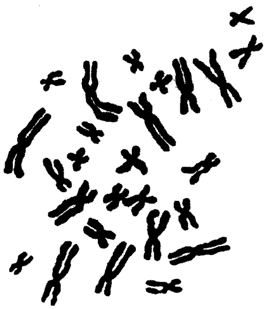

图7-1 青蛙骨髓细胞染色体核型（ $2n = 26$ ）

（11）镜检:在低倍镜下找到中期分裂相的细胞，转用高倍镜，选择染色体分散适度、长度适中的分裂相进行观察，图7-1是青蛙骨髓细胞染色体的核型。

#### 【注意事项】

（1）掌握好秋水仙素的浓度和处理时间，浓度过高，处理时间过长，都会使染色体过分收缩，不利于形态观察。

（2）控制好离心的转速，一般以 1000r/min 为宜，转速过大，会造成细胞结块，不利于染色体伸展；转速过小，细胞不能充分沉淀，会造成细胞分裂相丢失。

（3）低渗处理是实验成败的关键，其目的是使细胞体积胀大，染色体松散。低渗处理时

间过长，会造成细胞破裂，染色体丢失，不能准确计数。低渗处理时间不足，则细胞内染色体聚集一起，不能很好伸展开来，观察时无法区别和计数。

（4）固定液要现配现用，固定要充分。

（5）载玻片要洁净，无油脂和预先冰冻，滴片要有一定的高度，以利于细胞和染色体充分分散。

#### 【作业】

(1) 通过这次实验，你认为实验中要注意哪些问题？

（2）分析你做的标本的优劣，绘出骨髓细胞分裂中期染色体核型图，指出染色体数目 $2n$ 等于多少？

(何炎明)

<!-- END LAB LAB-E032 -->

### 实验33 人体外周血淋巴细胞培养与染色体标本制备
> 补充目的：在已有原理和机制材料上补齐教材实验的目的、试剂、器材、步骤、判读、注意事项及思考题（按该实验原文所含栏目）。
> 来源：细胞生物学实验教程（第2版） / 07_染色体技术与核型分析；[原解析正文](../../来源/实验教程/07_染色体技术与核型分析/正文.md) · [完整分页](../../来源/实验教程/07_染色体技术与核型分析/完整分页.md) · [原页PDF](https://github.com/kazewwk/test/blob/105df226e50395012449b4bad83f589769277174/%E7%BB%86%E8%83%9E%E7%94%9F%E7%89%A9%E5%AD%A6%E5%AE%9E%E9%AA%8C%E6%95%99%E7%A8%8B_%E7%AC%AC2%E7%89%88/07_%E6%9F%93%E8%89%B2%E4%BD%93%E6%8A%80%E6%9C%AF%E4%B8%8E%E6%A0%B8%E5%9E%8B%E5%88%86%E6%9E%90/%E5%8E%9F%E5%A7%8B%E9%A1%B5%E9%9D%A2.pdf)；编号 `LAB-E033`。

<!-- BEGIN LAB LAB-E033 -->
#### 实验 33 人体外周血淋巴细胞培养与染色体标本制备【实验目的】

掌握人体外周血淋巴细胞培养方法及染色体标本制备的方法。

#### 【实验原理】

外周血培养的方法，大多是以 1960 年 Moorhead 等建立的人外周血淋巴细胞培养技术为基础，其优点是方法比较完善，缺点是取血量多，且操作起来较麻烦。而目前国内外采用的微量全血培养技术，不但采血量少，而且省去一些离心、分离血浆等操作。

既方便，又节省人力物力，便于推广应用。

人体的 1ml 外周血中含有 $1 \times 10^{6} \sim 3 \times 10^{6}$ 个小淋巴细胞，它们几乎都处于 $G_{0}$ 期或 $G_{1}$ 期，一般情况下是不分裂的。用人工离体培养的方法，在培养基中加入植物血细胞凝集素（PHA）能刺激小淋巴细胞转化为淋巴母细胞而进行有丝分裂。经过短期的培养，秋水仙素处理，低渗和固定，就可获得大量的中期有丝分裂细胞。最后经空气干燥法制片，便可得到质量较好的染色体标本。该方法已经为临床医学、病毒学、药物学、遗传毒理学等广泛应用。

#### 【实验仪器、材料和试剂】

(1) 仪器、用具:超净工作台、恒温培养箱、恒温水浴箱、天平、离心机、显微镜、离心管、试管架、2ml 注射器、吸管、量筒、培养瓶、烧杯、试剂瓶、酒精灯、载玻片、切片盒。

(2) 材料:人外周血。

(3) 试剂

1）RPMI 1640 培养基。

2）肝素:作为抗凝剂使用。称取该粉末 160mg（每毫克含 126U），用 40ml 生理盐水溶解，即 500U/ml，8 磅 15min 灭菌。

3）秋水仙素:称取秋水仙素 2mg，用 50ml 生理盐水溶解，6 号细菌漏斗过滤，4℃冰箱保存。使用时终浓度 0.4～0.8μg/ml。

4）PHA:每毫升培养液中加入100～200μg PHA粉剂，1000ml培养液中加入100～200mg。

#### 5）双抗。

青霉素:取 4ml 生理盐水稀释 40 万 U，吸 1ml 到 1000ml 培养基中，终浓度为 100U/ml。

链霉素:取 10ml 生理盐水稀释 100 万 U，吸 1ml 到 1000ml 培养基中，终浓度为 100U/ml。

6）小牛血清。

7) Carnoy 固定液（甲醇:冰醋酸=3:1）。

8) $1 / 15\mathrm{mol} / \mathrm{L}$ 磷酸缓冲液（pH7.4）。

9）Giemsa原液。

#### 【方法与步骤】

(1) 培养基的制备

RPMI 1640 1 包 (10.5g)
小牛血清（灭活） 200ml
肝素 (500U/ml) 6ml
PHA 100mg
双抗（青霉素加链霉素） 培养液中最终浓度为 100U/ml

RPMI 1640 粉末先用约 800ml 三蒸水溶解，再加入其他成分混匀，定容到 1000ml，用 5%NaHCO₃ 调 pH 至 7.2，然后用过滤方式灭菌，最后分装至预先高压消毒的培养瓶中，每小瓶装 5ml，塞紧瓶塞，胶布封口备用。如不立即使用可置 0℃ 保藏，用前 37℃ 恒温水浴锅中温育 10min。

（2）采血:用 2ml 灭菌注射器吸取肝素湿润管壁，然后用碘酒和乙醇消毒皮肤，从肘静脉采血 1\~2ml，在酒精灯火焰旁，自橡皮塞向培养瓶内（内含有生长培养基 5ml）接种全血 0.3ml 左右，轻轻摇匀。

（3）培养:置  $37^{\circ}$ C 培养箱中培养 66～72h，终止培养前 3～4h，用注射器向培养物中加入秋水仙素，最终浓度  $0.4 \sim 0.8 \mu g/ml$ 。

（4）收集细胞:将培养 72h 并经秋水仙素处理的培养瓶从温箱中取出，用吸管将贴在瓶壁上的细胞冲散均匀，并移到刻度离心管中。

(5) 1000r/min 离心 8min，用吸管吸弃上清液。

(6) 低渗: 向离心管中加入 $6 \mathrm{ml}$ 蒸馏水或 $0.075 \mathrm{~mol} / \mathrm{L} \mathrm{KCl}$, 用吸管吹打均匀, 置于 $37^{\circ} \mathrm{C}$ 温箱内低渗 $20 \mathrm{~min}$, 使红细胞破裂, 白细胞膨胀。

（7）低渗后沿管壁慢慢加入 1ml 新配的固定液，吹打均匀，立即以 1000r/min 离心 8min，吸弃上清液。

（8）固定:沿管壁慢慢加入 6ml 固定液，用吸管吹打均匀，固定 20min。以 1000r/min 离心 8min，弃上清液。

（9）重复步骤（8）的工作一次。

（10）制片:加入固定液 0.5ml，吹打成细胞悬液，用滴管吸取细胞悬液，滴在预先经  $4^{\circ}$ C 冰冻的干净玻片上。每片滴 1 或 2 滴，用嘴轻轻吹散，在酒精灯火焰上微微烤干。

（11）染色:用 Giemsa 原液和磷酸缓冲液（pH6.8）按 1:10 配成染色液，将所制成的玻片染色 20min。微自来水冲洗，晾干。

（12）镜检:在显微镜下寻找染色体分散适宜，不重叠，长度适中，形态清晰的分裂相，然后在油镜下仔细观察染色体的形态和数目。选择有代表性的分裂相进行显微摄影以供做核型等进一步的分析。

人体外周血培养与染色体标本制作步骤（图 7-2）。

#### 【注意事项】

(1) PHA 的质量是人体淋巴细胞培养成败的关键。效价低或用量不足，则培养效果差，但浓度过大，红细胞凝固，会影响细胞生长。

(2) 采血接种时注意不要加入太多的肝素, 因为肝素过多可能引致溶血和抑制淋巴细胞转化和分裂。

(3) 接种的血样愈新鲜愈好，避免保存时间过久影响细胞的活力。

（4）秋水仙素处理的浓度和时间、离心的转速、低渗处理是影响染色体标本制备质量的关键因素。

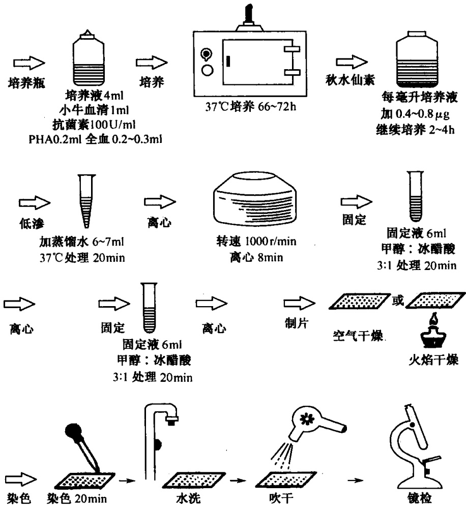

图7-2 人体外周血培养与染色体标本制作示意图

#### 【思考题】

(1) 培养基中添加 PHA 和小牛血清的作用是什么?

(2) 在制片中如低渗不足或低渗过度会出现什么问题?

（3）哪些因素会影响制片中染色体的分散？

(何炎明)

<!-- END LAB LAB-E033 -->

### 实验34 人类染色体 G 带技术
> 补充目的：在已有原理和机制材料上补齐教材实验的目的、试剂、器材、步骤、判读、注意事项及思考题（按该实验原文所含栏目）。
> 来源：细胞生物学实验教程（第2版） / 07_染色体技术与核型分析；[原解析正文](../../来源/实验教程/07_染色体技术与核型分析/正文.md) · [完整分页](../../来源/实验教程/07_染色体技术与核型分析/完整分页.md) · [原页PDF](https://github.com/kazewwk/test/blob/105df226e50395012449b4bad83f589769277174/%E7%BB%86%E8%83%9E%E7%94%9F%E7%89%A9%E5%AD%A6%E5%AE%9E%E9%AA%8C%E6%95%99%E7%A8%8B_%E7%AC%AC2%E7%89%88/07_%E6%9F%93%E8%89%B2%E4%BD%93%E6%8A%80%E6%9C%AF%E4%B8%8E%E6%A0%B8%E5%9E%8B%E5%88%86%E6%9E%90/%E5%8E%9F%E5%A7%8B%E9%A1%B5%E9%9D%A2.pdf)；编号 `LAB-E034`。

<!-- BEGIN LAB LAB-E034 -->
#### 实验 34 人类染色体 G 带技术

#### 【实验目的】

学习染色体G带显带技术，掌握胰蛋白酶法。

#### 【实验原理】

染色体由 DNA、组蛋白、非组蛋白组成。DNA 链上有 A—T 丰富区及 G—C 丰富区，用 Giemsa 染色，A—T 较 G—C 更易染。G 带染色技术也称为改良的 Giemsa 染色法。因用 Giemsa 染色，所以称为 G 带。它是目前应用最广泛的染色体分带技术之一。

染色体标本放到  $37^{\circ}$ C 胰酶中是 G 带显示的一种预处理方式，它可以从染色体上抽取蛋白质特定的成分，从而经 Giemsa 染色后获得良好一致的分带类型。G 带的形成与 Giemsa 染料的组成及染色特性分不开。Giemsa 染料即噻嗪-曙红染料，染色首先取决于两个噻嗪分子同 DNA 的结合，在此基础上它们结合一个曙红分子，其次取决于一个有助于染料沉淀物积累的疏水环境。通过胰酶预处理可以使阴性 G 带区的疏水蛋白被除去或使它们的构型变为更疏水状态。从而造成了染色体蛋白质的差异，这种差异就是明暗相间的染色体 G 带。

染色体 G 带技术为染色体遗传病诊断、杂种细胞检定、特殊细胞株标记、染色体的识别等开创了一系列检测方法，大大加速了染色体研究的进展。

#### 【实验仪器、材料和试剂】

（1）仪器、用具:恒温箱、恒温水浴锅、显微镜、染色缸、镊子、烧杯、擦镜纸、吸水纸。

(2) 材料:人外周血淋巴细胞染色体玻片。

(3) 试剂

1）pH6.8 PBS液:

溶液 A:0.1mol/L  $Na_{2}HPO_{4}$ ；溶液 B:0.1mol/L  $NaH_{2}PO_{4}$ 。

取 46.3ml 溶液 A+53.7ml 溶液 B，混合即为 pH6.8 PBS（见附录 2）。

2) pH7.0 ICN液:NaCl 0.80g、KCl 0.02g、 $Na_{2}HPO_{4}\cdot12H_{2}O$  0.30g、 $KH_{2}PO_{4}$  0.02g，加蒸馏水至100ml。

3）pH7.0 GKN 液:葡萄糖 0.1g、KCl 0.04g、NaCl 0.80g、 $NaHCO_{3}$  0.035g、蒸馏水·100ml。

4）0.25% Trypsin 溶液:称取 250mg 胰蛋白酶溶于 100ml ICN 液中。

5）Giemsa原液（配法见实验31）。

#### 【方法与步骤】

(1) 将空气干燥 1\~2 周的染色体制片置于 $60^{\circ} \mathrm{C}$ 烘箱中, 2h 后降至室温。

(2) 置于预热 $37^{\circ} \mathrm{C}$ 的 $0.25 \%$ 胰蛋白酶溶液中 $0.5 \sim 1.5 \mathrm{~min}$ 。

(3) 立即放入 GKN 溶液中漂洗 15s。

(4) pH6.8 磷酸缓冲液与 Giemsa 原液按 20:1 混合，染色 10\~20min。

(5) 轻微自来水冲洗后，空气干燥，镜检和显微拍照。

在高倍镜下观察显带标本，若染色体上出现清晰深浅相间的带型，可供摄影再作详细分析。若染色体变粗并且边缘毛糙，则是预处理过度了。

【注意事项】

(1) 染色体的长度应能适应分带技术的要求，秋水仙素浓度的控制是重要环节。

(2) 标本经胰蛋白酶预处理的时间与胰蛋白酶的质量、浓度、pH、温度之间有密切的关系。

(3) Giemsa 染色液须现用现配，以防沉淀影响染色效果。

#### 【作业】

（1）分析实验结果，指出实验的关键问题。

(2) 绘出染色体分带的核型图。

(何炎明)

<!-- END LAB LAB-E034 -->

### 实验35 植物染色体分带技术
> 补充目的：在已有原理和机制材料上补齐教材实验的目的、试剂、器材、步骤、判读、注意事项及思考题（按该实验原文所含栏目）。
> 来源：细胞生物学实验教程（第2版） / 07_染色体技术与核型分析；[原解析正文](../../来源/实验教程/07_染色体技术与核型分析/正文.md) · [完整分页](../../来源/实验教程/07_染色体技术与核型分析/完整分页.md) · [原页PDF](https://github.com/kazewwk/test/blob/105df226e50395012449b4bad83f589769277174/%E7%BB%86%E8%83%9E%E7%94%9F%E7%89%A9%E5%AD%A6%E5%AE%9E%E9%AA%8C%E6%95%99%E7%A8%8B_%E7%AC%AC2%E7%89%88/07_%E6%9F%93%E8%89%B2%E4%BD%93%E6%8A%80%E6%9C%AF%E4%B8%8E%E6%A0%B8%E5%9E%8B%E5%88%86%E6%9E%90/%E5%8E%9F%E5%A7%8B%E9%A1%B5%E9%9D%A2.pdf)；编号 `LAB-E035`。

<!-- BEGIN LAB LAB-E035 -->
#### 实验 35 植物染色体分带技术

#### 【实验目的】

掌握植物染色体分带的原理与方法，了解这一技术的重要意义。

#### 【实验原理】

植物染色体分带是借助特殊的处理程序，使染色体的一定部位显示出深浅不同的染色带纹。这些带纹具有物种及不同染色体的特异性，每条染色体上带的数目、部位、宽窄与浓淡具有相对的稳定性，从而在以往的染色体形态特征之外又增添了一类新标记，可以更有效地鉴别染色体与染色体的结构和功能。事实证明，几乎所有的植物染色体都能显带，植物染色体显带的原理和动物染色体显带原理相似，是由于特殊的染料和染色体上的结构成分发生特异反应而产生的。由于所用染料与处理条件不同可产生不同的带型，因此有C带、N带、G带等不同的显带技术。C带又称为结构异染色体带，主要显示着丝粒、端粒、核仁组织区或染色体臂上的结构异染色质；N带能使染色体核仁组织区特异着色；而G带技术能显示出植物染色体上的中间带，从而为种间鉴定、染色体或染色体亚单位的识别，以及基因定位的研究展示了新的前景。

#### 【实验仪器、材料和试剂】

（1）仪器、用具:显微镜及显微照相装置、天平、温箱、恒温水浴箱、量筒、烧杯、染色缸、冰冻载玻片、玻璃板、切片盒。

(2) 材料:玉米、黑麦、大麦、蚕豆、洋葱的染色体制片。

(3) 试剂

1）Giemsa原液（配法见实验31）。

2）饱和 $\mathrm{Ba(OH)_2}$ 溶液。

3） $2 \times$ SSC盐溶液（$20 \times$ SSC贮液的配方见附录2）。

4）1mol/L  $NaH_{2}PO_{4}$  溶液。

5）1/15mol/L 磷酸缓冲液（配法见实验 32）。

6）0.01%胰蛋白酶（用生理盐水配制）。

7）8mol/L尿素溶液。

#### 【方法与步骤】

#### （一）植物染色体 Giemsa C 带技术

#### 1. 染色体标本制备

按照去壁低渗法制备染色体标本，制好的标本需要空气干燥3\~7天。

#### 2. 显带处理

(1) 饱和  $\mathrm{Ba(OH)_2}$  溶液处理 5～10min (20～25℃)。

(2) 蒸馏水彻底冲洗，以清除 $\mathrm{Ba(OH)_2}$。

(3)  $2 \times$  SSC 盐溶液  $60 \sim 65^{\circ}C$  保温 2h。

（4）蒸馏水冲洗 $5\mathrm{min}$，空气干燥。

(5) pH6.8 磷酸缓冲液与 Giemsa 原液按 20:1 混合，染色 30min，自来水冲洗，空气干燥。

（6）镜检，拍照，带型分析。

#### （二）植物染色体 Giemsa N 带技术

#### 1. 染色体标本制备

按照去壁低渗法制备染色体标本，制好的标本需要空气干燥3\~7天。

#### 2. 显带处理

(1) 将贮存一周以内的染色体标本, 用 $1 \mathrm{~mol} / \mathrm{L} \mathrm{NaH}_{2} \mathrm{PO}_{4}$ 溶液 $(94 \pm 1)^{\circ} \mathrm{C}$ 处理 $6 \sim 15 \mathrm{~min}$ 。准确的处理时间需自己摸索。

(2) $50^{\circ}\mathrm{C}$ 左右蒸馏水冲洗3次。

(3) 空气干燥。

(4) pH6.8 Giemsa (20:1) 染色 30\~60min，染色时间随处理时间不同而异， $NaH_{2}PO_{4}$  处理时间稍长，染色时间就要延长。

(5) 自来水冲洗，空气干燥。

(6) 镜检，拍照，带型分析。

#### （三）植物染色体Giemsa G带技术

#### 1. 染色体标本制备

按照去壁低渗法制备染色体标本，预处理时可用饱和  $\alpha$ -溴化萘或用 0.02% 秋水仙素处理 1.5～2h，然后在 70～80℃ 烘箱中烤 2h。

#### 2. 显带处理

（1）胰蛋白酶法:贮存1～3天的染色体标本，用0.85%生理盐水浸数秒，然后用0.01%胰蛋白酶（生理盐水配制）处理10～30s，0.85%生理盐水冲洗2次，30:1Giemsa染色5～8min，自来水冲洗，空气干燥，镜检。

(2) 尿素法:贮存 1～3 天的染色体标本，用 8mol/L 尿素（2 份 8mol/L 尿素 +

1 份pH6.8 磷酸缓冲液混合）处理 40s～5min（视材料和标本而定），30:1 Giemsa 染色 5～8min，自来水冲洗，空气干燥，镜检。

（3）胰酶-尿素法:贮存1～3天的染色体标本，用0.85%生理盐水浸数秒，然后用0.01%胰蛋白酶处理5～40s，0.85%生理盐水冲洗2次，然后用8mol/L尿素处理5～15s，生理盐水冲洗2次，30:1 Giemsa染色5～8min，自来水冲洗，空气干燥，镜检。

(何炎明)

<!-- END LAB LAB-E035 -->

### 实验36 人类体细胞染色体组型分析
> 补充目的：在已有原理和机制材料上补齐教材实验的目的、试剂、器材、步骤、判读、注意事项及思考题（按该实验原文所含栏目）。
> 来源：细胞生物学实验教程（第2版） / 07_染色体技术与核型分析；[原解析正文](../../来源/实验教程/07_染色体技术与核型分析/正文.md) · [完整分页](../../来源/实验教程/07_染色体技术与核型分析/完整分页.md) · [原页PDF](https://github.com/kazewwk/test/blob/105df226e50395012449b4bad83f589769277174/%E7%BB%86%E8%83%9E%E7%94%9F%E7%89%A9%E5%AD%A6%E5%AE%9E%E9%AA%8C%E6%95%99%E7%A8%8B_%E7%AC%AC2%E7%89%88/07_%E6%9F%93%E8%89%B2%E4%BD%93%E6%8A%80%E6%9C%AF%E4%B8%8E%E6%A0%B8%E5%9E%8B%E5%88%86%E6%9E%90/%E5%8E%9F%E5%A7%8B%E9%A1%B5%E9%9D%A2.pdf)；编号 `LAB-E036`。

<!-- BEGIN LAB LAB-E036 -->
#### 实验 36 人类体细胞染色体组型分析

#### 【实验目的】

掌握人类体细胞染色体组型分析的方法。

#### 【实验原理】

核型（karyotype）是指一个细胞内的整套染色体按照一定的顺序排列起来所构成的图像，通常是将显微摄影得到的染色体照片剪贴而成。正常细胞的核型能代表个体的核型。组型（idiogram）是以模式图的方式表示，它是通过对许多细胞染色体的测量取其平均值绘制而成的，是理想的、模式化的染色体组成。它代表了一物种染色体组型的特征。核型的研究对人类医学遗传研究及临床应用，对探讨动植物起源、物种间亲缘关系、鉴定远缘杂种等方面都有重大意义。

染色体的特征以有丝分裂中期最为显著，所以一般都分析中期分裂相。根据染色体着丝粒位置的不同，可将染色体分为中部着丝粒染色体（m）、亚中部着丝粒染色体（sm）、亚端部着丝粒染色体（st）、端部着丝粒染色体（t）。对任何一个染色体的基本形态学特征来说，重要的参数有三个。

(1) 相对长度 (relative length): 指单个染色体长度与包括 X (或 Y) 染色体在内的单倍染色体总长之比, 以百分率表示。

$$
\text{相对长度} = \frac {\text {每个染色体的长度}}{\text {单倍染色体} + \mathrm{X染色体总长度}} \times 100 \%
$$

(2) 臂指数（armindex）:指长臂同短臂的比率，即

$$
\text {臂指数} = \frac {\text {长臂长度}}{\text {短臂长度}}
$$

按Levan（1964）的划分标准:臂指数为 $1.0\sim 1.7$ 称为中部着丝粒染色体（m）；臂指数为 $1.7\sim 3.0$ 称为亚中部着丝粒染色体（sm）；臂指数为 $3.0\sim 7.0$ 称为亚端部着丝粒染色体（st）；臂指数 $>7.0$ 者为端部着丝粒染色体（t）。

(3) 着丝粒指数（centromere index），指短臂占该染色体长度的比率，它决定着丝

粒的相对位置。

$$
\text {着丝粒指数} = \frac {\text {短臂长度}}{\text {该染色体总长}} \times 1 0 0
$$

按Levan（1964）的标准划分:着丝粒指数为 $50.0\sim 37.5$ 称为中部着丝粒染色体(m)；指数为 $37.5\sim 25.0$ 称为亚中部着丝粒染色体（sm)；指数为 $25.0\sim 12.5$ 称为亚端部着丝粒染色体（st)；指数为 $12.5\sim 0.0$ 称为端部着丝粒染色体（t）。

人类体细胞的正常核型含有46条染色体，相互构成23对。其中22对是男女所共有的常染色体，一对为男女所不同的性染色体:男XY，女XX。根据丹佛(1960)、伦敦（1963）和芝加哥（1966）会议提出的标准，即按照染色体的长度依次减小和着丝粒位置及其他特征，把人类体细胞染色体分为7个组群，各自特征简括于表7-1。

表 7-1 人类染色体组型

| 群组号 | 染色体号 | 形态大小 | 着丝粒位置 | 随体 | 次缢痕 | 鉴别程度 |
| --- | --- | --- | --- | --- | --- | --- |
| A | 1~3 | 最大 | m | 无 | 常见1号 | 可鉴定 |
| B | 4~5 | 次大 | sm | 无 |  | 不易 |
| C | 6~12+X | 中等 | sm | 无 | 常见9号 | 难鉴定 |
| D | 13~15 | 中等 | st | 有 | 偶见13号 | 难鉴定 |
| E | 16~18 | 较小 | 16m, 17sm和18sm | 无 | 常见16号 | 可鉴定 |
| F | 19~20 | 小 | m | 无 |  | 不易 |
| G | 21~22+Y | 最小 | st | 有、Y无 |  | 难鉴定 |

【实验仪器、材料】

(1) 仪器、用具:摄影显微镜、胶卷、冲印放大器材、剪刀、镊子、毫米尺、胶水。

(2) 材料:人类体细胞染色体标本。

#### 【方法与步骤】

（1）在显微镜下找出染色体分散良好、长度适中、姐妹染色单体清楚的中期分裂相进行显微拍摄。

(2) 将显微拍摄放大的照片上的一个细胞的全部染色体，一条一条分别剪下。

（3）根据染色体的长短和形态特征进行同源染色体的目测配对。

（4）测量出每条染色体短臂和长臂长度，计算出各条染色体的相对长度、着丝粒指数、臂指数，并记录原始数据。

(5) 根据测量数据校正目测配对排列的结果，进行调整排列。

（6）把染色体按一定顺序一对一对地排列，排列时注意短臂向上，长臂向下，性染色体单独排列，最后把染色体贴成一完整的染色体组型图（图7-3、图7-4）。

(7) 翻拍。

图7-3 正常男性染色体核型（高文和，2001）

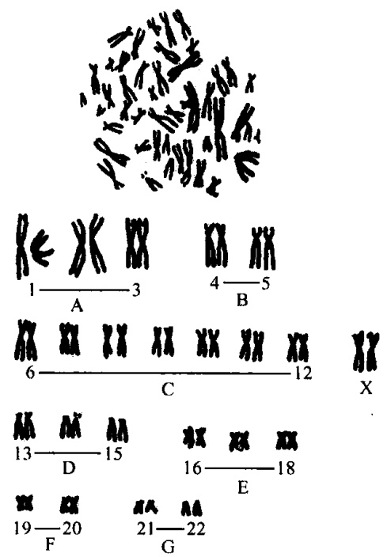

图7-4 正常女性染色体核型（高文和，2001）

#### 【作业】

剪贴男性、女性核型各一套。

(何炎明)

<!-- END LAB LAB-E036 -->

### 实验51 中期染色体的分离纯化
> 补充目的：在已有原理和机制材料上补齐教材实验的目的、试剂、器材、步骤、判读、注意事项及思考题（按该实验原文所含栏目）。
> 来源：细胞生物学实验教程（第2版） / 09_细胞化学成分的分离；[原解析正文](../../来源/实验教程/09_细胞化学成分的分离/正文.md) · [完整分页](../../来源/实验教程/09_细胞化学成分的分离/完整分页.md) · [原页PDF](https://github.com/kazewwk/test/blob/105df226e50395012449b4bad83f589769277174/%E7%BB%86%E8%83%9E%E7%94%9F%E7%89%A9%E5%AD%A6%E5%AE%9E%E9%AA%8C%E6%95%99%E7%A8%8B_%E7%AC%AC2%E7%89%88/09_%E7%BB%86%E8%83%9E%E5%8C%96%E5%AD%A6%E6%88%90%E5%88%86%E7%9A%84%E5%88%86%E7%A6%BB/%E5%8E%9F%E5%A7%8B%E9%A1%B5%E9%9D%A2.pdf)；编号 `LAB-E051`。

<!-- BEGIN LAB LAB-E051 -->
#### 实验 51 中期染色体的分离纯化

#### 【实验目的】

用己二醇法或水相法分离培养细胞的中期染色体，同时用梯度法纯化制备的染色体

粗样品，以适用于生化检测及形态分析。

#### 【实验原理】

染色体的分离纯化对于研究染色质的结构以及生物性状具有重要的作用。

分离有丝分裂染色体时的一个主要问题，是稳定染色体结构的同时，降低其他细胞结构的稳定性，从而制备染色体。所用的缓冲条件应温和以避免改变染色体的生化性质和形态。常用的方案包括聚胺法、水相法、己二醇法等。

本实验介绍的己二醇法中，染色体主要靠己二醇来维持其稳定性，而无需处于高浓度条件下的二价阳离子（$\mathrm{Ca^{2+}}$）。这种条件下，染色体能保持致密且形态稳定。在 $4^{\circ}\mathrm{C}$ 缓冲液中能保存几周。

而水相法则采用近似生理条件的提取介质，以减少对染色体结构的破坏。

通常用各种方法制备得到的粗制染色体样品，由于混有杂质，并不适用于直接进行一些生物学检测，而是必须将样品进行纯化。最主要的污染物一般是肌动蛋白和中间纤维成分的非染色体蛋白，以及细胞核和发生聚集的染色体。将染色体粗品悬液通过蔗糖梯度进行沉降能去除大部分污染。

#### 方法一 己二醇法分离中期染色体

#### 【实验仪器、材料和试剂】

（1）仪器、用具:冷冻离心机、离心管、移液器及枪头、玻璃匀浆器、相差显微镜。

(2) 材料:HeLa 细胞。

(3) 试剂

1）己二醇缓冲液:1mol/L 己二醇（2-甲基-2,4-戊二醇），0.5mmol/L CaCl₂，0.1mmol/L PIPES [哌嗪-N,N'-双（2-乙磺酸）] (pH6.5)。

2）蔗糖。

3）秋水仙素。

#### 【方法与步骤】

（1）有丝分裂过程中，细胞的同步化处理。在适宜的条件下培养细胞，收集处于有丝分裂前期 $10\sim 16\mathrm{h}$ 的细胞，在培养基中加入 $0.06\mu \mathrm{g / ml}$ 的秋水仙素（有丝分裂指数应大于 $50\%$ ，最好为 $80\% \sim 90\%$ ，细胞应处于对数生长期，细胞密度不大于 $75\%$ 的汇合）。

(2)  $4^{\circ}C$ , 1000g 离心 10min, 用 10ml 培养基重悬, 重悬细胞在  $4^{\circ}C$  放置 20min (低温以促进有丝分裂复合物包括微管的完全解离),  $4^{\circ}C$ , 1000g 离心 4min, 收集细胞。

(3) 用预冷的己二醇缓冲液清洗细胞，按第（2）步离心。

(4) 10ml 预冷的己二醇缓冲液重悬细胞，37℃温浴 10min。

（5）细胞悬液在玻璃匀浆器中匀浆10次，匀浆液于 $4^{\circ}\mathrm{C}$，3000g离心15min进行浓缩，重新悬浮后，即得到染色体粗样品。

（6）蔗糖梯度的制备:在己二醇缓冲液中加入蔗糖，分别制成 $20\%$ 、 $40\%$ 、 $50\%$ 、 $60\%$ 几种蔗糖浓度，小心地加入 $50\mathrm{ml}$ 离心管中，制成不连续梯度，梯度的总体积应不超过离心管容积的 $2/3$ 。

(7) 将得到的染色体粗样品轻轻加到梯度上, $2500 \mathrm{~g}$ 离心 $15 \mathrm{~min}$ 。

通常可溶性细胞成分以及细胞骨架留在顶层，细胞核及聚集的染色体会沉到底部，而纯化的染色体迁移到梯度中间（大约 $50\%$ 的蔗糖浓度梯度处），形成一条弥散的白色条带（取少量样品，可用相差显微镜检测染色体的情况）。

(8) 收集染色体区带，3000g 离心进行浓缩。

(9) 用微量的己二醇缓冲液重悬。

#### 方法二 水相法分离中期染色体

#### 【实验仪器、材料和试剂】

（1）仪器、用具:冷冻离心机、离心管、移液器及枪头、玻璃匀浆器、相差显微镜。

(2) 材料:HeLa 细胞。

(3) 试剂

1）水相裂解缓冲液:10mmol/L Tris-HCl（pH7.4），120mmol/L KCl，20mmol/L NaCl，0.1% Triton X-100，0.1mmol/L PMSF（苯甲基磺酰氟，含2mmol/L CaCl₂）。

2) 75mmol/L KCl。

3）蔗糖。

4）秋水仙素。

#### 【方法与步骤】

（1）细胞的同步化处理，同“己二醇法分离中期染色体”步骤（1）。

(2) 细胞的收集及预冷处理，同“己二醇法分离中期染色体”步骤（2）。

(3) 低渗溶胀: 细胞沉淀悬浮于 $75 \mathrm{mmol} / \mathrm{L} \mathrm{KCl}$ 溶液中, $4^{\circ} \mathrm{C}$ 孵育 $20 \mathrm{~min}$ 进行低渗处理。

注:某些细胞系要求 $40\sim 60\mathrm{mmol / L}$ KCl的低渗条件。

(4) $4^{\circ}\mathrm{C}$, 1000g 离心收集溶胀细胞。

(5) 细胞悬浮于水相裂解缓冲液中，温和搅匀，冰浴 5min。

(6) 细胞悬液温和地用注射器抽吸 10 次，或用玻璃匀浆器匀浆。

(7) $4^{\circ} \mathrm{C}$, $400 \mathrm{~g}$ 离心去除细胞核, 收集上清。

(8) 上清以  $4^{\circ}$ C，3000g 离心收集染色体。

(9) 染色体可进一步纯化或进行检测。

#### 【注意事项】

（1）细胞同步化处理前，如果是悬浮培养，则细胞密度应低于 $2 \times 10^{5} / \mathrm{ml}$ 。如单层培养，则处理时细胞应处于对数生长期，细胞密度应不大于 $75\%$ 的汇合。

（2）大多数细胞系也可选用其他药物，如  $10 \mu g/ml$  硫酸长春碱，或  $0.2 \mu g/ml$  秋水仙素阻遏有丝分裂进程。

（3）水相法分离染色体时最大污染源是核糖体，在含有二价阳离子的缓冲体系中易于与染色体聚集黏附在一起。

(4) 己二醇法的优点在于细胞数要求较少，且步骤简单。

#### 【作业】

分离纯化中期染色体。

(刘兵)

<!-- END LAB LAB-E051 -->

## 对应的跨章补充入口

- [合成基因组、Synthia 与单染色体酵母 SY14](../../01_绪论/小节/02_第二节%20细胞的同一性与多样性.md#WJ01-S1_7)（`WJ01-S1_7`；全文归属见链接）
- [实验15 DNA 的细胞化学——Feulgen 反应](02_第二节%20染色质.md#LAB-E015)（`LAB-E015`；全文归属见链接）
- [实验37 染色体核仁组织区（NOR）的显示](05_第五节%20核仁与核体.md#LAB-E037)（`LAB-E037`；全文归属见链接）
- [实验38 姐妹染色单体色差分析技术](03_第三节%20染色质的复制与表达.md#LAB-E038)（`LAB-E038`；全文归属见链接）
<!-- END NEW_SOURCES -->
